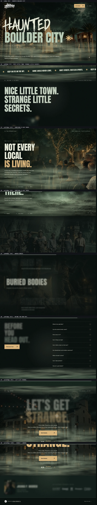
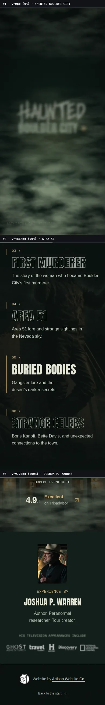

# UI Design System & Master Generation Blueprint: www-hauntedbouldercity-com

> **Boulder City Ghost & UFO Walking Tour · Haunted Boulder City** (https://www.hauntedbouldercity.com/) — Meet the stranger side of Boulder City. Discover local ghost stories, desert mysteries and UFO folklore on a one-hour walking tour with B...





---

## 1. Executive Visual Persona & Design Archetype

- **Brand Essence & Persona**: **Boulder City Ghost & UFO Walking Tour · Haunted Boulder City** (`https://www.hauntedbouldercity.com/`). Meet the stranger side of Boulder City. Discover local ghost stories, desert mysteries and UFO folklore on a one-hour walking tour with B...
- **Capture Provenance**: Live browser capture (`tier1_fast`, HTTP `200`, captured `2026-11-24`).
- **Visual Archetype**: **High-Contrast Obsidian / Atmospheric Design System (`#090f0e` canvas, `#e7e9d8` ink, `#b9cbb7` accent)**.
- **Anti-AI-Slop Differentiators**:
  - **Live-Computed Chromatic Polarity**: Anchors the viewport in `#090f0e` (live computed `body` `background-color` (`computed_styles.json`)) paired with `#e7e9d8` primary typography and `#b9cbb7` accents.
  - **Grounded Typographic Hierarchy**: Pairs `Display` for display copy (`HAUNTED BOULDER CITY`) with `SpaceMono` and `SpaceMono`.
  - **Calibrated Spatial Grid & Motion**: Combines `1100px` container bounds (`gap: 25px`, padding `66.24px`) with `cubic-bezier(.2,.75,.25,1)` easing.

---

## 2. Spatial Architecture & Modular Grid Mathematics

### Viewport Allocation & Container Geometry
- **Captured Journey Filmstrips**: Desktop `1280×6624px` (`assets/desktop-journey.webp`, `8` keyframes up to `y=11605px` / doc `12505px`), Mobile `390×2616px` (`assets/mobile-journey.webp`, `3` keyframes).
- **Master Container Bounds**: `1100px` (non-`@media` desktop container stylesheet rule).
- **Canvas Lateral Padding & Spacing**: `66.24px` lateral canvas padding with `25px` grid gap.
- **Border Radius Scale**: `50%`.

### Responsive Breakpoint Architecture
- **Desktop Layout**: Multi-column CSS Grid / Flexbox layout at `1440px` (`max-width: 1100px`, `gap: 25px`).
- **Mobile Layout**: Single-column vertical stack at `390px` viewport width with `66.24px` horizontal padding.
- **Extracted CSS Media Queries**: `@media (min-width:1800px)`, `@media (max-width:1100px)`, `@media (max-width:760px)`, `@media (prefers-reduced-motion:reduce)`.

---

## 3. Color System, Materiality & Atmospheric Lighting

### Semantic Palette & Source Grounding
| Semantic Role | Ground-Truth Value | Extracted Live / CSS Source |
|---|---|---|
| **Primary Canvas Substrate** | `#090f0e` | live computed `body` `background-color` (`computed_styles.json`) |
| **Primary Typography Ink** | `#e7e9d8` | live computed `main` `color` (`computed_styles.json`) |
| **Elevated Surface / Card Substrate** | `#192a23` | `var(--surface)` in `:root` |
| **Interactive Accent / Highlight** | `#b9cbb7` | live computed `a` `background-color` (`computed_styles.json`) |
| **Secondary / Muted Copy** | `#a7b3a7` | `var(--muted)` in `:root` |
| **Structural Hairline Border** | `#35463d` | `var(--line)` in `:root` |
| **Variable Token (`--amber`)** | `#d9b47b` | `var(--amber)` in `:root` |
| **Variable Token (`--mist`)** | `#c4d1c0` | `var(--mist)` in `:root` |

### Sanitized Root CSS Variables (`ui-ux.md` Ground Truth)
| Variable Name | Extracted Value | Semantic Role |
|---|---|---|
| `--ink` | `#090f0e` | Typography Ink Token |
| `--accent` | `#b9cbb7` | Brand / Palette Token |
| `--paper` | `#e7e9d8` | Canvas / Surface Token |
| `--muted` | `#a7b3a7` | Color / Atmospheric Token |
| `--line` | `#35463d` | Color / Atmospheric Token |
| `--amber` | `#d9b47b` | Color / Atmospheric Token |
| `--mist` | `#c4d1c0` | Color / Atmospheric Token |
| `--surface` | `#192a23` | Canvas / Surface Token |
| `--pad` | `clamp(24px,4.6vw,88px)` | Layout / Spatial Grid Token |
| `--display` | `Display,Impact,'Arial Narrow',sans-serif` | Design System Custom Token |
| `--logo-width` | `136px` | Layout / Spatial Grid Token |
| `--dir` | `1` | Design System Custom Token |
| `--spirit-duration` | `2800ms` | Motion / Easing Token |
| `--spirit-peak` | `.9` | Design System Custom Token |
| `--spirit-linger` | `14vh` | Dimension / Scale Token |
| `--spirit-side` | `0px` | Dimension / Scale Token |

---

## 4. Typographic Scale & Editorial Hierarchy

### Font Family Stacks
- **Display Typography**: `Display`.
- **Primary Body Stack**: `SpaceMono`.
- **Technical / Metadata Stack**: `SpaceMono`.

### Typographic Scale & Rules (Live Computed & Stylesheet Grounded)
- **Hero Display (`H1`)**: live computed `h1` (`font-size: 32px`, `line-height: 29.44px`, `font-weight: 400`); CSS variables `--display: Display,Impact,'Arial Narrow',sans-serif`; rule `h1` (`line-height: .92`, `font-weight: 400`).
- **Section Heading (`H2`)**: live computed `h2` (`font-size: 125.28px`, `line-height: 127.786px`, `font-weight: 400`, `letter-spacing: -1.2528px`); rule `h2` (`font-size: clamp(58px,8.7vw,162px)`, `line-height: 1.02`, `letter-spacing: -.01em`).
- **Body Copy**: live computed `body` (`font-size: 16px`, `line-height: normal`, `font-weight: 400`); rule `p` (`font-size: 18px`).
- **Metadata & Navigation Labels**: live computed `nav/a` (`font-size: 16px`, `line-height: normal`, `font-weight: 400`).

---

## 5. Choreographed Motion & Interaction Physics

### Primary Easing Curves
- **Extracted Timing Functions**: `cubic-bezier(.2,.75,.25,1)`, `cubic-bezier(.2,.7,.2,1)`, `cubic-bezier(.2,.8,.2,1)`.

### Per-Element Transition & Choreography Rules
- **Selector `.button`**: `transition: background .25s,transform .25s,color .25s` extracted from `www-hauntedbouldercity-com` stylesheet.
- **Selector `.round-arrow`**: `transition: background .3s,color .3s,transform .3s` extracted from `www-hauntedbouldercity-com` stylesheet.
- **Selector `.story-tabs button`**: `transition: color .3s,border .3s` extracted from `www-hauntedbouldercity-com` stylesheet.
- **Extracted Easing Curve (`cubic-bezier(.2,.75,.25,1)`)**: Governs interactive state transitions across `<header.site-header>` and `<section.intro>`.
- **State & Hover Choreography**: Opacity and transform transitions on `<section.hero>` and `<section.intro>` interactive targets.
### Measured Runtime Scroll & Interaction Telemetry (`behavioral_journey_v2`)
- **Scroll Driver Mode**: `native` (max document height `12505px`, deepest scrollY reached `11605px` across `8` desktop keyframes).
- **Detected Scroll / Motion Libraries**: Native browser scroll / standard CSS transitions.
- **Nav / Drawer Probe (`MENU`)**: Triggered visual change (pixel diff `35.277`, captured in `assets/state-nav.webp`); revealed links: 01 THE TOUR ONE HOUR..., 02 THE STRANGE STUFF..., 03 BEER ZOMBIES WHERE..., 04 PLAN YOUR VISIT AR..., DIRECTIONS.
- **Hover Physics (`primary_cta` · `EXPERIENCE BY JOSHUA P. WARREN`)**: Computed transition `0s` / `ease` (no static color/transform shift captured at rest).
- **Interactive Control Probe (`accordion` · `What’s the walk like?`)**: Triggered visual diff `5.132` (attr ` -> `, captured in `assets/state-interactive.webp`).

---

## 6. Component Wireframe & Structural DOM Map

### Visual Layout Schematic — Desktop (`1440px`, Grounded in `dom.html` & Landmark Bounding Boxes)
```
┌────────────────────────────────────────────────────────────────────────┐
│ DESKTOP VIEWPORT (1440px) — Boulder City Ghost & UFO Walking Tour · Ha │
│ ====================================================================== │
│ [ <header.site-header> (1425x110px)   | Get tickets · Directions     ] │
│ ---------------------------------------------------------------------- │
│ | HERO STAGE: <section.hero> (w=1425px)                              | │
│ | H1: HAUNTED BOULDER CITY                                           | │
│ | Substrate: #090f0e | Ink: #e7e9d8 | Accent: #b9cbb7                | │
│ ---------------------------------------------------------------------- │
│ | SHOWCASE GRID (<section.intro>) max-w: 1100px                      | │
│ | +------------------------------+  +------------------------------+ | │
│ | | NICE LITTLE TOWN. STRANGE LI |  | NOT EVERY LOCAL IS LIVING.   | | │
│ | +------------------------------+  +------------------------------+ | │
│ ---------------------------------------------------------------------- │
│ | DETAIL MODULE (<section.stories-scroll>) — THE PAST DOESN’T STAY   | │
│ ---------------------------------------------------------------------- │
│ [ FOOTER (<footer.skip-link>  ) | https://www.hauntedbouldercity.com/  │
└────────────────────────────────────────────────────────────────────────┘
```

### Visual Layout Schematic — Mobile Reflow (`390px`)
```
┌────────────────────────────────────────────────────────────────────────┐
│ MOBILE VIEWPORT REFLOW (390px) — Single-Column Stack (gap: 25px)       │
│ ====================================================================== │
│ [ HEADER BAR (<header.site-header>    ) | Compact Menu (390px)         │
│ ---------------------------------------------------------------------- │
│ | HERO STAGE (<section.hero>) — 390px Vertical Lead                  | │
│ | H1: HAUNTED BOULDER CITY                                           | │
│ ---------------------------------------------------------------------- │
│ | SHOWCASE STACK (<section.intro>) — 1-Col Stack                     | │
│ | [ Item 1: NICE LITTLE TOWN. STRANGE LITTLE SECRETS.              ] | │
│ | [ Item 2: NOT EVERY LOCAL IS LIVING.                             ] | │
│ ---------------------------------------------------------------------- │
│ | DETAIL STACK (<section.stories-scroll>) — 1-Col (THE PAST DOESN’T S) │
│ ---------------------------------------------------------------------- │
│ [ FOOTER (<footer.skip-link>  ) | Stacked 390px Colophon               │
└────────────────────────────────────────────────────────────────────────┘
```

### Granular DOM Region Breakdown
1. **Brand Header & Navigation Bar (<header.site-header> — `www-hauntedbouldercity-com`)**:
   - Landmark `<header class="site-header">` (`1425x110px`) hosting `Boulder City Ghost & UFO Walking Tou` navigation (`Get tickets · Directions`), DOM attributes (`data-src="/assets/ufo-night.mp4"`, `data-src-small="/assets/ufo-night-960..."`, `data-story="0"`, `data-story="1"`), and stylesheet rule `html { scroll-behavior:smooth;scroll-padding-top:88px }`.
2. **Hero Stage & Focal Lead (<section.hero> — `HAUNTED BOULDER CITY`)**:
   - Landmark `<section class="hero">` presenting display lead `HAUNTED BOULDER CITY` and copy excerpt *"A one-hour guided walking tour through Boulder City’s ghost stori"* over `#090f0e` canvas and `#e7e9d8` ink.
3. **Primary Showcase & Content Grid (<section.intro> — `NICE LITTLE TOWN. STRANGE LITTLE S`)**:
   - Landmark `<section class="intro section-pad">` rendering section `NICE LITTLE TOWN. STRANGE LITTLE SECRETS.` with copy *"Starting at Beer Zombies."*, asset references (`fog.webp`, `manticore.woff2`, `display.ttf`, `favicon-32.png`), and grid rule `selection { background:var(--accent);color:var(--ink) }`.
4. **Interactive Detail & Feature Matrix (<section.stories-scroll> — `NOT EVERY LOCAL IS LIVING.`)**:
   - Landmark `<section class="stories-scroll">` framing `NOT EVERY LOCAL IS LIVING.` and `THE PAST DOESN’T STAY BURIED.` (*"Quiet streets. Restless spirits."*) with `#192a23` surface cards, `#b9cbb7` accents, and `button { font:inherit;cursor:pointer }`.
5. **Colophon & Global Directory Footer (<footer.skip-link> — `https://www.hauntedbouldercity.com/`)**:
   - Landmark `<footer class="skip-link">` anchoring `Boulder City Ghost & UFO Walking` footer links (`Get tickets · Directions`), copy *"Keep an eye on the sky."*, and `#35463d` structural dividers.
### Full Vertical Scroll Sequence (Desktop `1440×900` Keyframes)
- **Step 01** (`y=0px`, `0%`): Active landmark `HAUNTED BOULDER CITY` · sticky/fixed elements: `1`
- **Step 02** (`y=850px`, `7%`): Active landmark `NICE LITTLE TOWN. STRANGE LITTLE SECRETS.` · sticky/fixed elements: `1`
- **Step 03** (`y=2550px`, `22%`): Active landmark `SOMETHING IS OUT THERE.` · sticky/fixed elements: `2`
- **Step 04** (`y=5100px`, `44%`): Active landmark `SOMETHING IS OUT THERE.` · sticky/fixed elements: `3`
- **Step 05** (`y=6800px`, `59%`): Active landmark `BURIED BODIES` · sticky/fixed elements: `2`
- **Step 06** (`y=9350px`, `81%`): Active landmark `BEFORE YOU HEAD OUT.` · sticky/fixed elements: `1`
- **Step 07** (`y=11050px`, `95%`): Active landmark `LET’S GET STRANGE.` · sticky/fixed elements: `1`
- **Step 08** (`y=11605px`, `100%`): Active landmark `JOSHUA P. WARREN` · sticky/fixed elements: `1`

---

## 7. Master Zero-Shot AI Generation Prompt

```markdown
# Master Zero-Shot Frontend Generation Prompt: www-hauntedbouldercity-com (Boulder City Ghost & UFO Walking Tour · Haunted Boulder City)

You are a principal frontend architect and design systems engineer. Build a complete, production-ready web application replicating the exact design system, DOM landmarks, typographic hierarchy, color tokens, and motion physics of `www-hauntedbouldercity-com` (**Boulder City Ghost & UFO Walking Tour · Haunted Boulder City** — `https://www.hauntedbouldercity.com/`).

### 1. Visual Archetype & Anti-AI-Slop Mandates
- **Archetype**: High-Contrast Obsidian / Atmospheric Design System (`#090f0e` canvas, `#e7e9d8` ink, `#b9cbb7` accent).
- **Identity & Domain Context**: Meet the stranger side of Boulder City. Discover local ghost stories, desert mysteries and UFO folklore on a one-hour walking tour with B...
- **Primary Substrate**: `#090f0e` (live computed `body` `background-color` (`computed_styles.json`)), **Primary Ink**: `#e7e9d8`, **Accent / Highlight**: `#b9cbb7`.
- **Site-Specific Differentiators**:
  - **Live-Computed Chromatic Polarity**: Anchors the viewport in `#090f0e` (live computed `body` `background-color` (`computed_styles.json`)) paired with `#e7e9d8` primary typography and `#b9cbb7` accents.
  - **Grounded Typographic Hierarchy**: Pairs `Display` for display copy (`HAUNTED BOULDER CITY`) with `SpaceMono` and `SpaceMono`.
  - **Calibrated Spatial Grid & Motion**: Combines `1100px` container bounds (`gap: 25px`, padding `66.24px`) with `cubic-bezier(.2,.75,.25,1)` easing.

### 2. Ground-Truth CSS Variables (`:root` Token Contract)
Declare and consume these exact custom properties extracted from `www-hauntedbouldercity-com` in your global stylesheet:

:root {
  /* Boulder City Ghost & UFO Walking Tour · Haunted Boulder City (www-hauntedbouldercity-com) — Live-Grounded CSS Variables */
  --ink: #090f0e; /* Typography Ink Token (www-hauntedbouldercity-com) */
  --accent: #b9cbb7; /* Brand / Palette Token (www-hauntedbouldercity-com) */
  --paper: #e7e9d8; /* Canvas / Surface Token (www-hauntedbouldercity-com) */
  --muted: #a7b3a7; /* Color / Atmospheric Token (www-hauntedbouldercity-com) */
  --line: #35463d; /* Color / Atmospheric Token (www-hauntedbouldercity-com) */
  --amber: #d9b47b; /* Color / Atmospheric Token (www-hauntedbouldercity-com) */
  --mist: #c4d1c0; /* Color / Atmospheric Token (www-hauntedbouldercity-com) */
  --surface: #192a23; /* Canvas / Surface Token (www-hauntedbouldercity-com) */
  --pad: clamp(24px,4.6vw,88px); /* Layout / Spatial Grid Token (www-hauntedbouldercity-com) */
  --display: Display,Impact,'Arial Narrow',sans-serif; /* Design System Custom Token (www-hauntedbouldercity-com) */
  --logo-width: 136px; /* Layout / Spatial Grid Token (www-hauntedbouldercity-com) */
  --dir: 1; /* Design System Custom Token (www-hauntedbouldercity-com) */
  --spirit-duration: 2800ms; /* Motion / Easing Token (www-hauntedbouldercity-com) */
  --spirit-peak: .9; /* Design System Custom Token (www-hauntedbouldercity-com) */
  --spirit-linger: 14vh; /* Dimension / Scale Token (www-hauntedbouldercity-com) */
  --spirit-side: 0px; /* Dimension / Scale Token (www-hauntedbouldercity-com) */
}

### 3. Semantic Color & Materiality Contract
Map every surface, ink, and border strictly to these source-grounded tokens:
- **Primary Canvas Substrate**: `#090f0e` — grounded in live computed `body` `background-color` (`computed_styles.json`)
- **Primary Typography Ink**: `#e7e9d8` — grounded in live computed `main` `color` (`computed_styles.json`)
- **Elevated Surface / Card Substrate**: `#192a23` — grounded in `var(--surface)` in `:root`
- **Interactive Accent / Highlight**: `#b9cbb7` — grounded in live computed `a` `background-color` (`computed_styles.json`)
- **Secondary / Muted Copy**: `#a7b3a7` — grounded in `var(--muted)` in `:root`
- **Structural Hairline Border**: `#35463d` — grounded in `var(--line)` in `:root`
- **Variable Token (`--amber`)**: `#d9b47b` — grounded in `var(--amber)` in `:root`
- **Variable Token (`--mist`)**: `#c4d1c0` — grounded in `var(--mist)` in `:root`

### 4. Spatial Grid, Container Bounds & Responsive Breakpoints
- **Desktop Viewport Reference**: `1280×6624px` (multi-frame vertical journey filmstrip (6624px), `1440px` standard desktop width).
- **Mobile Viewport Reference**: `390×2616px` (multi-frame vertical journey filmstrip (2616px), `390px` standard mobile width).
- **Container Max-Width**: `1100px` (non-`@media` desktop container stylesheet rule)
- **Padding & Gutters**: `66.24px` lateral canvas padding with `25px` grid gap
- **Desktop Grid**: Multi-column CSS Grid / Flexbox layout at `1440px` (`max-width: 1100px`, `gap: 25px`)
- **Mobile Adaptation**: Single-column vertical stack at `390px` viewport width with `66.24px` horizontal padding
- **Media Queries**: `@media (min-width:1800px)`, `@media (max-width:1100px)`, `@media (max-width:760px)`, `@media (prefers-reduced-motion:reduce)`
- **Corner Radii**: `50%`

### 5. Typography & Editorial Scale Contract
- **Display Font Stack**: `Display`
- **Body Font Stack**: `SpaceMono`
- **Monospace / Technical Font Stack**: `SpaceMono`
- **H1 Display Rule**: live computed `h1` (`font-size: 32px`, `line-height: 29.44px`, `font-weight: 400`); CSS variables `--display: Display,Impact,'Arial Narrow',sans-serif`; rule `h1` (`line-height: .92`, `font-weight: 400`)
- **H2 Section Rule**: live computed `h2` (`font-size: 125.28px`, `line-height: 127.786px`, `font-weight: 400`, `letter-spacing: -1.2528px`); rule `h2` (`font-size: clamp(58px,8.7vw,162px)`, `line-height: 1.02`, `letter-spacing: -.01em`)
- **Body Copy Rule**: live computed `body` (`font-size: 16px`, `line-height: normal`, `font-weight: 400`); rule `p` (`font-size: 18px`)
- **Metadata & Index Rule**: live computed `nav/a` (`font-size: 16px`, `line-height: normal`, `font-weight: 400`)

### 6. Component Hierarchy, Verbatim Copy & Real DOM Landmarks
Scaffold `www-hauntedbouldercity-com` (`Boulder City Ghost & UFO Walking Tour · Haunted Boulder City`) with these exact structural regions, extracted copy, and CSS rules from `dom.html`:
1. **Brand Header & Navigation Bar (<header.site-header> — `www-hauntedbouldercity-com`)**:
   - DOM & Selectors: Landmark `<header class="site-header">` (`1425x110px`) hosting `Boulder City Ghost & UFO Walking Tou` navigation (`Get tickets · Directions`), DOM attributes (`data-src="/assets/ufo-night.mp4"`, `data-src-small="/assets/ufo-night-960..."`, `data-story="0"`, `data-story="1"`), and stylesheet rule `html { scroll-behavior:smooth;scroll-padding-top:88px }`.
   - Responsive Contract: Header `Brand Header & Navigation Bar (<header.site-header> — `www-hauntedbouldercity-com`)` (`www-hauntedbouldercity-com`) adapts across `@media (min-width:1800px)`, `@media (max-width:1100px)`, `@media (max-width:760px)`, `@media (prefers-reduced-motion:reduce)` with `cubic-bezier(.2,.75,.25,1)`, `cubic-bezier(.2,.7,.2,1)`, `cubic-bezier(.2,.8,.2,1)` transitions and links `Get tickets · Directions`.
2. **Hero Stage & Focal Lead (<section.hero> — `HAUNTED BOULDER CITY`)**:
   - DOM & Selectors: Landmark `<section class="hero">` presenting display lead `HAUNTED BOULDER CITY` and copy excerpt *"A one-hour guided walking tour through Boulder City’s ghost stori"* over `#090f0e` canvas and `#e7e9d8` ink.
   - Responsive Contract: Hero stage (`1280×6624px` desktop / `390×2616px` mobile) sets `#090f0e` background with `#e7e9d8` headline `HAUNTED BOULDER CITY`.
3. **Primary Showcase & Content Grid (<section.intro> — `NICE LITTLE TOWN. STRANGE LITTLE S`)**:
   - DOM & Selectors: Landmark `<section class="intro section-pad">` rendering section `NICE LITTLE TOWN. STRANGE LITTLE SECRETS.` with copy *"Starting at Beer Zombies."*, asset references (`fog.webp`, `manticore.woff2`, `display.ttf`, `favicon-32.png`), and grid rule `selection { background:var(--accent);color:var(--ink) }`.
   - Responsive Contract: Showcase grid `Primary Showcase & Content Grid (<section.intro> — `NICE LITTLE TOWN. STRANGE LITTLE S`)` applies Multi-column CSS Grid / Flexbox layout at `1440px` (`max-width: 1100px`, `gap: 25px`) on desktop and Single-column vertical stack at `390px` viewport width with `66.24px` horizontal padding on mobile.
4. **Interactive Detail & Feature Matrix (<section.stories-scroll> — `NOT EVERY LOCAL IS LIVING.`)**:
   - DOM & Selectors: Landmark `<section class="stories-scroll">` framing `NOT EVERY LOCAL IS LIVING.` and `THE PAST DOESN’T STAY BURIED.` (*"Quiet streets. Restless spirits."*) with `#192a23` surface cards, `#b9cbb7` accents, and `button { font:inherit;cursor:pointer }`.
   - Responsive Contract: Detail module `Interactive Detail & Feature Matrix (<section.stories-scroll> — `NOT EVERY LOCAL IS LIVING.`)` uses `50%` radii, `#b9cbb7` highlights, and assets (fog.webp, manticore.woff2, display.ttf).
5. **Colophon & Global Directory Footer (<footer.skip-link> — `https://www.hauntedbouldercity.com/`)**:
   - DOM & Selectors: Landmark `<footer class="skip-link">` anchoring `Boulder City Ghost & UFO Walking` footer links (`Get tickets · Directions`), copy *"Keep an eye on the sky."*, and `#35463d` structural dividers.
   - Responsive Contract: Footer `Colophon & Global Directory Footer (<footer.skip-link> — `https://www.hauntedbouldercity.com/`)` aligns to `1100px` (non-`@media` desktop container stylesheet rule) with `66.24px` lateral canvas padding with `25px` grid gap and attributes (data-src="/assets/ufo-night.mp4", data-src-small="/assets/ufo-night-960...", data-story="0").

#### Verbatim DOM Copy Excerpts (`dom.html`)
- Copy Excerpt 1: *"A one-hour guided walking tour through Boulder City’s ghost stories, unusual histo..."*
- Copy Excerpt 2: *"Starting at Beer Zombies."*
- Copy Excerpt 3: *"Quiet streets. Restless spirits."*
- Copy Excerpt 4: *"Keep an eye on the sky."*

### 7. Motion, Extracted Stylesheet Rules & Interaction Choreography
- **Primary Easing Functions**: `cubic-bezier(.2,.75,.25,1)`, `cubic-bezier(.2,.7,.2,1)`, `cubic-bezier(.2,.8,.2,1)`
- **Extracted Stylesheet Rules (`www-hauntedbouldercity-com`)**:
- `html { scroll-behavior:smooth;scroll-padding-top:88px }`
- `selection { background:var(--accent);color:var(--ink) }`
- `button { font:inherit;cursor:pointer }`
- `summary { -webkit-tap-highlight-color:transparent }`
- `summary:focus-visible { outline:2px solid var(--accent);outline-offset:7px }`
- **Per-Selector Transition Rules**:
- **Selector `.button`**: `transition: background .25s,transform .25s,color .25s` extracted from `www-hauntedbouldercity-com` stylesheet.
- **Selector `.round-arrow`**: `transition: background .3s,color .3s,transform .3s` extracted from `www-hauntedbouldercity-com` stylesheet.
- **Selector `.story-tabs button`**: `transition: color .3s,border .3s` extracted from `www-hauntedbouldercity-com` stylesheet.
- **Extracted Easing Curve (`cubic-bezier(.2,.75,.25,1)`)**: Governs interactive state transitions across `<header.site-header>` and `<section.intro>`.
- **State & Hover Choreography**: Opacity and transform transitions on `<section.hero>` and `<section.intro>` interactive targets.
### 7b. Full-Page Scroll Choreography, Interactive States & Multi-Page Routes
- **Scroll Mechanics**: Implement `native` vertical progression up to `12505px` across 8 distinct viewport chapters.
- **Vertical Chapter Sequence**: HAUNTED BOULDER CITY (0%) -> NICE LITTLE TOWN. STRANGE L... (7%) -> SOMETHING IS OUT THERE. (22%) -> SOMETHING IS OUT THERE. (44%) -> BURIED BODIES (59%) -> BEFORE YOU HEAD OUT. (81%) -> LET’S GET STRANGE. (95%) -> JOSHUA P. WARREN (100%).
- **Navigation Drawer / Menu State**: Replicate interactive menu toggle (`MENU`) with Escape-to-close keyboard handling.

### 8. Technical Deliverables
- Implement in Next.js (App Router) with TypeScript and Tailwind CSS consuming the `:root` custom properties defined above for `www-hauntedbouldercity-com`.
- Reproduce both the `1440px` desktop architecture and `390px` mobile breakpoint transitions, preserving semantic HTML5 landmarks (`<header>`, `<nav>`, `<main>`, `<section>`, `<footer>`) and `prefers-reduced-motion` accessibility guards.
```
---

## 8. Full-Page Scroll Journey, Interactive States & Subpage Inventory

### Desktop Scroll Keyframes (`1440×900` WebP)
| Step | Scroll Y | Progress | Active Landmark / Section | Sticky/Fixed | Visual Asset |
| :---: | :---: | :---: | :--- | :---: | :--- |
| `#01` | `0px` | `0%` | HAUNTED BOULDER CITY | `1` | [desktop-step-01.webp](assets/desktop-step-01.webp) |
| `#02` | `850px` | `7%` | NICE LITTLE TOWN. STRANGE LITTLE SECRETS. | `1` | [desktop-step-02.webp](assets/desktop-step-02.webp) |
| `#03` | `2550px` | `22%` | SOMETHING IS OUT THERE. | `2` | [desktop-step-03.webp](assets/desktop-step-03.webp) |
| `#04` | `5100px` | `44%` | SOMETHING IS OUT THERE. | `3` | [desktop-step-04.webp](assets/desktop-step-04.webp) |
| `#05` | `6800px` | `59%` | BURIED BODIES | `2` | [desktop-step-05.webp](assets/desktop-step-05.webp) |
| `#06` | `9350px` | `81%` | BEFORE YOU HEAD OUT. | `1` | [desktop-step-06.webp](assets/desktop-step-06.webp) |
| `#07` | `11050px` | `95%` | LET’S GET STRANGE. | `1` | [desktop-step-07.webp](assets/desktop-step-07.webp) |
| `#08` | `11605px` | `100%` | JOSHUA P. WARREN | `1` | [desktop-step-08.webp](assets/desktop-step-08.webp) |

### Mobile Condensed Keyframes (`390×844` WebP)
| Step | Scroll Y | Progress | Active Landmark | Visual Asset |
| :---: | :---: | :---: | :--- | :--- |
| `#01` | `0px` | `0%` | HAUNTED BOULDER CITY | [mobile-step-01.webp](assets/mobile-step-01.webp) |
| `#02` | `4862px` | `50%` | AREA 51 | [mobile-step-02.webp](assets/mobile-step-02.webp) |
| `#03` | `9725px` | `100%` | JOSHUA P. WARREN | [mobile-step-03.webp](assets/mobile-step-03.webp) |

### Interactive UI State Captures (`1440×900` WebP)
| State Type | Trigger / Observation | Visual Asset |
| :--- | :--- | :--- |
| `nav_menu` | Nav/Menu opened (`MENU`, diff `35.277`) | [state-nav.webp](assets/state-nav.webp) |
| `interactive_control` | Control `accordion` (`What’s the walk like?`, diff `5.132`) | [state-interactive.webp](assets/state-interactive.webp) |

