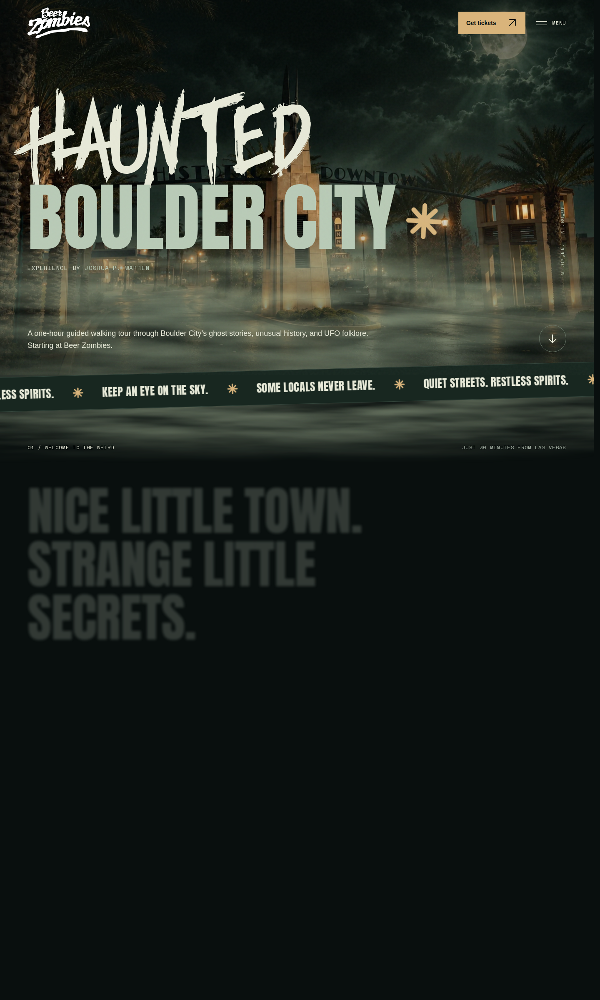
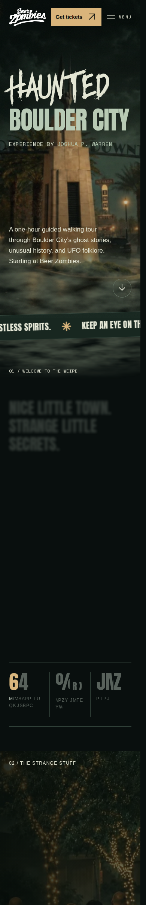

# UI Design System & Master Generation Blueprint: www-hauntedbouldercity-com

> **Boulder City Ghost & UFO Walking Tour · Haunted Boulder City** (https://www.hauntedbouldercity.com/) — Meet the stranger side of Boulder City. Discover local ghost stories, desert mysteries and UFO folklore on a one-hour walking tour with B...



---

## 1. Executive Visual Persona & Design Archetype

- **Brand Essence & Persona**: **Boulder City Ghost & UFO Walking Tour · Haunted Boulder City** (`https://www.hauntedbouldercity.com/`). Meet the stranger side of Boulder City. Discover local ghost stories, desert mysteries and UFO folklore on a one-hour walking tour with B...
- **Visual Archetype**: **High-Contrast Obsidian / Atmospheric Design System (`#090f0e` canvas, `#e7e9d8` ink, `#a7b3a7` accent)**.
- **Anti-AI-Slop Differentiators**:
  - **Source-Grounded Chromatic Polarity**: Anchors the viewport in `#090f0e` (`var(--ink)` in `:root`) paired with `#e7e9d8` primary typography and `#a7b3a7` accents.
  - **Extracted Typographic Hierarchy**: Pairs `Display` for display copy (`HAUNTED BOULDER CITY`) with `Manticore` and `SpaceMono`.
  - **Calibrated Spatial Grid & Motion**: Combines `535px` container bounds (`gap: 30px`, padding `45px`) with `cubic-bezier(.2,.75,.25,1)` easing.

---

## 2. Spatial Architecture & Modular Grid Mathematics



### Viewport Allocation & Container Geometry
- **Captured Viewport Dimensions**: Desktop `1440×12505px` (`assets/desktop.png`, full-page scroll capture), Mobile `390×2400px` (`assets/mobile.png`, capped at 2400px multi-section capture).
- **Master Container Bounds**: `535px` extracted from `www-hauntedbouldercity-com` stylesheet.
- **Canvas Lateral Padding & Spacing**: `45px` lateral canvas padding with `30px` grid gap.
- **Border Radius Scale**: `50%`.

### Responsive Breakpoint Architecture
- **Desktop Layout**: Multi-column CSS Grid / Flexbox layout at `1440px` (`max-width: 535px`, `gap: 30px`).
- **Mobile Layout**: Single-column vertical stack at `390px` viewport width with `45px` horizontal padding.
- **Extracted CSS Media Queries**: `@media (min-width:1800px)`, `@media (max-width:1100px)`, `@media (max-width:760px)`, `@media (prefers-reduced-motion:reduce)`.

---

## 3. Color System, Materiality & Atmospheric Lighting

### Semantic Palette & Source Grounding
| Semantic Role | Ground-Truth Value | Extracted CSS Source / Selector |
|---|---|---|
| **Primary Canvas Substrate** | `#090f0e` | `var(--ink)` in `:root` |
| **Primary Typography Ink** | `#b9cbb7` | `var(--accent)` in `:root` |
| **Elevated Surface / Card Substrate** | `#e7e9d8` | `var(--paper)` in `:root` |
| **Interactive Accent / Highlight** | `#a7b3a7` | `var(--muted)` in `:root` |
| **Secondary / Muted Copy** | `#35463d` | `var(--line)` in `:root` |
| **Structural Hairline Border** | `#d9b47b` | `var(--amber)` in `:root` |
| **Variable Token (`--mist`)** | `#c4d1c0` | `var(--mist)` in `:root` |
| **Variable Token (`--surface`)** | `#192a23` | `var(--surface)` in `:root` |

### Sanitized Root CSS Variables (`ui-ux.md` Ground Truth)
| Variable Name | Extracted Value | Semantic Role |
|---|---|---|
| `--ink` | `#090f0e` | Typography Ink Token |
| `--accent` | `#b9cbb7` | Brand / Palette Token |
| `--paper` | `#e7e9d8` | Canvas / Surface Token |
| `--muted` | `#a7b3a7` | Color / Atmospheric Token |
| `--line` | `#35463d` | Color / Atmospheric Token |
| `--amber` | `#d9b47b` | Color / Atmospheric Token |
| `--mist` | `#c4d1c0` | Color / Atmospheric Token |
| `--surface` | `#192a23` | Canvas / Surface Token |
| `--pad` | `clamp(24px,4.6vw,88px)` | Layout / Spatial Grid Token |
| `--display` | `Display,Impact,'Arial Narrow',sans-serif` | Design System Custom Token |
| `--logo-width` | `136px` | Layout / Spatial Grid Token |
| `--dir` | `1` | Design System Custom Token |
| `--spirit-duration` | `2800ms` | Motion / Easing Token |
| `--spirit-peak` | `.9` | Design System Custom Token |
| `--spirit-linger` | `14vh` | Dimension / Scale Token |
| `--spirit-side` | `0px` | Dimension / Scale Token |

---

## 4. Typographic Scale & Editorial Hierarchy

### Font Family Stacks
- **Display Typography**: `Display`.
- **Primary Body Stack**: `Manticore`.
- **Technical / Metadata Stack**: `SpaceMono`.

### Typographic Scale & Rules (Extracted from Stylesheet & Variables)
- **Hero Display (`H1`)**: CSS variables `--display: Display,Impact,'Arial Narrow',sans-serif`; rule `h1` (`line-height: .92`, `font-weight: 400`).
- **Section Heading (`H2`)**: rule `h2` (`font-size: clamp(58px,8.7vw,162px)`, `line-height: 1.02`, `letter-spacing: -.01em`).
- **Body Copy**: rule `p` (`font-size: 18px`).
- **Metadata & Navigation Labels**: not explicitly declared on tag in static CSS (stylesheet font-size ladder: `clamp(16px,1.35vw,20px)`, `12px`, `30px`, `15px`, `16px`).

---

## 5. Choreographed Motion & Interaction Physics

### Primary Easing Curves
- **Extracted Timing Functions**: `cubic-bezier(.2,.75,.25,1)`, `cubic-bezier(.2,.7,.2,1)`, `cubic-bezier(.2,.8,.2,1)`.

### Per-Element Transition & Choreography Rules
- **Selector `.button`**: `transition: background .25s,transform .25s,color .25s` extracted from `www-hauntedbouldercity-com` stylesheet.
- **Selector `.round-arrow`**: `transition: background .3s,color .3s,transform .3s` extracted from `www-hauntedbouldercity-com` stylesheet.
- **Selector `.story-tabs button`**: `transition: color .3s,border .3s` extracted from `www-hauntedbouldercity-com` stylesheet.
- **Extracted Easing Curve (`cubic-bezier(.2,.75,.25,1)`)**: Governs interactive state transitions across `<header.site-header>` and `<section.intro>`.
- **State & Hover Choreography**: Opacity and transform transitions on `<section.hero>` and `<section.intro>` interactive targets.

---

## 6. Component Wireframe & Structural DOM Map

### Visual Layout Schematic (Grounded in `dom.html` — `1440px` Desktop & `390px` Mobile Reflow)
```
┌────────────────────────────────────────────────────────────────────────┐
│ DESKTOP VIEWPORT (1440px) — Boulder City Ghost & UFO Walking Tour · Ha │
│ ====================================================================== │
│ [ <header.site-header>     | Get tickets · Directions               ]  │
│ ---------------------------------------------------------------------- │
│ | HERO STAGE: <section.hero>                                       |   │
│ | H1: HAUNTED BOULDER CITY                                         |   │
│ | Substrate: #090f0e    | Ink: #e7e9d8    | Accent: #a7b3a7        |   │
│ ---------------------------------------------------------------------- │
│ | SHOWCASE GRID (<section.intro>           ) max-w: 535px          |   │
│ | +------------------------------+  +------------------------------+ | │
│ | | NICE LITTLE TOWN. STRANGE LI |  | NOT EVERY LOCAL IS LIVING.   | | │
│ | +------------------------------+  +------------------------------+ | │
│ ---------------------------------------------------------------------- │
│ | MOBILE VIEWPORT REFLOW (390px) — Single-Column Stack (gap: 30px  ) | │
│ | [<header.site-heade] -> [<section.hero>] -> [<section.intro>] |      │
│ ---------------------------------------------------------------------- │
│ [ FOOTER (<footer.loader-veil>  ) | https://www.hauntedbouldercity.com │
└────────────────────────────────────────────────────────────────────────┘
```

### Granular DOM Region Breakdown
1. **Brand Header & Navigation Bar (<header.site-header> — `www-hauntedbouldercity-com`)**:
   - Landmark `<header class="site-header">` hosting `Boulder City Ghost & UFO Walking Tou` navigation (`Get tickets · Directions`), DOM attributes (`data-src="/assets/ufo-night.mp4"`, `data-src-small="/assets/ufo-night-960..."`, `data-story="0"`, `data-story="1"`), and stylesheet rule `html { scroll-behavior:smooth;scroll-padding-top:88px }`.
2. **Hero Stage & Focal Lead (<section.hero> — `HAUNTED BOULDER CITY`)**:
   - Landmark `<section class="hero">` presenting display lead `HAUNTED BOULDER CITY` and copy excerpt *"Gathering the mist"* over `#090f0e` canvas and `#e7e9d8` ink.
3. **Primary Showcase & Content Grid (<section.intro> — `NICE LITTLE TOWN. STRANGE LITTLE S`)**:
   - Landmark `<section class="intro section-pad">` rendering section `NICE LITTLE TOWN. STRANGE LITTLE SECRETS.` with copy *"01 The tour One hour on foot, full of stories"*, asset references (`fog.webp`, `manticore.woff2`, `display.ttf`, `favicon-32.png`), and grid rule `selection { background:var(--accent);color:var(--ink) }`.
4. **Interactive Detail & Feature Matrix (<section.stories-scroll> — `NOT EVERY LOCAL IS LIVING.`)**:
   - Landmark `<section class="stories-scroll">` framing `NOT EVERY LOCAL IS LIVING.` and `THE PAST DOESN’T STAY BURIED.` (*"One hour on foot, full of stories"*) with `#e7e9d8` surface cards, `#a7b3a7` accents, and `button { font:inherit;cursor:pointer }`.
5. **Colophon & Global Directory Footer (<footer.loader-veil> — `https://www.hauntedbouldercity.com/`)**:
   - Landmark `<footer class="loader-veil">` anchoring `Boulder City Ghost & UFO Walking` footer links (`Get tickets · Directions`), copy *"02 The strange stuff Ghosts, dark history & UFOs"*, and `#d9b47b` structural dividers.

---

## 7. Master Zero-Shot AI Generation Prompt

```markdown
# Master Zero-Shot Frontend Generation Prompt: www-hauntedbouldercity-com (Boulder City Ghost & UFO Walking Tour · Haunted Boulder City)

You are a principal frontend architect and design systems engineer. Build a complete, production-ready web application replicating the exact design system, DOM landmarks, typographic hierarchy, color tokens, and motion physics of `www-hauntedbouldercity-com` (**Boulder City Ghost & UFO Walking Tour · Haunted Boulder City** — `https://www.hauntedbouldercity.com/`).

### 1. Visual Archetype & Anti-AI-Slop Mandates
- **Archetype**: High-Contrast Obsidian / Atmospheric Design System (`#090f0e` canvas, `#e7e9d8` ink, `#a7b3a7` accent).
- **Identity & Domain Context**: Meet the stranger side of Boulder City. Discover local ghost stories, desert mysteries and UFO folklore on a one-hour walking tour with B...
- **Primary Substrate**: `#090f0e` (`var(--ink)` in `:root`), **Primary Ink**: `#e7e9d8`, **Accent / Highlight**: `#a7b3a7`.
- **Site-Specific Differentiators**:
  - **Source-Grounded Chromatic Polarity**: Anchors the viewport in `#090f0e` (`var(--ink)` in `:root`) paired with `#e7e9d8` primary typography and `#a7b3a7` accents.
  - **Extracted Typographic Hierarchy**: Pairs `Display` for display copy (`HAUNTED BOULDER CITY`) with `Manticore` and `SpaceMono`.
  - **Calibrated Spatial Grid & Motion**: Combines `535px` container bounds (`gap: 30px`, padding `45px`) with `cubic-bezier(.2,.75,.25,1)` easing.

### 2. Ground-Truth CSS Variables (`:root` Token Contract)
Declare and consume these exact custom properties extracted from `www-hauntedbouldercity-com` in your global stylesheet:

:root {
  /* Boulder City Ghost & UFO Walking Tour · Haunted Boulder City (www-hauntedbouldercity-com) — Ground-Truth Extracted CSS Variables */
  --ink: #090f0e; /* Typography Ink Token (www-hauntedbouldercity-com) */
  --accent: #b9cbb7; /* Brand / Palette Token (www-hauntedbouldercity-com) */
  --paper: #e7e9d8; /* Canvas / Surface Token (www-hauntedbouldercity-com) */
  --muted: #a7b3a7; /* Color / Atmospheric Token (www-hauntedbouldercity-com) */
  --line: #35463d; /* Color / Atmospheric Token (www-hauntedbouldercity-com) */
  --amber: #d9b47b; /* Color / Atmospheric Token (www-hauntedbouldercity-com) */
  --mist: #c4d1c0; /* Color / Atmospheric Token (www-hauntedbouldercity-com) */
  --surface: #192a23; /* Canvas / Surface Token (www-hauntedbouldercity-com) */
  --pad: clamp(24px,4.6vw,88px); /* Layout / Spatial Grid Token (www-hauntedbouldercity-com) */
  --display: Display,Impact,'Arial Narrow',sans-serif; /* Design System Custom Token (www-hauntedbouldercity-com) */
  --logo-width: 136px; /* Layout / Spatial Grid Token (www-hauntedbouldercity-com) */
  --dir: 1; /* Design System Custom Token (www-hauntedbouldercity-com) */
  --spirit-duration: 2800ms; /* Motion / Easing Token (www-hauntedbouldercity-com) */
  --spirit-peak: .9; /* Design System Custom Token (www-hauntedbouldercity-com) */
  --spirit-linger: 14vh; /* Dimension / Scale Token (www-hauntedbouldercity-com) */
  --spirit-side: 0px; /* Dimension / Scale Token (www-hauntedbouldercity-com) */
}

### 3. Semantic Color & Materiality Contract
Map every surface, ink, and border strictly to these source-grounded tokens:
- **Primary Canvas Substrate**: `#090f0e` — grounded in `var(--ink)` in `:root`
- **Primary Typography Ink**: `#b9cbb7` — grounded in `var(--accent)` in `:root`
- **Elevated Surface / Card Substrate**: `#e7e9d8` — grounded in `var(--paper)` in `:root`
- **Interactive Accent / Highlight**: `#a7b3a7` — grounded in `var(--muted)` in `:root`
- **Secondary / Muted Copy**: `#35463d` — grounded in `var(--line)` in `:root`
- **Structural Hairline Border**: `#d9b47b` — grounded in `var(--amber)` in `:root`
- **Variable Token (`--mist`)**: `#c4d1c0` — grounded in `var(--mist)` in `:root`
- **Variable Token (`--surface`)**: `#192a23` — grounded in `var(--surface)` in `:root`

### 4. Spatial Grid, Container Bounds & Responsive Breakpoints
- **Desktop Viewport Reference**: `1440×12505px` (full-page scroll capture, `1440px` standard desktop width).
- **Mobile Viewport Reference**: `390×2400px` (capped at 2400px multi-section capture, `390px` standard mobile width).
- **Container Max-Width**: `535px` extracted from `www-hauntedbouldercity-com` stylesheet
- **Padding & Gutters**: `45px` lateral canvas padding with `30px` grid gap
- **Desktop Grid**: Multi-column CSS Grid / Flexbox layout at `1440px` (`max-width: 535px`, `gap: 30px`)
- **Mobile Adaptation**: Single-column vertical stack at `390px` viewport width with `45px` horizontal padding
- **Media Queries**: `@media (min-width:1800px)`, `@media (max-width:1100px)`, `@media (max-width:760px)`, `@media (prefers-reduced-motion:reduce)`
- **Corner Radii**: `50%`

### 5. Typography & Editorial Scale Contract
- **Display Font Stack**: `Display`
- **Body Font Stack**: `Manticore`
- **Monospace / Technical Font Stack**: `SpaceMono`
- **H1 Display Rule**: CSS variables `--display: Display,Impact,'Arial Narrow',sans-serif`; rule `h1` (`line-height: .92`, `font-weight: 400`)
- **H2 Section Rule**: rule `h2` (`font-size: clamp(58px,8.7vw,162px)`, `line-height: 1.02`, `letter-spacing: -.01em`)
- **Body Copy Rule**: rule `p` (`font-size: 18px`)
- **Metadata & Index Rule**: not explicitly declared on tag in static CSS (stylesheet font-size ladder: `clamp(16px,1.35vw,20px)`, `12px`, `30px`, `15px`, `16px`)

### 6. Component Hierarchy, Verbatim Copy & Real DOM Landmarks
Scaffold `www-hauntedbouldercity-com` (`Boulder City Ghost & UFO Walking Tour · Haunted Boulder City`) with these exact structural regions, extracted copy, and CSS rules from `dom.html`:
1. **Brand Header & Navigation Bar (<header.site-header> — `www-hauntedbouldercity-com`)**:
   - DOM & Selectors: Landmark `<header class="site-header">` hosting `Boulder City Ghost & UFO Walking Tou` navigation (`Get tickets · Directions`), DOM attributes (`data-src="/assets/ufo-night.mp4"`, `data-src-small="/assets/ufo-night-960..."`, `data-story="0"`, `data-story="1"`), and stylesheet rule `html { scroll-behavior:smooth;scroll-padding-top:88px }`.
   - Responsive Contract: Header `Brand Header & Navigation Bar (<header.site-header> — `www-hauntedbouldercity-com`)` (`www-hauntedbouldercity-com`) adapts across `@media (min-width:1800px)`, `@media (max-width:1100px)`, `@media (max-width:760px)`, `@media (prefers-reduced-motion:reduce)` with `cubic-bezier(.2,.75,.25,1)`, `cubic-bezier(.2,.7,.2,1)`, `cubic-bezier(.2,.8,.2,1)` transitions and links `Get tickets · Directions`.
2. **Hero Stage & Focal Lead (<section.hero> — `HAUNTED BOULDER CITY`)**:
   - DOM & Selectors: Landmark `<section class="hero">` presenting display lead `HAUNTED BOULDER CITY` and copy excerpt *"Gathering the mist"* over `#090f0e` canvas and `#e7e9d8` ink.
   - Responsive Contract: Hero stage (`1440×12505px` desktop / `390×2400px` mobile) sets `#090f0e` background with `#e7e9d8` headline `HAUNTED BOULDER CITY`.
3. **Primary Showcase & Content Grid (<section.intro> — `NICE LITTLE TOWN. STRANGE LITTLE S`)**:
   - DOM & Selectors: Landmark `<section class="intro section-pad">` rendering section `NICE LITTLE TOWN. STRANGE LITTLE SECRETS.` with copy *"01 The tour One hour on foot, full of stories"*, asset references (`fog.webp`, `manticore.woff2`, `display.ttf`, `favicon-32.png`), and grid rule `selection { background:var(--accent);color:var(--ink) }`.
   - Responsive Contract: Showcase grid `Primary Showcase & Content Grid (<section.intro> — `NICE LITTLE TOWN. STRANGE LITTLE S`)` applies Multi-column CSS Grid / Flexbox layout at `1440px` (`max-width: 535px`, `gap: 30px`) on desktop and Single-column vertical stack at `390px` viewport width with `45px` horizontal padding on mobile.
4. **Interactive Detail & Feature Matrix (<section.stories-scroll> — `NOT EVERY LOCAL IS LIVING.`)**:
   - DOM & Selectors: Landmark `<section class="stories-scroll">` framing `NOT EVERY LOCAL IS LIVING.` and `THE PAST DOESN’T STAY BURIED.` (*"One hour on foot, full of stories"*) with `#e7e9d8` surface cards, `#a7b3a7` accents, and `button { font:inherit;cursor:pointer }`.
   - Responsive Contract: Detail module `Interactive Detail & Feature Matrix (<section.stories-scroll> — `NOT EVERY LOCAL IS LIVING.`)` uses `50%` radii, `#a7b3a7` highlights, and assets (fog.webp, manticore.woff2, display.ttf).
5. **Colophon & Global Directory Footer (<footer.loader-veil> — `https://www.hauntedbouldercity.com/`)**:
   - DOM & Selectors: Landmark `<footer class="loader-veil">` anchoring `Boulder City Ghost & UFO Walking` footer links (`Get tickets · Directions`), copy *"02 The strange stuff Ghosts, dark history & UFOs"*, and `#d9b47b` structural dividers.
   - Responsive Contract: Footer `Colophon & Global Directory Footer (<footer.loader-veil> — `https://www.hauntedbouldercity.com/`)` aligns to `535px` extracted from `www-hauntedbouldercity-com` stylesheet with `45px` lateral canvas padding with `30px` grid gap and attributes (data-src="/assets/ufo-night.mp4", data-src-small="/assets/ufo-night-960...", data-story="0").

#### Verbatim DOM Copy Excerpts (`dom.html`)
- Copy Excerpt 1: *"Gathering the mist"*
- Copy Excerpt 2: *"01 The tour One hour on foot, full of stories"*
- Copy Excerpt 3: *"One hour on foot, full of stories"*
- Copy Excerpt 4: *"02 The strange stuff Ghosts, dark history & UFOs"*

### 7. Motion, Extracted Stylesheet Rules & Interaction Choreography
- **Primary Easing Functions**: `cubic-bezier(.2,.75,.25,1)`, `cubic-bezier(.2,.7,.2,1)`, `cubic-bezier(.2,.8,.2,1)`
- **Extracted Stylesheet Rules (`www-hauntedbouldercity-com`)**:
- `html { scroll-behavior:smooth;scroll-padding-top:88px }`
- `selection { background:var(--accent);color:var(--ink) }`
- `button { font:inherit;cursor:pointer }`
- `summary { -webkit-tap-highlight-color:transparent }`
- `summary:focus-visible { outline:2px solid var(--accent);outline-offset:7px }`
- **Per-Selector Transition Rules**:
- **Selector `.button`**: `transition: background .25s,transform .25s,color .25s` extracted from `www-hauntedbouldercity-com` stylesheet.
- **Selector `.round-arrow`**: `transition: background .3s,color .3s,transform .3s` extracted from `www-hauntedbouldercity-com` stylesheet.
- **Selector `.story-tabs button`**: `transition: color .3s,border .3s` extracted from `www-hauntedbouldercity-com` stylesheet.
- **Extracted Easing Curve (`cubic-bezier(.2,.75,.25,1)`)**: Governs interactive state transitions across `<header.site-header>` and `<section.intro>`.
- **State & Hover Choreography**: Opacity and transform transitions on `<section.hero>` and `<section.intro>` interactive targets.

### 8. Technical Deliverables
- Implement in Next.js (App Router) with TypeScript and Tailwind CSS consuming the `:root` custom properties defined above for `www-hauntedbouldercity-com`.
- Reproduce both the `1440px` desktop architecture and `390px` mobile breakpoint transitions, preserving semantic HTML5 landmarks (`<header>`, `<nav>`, `<main>`, `<section>`, `<footer>`) and `prefers-reduced-motion` accessibility guards.
```
