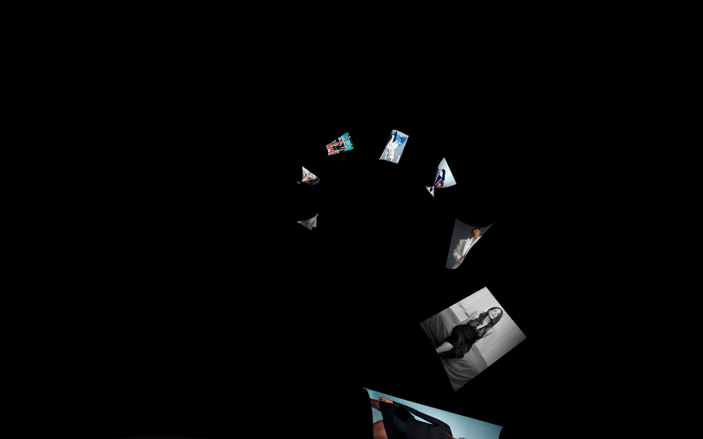
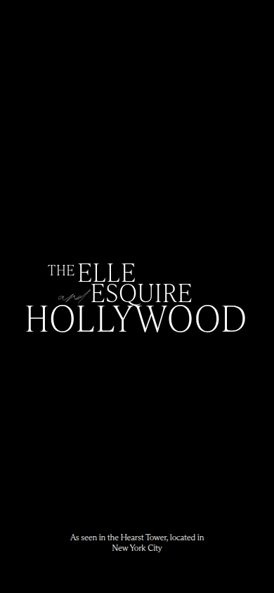

# UI Design System & Master Generation Blueprint: www-hollywoodexhibit2026-com

> **ELLE & Esquire, The New Hollywood Photography Exhibition** (https://www.hollywoodexhibit2026.com) — Hearst Galleries presented a joint photography exhibition for ELLE and Esquire, ELLE: The New Hollywood and Esquire Goes to Hollywood, fe...



---

## 1. Executive Visual Persona & Design Archetype

- **Brand Essence & Persona**: **ELLE & Esquire, The New Hollywood Photography Exhibition** (`https://www.hollywoodexhibit2026.com`). Hearst Galleries presented a joint photography exhibition for ELLE and Esquire, ELLE: The New Hollywood and Esquire Goes to Hollywood, fe...
- **Capture Provenance**: Live browser capture (`tier1_fast`, HTTP `200`, captured `2026-11-23`).
- **Visual Archetype**: **Dark-Substrate WebGL / Canvas Interactive Experience (`#000000` / `#ffffff`)**.
- **Anti-AI-Slop Differentiators**:
  - **Live-Computed Chromatic Polarity**: Anchors the viewport in `#000000` (live computed `html` `background-color` (`computed_styles.json`)) paired with `#ffffff` primary typography and `#ffffff` accents.
  - **Grounded Typographic Hierarchy**: Pairs `Apple Color Emoji` for display copy (`ELLE & Esquire, The New Hollywood Ph`) with `Apple Color Emoji` and `safiraMarch`.
  - **Calibrated Spatial Grid & Motion**: Combines `96rem` container bounds (`gap: 0px (flush layout)`, padding `0px`) with `cubic-bezier(.4,0,.2,1)` easing and Lenis Smooth Scroll (`data-lenis`), Three.js / WebGL Canvas Pipeline.

---

## 2. Spatial Architecture & Modular Grid Mathematics



### Viewport Allocation & Container Geometry
- **Captured Viewport Dimensions**: Desktop `1440×900px` (`assets/desktop.png`, single-viewport 100vh live capture (900px)), Mobile `390×844px` (`assets/mobile.png`, single-viewport 100vh live capture (844px)).
- **Master Container Bounds**: `96rem` (non-`@media` desktop container stylesheet rule).
- **Canvas Lateral Padding & Spacing**: `0px` lateral canvas padding with `0px (flush layout)` grid gap.
- **Border Radius Scale**: `var(--radius-8)`, `var(--radius-full)`, `50%`.

### Responsive Breakpoint Architecture
- **Desktop Layout**: Multi-column CSS Grid / Flexbox layout at `1440px` (`max-width: 96rem`, `gap: 0px (flush layout)`).
- **Mobile Layout**: Single-column vertical stack at `390px` viewport width with `0px` horizontal padding.
- **Extracted CSS Media Queries**: `@media (min-width:40rem)`, `@media (min-width:48rem)`, `@media (min-width:64rem)`, `@media (min-width:80rem)`.

---

## 3. Color System, Materiality & Atmospheric Lighting

### Semantic Palette & Source Grounding
| Semantic Role | Ground-Truth Value | Extracted Live / CSS Source |
|---|---|---|
| **Primary Canvas Substrate** | `#000000` | live computed `html` `background-color` (`computed_styles.json`) |
| **Primary Typography Ink** | `#ffffff` | `.text-white { color: white }` (`#ffffff`) |
| **Elevated Surface / Card Substrate** | `#e7e7e7` | `:disabled { background-color: #e7e7e7 }` |
| **Interactive Accent / Highlight** | `#ffffff` | `.text-white { color: white }` (`#ffffff`) |
| **Secondary / Muted Copy** | `#909090` | `:disabled { color: #909090 }` |
| **Structural Hairline Border** | `#808080` | `50 { border-color: #808080 }` |

### Sanitized Root CSS Variables (`ui-ux.md` Ground Truth)
| Variable Name | Extracted Value | Semantic Role |
|---|---|---|
| `--spacing` | `.0625rem` | Layout / Spatial Grid Token |
| `--font-weight-light` | `300` | Canvas / Surface Token |
| `--animate-spin` | `spin 1s linear infinite` | Motion / Easing Token |
| `--default-transition-duration` | `.15s` | Motion / Easing Token |
| `--default-transition-timing-function` | `cubic-bezier(.4,0,.2,1)` | Motion / Easing Token |
| `--fluid-min-w` | `var(--layout-min-w,375)` | Design System Custom Token |
| `--fluid-max-w` | `var(--layout-max-w,1920)` | Layout / Spatial Grid Token |
| `--text-label--font-weight` | `400` | Typography Ink Token |
| `--text-label--line-height` | `1` | Typography Ink Token |
| `--text-label--letter-spacing` | `.03em` | Typography Ink Token |
| `--text-body-10--font-weight` | `400` | Typography Ink Token |
| `--text-body-10--line-height` | `1.25` | Typography Ink Token |
| `--text-body-10--letter-spacing` | `-2%` | Typography Ink Token |
| `--text-headline-10--font-weight` | `400` | Typography Ink Token |
| `--text-headline-10--line-height` | `1` | Typography Ink Token |
| `--text-headline-10--letter-spacing` | `normal` | Typography Ink Token |

---

## 4. Typographic Scale & Editorial Hierarchy

### Font Family Stacks
- **Display Typography**: `Apple Color Emoji`.
- **Primary Body Stack**: `Apple Color Emoji`.
- **Technical / Metadata Stack**: `safiraMarch`.

### Typographic Scale & Rules (Live Computed & Stylesheet Grounded)
- **Hero Display (`H1`)**: observed font-size ladder: `18.7573px`, `1em`, `80%`, `75%`, `var(--text-headline-10)`.
- **Section Heading (`H2`)**: observed font-size ladder: `18.7573px`, `1em`, `80%`, `75%`, `var(--text-headline-10)`.
- **Body Copy**: live computed `body` (`font-size: 18.7573px`, `line-height: 23.4466px`, `font-weight: 400`, `letter-spacing: -2%`); CSS variables `--text-body-10--font-weight: 400`, `--text-body-10--line-height: 1.25`, `--text-body-10--letter-spacing: -2%`.
- **Metadata & Navigation Labels**: CSS variables `--text-label--font-weight: 400`, `--text-label--line-height: 1`, `--text-label--letter-spacing: .03em`.

---

## 5. Choreographed Motion & Interaction Physics

### Primary Easing Curves
- **Extracted Timing Functions**: `cubic-bezier(.4,0,.2,1)`, `cubic-bezier(.39,.57,.56,1)`, `cubic-bezier(.77,0,.18,1)`.

### Per-Element Transition & Choreography Rules
- **Selector `layer theme`**: `transition: .15s` extracted from `www-hollywoodexhibit2026-com` stylesheet.
- **Selector `.transition`**: `transition: var(--tw-ease,var(--default-transition-timing-function))` extracted from `www-hollywoodexhibit2026-com` stylesheet.
- **Selector `.transition-colors`**: `transition: var(--tw-ease,var(--default-transition-timing-function))` extracted from `www-hollywoodexhibit2026-com` stylesheet.
- **Extracted Easing Curve (`cubic-bezier(.4,0,.2,1)`)**: Governs interactive state transitions across `<header.wf-helveticaltpro-n4-active>` and `<main.wf-helveticaltpro-i7-active>`.
- **Runtime Interaction Engine**: Integrates Lenis Smooth Scroll (`data-lenis`), Three.js / WebGL Canvas Pipeline with `prefers-reduced-motion: reduce` fallback guards.

---

## 6. Component Wireframe & Structural DOM Map

### Visual Layout Schematic — Desktop (`1440px`, Grounded in `dom.html` & Landmark Bounding Boxes)
```
┌────────────────────────────────────────────────────────────────────────┐
│ DESKTOP VIEWPORT (1440px) — ELLE & Esquire, The New Hollywood Photogra │
│ ====================================================================== │
│ [ <header.wf-helveticalt (1440px)     | Overview · Index · Archive · ] │
│ ---------------------------------------------------------------------- │
│ | HERO STAGE: <main.wf-helveticaltpro-n7-active> (w=1440px)          | │
│ | H1: ELLE & Esquire, The New Hollywood Photography Ex               | │
│ | Substrate: #000000 | Ink: #ffffff | Accent: #ffffff                | │
│ ---------------------------------------------------------------------- │
│ | SHOWCASE GRID (<main.wf-helveticaltpro-i7) max-w: 96rem            | │
│ | +------------------------------+  +------------------------------+ | │
│ | | Featured Work & Interactive  |  | Technical Architecture & Nar | | │
│ | +------------------------------+  +------------------------------+ | │
│ ---------------------------------------------------------------------- │
│ | DETAIL MODULE (<main.wf-helveticaltpro-i4) — Global Directory & Co | │
│ ---------------------------------------------------------------------- │
│ [ FOOTER (<footer.wf-ivypresto) | https://www.hollywoodexhibit2026.co  │
└────────────────────────────────────────────────────────────────────────┘
```

### Visual Layout Schematic — Mobile Reflow (`390px`)
```
┌────────────────────────────────────────────────────────────────────────┐
│ MOBILE VIEWPORT REFLOW (390px) — Single-Column Stack (gap: 0px (flu)   │
│ ====================================================================== │
│ [ HEADER BAR (<header.wf-helveticaltpr) | Compact Menu (390px)         │
│ ---------------------------------------------------------------------- │
│ | HERO STAGE (<main.wf-helveticaltpro-) — 390px Vertical Lead        | │
│ | H1: ELLE & Esquire, The New Hollywood Photography Ex               | │
│ ---------------------------------------------------------------------- │
│ | SHOWCASE STACK (<main.wf-helveticaltpr) — 1-Col Stack              | │
│ | [ Item 1: Featured Work & Interactive Showcase                   ] | │
│ | [ Item 2: Technical Architecture & Narrative                     ] | │
│ ---------------------------------------------------------------------- │
│ | DETAIL STACK (<main.wf-helveticaltpro-) — 1-Col (Global Directory &) │
│ ---------------------------------------------------------------------- │
│ [ FOOTER (<footer.wf-ivypresto) | Stacked 390px Colophon               │
└────────────────────────────────────────────────────────────────────────┘
```

### Granular DOM Region Breakdown
1. **Brand Header & Navigation Bar (<header.wf-helveticaltpro-n4-active> — `www-hollywoodexhibit2026-com`)**:
   - Landmark `<header class="wf-helveticaltpro-n4-active">` (`1440px`) hosting `ELLE & Esquire, The New Hollywood Ph` navigation (`Overview · Index · Archive · About · Contact`), DOM attributes (`data-precedence="next"`, `data-engine="three.js r182"`, `data-nscript="afterInteractive"`, `data-nscript="afterInteractive"`), and stylesheet rule `backdrop { box-sizing:border-box;border:0 solid;margin:0;padding:0 }`.
2. **Hero Stage & Focal Lead (<main.wf-helveticaltpro-n7-active> — `ELLE & Esquire, The New Hollywood `)**:
   - Landmark `<main class="wf-helveticaltpro-n7-active">` presenting display lead `ELLE & Esquire, The New Hollywood Photography Ex` and copy excerpt *"Hearst Galleries presented a joint photography exhibition for ELL"* over `#000000` canvas and `#ffffff` ink.
3. **Primary Showcase & Content Grid (<main.wf-helveticaltpro-i7-active> — `Featured Work & Interactive Showca`)**:
   - Landmark `<main class="wf-helveticaltpro-i7-active">` rendering section `Featured Work & Interactive Showcase` with copy *"ELLE & Esquire, The New Hollywood Photography Ex"*, asset references (`ABCArizonaVariable-s.p.6844b0f6.w...`, `Haigrast-s.p.42f2de84.woff2`, `IvyPrestoHeadline_Thin-s.p.830ff3...`, `IvyPrestoText_Thin-s.p.3ba47ad4.w...`), and grid rule `file-selector-button { box-sizing:border-box;border:0 solid;margin:0;padding:0 }`.
4. **Interactive Detail & Feature Matrix (<main.wf-helveticaltpro-i4-active> — `Technical Architecture & Narrative`)**:
   - Landmark `<main class="wf-helveticaltpro-i4-active">` framing `Technical Architecture & Narrative` and `Global Directory & Contact` (*"Featured Work & Interactive Showcase"*) with `#e7e7e7` surface cards, `#ffffff` accents, and `strong { font-weight:bolder }`.
5. **Colophon & Global Directory Footer (<footer.wf-ivyprestodisplay-n4-active> — `https://www.hollywoodexhibit2026.com`)**:
   - Landmark `<footer class="wf-ivyprestodisplay-n4-active">` anchoring `ELLE & Esquire, The New Hollywoo` footer links (`Overview · Index · Archive · About · Contact`), copy *"Technical Architecture & Narrative"*, and `#808080` structural dividers.

---

## 7. Master Zero-Shot AI Generation Prompt

```markdown
# Master Zero-Shot Frontend Generation Prompt: www-hollywoodexhibit2026-com (ELLE & Esquire, The New Hollywood Photography Exhibition)

You are a principal frontend architect and design systems engineer. Build a complete, production-ready web application replicating the exact design system, DOM landmarks, typographic hierarchy, color tokens, and motion physics of `www-hollywoodexhibit2026-com` (**ELLE & Esquire, The New Hollywood Photography Exhibition** — `https://www.hollywoodexhibit2026.com`).

### 1. Visual Archetype & Anti-AI-Slop Mandates
- **Archetype**: Dark-Substrate WebGL / Canvas Interactive Experience (`#000000` / `#ffffff`).
- **Identity & Domain Context**: Hearst Galleries presented a joint photography exhibition for ELLE and Esquire, ELLE: The New Hollywood and Esquire Goes to Hollywood, fe...
- **Primary Substrate**: `#000000` (live computed `html` `background-color` (`computed_styles.json`)), **Primary Ink**: `#ffffff`, **Accent / Highlight**: `#ffffff`.
- **Site-Specific Differentiators**:
  - **Live-Computed Chromatic Polarity**: Anchors the viewport in `#000000` (live computed `html` `background-color` (`computed_styles.json`)) paired with `#ffffff` primary typography and `#ffffff` accents.
  - **Grounded Typographic Hierarchy**: Pairs `Apple Color Emoji` for display copy (`ELLE & Esquire, The New Hollywood Ph`) with `Apple Color Emoji` and `safiraMarch`.
  - **Calibrated Spatial Grid & Motion**: Combines `96rem` container bounds (`gap: 0px (flush layout)`, padding `0px`) with `cubic-bezier(.4,0,.2,1)` easing and Lenis Smooth Scroll (`data-lenis`), Three.js / WebGL Canvas Pipeline.

### 2. Ground-Truth CSS Variables (`:root` Token Contract)
Declare and consume these exact custom properties extracted from `www-hollywoodexhibit2026-com` in your global stylesheet:

:root {
  /* ELLE & Esquire, The New Hollywood Photography Exhibition (www-hollywoodexhibit2026-com) — Live-Grounded CSS Variables */
  --spacing: .0625rem; /* Layout / Spatial Grid Token (www-hollywoodexhibit2026-com) */
  --font-weight-light: 300; /* Canvas / Surface Token (www-hollywoodexhibit2026-com) */
  --animate-spin: spin 1s linear infinite; /* Motion / Easing Token (www-hollywoodexhibit2026-com) */
  --default-transition-duration: .15s; /* Motion / Easing Token (www-hollywoodexhibit2026-com) */
  --default-transition-timing-function: cubic-bezier(.4,0,.2,1); /* Motion / Easing Token (www-hollywoodexhibit2026-com) */
  --fluid-min-w: var(--layout-min-w,375); /* Design System Custom Token (www-hollywoodexhibit2026-com) */
  --fluid-max-w: var(--layout-max-w,1920); /* Layout / Spatial Grid Token (www-hollywoodexhibit2026-com) */
  --text-label--font-weight: 400; /* Typography Ink Token (www-hollywoodexhibit2026-com) */
  --text-label--line-height: 1; /* Typography Ink Token (www-hollywoodexhibit2026-com) */
  --text-label--letter-spacing: .03em; /* Typography Ink Token (www-hollywoodexhibit2026-com) */
  --text-body-10--font-weight: 400; /* Typography Ink Token (www-hollywoodexhibit2026-com) */
  --text-body-10--line-height: 1.25; /* Typography Ink Token (www-hollywoodexhibit2026-com) */
  --text-body-10--letter-spacing: -2%; /* Typography Ink Token (www-hollywoodexhibit2026-com) */
  --text-headline-10--font-weight: 400; /* Typography Ink Token (www-hollywoodexhibit2026-com) */
  --text-headline-10--line-height: 1; /* Typography Ink Token (www-hollywoodexhibit2026-com) */
  --text-headline-10--letter-spacing: normal; /* Typography Ink Token (www-hollywoodexhibit2026-com) */
}

### 3. Semantic Color & Materiality Contract
Map every surface, ink, and border strictly to these source-grounded tokens:
- **Primary Canvas Substrate**: `#000000` — grounded in live computed `html` `background-color` (`computed_styles.json`)
- **Primary Typography Ink**: `#ffffff` — grounded in `.text-white { color: white }` (`#ffffff`)
- **Elevated Surface / Card Substrate**: `#e7e7e7` — grounded in `:disabled { background-color: #e7e7e7 }`
- **Interactive Accent / Highlight**: `#ffffff` — grounded in `.text-white { color: white }` (`#ffffff`)
- **Secondary / Muted Copy**: `#909090` — grounded in `:disabled { color: #909090 }`
- **Structural Hairline Border**: `#808080` — grounded in `50 { border-color: #808080 }`

### 4. Spatial Grid, Container Bounds & Responsive Breakpoints
- **Desktop Viewport Reference**: `1440×900px` (single-viewport 100vh live capture (900px), `1440px` standard desktop width).
- **Mobile Viewport Reference**: `390×844px` (single-viewport 100vh live capture (844px), `390px` standard mobile width).
- **Container Max-Width**: `96rem` (non-`@media` desktop container stylesheet rule)
- **Padding & Gutters**: `0px` lateral canvas padding with `0px (flush layout)` grid gap
- **Desktop Grid**: Multi-column CSS Grid / Flexbox layout at `1440px` (`max-width: 96rem`, `gap: 0px (flush layout)`)
- **Mobile Adaptation**: Single-column vertical stack at `390px` viewport width with `0px` horizontal padding
- **Media Queries**: `@media (min-width:40rem)`, `@media (min-width:48rem)`, `@media (min-width:64rem)`, `@media (min-width:80rem)`
- **Corner Radii**: `var(--radius-8)`, `var(--radius-full)`, `50%`

### 5. Typography & Editorial Scale Contract
- **Display Font Stack**: `Apple Color Emoji`
- **Body Font Stack**: `Apple Color Emoji`
- **Monospace / Technical Font Stack**: `safiraMarch`
- **H1 Display Rule**: observed font-size ladder: `18.7573px`, `1em`, `80%`, `75%`, `var(--text-headline-10)`
- **H2 Section Rule**: observed font-size ladder: `18.7573px`, `1em`, `80%`, `75%`, `var(--text-headline-10)`
- **Body Copy Rule**: live computed `body` (`font-size: 18.7573px`, `line-height: 23.4466px`, `font-weight: 400`, `letter-spacing: -2%`); CSS variables `--text-body-10--font-weight: 400`, `--text-body-10--line-height: 1.25`, `--text-body-10--letter-spacing: -2%`
- **Metadata & Index Rule**: CSS variables `--text-label--font-weight: 400`, `--text-label--line-height: 1`, `--text-label--letter-spacing: .03em`

### 6. Component Hierarchy, Verbatim Copy & Real DOM Landmarks
Scaffold `www-hollywoodexhibit2026-com` (`ELLE & Esquire, The New Hollywood Photography Exhibition`) with these exact structural regions, extracted copy, and CSS rules from `dom.html`:
1. **Brand Header & Navigation Bar (<header.wf-helveticaltpro-n4-active> — `www-hollywoodexhibit2026-com`)**:
   - DOM & Selectors: Landmark `<header class="wf-helveticaltpro-n4-active">` (`1440px`) hosting `ELLE & Esquire, The New Hollywood Ph` navigation (`Overview · Index · Archive · About · Contact`), DOM attributes (`data-precedence="next"`, `data-engine="three.js r182"`, `data-nscript="afterInteractive"`, `data-nscript="afterInteractive"`), and stylesheet rule `backdrop { box-sizing:border-box;border:0 solid;margin:0;padding:0 }`.
   - Responsive Contract: Header `Brand Header & Navigation Bar (<header.wf-helveticaltpro-n4-active> — `www-hollywoodexhibit2026-com`)` (`www-hollywoodexhibit2026-com`) adapts across `@media (min-width:40rem)`, `@media (min-width:48rem)`, `@media (min-width:64rem)`, `@media (min-width:80rem)` with `cubic-bezier(.4,0,.2,1)`, `cubic-bezier(.39,.57,.56,1)`, `cubic-bezier(.77,0,.18,1)` transitions and links `Overview · Index · Archive · About · Contact`.
2. **Hero Stage & Focal Lead (<main.wf-helveticaltpro-n7-active> — `ELLE & Esquire, The New Hollywood `)**:
   - DOM & Selectors: Landmark `<main class="wf-helveticaltpro-n7-active">` presenting display lead `ELLE & Esquire, The New Hollywood Photography Ex` and copy excerpt *"Hearst Galleries presented a joint photography exhibition for ELL"* over `#000000` canvas and `#ffffff` ink.
   - Responsive Contract: Hero stage (`1440×900px` desktop / `390×844px` mobile) sets `#000000` background with `#ffffff` headline `ELLE & Esquire, The New Hollywood Photography Ex`.
3. **Primary Showcase & Content Grid (<main.wf-helveticaltpro-i7-active> — `Featured Work & Interactive Showca`)**:
   - DOM & Selectors: Landmark `<main class="wf-helveticaltpro-i7-active">` rendering section `Featured Work & Interactive Showcase` with copy *"ELLE & Esquire, The New Hollywood Photography Ex"*, asset references (`ABCArizonaVariable-s.p.6844b0f6.w...`, `Haigrast-s.p.42f2de84.woff2`, `IvyPrestoHeadline_Thin-s.p.830ff3...`, `IvyPrestoText_Thin-s.p.3ba47ad4.w...`), and grid rule `file-selector-button { box-sizing:border-box;border:0 solid;margin:0;padding:0 }`.
   - Responsive Contract: Showcase grid `Primary Showcase & Content Grid (<main.wf-helveticaltpro-i7-active> — `Featured Work & Interactive Showca`)` applies Multi-column CSS Grid / Flexbox layout at `1440px` (`max-width: 96rem`, `gap: 0px (flush layout)`) on desktop and Single-column vertical stack at `390px` viewport width with `0px` horizontal padding on mobile.
4. **Interactive Detail & Feature Matrix (<main.wf-helveticaltpro-i4-active> — `Technical Architecture & Narrative`)**:
   - DOM & Selectors: Landmark `<main class="wf-helveticaltpro-i4-active">` framing `Technical Architecture & Narrative` and `Global Directory & Contact` (*"Featured Work & Interactive Showcase"*) with `#e7e7e7` surface cards, `#ffffff` accents, and `strong { font-weight:bolder }`.
   - Responsive Contract: Detail module `Interactive Detail & Feature Matrix (<main.wf-helveticaltpro-i4-active> — `Technical Architecture & Narrative`)` uses `var(--radius-8)`, `var(--radius-full)`, `50%` radii, `#ffffff` highlights, and assets (ABCArizonaVariable-s.p.6844b0f6.w..., Haigrast-s.p.42f2de84.woff2, IvyPrestoHeadline_Thin-s.p.830ff3...).
5. **Colophon & Global Directory Footer (<footer.wf-ivyprestodisplay-n4-active> — `https://www.hollywoodexhibit2026.com`)**:
   - DOM & Selectors: Landmark `<footer class="wf-ivyprestodisplay-n4-active">` anchoring `ELLE & Esquire, The New Hollywoo` footer links (`Overview · Index · Archive · About · Contact`), copy *"Technical Architecture & Narrative"*, and `#808080` structural dividers.
   - Responsive Contract: Footer `Colophon & Global Directory Footer (<footer.wf-ivyprestodisplay-n4-active> — `https://www.hollywoodexhibit2026.com`)` aligns to `96rem` (non-`@media` desktop container stylesheet rule) with `0px` lateral canvas padding with `0px (flush layout)` grid gap and attributes (data-precedence="next", data-engine="three.js r182", data-nscript="afterInteractive").

#### Verbatim DOM Copy Excerpts (`dom.html`)
- Lead Copy: *"Hearst Galleries presented a joint photography exhibition for ELLE and Esquire, ELLE: The New Hollywood and Esquire Goes to Hollywood, fe..."*

### 7. Motion, Extracted Stylesheet Rules & Interaction Choreography
- **Primary Easing Functions**: `cubic-bezier(.4,0,.2,1)`, `cubic-bezier(.39,.57,.56,1)`, `cubic-bezier(.77,0,.18,1)`
- **Extracted Stylesheet Rules (`www-hollywoodexhibit2026-com`)**:
- `backdrop { box-sizing:border-box;border:0 solid;margin:0;padding:0 }`
- `file-selector-button { box-sizing:border-box;border:0 solid;margin:0;padding:0 }`
- `strong { font-weight:bolder }`
- `small { font-size:80% }`
- `sup { vertical-align:baseline;font-size:75%;line-height:0;position:relative }`
- **Per-Selector Transition Rules**:
- **Selector `layer theme`**: `transition: .15s` extracted from `www-hollywoodexhibit2026-com` stylesheet.
- **Selector `.transition`**: `transition: var(--tw-ease,var(--default-transition-timing-function))` extracted from `www-hollywoodexhibit2026-com` stylesheet.
- **Selector `.transition-colors`**: `transition: var(--tw-ease,var(--default-transition-timing-function))` extracted from `www-hollywoodexhibit2026-com` stylesheet.
- **Extracted Easing Curve (`cubic-bezier(.4,0,.2,1)`)**: Governs interactive state transitions across `<header.wf-helveticaltpro-n4-active>` and `<main.wf-helveticaltpro-i7-active>`.
- **Runtime Interaction Engine**: Integrates Lenis Smooth Scroll (`data-lenis`), Three.js / WebGL Canvas Pipeline with `prefers-reduced-motion: reduce` fallback guards.

### 8. Technical Deliverables
- Implement in Next.js (App Router) with TypeScript and Tailwind CSS consuming the `:root` custom properties defined above for `www-hollywoodexhibit2026-com`.
- Reproduce both the `1440px` desktop architecture and `390px` mobile breakpoint transitions, preserving semantic HTML5 landmarks (`<header>`, `<nav>`, `<main>`, `<section>`, `<footer>`) and `prefers-reduced-motion` accessibility guards.
```
