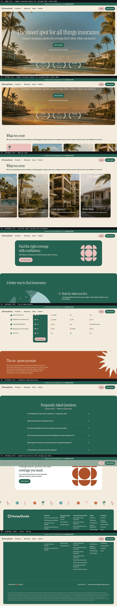
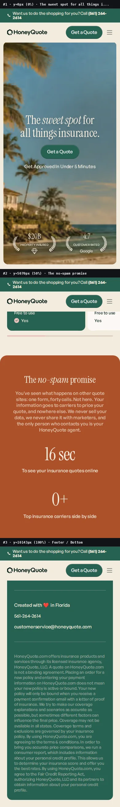

# UI Design System & Master Generation Blueprint: www-honeyquote-com

> **Compare Insurance Quotes Worth Trusting · HoneyQuote** (https://www.honeyquote.com/) — Compare quotes from 20+ carriers. Real licensed agents get you the best insurance quotes, straight answers, zero spam, and your credit sc...





---

## 1. Executive Visual Persona & Design Archetype

- **Brand Essence & Persona**: **Compare Insurance Quotes Worth Trusting · HoneyQuote** (`https://www.honeyquote.com/`). Compare quotes from 20+ carriers. Real licensed agents get you the best insurance quotes, straight answers, zero spam, and your credit sc...
- **Capture Provenance**: Live browser capture (`tier1_fast`, HTTP `200`, captured `2026-11-24`).
- **Visual Archetype**: **Light-Substrate Editorial & Modular Grid System (`#f4ecde` canvas, `#0d221d` ink, `#004cff` accent)**.
- **Anti-AI-Slop Differentiators**:
  - **Live-Computed Chromatic Polarity**: Anchors the viewport in `#f4ecde` (live computed `body` `background-color` (`computed_styles.json`)) paired with `#0d221d` primary typography and `#004cff` accents.
  - **Grounded Typographic Hierarchy**: Pairs `Instrument Serif` for display copy (`Compare insurance quotes for coverag`) with `Generalsans`.
  - **Calibrated Spatial Grid & Motion**: Combines `74rem` container bounds (`gap: 16px`, padding `9px`) with `cubic-bezier(.645,.045,.355,1)` easing and GSAP Timeline & ScrollTrigger, Three.js / WebGL Canvas Pipeline.

---

## 2. Spatial Architecture & Modular Grid Mathematics

### Viewport Allocation & Container Geometry
- **Captured Journey Filmstrips**: Desktop `1280×6624px` (`assets/desktop-journey.webp`, `8` keyframes up to `y=10021px` / doc `10921px`), Mobile `390×2616px` (`assets/mobile-journey.webp`, `3` keyframes).
- **Master Container Bounds**: `74rem` (non-`@media` desktop container stylesheet rule).
- **Canvas Lateral Padding & Spacing**: `9px` lateral canvas padding with `16px` grid gap.
- **Border Radius Scale**: `3px`, `100%`, `50%`, `2px`.

### Responsive Breakpoint Architecture
- **Desktop Layout**: Multi-column CSS Grid / Flexbox layout at `1440px` (`max-width: 74rem`, `gap: 16px`).
- **Mobile Layout**: Single-column vertical stack at `390px` viewport width with `9px` horizontal padding.
- **Extracted CSS Media Queries**: `@media screen and (max-width:991px)`, `@media screen and (max-width:767px)`, `@media screen and (max-width:479px)`, `@media (min-width:768px)`.

---

## 3. Color System, Materiality & Atmospheric Lighting

### Semantic Palette & Source Grounding
| Semantic Role | Ground-Truth Value | Extracted Live / CSS Source |
|---|---|---|
| **Primary Canvas Substrate** | `#f4ecde` | live computed `body` `background-color` (`computed_styles.json`) |
| **Primary Typography Ink** | `#0d221d` | live computed `main` `color` (`computed_styles.json`) |
| **Elevated Surface / Card Substrate** | `#ffff00` | `mark { background: #ffff00 }` |
| **Interactive Accent / Highlight** | `#004cff` | `global .btn-integration.btn-act... { background: #004cff }` |
| **Secondary / Muted Copy** | `#7a857f` | `var(--muted)` in `:root` |
| **Structural Hairline Border** | `#dbdbcd` | `var(--line)` in `:root` |

### Sanitized Root CSS Variables (`ui-ux.md` Ground Truth)
| Variable Name | Extracted Value | Semantic Role |
|---|---|---|
| `--background-color--background-primary` | `var(--brand--ivory-nectar)` | Canvas / Surface Token |
| `--_typography---body--font-family` | `var(--_typography---font-family--secondary)` | Typography / Scale Token |
| `--text-color--text-primary` | `var(--brand--midnight-pine)` | Typography Ink Token |
| `--_typography---body--font-size` | `var(--_typography---font--regular)` | Typography / Scale Token |
| `--_typography---body--line-height` | `var(--_typography---font-height--large)` | Typography / Scale Token |
| `--_typography---body--font-weight` | `var(--_typography---font-weight--medium)` | Typography / Scale Token |
| `--_typography---body--letter-spacing` | `var(--_typography---letter-spacing--tight)` | Typography / Scale Token |
| `--_typography---font-family--primary` | `"Instrument Serif",sans-serif` | Brand / Palette Token |
| `--_typography---h1--font-size` | `5rem` | Typography / Scale Token |
| `--_typography---h1--line-height` | `var(--_typography---font-height--small)` | Typography / Scale Token |
| `--_typography---h1--font-weight` | `var(--_typography---font-weight--normal)` | Typography / Scale Token |
| `--_typography---h1--letter-spacing` | `var(--_typography---letter-spacing--tight)` | Typography / Scale Token |
| `--_typography---h2--font-family` | `var(--_typography---font-family--primary)` | Typography / Scale Token |
| `--_typography---h2--font-size` | `3rem` | Typography / Scale Token |
| `--_typography---h2--line-height` | `var(--_typography---font-height--small)` | Typography / Scale Token |
| `--_typography---h2--font-weight` | `var(--_typography---font-weight--normal)` | Typography / Scale Token |

---

## 4. Typographic Scale & Editorial Hierarchy

### Font Family Stacks
- **Display Typography**: `Instrument Serif`.
- **Primary Body Stack**: `Generalsans`.
- **Technical / Metadata Stack**: not declared in live computed styles (uses primary stack / `ui-monospace`).

### Typographic Scale & Rules (Live Computed & Stylesheet Grounded)
- **Hero Display (`H1`)**: live computed `h1` (`font-size: 40px`, `line-height: 48px`, `font-weight: 400`, `letter-spacing: -0.4px`); CSS variables `--_typography---h1--font-size: 5rem`, `--_typography---h1--line-height: var(--_typography---font-height--small)`, `--_typography---h1--font-weight: var(--_typography---font-weight--normal)`; rule `h1` (`font-size: var(--_typography---h2--font-...`, `line-height: var(--_typography---h...`, `letter-spacing: var(--_typography---h...`, `font-weight: var(--_typogr...`).
- **Section Heading (`H2`)**: live computed `h2` (`font-size: 80px`, `line-height: 88px`, `font-weight: 400`, `letter-spacing: -0.8px`); CSS variables `--_typography---h2--font-family: var(--_typography---font-family--primary)`, `--_typography---h2--font-size: 3rem`, `--_typography---h2--line-height: var(--_typography---font-height--small)`; rule `h2` (`font-size: var(--_typography---h3--font-...`, `line-height: var(--_typography---h...`, `letter-spacing: var(--_typography---h...`, `font-weight: var(--_typogr...`).
- **Body Copy**: live computed `body` (`font-size: 16px`, `line-height: 20.8px`, `font-weight: 500`, `letter-spacing: -0.16px`); CSS variables `--_typography---body--font-family: var(--_typography---font-family--secondary)`, `--_typography---body--font-size: var(--_typography---font--regular)`, `--_typography---body--line-height: var(--_typography---font-height--large)`; rule `p` (`font-size: var(--_typography---h4--font-...`, `line-height: var(--_typography---h...`, `letter-spacing: var(--_typography---h...`, `font-weight: var(--_typogr...`).
- **Metadata & Navigation Labels**: live computed `nav/a` (`font-size: 16px`, `line-height: 20.8px`, `font-weight: 500`, `letter-spacing: -0.16px`); CSS variables `--_typography---body--letter-spacing: var(--_typography---letter-spacing--tight)`, `--_typography---h1--letter-spacing: var(--_typography---letter-spacing--tight)`, `--_typography---h2--letter-spacing: var(--_typography---letter-spacing--tight)`; rule `small` (`font-size: .75rem`, `line-height: 1.2`, `font-weight: 400`).

---

## 5. Choreographed Motion & Interaction Physics

### Primary Easing Curves
- **Extracted Timing Functions**: `cubic-bezier(.645,.045,.355,1)`, `cubic-bezier(.4,0,.2,1)`, `cubic-bezier(.68,-.55,.265,1.55)`.

### Per-Element Transition & Choreography Rules
- **Selector `.w-webflow-badge>img`**: `transition: unset` extracted from `www-honeyquote-com` stylesheet.
- **Selector `.w-slider-dot`**: `transition: background-color .1s,color .1s` extracted from `www-honeyquote-com` stylesheet.
- **Selector `.w-lightbox-control`**: `transition: all .3s` extracted from `www-honeyquote-com` stylesheet.
- **Extracted Easing Curve (`cubic-bezier(.645,.045,.355,1)`)**: Governs interactive state transitions across `<nav.nav_content>` and `<section.section_coverage>`.
- **Runtime Interaction Engine**: Integrates GSAP Timeline & ScrollTrigger, Three.js / WebGL Canvas Pipeline, Swiper Touch Carousel Engine, Lottie Vector Animation Player with `prefers-reduced-motion: reduce` fallback guards.
### Measured Runtime Scroll & Interaction Telemetry (`behavioral_journey_v2`)
- **Scroll Driver Mode**: `native` (max document height `10921px`, deepest scrollY reached `10021px` across `8` desktop keyframes).
- **Detected Scroll / Motion Libraries**: `GSAP/ScrollTrigger`.
- **Hover Physics (`primary_cta` · `Get a Quote`)**: `backgroundColor`: `rgb(39, 97, 82)` -> `rgb(22, 55, 46)` (`transition-duration: 0.2s`, `timing: cubic-bezier(0.645, 0.045, 0.355, 1)`).
- **Route Transition Architecture**: First internal navigation (`/company/contact`) measured as `MPA` in `1542ms`.

---

## 6. Component Wireframe & Structural DOM Map

### Visual Layout Schematic — Desktop (`1440px`, Grounded in `dom.html` & Landmark Bounding Boxes)
```
┌────────────────────────────────────────────────────────────────────────┐
│ DESKTOP VIEWPORT (1440px) — Compare Insurance Quotes Worth Trusting ·  │
│ ====================================================================== │
│ [ <nav.nav_content> (376x37px)        | Home Insurance · Flood Insur ] │
│ ---------------------------------------------------------------------- │
│ | HERO STAGE: <section.section_home-hero> (w=1440px)                 | │
│ | H1: Compare insurance quotes for coverage that's ther...           | │
│ | Substrate: #f4ecde | Ink: #0d221d | Accent: #004cff                | │
│ ---------------------------------------------------------------------- │
│ | SHOWCASE GRID (<section.section_coverage>) max-w: 74rem            | │
│ | +------------------------------+  +------------------------------+ | │
│ | | The sweet spot for all thing |  | What we cover                | | │
│ | +------------------------------+  +------------------------------+ | │
│ ---------------------------------------------------------------------- │
│ | DETAIL MODULE (<section.section_pp>) — Personal Lines              | │
│ ---------------------------------------------------------------------- │
│ [ FOOTER (<footer.wf-inter-n4-) | https://www.honeyquote.com/          │
└────────────────────────────────────────────────────────────────────────┘
```

### Visual Layout Schematic — Mobile Reflow (`390px`)
```
┌────────────────────────────────────────────────────────────────────────┐
│ MOBILE VIEWPORT REFLOW (390px) — Single-Column Stack (gap: 16px)       │
│ ====================================================================== │
│ [ HEADER BAR (<nav.nav_content>       ) | Compact Menu (390px)         │
│ ---------------------------------------------------------------------- │
│ | HERO STAGE (<section.section_home-he) — 390px Vertical Lead        | │
│ | H1: Compare insurance quotes for coverage that's ther...           | │
│ ---------------------------------------------------------------------- │
│ | SHOWCASE STACK (<section.section_cover) — 1-Col Stack              | │
│ | [ Item 1: The sweet spot for all things insurance.               ] | │
│ | [ Item 2: What we cover                                          ] | │
│ ---------------------------------------------------------------------- │
│ | DETAIL STACK (<section.section_pp>) — 1-Col (Personal Lines)       | │
│ ---------------------------------------------------------------------- │
│ [ FOOTER (<footer.wf-inter-n4-) | Stacked 390px Colophon               │
└────────────────────────────────────────────────────────────────────────┘
```

### Granular DOM Region Breakdown
1. **Brand Header & Navigation Bar (<nav.nav_content> — `www-honeyquote-com`)**:
   - Landmark `<nav class="nav_content w-nav-menu">` (`376x37px`) hosting `Compare Insurance Quotes Worth Trust` navigation (`Home Insurance · Flood Insurance · Condo Insurance · X insurance in Y`), DOM attributes (`data-wf-domain="www.honeyquote.com"`, `data-wf-page="6a21ae850094dc6f56f29bed"`, `data-wf-site="6a21ae820094dc6f56f29b98"`, `data-wf-intellimize-customer-id="117608328"`), and stylesheet rule `html { -webkit-text-size-adjust:100%;-ms-text-size-adjust:100%;font-family:sans... }`.
2. **Hero Stage & Focal Lead (<section.section_home-hero> — `Compare insurance quotes for cover`)**:
   - Landmark `<section class="section_home-hero">` presenting display lead `Compare insurance quotes for coverage that's ther...` and copy excerpt *"Want an expert to handle this?"* over `#f4ecde` canvas and `#0d221d` ink.
3. **Primary Showcase & Content Grid (<section.section_coverage> — `The sweet spot for all things insu`)**:
   - Landmark `<section class="section_coverage">` rendering section `The sweet spot for all things insurance.` with copy *"Get Approved In Under 5 Minutes"*, asset references (`cdn.prod.website-files.com`, `honeyquote-v2.shared.e243b8f63.mi...`, `fonts.googleapis.com`, `fonts.gstatic.com`), and grid rule `summary { display:block }`.
4. **Interactive Detail & Feature Matrix (<section.section_pp> — `What we cover`)**:
   - Landmark `<section class="section_pp">` framing `What we cover` and `Personal Lines` (*"We cover everything coastal residents actually juggle, and give e"*) with `#ffff00` surface cards, `#004cff` accents, and `video { vertical-align:baseline;display:inline-block }`.
5. **Colophon & Global Directory Footer (<footer.wf-inter-n4-active> — `https://www.honeyquote.com/`)**:
   - Landmark `<footer class="wf-inter-n4-active">` anchoring `Compare Insurance Quotes Worth T` footer links (`Home Insurance · Flood Insurance · Condo Insurance · X insurance in Y`), copy *"We can cancel your old insurance, manage escrow payments, an"*, and `#dbdbcd` structural dividers.
### Full Vertical Scroll Sequence (Desktop `1440×900` Keyframes)
- **Step 01** (`y=0px`, `0%`): Active landmark `Compare insurance quotes for coverage that's ther...` · sticky/fixed elements: `2`
- **Step 02** (`y=850px`, `8%`): Active landmark `Compare insurance quotes for coverage that's ther...` · sticky/fixed elements: `3`
- **Step 03** (`y=2550px`, `25%`): Active landmark `What we cover` · sticky/fixed elements: `2`
- **Step 04** (`y=4250px`, `42%`): Active landmark `Find the right coverage with confidence.` · sticky/fixed elements: `1`
- **Step 05** (`y=5950px`, `59%`): Active landmark `The no-spam promise` · sticky/fixed elements: `1`
- **Step 06** (`y=7650px`, `76%`): Active landmark `Frequently Asked Questions` · sticky/fixed elements: `1`
- **Step 07** (`y=9350px`, `93%`): Active landmark `Competitive prices on the coverage you need.` · sticky/fixed elements: `1`
- **Step 08** (`y=10021px`, `100%`): Active landmark `Footer / Bottom` · sticky/fixed elements: `1`

### Multi-Page Internal Route Map
- **Detail Route (`/company/contact`)**: `https://www.honeyquote.com/company/contact` — H1: `Talk to the right team`, scrollHeight `1960px`, transition `MPA` (`1542ms`)
- **About Route (`/about`)**: `https://www.honeyquote.com/about` — H1: `People who show up`, scrollHeight `4917px`, transition `direct` (`3333ms`)

---

## 7. Master Zero-Shot AI Generation Prompt

```markdown
# Master Zero-Shot Frontend Generation Prompt: www-honeyquote-com (Compare Insurance Quotes Worth Trusting · HoneyQuote)

You are a principal frontend architect and design systems engineer. Build a complete, production-ready web application replicating the exact design system, DOM landmarks, typographic hierarchy, color tokens, and motion physics of `www-honeyquote-com` (**Compare Insurance Quotes Worth Trusting · HoneyQuote** — `https://www.honeyquote.com/`).

### 1. Visual Archetype & Anti-AI-Slop Mandates
- **Archetype**: Light-Substrate Editorial & Modular Grid System (`#f4ecde` canvas, `#0d221d` ink, `#004cff` accent).
- **Identity & Domain Context**: Compare quotes from 20+ carriers. Real licensed agents get you the best insurance quotes, straight answers, zero spam, and your credit sc...
- **Primary Substrate**: `#f4ecde` (live computed `body` `background-color` (`computed_styles.json`)), **Primary Ink**: `#0d221d`, **Accent / Highlight**: `#004cff`.
- **Site-Specific Differentiators**:
  - **Live-Computed Chromatic Polarity**: Anchors the viewport in `#f4ecde` (live computed `body` `background-color` (`computed_styles.json`)) paired with `#0d221d` primary typography and `#004cff` accents.
  - **Grounded Typographic Hierarchy**: Pairs `Instrument Serif` for display copy (`Compare insurance quotes for coverag`) with `Generalsans`.
  - **Calibrated Spatial Grid & Motion**: Combines `74rem` container bounds (`gap: 16px`, padding `9px`) with `cubic-bezier(.645,.045,.355,1)` easing and GSAP Timeline & ScrollTrigger, Three.js / WebGL Canvas Pipeline.

### 2. Ground-Truth CSS Variables (`:root` Token Contract)
Declare and consume these exact custom properties extracted from `www-honeyquote-com` in your global stylesheet:

:root {
  /* Compare Insurance Quotes Worth Trusting · HoneyQuote (www-honeyquote-com) — Live-Grounded CSS Variables */
  --background-color--background-primary: var(--brand--ivory-nectar); /* Canvas / Surface Token (www-honeyquote-com) */
  --_typography---body--font-family: var(--_typography---font-family--secondary); /* Typography / Scale Token (www-honeyquote-com) */
  --text-color--text-primary: var(--brand--midnight-pine); /* Typography Ink Token (www-honeyquote-com) */
  --_typography---body--font-size: var(--_typography---font--regular); /* Typography / Scale Token (www-honeyquote-com) */
  --_typography---body--line-height: var(--_typography---font-height--large); /* Typography / Scale Token (www-honeyquote-com) */
  --_typography---body--font-weight: var(--_typography---font-weight--medium); /* Typography / Scale Token (www-honeyquote-com) */
  --_typography---body--letter-spacing: var(--_typography---letter-spacing--tight); /* Typography / Scale Token (www-honeyquote-com) */
  --_typography---font-family--primary: "Instrument Serif",sans-serif; /* Brand / Palette Token (www-honeyquote-com) */
  --_typography---h1--font-size: 5rem; /* Typography / Scale Token (www-honeyquote-com) */
  --_typography---h1--line-height: var(--_typography---font-height--small); /* Typography / Scale Token (www-honeyquote-com) */
  --_typography---h1--font-weight: var(--_typography---font-weight--normal); /* Typography / Scale Token (www-honeyquote-com) */
  --_typography---h1--letter-spacing: var(--_typography---letter-spacing--tight); /* Typography / Scale Token (www-honeyquote-com) */
  --_typography---h2--font-family: var(--_typography---font-family--primary); /* Typography / Scale Token (www-honeyquote-com) */
  --_typography---h2--font-size: 3rem; /* Typography / Scale Token (www-honeyquote-com) */
  --_typography---h2--line-height: var(--_typography---font-height--small); /* Typography / Scale Token (www-honeyquote-com) */
  --_typography---h2--font-weight: var(--_typography---font-weight--normal); /* Typography / Scale Token (www-honeyquote-com) */
}

### 3. Semantic Color & Materiality Contract
Map every surface, ink, and border strictly to these source-grounded tokens:
- **Primary Canvas Substrate**: `#f4ecde` — grounded in live computed `body` `background-color` (`computed_styles.json`)
- **Primary Typography Ink**: `#0d221d` — grounded in live computed `main` `color` (`computed_styles.json`)
- **Elevated Surface / Card Substrate**: `#ffff00` — grounded in `mark { background: #ffff00 }`
- **Interactive Accent / Highlight**: `#004cff` — grounded in `global .btn-integration.btn-act... { background: #004cff }`
- **Secondary / Muted Copy**: `#7a857f` — grounded in `var(--muted)` in `:root`
- **Structural Hairline Border**: `#dbdbcd` — grounded in `var(--line)` in `:root`

### 4. Spatial Grid, Container Bounds & Responsive Breakpoints
- **Desktop Viewport Reference**: `1280×6624px` (multi-frame vertical journey filmstrip (6624px), `1440px` standard desktop width).
- **Mobile Viewport Reference**: `390×2616px` (multi-frame vertical journey filmstrip (2616px), `390px` standard mobile width).
- **Container Max-Width**: `74rem` (non-`@media` desktop container stylesheet rule)
- **Padding & Gutters**: `9px` lateral canvas padding with `16px` grid gap
- **Desktop Grid**: Multi-column CSS Grid / Flexbox layout at `1440px` (`max-width: 74rem`, `gap: 16px`)
- **Mobile Adaptation**: Single-column vertical stack at `390px` viewport width with `9px` horizontal padding
- **Media Queries**: `@media screen and (max-width:991px)`, `@media screen and (max-width:767px)`, `@media screen and (max-width:479px)`, `@media (min-width:768px)`
- **Corner Radii**: `3px`, `100%`, `50%`, `2px`

### 5. Typography & Editorial Scale Contract
- **Display Font Stack**: `Instrument Serif`
- **Body Font Stack**: `Generalsans`
- **Monospace / Technical Font Stack**: not declared in live computed styles (uses primary stack / `ui-monospace`)
- **H1 Display Rule**: live computed `h1` (`font-size: 40px`, `line-height: 48px`, `font-weight: 400`, `letter-spacing: -0.4px`); CSS variables `--_typography---h1--font-size: 5rem`, `--_typography---h1--line-height: var(--_typography---font-height--small)`, `--_typography---h1--font-weight: var(--_typography---font-weight--normal)`; rule `h1` (`font-size: var(--_typography---h2--font-...`, `line-height: var(--_typography---h...`, `letter-spacing: var(--_typography---h...`, `font-weight: var(--_typogr...`)
- **H2 Section Rule**: live computed `h2` (`font-size: 80px`, `line-height: 88px`, `font-weight: 400`, `letter-spacing: -0.8px`); CSS variables `--_typography---h2--font-family: var(--_typography---font-family--primary)`, `--_typography---h2--font-size: 3rem`, `--_typography---h2--line-height: var(--_typography---font-height--small)`; rule `h2` (`font-size: var(--_typography---h3--font-...`, `line-height: var(--_typography---h...`, `letter-spacing: var(--_typography---h...`, `font-weight: var(--_typogr...`)
- **Body Copy Rule**: live computed `body` (`font-size: 16px`, `line-height: 20.8px`, `font-weight: 500`, `letter-spacing: -0.16px`); CSS variables `--_typography---body--font-family: var(--_typography---font-family--secondary)`, `--_typography---body--font-size: var(--_typography---font--regular)`, `--_typography---body--line-height: var(--_typography---font-height--large)`; rule `p` (`font-size: var(--_typography---h4--font-...`, `line-height: var(--_typography---h...`, `letter-spacing: var(--_typography---h...`, `font-weight: var(--_typogr...`)
- **Metadata & Index Rule**: live computed `nav/a` (`font-size: 16px`, `line-height: 20.8px`, `font-weight: 500`, `letter-spacing: -0.16px`); CSS variables `--_typography---body--letter-spacing: var(--_typography---letter-spacing--tight)`, `--_typography---h1--letter-spacing: var(--_typography---letter-spacing--tight)`, `--_typography---h2--letter-spacing: var(--_typography---letter-spacing--tight)`; rule `small` (`font-size: .75rem`, `line-height: 1.2`, `font-weight: 400`)

### 6. Component Hierarchy, Verbatim Copy & Real DOM Landmarks
Scaffold `www-honeyquote-com` (`Compare Insurance Quotes Worth Trusting · HoneyQuote`) with these exact structural regions, extracted copy, and CSS rules from `dom.html`:
1. **Brand Header & Navigation Bar (<nav.nav_content> — `www-honeyquote-com`)**:
   - DOM & Selectors: Landmark `<nav class="nav_content w-nav-menu">` (`376x37px`) hosting `Compare Insurance Quotes Worth Trust` navigation (`Home Insurance · Flood Insurance · Condo Insurance · X insurance in Y`), DOM attributes (`data-wf-domain="www.honeyquote.com"`, `data-wf-page="6a21ae850094dc6f56f29bed"`, `data-wf-site="6a21ae820094dc6f56f29b98"`, `data-wf-intellimize-customer-id="117608328"`), and stylesheet rule `html { -webkit-text-size-adjust:100%;-ms-text-size-adjust:100%;font-family:sans... }`.
   - Responsive Contract: Header `Brand Header & Navigation Bar (<nav.nav_content> — `www-honeyquote-com`)` (`www-honeyquote-com`) adapts across `@media screen and (max-width:991px)`, `@media screen and (max-width:767px)`, `@media screen and (max-width:479px)`, `@media (min-width:768px)` with `cubic-bezier(.645,.045,.355,1)`, `cubic-bezier(.4,0,.2,1)`, `cubic-bezier(.68,-.55,.265,1.55)` transitions and links `Home Insurance · Flood Insurance · Condo Insurance · X insurance in Y`.
2. **Hero Stage & Focal Lead (<section.section_home-hero> — `Compare insurance quotes for cover`)**:
   - DOM & Selectors: Landmark `<section class="section_home-hero">` presenting display lead `Compare insurance quotes for coverage that's ther...` and copy excerpt *"Want an expert to handle this?"* over `#f4ecde` canvas and `#0d221d` ink.
   - Responsive Contract: Hero stage (`1280×6624px` desktop / `390×2616px` mobile) sets `#f4ecde` background with `#0d221d` headline `Compare insurance quotes for coverage that's ther...`.
3. **Primary Showcase & Content Grid (<section.section_coverage> — `The sweet spot for all things insu`)**:
   - DOM & Selectors: Landmark `<section class="section_coverage">` rendering section `The sweet spot for all things insurance.` with copy *"Get Approved In Under 5 Minutes"*, asset references (`cdn.prod.website-files.com`, `honeyquote-v2.shared.e243b8f63.mi...`, `fonts.googleapis.com`, `fonts.gstatic.com`), and grid rule `summary { display:block }`.
   - Responsive Contract: Showcase grid `Primary Showcase & Content Grid (<section.section_coverage> — `The sweet spot for all things insu`)` applies Multi-column CSS Grid / Flexbox layout at `1440px` (`max-width: 74rem`, `gap: 16px`) on desktop and Single-column vertical stack at `390px` viewport width with `9px` horizontal padding on mobile.
4. **Interactive Detail & Feature Matrix (<section.section_pp> — `What we cover`)**:
   - DOM & Selectors: Landmark `<section class="section_pp">` framing `What we cover` and `Personal Lines` (*"We cover everything coastal residents actually juggle, and give e"*) with `#ffff00` surface cards, `#004cff` accents, and `video { vertical-align:baseline;display:inline-block }`.
   - Responsive Contract: Detail module `Interactive Detail & Feature Matrix (<section.section_pp> — `What we cover`)` uses `3px`, `100%`, `50%`, `2px` radii, `#004cff` highlights, and assets (cdn.prod.website-files.com, honeyquote-v2.shared.e243b8f63.mi..., fonts.googleapis.com).
5. **Colophon & Global Directory Footer (<footer.wf-inter-n4-active> — `https://www.honeyquote.com/`)**:
   - DOM & Selectors: Landmark `<footer class="wf-inter-n4-active">` anchoring `Compare Insurance Quotes Worth T` footer links (`Home Insurance · Flood Insurance · Condo Insurance · X insurance in Y`), copy *"We can cancel your old insurance, manage escrow payments, an"*, and `#dbdbcd` structural dividers.
   - Responsive Contract: Footer `Colophon & Global Directory Footer (<footer.wf-inter-n4-active> — `https://www.honeyquote.com/`)` aligns to `74rem` (non-`@media` desktop container stylesheet rule) with `9px` lateral canvas padding with `16px` grid gap and attributes (data-wf-domain="www.honeyquote.com", data-wf-page="6a21ae850094dc6f56f29bed", data-wf-site="6a21ae820094dc6f56f29b98").

#### Verbatim DOM Copy Excerpts (`dom.html`)
- Copy Excerpt 1: *"Want an expert to handle this?"*
- Copy Excerpt 2: *"Get Approved In Under 5 Minutes"*
- Copy Excerpt 3: *"We cover everything coastal residents actually juggle, and give each one a straigh..."*
- Copy Excerpt 4: *"We can cancel your old insurance, manage escrow payments, and continuously monitor..."*

### 7. Motion, Extracted Stylesheet Rules & Interaction Choreography
- **Primary Easing Functions**: `cubic-bezier(.645,.045,.355,1)`, `cubic-bezier(.4,0,.2,1)`, `cubic-bezier(.68,-.55,.265,1.55)`
- **Extracted Stylesheet Rules (`www-honeyquote-com`)**:
- `html { -webkit-text-size-adjust:100%;-ms-text-size-adjust:100%;font-family:sans... }`
- `summary { display:block }`
- `video { vertical-align:baseline;display:inline-block }`
- `template { display:none }`
- `strong { font-weight:700 }`
- **Per-Selector Transition Rules**:
- **Selector `.w-webflow-badge>img`**: `transition: unset` extracted from `www-honeyquote-com` stylesheet.
- **Selector `.w-slider-dot`**: `transition: background-color .1s,color .1s` extracted from `www-honeyquote-com` stylesheet.
- **Selector `.w-lightbox-control`**: `transition: all .3s` extracted from `www-honeyquote-com` stylesheet.
- **Extracted Easing Curve (`cubic-bezier(.645,.045,.355,1)`)**: Governs interactive state transitions across `<nav.nav_content>` and `<section.section_coverage>`.
- **Runtime Interaction Engine**: Integrates GSAP Timeline & ScrollTrigger, Three.js / WebGL Canvas Pipeline, Swiper Touch Carousel Engine, Lottie Vector Animation Player with `prefers-reduced-motion: reduce` fallback guards.
### 7b. Full-Page Scroll Choreography, Interactive States & Multi-Page Routes
- **Scroll Mechanics**: Implement `native` vertical progression up to `10921px` across 8 distinct viewport chapters using GSAP/ScrollTrigger.
- **Vertical Chapter Sequence**: Compare insurance quotes fo... (0%) -> Compare insurance quotes fo... (8%) -> What we cover (25%) -> Find the right coverage wit... (42%) -> The no-spam promise (59%) -> Frequently Asked Questions (76%) -> Competitive prices on the c... (93%) -> Footer / Bottom (100%).
- **Hover Micro-Interaction (`primary_cta`)**: Animate `backgroundColor` with `0.2s cubic-bezier(0.645, 0.045, 0.355, 1)`.
- **Multi-Page Routes**: Scaffold internal routes `/company/contact` (detail, MPA), `/about` (about, direct) sharing the global header/footer shell and design tokens.

### 8. Technical Deliverables
- Implement in Next.js (App Router) with TypeScript and Tailwind CSS consuming the `:root` custom properties defined above for `www-honeyquote-com`.
- Reproduce both the `1440px` desktop architecture and `390px` mobile breakpoint transitions, preserving semantic HTML5 landmarks (`<header>`, `<nav>`, `<main>`, `<section>`, `<footer>`) and `prefers-reduced-motion` accessibility guards.
```
---

## 8. Full-Page Scroll Journey, Interactive States & Subpage Inventory

### Desktop Scroll Keyframes (`1440×900` WebP)
| Step | Scroll Y | Progress | Active Landmark / Section | Sticky/Fixed | Visual Asset |
| :---: | :---: | :---: | :--- | :---: | :--- |
| `#01` | `0px` | `0%` | Compare insurance quotes for coverage that's... | `2` | [desktop-step-01.webp](assets/desktop-step-01.webp) |
| `#02` | `850px` | `8%` | Compare insurance quotes for coverage that's... | `3` | [desktop-step-02.webp](assets/desktop-step-02.webp) |
| `#03` | `2550px` | `25%` | What we cover | `2` | [desktop-step-03.webp](assets/desktop-step-03.webp) |
| `#04` | `4250px` | `42%` | Find the right coverage with confidence. | `1` | [desktop-step-04.webp](assets/desktop-step-04.webp) |
| `#05` | `5950px` | `59%` | The no-spam promise | `1` | [desktop-step-05.webp](assets/desktop-step-05.webp) |
| `#06` | `7650px` | `76%` | Frequently Asked Questions | `1` | [desktop-step-06.webp](assets/desktop-step-06.webp) |
| `#07` | `9350px` | `93%` | Competitive prices on the coverage you need. | `1` | [desktop-step-07.webp](assets/desktop-step-07.webp) |
| `#08` | `10021px` | `100%` | Footer / Bottom | `1` | [desktop-step-08.webp](assets/desktop-step-08.webp) |

### Mobile Condensed Keyframes (`390×844` WebP)
| Step | Scroll Y | Progress | Active Landmark | Visual Asset |
| :---: | :---: | :---: | :--- | :--- |
| `#01` | `0px` | `0%` | The sweet spot for all things insurance. | [mobile-step-01.webp](assets/mobile-step-01.webp) |
| `#02` | `5070px` | `50%` | The no-spam promise | [mobile-step-02.webp](assets/mobile-step-02.webp) |
| `#03` | `10143px` | `100%` | Footer / Bottom | [mobile-step-03.webp](assets/mobile-step-03.webp) |

### Internal Subpage Filmstrips (`1080px` Wide WebP)
| # | Template | Route URL | H1 / Title | Scroll Height | Transition | Filmstrip Asset |
| :-: | :---: | :--- | :--- | :---: | :---: | :--- |
| `1` | `detail` | `https://www.honeyquote.com/company/contact` | Talk to the right team | `1960px` | `MPA` (`1542ms`) | [subpage-01-company-contact.webp](assets/subpage-01-company-contact.webp) |
| `2` | `about` | `https://www.honeyquote.com/about` | People who show up | `4917px` | `direct` (`3333ms`) | [subpage-02-about.webp](assets/subpage-02-about.webp) |

