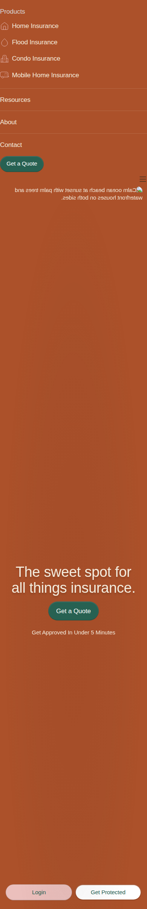

# UI Design System & Master Generation Blueprint: www-honeyquote-com

> **Compare Insurance Quotes Worth Trusting · HoneyQuote** (https://www.honeyquote.com/) — Compare quotes from 20+ carriers. Real licensed agents get you the best insurance quotes, straight answers, zero spam, and your credit sc...


---

## 1. Executive Visual Persona & Design Archetype

- **Brand Essence & Persona**: **Compare Insurance Quotes Worth Trusting · HoneyQuote** (`https://www.honeyquote.com/`). Compare quotes from 20+ carriers. Real licensed agents get you the best insurance quotes, straight answers, zero spam, and your credit sc...
- **Visual Archetype**: **High-Contrast Obsidian / Atmospheric Design System (`#ac512a` canvas, `#fff` ink, `#1b493d` accent)**.
- **Anti-AI-Slop Differentiators**:
  - **Source-Grounded Chromatic Polarity**: Anchors the viewport in `#ac512a` (`var(--amber)` in `:root`) paired with `#fff` primary typography and `#1b493d` accents.
  - **Extracted Typographic Hierarchy**: Pairs `Instrument Serif` for display copy (`Compare insurance quotes for coverag`) with `Inter` and not declared in static CSS (uses primary stack / `ui-monospace`).
  - **Calibrated Spatial Grid & Motion**: Combines `940px` container bounds (`gap: 16px`, padding `9px`) with `cubic-bezier(.645,.045,.355,1)` easing and GSAP Timeline & ScrollTrigger, Three.js / WebGL Canvas Pipeline.

---

## 2. Spatial Architecture & Modular Grid Mathematics



### Viewport Allocation & Container Geometry
- **Captured Viewport Dimensions**: Desktop `1440×10704px` (`assets/desktop.png`, full-page scroll capture), Mobile `390×2400px` (`assets/mobile.png`, capped at 2400px multi-section capture).
- **Master Container Bounds**: `940px` extracted from `www-honeyquote-com` stylesheet.
- **Canvas Lateral Padding & Spacing**: `9px` lateral canvas padding with `16px` grid gap.
- **Border Radius Scale**: `3px`, `100%`, `50%`, `2px`.

### Responsive Breakpoint Architecture
- **Desktop Layout**: Multi-column CSS Grid / Flexbox layout at `1440px` (`max-width: 940px`, `gap: 16px`).
- **Mobile Layout**: Single-column vertical stack at `390px` viewport width with `9px` horizontal padding.
- **Extracted CSS Media Queries**: `@media screen and (max-width:991px)`, `@media screen and (max-width:767px)`, `@media screen and (max-width:479px)`, `@media (min-width:768px)`.

---

## 3. Color System, Materiality & Atmospheric Lighting

### Semantic Palette & Source Grounding
| Semantic Role | Ground-Truth Value | Extracted CSS Source / Selector |
|---|---|---|
| **Primary Canvas Substrate** | `#ac512a` | `var(--amber)` in `:root` |
| **Primary Typography Ink** | `#f4ecde` | `var(--brand--ivory-nectar)` in `:root` |
| **Elevated Surface / Card Substrate** | `#276152` | `var(--brand--deep-cypress)` in `:root` |
| **Interactive Accent / Highlight** | `#1b493d` | `var(--brand--deep-cypress-dark)` in `:root` |
| **Secondary / Muted Copy** | `#fff` | `var(--base-color-neutral--white)` in `:root` |
| **Structural Hairline Border** | `#fff0` | `var(--opacity--transparent)` in `:root` |

### Sanitized Root CSS Variables (`ui-ux.md` Ground Truth)
| Variable Name | Extracted Value | Semantic Role |
|---|---|---|
| `--w-backdrop-animation` | `initial` | Motion / Easing Token |
| `--background-color--background-primary` | `var(--brand--ivory-nectar)` | Canvas / Surface Token |
| `--_typography---body--font-family` | `var(--_typography---font-family--secondary)` | Typography / Scale Token |
| `--text-color--text-primary` | `var(--brand--midnight-pine)` | Typography Ink Token |
| `--_typography---body--font-size` | `var(--_typography---font--regular)` | Typography / Scale Token |
| `--_typography---body--line-height` | `var(--_typography---font-height--large)` | Typography / Scale Token |
| `--_typography---body--font-weight` | `var(--_typography---font-weight--medium)` | Typography / Scale Token |
| `--_typography---body--letter-spacing` | `var(--_typography---letter-spacing--tight)` | Typography / Scale Token |
| `--_typography---font-family--primary` | `"Instrument Serif",sans-serif` | Brand / Palette Token |
| `--_typography---h1--font-size` | `5rem` | Typography / Scale Token |
| `--_typography---h1--line-height` | `var(--_typography---font-height--small)` | Typography / Scale Token |
| `--_typography---h1--font-weight` | `var(--_typography---font-weight--normal)` | Typography / Scale Token |
| `--_typography---h1--letter-spacing` | `var(--_typography---letter-spacing--tight)` | Typography / Scale Token |
| `--_typography---h2--font-family` | `var(--_typography---font-family--primary)` | Typography / Scale Token |
| `--_typography---h2--font-size` | `3rem` | Typography / Scale Token |
| `--_typography---h2--line-height` | `var(--_typography---font-height--small)` | Typography / Scale Token |

---

## 4. Typographic Scale & Editorial Hierarchy

### Font Family Stacks
- **Display Typography**: `Instrument Serif`.
- **Primary Body Stack**: `Inter`.
- **Technical / Metadata Stack**: not declared in static CSS (uses primary stack / `ui-monospace`).

### Typographic Scale & Rules (Extracted from Stylesheet & Variables)
- **Hero Display (`H1`)**: CSS variables `--_typography---h1--font-size: 5rem`, `--_typography---h1--line-height: var(--_typography---font-height--small)`, `--_typography---h1--font-weight: var(--_typography---font-weight--normal)`; rule `h1` (`font-size: var(--_typography---h2--font-...`, `line-height: var(--_typography---h...`, `letter-spacing: var(--_typography---h...`, `font-weight: var(--_typogr...`).
- **Section Heading (`H2`)**: CSS variables `--_typography---h2--font-family: var(--_typography---font-family--primary)`, `--_typography---h2--font-size: 3rem`, `--_typography---h2--line-height: var(--_typography---font-height--small)`; rule `h2` (`font-size: var(--_typography---h3--font-...`, `line-height: var(--_typography---h...`, `letter-spacing: var(--_typography---h...`, `font-weight: var(--_typogr...`).
- **Body Copy**: CSS variables `--_typography---body--font-family: var(--_typography---font-family--secondary)`, `--_typography---body--font-size: var(--_typography---font--regular)`, `--_typography---body--line-height: var(--_typography---font-height--large)`; rule `p` (`font-size: var(--_typography---h4--font-...`, `line-height: var(--_typography---h...`, `letter-spacing: var(--_typography---h...`, `font-weight: var(--_typogr...`).
- **Metadata & Navigation Labels**: CSS variables `--_typography---body--letter-spacing: var(--_typography---letter-spacing--tight)`, `--_typography---h1--letter-spacing: var(--_typography---letter-spacing--tight)`, `--_typography---h2--letter-spacing: var(--_typography---letter-spacing--tight)`; rule `small` (`font-size: .75rem`, `line-height: 1.2`, `font-weight: 400`).

---

## 5. Choreographed Motion & Interaction Physics

### Primary Easing Curves
- **Extracted Timing Functions**: `cubic-bezier(.645,.045,.355,1)`, `cubic-bezier(.4,0,.2,1)`, `cubic-bezier(.68,-.55,.265,1.55)`.

### Per-Element Transition & Choreography Rules
- **Selector `.w-webflow-badge>img`**: `transition: unset` extracted from `www-honeyquote-com` stylesheet.
- **Selector `.w-slider-dot`**: `transition: background-color .1s,color .1s` extracted from `www-honeyquote-com` stylesheet.
- **Selector `.w-lightbox-control`**: `transition: all .3s` extracted from `www-honeyquote-com` stylesheet.
- **Extracted Easing Curve (`cubic-bezier(.645,.045,.355,1)`)**: Governs interactive state transitions across `<nav.nav_content>` and `<section.section_home-hero>`.
- **Runtime Interaction Engine**: Integrates GSAP Timeline & ScrollTrigger, Three.js / WebGL Canvas Pipeline, Swiper Touch Carousel Engine, Lottie Vector Animation Player with `prefers-reduced-motion: reduce` fallback guards.

---

## 6. Component Wireframe & Structural DOM Map

### Visual Layout Schematic (Grounded in `dom.html` — `1440px` Desktop & `390px` Mobile Reflow)
```
┌────────────────────────────────────────────────────────────────────────┐
│ DESKTOP VIEWPORT (1440px) — Compare Insurance Quotes Worth Trusting ·  │
│ ====================================================================== │
│ [ <nav.nav_content>        | Home Insurance · Flood Insurance · Con ]  │
│ ---------------------------------------------------------------------- │
│ | HERO STAGE: <section.section_banner>                             |   │
│ | H1: Compare insurance quotes for coverage that's ther...         |   │
│ | Substrate: #ac512a    | Ink: #fff       | Accent: #1b493d        |   │
│ ---------------------------------------------------------------------- │
│ | SHOWCASE GRID (<section.section_home-hero) max-w: 940px          |   │
│ | +------------------------------+  +------------------------------+ | │
│ | | The sweet spot for all thing |  | What we cover                | | │
│ | +------------------------------+  +------------------------------+ | │
│ ---------------------------------------------------------------------- │
│ | MOBILE VIEWPORT REFLOW (390px) — Single-Column Stack (gap: 16px  ) | │
│ | [<nav.nav_content>] -> [<section.section_b] -> [<section.section_h]  │
│ ---------------------------------------------------------------------- │
│ [ FOOTER (<footer.wf-inter-n8-ac) | https://www.honeyquote.com/        │
└────────────────────────────────────────────────────────────────────────┘
```

### Granular DOM Region Breakdown
1. **Brand Header & Navigation Bar (<nav.nav_content> — `www-honeyquote-com`)**:
   - Landmark `<nav class="nav_content w-nav-menu">` hosting `Compare Insurance Quotes Worth Trust` navigation (`Home Insurance · Flood Insurance · Condo Insurance · X insurance in Y`), DOM attributes (`data-wf-domain="www.honeyquote.com"`, `data-wf-page="6a21ae850094dc6f56f29bed"`, `data-wf-site="6a21ae820094dc6f56f29b98"`, `data-wf-intellimize-customer-id="117608328"`), and stylesheet rule `html { -webkit-text-size-adjust:100%;-ms-text-size-adjust:100%;font-family:sans... }`.
2. **Hero Stage & Focal Lead (<section.section_banner> — `Compare insurance quotes for cover`)**:
   - Landmark `<section class="section_banner">` presenting display lead `Compare insurance quotes for coverage that's ther...` and copy excerpt *"Want us to do the shopping for you? Call (561) 264-2614"* over `#ac512a` canvas and `#fff` ink.
3. **Primary Showcase & Content Grid (<section.section_home-hero> — `The sweet spot for all things insu`)**:
   - Landmark `<section class="section_home-hero">` rendering section `The sweet spot for all things insurance.` with copy *"Mobile Home Insurance"*, asset references (`cdn.prod.website-files.com`, `honeyquote-v2.shared.e243b8f63.mi...`, `fonts.googleapis.com`, `fonts.gstatic.com`), and grid rule `summary { display:block }`.
4. **Interactive Detail & Feature Matrix (<section.section_coverage> — `What we cover`)**:
   - Landmark `<section class="section_coverage">` framing `What we cover` and `Personal Lines` (*"Want an expert to handle this?"*) with `#276152` surface cards, `#1b493d` accents, and `video { vertical-align:baseline;display:inline-block }`.
5. **Colophon & Global Directory Footer (<footer.wf-inter-n8-active> — `https://www.honeyquote.com/`)**:
   - Landmark `<footer class="wf-inter-n8-active">` anchoring `Compare Insurance Quotes Worth T` footer links (`Home Insurance · Flood Insurance · Condo Insurance · X insurance in Y`), copy *"Home insurance in Florida"*, and `#fff0` structural dividers.

---

## 7. Master Zero-Shot AI Generation Prompt

```markdown
# Master Zero-Shot Frontend Generation Prompt: www-honeyquote-com (Compare Insurance Quotes Worth Trusting · HoneyQuote)

You are a principal frontend architect and design systems engineer. Build a complete, production-ready web application replicating the exact design system, DOM landmarks, typographic hierarchy, color tokens, and motion physics of `www-honeyquote-com` (**Compare Insurance Quotes Worth Trusting · HoneyQuote** — `https://www.honeyquote.com/`).

### 1. Visual Archetype & Anti-AI-Slop Mandates
- **Archetype**: High-Contrast Obsidian / Atmospheric Design System (`#ac512a` canvas, `#fff` ink, `#1b493d` accent).
- **Identity & Domain Context**: Compare quotes from 20+ carriers. Real licensed agents get you the best insurance quotes, straight answers, zero spam, and your credit sc...
- **Primary Substrate**: `#ac512a` (`var(--amber)` in `:root`), **Primary Ink**: `#fff`, **Accent / Highlight**: `#1b493d`.
- **Site-Specific Differentiators**:
  - **Source-Grounded Chromatic Polarity**: Anchors the viewport in `#ac512a` (`var(--amber)` in `:root`) paired with `#fff` primary typography and `#1b493d` accents.
  - **Extracted Typographic Hierarchy**: Pairs `Instrument Serif` for display copy (`Compare insurance quotes for coverag`) with `Inter` and not declared in static CSS (uses primary stack / `ui-monospace`).
  - **Calibrated Spatial Grid & Motion**: Combines `940px` container bounds (`gap: 16px`, padding `9px`) with `cubic-bezier(.645,.045,.355,1)` easing and GSAP Timeline & ScrollTrigger, Three.js / WebGL Canvas Pipeline.

### 2. Ground-Truth CSS Variables (`:root` Token Contract)
Declare and consume these exact custom properties extracted from `www-honeyquote-com` in your global stylesheet:

:root {
  /* Compare Insurance Quotes Worth Trusting · HoneyQuote (www-honeyquote-com) — Ground-Truth Extracted CSS Variables */
  --w-backdrop-animation: initial; /* Motion / Easing Token (www-honeyquote-com) */
  --background-color--background-primary: var(--brand--ivory-nectar); /* Canvas / Surface Token (www-honeyquote-com) */
  --_typography---body--font-family: var(--_typography---font-family--secondary); /* Typography / Scale Token (www-honeyquote-com) */
  --text-color--text-primary: var(--brand--midnight-pine); /* Typography Ink Token (www-honeyquote-com) */
  --_typography---body--font-size: var(--_typography---font--regular); /* Typography / Scale Token (www-honeyquote-com) */
  --_typography---body--line-height: var(--_typography---font-height--large); /* Typography / Scale Token (www-honeyquote-com) */
  --_typography---body--font-weight: var(--_typography---font-weight--medium); /* Typography / Scale Token (www-honeyquote-com) */
  --_typography---body--letter-spacing: var(--_typography---letter-spacing--tight); /* Typography / Scale Token (www-honeyquote-com) */
  --_typography---font-family--primary: "Instrument Serif",sans-serif; /* Brand / Palette Token (www-honeyquote-com) */
  --_typography---h1--font-size: 5rem; /* Typography / Scale Token (www-honeyquote-com) */
  --_typography---h1--line-height: var(--_typography---font-height--small); /* Typography / Scale Token (www-honeyquote-com) */
  --_typography---h1--font-weight: var(--_typography---font-weight--normal); /* Typography / Scale Token (www-honeyquote-com) */
  --_typography---h1--letter-spacing: var(--_typography---letter-spacing--tight); /* Typography / Scale Token (www-honeyquote-com) */
  --_typography---h2--font-family: var(--_typography---font-family--primary); /* Typography / Scale Token (www-honeyquote-com) */
  --_typography---h2--font-size: 3rem; /* Typography / Scale Token (www-honeyquote-com) */
  --_typography---h2--line-height: var(--_typography---font-height--small); /* Typography / Scale Token (www-honeyquote-com) */
}

### 3. Semantic Color & Materiality Contract
Map every surface, ink, and border strictly to these source-grounded tokens:
- **Primary Canvas Substrate**: `#ac512a` — grounded in `var(--amber)` in `:root`
- **Primary Typography Ink**: `#f4ecde` — grounded in `var(--brand--ivory-nectar)` in `:root`
- **Elevated Surface / Card Substrate**: `#276152` — grounded in `var(--brand--deep-cypress)` in `:root`
- **Interactive Accent / Highlight**: `#1b493d` — grounded in `var(--brand--deep-cypress-dark)` in `:root`
- **Secondary / Muted Copy**: `#fff` — grounded in `var(--base-color-neutral--white)` in `:root`
- **Structural Hairline Border**: `#fff0` — grounded in `var(--opacity--transparent)` in `:root`

### 4. Spatial Grid, Container Bounds & Responsive Breakpoints
- **Desktop Viewport Reference**: `1440×10704px` (full-page scroll capture, `1440px` standard desktop width).
- **Mobile Viewport Reference**: `390×2400px` (capped at 2400px multi-section capture, `390px` standard mobile width).
- **Container Max-Width**: `940px` extracted from `www-honeyquote-com` stylesheet
- **Padding & Gutters**: `9px` lateral canvas padding with `16px` grid gap
- **Desktop Grid**: Multi-column CSS Grid / Flexbox layout at `1440px` (`max-width: 940px`, `gap: 16px`)
- **Mobile Adaptation**: Single-column vertical stack at `390px` viewport width with `9px` horizontal padding
- **Media Queries**: `@media screen and (max-width:991px)`, `@media screen and (max-width:767px)`, `@media screen and (max-width:479px)`, `@media (min-width:768px)`
- **Corner Radii**: `3px`, `100%`, `50%`, `2px`

### 5. Typography & Editorial Scale Contract
- **Display Font Stack**: `Instrument Serif`
- **Body Font Stack**: `Inter`
- **Monospace / Technical Font Stack**: not declared in static CSS (uses primary stack / `ui-monospace`)
- **H1 Display Rule**: CSS variables `--_typography---h1--font-size: 5rem`, `--_typography---h1--line-height: var(--_typography---font-height--small)`, `--_typography---h1--font-weight: var(--_typography---font-weight--normal)`; rule `h1` (`font-size: var(--_typography---h2--font-...`, `line-height: var(--_typography---h...`, `letter-spacing: var(--_typography---h...`, `font-weight: var(--_typogr...`)
- **H2 Section Rule**: CSS variables `--_typography---h2--font-family: var(--_typography---font-family--primary)`, `--_typography---h2--font-size: 3rem`, `--_typography---h2--line-height: var(--_typography---font-height--small)`; rule `h2` (`font-size: var(--_typography---h3--font-...`, `line-height: var(--_typography---h...`, `letter-spacing: var(--_typography---h...`, `font-weight: var(--_typogr...`)
- **Body Copy Rule**: CSS variables `--_typography---body--font-family: var(--_typography---font-family--secondary)`, `--_typography---body--font-size: var(--_typography---font--regular)`, `--_typography---body--line-height: var(--_typography---font-height--large)`; rule `p` (`font-size: var(--_typography---h4--font-...`, `line-height: var(--_typography---h...`, `letter-spacing: var(--_typography---h...`, `font-weight: var(--_typogr...`)
- **Metadata & Index Rule**: CSS variables `--_typography---body--letter-spacing: var(--_typography---letter-spacing--tight)`, `--_typography---h1--letter-spacing: var(--_typography---letter-spacing--tight)`, `--_typography---h2--letter-spacing: var(--_typography---letter-spacing--tight)`; rule `small` (`font-size: .75rem`, `line-height: 1.2`, `font-weight: 400`)

### 6. Component Hierarchy, Verbatim Copy & Real DOM Landmarks
Scaffold `www-honeyquote-com` (`Compare Insurance Quotes Worth Trusting · HoneyQuote`) with these exact structural regions, extracted copy, and CSS rules from `dom.html`:
1. **Brand Header & Navigation Bar (<nav.nav_content> — `www-honeyquote-com`)**:
   - DOM & Selectors: Landmark `<nav class="nav_content w-nav-menu">` hosting `Compare Insurance Quotes Worth Trust` navigation (`Home Insurance · Flood Insurance · Condo Insurance · X insurance in Y`), DOM attributes (`data-wf-domain="www.honeyquote.com"`, `data-wf-page="6a21ae850094dc6f56f29bed"`, `data-wf-site="6a21ae820094dc6f56f29b98"`, `data-wf-intellimize-customer-id="117608328"`), and stylesheet rule `html { -webkit-text-size-adjust:100%;-ms-text-size-adjust:100%;font-family:sans... }`.
   - Responsive Contract: Header `Brand Header & Navigation Bar (<nav.nav_content> — `www-honeyquote-com`)` (`www-honeyquote-com`) adapts across `@media screen and (max-width:991px)`, `@media screen and (max-width:767px)`, `@media screen and (max-width:479px)`, `@media (min-width:768px)` with `cubic-bezier(.645,.045,.355,1)`, `cubic-bezier(.4,0,.2,1)`, `cubic-bezier(.68,-.55,.265,1.55)` transitions and links `Home Insurance · Flood Insurance · Condo Insurance · X insurance in Y`.
2. **Hero Stage & Focal Lead (<section.section_banner> — `Compare insurance quotes for cover`)**:
   - DOM & Selectors: Landmark `<section class="section_banner">` presenting display lead `Compare insurance quotes for coverage that's ther...` and copy excerpt *"Want us to do the shopping for you? Call (561) 264-2614"* over `#ac512a` canvas and `#fff` ink.
   - Responsive Contract: Hero stage (`1440×10704px` desktop / `390×2400px` mobile) sets `#ac512a` background with `#fff` headline `Compare insurance quotes for coverage that's ther...`.
3. **Primary Showcase & Content Grid (<section.section_home-hero> — `The sweet spot for all things insu`)**:
   - DOM & Selectors: Landmark `<section class="section_home-hero">` rendering section `The sweet spot for all things insurance.` with copy *"Mobile Home Insurance"*, asset references (`cdn.prod.website-files.com`, `honeyquote-v2.shared.e243b8f63.mi...`, `fonts.googleapis.com`, `fonts.gstatic.com`), and grid rule `summary { display:block }`.
   - Responsive Contract: Showcase grid `Primary Showcase & Content Grid (<section.section_home-hero> — `The sweet spot for all things insu`)` applies Multi-column CSS Grid / Flexbox layout at `1440px` (`max-width: 940px`, `gap: 16px`) on desktop and Single-column vertical stack at `390px` viewport width with `9px` horizontal padding on mobile.
4. **Interactive Detail & Feature Matrix (<section.section_coverage> — `What we cover`)**:
   - DOM & Selectors: Landmark `<section class="section_coverage">` framing `What we cover` and `Personal Lines` (*"Want an expert to handle this?"*) with `#276152` surface cards, `#1b493d` accents, and `video { vertical-align:baseline;display:inline-block }`.
   - Responsive Contract: Detail module `Interactive Detail & Feature Matrix (<section.section_coverage> — `What we cover`)` uses `3px`, `100%`, `50%`, `2px` radii, `#1b493d` highlights, and assets (cdn.prod.website-files.com, honeyquote-v2.shared.e243b8f63.mi..., fonts.googleapis.com).
5. **Colophon & Global Directory Footer (<footer.wf-inter-n8-active> — `https://www.honeyquote.com/`)**:
   - DOM & Selectors: Landmark `<footer class="wf-inter-n8-active">` anchoring `Compare Insurance Quotes Worth T` footer links (`Home Insurance · Flood Insurance · Condo Insurance · X insurance in Y`), copy *"Home insurance in Florida"*, and `#fff0` structural dividers.
   - Responsive Contract: Footer `Colophon & Global Directory Footer (<footer.wf-inter-n8-active> — `https://www.honeyquote.com/`)` aligns to `940px` extracted from `www-honeyquote-com` stylesheet with `9px` lateral canvas padding with `16px` grid gap and attributes (data-wf-domain="www.honeyquote.com", data-wf-page="6a21ae850094dc6f56f29bed", data-wf-site="6a21ae820094dc6f56f29b98").

#### Verbatim DOM Copy Excerpts (`dom.html`)
- Copy Excerpt 1: *"Want us to do the shopping for you? Call (561) 264-2614"*
- Copy Excerpt 2: *"Mobile Home Insurance"*
- Copy Excerpt 3: *"Want an expert to handle this?"*
- Copy Excerpt 4: *"Home insurance in Florida"*

### 7. Motion, Extracted Stylesheet Rules & Interaction Choreography
- **Primary Easing Functions**: `cubic-bezier(.645,.045,.355,1)`, `cubic-bezier(.4,0,.2,1)`, `cubic-bezier(.68,-.55,.265,1.55)`
- **Extracted Stylesheet Rules (`www-honeyquote-com`)**:
- `html { -webkit-text-size-adjust:100%;-ms-text-size-adjust:100%;font-family:sans... }`
- `summary { display:block }`
- `video { vertical-align:baseline;display:inline-block }`
- `template { display:none }`
- `strong { font-weight:700 }`
- **Per-Selector Transition Rules**:
- **Selector `.w-webflow-badge>img`**: `transition: unset` extracted from `www-honeyquote-com` stylesheet.
- **Selector `.w-slider-dot`**: `transition: background-color .1s,color .1s` extracted from `www-honeyquote-com` stylesheet.
- **Selector `.w-lightbox-control`**: `transition: all .3s` extracted from `www-honeyquote-com` stylesheet.
- **Extracted Easing Curve (`cubic-bezier(.645,.045,.355,1)`)**: Governs interactive state transitions across `<nav.nav_content>` and `<section.section_home-hero>`.
- **Runtime Interaction Engine**: Integrates GSAP Timeline & ScrollTrigger, Three.js / WebGL Canvas Pipeline, Swiper Touch Carousel Engine, Lottie Vector Animation Player with `prefers-reduced-motion: reduce` fallback guards.

### 8. Technical Deliverables
- Implement in Next.js (App Router) with TypeScript and Tailwind CSS consuming the `:root` custom properties defined above for `www-honeyquote-com`.
- Reproduce both the `1440px` desktop architecture and `390px` mobile breakpoint transitions, preserving semantic HTML5 landmarks (`<header>`, `<nav>`, `<main>`, `<section>`, `<footer>`) and `prefers-reduced-motion` accessibility guards.
```
