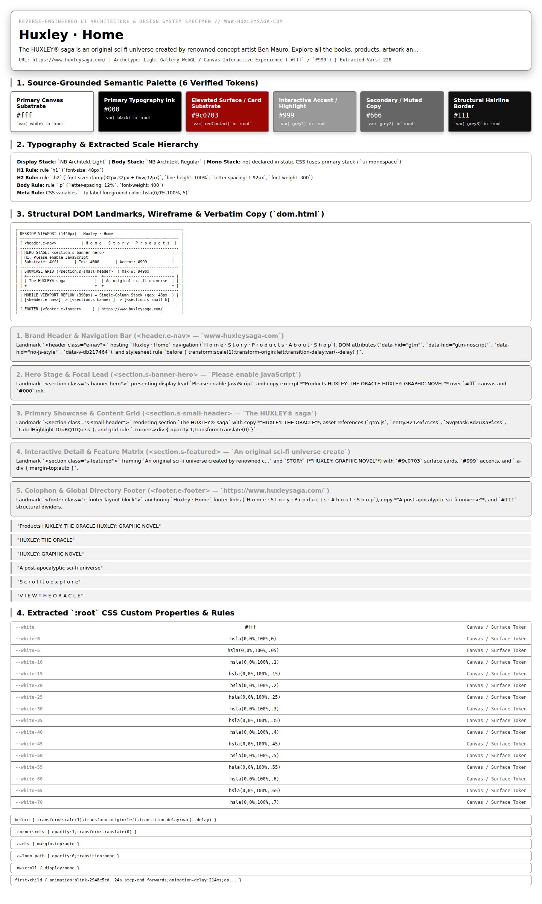
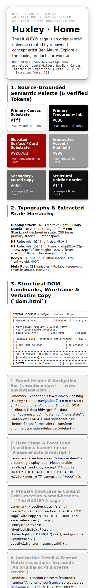

# UI Design System & Master Generation Blueprint: www-huxleysaga-com

> **Huxley · Home** (https://www.huxleysaga.com/) — The HUXLEY® saga is an original sci-fi universe created by renowned concept artist Ben Mauro. Explore all the books, products, artwork an...



---

## 1. Executive Visual Persona & Design Archetype

- **Brand Essence & Persona**: **Huxley · Home** (`https://www.huxleysaga.com/`). The HUXLEY® saga is an original sci-fi universe created by renowned concept artist Ben Mauro. Explore all the books, products, artwork an...
- **Visual Archetype**: **Light-Gallery WebGL / Canvas Interactive Experience (`#fff` / `#999`)**.
- **Anti-AI-Slop Differentiators**:
  - **Source-Grounded Chromatic Polarity**: Anchors the viewport in `#fff` (`var(--white)` in `:root`) paired with `#000` primary typography and `#999` accents.
  - **Extracted Typographic Hierarchy**: Pairs `NB Architekt Light` for display copy (`Please enable JavaScript`) with `NB Architekt Regular` and not declared in static CSS (uses primary stack / `ui-monospace`).
  - **Calibrated Spatial Grid & Motion**: Combines `949px` container bounds (`gap: 48px`, padding `12px`) with `cubic-bezier(.4,0,.2,1)` easing and Lenis Smooth Scroll (`data-lenis`), Three.js / WebGL Canvas Pipeline.

---

## 2. Spatial Architecture & Modular Grid Mathematics



### Viewport Allocation & Container Geometry
- **Captured Viewport Dimensions**: Desktop `1440×2400px` (`assets/desktop.png`, capped at 2400px multi-section capture), Mobile `390×2400px` (`assets/mobile.png`, capped at 2400px multi-section capture).
- **Master Container Bounds**: `949px` extracted from `www-huxleysaga-com` stylesheet.
- **Canvas Lateral Padding & Spacing**: `12px` lateral canvas padding with `48px` grid gap.
- **Border Radius Scale**: `0px` (sharp unrounded corners).

### Responsive Breakpoint Architecture
- **Desktop Layout**: Multi-column CSS Grid / Flexbox layout at `1440px` (`max-width: 949px`, `gap: 48px`).
- **Mobile Layout**: Single-column vertical stack at `390px` viewport width with `12px` horizontal padding.
- **Extracted CSS Media Queries**: `@media (min-width:950px)`, `@media (max-width:949px)`, `@media (prefers-reduced-motion:reduce)`, `@media (max-width:949px)and (min-width:950px)`.

---

## 3. Color System, Materiality & Atmospheric Lighting

### Semantic Palette & Source Grounding
| Semantic Role | Ground-Truth Value | Extracted CSS Source / Selector |
|---|---|---|
| **Primary Canvas Substrate** | `#fff` | `var(--white)` in `:root` |
| **Primary Typography Ink** | `#000` | `var(--black)` in `:root` |
| **Elevated Surface / Card Substrate** | `#9c0703` | `var(--redContact)` in `:root` |
| **Interactive Accent / Highlight** | `#999` | `var(--grey1)` in `:root` |
| **Secondary / Muted Copy** | `#666` | `var(--grey2)` in `:root` |
| **Structural Hairline Border** | `#111` | `var(--grey3)` in `:root` |

### Sanitized Root CSS Variables (`ui-ux.md` Ground Truth)
| Variable Name | Extracted Value | Semantic Role |
|---|---|---|
| `--white` | `#fff` | Canvas / Surface Token |
| `--white-0` | `hsla(0,0%,100%,0)` | Canvas / Surface Token |
| `--white-5` | `hsla(0,0%,100%,.05)` | Canvas / Surface Token |
| `--white-10` | `hsla(0,0%,100%,.1)` | Canvas / Surface Token |
| `--white-15` | `hsla(0,0%,100%,.15)` | Canvas / Surface Token |
| `--white-20` | `hsla(0,0%,100%,.2)` | Canvas / Surface Token |
| `--white-25` | `hsla(0,0%,100%,.25)` | Canvas / Surface Token |
| `--white-30` | `hsla(0,0%,100%,.3)` | Canvas / Surface Token |
| `--white-35` | `hsla(0,0%,100%,.35)` | Canvas / Surface Token |
| `--white-40` | `hsla(0,0%,100%,.4)` | Canvas / Surface Token |
| `--white-45` | `hsla(0,0%,100%,.45)` | Canvas / Surface Token |
| `--white-50` | `hsla(0,0%,100%,.5)` | Canvas / Surface Token |
| `--white-55` | `hsla(0,0%,100%,.55)` | Canvas / Surface Token |
| `--white-60` | `hsla(0,0%,100%,.6)` | Canvas / Surface Token |
| `--white-65` | `hsla(0,0%,100%,.65)` | Canvas / Surface Token |
| `--white-70` | `hsla(0,0%,100%,.7)` | Canvas / Surface Token |

---

## 4. Typographic Scale & Editorial Hierarchy

### Font Family Stacks
- **Display Typography**: `NB Architekt Light`.
- **Primary Body Stack**: `NB Architekt Regular`.
- **Technical / Metadata Stack**: not declared in static CSS (uses primary stack / `ui-monospace`).

### Typographic Scale & Rules (Extracted from Stylesheet & Variables)
- **Hero Display (`H1`)**: rule `h1` (`font-size: 48px`).
- **Section Heading (`H2`)**: rule `,h2` (`font-size: clamp(32px,32px + 0vw,32px)`, `line-height: 100%`, `letter-spacing: 1.92px`, `font-weight: 300`).
- **Body Copy**: rule `,p` (`letter-spacing: 12%`, `font-weight: 400`).
- **Metadata & Navigation Labels**: CSS variables `--tp-label-foreground-color: hsla(0,0%,100%,.5)`.

---

## 5. Choreographed Motion & Interaction Physics

### Primary Easing Curves
- **Extracted Timing Functions**: `cubic-bezier(.4,0,.2,1)`, `cubic-bezier(.596,.003,0,1.033)`, `cubic-bezier(.47,0,.745,.715)`.

### Per-Element Transition & Choreography Rules
- **Selector `mon-label-highlight[data-v-14832d...`**: `transition: transform var(--d-slide) steps(6)` extracted from `www-huxleysaga-com` stylesheet.
- **Selector `ommon-label-highlight span[data-v...`**: `transition: padding var(--d-medium) steps(3)` extracted from `www-huxleysaga-com` stylesheet.
- **Selector `er-hero__logo[data-v-922fea5f] .a...`**: `transition: none` extracted from `www-huxleysaga-com` stylesheet.
- **Extracted Easing Curve (`cubic-bezier(.4,0,.2,1)`)**: Governs interactive state transitions across `<header.e-nav>` and `<section.s-small-header>`.
- **Runtime Interaction Engine**: Integrates Lenis Smooth Scroll (`data-lenis`), Three.js / WebGL Canvas Pipeline, Lottie Vector Animation Player with `prefers-reduced-motion: reduce` fallback guards.

---

## 6. Component Wireframe & Structural DOM Map

### Visual Layout Schematic (Grounded in `dom.html` — `1440px` Desktop & `390px` Mobile Reflow)
```
┌────────────────────────────────────────────────────────────────────────┐
│ DESKTOP VIEWPORT (1440px) — Huxley · Home                              │
│ ====================================================================== │
│ [ <header.e-nav>           | H o m e · S t o r y · P r o d u c t s  ]  │
│ ---------------------------------------------------------------------- │
│ | HERO STAGE: <section.s-banner-hero>                              |   │
│ | H1: Please enable JavaScript                                     |   │
│ | Substrate: #fff       | Ink: #000       | Accent: #999           |   │
│ ---------------------------------------------------------------------- │
│ | SHOWCASE GRID (<section.s-small-header>  ) max-w: 949px          |   │
│ | +------------------------------+  +------------------------------+ | │
│ | | The HUXLEY® saga             |  | An original sci-fi universe  | | │
│ | +------------------------------+  +------------------------------+ | │
│ ---------------------------------------------------------------------- │
│ | MOBILE VIEWPORT REFLOW (390px) — Single-Column Stack (gap: 48px  ) | │
│ | [<header.e-nav>] -> [<section.s-banner-] -> [<section.s-small-h] |   │
│ ---------------------------------------------------------------------- │
│ [ FOOTER (<footer.e-footer>     ) | https://www.huxleysaga.com/        │
└────────────────────────────────────────────────────────────────────────┘
```

### Granular DOM Region Breakdown
1. **Brand Header & Navigation Bar (<header.e-nav> — `www-huxleysaga-com`)**:
   - Landmark `<header class="e-nav">` hosting `Huxley · Home` navigation (`H o m e · S t o r y · P r o d u c t s · A b o u t · S h o p`), DOM attributes (`data-hid="gtm"`, `data-hid="gtm-noscript"`, `data-hid="no-js-style"`, `data-v-db217464`), and stylesheet rule `before { transform:scale(1);transform-origin:left;transition-delay:var(--delay) }`.
2. **Hero Stage & Focal Lead (<section.s-banner-hero> — `Please enable JavaScript`)**:
   - Landmark `<section class="s-banner-hero">` presenting display lead `Please enable JavaScript` and copy excerpt *"Products HUXLEY: THE ORACLE HUXLEY: GRAPHIC NOVEL"* over `#fff` canvas and `#000` ink.
3. **Primary Showcase & Content Grid (<section.s-small-header> — `The HUXLEY® saga`)**:
   - Landmark `<section class="s-small-header">` rendering section `The HUXLEY® saga` with copy *"HUXLEY: THE ORACLE"*, asset references (`gtm.js`, `entry.B21Z6f7r.css`, `SvgMask.Bd2uXaPf.css`, `LabelHighlight.DTuRQ1tQ.css`), and grid rule `.corners>div { opacity:1;transform:translate(0) }`.
4. **Interactive Detail & Feature Matrix (<section.s-featured> — `An original sci-fi universe create`)**:
   - Landmark `<section class="s-featured">` framing `An original sci-fi universe created by renowned c...` and `STORY` (*"HUXLEY: GRAPHIC NOVEL"*) with `#9c0703` surface cards, `#999` accents, and `.a-div { margin-top:auto }`.
5. **Colophon & Global Directory Footer (<footer.e-footer> — `https://www.huxleysaga.com/`)**:
   - Landmark `<footer class="e-footer layout-block">` anchoring `Huxley · Home` footer links (`H o m e · S t o r y · P r o d u c t s · A b o u t · S h o p`), copy *"A post-apocalyptic sci-fi universe"*, and `#111` structural dividers.

---

## 7. Master Zero-Shot AI Generation Prompt

```markdown
# Master Zero-Shot Frontend Generation Prompt: www-huxleysaga-com (Huxley · Home)

You are a principal frontend architect and design systems engineer. Build a complete, production-ready web application replicating the exact design system, DOM landmarks, typographic hierarchy, color tokens, and motion physics of `www-huxleysaga-com` (**Huxley · Home** — `https://www.huxleysaga.com/`).

### 1. Visual Archetype & Anti-AI-Slop Mandates
- **Archetype**: Light-Gallery WebGL / Canvas Interactive Experience (`#fff` / `#999`).
- **Identity & Domain Context**: The HUXLEY® saga is an original sci-fi universe created by renowned concept artist Ben Mauro. Explore all the books, products, artwork an...
- **Primary Substrate**: `#fff` (`var(--white)` in `:root`), **Primary Ink**: `#000`, **Accent / Highlight**: `#999`.
- **Site-Specific Differentiators**:
  - **Source-Grounded Chromatic Polarity**: Anchors the viewport in `#fff` (`var(--white)` in `:root`) paired with `#000` primary typography and `#999` accents.
  - **Extracted Typographic Hierarchy**: Pairs `NB Architekt Light` for display copy (`Please enable JavaScript`) with `NB Architekt Regular` and not declared in static CSS (uses primary stack / `ui-monospace`).
  - **Calibrated Spatial Grid & Motion**: Combines `949px` container bounds (`gap: 48px`, padding `12px`) with `cubic-bezier(.4,0,.2,1)` easing and Lenis Smooth Scroll (`data-lenis`), Three.js / WebGL Canvas Pipeline.

### 2. Ground-Truth CSS Variables (`:root` Token Contract)
Declare and consume these exact custom properties extracted from `www-huxleysaga-com` in your global stylesheet:

:root {
  /* Huxley · Home (www-huxleysaga-com) — Ground-Truth Extracted CSS Variables */
  --white: #fff; /* Canvas / Surface Token (www-huxleysaga-com) */
  --white-0: hsla(0,0%,100%,0); /* Canvas / Surface Token (www-huxleysaga-com) */
  --white-5: hsla(0,0%,100%,.05); /* Canvas / Surface Token (www-huxleysaga-com) */
  --white-10: hsla(0,0%,100%,.1); /* Canvas / Surface Token (www-huxleysaga-com) */
  --white-15: hsla(0,0%,100%,.15); /* Canvas / Surface Token (www-huxleysaga-com) */
  --white-20: hsla(0,0%,100%,.2); /* Canvas / Surface Token (www-huxleysaga-com) */
  --white-25: hsla(0,0%,100%,.25); /* Canvas / Surface Token (www-huxleysaga-com) */
  --white-30: hsla(0,0%,100%,.3); /* Canvas / Surface Token (www-huxleysaga-com) */
  --white-35: hsla(0,0%,100%,.35); /* Canvas / Surface Token (www-huxleysaga-com) */
  --white-40: hsla(0,0%,100%,.4); /* Canvas / Surface Token (www-huxleysaga-com) */
  --white-45: hsla(0,0%,100%,.45); /* Canvas / Surface Token (www-huxleysaga-com) */
  --white-50: hsla(0,0%,100%,.5); /* Canvas / Surface Token (www-huxleysaga-com) */
  --white-55: hsla(0,0%,100%,.55); /* Canvas / Surface Token (www-huxleysaga-com) */
  --white-60: hsla(0,0%,100%,.6); /* Canvas / Surface Token (www-huxleysaga-com) */
  --white-65: hsla(0,0%,100%,.65); /* Canvas / Surface Token (www-huxleysaga-com) */
  --white-70: hsla(0,0%,100%,.7); /* Canvas / Surface Token (www-huxleysaga-com) */
}

### 3. Semantic Color & Materiality Contract
Map every surface, ink, and border strictly to these source-grounded tokens:
- **Primary Canvas Substrate**: `#fff` — grounded in `var(--white)` in `:root`
- **Primary Typography Ink**: `#000` — grounded in `var(--black)` in `:root`
- **Elevated Surface / Card Substrate**: `#9c0703` — grounded in `var(--redContact)` in `:root`
- **Interactive Accent / Highlight**: `#999` — grounded in `var(--grey1)` in `:root`
- **Secondary / Muted Copy**: `#666` — grounded in `var(--grey2)` in `:root`
- **Structural Hairline Border**: `#111` — grounded in `var(--grey3)` in `:root`

### 4. Spatial Grid, Container Bounds & Responsive Breakpoints
- **Desktop Viewport Reference**: `1440×2400px` (capped at 2400px multi-section capture, `1440px` standard desktop width).
- **Mobile Viewport Reference**: `390×2400px` (capped at 2400px multi-section capture, `390px` standard mobile width).
- **Container Max-Width**: `949px` extracted from `www-huxleysaga-com` stylesheet
- **Padding & Gutters**: `12px` lateral canvas padding with `48px` grid gap
- **Desktop Grid**: Multi-column CSS Grid / Flexbox layout at `1440px` (`max-width: 949px`, `gap: 48px`)
- **Mobile Adaptation**: Single-column vertical stack at `390px` viewport width with `12px` horizontal padding
- **Media Queries**: `@media (min-width:950px)`, `@media (max-width:949px)`, `@media (prefers-reduced-motion:reduce)`, `@media (max-width:949px)and (min-width:950px)`
- **Corner Radii**: `0px` (sharp unrounded corners)

### 5. Typography & Editorial Scale Contract
- **Display Font Stack**: `NB Architekt Light`
- **Body Font Stack**: `NB Architekt Regular`
- **Monospace / Technical Font Stack**: not declared in static CSS (uses primary stack / `ui-monospace`)
- **H1 Display Rule**: rule `h1` (`font-size: 48px`)
- **H2 Section Rule**: rule `,h2` (`font-size: clamp(32px,32px + 0vw,32px)`, `line-height: 100%`, `letter-spacing: 1.92px`, `font-weight: 300`)
- **Body Copy Rule**: rule `,p` (`letter-spacing: 12%`, `font-weight: 400`)
- **Metadata & Index Rule**: CSS variables `--tp-label-foreground-color: hsla(0,0%,100%,.5)`

### 6. Component Hierarchy, Verbatim Copy & Real DOM Landmarks
Scaffold `www-huxleysaga-com` (`Huxley · Home`) with these exact structural regions, extracted copy, and CSS rules from `dom.html`:
1. **Brand Header & Navigation Bar (<header.e-nav> — `www-huxleysaga-com`)**:
   - DOM & Selectors: Landmark `<header class="e-nav">` hosting `Huxley · Home` navigation (`H o m e · S t o r y · P r o d u c t s · A b o u t · S h o p`), DOM attributes (`data-hid="gtm"`, `data-hid="gtm-noscript"`, `data-hid="no-js-style"`, `data-v-db217464`), and stylesheet rule `before { transform:scale(1);transform-origin:left;transition-delay:var(--delay) }`.
   - Responsive Contract: Header `Brand Header & Navigation Bar (<header.e-nav> — `www-huxleysaga-com`)` (`www-huxleysaga-com`) adapts across `@media (min-width:950px)`, `@media (max-width:949px)`, `@media (prefers-reduced-motion:reduce)`, `@media (max-width:949px)and (min-width:950px)` with `cubic-bezier(.4,0,.2,1)`, `cubic-bezier(.596,.003,0,1.033)`, `cubic-bezier(.47,0,.745,.715)` transitions and links `H o m e · S t o r y · P r o d u c t s · A b o u t · S h o p`.
2. **Hero Stage & Focal Lead (<section.s-banner-hero> — `Please enable JavaScript`)**:
   - DOM & Selectors: Landmark `<section class="s-banner-hero">` presenting display lead `Please enable JavaScript` and copy excerpt *"Products HUXLEY: THE ORACLE HUXLEY: GRAPHIC NOVEL"* over `#fff` canvas and `#000` ink.
   - Responsive Contract: Hero stage (`1440×2400px` desktop / `390×2400px` mobile) sets `#fff` background with `#000` headline `Please enable JavaScript`.
3. **Primary Showcase & Content Grid (<section.s-small-header> — `The HUXLEY® saga`)**:
   - DOM & Selectors: Landmark `<section class="s-small-header">` rendering section `The HUXLEY® saga` with copy *"HUXLEY: THE ORACLE"*, asset references (`gtm.js`, `entry.B21Z6f7r.css`, `SvgMask.Bd2uXaPf.css`, `LabelHighlight.DTuRQ1tQ.css`), and grid rule `.corners>div { opacity:1;transform:translate(0) }`.
   - Responsive Contract: Showcase grid `Primary Showcase & Content Grid (<section.s-small-header> — `The HUXLEY® saga`)` applies Multi-column CSS Grid / Flexbox layout at `1440px` (`max-width: 949px`, `gap: 48px`) on desktop and Single-column vertical stack at `390px` viewport width with `12px` horizontal padding on mobile.
4. **Interactive Detail & Feature Matrix (<section.s-featured> — `An original sci-fi universe create`)**:
   - DOM & Selectors: Landmark `<section class="s-featured">` framing `An original sci-fi universe created by renowned c...` and `STORY` (*"HUXLEY: GRAPHIC NOVEL"*) with `#9c0703` surface cards, `#999` accents, and `.a-div { margin-top:auto }`.
   - Responsive Contract: Detail module `Interactive Detail & Feature Matrix (<section.s-featured> — `An original sci-fi universe create`)` uses `0px` (sharp unrounded corners) radii, `#999` highlights, and assets (gtm.js, entry.B21Z6f7r.css, SvgMask.Bd2uXaPf.css).
5. **Colophon & Global Directory Footer (<footer.e-footer> — `https://www.huxleysaga.com/`)**:
   - DOM & Selectors: Landmark `<footer class="e-footer layout-block">` anchoring `Huxley · Home` footer links (`H o m e · S t o r y · P r o d u c t s · A b o u t · S h o p`), copy *"A post-apocalyptic sci-fi universe"*, and `#111` structural dividers.
   - Responsive Contract: Footer `Colophon & Global Directory Footer (<footer.e-footer> — `https://www.huxleysaga.com/`)` aligns to `949px` extracted from `www-huxleysaga-com` stylesheet with `12px` lateral canvas padding with `48px` grid gap and attributes (data-hid="gtm", data-hid="gtm-noscript", data-hid="no-js-style").

#### Verbatim DOM Copy Excerpts (`dom.html`)
- Copy Excerpt 1: *"Products HUXLEY: THE ORACLE HUXLEY: GRAPHIC NOVEL"*
- Copy Excerpt 2: *"HUXLEY: THE ORACLE"*
- Copy Excerpt 3: *"HUXLEY: GRAPHIC NOVEL"*
- Copy Excerpt 4: *"A post-apocalyptic sci-fi universe"*

### 7. Motion, Extracted Stylesheet Rules & Interaction Choreography
- **Primary Easing Functions**: `cubic-bezier(.4,0,.2,1)`, `cubic-bezier(.596,.003,0,1.033)`, `cubic-bezier(.47,0,.745,.715)`
- **Extracted Stylesheet Rules (`www-huxleysaga-com`)**:
- `before { transform:scale(1);transform-origin:left;transition-delay:var(--delay) }`
- `.corners>div { opacity:1;transform:translate(0) }`
- `.a-div { margin-top:auto }`
- `.a-logo path { opacity:0;transition:none }`
- `.m-scroll { display:none }`
- **Per-Selector Transition Rules**:
- **Selector `mon-label-highlight[data-v-14832d...`**: `transition: transform var(--d-slide) steps(6)` extracted from `www-huxleysaga-com` stylesheet.
- **Selector `ommon-label-highlight span[data-v...`**: `transition: padding var(--d-medium) steps(3)` extracted from `www-huxleysaga-com` stylesheet.
- **Selector `er-hero__logo[data-v-922fea5f] .a...`**: `transition: none` extracted from `www-huxleysaga-com` stylesheet.
- **Extracted Easing Curve (`cubic-bezier(.4,0,.2,1)`)**: Governs interactive state transitions across `<header.e-nav>` and `<section.s-small-header>`.
- **Runtime Interaction Engine**: Integrates Lenis Smooth Scroll (`data-lenis`), Three.js / WebGL Canvas Pipeline, Lottie Vector Animation Player with `prefers-reduced-motion: reduce` fallback guards.

### 8. Technical Deliverables
- Implement in Next.js (App Router) with TypeScript and Tailwind CSS consuming the `:root` custom properties defined above for `www-huxleysaga-com`.
- Reproduce both the `1440px` desktop architecture and `390px` mobile breakpoint transitions, preserving semantic HTML5 landmarks (`<header>`, `<nav>`, `<main>`, `<section>`, `<footer>`) and `prefers-reduced-motion` accessibility guards.
```
