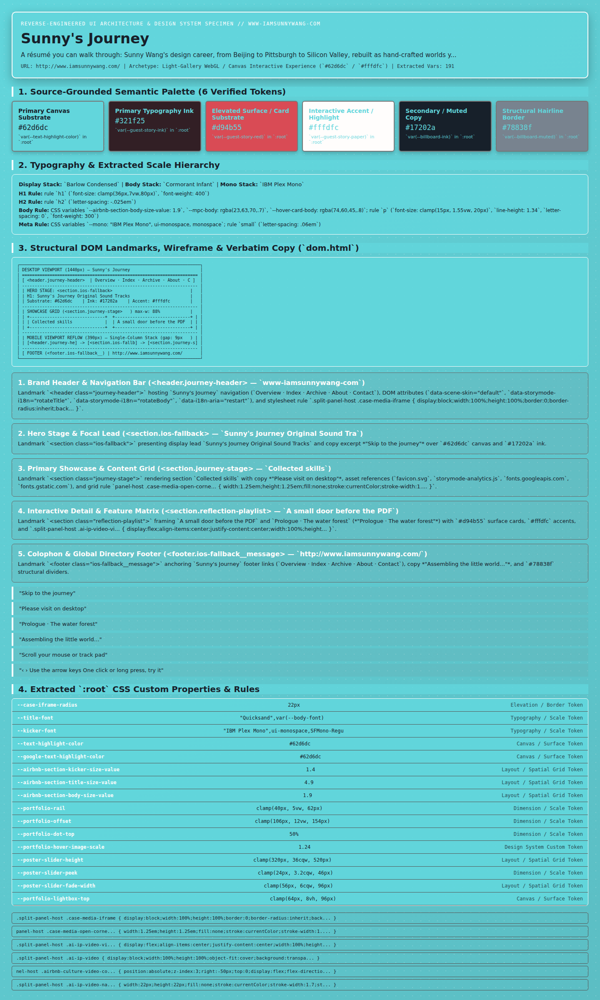
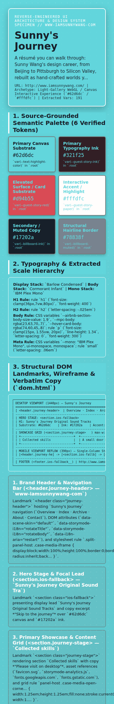

# UI Design System & Master Generation Blueprint: www-iamsunnywang-com

> **Sunny's Journey** (http://www.iamsunnywang.com/) — A résumé you can walk through: Sunny Wang's design career, from Beijing to Pittsburgh to Silicon Valley, rebuilt as hand-crafted worlds y...



---

## 1. Executive Visual Persona & Design Archetype

- **Brand Essence & Persona**: **Sunny's Journey** (`http://www.iamsunnywang.com/`). A résumé you can walk through: Sunny Wang's design career, from Beijing to Pittsburgh to Silicon Valley, rebuilt as hand-crafted worlds y...
- **Visual Archetype**: **Light-Gallery WebGL / Canvas Interactive Experience (`#62d6dc` / `#fffdfc`)**.
- **Anti-AI-Slop Differentiators**:
  - **Source-Grounded Chromatic Polarity**: Anchors the viewport in `#62d6dc` (`var(--text-highlight-color)` in `:root`) paired with `#17202a` primary typography and `#fffdfc` accents.
  - **Extracted Typographic Hierarchy**: Pairs `Barlow Condensed` for display copy (`Sunny's Journey Original Sound Track`) with `Cormorant Infant` and `IBM Plex Mono`.
  - **Calibrated Spatial Grid & Motion**: Combines `88%` container bounds (`gap: 9px`, padding `12px`) with `cubic-bezier(0.22,1,0.36,1)` easing and Three.js / WebGL Canvas Pipeline.

---

## 2. Spatial Architecture & Modular Grid Mathematics



### Viewport Allocation & Container Geometry
- **Captured Viewport Dimensions**: Desktop `1440×2400px` (`assets/desktop.png`, capped at 2400px multi-section capture), Mobile `390×2400px` (`assets/mobile.png`, capped at 2400px multi-section capture).
- **Master Container Bounds**: `88%` extracted from `www-iamsunnywang-com` stylesheet.
- **Canvas Lateral Padding & Spacing**: `12px` lateral canvas padding with `9px` grid gap.
- **Border Radius Scale**: `var(--case-iframe-radius)`, `999px`, `50%`, `28px`.

### Responsive Breakpoint Architecture
- **Desktop Layout**: Multi-column CSS Grid / Flexbox layout at `1440px` (`max-width: 88%`, `gap: 9px`).
- **Mobile Layout**: Single-column vertical stack at `390px` viewport width with `12px` horizontal padding.
- **Extracted CSS Media Queries**: `@media (max-width:800px)`, `@media (max-width: 900px)`, `@media (max-width: 820px)`, `@media (prefers-reduced-motion: reduce)`.

---

## 3. Color System, Materiality & Atmospheric Lighting

### Semantic Palette & Source Grounding
| Semantic Role | Ground-Truth Value | Extracted CSS Source / Selector |
|---|---|---|
| **Primary Canvas Substrate** | `#62d6dc` | `var(--text-highlight-color)` in `:root` |
| **Primary Typography Ink** | `#321f25` | `var(--guest-story-ink)` in `:root` |
| **Elevated Surface / Card Substrate** | `#d94b55` | `var(--guest-story-red)` in `:root` |
| **Interactive Accent / Highlight** | `#fffdfc` | `var(--guest-story-paper)` in `:root` |
| **Secondary / Muted Copy** | `#17202a` | `var(--billboard-ink)` in `:root` |
| **Structural Hairline Border** | `#78838f` | `var(--billboard-muted)` in `:root` |

### Sanitized Root CSS Variables (`ui-ux.md` Ground Truth)
| Variable Name | Extracted Value | Semantic Role |
|---|---|---|
| `--case-iframe-radius` | `22px` | Elevation / Border Token |
| `--title-font` | `"Quicksand",var(--body-font)` | Typography / Scale Token |
| `--kicker-font` | `"IBM Plex Mono",ui-monospace,SFMono-Regular,Menlo,Monaco,Consolas,monospace` | Typography / Scale Token |
| `--text-highlight-color` | `#62d6dc` | Canvas / Surface Token |
| `--google-text-highlight-color` | `#62d6dc` | Canvas / Surface Token |
| `--airbnb-section-kicker-size-value` | `1.4` | Layout / Spatial Grid Token |
| `--airbnb-section-title-size-value` | `4.9` | Layout / Spatial Grid Token |
| `--airbnb-section-body-size-value` | `1.9` | Layout / Spatial Grid Token |
| `--portfolio-rail` | `clamp(40px, 5vw, 62px)` | Dimension / Scale Token |
| `--portfolio-offset` | `clamp(106px, 12vw, 154px)` | Dimension / Scale Token |
| `--portfolio-dot-top` | `50%` | Dimension / Scale Token |
| `--portfolio-hover-image-scale` | `1.24` | Design System Custom Token |
| `--poster-slider-height` | `clamp(320px, 36cqw, 520px)` | Layout / Spatial Grid Token |
| `--poster-slider-peek` | `clamp(24px, 3.2cqw, 46px)` | Dimension / Scale Token |
| `--poster-slider-fade-width` | `clamp(56px, 6cqw, 96px)` | Layout / Spatial Grid Token |
| `--portfolio-lightbox-top` | `clamp(64px, 8vh, 96px)` | Canvas / Surface Token |

---

## 4. Typographic Scale & Editorial Hierarchy

### Font Family Stacks
- **Display Typography**: `Barlow Condensed`.
- **Primary Body Stack**: `Cormorant Infant`.
- **Technical / Metadata Stack**: `IBM Plex Mono`.

### Typographic Scale & Rules (Extracted from Stylesheet & Variables)
- **Hero Display (`H1`)**: rule `h1` (`font-size: clamp(36px,7vw,80px)`, `font-weight: 400`).
- **Section Heading (`H2`)**: rule `h2` (`letter-spacing: -.025em`).
- **Body Copy**: CSS variables `--airbnb-section-body-size-value: 1.9`, `--mpc-body: rgba(23,63,70,.7)`, `--hover-card-body: rgba(74,60,45,.8)`; rule `p` (`font-size: clamp(15px, 1.55vw, 20px)`, `line-height: 1.34`, `letter-spacing: 0`, `font-weight: 300`).
- **Metadata & Navigation Labels**: CSS variables `--mono: "IBM Plex Mono", ui-monospace, monospace`; rule `small` (`letter-spacing: .06em`).

---

## 5. Choreographed Motion & Interaction Physics

### Primary Easing Curves
- **Extracted Timing Functions**: `cubic-bezier(0.22,1,0.36,1)`, `cubic-bezier(.16,.88,.18,1)`, `cubic-bezier(0.08,0.78,0.16,1)`.

### Per-Element Transition & Choreography Rules
- **Selector `.tab-longform-nav-item`**: `transition: color 180ms ease,transform 180ms ease` extracted from `www-iamsunnywang-com` stylesheet.
- **Selector `.airbnb-panel-tabs`**: `transition: background 180ms ease, backdrop-filter 180ms ease, border-colo...` extracted from `www-iamsunnywang-com` stylesheet.
- **Selector `.airbnb-panel-tab`**: `transition: color 180ms ease` extracted from `www-iamsunnywang-com` stylesheet.
- **Extracted Easing Curve (`cubic-bezier(0.22,1,0.36,1)`)**: Governs interactive state transitions across `<header.journey-header>` and `<section.journey-stage>`.
- **Runtime Interaction Engine**: Integrates Three.js / WebGL Canvas Pipeline with `prefers-reduced-motion: reduce` fallback guards.

---

## 6. Component Wireframe & Structural DOM Map

### Visual Layout Schematic (Grounded in `dom.html` — `1440px` Desktop & `390px` Mobile Reflow)
```
┌────────────────────────────────────────────────────────────────────────┐
│ DESKTOP VIEWPORT (1440px) — Sunny's Journey                            │
│ ====================================================================== │
│ [ <header.journey-header>  | Overview · Index · Archive · About · C ]  │
│ ---------------------------------------------------------------------- │
│ | HERO STAGE: <section.ios-fallback>                               |   │
│ | H1: Sunny's Journey Original Sound Tracks                        |   │
│ | Substrate: #62d6dc    | Ink: #17202a    | Accent: #fffdfc        |   │
│ ---------------------------------------------------------------------- │
│ | SHOWCASE GRID (<section.journey-stage>   ) max-w: 88%            |   │
│ | +------------------------------+  +------------------------------+ | │
│ | | Collected skills             |  | A small door before the PDF  | | │
│ | +------------------------------+  +------------------------------+ | │
│ ---------------------------------------------------------------------- │
│ | MOBILE VIEWPORT REFLOW (390px) — Single-Column Stack (gap: 9px   ) | │
│ | [<header.journey-he] -> [<section.ios-fallb] -> [<section.journey-s] │
│ ---------------------------------------------------------------------- │
│ [ FOOTER (<footer.ios-fallback__) | http://www.iamsunnywang.com/       │
└────────────────────────────────────────────────────────────────────────┘
```

### Granular DOM Region Breakdown
1. **Brand Header & Navigation Bar (<header.journey-header> — `www-iamsunnywang-com`)**:
   - Landmark `<header class="journey-header">` hosting `Sunny's Journey` navigation (`Overview · Index · Archive · About · Contact`), DOM attributes (`data-scene-skin="default"`, `data-storymode-i18n="rotateTitle"`, `data-storymode-i18n="rotateBody"`, `data-i18n-aria="restart"`), and stylesheet rule `.split-panel-host .case-media-iframe { display:block;width:100%;height:100%;border:0;border-radius:inherit;back... }`.
2. **Hero Stage & Focal Lead (<section.ios-fallback> — `Sunny's Journey Original Sound Tra`)**:
   - Landmark `<section class="ios-fallback">` presenting display lead `Sunny's Journey Original Sound Tracks` and copy excerpt *"Skip to the journey"* over `#62d6dc` canvas and `#17202a` ink.
3. **Primary Showcase & Content Grid (<section.journey-stage> — `Collected skills`)**:
   - Landmark `<section class="journey-stage">` rendering section `Collected skills` with copy *"Please visit on desktop"*, asset references (`favicon.svg`, `storymode-analytics.js`, `fonts.googleapis.com`, `fonts.gstatic.com`), and grid rule `panel-host .case-media-open-corne... { width:1.25em;height:1.25em;fill:none;stroke:currentColor;stroke-width:1.... }`.
4. **Interactive Detail & Feature Matrix (<section.reflection-playlist> — `A small door before the PDF`)**:
   - Landmark `<section class="reflection-playlist">` framing `A small door before the PDF` and `Prologue · The water forest` (*"Prologue · The water forest"*) with `#d94b55` surface cards, `#fffdfc` accents, and `.split-panel-host .ai-ip-video-vi... { display:flex;align-items:center;justify-content:center;width:100%;height... }`.
5. **Colophon & Global Directory Footer (<footer.ios-fallback__message> — `http://www.iamsunnywang.com/`)**:
   - Landmark `<footer class="ios-fallback__message">` anchoring `Sunny's Journey` footer links (`Overview · Index · Archive · About · Contact`), copy *"Assembling the little world…"*, and `#78838f` structural dividers.

---

## 7. Master Zero-Shot AI Generation Prompt

```markdown
# Master Zero-Shot Frontend Generation Prompt: www-iamsunnywang-com (Sunny's Journey)

You are a principal frontend architect and design systems engineer. Build a complete, production-ready web application replicating the exact design system, DOM landmarks, typographic hierarchy, color tokens, and motion physics of `www-iamsunnywang-com` (**Sunny's Journey** — `http://www.iamsunnywang.com/`).

### 1. Visual Archetype & Anti-AI-Slop Mandates
- **Archetype**: Light-Gallery WebGL / Canvas Interactive Experience (`#62d6dc` / `#fffdfc`).
- **Identity & Domain Context**: A résumé you can walk through: Sunny Wang's design career, from Beijing to Pittsburgh to Silicon Valley, rebuilt as hand-crafted worlds y...
- **Primary Substrate**: `#62d6dc` (`var(--text-highlight-color)` in `:root`), **Primary Ink**: `#17202a`, **Accent / Highlight**: `#fffdfc`.
- **Site-Specific Differentiators**:
  - **Source-Grounded Chromatic Polarity**: Anchors the viewport in `#62d6dc` (`var(--text-highlight-color)` in `:root`) paired with `#17202a` primary typography and `#fffdfc` accents.
  - **Extracted Typographic Hierarchy**: Pairs `Barlow Condensed` for display copy (`Sunny's Journey Original Sound Track`) with `Cormorant Infant` and `IBM Plex Mono`.
  - **Calibrated Spatial Grid & Motion**: Combines `88%` container bounds (`gap: 9px`, padding `12px`) with `cubic-bezier(0.22,1,0.36,1)` easing and Three.js / WebGL Canvas Pipeline.

### 2. Ground-Truth CSS Variables (`:root` Token Contract)
Declare and consume these exact custom properties extracted from `www-iamsunnywang-com` in your global stylesheet:

:root {
  /* Sunny's Journey (www-iamsunnywang-com) — Ground-Truth Extracted CSS Variables */
  --case-iframe-radius: 22px; /* Elevation / Border Token (www-iamsunnywang-com) */
  --title-font: "Quicksand",var(--body-font); /* Typography / Scale Token (www-iamsunnywang-com) */
  --kicker-font: "IBM Plex Mono",ui-monospace,SFMono-Regular,Menlo,Monaco,Consolas,monospace; /* Typography / Scale Token (www-iamsunnywang-com) */
  --text-highlight-color: #62d6dc; /* Canvas / Surface Token (www-iamsunnywang-com) */
  --google-text-highlight-color: #62d6dc; /* Canvas / Surface Token (www-iamsunnywang-com) */
  --airbnb-section-kicker-size-value: 1.4; /* Layout / Spatial Grid Token (www-iamsunnywang-com) */
  --airbnb-section-title-size-value: 4.9; /* Layout / Spatial Grid Token (www-iamsunnywang-com) */
  --airbnb-section-body-size-value: 1.9; /* Layout / Spatial Grid Token (www-iamsunnywang-com) */
  --portfolio-rail: clamp(40px, 5vw, 62px); /* Dimension / Scale Token (www-iamsunnywang-com) */
  --portfolio-offset: clamp(106px, 12vw, 154px); /* Dimension / Scale Token (www-iamsunnywang-com) */
  --portfolio-dot-top: 50%; /* Dimension / Scale Token (www-iamsunnywang-com) */
  --portfolio-hover-image-scale: 1.24; /* Design System Custom Token (www-iamsunnywang-com) */
  --poster-slider-height: clamp(320px, 36cqw, 520px); /* Layout / Spatial Grid Token (www-iamsunnywang-com) */
  --poster-slider-peek: clamp(24px, 3.2cqw, 46px); /* Dimension / Scale Token (www-iamsunnywang-com) */
  --poster-slider-fade-width: clamp(56px, 6cqw, 96px); /* Layout / Spatial Grid Token (www-iamsunnywang-com) */
  --portfolio-lightbox-top: clamp(64px, 8vh, 96px); /* Canvas / Surface Token (www-iamsunnywang-com) */
}

### 3. Semantic Color & Materiality Contract
Map every surface, ink, and border strictly to these source-grounded tokens:
- **Primary Canvas Substrate**: `#62d6dc` — grounded in `var(--text-highlight-color)` in `:root`
- **Primary Typography Ink**: `#321f25` — grounded in `var(--guest-story-ink)` in `:root`
- **Elevated Surface / Card Substrate**: `#d94b55` — grounded in `var(--guest-story-red)` in `:root`
- **Interactive Accent / Highlight**: `#fffdfc` — grounded in `var(--guest-story-paper)` in `:root`
- **Secondary / Muted Copy**: `#17202a` — grounded in `var(--billboard-ink)` in `:root`
- **Structural Hairline Border**: `#78838f` — grounded in `var(--billboard-muted)` in `:root`

### 4. Spatial Grid, Container Bounds & Responsive Breakpoints
- **Desktop Viewport Reference**: `1440×2400px` (capped at 2400px multi-section capture, `1440px` standard desktop width).
- **Mobile Viewport Reference**: `390×2400px` (capped at 2400px multi-section capture, `390px` standard mobile width).
- **Container Max-Width**: `88%` extracted from `www-iamsunnywang-com` stylesheet
- **Padding & Gutters**: `12px` lateral canvas padding with `9px` grid gap
- **Desktop Grid**: Multi-column CSS Grid / Flexbox layout at `1440px` (`max-width: 88%`, `gap: 9px`)
- **Mobile Adaptation**: Single-column vertical stack at `390px` viewport width with `12px` horizontal padding
- **Media Queries**: `@media (max-width:800px)`, `@media (max-width: 900px)`, `@media (max-width: 820px)`, `@media (prefers-reduced-motion: reduce)`
- **Corner Radii**: `var(--case-iframe-radius)`, `999px`, `50%`, `28px`

### 5. Typography & Editorial Scale Contract
- **Display Font Stack**: `Barlow Condensed`
- **Body Font Stack**: `Cormorant Infant`
- **Monospace / Technical Font Stack**: `IBM Plex Mono`
- **H1 Display Rule**: rule `h1` (`font-size: clamp(36px,7vw,80px)`, `font-weight: 400`)
- **H2 Section Rule**: rule `h2` (`letter-spacing: -.025em`)
- **Body Copy Rule**: CSS variables `--airbnb-section-body-size-value: 1.9`, `--mpc-body: rgba(23,63,70,.7)`, `--hover-card-body: rgba(74,60,45,.8)`; rule `p` (`font-size: clamp(15px, 1.55vw, 20px)`, `line-height: 1.34`, `letter-spacing: 0`, `font-weight: 300`)
- **Metadata & Index Rule**: CSS variables `--mono: "IBM Plex Mono", ui-monospace, monospace`; rule `small` (`letter-spacing: .06em`)

### 6. Component Hierarchy, Verbatim Copy & Real DOM Landmarks
Scaffold `www-iamsunnywang-com` (`Sunny's Journey`) with these exact structural regions, extracted copy, and CSS rules from `dom.html`:
1. **Brand Header & Navigation Bar (<header.journey-header> — `www-iamsunnywang-com`)**:
   - DOM & Selectors: Landmark `<header class="journey-header">` hosting `Sunny's Journey` navigation (`Overview · Index · Archive · About · Contact`), DOM attributes (`data-scene-skin="default"`, `data-storymode-i18n="rotateTitle"`, `data-storymode-i18n="rotateBody"`, `data-i18n-aria="restart"`), and stylesheet rule `.split-panel-host .case-media-iframe { display:block;width:100%;height:100%;border:0;border-radius:inherit;back... }`.
   - Responsive Contract: Header `Brand Header & Navigation Bar (<header.journey-header> — `www-iamsunnywang-com`)` (`www-iamsunnywang-com`) adapts across `@media (max-width:800px)`, `@media (max-width: 900px)`, `@media (max-width: 820px)`, `@media (prefers-reduced-motion: reduce)` with `cubic-bezier(0.22,1,0.36,1)`, `cubic-bezier(.16,.88,.18,1)`, `cubic-bezier(0.08,0.78,0.16,1)` transitions and links `Overview · Index · Archive · About · Contact`.
2. **Hero Stage & Focal Lead (<section.ios-fallback> — `Sunny's Journey Original Sound Tra`)**:
   - DOM & Selectors: Landmark `<section class="ios-fallback">` presenting display lead `Sunny's Journey Original Sound Tracks` and copy excerpt *"Skip to the journey"* over `#62d6dc` canvas and `#17202a` ink.
   - Responsive Contract: Hero stage (`1440×2400px` desktop / `390×2400px` mobile) sets `#62d6dc` background with `#17202a` headline `Sunny's Journey Original Sound Tracks`.
3. **Primary Showcase & Content Grid (<section.journey-stage> — `Collected skills`)**:
   - DOM & Selectors: Landmark `<section class="journey-stage">` rendering section `Collected skills` with copy *"Please visit on desktop"*, asset references (`favicon.svg`, `storymode-analytics.js`, `fonts.googleapis.com`, `fonts.gstatic.com`), and grid rule `panel-host .case-media-open-corne... { width:1.25em;height:1.25em;fill:none;stroke:currentColor;stroke-width:1.... }`.
   - Responsive Contract: Showcase grid `Primary Showcase & Content Grid (<section.journey-stage> — `Collected skills`)` applies Multi-column CSS Grid / Flexbox layout at `1440px` (`max-width: 88%`, `gap: 9px`) on desktop and Single-column vertical stack at `390px` viewport width with `12px` horizontal padding on mobile.
4. **Interactive Detail & Feature Matrix (<section.reflection-playlist> — `A small door before the PDF`)**:
   - DOM & Selectors: Landmark `<section class="reflection-playlist">` framing `A small door before the PDF` and `Prologue · The water forest` (*"Prologue · The water forest"*) with `#d94b55` surface cards, `#fffdfc` accents, and `.split-panel-host .ai-ip-video-vi... { display:flex;align-items:center;justify-content:center;width:100%;height... }`.
   - Responsive Contract: Detail module `Interactive Detail & Feature Matrix (<section.reflection-playlist> — `A small door before the PDF`)` uses `var(--case-iframe-radius)`, `999px`, `50%`, `28px` radii, `#fffdfc` highlights, and assets (favicon.svg, storymode-analytics.js, fonts.googleapis.com).
5. **Colophon & Global Directory Footer (<footer.ios-fallback__message> — `http://www.iamsunnywang.com/`)**:
   - DOM & Selectors: Landmark `<footer class="ios-fallback__message">` anchoring `Sunny's Journey` footer links (`Overview · Index · Archive · About · Contact`), copy *"Assembling the little world…"*, and `#78838f` structural dividers.
   - Responsive Contract: Footer `Colophon & Global Directory Footer (<footer.ios-fallback__message> — `http://www.iamsunnywang.com/`)` aligns to `88%` extracted from `www-iamsunnywang-com` stylesheet with `12px` lateral canvas padding with `9px` grid gap and attributes (data-scene-skin="default", data-storymode-i18n="rotateTitle", data-storymode-i18n="rotateBody").

#### Verbatim DOM Copy Excerpts (`dom.html`)
- Copy Excerpt 1: *"Skip to the journey"*
- Copy Excerpt 2: *"Please visit on desktop"*
- Copy Excerpt 3: *"Prologue · The water forest"*
- Copy Excerpt 4: *"Assembling the little world…"*

### 7. Motion, Extracted Stylesheet Rules & Interaction Choreography
- **Primary Easing Functions**: `cubic-bezier(0.22,1,0.36,1)`, `cubic-bezier(.16,.88,.18,1)`, `cubic-bezier(0.08,0.78,0.16,1)`
- **Extracted Stylesheet Rules (`www-iamsunnywang-com`)**:
- `.split-panel-host .case-media-iframe { display:block;width:100%;height:100%;border:0;border-radius:inherit;back... }`
- `panel-host .case-media-open-corne... { width:1.25em;height:1.25em;fill:none;stroke:currentColor;stroke-width:1.... }`
- `.split-panel-host .ai-ip-video-vi... { display:flex;align-items:center;justify-content:center;width:100%;height... }`
- `.split-panel-host .ai-ip-video { display:block;width:100%;height:100%;object-fit:cover;background:transpa... }`
- `nel-host .airbnb-culture-video-co... { position:absolute;z-index:3;right:-50px;top:0;display:flex;flex-directio... }`
- **Per-Selector Transition Rules**:
- **Selector `.tab-longform-nav-item`**: `transition: color 180ms ease,transform 180ms ease` extracted from `www-iamsunnywang-com` stylesheet.
- **Selector `.airbnb-panel-tabs`**: `transition: background 180ms ease, backdrop-filter 180ms ease, border-colo...` extracted from `www-iamsunnywang-com` stylesheet.
- **Selector `.airbnb-panel-tab`**: `transition: color 180ms ease` extracted from `www-iamsunnywang-com` stylesheet.
- **Extracted Easing Curve (`cubic-bezier(0.22,1,0.36,1)`)**: Governs interactive state transitions across `<header.journey-header>` and `<section.journey-stage>`.
- **Runtime Interaction Engine**: Integrates Three.js / WebGL Canvas Pipeline with `prefers-reduced-motion: reduce` fallback guards.

### 8. Technical Deliverables
- Implement in Next.js (App Router) with TypeScript and Tailwind CSS consuming the `:root` custom properties defined above for `www-iamsunnywang-com`.
- Reproduce both the `1440px` desktop architecture and `390px` mobile breakpoint transitions, preserving semantic HTML5 landmarks (`<header>`, `<nav>`, `<main>`, `<section>`, `<footer>`) and `prefers-reduced-motion` accessibility guards.
```
