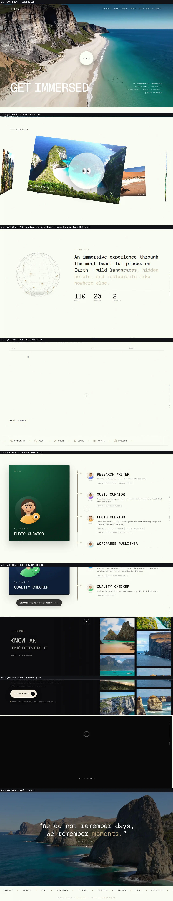
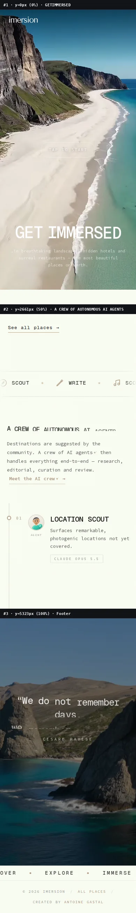

# UI Design System & Master Generation Blueprint: www-imersion-io

> **Imersion — Get Immersed in the World's Most Beautiful Places** (https://www.imersion.io) — Get immersed in the most beautiful places on Earth — breathtaking landscapes, hidden hotels and surreal restaurants, each with its own st...





---

## 1. Executive Visual Persona & Design Archetype

- **Brand Essence & Persona**: **Imersion — Get Immersed in the World's Most Beautiful Places** (`https://www.imersion.io`). Get immersed in the most beautiful places on Earth — breathtaking landscapes, hidden hotels and surreal restaurants, each with its own st...
- **Capture Provenance**: Live browser capture (`tier1_fast`, HTTP `200`, captured `2026-11-24`).
- **Visual Archetype**: **High-Contrast Obsidian / Atmospheric Design System (`#111111` canvas, `#ffffff` ink, `#007bff` accent)**.
- **Anti-AI-Slop Differentiators**:
  - **Live-Computed Chromatic Polarity**: Anchors the viewport in `#111111` (live computed `body` `background-color` (`computed_styles.json`)) paired with `#ffffff` primary typography and `#007bff` accents.
  - **Grounded Typographic Hierarchy**: Pairs `Geist Mono` for display copy (`GETIMMERSED`) with `Source Code Pro` and `Geist Mono`.
  - **Calibrated Spatial Grid & Motion**: Combines `1140px` container bounds (`gap: 24px`, padding `86.3906px`) with `cubic-bezier(.2,.8,.2,1)` easing and GSAP Timeline & ScrollTrigger.

---

## 2. Spatial Architecture & Modular Grid Mathematics

### Viewport Allocation & Container Geometry
- **Captured Journey Filmstrips**: Desktop `1280×6624px` (`assets/desktop-journey.webp`, `8` keyframes up to `y=6364px` / doc `7269px`), Mobile `390×2616px` (`assets/mobile-journey.webp`, `3` keyframes).
- **Master Container Bounds**: `1140px` (non-`@media` desktop container stylesheet rule).
- **Canvas Lateral Padding & Spacing**: `86.3906px` lateral canvas padding with `24px` grid gap.
- **Border Radius Scale**: `0px 0px 6px 6px`, `.25rem`, `.2rem`, `.3rem`.

### Responsive Breakpoint Architecture
- **Desktop Layout**: Multi-column CSS Grid / Flexbox layout at `1440px` (`max-width: 1140px`, `gap: 24px`).
- **Mobile Layout**: Single-column vertical stack at `390px` viewport width with `86.3906px` horizontal padding.
- **Extracted CSS Media Queries**: `@media (min-width:576px)`, `@media (min-width:768px)`, `@media (min-width:992px)`, `@media (min-width:1200px)`.

---

## 3. Color System, Materiality & Atmospheric Lighting

### Semantic Palette & Source Grounding
| Semantic Role | Ground-Truth Value | Extracted Live / CSS Source |
|---|---|---|
| **Primary Canvas Substrate** | `#111111` | live computed `body` `background-color` (`computed_styles.json`) |
| **Primary Typography Ink** | `#ffffff` | live computed `h1` `color` (`computed_styles.json`) |
| **Elevated Surface / Card Substrate** | `#0a0a0d` | live computed `a` `background-color` (`computed_styles.json`) |
| **Interactive Accent / Highlight** | `#007bff` | `var(--primary)` in `:root` |
| **Secondary / Muted Copy** | `#999999` | live computed `footer` `color` (`computed_styles.json`) |
| **Structural Hairline Border** | `#0f0f0f` | `hr { border-top: #0f0f0f }` |
| **Variable Token (`--indigo`)** | `#6610f2` | `var(--indigo)` in `:root` |
| **Variable Token (`--purple`)** | `#6f42c1` | `var(--purple)` in `:root` |
| **Variable Token (`--pink`)** | `#e83e8c` | `var(--pink)` in `:root` |
| **Variable Token (`--red`)** | `#dc3545` | `var(--red)` in `:root` |
| **Variable Token (`--orange`)** | `#fd7e14` | `var(--orange)` in `:root` |
| **Variable Token (`--yellow`)** | `#ffc107` | `var(--yellow)` in `:root` |
| **Variable Token (`--green`)** | `#28a745` | `var(--green)` in `:root` |
| **Variable Token (`--teal`)** | `#20c997` | `var(--teal)` in `:root` |
| **Variable Token (`--cyan`)** | `#17a2b8` | `var(--cyan)` in `:root` |
| **Variable Token (`--gray`)** | `#6c757d` | `var(--gray)` in `:root` |
| **Variable Token (`--gray-dark`)** | `#343a40` | `var(--gray-dark)` in `:root` |

### Sanitized Root CSS Variables (`ui-ux.md` Ground Truth)
| Variable Name | Extracted Value | Semantic Role |
|---|---|---|
| `--blue` | `#007bff` | Color / Atmospheric Token |
| `--indigo` | `#6610f2` | Color / Atmospheric Token |
| `--purple` | `#6f42c1` | Color / Atmospheric Token |
| `--pink` | `#e83e8c` | Typography Ink Token |
| `--red` | `#dc3545` | Color / Atmospheric Token |
| `--orange` | `#fd7e14` | Color / Atmospheric Token |
| `--yellow` | `#ffc107` | Color / Atmospheric Token |
| `--green` | `#28a745` | Color / Atmospheric Token |
| `--teal` | `#20c997` | Color / Atmospheric Token |
| `--cyan` | `#17a2b8` | Color / Atmospheric Token |
| `--white` | `#fff` | Canvas / Surface Token |
| `--gray` | `#6c757d` | Color / Atmospheric Token |
| `--gray-dark` | `#343a40` | Canvas / Surface Token |
| `--primary` | `#007bff` | Brand / Palette Token |
| `--secondary` | `#6c757d` | Brand / Palette Token |
| `--success` | `#28a745` | Color / Atmospheric Token |

---

## 4. Typographic Scale & Editorial Hierarchy

### Font Family Stacks
- **Display Typography**: `Geist Mono`.
- **Primary Body Stack**: `Source Code Pro`.
- **Technical / Metadata Stack**: `Geist Mono`.

### Typographic Scale & Rules (Live Computed & Stylesheet Grounded)
- **Hero Display (`H1`)**: live computed `h1` (`font-size: 100.8px`, `line-height: 92.736px`, `font-weight: 500`, `letter-spacing: -3.528px`); rule `,h1` (`font-size: 2.5rem`).
- **Section Heading (`H2`)**: live computed `h2` (`font-size: 76.8px`, `line-height: 78.336px`, `font-weight: 500`, `letter-spacing: -2.304px`); rule `,h2` (`font-size: 2rem`).
- **Body Copy**: live computed `body` (`font-size: 16px`, `line-height: 24px`, `font-weight: 400`).
- **Metadata & Navigation Labels**: live computed `nav/a` (`font-size: 16px`, `line-height: 24px`, `font-weight: 400`); rule `,small` (`font-size: 80%`, `font-weight: 400`).

---

## 5. Choreographed Motion & Interaction Physics

### Primary Easing Curves
- **Extracted Timing Functions**: `cubic-bezier(.2,.8,.2,1)`, `cubic-bezier(.7,0,.3,1)`, `cubic-bezier(.16,1,.3,1)`.

### Per-Element Transition & Choreography Rules
- **Selector `.form-control`**: `transition: border-color .15s ease-in-out,box-shadow .15s ease-in-out` extracted from `www-imersion-io` stylesheet.
- **Selector `screen and (prefers-reduced-motio...`**: `transition: none` extracted from `www-imersion-io` stylesheet.
- **Selector `.btn`**: `transition: color .15s ease-in-out,background-color .15s ease-in-out,borde...` extracted from `www-imersion-io` stylesheet.
- **Extracted Easing Curve (`cubic-bezier(.2,.8,.2,1)`)**: Governs interactive state transitions across `<header.hh>` and `<section.recent>`.
- **Runtime Interaction Engine**: Integrates GSAP Timeline & ScrollTrigger with `prefers-reduced-motion: reduce` fallback guards.
### Measured Runtime Scroll & Interaction Telemetry (`behavioral_journey_v2`)
- **Scroll Driver Mode**: `native` (max document height `7269px`, deepest scrollY reached `6364px` across `8` desktop keyframes).
- **Detected Scroll / Motion Libraries**: `GSAP/ScrollTrigger`.
- **Route Transition Architecture**: First internal navigation (`/places/346`) measured as `direct` in `1231ms`.

---

## 6. Component Wireframe & Structural DOM Map

### Visual Layout Schematic — Desktop (`1440px`, Grounded in `dom.html` & Landmark Bounding Boxes)
```
┌────────────────────────────────────────────────────────────────────────┐
│ DESKTOP VIEWPORT (1440px) — Imersion — Get Immersed in the World's Mos │
│ ====================================================================== │
│ [ <header.hh> (1440x80px)             | Contact Contact              ] │
│ ---------------------------------------------------------------------- │
│ | HERO STAGE: <section.wow> (w=1440px)                               | │
│ | H1: GETIMMERSED                                                    | │
│ | Substrate: #111111 | Ink: #ffffff | Accent: #007bff                | │
│ ---------------------------------------------------------------------- │
│ | SHOWCASE GRID (<section.recent>) max-w: 1140px                     | │
│ | +------------------------------+  +------------------------------+ | │
│ | | …in breathtaking landscapes, |  | Need a crew of AI agents?    | | │
│ | +------------------------------+  +------------------------------+ | │
│ ---------------------------------------------------------------------- │
│ | DETAIL MODULE (<section.about>) — G E T I M M E R S E D            | │
│ ---------------------------------------------------------------------- │
│ [ FOOTER (<footer.hf>         ) | https://www.imersion.io              │
└────────────────────────────────────────────────────────────────────────┘
```

### Visual Layout Schematic — Mobile Reflow (`390px`)
```
┌────────────────────────────────────────────────────────────────────────┐
│ MOBILE VIEWPORT REFLOW (390px) — Single-Column Stack (gap: 24px)       │
│ ====================================================================== │
│ [ HEADER BAR (<header.hh>             ) | Compact Menu (390px)         │
│ ---------------------------------------------------------------------- │
│ | HERO STAGE (<section.wow>) — 390px Vertical Lead                   | │
│ | H1: GETIMMERSED                                                    | │
│ ---------------------------------------------------------------------- │
│ | SHOWCASE STACK (<section.recent>) — 1-Col Stack                    | │
│ | [ Item 1: …in breathtaking landscapes, hidden hotels and s       ] | │
│ | [ Item 2: Need a crew of AI agents?                              ] | │
│ ---------------------------------------------------------------------- │
│ | DETAIL STACK (<section.about>) — 1-Col (G E T I M M E R S )        | │
│ ---------------------------------------------------------------------- │
│ [ FOOTER (<footer.hf>         ) | Stacked 390px Colophon               │
└────────────────────────────────────────────────────────────────────────┘
```

### Granular DOM Region Breakdown
1. **Brand Header & Navigation Bar (<header.hh> — `www-imersion-io`)**:
   - Landmark `<header class="hh">` (`1440x80px`) hosting `Imersion — Get Immersed in the World` navigation (`Contact Contact`), DOM attributes (`data-n-head="%7B%22lang%22:%7B%22s..."`, `data-n-head="ssr"`, `data-n-head="ssr"`, `data-n-head="ssr"`), and stylesheet rule `before { box-sizing:border-box }`.
2. **Hero Stage & Focal Lead (<section.wow> — `GETIMMERSED`)**:
   - Landmark `<section class="wow">` presenting display lead `GETIMMERSED` and copy excerpt *"…in breathtaking landscapes, hidden hotels and surreal restaurant"* over `#111111` canvas and `#ffffff` ink.
3. **Primary Showcase & Content Grid (<section.recent> — `…in breathtaking landscapes, hidde`)**:
   - Landmark `<section class="recent">` rendering section `…in breathtaking landscapes, hidden hotels and s` with copy *"Need a crew of AI agents?"*, asset references (`favicon.ico`, `hero-poster.jpg`, `fonts.googleapis.com`, `fonts.gstatic.com`), and grid rule `html { font-family:sans-serif;line-height:1.15;-webkit-text-size-adjust:100%;-w... }`.
4. **Interactive Detail & Feature Matrix (<section.about> — `Need a crew of AI agents?`)**:
   - Landmark `<section class="about">` framing `Need a crew of AI agents?` and `G E T I M M E R S E D` (*"G E T I M M E R S E D"*) with `#0a0a0d` surface cards, `#007bff` accents, and `section { display:block }`.
5. **Colophon & Global Directory Footer (<footer.hf> — `https://www.imersion.io`)**:
   - Landmark `<footer class="hf">` anchoring `Imersion — Get Immersed in the W` footer links (`Contact Contact`), copy *"Nusa Penida, Klungkung, Indonesia"*, and `#0f0f0f` structural dividers.
### Full Vertical Scroll Sequence (Desktop `1440×900` Keyframes)
- **Step 01** (`y=0px`, `0%`): Active landmark `GETIMMERSED` · sticky/fixed elements: `1`
- **Step 02** (`y=850px`, `13%`): Active landmark `Section @ 13%` · sticky/fixed elements: `1`
- **Step 03** (`y=1700px`, `27%`): Active landmark `An immersive experience through the most beautifu...` · sticky/fixed elements: `1`
- **Step 04** (`y=2550px`, `40%`): Active landmark `RECENTLY ADDED` · sticky/fixed elements: `1`
- **Step 05** (`y=4250px`, `67%`): Active landmark `LOCATION SCOUT` · sticky/fixed elements: `2`
- **Step 06** (`y=5100px`, `80%`): Active landmark `QUALITY CHECKER` · sticky/fixed elements: `1`
- **Step 07** (`y=5950px`, `93%`): Active landmark `Section @ 93%` · sticky/fixed elements: `1`
- **Step 08** (`y=6364px`, `100%`): Active landmark `Footer` · sticky/fixed elements: `1`

### Multi-Page Internal Route Map
- **Detail Route (`/places/346`)**: `https://www.imersion.io/places/346` — H1: `Kelingking Beach [+]`, scrollHeight `900px`, transition `direct` (`1231ms`)
- **Detail Route (`/places/342`)**: `https://www.imersion.io/places/342` — H1: `Wayag Islands and Piaynemo Karst Lagoons Viewpoint`, scrollHeight `900px`, transition `direct` (`986ms`)
- **Detail Route (`/places/16`)**: `https://www.imersion.io/places/16` — H1: `Deadvlei White Clay Pan with Camelthorn Trees [+]`, scrollHeight `900px`, transition `direct` (`582ms`)

---

## 7. Master Zero-Shot AI Generation Prompt

```markdown
# Master Zero-Shot Frontend Generation Prompt: www-imersion-io (Imersion — Get Immersed in the World's Most Beautiful Places)

You are a principal frontend architect and design systems engineer. Build a complete, production-ready web application replicating the exact design system, DOM landmarks, typographic hierarchy, color tokens, and motion physics of `www-imersion-io` (**Imersion — Get Immersed in the World's Most Beautiful Places** — `https://www.imersion.io`).

### 1. Visual Archetype & Anti-AI-Slop Mandates
- **Archetype**: High-Contrast Obsidian / Atmospheric Design System (`#111111` canvas, `#ffffff` ink, `#007bff` accent).
- **Identity & Domain Context**: Get immersed in the most beautiful places on Earth — breathtaking landscapes, hidden hotels and surreal restaurants, each with its own st...
- **Primary Substrate**: `#111111` (live computed `body` `background-color` (`computed_styles.json`)), **Primary Ink**: `#ffffff`, **Accent / Highlight**: `#007bff`.
- **Site-Specific Differentiators**:
  - **Live-Computed Chromatic Polarity**: Anchors the viewport in `#111111` (live computed `body` `background-color` (`computed_styles.json`)) paired with `#ffffff` primary typography and `#007bff` accents.
  - **Grounded Typographic Hierarchy**: Pairs `Geist Mono` for display copy (`GETIMMERSED`) with `Source Code Pro` and `Geist Mono`.
  - **Calibrated Spatial Grid & Motion**: Combines `1140px` container bounds (`gap: 24px`, padding `86.3906px`) with `cubic-bezier(.2,.8,.2,1)` easing and GSAP Timeline & ScrollTrigger.

### 2. Ground-Truth CSS Variables (`:root` Token Contract)
Declare and consume these exact custom properties extracted from `www-imersion-io` in your global stylesheet:

:root {
  /* Imersion — Get Immersed in the World's Most Beautiful Places (www-imersion-io) — Live-Grounded CSS Variables */
  --blue: #007bff; /* Color / Atmospheric Token (www-imersion-io) */
  --indigo: #6610f2; /* Color / Atmospheric Token (www-imersion-io) */
  --purple: #6f42c1; /* Color / Atmospheric Token (www-imersion-io) */
  --pink: #e83e8c; /* Typography Ink Token (www-imersion-io) */
  --red: #dc3545; /* Color / Atmospheric Token (www-imersion-io) */
  --orange: #fd7e14; /* Color / Atmospheric Token (www-imersion-io) */
  --yellow: #ffc107; /* Color / Atmospheric Token (www-imersion-io) */
  --green: #28a745; /* Color / Atmospheric Token (www-imersion-io) */
  --teal: #20c997; /* Color / Atmospheric Token (www-imersion-io) */
  --cyan: #17a2b8; /* Color / Atmospheric Token (www-imersion-io) */
  --white: #fff; /* Canvas / Surface Token (www-imersion-io) */
  --gray: #6c757d; /* Color / Atmospheric Token (www-imersion-io) */
  --gray-dark: #343a40; /* Canvas / Surface Token (www-imersion-io) */
  --primary: #007bff; /* Brand / Palette Token (www-imersion-io) */
  --secondary: #6c757d; /* Brand / Palette Token (www-imersion-io) */
  --success: #28a745; /* Color / Atmospheric Token (www-imersion-io) */
}

### 3. Semantic Color & Materiality Contract
Map every surface, ink, and border strictly to these source-grounded tokens:
- **Primary Canvas Substrate**: `#111111` — grounded in live computed `body` `background-color` (`computed_styles.json`)
- **Primary Typography Ink**: `#ffffff` — grounded in live computed `h1` `color` (`computed_styles.json`)
- **Elevated Surface / Card Substrate**: `#0a0a0d` — grounded in live computed `a` `background-color` (`computed_styles.json`)
- **Interactive Accent / Highlight**: `#007bff` — grounded in `var(--primary)` in `:root`
- **Secondary / Muted Copy**: `#999999` — grounded in live computed `footer` `color` (`computed_styles.json`)
- **Structural Hairline Border**: `#0f0f0f` — grounded in `hr { border-top: #0f0f0f }`
- **Variable Token (`--indigo`)**: `#6610f2` — grounded in `var(--indigo)` in `:root`
- **Variable Token (`--purple`)**: `#6f42c1` — grounded in `var(--purple)` in `:root`
- **Variable Token (`--pink`)**: `#e83e8c` — grounded in `var(--pink)` in `:root`
- **Variable Token (`--red`)**: `#dc3545` — grounded in `var(--red)` in `:root`
- **Variable Token (`--orange`)**: `#fd7e14` — grounded in `var(--orange)` in `:root`
- **Variable Token (`--yellow`)**: `#ffc107` — grounded in `var(--yellow)` in `:root`
- **Variable Token (`--green`)**: `#28a745` — grounded in `var(--green)` in `:root`
- **Variable Token (`--teal`)**: `#20c997` — grounded in `var(--teal)` in `:root`
- **Variable Token (`--cyan`)**: `#17a2b8` — grounded in `var(--cyan)` in `:root`
- **Variable Token (`--gray`)**: `#6c757d` — grounded in `var(--gray)` in `:root`
- **Variable Token (`--gray-dark`)**: `#343a40` — grounded in `var(--gray-dark)` in `:root`

### 4. Spatial Grid, Container Bounds & Responsive Breakpoints
- **Desktop Viewport Reference**: `1280×6624px` (multi-frame vertical journey filmstrip (6624px), `1440px` standard desktop width).
- **Mobile Viewport Reference**: `390×2616px` (multi-frame vertical journey filmstrip (2616px), `390px` standard mobile width).
- **Container Max-Width**: `1140px` (non-`@media` desktop container stylesheet rule)
- **Padding & Gutters**: `86.3906px` lateral canvas padding with `24px` grid gap
- **Desktop Grid**: Multi-column CSS Grid / Flexbox layout at `1440px` (`max-width: 1140px`, `gap: 24px`)
- **Mobile Adaptation**: Single-column vertical stack at `390px` viewport width with `86.3906px` horizontal padding
- **Media Queries**: `@media (min-width:576px)`, `@media (min-width:768px)`, `@media (min-width:992px)`, `@media (min-width:1200px)`
- **Corner Radii**: `0px 0px 6px 6px`, `.25rem`, `.2rem`, `.3rem`

### 5. Typography & Editorial Scale Contract
- **Display Font Stack**: `Geist Mono`
- **Body Font Stack**: `Source Code Pro`
- **Monospace / Technical Font Stack**: `Geist Mono`
- **H1 Display Rule**: live computed `h1` (`font-size: 100.8px`, `line-height: 92.736px`, `font-weight: 500`, `letter-spacing: -3.528px`); rule `,h1` (`font-size: 2.5rem`)
- **H2 Section Rule**: live computed `h2` (`font-size: 76.8px`, `line-height: 78.336px`, `font-weight: 500`, `letter-spacing: -2.304px`); rule `,h2` (`font-size: 2rem`)
- **Body Copy Rule**: live computed `body` (`font-size: 16px`, `line-height: 24px`, `font-weight: 400`)
- **Metadata & Index Rule**: live computed `nav/a` (`font-size: 16px`, `line-height: 24px`, `font-weight: 400`); rule `,small` (`font-size: 80%`, `font-weight: 400`)

### 6. Component Hierarchy, Verbatim Copy & Real DOM Landmarks
Scaffold `www-imersion-io` (`Imersion — Get Immersed in the World's Most Beautiful Places`) with these exact structural regions, extracted copy, and CSS rules from `dom.html`:
1. **Brand Header & Navigation Bar (<header.hh> — `www-imersion-io`)**:
   - DOM & Selectors: Landmark `<header class="hh">` (`1440x80px`) hosting `Imersion — Get Immersed in the World` navigation (`Contact Contact`), DOM attributes (`data-n-head="%7B%22lang%22:%7B%22s..."`, `data-n-head="ssr"`, `data-n-head="ssr"`, `data-n-head="ssr"`), and stylesheet rule `before { box-sizing:border-box }`.
   - Responsive Contract: Header `Brand Header & Navigation Bar (<header.hh> — `www-imersion-io`)` (`www-imersion-io`) adapts across `@media (min-width:576px)`, `@media (min-width:768px)`, `@media (min-width:992px)`, `@media (min-width:1200px)` with `cubic-bezier(.2,.8,.2,1)`, `cubic-bezier(.7,0,.3,1)`, `cubic-bezier(.16,1,.3,1)` transitions and links `Contact Contact`.
2. **Hero Stage & Focal Lead (<section.wow> — `GETIMMERSED`)**:
   - DOM & Selectors: Landmark `<section class="wow">` presenting display lead `GETIMMERSED` and copy excerpt *"…in breathtaking landscapes, hidden hotels and surreal restaurant"* over `#111111` canvas and `#ffffff` ink.
   - Responsive Contract: Hero stage (`1280×6624px` desktop / `390×2616px` mobile) sets `#111111` background with `#ffffff` headline `GETIMMERSED`.
3. **Primary Showcase & Content Grid (<section.recent> — `…in breathtaking landscapes, hidde`)**:
   - DOM & Selectors: Landmark `<section class="recent">` rendering section `…in breathtaking landscapes, hidden hotels and s` with copy *"Need a crew of AI agents?"*, asset references (`favicon.ico`, `hero-poster.jpg`, `fonts.googleapis.com`, `fonts.gstatic.com`), and grid rule `html { font-family:sans-serif;line-height:1.15;-webkit-text-size-adjust:100%;-w... }`.
   - Responsive Contract: Showcase grid `Primary Showcase & Content Grid (<section.recent> — `…in breathtaking landscapes, hidde`)` applies Multi-column CSS Grid / Flexbox layout at `1440px` (`max-width: 1140px`, `gap: 24px`) on desktop and Single-column vertical stack at `390px` viewport width with `86.3906px` horizontal padding on mobile.
4. **Interactive Detail & Feature Matrix (<section.about> — `Need a crew of AI agents?`)**:
   - DOM & Selectors: Landmark `<section class="about">` framing `Need a crew of AI agents?` and `G E T I M M E R S E D` (*"G E T I M M E R S E D"*) with `#0a0a0d` surface cards, `#007bff` accents, and `section { display:block }`.
   - Responsive Contract: Detail module `Interactive Detail & Feature Matrix (<section.about> — `Need a crew of AI agents?`)` uses `0px 0px 6px 6px`, `.25rem`, `.2rem`, `.3rem` radii, `#007bff` highlights, and assets (favicon.ico, hero-poster.jpg, fonts.googleapis.com).
5. **Colophon & Global Directory Footer (<footer.hf> — `https://www.imersion.io`)**:
   - DOM & Selectors: Landmark `<footer class="hf">` anchoring `Imersion — Get Immersed in the W` footer links (`Contact Contact`), copy *"Nusa Penida, Klungkung, Indonesia"*, and `#0f0f0f` structural dividers.
   - Responsive Contract: Footer `Colophon & Global Directory Footer (<footer.hf> — `https://www.imersion.io`)` aligns to `1140px` (non-`@media` desktop container stylesheet rule) with `86.3906px` lateral canvas padding with `24px` grid gap and attributes (data-n-head="%7B%22lang%22:%7B%22s...", data-n-head="ssr", data-n-head="ssr").

#### Verbatim DOM Copy Excerpts (`dom.html`)
- Copy Excerpt 1: *"…in breathtaking landscapes, hidden hotels and surreal restaurants — the most beau..."*
- Copy Excerpt 2: *"Need a crew of AI agents?"*
- Copy Excerpt 3: *"G E T I M M E R S E D"*
- Copy Excerpt 4: *"Nusa Penida, Klungkung, Indonesia"*

### 7. Motion, Extracted Stylesheet Rules & Interaction Choreography
- **Primary Easing Functions**: `cubic-bezier(.2,.8,.2,1)`, `cubic-bezier(.7,0,.3,1)`, `cubic-bezier(.16,1,.3,1)`
- **Extracted Stylesheet Rules (`www-imersion-io`)**:
- `before { box-sizing:border-box }`
- `html { font-family:sans-serif;line-height:1.15;-webkit-text-size-adjust:100%;-w... }`
- `section { display:block }`
- `focus { outline:0!important }`
- `address { margin-bottom:1rem;font-style:normal;line-height:inherit }`
- **Per-Selector Transition Rules**:
- **Selector `.form-control`**: `transition: border-color .15s ease-in-out,box-shadow .15s ease-in-out` extracted from `www-imersion-io` stylesheet.
- **Selector `screen and (prefers-reduced-motio...`**: `transition: none` extracted from `www-imersion-io` stylesheet.
- **Selector `.btn`**: `transition: color .15s ease-in-out,background-color .15s ease-in-out,borde...` extracted from `www-imersion-io` stylesheet.
- **Extracted Easing Curve (`cubic-bezier(.2,.8,.2,1)`)**: Governs interactive state transitions across `<header.hh>` and `<section.recent>`.
- **Runtime Interaction Engine**: Integrates GSAP Timeline & ScrollTrigger with `prefers-reduced-motion: reduce` fallback guards.
### 7b. Full-Page Scroll Choreography, Interactive States & Multi-Page Routes
- **Scroll Mechanics**: Implement `native` vertical progression up to `7269px` across 8 distinct viewport chapters using GSAP/ScrollTrigger.
- **Vertical Chapter Sequence**: GETIMMERSED (0%) -> Section @ 13% (13%) -> An immersive experience thr... (27%) -> RECENTLY ADDED (40%) -> LOCATION SCOUT (67%) -> QUALITY CHECKER (80%) -> Section @ 93% (93%) -> Footer (100%).
- **Multi-Page Routes**: Scaffold internal routes `/places/346` (detail, direct), `/places/342` (detail, direct), `/places/16` (detail, direct) sharing the global header/footer shell and design tokens.

### 8. Technical Deliverables
- Implement in Next.js (App Router) with TypeScript and Tailwind CSS consuming the `:root` custom properties defined above for `www-imersion-io`.
- Reproduce both the `1440px` desktop architecture and `390px` mobile breakpoint transitions, preserving semantic HTML5 landmarks (`<header>`, `<nav>`, `<main>`, `<section>`, `<footer>`) and `prefers-reduced-motion` accessibility guards.
```
---

## 8. Full-Page Scroll Journey, Interactive States & Subpage Inventory

### Desktop Scroll Keyframes (`1440×900` WebP)
| Step | Scroll Y | Progress | Active Landmark / Section | Sticky/Fixed | Visual Asset |
| :---: | :---: | :---: | :--- | :---: | :--- |
| `#01` | `0px` | `0%` | GETIMMERSED | `1` | [desktop-step-01.webp](assets/desktop-step-01.webp) |
| `#02` | `850px` | `13%` | Section @ 13% | `1` | [desktop-step-02.webp](assets/desktop-step-02.webp) |
| `#03` | `1700px` | `27%` | An immersive experience through the most beau... | `1` | [desktop-step-03.webp](assets/desktop-step-03.webp) |
| `#04` | `2550px` | `40%` | RECENTLY ADDED | `1` | [desktop-step-04.webp](assets/desktop-step-04.webp) |
| `#05` | `4250px` | `67%` | LOCATION SCOUT | `2` | [desktop-step-05.webp](assets/desktop-step-05.webp) |
| `#06` | `5100px` | `80%` | QUALITY CHECKER | `1` | [desktop-step-06.webp](assets/desktop-step-06.webp) |
| `#07` | `5950px` | `93%` | Section @ 93% | `1` | [desktop-step-07.webp](assets/desktop-step-07.webp) |
| `#08` | `6364px` | `100%` | Footer | `1` | [desktop-step-08.webp](assets/desktop-step-08.webp) |

### Mobile Condensed Keyframes (`390×844` WebP)
| Step | Scroll Y | Progress | Active Landmark | Visual Asset |
| :---: | :---: | :---: | :--- | :--- |
| `#01` | `0px` | `0%` | GETIMMERSED | [mobile-step-01.webp](assets/mobile-step-01.webp) |
| `#02` | `2661px` | `50%` | A CREW OF AUTONOMOUS AI AGENTS | [mobile-step-02.webp](assets/mobile-step-02.webp) |
| `#03` | `5323px` | `100%` | Footer | [mobile-step-03.webp](assets/mobile-step-03.webp) |

### Internal Subpage Filmstrips (`1080px` Wide WebP)
| # | Template | Route URL | H1 / Title | Scroll Height | Transition | Filmstrip Asset |
| :-: | :---: | :--- | :--- | :---: | :---: | :--- |
| `1` | `detail` | `https://www.imersion.io/places/346` | Kelingking Beach [+] | `900px` | `direct` (`1231ms`) | [subpage-01-places-346.webp](assets/subpage-01-places-346.webp) |
| `2` | `detail` | `https://www.imersion.io/places/342` | Wayag Islands and Piaynemo Karst Lago... | `900px` | `direct` (`986ms`) | [subpage-02-places-342.webp](assets/subpage-02-places-342.webp) |
| `3` | `detail` | `https://www.imersion.io/places/16` | Deadvlei White Clay Pan with Cameltho... | `900px` | `direct` (`582ms`) | [subpage-03-places-16.webp](assets/subpage-03-places-16.webp) |

