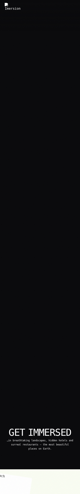

# UI Design System & Master Generation Blueprint: www-imersion-io

> **Imersion — Get Immersed in the World's Most Beautiful Places** (https://www.imersion.io) — Get immersed in the most beautiful places on Earth — breathtaking landscapes, hidden hotels and surreal restaurants, each with its own st...


---

## 1. Executive Visual Persona & Design Archetype

- **Brand Essence & Persona**: **Imersion — Get Immersed in the World's Most Beautiful Places** (`https://www.imersion.io`). Get immersed in the most beautiful places on Earth — breathtaking landscapes, hidden hotels and surreal restaurants, each with its own st...
- **Visual Archetype**: **High-Contrast Obsidian / Atmospheric Design System (`#007bff` canvas, `#6610f2` ink, `#e83e8c` accent)**.
- **Anti-AI-Slop Differentiators**:
  - **Source-Grounded Chromatic Polarity**: Anchors the viewport in `#007bff` (`var(--blue)` in `:root`) paired with `#6610f2` primary typography and `#e83e8c` accents.
  - **Extracted Typographic Hierarchy**: Pairs `Anton` for display copy (`G E T I M M E R S E D`) with `Bitcount Single` and `Geist Mono`.
  - **Calibrated Spatial Grid & Motion**: Combines `540px` container bounds (`gap: 1.25rem`, padding `.25rem`) with `cubic-bezier(.2,.8,.2,1)` easing and GSAP Timeline & ScrollTrigger.

---

## 2. Spatial Architecture & Modular Grid Mathematics



### Viewport Allocation & Container Geometry
- **Captured Viewport Dimensions**: Desktop `1440×7264px` (`assets/desktop.png`, full-page scroll capture), Mobile `390×2400px` (`assets/mobile.png`, capped at 2400px multi-section capture).
- **Master Container Bounds**: `540px` extracted from `www-imersion-io` stylesheet.
- **Canvas Lateral Padding & Spacing**: `.25rem` lateral canvas padding with `1.25rem` grid gap.
- **Border Radius Scale**: `.25rem`, `.2rem`, `.3rem`, `50%`.

### Responsive Breakpoint Architecture
- **Desktop Layout**: Multi-column CSS Grid / Flexbox layout at `1440px` (`max-width: 540px`, `gap: 1.25rem`).
- **Mobile Layout**: Single-column vertical stack at `390px` viewport width with `.25rem` horizontal padding.
- **Extracted CSS Media Queries**: `@media (min-width:576px)`, `@media (min-width:768px)`, `@media (min-width:992px)`, `@media (min-width:1200px)`.

---

## 3. Color System, Materiality & Atmospheric Lighting

### Semantic Palette & Source Grounding
| Semantic Role | Ground-Truth Value | Extracted CSS Source / Selector |
|---|---|---|
| **Primary Canvas Substrate** | `#007bff` | `var(--blue)` in `:root` |
| **Primary Typography Ink** | `#6610f2` | `var(--indigo)` in `:root` |
| **Elevated Surface / Card Substrate** | `#6f42c1` | `var(--purple)` in `:root` |
| **Interactive Accent / Highlight** | `#e83e8c` | `var(--pink)` in `:root` |
| **Secondary / Muted Copy** | `#dc3545` | `var(--red)` in `:root` |
| **Structural Hairline Border** | `#fd7e14` | `var(--orange)` in `:root` |
| **Variable Token (`--yellow`)** | `#ffc107` | `var(--yellow)` in `:root` |
| **Variable Token (`--green`)** | `#28a745` | `var(--green)` in `:root` |
| **Variable Token (`--teal`)** | `#20c997` | `var(--teal)` in `:root` |
| **Variable Token (`--cyan`)** | `#17a2b8` | `var(--cyan)` in `:root` |
| **Variable Token (`--white`)** | `#fff` | `var(--white)` in `:root` |
| **Variable Token (`--gray`)** | `#6c757d` | `var(--gray)` in `:root` |
| **Variable Token (`--gray-dark`)** | `#343a40` | `var(--gray-dark)` in `:root` |

### Sanitized Root CSS Variables (`ui-ux.md` Ground Truth)
| Variable Name | Extracted Value | Semantic Role |
|---|---|---|
| `--blue` | `#007bff` | Color / Atmospheric Token |
| `--indigo` | `#6610f2` | Color / Atmospheric Token |
| `--purple` | `#6f42c1` | Color / Atmospheric Token |
| `--pink` | `#e83e8c` | Typography Ink Token |
| `--red` | `#dc3545` | Color / Atmospheric Token |
| `--orange` | `#fd7e14` | Color / Atmospheric Token |
| `--yellow` | `#ffc107` | Color / Atmospheric Token |
| `--green` | `#28a745` | Color / Atmospheric Token |
| `--teal` | `#20c997` | Color / Atmospheric Token |
| `--cyan` | `#17a2b8` | Color / Atmospheric Token |
| `--white` | `#fff` | Canvas / Surface Token |
| `--gray` | `#6c757d` | Color / Atmospheric Token |
| `--gray-dark` | `#343a40` | Canvas / Surface Token |
| `--primary` | `#007bff` | Brand / Palette Token |
| `--secondary` | `#6c757d` | Brand / Palette Token |
| `--success` | `#28a745` | Color / Atmospheric Token |

---

## 4. Typographic Scale & Editorial Hierarchy

### Font Family Stacks
- **Display Typography**: `Anton`.
- **Primary Body Stack**: `Bitcount Single`.
- **Technical / Metadata Stack**: `Geist Mono`.

### Typographic Scale & Rules (Extracted from Stylesheet & Variables)
- **Hero Display (`H1`)**: rule `,h1` (`font-size: 2.5rem`).
- **Section Heading (`H2`)**: rule `,h2` (`font-size: 2rem`).
- **Body Copy**: not explicitly declared on tag in static CSS (stylesheet font-size ladder: `1rem`, `80%`, `75%`, `1em`, `1.5rem`).
- **Metadata & Navigation Labels**: rule `,small` (`font-size: 80%`, `font-weight: 400`).

---

## 5. Choreographed Motion & Interaction Physics

### Primary Easing Curves
- **Extracted Timing Functions**: `cubic-bezier(.2,.8,.2,1)`, `cubic-bezier(.7,0,.3,1)`, `cubic-bezier(.16,1,.3,1)`.

### Per-Element Transition & Choreography Rules
- **Selector `.form-control`**: `transition: border-color .15s ease-in-out,box-shadow .15s ease-in-out` extracted from `www-imersion-io` stylesheet.
- **Selector `screen and (prefers-reduced-motio...`**: `transition: none` extracted from `www-imersion-io` stylesheet.
- **Selector `.btn`**: `transition: color .15s ease-in-out,background-color .15s ease-in-out,borde...` extracted from `www-imersion-io` stylesheet.
- **Extracted Easing Curve (`cubic-bezier(.2,.8,.2,1)`)**: Governs interactive state transitions across `<header.hh>` and `<section.recent>`.
- **Runtime Interaction Engine**: Integrates GSAP Timeline & ScrollTrigger with `prefers-reduced-motion: reduce` fallback guards.

---

## 6. Component Wireframe & Structural DOM Map

### Visual Layout Schematic (Grounded in `dom.html` — `1440px` Desktop & `390px` Mobile Reflow)
```
┌────────────────────────────────────────────────────────────────────────┐
│ DESKTOP VIEWPORT (1440px) — Imersion — Get Immersed in the World's Mos │
│ ====================================================================== │
│ [ <header.hh>              | Contact Contact                        ]  │
│ ---------------------------------------------------------------------- │
│ | HERO STAGE: <section.wow>                                        |   │
│ | H1: G E T I M M E R S E D                                        |   │
│ | Substrate: #007bff    | Ink: #6610f2    | Accent: #e83e8c        |   │
│ ---------------------------------------------------------------------- │
│ | SHOWCASE GRID (<section.recent>          ) max-w: 540px          |   │
│ | +------------------------------+  +------------------------------+ | │
│ | | A n i m m e r s i v e e x p  |  | Recently added               | | │
│ | +------------------------------+  +------------------------------+ | │
│ ---------------------------------------------------------------------- │
│ | MOBILE VIEWPORT REFLOW (390px) — Single-Column Stack (gap: 1.25re) | │
│ | [<header.hh>] -> [<section.wow>] -> [<section.recent>] |             │
│ ---------------------------------------------------------------------- │
│ [ FOOTER (<footer.hf>           ) | https://www.imersion.io            │
└────────────────────────────────────────────────────────────────────────┘
```

### Granular DOM Region Breakdown
1. **Brand Header & Navigation Bar (<header.hh> — `www-imersion-io`)**:
   - Landmark `<header class="hh">` hosting `Imersion — Get Immersed in the World` navigation (`Contact Contact`), DOM attributes (`data-n-head="%7B%22lang%22:%7B%22s..."`, `data-n-head="ssr"`, `data-n-head="ssr"`, `data-n-head="ssr"`), and stylesheet rule `before { box-sizing:border-box }`.
2. **Hero Stage & Focal Lead (<section.wow> — `G E T I M M E R S E D`)**:
   - Landmark `<section class="wow">` presenting display lead `G E T I M M E R S E D` and copy excerpt *"All places All places"* over `#007bff` canvas and `#6610f2` ink.
3. **Primary Showcase & Content Grid (<section.recent> — `A n i m m e r s i v e e x p e r i `)**:
   - Landmark `<section class="recent">` rendering section `A n i m m e r s i v e e x p e r i e n c e t h r o...` with copy *"Submit a place Submit a place"*, asset references (`favicon.ico`, `hero-poster.jpg`, `fonts.googleapis.com`, `fonts.gstatic.com`), and grid rule `html { font-family:sans-serif;line-height:1.15;-webkit-text-size-adjust:100%;-w... }`.
4. **Interactive Detail & Feature Matrix (<section.about> — `Recently added`)**:
   - Landmark `<section class="about">` framing `Recently added` and `A crew of autonomous AI agents` (*"Need a crew of AI agents? Need a crew of AI agents?"*) with `#6f42c1` surface cards, `#e83e8c` accents, and `section { display:block }`.
5. **Colophon & Global Directory Footer (<footer.hf> — `https://www.imersion.io`)**:
   - Landmark `<footer class="hf">` anchoring `Imersion — Get Immersed in the W` footer links (`Contact Contact`), copy *"Need a crew of AI agents?"*, and `#fd7e14` structural dividers.

---

## 7. Master Zero-Shot AI Generation Prompt

```markdown
# Master Zero-Shot Frontend Generation Prompt: www-imersion-io (Imersion — Get Immersed in the World's Most Beautiful Places)

You are a principal frontend architect and design systems engineer. Build a complete, production-ready web application replicating the exact design system, DOM landmarks, typographic hierarchy, color tokens, and motion physics of `www-imersion-io` (**Imersion — Get Immersed in the World's Most Beautiful Places** — `https://www.imersion.io`).

### 1. Visual Archetype & Anti-AI-Slop Mandates
- **Archetype**: High-Contrast Obsidian / Atmospheric Design System (`#007bff` canvas, `#6610f2` ink, `#e83e8c` accent).
- **Identity & Domain Context**: Get immersed in the most beautiful places on Earth — breathtaking landscapes, hidden hotels and surreal restaurants, each with its own st...
- **Primary Substrate**: `#007bff` (`var(--blue)` in `:root`), **Primary Ink**: `#6610f2`, **Accent / Highlight**: `#e83e8c`.
- **Site-Specific Differentiators**:
  - **Source-Grounded Chromatic Polarity**: Anchors the viewport in `#007bff` (`var(--blue)` in `:root`) paired with `#6610f2` primary typography and `#e83e8c` accents.
  - **Extracted Typographic Hierarchy**: Pairs `Anton` for display copy (`G E T I M M E R S E D`) with `Bitcount Single` and `Geist Mono`.
  - **Calibrated Spatial Grid & Motion**: Combines `540px` container bounds (`gap: 1.25rem`, padding `.25rem`) with `cubic-bezier(.2,.8,.2,1)` easing and GSAP Timeline & ScrollTrigger.

### 2. Ground-Truth CSS Variables (`:root` Token Contract)
Declare and consume these exact custom properties extracted from `www-imersion-io` in your global stylesheet:

:root {
  /* Imersion — Get Immersed in the World's Most Beautiful Places (www-imersion-io) — Ground-Truth Extracted CSS Variables */
  --blue: #007bff; /* Color / Atmospheric Token (www-imersion-io) */
  --indigo: #6610f2; /* Color / Atmospheric Token (www-imersion-io) */
  --purple: #6f42c1; /* Color / Atmospheric Token (www-imersion-io) */
  --pink: #e83e8c; /* Typography Ink Token (www-imersion-io) */
  --red: #dc3545; /* Color / Atmospheric Token (www-imersion-io) */
  --orange: #fd7e14; /* Color / Atmospheric Token (www-imersion-io) */
  --yellow: #ffc107; /* Color / Atmospheric Token (www-imersion-io) */
  --green: #28a745; /* Color / Atmospheric Token (www-imersion-io) */
  --teal: #20c997; /* Color / Atmospheric Token (www-imersion-io) */
  --cyan: #17a2b8; /* Color / Atmospheric Token (www-imersion-io) */
  --white: #fff; /* Canvas / Surface Token (www-imersion-io) */
  --gray: #6c757d; /* Color / Atmospheric Token (www-imersion-io) */
  --gray-dark: #343a40; /* Canvas / Surface Token (www-imersion-io) */
  --primary: #007bff; /* Brand / Palette Token (www-imersion-io) */
  --secondary: #6c757d; /* Brand / Palette Token (www-imersion-io) */
  --success: #28a745; /* Color / Atmospheric Token (www-imersion-io) */
}

### 3. Semantic Color & Materiality Contract
Map every surface, ink, and border strictly to these source-grounded tokens:
- **Primary Canvas Substrate**: `#007bff` — grounded in `var(--blue)` in `:root`
- **Primary Typography Ink**: `#6610f2` — grounded in `var(--indigo)` in `:root`
- **Elevated Surface / Card Substrate**: `#6f42c1` — grounded in `var(--purple)` in `:root`
- **Interactive Accent / Highlight**: `#e83e8c` — grounded in `var(--pink)` in `:root`
- **Secondary / Muted Copy**: `#dc3545` — grounded in `var(--red)` in `:root`
- **Structural Hairline Border**: `#fd7e14` — grounded in `var(--orange)` in `:root`
- **Variable Token (`--yellow`)**: `#ffc107` — grounded in `var(--yellow)` in `:root`
- **Variable Token (`--green`)**: `#28a745` — grounded in `var(--green)` in `:root`
- **Variable Token (`--teal`)**: `#20c997` — grounded in `var(--teal)` in `:root`
- **Variable Token (`--cyan`)**: `#17a2b8` — grounded in `var(--cyan)` in `:root`
- **Variable Token (`--white`)**: `#fff` — grounded in `var(--white)` in `:root`
- **Variable Token (`--gray`)**: `#6c757d` — grounded in `var(--gray)` in `:root`
- **Variable Token (`--gray-dark`)**: `#343a40` — grounded in `var(--gray-dark)` in `:root`

### 4. Spatial Grid, Container Bounds & Responsive Breakpoints
- **Desktop Viewport Reference**: `1440×7264px` (full-page scroll capture, `1440px` standard desktop width).
- **Mobile Viewport Reference**: `390×2400px` (capped at 2400px multi-section capture, `390px` standard mobile width).
- **Container Max-Width**: `540px` extracted from `www-imersion-io` stylesheet
- **Padding & Gutters**: `.25rem` lateral canvas padding with `1.25rem` grid gap
- **Desktop Grid**: Multi-column CSS Grid / Flexbox layout at `1440px` (`max-width: 540px`, `gap: 1.25rem`)
- **Mobile Adaptation**: Single-column vertical stack at `390px` viewport width with `.25rem` horizontal padding
- **Media Queries**: `@media (min-width:576px)`, `@media (min-width:768px)`, `@media (min-width:992px)`, `@media (min-width:1200px)`
- **Corner Radii**: `.25rem`, `.2rem`, `.3rem`, `50%`

### 5. Typography & Editorial Scale Contract
- **Display Font Stack**: `Anton`
- **Body Font Stack**: `Bitcount Single`
- **Monospace / Technical Font Stack**: `Geist Mono`
- **H1 Display Rule**: rule `,h1` (`font-size: 2.5rem`)
- **H2 Section Rule**: rule `,h2` (`font-size: 2rem`)
- **Body Copy Rule**: not explicitly declared on tag in static CSS (stylesheet font-size ladder: `1rem`, `80%`, `75%`, `1em`, `1.5rem`)
- **Metadata & Index Rule**: rule `,small` (`font-size: 80%`, `font-weight: 400`)

### 6. Component Hierarchy, Verbatim Copy & Real DOM Landmarks
Scaffold `www-imersion-io` (`Imersion — Get Immersed in the World's Most Beautiful Places`) with these exact structural regions, extracted copy, and CSS rules from `dom.html`:
1. **Brand Header & Navigation Bar (<header.hh> — `www-imersion-io`)**:
   - DOM & Selectors: Landmark `<header class="hh">` hosting `Imersion — Get Immersed in the World` navigation (`Contact Contact`), DOM attributes (`data-n-head="%7B%22lang%22:%7B%22s..."`, `data-n-head="ssr"`, `data-n-head="ssr"`, `data-n-head="ssr"`), and stylesheet rule `before { box-sizing:border-box }`.
   - Responsive Contract: Header `Brand Header & Navigation Bar (<header.hh> — `www-imersion-io`)` (`www-imersion-io`) adapts across `@media (min-width:576px)`, `@media (min-width:768px)`, `@media (min-width:992px)`, `@media (min-width:1200px)` with `cubic-bezier(.2,.8,.2,1)`, `cubic-bezier(.7,0,.3,1)`, `cubic-bezier(.16,1,.3,1)` transitions and links `Contact Contact`.
2. **Hero Stage & Focal Lead (<section.wow> — `G E T I M M E R S E D`)**:
   - DOM & Selectors: Landmark `<section class="wow">` presenting display lead `G E T I M M E R S E D` and copy excerpt *"All places All places"* over `#007bff` canvas and `#6610f2` ink.
   - Responsive Contract: Hero stage (`1440×7264px` desktop / `390×2400px` mobile) sets `#007bff` background with `#6610f2` headline `G E T I M M E R S E D`.
3. **Primary Showcase & Content Grid (<section.recent> — `A n i m m e r s i v e e x p e r i `)**:
   - DOM & Selectors: Landmark `<section class="recent">` rendering section `A n i m m e r s i v e e x p e r i e n c e t h r o...` with copy *"Submit a place Submit a place"*, asset references (`favicon.ico`, `hero-poster.jpg`, `fonts.googleapis.com`, `fonts.gstatic.com`), and grid rule `html { font-family:sans-serif;line-height:1.15;-webkit-text-size-adjust:100%;-w... }`.
   - Responsive Contract: Showcase grid `Primary Showcase & Content Grid (<section.recent> — `A n i m m e r s i v e e x p e r i `)` applies Multi-column CSS Grid / Flexbox layout at `1440px` (`max-width: 540px`, `gap: 1.25rem`) on desktop and Single-column vertical stack at `390px` viewport width with `.25rem` horizontal padding on mobile.
4. **Interactive Detail & Feature Matrix (<section.about> — `Recently added`)**:
   - DOM & Selectors: Landmark `<section class="about">` framing `Recently added` and `A crew of autonomous AI agents` (*"Need a crew of AI agents? Need a crew of AI agents?"*) with `#6f42c1` surface cards, `#e83e8c` accents, and `section { display:block }`.
   - Responsive Contract: Detail module `Interactive Detail & Feature Matrix (<section.about> — `Recently added`)` uses `.25rem`, `.2rem`, `.3rem`, `50%` radii, `#e83e8c` highlights, and assets (favicon.ico, hero-poster.jpg, fonts.googleapis.com).
5. **Colophon & Global Directory Footer (<footer.hf> — `https://www.imersion.io`)**:
   - DOM & Selectors: Landmark `<footer class="hf">` anchoring `Imersion — Get Immersed in the W` footer links (`Contact Contact`), copy *"Need a crew of AI agents?"*, and `#fd7e14` structural dividers.
   - Responsive Contract: Footer `Colophon & Global Directory Footer (<footer.hf> — `https://www.imersion.io`)` aligns to `540px` extracted from `www-imersion-io` stylesheet with `.25rem` lateral canvas padding with `1.25rem` grid gap and attributes (data-n-head="%7B%22lang%22:%7B%22s...", data-n-head="ssr", data-n-head="ssr").

#### Verbatim DOM Copy Excerpts (`dom.html`)
- Copy Excerpt 1: *"All places All places"*
- Copy Excerpt 2: *"Submit a place Submit a place"*
- Copy Excerpt 3: *"Need a crew of AI agents? Need a crew of AI agents?"*
- Copy Excerpt 4: *"Need a crew of AI agents?"*

### 7. Motion, Extracted Stylesheet Rules & Interaction Choreography
- **Primary Easing Functions**: `cubic-bezier(.2,.8,.2,1)`, `cubic-bezier(.7,0,.3,1)`, `cubic-bezier(.16,1,.3,1)`
- **Extracted Stylesheet Rules (`www-imersion-io`)**:
- `before { box-sizing:border-box }`
- `html { font-family:sans-serif;line-height:1.15;-webkit-text-size-adjust:100%;-w... }`
- `section { display:block }`
- `focus { outline:0!important }`
- `address { margin-bottom:1rem;font-style:normal;line-height:inherit }`
- **Per-Selector Transition Rules**:
- **Selector `.form-control`**: `transition: border-color .15s ease-in-out,box-shadow .15s ease-in-out` extracted from `www-imersion-io` stylesheet.
- **Selector `screen and (prefers-reduced-motio...`**: `transition: none` extracted from `www-imersion-io` stylesheet.
- **Selector `.btn`**: `transition: color .15s ease-in-out,background-color .15s ease-in-out,borde...` extracted from `www-imersion-io` stylesheet.
- **Extracted Easing Curve (`cubic-bezier(.2,.8,.2,1)`)**: Governs interactive state transitions across `<header.hh>` and `<section.recent>`.
- **Runtime Interaction Engine**: Integrates GSAP Timeline & ScrollTrigger with `prefers-reduced-motion: reduce` fallback guards.

### 8. Technical Deliverables
- Implement in Next.js (App Router) with TypeScript and Tailwind CSS consuming the `:root` custom properties defined above for `www-imersion-io`.
- Reproduce both the `1440px` desktop architecture and `390px` mobile breakpoint transitions, preserving semantic HTML5 landmarks (`<header>`, `<nav>`, `<main>`, `<section>`, `<footer>`) and `prefers-reduced-motion` accessibility guards.
```
