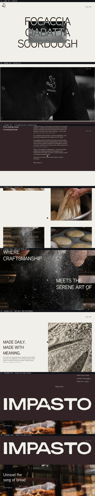
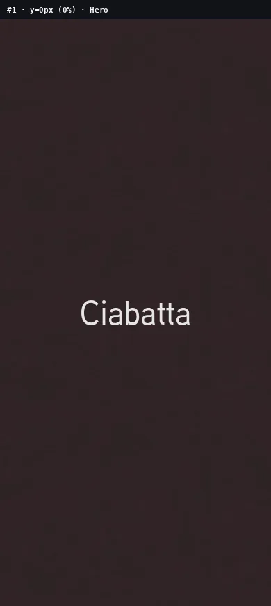

# UI Design System & Master Generation Blueprint: www-impastofornoantico-com

> **Handcrafted Bread with Soul - Impasto** (https://www.impastofornoantico.com/) — Discover Impasto’s soulful, handcrafted bread - Rye, Focaccia, Sourdough. Experience the rhythm of baking with care. Order or contact us...





---

## 1. Executive Visual Persona & Design Archetype

- **Brand Essence & Persona**: **Handcrafted Bread with Soul - Impasto** (`https://www.impastofornoantico.com/`). Discover Impasto’s soulful, handcrafted bread - Rye, Focaccia, Sourdough. Experience the rhythm of baking with care. Order or contact us...
- **Capture Provenance**: Live browser capture (`tier1_fast`, HTTP `200`, captured `2026-11-24`).
- **Visual Archetype**: **Light-Substrate Editorial & Modular Grid System (`#efefe7` canvas, `#312426` ink, `#0082f3` accent)**.
- **Anti-AI-Slop Differentiators**:
  - **Live-Computed Chromatic Polarity**: Anchors the viewport in `#efefe7` (live computed `body` `background-color` (`computed_styles.json`)) paired with `#312426` primary typography and `#0082f3` accents.
  - **Grounded Typographic Hierarchy**: Pairs `aaux-next` for display copy (`FOCACCIA`) with `ff-scala`.
  - **Calibrated Spatial Grid & Motion**: Combines `80em` container bounds (`gap: var(--space--2)`, padding `9px`) with `cubic-bezier(.625,.05,0,1)` easing and Lenis Smooth Scroll (`data-lenis`), GSAP Timeline & ScrollTrigger.

---

## 2. Spatial Architecture & Modular Grid Mathematics

### Viewport Allocation & Container Geometry
- **Captured Journey Filmstrips**: Desktop `1280×6624px` (`assets/desktop-journey.webp`, `8` keyframes up to `y=10468px` / doc `11368px`), Mobile `390×872px` (`assets/mobile-journey.webp`, `1` keyframes).
- **Master Container Bounds**: `80em` (non-`@media` desktop container stylesheet rule).
- **Canvas Lateral Padding & Spacing**: `9px` lateral canvas padding with `var(--space--2)` grid gap.
- **Border Radius Scale**: `3px`, `100%`, `50%`, `var(--radius--small)`.

### Responsive Breakpoint Architecture
- **Desktop Layout**: Multi-column CSS Grid / Flexbox layout at `1440px` (`max-width: 80em`, `gap: var(--space--2)`).
- **Mobile Layout**: Single-column vertical stack at `390px` viewport width with `9px` horizontal padding.
- **Extracted CSS Media Queries**: `@media screen and (max-width:991px)`, `@media screen and (max-width:767px)`, `@media screen and (max-width:479px)`, `@media (min-width:768px)`.

---

## 3. Color System, Materiality & Atmospheric Lighting

### Semantic Palette & Source Grounding
| Semantic Role | Ground-Truth Value | Extracted Live / CSS Source |
|---|---|---|
| **Primary Canvas Substrate** | `#efefe7` | live computed `body` `background-color` (`computed_styles.json`) |
| **Primary Typography Ink** | `#312426` | live computed `body` `color` (`computed_styles.json`) |
| **Elevated Surface / Card Substrate** | `#ffff00` | `mark { background: #ffff00 }` |
| **Interactive Accent / Highlight** | `#0082f3` | `.w-dropdown-link.w--current { color: #0082f3 }` |
| **Secondary / Muted Copy** | `#d9cec3` | live computed `p` `color` (`computed_styles.json`) |
| **Structural Hairline Border** | `#e2e2e2` | `blockquote { border-left: #e2e2e2 }` |

### Sanitized Root CSS Variables (`ui-ux.md` Ground Truth)
| Variable Name | Extracted Value | Semantic Role |
|---|---|---|
| `--theme--background` | `var(--swatch--light)` | Canvas / Surface Token |
| `--text-main--font-family` | `var(--font--second-family)` | Typography Ink Token |
| `--theme--text` | `var(--swatch--dark)` | Typography Ink Token |
| `--text-main--font-size` | `1.2rem` | Typography Ink Token |
| `--text-main--line-height` | `var(--line-height--1-5)` | Typography Ink Token |
| `--text-main--font-weight` | `var(--font--primary-regular)` | Typography Ink Token |
| `--text-main--letter-spacing` | `var(--letter-spacing--0em)` | Typography Ink Token |
| `--h1--margin-bottom` | `var(--space--3)` | Typography / Scale Token |
| `--h1--font-family` | `var(--all-headings--heading-font-family)` | Typography / Scale Token |
| `--h1--font-size` | `var(--size--5rem)` | Typography / Scale Token |
| `--h1--line-height` | `var(--all-headings--heading-line-height)` | Typography / Scale Token |
| `--h1--font-weight` | `var(--font--primary-medium)` | Typography / Scale Token |
| `--h1--letter-spacing` | `var(--all-headings--heading-letter-spacing)` | Typography / Scale Token |
| `--h2--margin-bottom` | `var(--space--3)` | Typography / Scale Token |
| `--h2--font-family` | `var(--all-headings--heading-font-family)` | Typography / Scale Token |
| `--h2--font-size` | `var(--size--4rem)` | Typography / Scale Token |

---

## 4. Typographic Scale & Editorial Hierarchy

### Font Family Stacks
- **Display Typography**: `aaux-next`.
- **Primary Body Stack**: `ff-scala`.
- **Technical / Metadata Stack**: not declared in live computed styles (uses primary stack / `ui-monospace`).

### Typographic Scale & Rules (Live Computed & Stylesheet Grounded)
- **Hero Display (`H1`)**: CSS variables `--h1--margin-bottom: var(--space--3)`, `--h1--font-family: var(--all-headings--heading-font-family)`, `--h1--font-size: var(--size--5rem)`.
- **Section Heading (`H2`)**: live computed `h2` (`font-size: 168px`, `line-height: 168px`, `font-weight: 400`, `letter-spacing: -5.03999px`); CSS variables `--h2--margin-bottom: var(--space--3)`, `--h2--font-family: var(--all-headings--heading-font-family)`, `--h2--font-size: var(--size--4rem)`.
- **Body Copy**: live computed `body` (`font-size: 19.2px`, `line-height: 28.8px`, `font-weight: 400`).
- **Metadata & Navigation Labels**: live computed `nav/a` (`font-size: 19.2px`, `line-height: 28.8px`, `font-weight: 400`); CSS variables `--text-main--letter-spacing: var(--letter-spacing--0em)`, `--h1--letter-spacing: var(--all-headings--heading-letter-spacing)`, `--h2--letter-spacing: var(--all-headings--heading-letter-spacing)`.

---

## 5. Choreographed Motion & Interaction Physics

### Primary Easing Curves
- **Extracted Timing Functions**: `cubic-bezier(.625,.05,0,1)`, `cubic-bezier(.165,.84,.44,1)`, `cubic-bezier(.49,.78,.46,1.34)`.

### Per-Element Transition & Choreography Rules
- **Selector `.w-webflow-badge>img`**: `transition: unset` extracted from `www-impastofornoantico-com` stylesheet.
- **Selector `.w-slider-dot`**: `transition: background-color .1s,color .1s` extracted from `www-impastofornoantico-com` stylesheet.
- **Selector `.w-lightbox-control`**: `transition: all .3s` extracted from `www-impastofornoantico-com` stylesheet.
- **Extracted Easing Curve (`cubic-bezier(.625,.05,0,1)`)**: Governs interactive state transitions across `<nav.navigation>` and `<section.scaling-element-video>`.
- **Runtime Interaction Engine**: Integrates Lenis Smooth Scroll (`data-lenis`), GSAP Timeline & ScrollTrigger, Three.js / WebGL Canvas Pipeline, Barba.js Page Transition Router with `prefers-reduced-motion: reduce` fallback guards.
### Measured Runtime Scroll & Interaction Telemetry (`behavioral_journey_v2`)
- **Scroll Driver Mode**: `native` (max document height `11368px`, deepest scrollY reached `10468px` across `8` desktop keyframes).
- **Detected Scroll / Motion Libraries**: `Lenis`, `GSAP/ScrollTrigger`.
- **Route Transition Architecture**: First internal navigation (`/products`) measured as `direct` in `487ms`.

---

## 6. Component Wireframe & Structural DOM Map

### Visual Layout Schematic — Desktop (`1440px`, Grounded in `dom.html` & Landmark Bounding Boxes)
```
┌────────────────────────────────────────────────────────────────────────┐
│ DESKTOP VIEWPORT (1440px) — Handcrafted Bread with Soul - Impasto      │
│ ====================================================================== │
│ [ <nav.navigation> (1440x900px)       | Home · About · Products · St ] │
│ ---------------------------------------------------------------------- │
│ | HERO STAGE: <section.scaling-element-header> (w=1440px)            | │
│ | H1: FOCACCIA                                                       | │
│ | Substrate: #efefe7 | Ink: #312426 | Accent: #0082f3                | │
│ ---------------------------------------------------------------------- │
│ | SHOWCASE GRID (<section.scaling-element-v) max-w: 80em             | │
│ | +------------------------------+  +------------------------------+ | │
│ | | CIABATTA                     |  | SOURDOUGH                    | | │
│ | +------------------------------+  +------------------------------+ | │
│ ---------------------------------------------------------------------- │
│ | DETAIL MODULE (<section.scaling-element-v) — Our ongoing pursuit o | │
│ ---------------------------------------------------------------------- │
│ [ FOOTER (<footer.footer_compo) | https://www.impastofornoantico.com/  │
└────────────────────────────────────────────────────────────────────────┘
```

### Visual Layout Schematic — Mobile Reflow (`390px`)
```
┌────────────────────────────────────────────────────────────────────────┐
│ MOBILE VIEWPORT REFLOW (390px) — Single-Column Stack (gap: var(--sp)   │
│ ====================================================================== │
│ [ HEADER BAR (<nav.navigation>        ) | Compact Menu (390px)         │
│ ---------------------------------------------------------------------- │
│ | HERO STAGE (<section.scaling-element) — 390px Vertical Lead        | │
│ | H1: FOCACCIA                                                       | │
│ ---------------------------------------------------------------------- │
│ | SHOWCASE STACK (<section.scaling-eleme) — 1-Col Stack              | │
│ | [ Item 1: CIABATTA                                               ] | │
│ | [ Item 2: SOURDOUGH                                              ] | │
│ ---------------------------------------------------------------------- │
│ | DETAIL STACK (<section.scaling-element) — 1-Col (Our ongoing pursui) │
│ ---------------------------------------------------------------------- │
│ [ FOOTER (<footer.footer_compo) | Stacked 390px Colophon               │
└────────────────────────────────────────────────────────────────────────┘
```

### Granular DOM Region Breakdown
1. **Brand Header & Navigation Bar (<nav.navigation> — `www-impastofornoantico-com`)**:
   - Landmark `<nav class="navigation">` (`1440x900px`) hosting `Handcrafted Bread with Soul - Impast` navigation (`Home · About · Products · Stockists · Wholesale`), DOM attributes (`data-wf-domain="www.impastofornoantic..."`, `data-wf-page="6774ded4742b832f88f9825e"`, `data-wf-site="6774ded4742b832f88f98269"`, `data-navigation-status="not-active"`), and stylesheet rule `html { -webkit-text-size-adjust:100%;-ms-text-size-adjust:100%;font-family:sans... }`.
2. **Hero Stage & Focal Lead (<section.scaling-element-header> — `FOCACCIA`)**:
   - Landmark `<section class="scaling-element-header">` presenting display lead `FOCACCIA` and copy excerpt *"For generations, the Villani family has followed a time-honored m"* over `#efefe7` canvas and `#312426` ink.
3. **Primary Showcase & Content Grid (<section.scaling-element-video> — `CIABATTA`)**:
   - Landmark `<section class="scaling-element-video">` rendering section `CIABATTA` with copy *"It’s a method rooted in patience, respect for ingredients, and a "*, asset references (`cdn.prod.website-files.com`, `impasto-tag.webflow.shared.02cb07...`, `recaptcha__en.js`, `gvw6vxl.js`), and grid rule `summary { display:block }`.
4. **Interactive Detail & Feature Matrix (<section.scaling-element-video:nth(2)> — `SOURDOUGH`)**:
   - Landmark `<section class="scaling-element-video">` framing `SOURDOUGH` and `Our ongoing pursuit of quality ensures that our ` (*"Our ongoing pursuit of quality ensures that our bread evolves wit"*) with `#ffff00` surface cards, `#0082f3` accents, and `video { vertical-align:baseline;display:inline-block }`.
5. **Colophon & Global Directory Footer (<footer.footer_component> — `https://www.impastofornoantico.com/`)**:
   - Landmark `<footer class="footer_component">` anchoring `Handcrafted Bread with Soul - Im` footer links (`Home · About · Products · Stockists · Wholesale`), copy *"Today, a new approach is taking shape — one that still value"*, and `#e2e2e2` structural dividers.
### Full Vertical Scroll Sequence (Desktop `1440×900` Keyframes)
- **Step 01** (`y=0px`, `0%`): Active landmark `FOCACCIA` · sticky/fixed elements: `1`
- **Step 02** (`y=850px`, `8%`): Active landmark `Section @ 8%` · sticky/fixed elements: `1`
- **Step 03** (`y=2550px`, `24%`): Active landmark `From baking bread to breaking bread.` · sticky/fixed elements: `1`
- **Step 04** (`y=4250px`, `41%`): Active landmark `Section @ 41%` · sticky/fixed elements: `1`
- **Step 05** (`y=6800px`, `65%`): Active landmark `MEETS THE SERENE ART OF` · sticky/fixed elements: `1`
- **Step 06** (`y=8500px`, `81%`): Active landmark `MADE DAILY. MADE WITH MEANING.` · sticky/fixed elements: `1`
- **Step 07** (`y=10200px`, `97%`): Active landmark `Unravel the song of bread` · sticky/fixed elements: `1`
- **Step 08** (`y=10468px`, `100%`): Active landmark `Unravel the song of bread` · sticky/fixed elements: `1`

### Multi-Page Internal Route Map
- **Listing Route (`/products`)**: `https://www.impastofornoantico.com/products` — H1: `FLOUR AND WATER. SHAPED BY SOUL AND MOVEMENT.`, scrollHeight `7784px`, transition `direct` (`487ms`)
- **About Route (`/about`)**: `https://www.impastofornoantico.com/about` — H1: `MORE THAN BREAD. A WAY OF LIFE.`, scrollHeight `8083px`, transition `direct` (`322ms`)
- **About Route (`/contact`)**: `https://www.impastofornoantico.com/contact` — H1: `LET'S BREAK BREAD TOGETHER`, scrollHeight `4255px`, transition `direct` (`264ms`)

---

## 7. Master Zero-Shot AI Generation Prompt

```markdown
# Master Zero-Shot Frontend Generation Prompt: www-impastofornoantico-com (Handcrafted Bread with Soul - Impasto)

You are a principal frontend architect and design systems engineer. Build a complete, production-ready web application replicating the exact design system, DOM landmarks, typographic hierarchy, color tokens, and motion physics of `www-impastofornoantico-com` (**Handcrafted Bread with Soul - Impasto** — `https://www.impastofornoantico.com/`).

### 1. Visual Archetype & Anti-AI-Slop Mandates
- **Archetype**: Light-Substrate Editorial & Modular Grid System (`#efefe7` canvas, `#312426` ink, `#0082f3` accent).
- **Identity & Domain Context**: Discover Impasto’s soulful, handcrafted bread - Rye, Focaccia, Sourdough. Experience the rhythm of baking with care. Order or contact us...
- **Primary Substrate**: `#efefe7` (live computed `body` `background-color` (`computed_styles.json`)), **Primary Ink**: `#312426`, **Accent / Highlight**: `#0082f3`.
- **Site-Specific Differentiators**:
  - **Live-Computed Chromatic Polarity**: Anchors the viewport in `#efefe7` (live computed `body` `background-color` (`computed_styles.json`)) paired with `#312426` primary typography and `#0082f3` accents.
  - **Grounded Typographic Hierarchy**: Pairs `aaux-next` for display copy (`FOCACCIA`) with `ff-scala`.
  - **Calibrated Spatial Grid & Motion**: Combines `80em` container bounds (`gap: var(--space--2)`, padding `9px`) with `cubic-bezier(.625,.05,0,1)` easing and Lenis Smooth Scroll (`data-lenis`), GSAP Timeline & ScrollTrigger.

### 2. Ground-Truth CSS Variables (`:root` Token Contract)
Declare and consume these exact custom properties extracted from `www-impastofornoantico-com` in your global stylesheet:

:root {
  /* Handcrafted Bread with Soul - Impasto (www-impastofornoantico-com) — Live-Grounded CSS Variables */
  --theme--background: var(--swatch--light); /* Canvas / Surface Token (www-impastofornoantico-com) */
  --text-main--font-family: var(--font--second-family); /* Typography Ink Token (www-impastofornoantico-com) */
  --theme--text: var(--swatch--dark); /* Typography Ink Token (www-impastofornoantico-com) */
  --text-main--font-size: 1.2rem; /* Typography Ink Token (www-impastofornoantico-com) */
  --text-main--line-height: var(--line-height--1-5); /* Typography Ink Token (www-impastofornoantico-com) */
  --text-main--font-weight: var(--font--primary-regular); /* Typography Ink Token (www-impastofornoantico-com) */
  --text-main--letter-spacing: var(--letter-spacing--0em); /* Typography Ink Token (www-impastofornoantico-com) */
  --h1--margin-bottom: var(--space--3); /* Typography / Scale Token (www-impastofornoantico-com) */
  --h1--font-family: var(--all-headings--heading-font-family); /* Typography / Scale Token (www-impastofornoantico-com) */
  --h1--font-size: var(--size--5rem); /* Typography / Scale Token (www-impastofornoantico-com) */
  --h1--line-height: var(--all-headings--heading-line-height); /* Typography / Scale Token (www-impastofornoantico-com) */
  --h1--font-weight: var(--font--primary-medium); /* Typography / Scale Token (www-impastofornoantico-com) */
  --h1--letter-spacing: var(--all-headings--heading-letter-spacing); /* Typography / Scale Token (www-impastofornoantico-com) */
  --h2--margin-bottom: var(--space--3); /* Typography / Scale Token (www-impastofornoantico-com) */
  --h2--font-family: var(--all-headings--heading-font-family); /* Typography / Scale Token (www-impastofornoantico-com) */
  --h2--font-size: var(--size--4rem); /* Typography / Scale Token (www-impastofornoantico-com) */
}

### 3. Semantic Color & Materiality Contract
Map every surface, ink, and border strictly to these source-grounded tokens:
- **Primary Canvas Substrate**: `#efefe7` — grounded in live computed `body` `background-color` (`computed_styles.json`)
- **Primary Typography Ink**: `#312426` — grounded in live computed `body` `color` (`computed_styles.json`)
- **Elevated Surface / Card Substrate**: `#ffff00` — grounded in `mark { background: #ffff00 }`
- **Interactive Accent / Highlight**: `#0082f3` — grounded in `.w-dropdown-link.w--current { color: #0082f3 }`
- **Secondary / Muted Copy**: `#d9cec3` — grounded in live computed `p` `color` (`computed_styles.json`)
- **Structural Hairline Border**: `#e2e2e2` — grounded in `blockquote { border-left: #e2e2e2 }`

### 4. Spatial Grid, Container Bounds & Responsive Breakpoints
- **Desktop Viewport Reference**: `1280×6624px` (multi-frame vertical journey filmstrip (6624px), `1440px` standard desktop width).
- **Mobile Viewport Reference**: `390×872px` (full-page live capture (872px), `390px` standard mobile width).
- **Container Max-Width**: `80em` (non-`@media` desktop container stylesheet rule)
- **Padding & Gutters**: `9px` lateral canvas padding with `var(--space--2)` grid gap
- **Desktop Grid**: Multi-column CSS Grid / Flexbox layout at `1440px` (`max-width: 80em`, `gap: var(--space--2)`)
- **Mobile Adaptation**: Single-column vertical stack at `390px` viewport width with `9px` horizontal padding
- **Media Queries**: `@media screen and (max-width:991px)`, `@media screen and (max-width:767px)`, `@media screen and (max-width:479px)`, `@media (min-width:768px)`
- **Corner Radii**: `3px`, `100%`, `50%`, `var(--radius--small)`

### 5. Typography & Editorial Scale Contract
- **Display Font Stack**: `aaux-next`
- **Body Font Stack**: `ff-scala`
- **Monospace / Technical Font Stack**: not declared in live computed styles (uses primary stack / `ui-monospace`)
- **H1 Display Rule**: CSS variables `--h1--margin-bottom: var(--space--3)`, `--h1--font-family: var(--all-headings--heading-font-family)`, `--h1--font-size: var(--size--5rem)`
- **H2 Section Rule**: live computed `h2` (`font-size: 168px`, `line-height: 168px`, `font-weight: 400`, `letter-spacing: -5.03999px`); CSS variables `--h2--margin-bottom: var(--space--3)`, `--h2--font-family: var(--all-headings--heading-font-family)`, `--h2--font-size: var(--size--4rem)`
- **Body Copy Rule**: live computed `body` (`font-size: 19.2px`, `line-height: 28.8px`, `font-weight: 400`)
- **Metadata & Index Rule**: live computed `nav/a` (`font-size: 19.2px`, `line-height: 28.8px`, `font-weight: 400`); CSS variables `--text-main--letter-spacing: var(--letter-spacing--0em)`, `--h1--letter-spacing: var(--all-headings--heading-letter-spacing)`, `--h2--letter-spacing: var(--all-headings--heading-letter-spacing)`

### 6. Component Hierarchy, Verbatim Copy & Real DOM Landmarks
Scaffold `www-impastofornoantico-com` (`Handcrafted Bread with Soul - Impasto`) with these exact structural regions, extracted copy, and CSS rules from `dom.html`:
1. **Brand Header & Navigation Bar (<nav.navigation> — `www-impastofornoantico-com`)**:
   - DOM & Selectors: Landmark `<nav class="navigation">` (`1440x900px`) hosting `Handcrafted Bread with Soul - Impast` navigation (`Home · About · Products · Stockists · Wholesale`), DOM attributes (`data-wf-domain="www.impastofornoantic..."`, `data-wf-page="6774ded4742b832f88f9825e"`, `data-wf-site="6774ded4742b832f88f98269"`, `data-navigation-status="not-active"`), and stylesheet rule `html { -webkit-text-size-adjust:100%;-ms-text-size-adjust:100%;font-family:sans... }`.
   - Responsive Contract: Header `Brand Header & Navigation Bar (<nav.navigation> — `www-impastofornoantico-com`)` (`www-impastofornoantico-com`) adapts across `@media screen and (max-width:991px)`, `@media screen and (max-width:767px)`, `@media screen and (max-width:479px)`, `@media (min-width:768px)` with `cubic-bezier(.625,.05,0,1)`, `cubic-bezier(.165,.84,.44,1)`, `cubic-bezier(.49,.78,.46,1.34)` transitions and links `Home · About · Products · Stockists · Wholesale`.
2. **Hero Stage & Focal Lead (<section.scaling-element-header> — `FOCACCIA`)**:
   - DOM & Selectors: Landmark `<section class="scaling-element-header">` presenting display lead `FOCACCIA` and copy excerpt *"For generations, the Villani family has followed a time-honored m"* over `#efefe7` canvas and `#312426` ink.
   - Responsive Contract: Hero stage (`1280×6624px` desktop / `390×872px` mobile) sets `#efefe7` background with `#312426` headline `FOCACCIA`.
3. **Primary Showcase & Content Grid (<section.scaling-element-video> — `CIABATTA`)**:
   - DOM & Selectors: Landmark `<section class="scaling-element-video">` rendering section `CIABATTA` with copy *"It’s a method rooted in patience, respect for ingredients, and a "*, asset references (`cdn.prod.website-files.com`, `impasto-tag.webflow.shared.02cb07...`, `recaptcha__en.js`, `gvw6vxl.js`), and grid rule `summary { display:block }`.
   - Responsive Contract: Showcase grid `Primary Showcase & Content Grid (<section.scaling-element-video> — `CIABATTA`)` applies Multi-column CSS Grid / Flexbox layout at `1440px` (`max-width: 80em`, `gap: var(--space--2)`) on desktop and Single-column vertical stack at `390px` viewport width with `9px` horizontal padding on mobile.
4. **Interactive Detail & Feature Matrix (<section.scaling-element-video:nth(2)> — `SOURDOUGH`)**:
   - DOM & Selectors: Landmark `<section class="scaling-element-video">` framing `SOURDOUGH` and `Our ongoing pursuit of quality ensures that our ` (*"Our ongoing pursuit of quality ensures that our bread evolves wit"*) with `#ffff00` surface cards, `#0082f3` accents, and `video { vertical-align:baseline;display:inline-block }`.
   - Responsive Contract: Detail module `Interactive Detail & Feature Matrix (<section.scaling-element-video:nth(2)> — `SOURDOUGH`)` uses `3px`, `100%`, `50%`, `var(--radius--small)` radii, `#0082f3` highlights, and assets (cdn.prod.website-files.com, impasto-tag.webflow.shared.02cb07..., recaptcha__en.js).
5. **Colophon & Global Directory Footer (<footer.footer_component> — `https://www.impastofornoantico.com/`)**:
   - DOM & Selectors: Landmark `<footer class="footer_component">` anchoring `Handcrafted Bread with Soul - Im` footer links (`Home · About · Products · Stockists · Wholesale`), copy *"Today, a new approach is taking shape — one that still value"*, and `#e2e2e2` structural dividers.
   - Responsive Contract: Footer `Colophon & Global Directory Footer (<footer.footer_component> — `https://www.impastofornoantico.com/`)` aligns to `80em` (non-`@media` desktop container stylesheet rule) with `9px` lateral canvas padding with `var(--space--2)` grid gap and attributes (data-wf-domain="www.impastofornoantic...", data-wf-page="6774ded4742b832f88f9825e", data-wf-site="6774ded4742b832f88f98269").

#### Verbatim DOM Copy Excerpts (`dom.html`)
- Copy Excerpt 1: *"For generations, the Villani family has followed a time-honored method — a traditi..."*
- Copy Excerpt 2: *"It’s a method rooted in patience, respect for ingredients, and a deep understandin..."*
- Copy Excerpt 3: *"Our ongoing pursuit of quality ensures that our bread evolves with the times, with..."*
- Copy Excerpt 4: *"Today, a new approach is taking shape — one that still values integrity and streng..."*

### 7. Motion, Extracted Stylesheet Rules & Interaction Choreography
- **Primary Easing Functions**: `cubic-bezier(.625,.05,0,1)`, `cubic-bezier(.165,.84,.44,1)`, `cubic-bezier(.49,.78,.46,1.34)`
- **Extracted Stylesheet Rules (`www-impastofornoantico-com`)**:
- `html { -webkit-text-size-adjust:100%;-ms-text-size-adjust:100%;font-family:sans... }`
- `summary { display:block }`
- `video { vertical-align:baseline;display:inline-block }`
- `template { display:none }`
- `strong { font-weight:700 }`
- **Per-Selector Transition Rules**:
- **Selector `.w-webflow-badge>img`**: `transition: unset` extracted from `www-impastofornoantico-com` stylesheet.
- **Selector `.w-slider-dot`**: `transition: background-color .1s,color .1s` extracted from `www-impastofornoantico-com` stylesheet.
- **Selector `.w-lightbox-control`**: `transition: all .3s` extracted from `www-impastofornoantico-com` stylesheet.
- **Extracted Easing Curve (`cubic-bezier(.625,.05,0,1)`)**: Governs interactive state transitions across `<nav.navigation>` and `<section.scaling-element-video>`.
- **Runtime Interaction Engine**: Integrates Lenis Smooth Scroll (`data-lenis`), GSAP Timeline & ScrollTrigger, Three.js / WebGL Canvas Pipeline, Barba.js Page Transition Router with `prefers-reduced-motion: reduce` fallback guards.
### 7b. Full-Page Scroll Choreography, Interactive States & Multi-Page Routes
- **Scroll Mechanics**: Implement `native` vertical progression up to `11368px` across 8 distinct viewport chapters using Lenis, GSAP/ScrollTrigger.
- **Vertical Chapter Sequence**: FOCACCIA (0%) -> Section @ 8% (8%) -> From baking bread to breaki... (24%) -> Section @ 41% (41%) -> MEETS THE SERENE ART OF (65%) -> MADE DAILY. MADE WITH MEANING. (81%) -> Unravel the song of bread (97%) -> Unravel the song of bread (100%).
- **Multi-Page Routes**: Scaffold internal routes `/products` (listing, direct), `/about` (about, direct), `/contact` (about, direct) sharing the global header/footer shell and design tokens.

### 8. Technical Deliverables
- Implement in Next.js (App Router) with TypeScript and Tailwind CSS consuming the `:root` custom properties defined above for `www-impastofornoantico-com`.
- Reproduce both the `1440px` desktop architecture and `390px` mobile breakpoint transitions, preserving semantic HTML5 landmarks (`<header>`, `<nav>`, `<main>`, `<section>`, `<footer>`) and `prefers-reduced-motion` accessibility guards.
```
---

## 8. Full-Page Scroll Journey, Interactive States & Subpage Inventory

### Desktop Scroll Keyframes (`1440×900` WebP)
| Step | Scroll Y | Progress | Active Landmark / Section | Sticky/Fixed | Visual Asset |
| :---: | :---: | :---: | :--- | :---: | :--- |
| `#01` | `0px` | `0%` | FOCACCIA | `1` | [desktop-step-01.webp](assets/desktop-step-01.webp) |
| `#02` | `850px` | `8%` | Section @ 8% | `1` | [desktop-step-02.webp](assets/desktop-step-02.webp) |
| `#03` | `2550px` | `24%` | From baking bread to breaking bread. | `1` | [desktop-step-03.webp](assets/desktop-step-03.webp) |
| `#04` | `4250px` | `41%` | Section @ 41% | `1` | [desktop-step-04.webp](assets/desktop-step-04.webp) |
| `#05` | `6800px` | `65%` | MEETS THE SERENE ART OF | `1` | [desktop-step-05.webp](assets/desktop-step-05.webp) |
| `#06` | `8500px` | `81%` | MADE DAILY. MADE WITH MEANING. | `1` | [desktop-step-06.webp](assets/desktop-step-06.webp) |
| `#07` | `10200px` | `97%` | Unravel the song of bread | `1` | [desktop-step-07.webp](assets/desktop-step-07.webp) |
| `#08` | `10468px` | `100%` | Unravel the song of bread | `1` | [desktop-step-08.webp](assets/desktop-step-08.webp) |

### Mobile Condensed Keyframes (`390×844` WebP)
| Step | Scroll Y | Progress | Active Landmark | Visual Asset |
| :---: | :---: | :---: | :--- | :--- |
| `#01` | `0px` | `0%` | Hero | [mobile-step-01.webp](assets/mobile-step-01.webp) |

### Internal Subpage Filmstrips (`1080px` Wide WebP)
| # | Template | Route URL | H1 / Title | Scroll Height | Transition | Filmstrip Asset |
| :-: | :---: | :--- | :--- | :---: | :---: | :--- |
| `1` | `listing` | `https://www.impastofornoantico.com/products` | FLOUR AND WATER. SHAPED BY SOUL AND M... | `7784px` | `direct` (`487ms`) | [subpage-01-products.webp](assets/subpage-01-products.webp) |
| `2` | `about` | `https://www.impastofornoantico.com/about` | MORE THAN BREAD. A WAY OF LIFE. | `8083px` | `direct` (`322ms`) | [subpage-02-about.webp](assets/subpage-02-about.webp) |
| `3` | `about` | `https://www.impastofornoantico.com/contact` | LET'S BREAK BREAD TOGETHER | `4255px` | `direct` (`264ms`) | [subpage-03-contact.webp](assets/subpage-03-contact.webp) |

