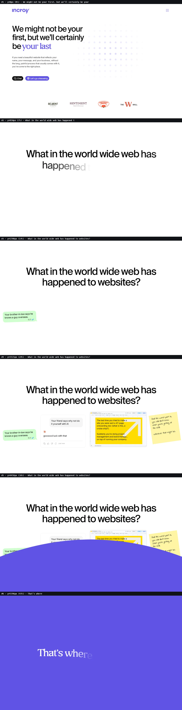
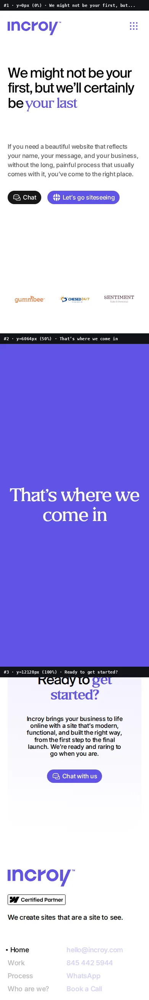

# UI Design System & Master Generation Blueprint: www-incroy-com

> **Incroy · Webflow Certified Development Agency** (https://www.incroy.com/) — Incroy is a Webflow agency serving medium to large businesses. We handle design, development, copywriting, and ongoing site management un...





---

## 1. Executive Visual Persona & Design Archetype

- **Brand Essence & Persona**: **Incroy · Webflow Certified Development Agency** (`https://www.incroy.com/`). Incroy is a Webflow agency serving medium to large businesses. We handle design, development, copywriting, and ongoing site management un...
- **Capture Provenance**: Live browser capture (`tier1_fast`, HTTP `200`, captured `2026-11-24`).
- **Visual Archetype**: **Light-Substrate Editorial & Modular Grid System (`#ffffff` canvas, `#000000` ink, `#0082f3` accent)**.
- **Anti-AI-Slop Differentiators**:
  - **Live-Computed Chromatic Polarity**: Anchors the viewport in `#ffffff` (live computed `body` `background-color` (`computed_styles.json`)) paired with `#000000` primary typography and `#0082f3` accents.
  - **Grounded Typographic Hierarchy**: Pairs `Suisseintl Book` for display copy (`Ready to get started?`) with `Inter`.
  - **Calibrated Spatial Grid & Motion**: Combines `1008px` container bounds (`gap: 16px`, padding `9px`) with `cubic-bezier(.32,.72,0,1)` easing and Lenis Smooth Scroll (`data-lenis`), GSAP Timeline & ScrollTrigger.

---

## 2. Spatial Architecture & Modular Grid Mathematics

### Viewport Allocation & Container Geometry
- **Captured Journey Filmstrips**: Desktop `1280×4968px` (`assets/desktop-journey.webp`, `6` keyframes up to `y=5396px` / doc `13306px`), Mobile `390×2616px` (`assets/mobile-journey.webp`, `3` keyframes).
- **Master Container Bounds**: `1008px` (measured widest bounded `<section>` landmark width on `1440px` desktop).
- **Canvas Lateral Padding & Spacing**: `9px` lateral canvas padding with `16px` grid gap.
- **Border Radius Scale**: `3px`, `100%`, `50%`, `2px`.

### Responsive Breakpoint Architecture
- **Desktop Layout**: Multi-column CSS Grid / Flexbox layout at `1440px` (`max-width: 1008px`, `gap: 16px`).
- **Mobile Layout**: Single-column vertical stack at `390px` viewport width with `9px` horizontal padding.
- **Extracted CSS Media Queries**: `@media screen and (max-width: 991px)`, `@media screen and (max-width: 767px)`, `@media screen and (max-width: 479px)`, `@media (min-width: 768px)`.

---

## 3. Color System, Materiality & Atmospheric Lighting

### Semantic Palette & Source Grounding
| Semantic Role | Ground-Truth Value | Extracted Live / CSS Source |
|---|---|---|
| **Primary Canvas Substrate** | `#ffffff` | live computed `body` `background-color` (`computed_styles.json`) |
| **Primary Typography Ink** | `#000000` | live computed `h1` `color` (`computed_styles.json`) |
| **Elevated Surface / Card Substrate** | `#ffff00` | `mark { background: #ffff00 }` |
| **Interactive Accent / Highlight** | `#0082f3` | `.w-dropdown-link.w--current { color: #0082f3 }` |
| **Secondary / Muted Copy** | `#6053e5` | live computed `a` `color` (`computed_styles.json`) |
| **Structural Hairline Border** | `#f0f0f0` | `var(--private-button-border-color)` in `:root` (`rgb(0, 0, 0, 0.06)`) |

### Sanitized Root CSS Variables (`ui-ux.md` Ground Truth)
| Variable Name | Extracted Value | Semantic Role |
|---|---|---|
| `--link-color--link-primary` | `var(--base-color-brand--brand-primary)` | Typography Ink Token |
| `--background-color--background-primary` | `var(--base-color-neutral--black)` | Canvas / Surface Token |
| `--text-color--text-alternate` | `var(--base-color-neutral--white)` | Typography Ink Token |
| `--text-color--text-primary` | `var(--base-color-neutral--black)` | Typography Ink Token |
| `--text-color--text-secondary` | `var(--base-color-neutral--neutral-darker)` | Typography Ink Token |
| `--background-color--background-success` | `var(--base-color-system--success-green)` | Canvas / Surface Token |
| `--text-color--text-success` | `var(--base-color-system--success-green-dark)` | Typography Ink Token |
| `--base-color-neutral--white` | `#fff` | Canvas / Surface Token |
| `--border-color--border-primary` | `var(--base-color-neutral--neutral-lightest)` | Brand / Palette Token |
| `--background-color--background-alternate` | `var(--base-color-neutral--white)` | Canvas / Surface Token |
| `--background-color--background-secondary` | `var(--base-color-brand--brand-primary)` | Canvas / Surface Token |
| `--background-color--background-tertiary` | `var(--base-color-brand--pink)` | Canvas / Surface Token |
| `--background-color--background-error` | `var(--base-color-system--error-red)` | Canvas / Surface Token |
| `--text-color--text-error` | `var(--base-color-system--error-red-dark)` | Typography Ink Token |
| `--border-color--border-subtle` | `var(--base-color-neutral--neutral-dark)` | Brand / Palette Token |
| `--background-color--background-warning` | `var(--base-color-system--warning-yellow)` | Canvas / Surface Token |

---

## 4. Typographic Scale & Editorial Hierarchy

### Font Family Stacks
- **Display Typography**: `Suisseintl Book`.
- **Primary Body Stack**: `Inter`.
- **Technical / Metadata Stack**: not declared in live computed styles (uses primary stack / `ui-monospace`).

### Typographic Scale & Rules (Live Computed & Stylesheet Grounded)
- **Hero Display (`H1`)**: live computed `h1` (`font-size: 78px`, `line-height: 84.24px`, `font-weight: 400`, `letter-spacing: -4.29px`); CSS variables `--font-size--h1: 5.625rem`, `--header-logo-display: none`, `--header-logo-inverse-display: block`; rule `h1` (`font-size: 2em`).
- **Section Heading (`H2`)**: live computed `h2` (`font-size: 48px`, `line-height: 60px`, `font-weight: 400`, `letter-spacing: -2.16px`); CSS variables `--font-size--h2: 3.75rem`; rule `h2` (`font-size: 32px`, `line-height: 36px`).
- **Body Copy**: live computed `body` (`font-size: 18px`, `line-height: 23.994px`, `font-weight: 600`, `letter-spacing: -0.27px`); CSS variables `--font-paragraph--line-height: 1`, `--shopify-account-font-body: var(--font-body--family)`, `--shopify-account-font-body-weight: var(--font-body--weight)`; rule `body` (`font-size: 14px`, `line-height: 20px`).
- **Metadata & Navigation Labels**: live computed `nav/a` (`font-size: 16px`, `line-height: 21.328px`, `font-weight: 600`, `letter-spacing: -0.27px`); CSS variables `--shopify-account-radius-button-small: var(--style-border-radius-buttons-primary)`; rule `small` (`font-size: 80%`).

---

## 5. Choreographed Motion & Interaction Physics

### Primary Easing Curves
- **Extracted Timing Functions**: `cubic-bezier(.32,.72,0,1)`, `cubic-bezier(.645,.045,.355,1)`, `cubic-bezier(.322,.014,0,.99)`.

### Per-Element Transition & Choreography Rules
- **Selector `.w-webflow-badge > img`**: `transition: unset` extracted from `www-incroy-com` stylesheet.
- **Selector `.w-slider-dot`**: `transition: background-color .1s, color .1s` extracted from `www-incroy-com` stylesheet.
- **Selector `.w-lightbox-control`**: `transition: all .3s` extracted from `www-incroy-com` stylesheet.
- **Extracted Easing Curve (`cubic-bezier(.32,.72,0,1)`)**: Governs interactive state transitions across `<nav.navigation>` and `<section.section-dots:nth(2)>`.
- **Runtime Interaction Engine**: Integrates Lenis Smooth Scroll (`data-lenis`), GSAP Timeline & ScrollTrigger, Swiper Touch Carousel Engine, Lottie Vector Animation Player, Barba.js Page Transition Router with `prefers-reduced-motion: reduce` fallback guards.
### Measured Runtime Scroll & Interaction Telemetry (`behavioral_journey_v2`)
- **Scroll Driver Mode**: `native+wheel` (max document height `13306px`, deepest scrollY reached `5396px` across `6` desktop keyframes).
- **Detected Scroll / Motion Libraries**: `Lenis`, `GSAP/ScrollTrigger`.
- **Hover Physics (`primary_cta` · `Chat`)**: Computed transition `0s` / `ease` (no static color/transform shift captured at rest).
- **Route Transition Architecture**: First internal navigation (`/projects`) measured as `direct` in `1242ms`.

---

## 6. Component Wireframe & Structural DOM Map

### Visual Layout Schematic — Desktop (`1440px`, Grounded in `dom.html` & Landmark Bounding Boxes)
```
┌────────────────────────────────────────────────────────────────────────┐
│ DESKTOP VIEWPORT (1440px) — Incroy · Webflow Certified Development Age │
│ ====================================================================== │
│ [ <nav.navigation> (1248x101px)       | H o m e · W o r k · P r o c  ] │
│ ---------------------------------------------------------------------- │
│ | HERO STAGE: <section.section-dots> (w=1440px)                      | │
│ | H1: Ready to get started?                                          | │
│ | Substrate: #ffffff | Ink: #000000 | Accent: #0082f3                | │
│ ---------------------------------------------------------------------- │
│ | SHOWCASE GRID (<section.section-dots:nth() max-w: 1008px           | │
│ | +------------------------------+  +------------------------------+ | │
│ | | W e m i g h t n o t b e y o  |  | W h a t i n t h e w o r l d  | | │
│ | +------------------------------+  +------------------------------+ | │
│ ---------------------------------------------------------------------- │
│ | DETAIL MODULE (<section.section-dots:nth() — T h a t ’ s w h e r e | │
│ ---------------------------------------------------------------------- │
│ [ FOOTER (<footer.hide>       ) | https://www.incroy.com/              │
└────────────────────────────────────────────────────────────────────────┘
```

### Visual Layout Schematic — Mobile Reflow (`390px`)
```
┌────────────────────────────────────────────────────────────────────────┐
│ MOBILE VIEWPORT REFLOW (390px) — Single-Column Stack (gap: 16px)       │
│ ====================================================================== │
│ [ HEADER BAR (<nav.navigation>        ) | Compact Menu (390px)         │
│ ---------------------------------------------------------------------- │
│ | HERO STAGE (<section.section-dots>) — 390px Vertical Lead          | │
│ | H1: Ready to get started?                                          | │
│ ---------------------------------------------------------------------- │
│ | SHOWCASE STACK (<section.section-dots:) — 1-Col Stack              | │
│ | [ Item 1: W e m i g h t n o t b e y o u r f i r s t , b u t...   ] | │
│ | [ Item 2: W h a t i n t h e w o r l d w i d e w e b h a s h...   ] | │
│ ---------------------------------------------------------------------- │
│ | DETAIL STACK (<section.section-dots:nt) — 1-Col (T h a t ’ s w h e ) │
│ ---------------------------------------------------------------------- │
│ [ FOOTER (<footer.hide>       ) | Stacked 390px Colophon               │
└────────────────────────────────────────────────────────────────────────┘
```

### Granular DOM Region Breakdown
1. **Brand Header & Navigation Bar (<nav.navigation> — `www-incroy-com`)**:
   - Landmark `<nav class="navigation">` (`1248x101px`) hosting `Incroy · Webflow Certified Developme` navigation (`H o m e · W o r k · P r o c e s s · W h o a r e w e ? · C o n t a c t`), DOM attributes (`data-wf-domain="www.incroy.com"`, `data-wf-page="6a21b959b61cf447eaaeea89"`, `data-wf-site="6a21b956b61cf447eaaeea3c"`, `data-page-theme="light"`), and stylesheet rule `html { -webkit-text-size-adjust: 100%; -ms-text-size-adjust: 100%; font-family:... }`.
2. **Hero Stage & Focal Lead (<section.section-dots> — `Ready to get started?`)**:
   - Landmark `<section class="section-dots">` presenting display lead `Ready to get started?` and copy excerpt *"If you need a beautiful website that reflects your name, your mes"* over `#ffffff` canvas and `#000000` ink.
3. **Primary Showcase & Content Grid (<section.section-dots:nth(2)> — `W e m i g h t n o t b e y o u r f `)**:
   - Landmark `<section class="section-dots">` rendering section `W e m i g h t n o t b e y o u r f i r s t , b u t...` with copy *"I f y o u n e e d a b e a u t i f u l w e b s i t e t h a t r e f"*, asset references (`cdn.prod.website-files.com`, `incroy-v2.shared.e656a73ee.css`, `clarity.js`, `pw6po7h0ab`), and grid rule `body { margin: 0; }`.
4. **Interactive Detail & Feature Matrix (<section.section-dots:nth(3)> — `W h a t i n t h e w o r l d w i d `)**:
   - Landmark `<section class="section-dots">` framing `W h a t i n t h e w o r l d w i d e w e b h a s h...` and `T h a t ’ s w h e r e w e c o m e i n` (*"L e t ’ s g o s i t e s e e i n g"*) with `#ffff00` surface cards, `#0082f3` accents, and `summary { display: block; }`.
5. **Colophon & Global Directory Footer (<footer.hide> — `https://www.incroy.com/`)**:
   - Landmark `<footer class="hide">` anchoring `Incroy · Webflow Certified Devel` footer links (`H o m e · W o r k · P r o c e s s · W h o a r e w e ? · C o n t a c t`), copy *"W e d e s i g n a n d d e v e l o p w e b s i t e s t h a t "*, and `#f0f0f0` structural dividers.
### Full Vertical Scroll Sequence (Desktop `1440×900` Keyframes)
- **Step 01** (`y=0px`, `0%`): Active landmark `We might not be your first, but we’ll certainly b...` · sticky/fixed elements: `1`
- **Step 02** (`y=850px`, `7%`): Active landmark `What in the world wide web has happened t` · sticky/fixed elements: `1`
- **Step 03** (`y=1700px`, `14%`): Active landmark `What in the world wide web has happened to websites?` · sticky/fixed elements: `1`
- **Step 04** (`y=3515px`, `28%`): Active landmark `What in the world wide web has happened to websites?` · sticky/fixed elements: `1`
- **Step 05** (`y=4458px`, `36%`): Active landmark `What in the world wide web has happened to websites?` · sticky/fixed elements: `1`
- **Step 06** (`y=5396px`, `43%`): Active landmark `That’s where` · sticky/fixed elements: `1`

### Multi-Page Internal Route Map
- **Listing Route (`/projects`)**: `https://www.incroy.com/projects` — H1: `Projects and Case Studies · Incroy`, scrollHeight `4475px`, transition `direct` (`1242ms`)
- **Detail Route (`/projects/gummbee`)**: `https://www.incroy.com/projects/gummbee` — H1: `Gummbee Website · Proudly built by Incroy`, scrollHeight `1488px`, transition `direct` (`2011ms`)
- **About Route (`/about`)**: `https://www.incroy.com/about` — H1: `About Incroy · Webflow Agency`, scrollHeight `2915px`, transition `direct` (`595ms`)

---

## 7. Master Zero-Shot AI Generation Prompt

```markdown
# Master Zero-Shot Frontend Generation Prompt: www-incroy-com (Incroy · Webflow Certified Development Agency)

You are a principal frontend architect and design systems engineer. Build a complete, production-ready web application replicating the exact design system, DOM landmarks, typographic hierarchy, color tokens, and motion physics of `www-incroy-com` (**Incroy · Webflow Certified Development Agency** — `https://www.incroy.com/`).

### 1. Visual Archetype & Anti-AI-Slop Mandates
- **Archetype**: Light-Substrate Editorial & Modular Grid System (`#ffffff` canvas, `#000000` ink, `#0082f3` accent).
- **Identity & Domain Context**: Incroy is a Webflow agency serving medium to large businesses. We handle design, development, copywriting, and ongoing site management un...
- **Primary Substrate**: `#ffffff` (live computed `body` `background-color` (`computed_styles.json`)), **Primary Ink**: `#000000`, **Accent / Highlight**: `#0082f3`.
- **Site-Specific Differentiators**:
  - **Live-Computed Chromatic Polarity**: Anchors the viewport in `#ffffff` (live computed `body` `background-color` (`computed_styles.json`)) paired with `#000000` primary typography and `#0082f3` accents.
  - **Grounded Typographic Hierarchy**: Pairs `Suisseintl Book` for display copy (`Ready to get started?`) with `Inter`.
  - **Calibrated Spatial Grid & Motion**: Combines `1008px` container bounds (`gap: 16px`, padding `9px`) with `cubic-bezier(.32,.72,0,1)` easing and Lenis Smooth Scroll (`data-lenis`), GSAP Timeline & ScrollTrigger.

### 2. Ground-Truth CSS Variables (`:root` Token Contract)
Declare and consume these exact custom properties extracted from `www-incroy-com` in your global stylesheet:

:root {
  /* Incroy · Webflow Certified Development Agency (www-incroy-com) — Live-Grounded CSS Variables */
  --link-color--link-primary: var(--base-color-brand--brand-primary); /* Typography Ink Token (www-incroy-com) */
  --background-color--background-primary: var(--base-color-neutral--black); /* Canvas / Surface Token (www-incroy-com) */
  --text-color--text-alternate: var(--base-color-neutral--white); /* Typography Ink Token (www-incroy-com) */
  --text-color--text-primary: var(--base-color-neutral--black); /* Typography Ink Token (www-incroy-com) */
  --text-color--text-secondary: var(--base-color-neutral--neutral-darker); /* Typography Ink Token (www-incroy-com) */
  --background-color--background-success: var(--base-color-system--success-green); /* Canvas / Surface Token (www-incroy-com) */
  --text-color--text-success: var(--base-color-system--success-green-dark); /* Typography Ink Token (www-incroy-com) */
  --base-color-neutral--white: #fff; /* Canvas / Surface Token (www-incroy-com) */
  --border-color--border-primary: var(--base-color-neutral--neutral-lightest); /* Brand / Palette Token (www-incroy-com) */
  --background-color--background-alternate: var(--base-color-neutral--white); /* Canvas / Surface Token (www-incroy-com) */
  --background-color--background-secondary: var(--base-color-brand--brand-primary); /* Canvas / Surface Token (www-incroy-com) */
  --background-color--background-tertiary: var(--base-color-brand--pink); /* Canvas / Surface Token (www-incroy-com) */
  --background-color--background-error: var(--base-color-system--error-red); /* Canvas / Surface Token (www-incroy-com) */
  --text-color--text-error: var(--base-color-system--error-red-dark); /* Typography Ink Token (www-incroy-com) */
  --border-color--border-subtle: var(--base-color-neutral--neutral-dark); /* Brand / Palette Token (www-incroy-com) */
  --background-color--background-warning: var(--base-color-system--warning-yellow); /* Canvas / Surface Token (www-incroy-com) */
}

### 3. Semantic Color & Materiality Contract
Map every surface, ink, and border strictly to these source-grounded tokens:
- **Primary Canvas Substrate**: `#ffffff` — grounded in live computed `body` `background-color` (`computed_styles.json`)
- **Primary Typography Ink**: `#000000` — grounded in live computed `h1` `color` (`computed_styles.json`)
- **Elevated Surface / Card Substrate**: `#ffff00` — grounded in `mark { background: #ffff00 }`
- **Interactive Accent / Highlight**: `#0082f3` — grounded in `.w-dropdown-link.w--current { color: #0082f3 }`
- **Secondary / Muted Copy**: `#6053e5` — grounded in live computed `a` `color` (`computed_styles.json`)
- **Structural Hairline Border**: `#f0f0f0` — grounded in `var(--private-button-border-color)` in `:root` (`rgb(0, 0, 0, 0.06)`)

### 4. Spatial Grid, Container Bounds & Responsive Breakpoints
- **Desktop Viewport Reference**: `1280×4968px` (multi-frame vertical journey filmstrip (4968px), `1440px` standard desktop width).
- **Mobile Viewport Reference**: `390×2616px` (multi-frame vertical journey filmstrip (2616px), `390px` standard mobile width).
- **Container Max-Width**: `1008px` (measured widest bounded `<section>` landmark width on `1440px` desktop)
- **Padding & Gutters**: `9px` lateral canvas padding with `16px` grid gap
- **Desktop Grid**: Multi-column CSS Grid / Flexbox layout at `1440px` (`max-width: 1008px`, `gap: 16px`)
- **Mobile Adaptation**: Single-column vertical stack at `390px` viewport width with `9px` horizontal padding
- **Media Queries**: `@media screen and (max-width: 991px)`, `@media screen and (max-width: 767px)`, `@media screen and (max-width: 479px)`, `@media (min-width: 768px)`
- **Corner Radii**: `3px`, `100%`, `50%`, `2px`

### 5. Typography & Editorial Scale Contract
- **Display Font Stack**: `Suisseintl Book`
- **Body Font Stack**: `Inter`
- **Monospace / Technical Font Stack**: not declared in live computed styles (uses primary stack / `ui-monospace`)
- **H1 Display Rule**: live computed `h1` (`font-size: 78px`, `line-height: 84.24px`, `font-weight: 400`, `letter-spacing: -4.29px`); CSS variables `--font-size--h1: 5.625rem`, `--header-logo-display: none`, `--header-logo-inverse-display: block`; rule `h1` (`font-size: 2em`)
- **H2 Section Rule**: live computed `h2` (`font-size: 48px`, `line-height: 60px`, `font-weight: 400`, `letter-spacing: -2.16px`); CSS variables `--font-size--h2: 3.75rem`; rule `h2` (`font-size: 32px`, `line-height: 36px`)
- **Body Copy Rule**: live computed `body` (`font-size: 18px`, `line-height: 23.994px`, `font-weight: 600`, `letter-spacing: -0.27px`); CSS variables `--font-paragraph--line-height: 1`, `--shopify-account-font-body: var(--font-body--family)`, `--shopify-account-font-body-weight: var(--font-body--weight)`; rule `body` (`font-size: 14px`, `line-height: 20px`)
- **Metadata & Index Rule**: live computed `nav/a` (`font-size: 16px`, `line-height: 21.328px`, `font-weight: 600`, `letter-spacing: -0.27px`); CSS variables `--shopify-account-radius-button-small: var(--style-border-radius-buttons-primary)`; rule `small` (`font-size: 80%`)

### 6. Component Hierarchy, Verbatim Copy & Real DOM Landmarks
Scaffold `www-incroy-com` (`Incroy · Webflow Certified Development Agency`) with these exact structural regions, extracted copy, and CSS rules from `dom.html`:
1. **Brand Header & Navigation Bar (<nav.navigation> — `www-incroy-com`)**:
   - DOM & Selectors: Landmark `<nav class="navigation">` (`1248x101px`) hosting `Incroy · Webflow Certified Developme` navigation (`H o m e · W o r k · P r o c e s s · W h o a r e w e ? · C o n t a c t`), DOM attributes (`data-wf-domain="www.incroy.com"`, `data-wf-page="6a21b959b61cf447eaaeea89"`, `data-wf-site="6a21b956b61cf447eaaeea3c"`, `data-page-theme="light"`), and stylesheet rule `html { -webkit-text-size-adjust: 100%; -ms-text-size-adjust: 100%; font-family:... }`.
   - Responsive Contract: Header `Brand Header & Navigation Bar (<nav.navigation> — `www-incroy-com`)` (`www-incroy-com`) adapts across `@media screen and (max-width: 991px)`, `@media screen and (max-width: 767px)`, `@media screen and (max-width: 479px)`, `@media (min-width: 768px)` with `cubic-bezier(.32,.72,0,1)`, `cubic-bezier(.645,.045,.355,1)`, `cubic-bezier(.322,.014,0,.99)` transitions and links `H o m e · W o r k · P r o c e s s · W h o a r e w e ? · C o n t a c t`.
2. **Hero Stage & Focal Lead (<section.section-dots> — `Ready to get started?`)**:
   - DOM & Selectors: Landmark `<section class="section-dots">` presenting display lead `Ready to get started?` and copy excerpt *"If you need a beautiful website that reflects your name, your mes"* over `#ffffff` canvas and `#000000` ink.
   - Responsive Contract: Hero stage (`1280×4968px` desktop / `390×2616px` mobile) sets `#ffffff` background with `#000000` headline `Ready to get started?`.
3. **Primary Showcase & Content Grid (<section.section-dots:nth(2)> — `W e m i g h t n o t b e y o u r f `)**:
   - DOM & Selectors: Landmark `<section class="section-dots">` rendering section `W e m i g h t n o t b e y o u r f i r s t , b u t...` with copy *"I f y o u n e e d a b e a u t i f u l w e b s i t e t h a t r e f"*, asset references (`cdn.prod.website-files.com`, `incroy-v2.shared.e656a73ee.css`, `clarity.js`, `pw6po7h0ab`), and grid rule `body { margin: 0; }`.
   - Responsive Contract: Showcase grid `Primary Showcase & Content Grid (<section.section-dots:nth(2)> — `W e m i g h t n o t b e y o u r f `)` applies Multi-column CSS Grid / Flexbox layout at `1440px` (`max-width: 1008px`, `gap: 16px`) on desktop and Single-column vertical stack at `390px` viewport width with `9px` horizontal padding on mobile.
4. **Interactive Detail & Feature Matrix (<section.section-dots:nth(3)> — `W h a t i n t h e w o r l d w i d `)**:
   - DOM & Selectors: Landmark `<section class="section-dots">` framing `W h a t i n t h e w o r l d w i d e w e b h a s h...` and `T h a t ’ s w h e r e w e c o m e i n` (*"L e t ’ s g o s i t e s e e i n g"*) with `#ffff00` surface cards, `#0082f3` accents, and `summary { display: block; }`.
   - Responsive Contract: Detail module `Interactive Detail & Feature Matrix (<section.section-dots:nth(3)> — `W h a t i n t h e w o r l d w i d `)` uses `3px`, `100%`, `50%`, `2px` radii, `#0082f3` highlights, and assets (cdn.prod.website-files.com, incroy-v2.shared.e656a73ee.css, clarity.js).
5. **Colophon & Global Directory Footer (<footer.hide> — `https://www.incroy.com/`)**:
   - DOM & Selectors: Landmark `<footer class="hide">` anchoring `Incroy · Webflow Certified Devel` footer links (`H o m e · W o r k · P r o c e s s · W h o a r e w e ? · C o n t a c t`), copy *"W e d e s i g n a n d d e v e l o p w e b s i t e s t h a t "*, and `#f0f0f0` structural dividers.
   - Responsive Contract: Footer `Colophon & Global Directory Footer (<footer.hide> — `https://www.incroy.com/`)` aligns to `1008px` (measured widest bounded `<section>` landmark width on `1440px` desktop) with `9px` lateral canvas padding with `16px` grid gap and attributes (data-wf-domain="www.incroy.com", data-wf-page="6a21b959b61cf447eaaeea89", data-wf-site="6a21b956b61cf447eaaeea3c").

#### Verbatim DOM Copy Excerpts (`dom.html`)
- Copy Excerpt 1: *"If you need a beautiful website that reflects your name, your message, and your bu..."*
- Copy Excerpt 2: *"I f y o u n e e d a b e a u t i f u l w e b s i t e t h a t r e f l e c t s y o u..."*
- Copy Excerpt 3: *"L e t ’ s g o s i t e s e e i n g"*
- Copy Excerpt 4: *"W e d e s i g n a n d d e v e l o p w e b s i t e s t h a t l o o k g r e a t , d..."*

### 7. Motion, Extracted Stylesheet Rules & Interaction Choreography
- **Primary Easing Functions**: `cubic-bezier(.32,.72,0,1)`, `cubic-bezier(.645,.045,.355,1)`, `cubic-bezier(.322,.014,0,.99)`
- **Extracted Stylesheet Rules (`www-incroy-com`)**:
- `html { -webkit-text-size-adjust: 100%; -ms-text-size-adjust: 100%; font-family:... }`
- `body { margin: 0; }`
- `summary { display: block; }`
- `video { vertical-align: baseline; display: inline-block; }`
- `template { display: none; }`
- **Per-Selector Transition Rules**:
- **Selector `.w-webflow-badge > img`**: `transition: unset` extracted from `www-incroy-com` stylesheet.
- **Selector `.w-slider-dot`**: `transition: background-color .1s, color .1s` extracted from `www-incroy-com` stylesheet.
- **Selector `.w-lightbox-control`**: `transition: all .3s` extracted from `www-incroy-com` stylesheet.
- **Extracted Easing Curve (`cubic-bezier(.32,.72,0,1)`)**: Governs interactive state transitions across `<nav.navigation>` and `<section.section-dots:nth(2)>`.
- **Runtime Interaction Engine**: Integrates Lenis Smooth Scroll (`data-lenis`), GSAP Timeline & ScrollTrigger, Swiper Touch Carousel Engine, Lottie Vector Animation Player, Barba.js Page Transition Router with `prefers-reduced-motion: reduce` fallback guards.
### 7b. Full-Page Scroll Choreography, Interactive States & Multi-Page Routes
- **Scroll Mechanics**: Implement `native+wheel` vertical progression up to `13306px` across 6 distinct viewport chapters using Lenis, GSAP/ScrollTrigger.
- **Vertical Chapter Sequence**: We might not be your first,... (0%) -> What in the world wide web... (7%) -> What in the world wide web... (14%) -> What in the world wide web... (28%) -> What in the world wide web... (36%) -> That’s where (43%).
- **Multi-Page Routes**: Scaffold internal routes `/projects` (listing, direct), `/projects/gummbee` (detail, direct), `/about` (about, direct) sharing the global header/footer shell and design tokens.

### 8. Technical Deliverables
- Implement in Next.js (App Router) with TypeScript and Tailwind CSS consuming the `:root` custom properties defined above for `www-incroy-com`.
- Reproduce both the `1440px` desktop architecture and `390px` mobile breakpoint transitions, preserving semantic HTML5 landmarks (`<header>`, `<nav>`, `<main>`, `<section>`, `<footer>`) and `prefers-reduced-motion` accessibility guards.
```
---

## 8. Full-Page Scroll Journey, Interactive States & Subpage Inventory

### Desktop Scroll Keyframes (`1440×900` WebP)
| Step | Scroll Y | Progress | Active Landmark / Section | Sticky/Fixed | Visual Asset |
| :---: | :---: | :---: | :--- | :---: | :--- |
| `#01` | `0px` | `0%` | We might not be your first, but we’ll certain... | `1` | [desktop-step-01.webp](assets/desktop-step-01.webp) |
| `#02` | `850px` | `7%` | What in the world wide web has happened t | `1` | [desktop-step-02.webp](assets/desktop-step-02.webp) |
| `#03` | `1700px` | `14%` | What in the world wide web has happened to we... | `1` | [desktop-step-03.webp](assets/desktop-step-03.webp) |
| `#04` | `3515px` | `28%` | What in the world wide web has happened to we... | `1` | [desktop-step-04.webp](assets/desktop-step-04.webp) |
| `#05` | `4458px` | `36%` | What in the world wide web has happened to we... | `1` | [desktop-step-05.webp](assets/desktop-step-05.webp) |
| `#06` | `5396px` | `43%` | That’s where | `1` | [desktop-step-06.webp](assets/desktop-step-06.webp) |

### Mobile Condensed Keyframes (`390×844` WebP)
| Step | Scroll Y | Progress | Active Landmark | Visual Asset |
| :---: | :---: | :---: | :--- | :--- |
| `#01` | `0px` | `0%` | We might not be your first, but we’ll cer... | [mobile-step-01.webp](assets/mobile-step-01.webp) |
| `#02` | `6064px` | `50%` | That’s where we come in | [mobile-step-02.webp](assets/mobile-step-02.webp) |
| `#03` | `12128px` | `100%` | Ready to get started? | [mobile-step-03.webp](assets/mobile-step-03.webp) |

### Internal Subpage Filmstrips (`1080px` Wide WebP)
| # | Template | Route URL | H1 / Title | Scroll Height | Transition | Filmstrip Asset |
| :-: | :---: | :--- | :--- | :---: | :---: | :--- |
| `1` | `listing` | `https://www.incroy.com/projects` | Projects and Case Studies · Incroy | `4475px` | `direct` (`1242ms`) | [subpage-01-projects.webp](assets/subpage-01-projects.webp) |
| `2` | `detail` | `https://www.incroy.com/projects/gummbee` | Gummbee Website · Proudly built by In... | `1488px` | `direct` (`2011ms`) | [subpage-02-projects-gummbee.webp](assets/subpage-02-projects-gummbee.webp) |
| `3` | `about` | `https://www.incroy.com/about` | About Incroy · Webflow Agency | `2915px` | `direct` (`595ms`) | [subpage-03-about.webp](assets/subpage-03-about.webp) |

