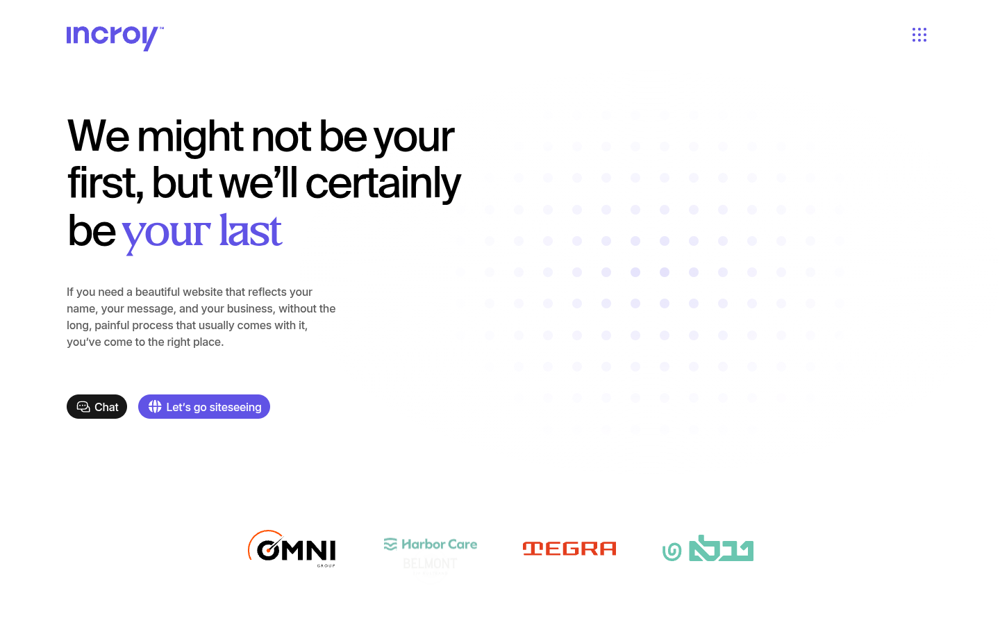

# UI Design System & Master Generation Blueprint: www-incroy-com

> **Incroy · Webflow Certified Development Agency** (https://www.incroy.com/) — Incroy is a Webflow agency serving medium to large businesses. We handle design, development, copywriting, and ongoing site management un...



---

## 1. Executive Visual Persona & Design Archetype

- **Brand Essence & Persona**: **Incroy · Webflow Certified Development Agency** (`https://www.incroy.com/`). Incroy is a Webflow agency serving medium to large businesses. We handle design, development, copywriting, and ongoing site management un...
- **Visual Archetype**: **Light-Substrate Editorial & Modular Grid System (`#fff` canvas, `#171717` ink, `#aaa` accent)**.
- **Anti-AI-Slop Differentiators**:
  - **Source-Grounded Chromatic Polarity**: Anchors the viewport in `#fff` (`var(--base-color-neutral--white)` in `:root`) paired with `#171717` primary typography and `#aaa` accents.
  - **Extracted Typographic Hierarchy**: Pairs `Suisseintl Book` for display copy (`Heading`) with `Inter` and not declared in static CSS (uses primary stack / `ui-monospace`).
  - **Calibrated Spatial Grid & Motion**: Combines `940px` container bounds (`gap: 16px`, padding `9px`) with `cubic-bezier(.32,.72,0,1)` easing and Lenis Smooth Scroll (`data-lenis`), GSAP Timeline & ScrollTrigger.

---

## 2. Spatial Architecture & Modular Grid Mathematics


### Viewport Allocation & Container Geometry
- **Captured Viewport Dimensions**: Desktop `1440×13306px` (`assets/desktop.png`, full-page scroll capture), Mobile `390×2400px` (`assets/mobile.png`, capped at 2400px multi-section capture).
- **Master Container Bounds**: `940px` extracted from `www-incroy-com` stylesheet.
- **Canvas Lateral Padding & Spacing**: `9px` lateral canvas padding with `16px` grid gap.
- **Border Radius Scale**: `3px`, `100%`, `50%`, `2px`.

### Responsive Breakpoint Architecture
- **Desktop Layout**: Multi-column CSS Grid / Flexbox layout at `1440px` (`max-width: 940px`, `gap: 16px`).
- **Mobile Layout**: Single-column vertical stack at `390px` viewport width with `9px` horizontal padding.
- **Extracted CSS Media Queries**: `@media screen and (max-width: 991px)`, `@media screen and (max-width: 767px)`, `@media screen and (max-width: 479px)`, `@media (min-width: 768px)`.

---

## 3. Color System, Materiality & Atmospheric Lighting

### Semantic Palette & Source Grounding
| Semantic Role | Ground-Truth Value | Extracted CSS Source / Selector |
|---|---|---|
| **Primary Canvas Substrate** | `#fff` | `var(--base-color-neutral--white)` in `:root` |
| **Primary Typography Ink** | `#6053e5` | `var(--base-color-brand--brand-primary)` in `:root` |
| **Elevated Surface / Card Substrate** | `#d2cef9` | `var(--base-color-brand--brand-light)` in `:root` |
| **Interactive Accent / Highlight** | `#aaa` | `var(--base-color-neutral--neutral-light)` in `:root` |
| **Secondary / Muted Copy** | `#171717` | `var(--base-color-neutral--black)` in `:root` |
| **Structural Hairline Border** | `#ebebeb` | `var(--base-color-neutral--neutral-lightest)` in `:root` |

### Sanitized Root CSS Variables (`ui-ux.md` Ground Truth)
| Variable Name | Extracted Value | Semantic Role |
|---|---|---|
| `--w-backdrop-animation` | `initial` | Motion / Easing Token |
| `--link-color--link-primary` | `var(--base-color-brand--brand-primary)` | Typography Ink Token |
| `--background-color--background-primary` | `var(--base-color-neutral--black)` | Canvas / Surface Token |
| `--text-color--text-alternate` | `var(--base-color-neutral--white)` | Typography Ink Token |
| `--text-color--text-primary` | `var(--base-color-neutral--black)` | Typography Ink Token |
| `--text-color--text-secondary` | `var(--base-color-neutral--neutral-darker)` | Typography Ink Token |
| `--background-color--background-success` | `var(--base-color-system--success-green)` | Canvas / Surface Token |
| `--text-color--text-success` | `var(--base-color-system--success-green-dark)` | Typography Ink Token |
| `--base-color-neutral--white` | `#fff` | Canvas / Surface Token |
| `--border-color--border-primary` | `var(--base-color-neutral--neutral-lightest)` | Brand / Palette Token |
| `--background-color--background-alternate` | `var(--base-color-neutral--white)` | Canvas / Surface Token |
| `--background-color--background-secondary` | `var(--base-color-brand--brand-primary)` | Canvas / Surface Token |
| `--background-color--background-tertiary` | `var(--base-color-brand--pink)` | Canvas / Surface Token |
| `--background-color--background-error` | `var(--base-color-system--error-red)` | Canvas / Surface Token |
| `--text-color--text-error` | `var(--base-color-system--error-red-dark)` | Typography Ink Token |
| `--border-color--border-subtle` | `var(--base-color-neutral--neutral-dark)` | Brand / Palette Token |

---

## 4. Typographic Scale & Editorial Hierarchy

### Font Family Stacks
- **Display Typography**: `Suisseintl Book`.
- **Primary Body Stack**: `Inter`.
- **Technical / Metadata Stack**: not declared in static CSS (uses primary stack / `ui-monospace`).

### Typographic Scale & Rules (Extracted from Stylesheet & Variables)
- **Hero Display (`H1`)**: rule `h1` (`font-size: 2em`).
- **Section Heading (`H2`)**: rule `h2` (`font-size: 32px`, `line-height: 36px`).
- **Body Copy**: rule `body` (`font-size: 14px`, `line-height: 20px`).
- **Metadata & Navigation Labels**: rule `small` (`font-size: 80%`).

---

## 5. Choreographed Motion & Interaction Physics

### Primary Easing Curves
- **Extracted Timing Functions**: `cubic-bezier(.32,.72,0,1)`, `cubic-bezier(.645,.045,.355,1)`, `cubic-bezier(.322,.014,0,.99)`.

### Per-Element Transition & Choreography Rules
- **Selector `.w-webflow-badge > img`**: `transition: unset` extracted from `www-incroy-com` stylesheet.
- **Selector `.w-slider-dot`**: `transition: background-color .1s, color .1s` extracted from `www-incroy-com` stylesheet.
- **Selector `.w-lightbox-control`**: `transition: all .3s` extracted from `www-incroy-com` stylesheet.
- **Extracted Easing Curve (`cubic-bezier(.32,.72,0,1)`)**: Governs interactive state transitions across `<nav.navigation>` and `<section.section-dots>`.
- **Runtime Interaction Engine**: Integrates Lenis Smooth Scroll (`data-lenis`), GSAP Timeline & ScrollTrigger, Swiper Touch Carousel Engine, Lottie Vector Animation Player, Barba.js Page Transition Router with `prefers-reduced-motion: reduce` fallback guards.

---

## 6. Component Wireframe & Structural DOM Map

### Visual Layout Schematic (Grounded in `dom.html` — `1440px` Desktop & `390px` Mobile Reflow)
```
┌────────────────────────────────────────────────────────────────────────┐
│ DESKTOP VIEWPORT (1440px) — Incroy · Webflow Certified Development Age │
│ ====================================================================== │
│ [ <nav.navigation>         | H o m e · W o r k · P r o c e s s · W  ]  │
│ ---------------------------------------------------------------------- │
│ | HERO STAGE: <section.section-dots>                               |   │
│ | H1: Heading                                                      |   │
│ | Substrate: #fff       | Ink: #171717    | Accent: #aaa           |   │
│ ---------------------------------------------------------------------- │
│ | SHOWCASE GRID (<section.section-dots>    ) max-w: 940px          |   │
│ | +------------------------------+  +------------------------------+ | │
│ | | W e m i g h t n o t b e y o  |  | W h a t i n t h e w o r l d  | | │
│ | +------------------------------+  +------------------------------+ | │
│ ---------------------------------------------------------------------- │
│ | MOBILE VIEWPORT REFLOW (390px) — Single-Column Stack (gap: 16px  ) | │
│ | [<nav.navigation>] -> [<section.section-d] -> [<section.section-d] | │
│ ---------------------------------------------------------------------- │
│ [ FOOTER (<footer.hide>         ) | https://www.incroy.com/            │
└────────────────────────────────────────────────────────────────────────┘
```

### Granular DOM Region Breakdown
1. **Brand Header & Navigation Bar (<nav.navigation> — `www-incroy-com`)**:
   - Landmark `<nav class="navigation">` hosting `Incroy · Webflow Certified Developme` navigation (`H o m e · W o r k · P r o c e s s · W h o a r e w e ? · C o n t a c t`), DOM attributes (`data-wf-domain="www.incroy.com"`, `data-wf-page="6a21b959b61cf447eaaeea89"`, `data-wf-site="6a21b956b61cf447eaaeea3c"`, `data-settings="("apiEndpoint":"https..."`), and stylesheet rule `html { -webkit-text-size-adjust: 100%; -ms-text-size-adjust: 100%; font-family:... }`.
2. **Hero Stage & Focal Lead (<section.section-dots> — `Heading`)**:
   - Landmark `<section class="section-dots">` presenting display lead `Heading` and copy excerpt *"I f y o u n e e d a b e a u t i f u l w e b s i t e t h a t r e f"* over `#fff` canvas and `#171717` ink.
3. **Primary Showcase & Content Grid (<section.section-dots> — `W e m i g h t n o t b e y o u r f `)**:
   - Landmark `<section class="section-dots">` rendering section `W e m i g h t n o t b e y o u r f i r s t , b u t...` with copy *"L e t ’ s g o s i t e s e e i n g"*, asset references (`cdn.prod.website-files.com`, `incroy-v2.shared.e656a73ee.css`, `clarity.js`, `radar.min.js`), and grid rule `body { margin: 0; }`.
4. **Interactive Detail & Feature Matrix (<section.section-dots> — `W h a t i n t h e w o r l d w i d `)**:
   - Landmark `<section class="section-dots">` framing `W h a t i n t h e w o r l d w i d e w e b h a s h...` and `T h a t ’ s w h e r e w e c o m e i n` (*"W e d e s i g n a n d d e v e l o p w e b s i t e s t h a t l o o"*) with `#d2cef9` surface cards, `#aaa` accents, and `summary { display: block; }`.
5. **Colophon & Global Directory Footer (<footer.hide> — `https://www.incroy.com/`)**:
   - Landmark `<footer class="hide">` anchoring `Incroy · Webflow Certified Devel` footer links (`H o m e · W o r k · P r o c e s s · W h o a r e w e ? · C o n t a c t`), copy *"d e v e l o p m e n t ,"*, and `#ebebeb` structural dividers.

---

## 7. Master Zero-Shot AI Generation Prompt

```markdown
# Master Zero-Shot Frontend Generation Prompt: www-incroy-com (Incroy · Webflow Certified Development Agency)

You are a principal frontend architect and design systems engineer. Build a complete, production-ready web application replicating the exact design system, DOM landmarks, typographic hierarchy, color tokens, and motion physics of `www-incroy-com` (**Incroy · Webflow Certified Development Agency** — `https://www.incroy.com/`).

### 1. Visual Archetype & Anti-AI-Slop Mandates
- **Archetype**: Light-Substrate Editorial & Modular Grid System (`#fff` canvas, `#171717` ink, `#aaa` accent).
- **Identity & Domain Context**: Incroy is a Webflow agency serving medium to large businesses. We handle design, development, copywriting, and ongoing site management un...
- **Primary Substrate**: `#fff` (`var(--base-color-neutral--white)` in `:root`), **Primary Ink**: `#171717`, **Accent / Highlight**: `#aaa`.
- **Site-Specific Differentiators**:
  - **Source-Grounded Chromatic Polarity**: Anchors the viewport in `#fff` (`var(--base-color-neutral--white)` in `:root`) paired with `#171717` primary typography and `#aaa` accents.
  - **Extracted Typographic Hierarchy**: Pairs `Suisseintl Book` for display copy (`Heading`) with `Inter` and not declared in static CSS (uses primary stack / `ui-monospace`).
  - **Calibrated Spatial Grid & Motion**: Combines `940px` container bounds (`gap: 16px`, padding `9px`) with `cubic-bezier(.32,.72,0,1)` easing and Lenis Smooth Scroll (`data-lenis`), GSAP Timeline & ScrollTrigger.

### 2. Ground-Truth CSS Variables (`:root` Token Contract)
Declare and consume these exact custom properties extracted from `www-incroy-com` in your global stylesheet:

:root {
  /* Incroy · Webflow Certified Development Agency (www-incroy-com) — Ground-Truth Extracted CSS Variables */
  --w-backdrop-animation: initial; /* Motion / Easing Token (www-incroy-com) */
  --link-color--link-primary: var(--base-color-brand--brand-primary); /* Typography Ink Token (www-incroy-com) */
  --background-color--background-primary: var(--base-color-neutral--black); /* Canvas / Surface Token (www-incroy-com) */
  --text-color--text-alternate: var(--base-color-neutral--white); /* Typography Ink Token (www-incroy-com) */
  --text-color--text-primary: var(--base-color-neutral--black); /* Typography Ink Token (www-incroy-com) */
  --text-color--text-secondary: var(--base-color-neutral--neutral-darker); /* Typography Ink Token (www-incroy-com) */
  --background-color--background-success: var(--base-color-system--success-green); /* Canvas / Surface Token (www-incroy-com) */
  --text-color--text-success: var(--base-color-system--success-green-dark); /* Typography Ink Token (www-incroy-com) */
  --base-color-neutral--white: #fff; /* Canvas / Surface Token (www-incroy-com) */
  --border-color--border-primary: var(--base-color-neutral--neutral-lightest); /* Brand / Palette Token (www-incroy-com) */
  --background-color--background-alternate: var(--base-color-neutral--white); /* Canvas / Surface Token (www-incroy-com) */
  --background-color--background-secondary: var(--base-color-brand--brand-primary); /* Canvas / Surface Token (www-incroy-com) */
  --background-color--background-tertiary: var(--base-color-brand--pink); /* Canvas / Surface Token (www-incroy-com) */
  --background-color--background-error: var(--base-color-system--error-red); /* Canvas / Surface Token (www-incroy-com) */
  --text-color--text-error: var(--base-color-system--error-red-dark); /* Typography Ink Token (www-incroy-com) */
  --border-color--border-subtle: var(--base-color-neutral--neutral-dark); /* Brand / Palette Token (www-incroy-com) */
}

### 3. Semantic Color & Materiality Contract
Map every surface, ink, and border strictly to these source-grounded tokens:
- **Primary Canvas Substrate**: `#fff` — grounded in `var(--base-color-neutral--white)` in `:root`
- **Primary Typography Ink**: `#6053e5` — grounded in `var(--base-color-brand--brand-primary)` in `:root`
- **Elevated Surface / Card Substrate**: `#d2cef9` — grounded in `var(--base-color-brand--brand-light)` in `:root`
- **Interactive Accent / Highlight**: `#aaa` — grounded in `var(--base-color-neutral--neutral-light)` in `:root`
- **Secondary / Muted Copy**: `#171717` — grounded in `var(--base-color-neutral--black)` in `:root`
- **Structural Hairline Border**: `#ebebeb` — grounded in `var(--base-color-neutral--neutral-lightest)` in `:root`

### 4. Spatial Grid, Container Bounds & Responsive Breakpoints
- **Desktop Viewport Reference**: `1440×13306px` (full-page scroll capture, `1440px` standard desktop width).
- **Mobile Viewport Reference**: `390×2400px` (capped at 2400px multi-section capture, `390px` standard mobile width).
- **Container Max-Width**: `940px` extracted from `www-incroy-com` stylesheet
- **Padding & Gutters**: `9px` lateral canvas padding with `16px` grid gap
- **Desktop Grid**: Multi-column CSS Grid / Flexbox layout at `1440px` (`max-width: 940px`, `gap: 16px`)
- **Mobile Adaptation**: Single-column vertical stack at `390px` viewport width with `9px` horizontal padding
- **Media Queries**: `@media screen and (max-width: 991px)`, `@media screen and (max-width: 767px)`, `@media screen and (max-width: 479px)`, `@media (min-width: 768px)`
- **Corner Radii**: `3px`, `100%`, `50%`, `2px`

### 5. Typography & Editorial Scale Contract
- **Display Font Stack**: `Suisseintl Book`
- **Body Font Stack**: `Inter`
- **Monospace / Technical Font Stack**: not declared in static CSS (uses primary stack / `ui-monospace`)
- **H1 Display Rule**: rule `h1` (`font-size: 2em`)
- **H2 Section Rule**: rule `h2` (`font-size: 32px`, `line-height: 36px`)
- **Body Copy Rule**: rule `body` (`font-size: 14px`, `line-height: 20px`)
- **Metadata & Index Rule**: rule `small` (`font-size: 80%`)

### 6. Component Hierarchy, Verbatim Copy & Real DOM Landmarks
Scaffold `www-incroy-com` (`Incroy · Webflow Certified Development Agency`) with these exact structural regions, extracted copy, and CSS rules from `dom.html`:
1. **Brand Header & Navigation Bar (<nav.navigation> — `www-incroy-com`)**:
   - DOM & Selectors: Landmark `<nav class="navigation">` hosting `Incroy · Webflow Certified Developme` navigation (`H o m e · W o r k · P r o c e s s · W h o a r e w e ? · C o n t a c t`), DOM attributes (`data-wf-domain="www.incroy.com"`, `data-wf-page="6a21b959b61cf447eaaeea89"`, `data-wf-site="6a21b956b61cf447eaaeea3c"`, `data-settings="("apiEndpoint":"https..."`), and stylesheet rule `html { -webkit-text-size-adjust: 100%; -ms-text-size-adjust: 100%; font-family:... }`.
   - Responsive Contract: Header `Brand Header & Navigation Bar (<nav.navigation> — `www-incroy-com`)` (`www-incroy-com`) adapts across `@media screen and (max-width: 991px)`, `@media screen and (max-width: 767px)`, `@media screen and (max-width: 479px)`, `@media (min-width: 768px)` with `cubic-bezier(.32,.72,0,1)`, `cubic-bezier(.645,.045,.355,1)`, `cubic-bezier(.322,.014,0,.99)` transitions and links `H o m e · W o r k · P r o c e s s · W h o a r e w e ? · C o n t a c t`.
2. **Hero Stage & Focal Lead (<section.section-dots> — `Heading`)**:
   - DOM & Selectors: Landmark `<section class="section-dots">` presenting display lead `Heading` and copy excerpt *"I f y o u n e e d a b e a u t i f u l w e b s i t e t h a t r e f"* over `#fff` canvas and `#171717` ink.
   - Responsive Contract: Hero stage (`1440×13306px` desktop / `390×2400px` mobile) sets `#fff` background with `#171717` headline `Heading`.
3. **Primary Showcase & Content Grid (<section.section-dots> — `W e m i g h t n o t b e y o u r f `)**:
   - DOM & Selectors: Landmark `<section class="section-dots">` rendering section `W e m i g h t n o t b e y o u r f i r s t , b u t...` with copy *"L e t ’ s g o s i t e s e e i n g"*, asset references (`cdn.prod.website-files.com`, `incroy-v2.shared.e656a73ee.css`, `clarity.js`, `radar.min.js`), and grid rule `body { margin: 0; }`.
   - Responsive Contract: Showcase grid `Primary Showcase & Content Grid (<section.section-dots> — `W e m i g h t n o t b e y o u r f `)` applies Multi-column CSS Grid / Flexbox layout at `1440px` (`max-width: 940px`, `gap: 16px`) on desktop and Single-column vertical stack at `390px` viewport width with `9px` horizontal padding on mobile.
4. **Interactive Detail & Feature Matrix (<section.section-dots> — `W h a t i n t h e w o r l d w i d `)**:
   - DOM & Selectors: Landmark `<section class="section-dots">` framing `W h a t i n t h e w o r l d w i d e w e b h a s h...` and `T h a t ’ s w h e r e w e c o m e i n` (*"W e d e s i g n a n d d e v e l o p w e b s i t e s t h a t l o o"*) with `#d2cef9` surface cards, `#aaa` accents, and `summary { display: block; }`.
   - Responsive Contract: Detail module `Interactive Detail & Feature Matrix (<section.section-dots> — `W h a t i n t h e w o r l d w i d `)` uses `3px`, `100%`, `50%`, `2px` radii, `#aaa` highlights, and assets (cdn.prod.website-files.com, incroy-v2.shared.e656a73ee.css, clarity.js).
5. **Colophon & Global Directory Footer (<footer.hide> — `https://www.incroy.com/`)**:
   - DOM & Selectors: Landmark `<footer class="hide">` anchoring `Incroy · Webflow Certified Devel` footer links (`H o m e · W o r k · P r o c e s s · W h o a r e w e ? · C o n t a c t`), copy *"d e v e l o p m e n t ,"*, and `#ebebeb` structural dividers.
   - Responsive Contract: Footer `Colophon & Global Directory Footer (<footer.hide> — `https://www.incroy.com/`)` aligns to `940px` extracted from `www-incroy-com` stylesheet with `9px` lateral canvas padding with `16px` grid gap and attributes (data-wf-domain="www.incroy.com", data-wf-page="6a21b959b61cf447eaaeea89", data-wf-site="6a21b956b61cf447eaaeea3c").

#### Verbatim DOM Copy Excerpts (`dom.html`)
- Copy Excerpt 1: *"I f y o u n e e d a b e a u t i f u l w e b s i t e t h a t r e f l e c t s y o u..."*
- Copy Excerpt 2: *"L e t ’ s g o s i t e s e e i n g"*
- Copy Excerpt 3: *"W e d e s i g n a n d d e v e l o p w e b s i t e s t h a t l o o k g r e a t , d..."*
- Copy Excerpt 4: *"d e v e l o p m e n t ,"*

### 7. Motion, Extracted Stylesheet Rules & Interaction Choreography
- **Primary Easing Functions**: `cubic-bezier(.32,.72,0,1)`, `cubic-bezier(.645,.045,.355,1)`, `cubic-bezier(.322,.014,0,.99)`
- **Extracted Stylesheet Rules (`www-incroy-com`)**:
- `html { -webkit-text-size-adjust: 100%; -ms-text-size-adjust: 100%; font-family:... }`
- `body { margin: 0; }`
- `summary { display: block; }`
- `video { vertical-align: baseline; display: inline-block; }`
- `template { display: none; }`
- **Per-Selector Transition Rules**:
- **Selector `.w-webflow-badge > img`**: `transition: unset` extracted from `www-incroy-com` stylesheet.
- **Selector `.w-slider-dot`**: `transition: background-color .1s, color .1s` extracted from `www-incroy-com` stylesheet.
- **Selector `.w-lightbox-control`**: `transition: all .3s` extracted from `www-incroy-com` stylesheet.
- **Extracted Easing Curve (`cubic-bezier(.32,.72,0,1)`)**: Governs interactive state transitions across `<nav.navigation>` and `<section.section-dots>`.
- **Runtime Interaction Engine**: Integrates Lenis Smooth Scroll (`data-lenis`), GSAP Timeline & ScrollTrigger, Swiper Touch Carousel Engine, Lottie Vector Animation Player, Barba.js Page Transition Router with `prefers-reduced-motion: reduce` fallback guards.

### 8. Technical Deliverables
- Implement in Next.js (App Router) with TypeScript and Tailwind CSS consuming the `:root` custom properties defined above for `www-incroy-com`.
- Reproduce both the `1440px` desktop architecture and `390px` mobile breakpoint transitions, preserving semantic HTML5 landmarks (`<header>`, `<nav>`, `<main>`, `<section>`, `<footer>`) and `prefers-reduced-motion` accessibility guards.
```
