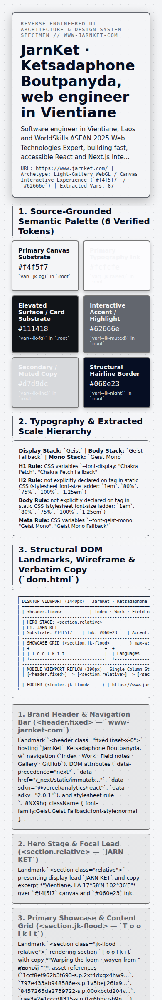

# UI Design System & Master Generation Blueprint: www-jarnket-com

> **JarnKet · Ketsadaphone Boutpanyda, web engineer in Vientiane** (https://www.jarnket.com/) — Software engineer in Vientiane, Laos and WorldSkills ASEAN 2025 Web Technologies Expert, building fast, accessible React and Next.js inte...


---

## 1. Executive Visual Persona & Design Archetype

- **Brand Essence & Persona**: **JarnKet · Ketsadaphone Boutpanyda, web engineer in Vientiane** (`https://www.jarnket.com/`). Software engineer in Vientiane, Laos and WorldSkills ASEAN 2025 Web Technologies Expert, building fast, accessible React and Next.js inte...
- **Visual Archetype**: **Light-Gallery WebGL / Canvas Interactive Experience (`#f4f5f7` / `#62666e`)**.
- **Anti-AI-Slop Differentiators**:
  - **Source-Grounded Chromatic Polarity**: Anchors the viewport in `#f4f5f7` (`var(--jk-bg)` in `:root`) paired with `#060e23` primary typography and `#62666e` accents.
  - **Extracted Typographic Hierarchy**: Pairs `Geist` for display copy (`JARN KET`) with `Geist Fallback` and `Geist Mono`.
  - **Calibrated Spatial Grid & Motion**: Combines `65ch` container bounds (`gap: .125rem`, padding `.125rem`) with `cubic-bezier(.16,1,.3,1)` easing and Lenis Smooth Scroll (`data-lenis`), GSAP Timeline & ScrollTrigger.

---

## 2. Spatial Architecture & Modular Grid Mathematics



### Viewport Allocation & Container Geometry
- **Captured Viewport Dimensions**: Desktop `1440×10631px` (`assets/desktop.png`, full-page scroll capture), Mobile `390×2400px` (`assets/mobile.png`, capped at 2400px multi-section capture).
- **Master Container Bounds**: `65ch` extracted from `www-jarnket-com` stylesheet.
- **Canvas Lateral Padding & Spacing**: `.125rem` lateral canvas padding with `.125rem` grid gap.
- **Border Radius Scale**: `.3125rem`, `.375rem`, `.25rem`, `2px`.

### Responsive Breakpoint Architecture
- **Desktop Layout**: Multi-column CSS Grid / Flexbox layout at `1440px` (`max-width: 65ch`, `gap: .125rem`).
- **Mobile Layout**: Single-column vertical stack at `390px` viewport width with `.125rem` horizontal padding.
- **Extracted CSS Media Queries**: `@media (prefers-reduced-motion:reduce)`, `@media (min-width:640px)`, `@media (min-width:768px)`, `@media (min-width:1024px)`.

---

## 3. Color System, Materiality & Atmospheric Lighting

### Semantic Palette & Source Grounding
| Semantic Role | Ground-Truth Value | Extracted CSS Source / Selector |
|---|---|---|
| **Primary Canvas Substrate** | `#f4f5f7` | `var(--jk-bg)` in `:root` |
| **Primary Typography Ink** | `#fcfcfe` | `var(--jk-raised)` in `:root` |
| **Elevated Surface / Card Substrate** | `#111418` | `var(--jk-fg)` in `:root` |
| **Interactive Accent / Highlight** | `#62666e` | `var(--jk-muted)` in `:root` |
| **Secondary / Muted Copy** | `#d7d9dc` | `var(--jk-line)` in `:root` |
| **Structural Hairline Border** | `#060e23` | `var(--jk-night)` in `:root` |

### Sanitized Root CSS Variables (`ui-ux.md` Ground Truth)
| Variable Name | Extracted Value | Semantic Role |
|---|---|---|
| `--font-geist` | `"Geist", "Geist Fallback"` | Typography / Scale Token |
| `--font-geist-mono` | `"Geist Mono", "Geist Mono Fallback"` | Typography / Scale Token |
| `--background` | `0 0% 96%` | Canvas / Surface Token |
| `--foreground` | `0 0% 10%` | Typography Ink Token |
| `--card` | `0 0% 98%` | Dimension / Scale Token |
| `--card-foreground` | `0 0% 10%` | Typography Ink Token |
| `--popover` | `0 0% 98%` | Dimension / Scale Token |
| `--popover-foreground` | `0 0% 10%` | Typography Ink Token |
| `--primary` | `0 0% 10%` | Brand / Palette Token |
| `--primary-foreground` | `0 0% 96%` | Typography Ink Token |
| `--secondary` | `0 0% 92%` | Brand / Palette Token |
| `--secondary-foreground` | `0 0% 10%` | Typography Ink Token |
| `--muted` | `0 0% 91%` | Dimension / Scale Token |
| `--muted-foreground` | `0 0% 40%` | Typography Ink Token |
| `--accent` | `0 0% 90%` | Brand / Palette Token |
| `--accent-foreground` | `0 0% 10%` | Typography Ink Token |

---

## 4. Typographic Scale & Editorial Hierarchy

### Font Family Stacks
- **Display Typography**: `Geist`.
- **Primary Body Stack**: `Geist Fallback`.
- **Technical / Metadata Stack**: `Geist Mono`.

### Typographic Scale & Rules (Extracted from Stylesheet & Variables)
- **Hero Display (`H1`)**: CSS variables `--font-display: "Chakra Petch", "Chakra Petch Fallback"`.
- **Section Heading (`H2`)**: not explicitly declared on tag in static CSS (stylesheet font-size ladder: `1em`, `80%`, `75%`, `100%`, `1.25em`).
- **Body Copy**: not explicitly declared on tag in static CSS (stylesheet font-size ladder: `1em`, `80%`, `75%`, `100%`, `1.25em`).
- **Metadata & Navigation Labels**: CSS variables `--font-geist-mono: "Geist Mono", "Geist Mono Fallback"`.

---

## 5. Choreographed Motion & Interaction Physics

### Primary Easing Curves
- **Extracted Timing Functions**: `cubic-bezier(.16,1,.3,1)`, `cubic-bezier(.65,0,.35,1)`, `cubic-bezier(.4,0,.6,1)`.

### Per-Element Transition & Choreography Rules
- **Selector `media (prefers-reduced-motion:red...`**: `transition: .001ms!important` extracted from `www-jarnket-com` stylesheet.
- **Selector `.transition`**: `transition: .15s` extracted from `www-jarnket-com` stylesheet.
- **Selector `border-color\]`**: `transition: .15s` extracted from `www-jarnket-com` stylesheet.
- **Extracted Easing Curve (`cubic-bezier(.16,1,.3,1)`)**: Governs interactive state transitions across `<header.fixed>` and `<section.jk-flood>`.
- **Runtime Interaction Engine**: Integrates Lenis Smooth Scroll (`data-lenis`), GSAP Timeline & ScrollTrigger, HTML5 `<canvas>` Interactive Viewport Surface with `prefers-reduced-motion: reduce` fallback guards.

---

## 6. Component Wireframe & Structural DOM Map

### Visual Layout Schematic (Grounded in `dom.html` — `1440px` Desktop & `390px` Mobile Reflow)
```
┌────────────────────────────────────────────────────────────────────────┐
│ DESKTOP VIEWPORT (1440px) — JarnKet · Ketsadaphone Boutpanyda, web eng │
│ ====================================================================== │
│ [ <header.fixed>           | Index · Work · Field notes · Gallery · ]  │
│ ---------------------------------------------------------------------- │
│ | HERO STAGE: <section.relative>                                   |   │
│ | H1: JARN KET                                                     |   │
│ | Substrate: #f4f5f7    | Ink: #060e23    | Accent: #62666e        |   │
│ ---------------------------------------------------------------------- │
│ | SHOWCASE GRID (<section.jk-flood>        ) max-w: 65ch           |   │
│ | +------------------------------+  +------------------------------+ | │
│ | | T o o l k i t                |  | Languages                    | | │
│ | +------------------------------+  +------------------------------+ | │
│ ---------------------------------------------------------------------- │
│ | MOBILE VIEWPORT REFLOW (390px) — Single-Column Stack (gap: .125re) | │
│ | [<header.fixed>] -> [<section.relative>] -> [<section.jk-flood>] |   │
│ ---------------------------------------------------------------------- │
│ [ FOOTER (<footer.jk-flood>     ) | https://www.jarnket.com/           │
└────────────────────────────────────────────────────────────────────────┘
```

### Granular DOM Region Breakdown
1. **Brand Header & Navigation Bar (<header.fixed> — `www-jarnket-com`)**:
   - Landmark `<header class="fixed inset-x-0">` hosting `JarnKet · Ketsadaphone Boutpanyda, w` navigation (`Index · Work · Field notes · Gallery · GitHub`), DOM attributes (`data-precedence="next"`, `data-href="/_next/static/immutab..."`, `data-sdkn="@vercel/analytics/react"`, `data-sdkv="2.0.1"`), and stylesheet rule `._8NX9hq_className { font-family:Geist,Geist Fallback;font-style:normal }`.
2. **Hero Stage & Focal Lead (<section.relative> — `JARN KET`)**:
   - Landmark `<section class="relative">` presenting display lead `JARN KET` and copy excerpt *"Vientiane, LA 17°58′N 102°36′E"* over `#f4f5f7` canvas and `#060e23` ink.
3. **Primary Showcase & Content Grid (<section.jk-flood> — `T o o l k i t`)**:
   - Landmark `<section class="jk-flood relative">` rendering section `T o o l k i t` with copy *"Warping the loom · woven from “ ສະບາຍດີ ”"*, asset references (`1ccf8ef962b3f693-s.p.2xt4dxqx4hw9...`, `797e433ab948586e-s.p.1v5bejj26fx9...`, `8457265da2739722-s.p.00okbctd204v...`, `caa3a2e1cccd8315-s.p.0zr6hhvz-h9n...`), and grid rule `._8NX9hq_variable { --font-geist:"Geist", "Geist Fallback" }`.
4. **Interactive Detail & Feature Matrix (<section.relative> — `Languages`)**:
   - Landmark `<section class="relative">` framing `Languages` and `Frameworks` (*"Software Engineer @BCEL Bank"*) with `#111418` surface cards, `#62666e` accents, and `.z61v7q_className { font-family:Geist Mono,Geist Mono Fallback;font-style:normal }`.
5. **Colophon & Global Directory Footer (<footer.jk-flood> — `https://www.jarnket.com/`)**:
   - Landmark `<footer class="jk-flood relative">` anchoring `JarnKet · Ketsadaphone Boutpanyd` footer links (`Index · Work · Field notes · Gallery · GitHub`), copy *"ketsadaphoneOfficial@gmail.com"*, and `#060e23` structural dividers.

---

## 7. Master Zero-Shot AI Generation Prompt

```markdown
# Master Zero-Shot Frontend Generation Prompt: www-jarnket-com (JarnKet · Ketsadaphone Boutpanyda, web engineer in Vientiane)

You are a principal frontend architect and design systems engineer. Build a complete, production-ready web application replicating the exact design system, DOM landmarks, typographic hierarchy, color tokens, and motion physics of `www-jarnket-com` (**JarnKet · Ketsadaphone Boutpanyda, web engineer in Vientiane** — `https://www.jarnket.com/`).

### 1. Visual Archetype & Anti-AI-Slop Mandates
- **Archetype**: Light-Gallery WebGL / Canvas Interactive Experience (`#f4f5f7` / `#62666e`).
- **Identity & Domain Context**: Software engineer in Vientiane, Laos and WorldSkills ASEAN 2025 Web Technologies Expert, building fast, accessible React and Next.js inte...
- **Primary Substrate**: `#f4f5f7` (`var(--jk-bg)` in `:root`), **Primary Ink**: `#060e23`, **Accent / Highlight**: `#62666e`.
- **Site-Specific Differentiators**:
  - **Source-Grounded Chromatic Polarity**: Anchors the viewport in `#f4f5f7` (`var(--jk-bg)` in `:root`) paired with `#060e23` primary typography and `#62666e` accents.
  - **Extracted Typographic Hierarchy**: Pairs `Geist` for display copy (`JARN KET`) with `Geist Fallback` and `Geist Mono`.
  - **Calibrated Spatial Grid & Motion**: Combines `65ch` container bounds (`gap: .125rem`, padding `.125rem`) with `cubic-bezier(.16,1,.3,1)` easing and Lenis Smooth Scroll (`data-lenis`), GSAP Timeline & ScrollTrigger.

### 2. Ground-Truth CSS Variables (`:root` Token Contract)
Declare and consume these exact custom properties extracted from `www-jarnket-com` in your global stylesheet:

:root {
  /* JarnKet · Ketsadaphone Boutpanyda, web engineer in Vientiane (www-jarnket-com) — Ground-Truth Extracted CSS Variables */
  --font-geist: "Geist", "Geist Fallback"; /* Typography / Scale Token (www-jarnket-com) */
  --font-geist-mono: "Geist Mono", "Geist Mono Fallback"; /* Typography / Scale Token (www-jarnket-com) */
  --background: 0 0% 96%; /* Canvas / Surface Token (www-jarnket-com) */
  --foreground: 0 0% 10%; /* Typography Ink Token (www-jarnket-com) */
  --card: 0 0% 98%; /* Dimension / Scale Token (www-jarnket-com) */
  --card-foreground: 0 0% 10%; /* Typography Ink Token (www-jarnket-com) */
  --popover: 0 0% 98%; /* Dimension / Scale Token (www-jarnket-com) */
  --popover-foreground: 0 0% 10%; /* Typography Ink Token (www-jarnket-com) */
  --primary: 0 0% 10%; /* Brand / Palette Token (www-jarnket-com) */
  --primary-foreground: 0 0% 96%; /* Typography Ink Token (www-jarnket-com) */
  --secondary: 0 0% 92%; /* Brand / Palette Token (www-jarnket-com) */
  --secondary-foreground: 0 0% 10%; /* Typography Ink Token (www-jarnket-com) */
  --muted: 0 0% 91%; /* Dimension / Scale Token (www-jarnket-com) */
  --muted-foreground: 0 0% 40%; /* Typography Ink Token (www-jarnket-com) */
  --accent: 0 0% 90%; /* Brand / Palette Token (www-jarnket-com) */
  --accent-foreground: 0 0% 10%; /* Typography Ink Token (www-jarnket-com) */
}

### 3. Semantic Color & Materiality Contract
Map every surface, ink, and border strictly to these source-grounded tokens:
- **Primary Canvas Substrate**: `#f4f5f7` — grounded in `var(--jk-bg)` in `:root`
- **Primary Typography Ink**: `#fcfcfe` — grounded in `var(--jk-raised)` in `:root`
- **Elevated Surface / Card Substrate**: `#111418` — grounded in `var(--jk-fg)` in `:root`
- **Interactive Accent / Highlight**: `#62666e` — grounded in `var(--jk-muted)` in `:root`
- **Secondary / Muted Copy**: `#d7d9dc` — grounded in `var(--jk-line)` in `:root`
- **Structural Hairline Border**: `#060e23` — grounded in `var(--jk-night)` in `:root`

### 4. Spatial Grid, Container Bounds & Responsive Breakpoints
- **Desktop Viewport Reference**: `1440×10631px` (full-page scroll capture, `1440px` standard desktop width).
- **Mobile Viewport Reference**: `390×2400px` (capped at 2400px multi-section capture, `390px` standard mobile width).
- **Container Max-Width**: `65ch` extracted from `www-jarnket-com` stylesheet
- **Padding & Gutters**: `.125rem` lateral canvas padding with `.125rem` grid gap
- **Desktop Grid**: Multi-column CSS Grid / Flexbox layout at `1440px` (`max-width: 65ch`, `gap: .125rem`)
- **Mobile Adaptation**: Single-column vertical stack at `390px` viewport width with `.125rem` horizontal padding
- **Media Queries**: `@media (prefers-reduced-motion:reduce)`, `@media (min-width:640px)`, `@media (min-width:768px)`, `@media (min-width:1024px)`
- **Corner Radii**: `.3125rem`, `.375rem`, `.25rem`, `2px`

### 5. Typography & Editorial Scale Contract
- **Display Font Stack**: `Geist`
- **Body Font Stack**: `Geist Fallback`
- **Monospace / Technical Font Stack**: `Geist Mono`
- **H1 Display Rule**: CSS variables `--font-display: "Chakra Petch", "Chakra Petch Fallback"`
- **H2 Section Rule**: not explicitly declared on tag in static CSS (stylesheet font-size ladder: `1em`, `80%`, `75%`, `100%`, `1.25em`)
- **Body Copy Rule**: not explicitly declared on tag in static CSS (stylesheet font-size ladder: `1em`, `80%`, `75%`, `100%`, `1.25em`)
- **Metadata & Index Rule**: CSS variables `--font-geist-mono: "Geist Mono", "Geist Mono Fallback"`

### 6. Component Hierarchy, Verbatim Copy & Real DOM Landmarks
Scaffold `www-jarnket-com` (`JarnKet · Ketsadaphone Boutpanyda, web engineer in Vientiane`) with these exact structural regions, extracted copy, and CSS rules from `dom.html`:
1. **Brand Header & Navigation Bar (<header.fixed> — `www-jarnket-com`)**:
   - DOM & Selectors: Landmark `<header class="fixed inset-x-0">` hosting `JarnKet · Ketsadaphone Boutpanyda, w` navigation (`Index · Work · Field notes · Gallery · GitHub`), DOM attributes (`data-precedence="next"`, `data-href="/_next/static/immutab..."`, `data-sdkn="@vercel/analytics/react"`, `data-sdkv="2.0.1"`), and stylesheet rule `._8NX9hq_className { font-family:Geist,Geist Fallback;font-style:normal }`.
   - Responsive Contract: Header `Brand Header & Navigation Bar (<header.fixed> — `www-jarnket-com`)` (`www-jarnket-com`) adapts across `@media (prefers-reduced-motion:reduce)`, `@media (min-width:640px)`, `@media (min-width:768px)`, `@media (min-width:1024px)` with `cubic-bezier(.16,1,.3,1)`, `cubic-bezier(.65,0,.35,1)`, `cubic-bezier(.4,0,.6,1)` transitions and links `Index · Work · Field notes · Gallery · GitHub`.
2. **Hero Stage & Focal Lead (<section.relative> — `JARN KET`)**:
   - DOM & Selectors: Landmark `<section class="relative">` presenting display lead `JARN KET` and copy excerpt *"Vientiane, LA 17°58′N 102°36′E"* over `#f4f5f7` canvas and `#060e23` ink.
   - Responsive Contract: Hero stage (`1440×10631px` desktop / `390×2400px` mobile) sets `#f4f5f7` background with `#060e23` headline `JARN KET`.
3. **Primary Showcase & Content Grid (<section.jk-flood> — `T o o l k i t`)**:
   - DOM & Selectors: Landmark `<section class="jk-flood relative">` rendering section `T o o l k i t` with copy *"Warping the loom · woven from “ ສະບາຍດີ ”"*, asset references (`1ccf8ef962b3f693-s.p.2xt4dxqx4hw9...`, `797e433ab948586e-s.p.1v5bejj26fx9...`, `8457265da2739722-s.p.00okbctd204v...`, `caa3a2e1cccd8315-s.p.0zr6hhvz-h9n...`), and grid rule `._8NX9hq_variable { --font-geist:"Geist", "Geist Fallback" }`.
   - Responsive Contract: Showcase grid `Primary Showcase & Content Grid (<section.jk-flood> — `T o o l k i t`)` applies Multi-column CSS Grid / Flexbox layout at `1440px` (`max-width: 65ch`, `gap: .125rem`) on desktop and Single-column vertical stack at `390px` viewport width with `.125rem` horizontal padding on mobile.
4. **Interactive Detail & Feature Matrix (<section.relative> — `Languages`)**:
   - DOM & Selectors: Landmark `<section class="relative">` framing `Languages` and `Frameworks` (*"Software Engineer @BCEL Bank"*) with `#111418` surface cards, `#62666e` accents, and `.z61v7q_className { font-family:Geist Mono,Geist Mono Fallback;font-style:normal }`.
   - Responsive Contract: Detail module `Interactive Detail & Feature Matrix (<section.relative> — `Languages`)` uses `.3125rem`, `.375rem`, `.25rem`, `2px` radii, `#62666e` highlights, and assets (1ccf8ef962b3f693-s.p.2xt4dxqx4hw9..., 797e433ab948586e-s.p.1v5bejj26fx9..., 8457265da2739722-s.p.00okbctd204v...).
5. **Colophon & Global Directory Footer (<footer.jk-flood> — `https://www.jarnket.com/`)**:
   - DOM & Selectors: Landmark `<footer class="jk-flood relative">` anchoring `JarnKet · Ketsadaphone Boutpanyd` footer links (`Index · Work · Field notes · Gallery · GitHub`), copy *"ketsadaphoneOfficial@gmail.com"*, and `#060e23` structural dividers.
   - Responsive Contract: Footer `Colophon & Global Directory Footer (<footer.jk-flood> — `https://www.jarnket.com/`)` aligns to `65ch` extracted from `www-jarnket-com` stylesheet with `.125rem` lateral canvas padding with `.125rem` grid gap and attributes (data-precedence="next", data-href="/_next/static/immutab...", data-sdkn="@vercel/analytics/react").

#### Verbatim DOM Copy Excerpts (`dom.html`)
- Copy Excerpt 1: *"Vientiane, LA 17°58′N 102°36′E"*
- Copy Excerpt 2: *"Warping the loom · woven from “ ສະບາຍດີ ”"*
- Copy Excerpt 3: *"Software Engineer @BCEL Bank"*
- Copy Excerpt 4: *"ketsadaphoneOfficial@gmail.com"*

### 7. Motion, Extracted Stylesheet Rules & Interaction Choreography
- **Primary Easing Functions**: `cubic-bezier(.16,1,.3,1)`, `cubic-bezier(.65,0,.35,1)`, `cubic-bezier(.4,0,.6,1)`
- **Extracted Stylesheet Rules (`www-jarnket-com`)**:
- `._8NX9hq_className { font-family:Geist,Geist Fallback;font-style:normal }`
- `._8NX9hq_variable { --font-geist:"Geist", "Geist Fallback" }`
- `.z61v7q_className { font-family:Geist Mono,Geist Mono Fallback;font-style:normal }`
- `.z61v7q_variable { --font-geist-mono:"Geist Mono", "Geist Mono Fallback" }`
- `after { box-sizing:border-box;border:0 solid e5e7eb }`
- **Per-Selector Transition Rules**:
- **Selector `media (prefers-reduced-motion:red...`**: `transition: .001ms!important` extracted from `www-jarnket-com` stylesheet.
- **Selector `.transition`**: `transition: .15s` extracted from `www-jarnket-com` stylesheet.
- **Selector `border-color\]`**: `transition: .15s` extracted from `www-jarnket-com` stylesheet.
- **Extracted Easing Curve (`cubic-bezier(.16,1,.3,1)`)**: Governs interactive state transitions across `<header.fixed>` and `<section.jk-flood>`.
- **Runtime Interaction Engine**: Integrates Lenis Smooth Scroll (`data-lenis`), GSAP Timeline & ScrollTrigger, HTML5 `<canvas>` Interactive Viewport Surface with `prefers-reduced-motion: reduce` fallback guards.

### 8. Technical Deliverables
- Implement in Next.js (App Router) with TypeScript and Tailwind CSS consuming the `:root` custom properties defined above for `www-jarnket-com`.
- Reproduce both the `1440px` desktop architecture and `390px` mobile breakpoint transitions, preserving semantic HTML5 landmarks (`<header>`, `<nav>`, `<main>`, `<section>`, `<footer>`) and `prefers-reduced-motion` accessibility guards.
```
