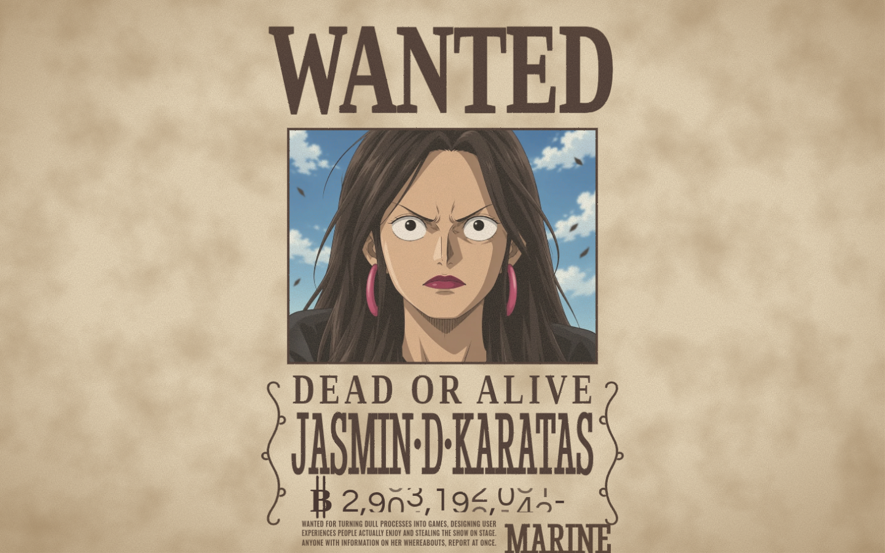

# UI Design System & Master Generation Blueprint: www-jasmin-karatas-ch

> **Jasmin Deniz Karatas – Product Designer, Gamification Specialist & Keyno...** (http://www.jasmin-karatas.ch) — Jasmin Deniz Karatas (JayKay): product designer, gamification specialist and keynote speaker. Keynotes, workshops and books on gaming the...



---

## 1. Executive Visual Persona & Design Archetype

- **Brand Essence & Persona**: **Jasmin Deniz Karatas – Product Designer, Gamification Specialist & Keyno...** (`http://www.jasmin-karatas.ch`). Jasmin Deniz Karatas (JayKay): product designer, gamification specialist and keynote speaker. Keynotes, workshops and books on gaming the...
- **Capture Provenance**: Live browser capture (`tier2_webgl`, HTTP `200`, captured `2026-11-23`).
- **Visual Archetype**: **Light-Gallery WebGL / Canvas Interactive Experience (`#ffffff` / `#fea0c0`)**.
- **Anti-AI-Slop Differentiators**:
  - **Live-Computed Chromatic Polarity**: Anchors the viewport in `#ffffff` (live computed `body` `background-color` (`computed_styles.json`)) paired with `#171717` primary typography and `#fea0c0` accents.
  - **Grounded Typographic Hierarchy**: Pairs `larsseit` for display copy (`JAYKAY – Jasmin Deniz Karatas`) with `interphases` and not declared in live computed styles (uses primary stack / `ui-monospace`).
  - **Calibrated Spatial Grid & Motion**: Combines `1440px` container bounds (`gap: 16px`, padding `100.8px`) with `cubic-bezier(0,0,.2,1)` easing and Lenis Smooth Scroll (`data-lenis`), Three.js / WebGL Canvas Pipeline.

---

## 2. Spatial Architecture & Modular Grid Mathematics


### Viewport Allocation & Container Geometry
- **Captured Viewport Dimensions**: Desktop `1440×900px` (`assets/desktop.png`, single-viewport 100vh live capture (900px)), Mobile `390×844px` (`assets/mobile.png`, single-viewport 100vh live capture (844px)).
- **Master Container Bounds**: `1440px` (full-bleed `100%` desktop stage measured on `1440px` viewport).
- **Canvas Lateral Padding & Spacing**: `100.8px` lateral canvas padding with `16px` grid gap.
- **Border Radius Scale**: `.25rem`, `var(--radius-2xl)`, `var(--radius-3xl)`, `.5rem`.

### Responsive Breakpoint Architecture
- **Desktop Layout**: Multi-column CSS Grid / Flexbox layout at `1440px` (`max-width: 1440px`, `gap: 16px`).
- **Mobile Layout**: Single-column vertical stack at `390px` viewport width with `100.8px` horizontal padding.
- **Extracted CSS Media Queries**: `@media (prefers-reduced-motion:reduce)`, `@media not all and (min-width:48rem)`, `@media (min-width:40rem)`, `@media (min-width:48rem)`.

---

## 3. Color System, Materiality & Atmospheric Lighting

### Semantic Palette & Source Grounding
| Semantic Role | Ground-Truth Value | Extracted Live / CSS Source |
|---|---|---|
| **Primary Canvas Substrate** | `#ffffff` | live computed `body` `background-color` (`computed_styles.json`) |
| **Primary Typography Ink** | `#171717` | live computed `body` `color` (`computed_styles.json`) |
| **Elevated Surface / Card Substrate** | `#e8d8ba` | `.bg-paper { background-color: #e8d8ba }` |
| **Interactive Accent / Highlight** | `#fea0c0` | `var(--color-primary-100)` in `:root` |
| **Secondary / Muted Copy** | `#9fb0e2` | live computed `nav` `color` (`computed_styles.json`) |
| **Structural Hairline Border** | `#c8c2bd` | `30 { border-color: #c8c2bd }` |
| **Variable Token (`--color-emerald-300`)** | `#5ee9b5` | `var(--color-emerald-300)` in `:root` |
| **Variable Token (`--color-emerald-400`)** | `#00d294` | `var(--color-emerald-400)` in `:root` |
| **Variable Token (`--color-black`)** | `#000000` | `var(--color-black)` in `:root` |

### Sanitized Root CSS Variables (`ui-ux.md` Ground Truth)
| Variable Name | Extracted Value | Semantic Role |
|---|---|---|
| `--gutter` | `clamp(1.75rem, 7vw, 8rem)` | Layout / Spatial Grid Token |
| `--background` | `#fff` | Canvas / Surface Token |
| `--foreground` | `#171717` | Typography Ink Token |
| `--font-larsseit` | `"larsseit", "larsseit Fallback"` | Typography / Scale Token |
| `--font-interphases` | `"interphases", "interphases Fallback"` | Typography / Scale Token |
| `--font-wanted-serif` | `"Tinos", "Tinos Fallback"` | Typography / Scale Token |
| `--font-wanted-condensed` | `"Stint Ultra Condensed", "Stint Ultra Condensed Fallback"` | Typography / Scale Token |
| `--font-wanted-bounty` | `"Questrial", "Questrial Fallback"` | Typography / Scale Token |
| `--font-wanted-fine` | `"Oswald", "Oswald Fallback"` | Typography / Scale Token |
| `--font-sans` | `var(--font-interphases), sans-serif` | Typography / Scale Token |
| `--color-emerald-300` | `#5ee9b5` | Brand / Palette Token |
| `--color-emerald-400` | `#00d294` | Brand / Palette Token |
| `--color-black` | `#000` | Canvas / Surface Token |
| `--color-white` | `#fff` | Canvas / Surface Token |
| `--spacing` | `.25rem` | Layout / Spatial Grid Token |
| `--container-xs` | `20rem` | Layout / Spatial Grid Token |

---

## 4. Typographic Scale & Editorial Hierarchy

### Font Family Stacks
- **Display Typography**: `larsseit`.
- **Primary Body Stack**: `interphases`.
- **Technical / Metadata Stack**: not declared in live computed styles (uses primary stack / `ui-monospace`).

### Typographic Scale & Rules (Live Computed & Stylesheet Grounded)
- **Hero Display (`H1`)**: live computed `h1` (`font-size: 16px`, `line-height: 24px`, `font-weight: 400`); CSS variables `--text-4xl: 2.25rem`, `--text-4xl--line-height: calc(2.5 / 2.25)`, `--text-5xl: 3rem`.
- **Section Heading (`H2`)**: live computed `h2` (`font-size: 57.6px`, `line-height: 58.752px`, `font-weight: 700`, `letter-spacing: -2.304px`); CSS variables `--text-2xl: 1.5rem`, `--text-2xl--line-height: calc(2 / 1.5)`, `--text-3xl: 1.875rem`.
- **Body Copy**: live computed `body` (`font-size: 16px`, `line-height: 24px`, `font-weight: 400`); CSS variables `--text-base: 1rem`, `--text-base--line-height: calc(1.5 / 1)`.
- **Metadata & Navigation Labels**: live computed `nav/a` (`font-size: 16px`, `line-height: 24px`, `font-weight: 400`); CSS variables `--text-xs: .75rem`, `--text-xs--line-height: calc(1 / .75)`, `--text-sm: .875rem`.

---

## 5. Choreographed Motion & Interaction Physics

### Primary Easing Curves
- **Extracted Timing Functions**: `cubic-bezier(0,0,.2,1)`, `cubic-bezier(.4,0,.2,1)`, `cubic-bezier(.4,0,.6,1)`.

### Per-Element Transition & Choreography Rules
- **Selector `.lenis.lenis-autoToggle`**: `transition: 1ms` extracted from `www-jasmin-karatas-ch` stylesheet.
- **Selector `layer theme`**: `transition: .15s` extracted from `www-jasmin-karatas-ch` stylesheet.
- **Selector `.transition`**: `transition: var(--tw-ease,var(--default-transition-timing-function))` extracted from `www-jasmin-karatas-ch` stylesheet.
- **Extracted Easing Curve (`cubic-bezier(0,0,.2,1)`)**: Governs interactive state transitions across `<header.inset-x-0>` and `<section.h-svh>`.
- **Runtime Interaction Engine**: Integrates Lenis Smooth Scroll (`data-lenis`), Three.js / WebGL Canvas Pipeline with `prefers-reduced-motion: reduce` fallback guards.

---

## 6. Component Wireframe & Structural DOM Map

### Visual Layout Schematic — Desktop (`1440px`, Grounded in `dom.html` & Landmark Bounding Boxes)
```
┌────────────────────────────────────────────────────────────────────────┐
│ DESKTOP VIEWPORT (1440px) — Jasmin Deniz Karatas – Product Designer, G │
│ ====================================================================== │
│ [ <header.inset-x-0> (1440x96px)      | Privacy · Imprint            ] │
│ ---------------------------------------------------------------------- │
│ | HERO STAGE: <section.relative> (w=1440px)                          | │
│ | H1: JAYKAY – Jasmin Deniz Karatas                                  | │
│ | Substrate: #ffffff | Ink: #171717 | Accent: #fea0c0                | │
│ ---------------------------------------------------------------------- │
│ | SHOWCASE GRID (<section.h-svh>) max-w: 1440px                      | │
│ | +------------------------------+  +------------------------------+ | │
│ | | 04 Content Creation          |  | Product Designer, Gamificati | | │
│ | +------------------------------+  +------------------------------+ | │
│ ---------------------------------------------------------------------- │
│ | DETAIL MODULE (<section.px-page>) — Start voyage ENTER             | │
│ ---------------------------------------------------------------------- │
│ [ FOOTER (<footer.overflow-cli) | http://www.jasmin-karatas.ch         │
└────────────────────────────────────────────────────────────────────────┘
```

### Visual Layout Schematic — Mobile Reflow (`390px`)
```
┌────────────────────────────────────────────────────────────────────────┐
│ MOBILE VIEWPORT REFLOW (390px) — Single-Column Stack (gap: 16px)       │
│ ====================================================================== │
│ [ HEADER BAR (<header.inset-x-0>      ) | Compact Menu (390px)         │
│ ---------------------------------------------------------------------- │
│ | HERO STAGE (<section.relative>) — 390px Vertical Lead              | │
│ | H1: JAYKAY – Jasmin Deniz Karatas                                  | │
│ ---------------------------------------------------------------------- │
│ | SHOWCASE STACK (<section.h-svh>) — 1-Col Stack                     | │
│ | [ Item 1: 04 Content Creation                                    ] | │
│ | [ Item 2: Product Designer, Gamification Specialist & Keyn       ] | │
│ ---------------------------------------------------------------------- │
│ | DETAIL STACK (<section.px-page>) — 1-Col (Start voyage ENTER)      | │
│ ---------------------------------------------------------------------- │
│ [ FOOTER (<footer.overflow-cli) | Stacked 390px Colophon               │
└────────────────────────────────────────────────────────────────────────┘
```

### Granular DOM Region Breakdown
1. **Brand Header & Navigation Bar (<header.inset-x-0> — `www-jasmin-karatas-ch`)**:
   - Landmark `<header class="inset-x-0 top-0">` (`1440x96px`) hosting `Jasmin Deniz Karatas – Product Desig` navigation (`Privacy · Imprint`), DOM attributes (`data-precedence="next"`, `data-precedence="next"`, `data-precedence="next"`, `data-sdkn="@vercel/analytics/next"`), and stylesheet rule `html.lenis body { height:auto }`.
2. **Hero Stage & Focal Lead (<section.relative> — `JAYKAY – Jasmin Deniz Karatas`)**:
   - Landmark `<section class="relative">` presenting display lead `JAYKAY – Jasmin Deniz Karatas` and copy excerpt *"04 Content Creation"* over `#ffffff` canvas and `#171717` ink.
3. **Primary Showcase & Content Grid (<section.h-svh> — `04 Content Creation`)**:
   - Landmark `<section class="h-svh px-page">` rendering section `04 Content Creation` with copy *"Product Designer, Gamification Specialist & Keynote Speaker"*, asset references (`2f19417f17ff8e58-s.p.3gn-3bwpf0f0...`, `581c3ae769a58b7e-s.p.2ow53ya-6whs...`, `96cd250007373f76-s.p.13j832optq1i...`, `Larsseit_Bold-s.p.3wzp25uvg6vh4.w...`), and grid rule `.lenis-stopped { overflow:clip }`.
4. **Interactive Detail & Feature Matrix (<section.px-page> — `Product Designer, Gamification Spe`)**:
   - Landmark `<section class="h-svh px-page">` framing `Product Designer, Gamification Specialist & Keyn` and `Start voyage ENTER` (*"Start voyage ENTER"*) with `#e8d8ba` surface cards, `#fea0c0` accents, and `.lenis.lenis-smooth iframe { pointer-events:none }`.
5. **Colophon & Global Directory Footer (<footer.overflow-clip> — `http://www.jasmin-karatas.ch`)**:
   - Landmark `<footer class="overflow-clip bg-navy-900">` anchoring `Jasmin Deniz Karatas – Product D` footer links (`Privacy · Imprint`), copy *"Not in the mood for games? Simple Website Version →"*, and `#c8c2bd` structural dividers.

---

## 7. Master Zero-Shot AI Generation Prompt

```markdown
# Master Zero-Shot Frontend Generation Prompt: www-jasmin-karatas-ch (Jasmin Deniz Karatas – Product Designer, Gamification Specialist & Keyno...)

You are a principal frontend architect and design systems engineer. Build a complete, production-ready web application replicating the exact design system, DOM landmarks, typographic hierarchy, color tokens, and motion physics of `www-jasmin-karatas-ch` (**Jasmin Deniz Karatas – Product Designer, Gamification Specialist & Keyno...** — `http://www.jasmin-karatas.ch`).

### 1. Visual Archetype & Anti-AI-Slop Mandates
- **Archetype**: Light-Gallery WebGL / Canvas Interactive Experience (`#ffffff` / `#fea0c0`).
- **Identity & Domain Context**: Jasmin Deniz Karatas (JayKay): product designer, gamification specialist and keynote speaker. Keynotes, workshops and books on gaming the...
- **Primary Substrate**: `#ffffff` (live computed `body` `background-color` (`computed_styles.json`)), **Primary Ink**: `#171717`, **Accent / Highlight**: `#fea0c0`.
- **Site-Specific Differentiators**:
  - **Live-Computed Chromatic Polarity**: Anchors the viewport in `#ffffff` (live computed `body` `background-color` (`computed_styles.json`)) paired with `#171717` primary typography and `#fea0c0` accents.
  - **Grounded Typographic Hierarchy**: Pairs `larsseit` for display copy (`JAYKAY – Jasmin Deniz Karatas`) with `interphases` and not declared in live computed styles (uses primary stack / `ui-monospace`).
  - **Calibrated Spatial Grid & Motion**: Combines `1440px` container bounds (`gap: 16px`, padding `100.8px`) with `cubic-bezier(0,0,.2,1)` easing and Lenis Smooth Scroll (`data-lenis`), Three.js / WebGL Canvas Pipeline.

### 2. Ground-Truth CSS Variables (`:root` Token Contract)
Declare and consume these exact custom properties extracted from `www-jasmin-karatas-ch` in your global stylesheet:

:root {
  /* Jasmin Deniz Karatas – Product Designer, Gamification Specialist & Keyno... (www-jasmin-karatas-ch) — Live-Grounded CSS Variables */
  --gutter: clamp(1.75rem, 7vw, 8rem); /* Layout / Spatial Grid Token (www-jasmin-karatas-ch) */
  --background: #fff; /* Canvas / Surface Token (www-jasmin-karatas-ch) */
  --foreground: #171717; /* Typography Ink Token (www-jasmin-karatas-ch) */
  --font-larsseit: "larsseit", "larsseit Fallback"; /* Typography / Scale Token (www-jasmin-karatas-ch) */
  --font-interphases: "interphases", "interphases Fallback"; /* Typography / Scale Token (www-jasmin-karatas-ch) */
  --font-wanted-serif: "Tinos", "Tinos Fallback"; /* Typography / Scale Token (www-jasmin-karatas-ch) */
  --font-wanted-condensed: "Stint Ultra Condensed", "Stint Ultra Condensed Fallback"; /* Typography / Scale Token (www-jasmin-karatas-ch) */
  --font-wanted-bounty: "Questrial", "Questrial Fallback"; /* Typography / Scale Token (www-jasmin-karatas-ch) */
  --font-wanted-fine: "Oswald", "Oswald Fallback"; /* Typography / Scale Token (www-jasmin-karatas-ch) */
  --font-sans: var(--font-interphases), sans-serif; /* Typography / Scale Token (www-jasmin-karatas-ch) */
  --color-emerald-300: #5ee9b5; /* Brand / Palette Token (www-jasmin-karatas-ch) */
  --color-emerald-400: #00d294; /* Brand / Palette Token (www-jasmin-karatas-ch) */
  --color-black: #000; /* Canvas / Surface Token (www-jasmin-karatas-ch) */
  --color-white: #fff; /* Canvas / Surface Token (www-jasmin-karatas-ch) */
  --spacing: .25rem; /* Layout / Spatial Grid Token (www-jasmin-karatas-ch) */
  --container-xs: 20rem; /* Layout / Spatial Grid Token (www-jasmin-karatas-ch) */
}

### 3. Semantic Color & Materiality Contract
Map every surface, ink, and border strictly to these source-grounded tokens:
- **Primary Canvas Substrate**: `#ffffff` — grounded in live computed `body` `background-color` (`computed_styles.json`)
- **Primary Typography Ink**: `#171717` — grounded in live computed `body` `color` (`computed_styles.json`)
- **Elevated Surface / Card Substrate**: `#e8d8ba` — grounded in `.bg-paper { background-color: #e8d8ba }`
- **Interactive Accent / Highlight**: `#fea0c0` — grounded in `var(--color-primary-100)` in `:root`
- **Secondary / Muted Copy**: `#9fb0e2` — grounded in live computed `nav` `color` (`computed_styles.json`)
- **Structural Hairline Border**: `#c8c2bd` — grounded in `30 { border-color: #c8c2bd }`
- **Variable Token (`--color-emerald-300`)**: `#5ee9b5` — grounded in `var(--color-emerald-300)` in `:root`
- **Variable Token (`--color-emerald-400`)**: `#00d294` — grounded in `var(--color-emerald-400)` in `:root`
- **Variable Token (`--color-black`)**: `#000000` — grounded in `var(--color-black)` in `:root`

### 4. Spatial Grid, Container Bounds & Responsive Breakpoints
- **Desktop Viewport Reference**: `1440×900px` (single-viewport 100vh live capture (900px), `1440px` standard desktop width).
- **Mobile Viewport Reference**: `390×844px` (single-viewport 100vh live capture (844px), `390px` standard mobile width).
- **Container Max-Width**: `1440px` (full-bleed `100%` desktop stage measured on `1440px` viewport)
- **Padding & Gutters**: `100.8px` lateral canvas padding with `16px` grid gap
- **Desktop Grid**: Multi-column CSS Grid / Flexbox layout at `1440px` (`max-width: 1440px`, `gap: 16px`)
- **Mobile Adaptation**: Single-column vertical stack at `390px` viewport width with `100.8px` horizontal padding
- **Media Queries**: `@media (prefers-reduced-motion:reduce)`, `@media not all and (min-width:48rem)`, `@media (min-width:40rem)`, `@media (min-width:48rem)`
- **Corner Radii**: `.25rem`, `var(--radius-2xl)`, `var(--radius-3xl)`, `.5rem`

### 5. Typography & Editorial Scale Contract
- **Display Font Stack**: `larsseit`
- **Body Font Stack**: `interphases`
- **Monospace / Technical Font Stack**: not declared in live computed styles (uses primary stack / `ui-monospace`)
- **H1 Display Rule**: live computed `h1` (`font-size: 16px`, `line-height: 24px`, `font-weight: 400`); CSS variables `--text-4xl: 2.25rem`, `--text-4xl--line-height: calc(2.5 / 2.25)`, `--text-5xl: 3rem`
- **H2 Section Rule**: live computed `h2` (`font-size: 57.6px`, `line-height: 58.752px`, `font-weight: 700`, `letter-spacing: -2.304px`); CSS variables `--text-2xl: 1.5rem`, `--text-2xl--line-height: calc(2 / 1.5)`, `--text-3xl: 1.875rem`
- **Body Copy Rule**: live computed `body` (`font-size: 16px`, `line-height: 24px`, `font-weight: 400`); CSS variables `--text-base: 1rem`, `--text-base--line-height: calc(1.5 / 1)`
- **Metadata & Index Rule**: live computed `nav/a` (`font-size: 16px`, `line-height: 24px`, `font-weight: 400`); CSS variables `--text-xs: .75rem`, `--text-xs--line-height: calc(1 / .75)`, `--text-sm: .875rem`

### 6. Component Hierarchy, Verbatim Copy & Real DOM Landmarks
Scaffold `www-jasmin-karatas-ch` (`Jasmin Deniz Karatas – Product Designer, Gamification Specialist & Keyno...`) with these exact structural regions, extracted copy, and CSS rules from `dom.html`:
1. **Brand Header & Navigation Bar (<header.inset-x-0> — `www-jasmin-karatas-ch`)**:
   - DOM & Selectors: Landmark `<header class="inset-x-0 top-0">` (`1440x96px`) hosting `Jasmin Deniz Karatas – Product Desig` navigation (`Privacy · Imprint`), DOM attributes (`data-precedence="next"`, `data-precedence="next"`, `data-precedence="next"`, `data-sdkn="@vercel/analytics/next"`), and stylesheet rule `html.lenis body { height:auto }`.
   - Responsive Contract: Header `Brand Header & Navigation Bar (<header.inset-x-0> — `www-jasmin-karatas-ch`)` (`www-jasmin-karatas-ch`) adapts across `@media (prefers-reduced-motion:reduce)`, `@media not all and (min-width:48rem)`, `@media (min-width:40rem)`, `@media (min-width:48rem)` with `cubic-bezier(0,0,.2,1)`, `cubic-bezier(.4,0,.2,1)`, `cubic-bezier(.4,0,.6,1)` transitions and links `Privacy · Imprint`.
2. **Hero Stage & Focal Lead (<section.relative> — `JAYKAY – Jasmin Deniz Karatas`)**:
   - DOM & Selectors: Landmark `<section class="relative">` presenting display lead `JAYKAY – Jasmin Deniz Karatas` and copy excerpt *"04 Content Creation"* over `#ffffff` canvas and `#171717` ink.
   - Responsive Contract: Hero stage (`1440×900px` desktop / `390×844px` mobile) sets `#ffffff` background with `#171717` headline `JAYKAY – Jasmin Deniz Karatas`.
3. **Primary Showcase & Content Grid (<section.h-svh> — `04 Content Creation`)**:
   - DOM & Selectors: Landmark `<section class="h-svh px-page">` rendering section `04 Content Creation` with copy *"Product Designer, Gamification Specialist & Keynote Speaker"*, asset references (`2f19417f17ff8e58-s.p.3gn-3bwpf0f0...`, `581c3ae769a58b7e-s.p.2ow53ya-6whs...`, `96cd250007373f76-s.p.13j832optq1i...`, `Larsseit_Bold-s.p.3wzp25uvg6vh4.w...`), and grid rule `.lenis-stopped { overflow:clip }`.
   - Responsive Contract: Showcase grid `Primary Showcase & Content Grid (<section.h-svh> — `04 Content Creation`)` applies Multi-column CSS Grid / Flexbox layout at `1440px` (`max-width: 1440px`, `gap: 16px`) on desktop and Single-column vertical stack at `390px` viewport width with `100.8px` horizontal padding on mobile.
4. **Interactive Detail & Feature Matrix (<section.px-page> — `Product Designer, Gamification Spe`)**:
   - DOM & Selectors: Landmark `<section class="h-svh px-page">` framing `Product Designer, Gamification Specialist & Keyn` and `Start voyage ENTER` (*"Start voyage ENTER"*) with `#e8d8ba` surface cards, `#fea0c0` accents, and `.lenis.lenis-smooth iframe { pointer-events:none }`.
   - Responsive Contract: Detail module `Interactive Detail & Feature Matrix (<section.px-page> — `Product Designer, Gamification Spe`)` uses `.25rem`, `var(--radius-2xl)`, `var(--radius-3xl)`, `.5rem` radii, `#fea0c0` highlights, and assets (2f19417f17ff8e58-s.p.3gn-3bwpf0f0..., 581c3ae769a58b7e-s.p.2ow53ya-6whs..., 96cd250007373f76-s.p.13j832optq1i...).
5. **Colophon & Global Directory Footer (<footer.overflow-clip> — `http://www.jasmin-karatas.ch`)**:
   - DOM & Selectors: Landmark `<footer class="overflow-clip bg-navy-900">` anchoring `Jasmin Deniz Karatas – Product D` footer links (`Privacy · Imprint`), copy *"Not in the mood for games? Simple Website Version →"*, and `#c8c2bd` structural dividers.
   - Responsive Contract: Footer `Colophon & Global Directory Footer (<footer.overflow-clip> — `http://www.jasmin-karatas.ch`)` aligns to `1440px` (full-bleed `100%` desktop stage measured on `1440px` viewport) with `100.8px` lateral canvas padding with `16px` grid gap and attributes (data-precedence="next", data-precedence="next", data-precedence="next").

#### Verbatim DOM Copy Excerpts (`dom.html`)
- Copy Excerpt 1: *"04 Content Creation"*
- Copy Excerpt 2: *"Product Designer, Gamification Specialist & Keynote Speaker"*
- Copy Excerpt 3: *"Start voyage ENTER"*
- Copy Excerpt 4: *"Not in the mood for games? Simple Website Version →"*

### 7. Motion, Extracted Stylesheet Rules & Interaction Choreography
- **Primary Easing Functions**: `cubic-bezier(0,0,.2,1)`, `cubic-bezier(.4,0,.2,1)`, `cubic-bezier(.4,0,.6,1)`
- **Extracted Stylesheet Rules (`www-jasmin-karatas-ch`)**:
- `html.lenis body { height:auto }`
- `.lenis-stopped { overflow:clip }`
- `.lenis.lenis-smooth iframe { pointer-events:none }`
- `.lenis.lenis-autoToggle { transition-behavior:allow-discrete;transition-property:overflow;transiti... }`
- `seit_bc6e4957-module__L5pDiG__cla... { font-family:larsseit,larsseit Fallback;font-style:normal;font-weight:700 }`
- **Per-Selector Transition Rules**:
- **Selector `.lenis.lenis-autoToggle`**: `transition: 1ms` extracted from `www-jasmin-karatas-ch` stylesheet.
- **Selector `layer theme`**: `transition: .15s` extracted from `www-jasmin-karatas-ch` stylesheet.
- **Selector `.transition`**: `transition: var(--tw-ease,var(--default-transition-timing-function))` extracted from `www-jasmin-karatas-ch` stylesheet.
- **Extracted Easing Curve (`cubic-bezier(0,0,.2,1)`)**: Governs interactive state transitions across `<header.inset-x-0>` and `<section.h-svh>`.
- **Runtime Interaction Engine**: Integrates Lenis Smooth Scroll (`data-lenis`), Three.js / WebGL Canvas Pipeline with `prefers-reduced-motion: reduce` fallback guards.

### 8. Technical Deliverables
- Implement in Next.js (App Router) with TypeScript and Tailwind CSS consuming the `:root` custom properties defined above for `www-jasmin-karatas-ch`.
- Reproduce both the `1440px` desktop architecture and `390px` mobile breakpoint transitions, preserving semantic HTML5 landmarks (`<header>`, `<nav>`, `<main>`, `<section>`, `<footer>`) and `prefers-reduced-motion` accessibility guards.
```
