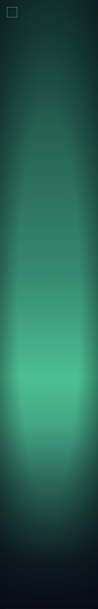

# UI Design System & Master Generation Blueprint: www-jasmin-karatas-ch

> **Jasmin Deniz Karatas – Product Designer, Gamification Specialist & Keyno...** (http://www.jasmin-karatas.ch) — Jasmin Deniz Karatas (JayKay): product designer, gamification specialist and keynote speaker. Keynotes, workshops and books on gaming the...


---

## 1. Executive Visual Persona & Design Archetype

- **Brand Essence & Persona**: **Jasmin Deniz Karatas – Product Designer, Gamification Specialist & Keyno...** (`http://www.jasmin-karatas.ch`). Jasmin Deniz Karatas (JayKay): product designer, gamification specialist and keynote speaker. Keynotes, workshops and books on gaming the...
- **Visual Archetype**: **Light-Gallery WebGL / Canvas Interactive Experience (`#5ee9b5` / `#fff`)**.
- **Anti-AI-Slop Differentiators**:
  - **Source-Grounded Chromatic Polarity**: Anchors the viewport in `#5ee9b5` (`var(--color-emerald-300)` in `:root`) paired with `#000` primary typography and `#fff` accents.
  - **Extracted Typographic Hierarchy**: Pairs `larsseit` for display copy (`JAYKAY – Jasmin Deniz Karatas`) with `larsseit Fallback` and not declared in static CSS (uses primary stack / `ui-monospace`).
  - **Calibrated Spatial Grid & Motion**: Combines `var(--container-2xl)` container bounds (`gap: var(--spacing)`, padding `var(--spacing)`) with `cubic-bezier(0,0,.2,1)` easing and Lenis Smooth Scroll (`data-lenis`), Three.js / WebGL Canvas Pipeline.

---

## 2. Spatial Architecture & Modular Grid Mathematics



### Viewport Allocation & Container Geometry
- **Captured Viewport Dimensions**: Desktop `1440×2400px` (`assets/desktop.png`, capped at 2400px multi-section capture), Mobile `390×2400px` (`assets/mobile.png`, capped at 2400px multi-section capture).
- **Master Container Bounds**: `var(--container-2xl)` extracted from `www-jasmin-karatas-ch` stylesheet.
- **Canvas Lateral Padding & Spacing**: `var(--spacing)` lateral canvas padding with `var(--spacing)` grid gap.
- **Border Radius Scale**: `.25rem`, `var(--radius-2xl)`, `var(--radius-3xl)`, `.5rem`.

### Responsive Breakpoint Architecture
- **Desktop Layout**: Multi-column CSS Grid / Flexbox layout at `1440px` (`max-width: var(--container-2xl)`, `gap: var(--spacing)`).
- **Mobile Layout**: Single-column vertical stack at `390px` viewport width with `var(--spacing)` horizontal padding.
- **Extracted CSS Media Queries**: `@media (prefers-reduced-motion:reduce)`, `@media not all and (min-width:48rem)`, `@media (min-width:40rem)`, `@media (min-width:48rem)`.

---

## 3. Color System, Materiality & Atmospheric Lighting

### Semantic Palette & Source Grounding
| Semantic Role | Ground-Truth Value | Extracted CSS Source / Selector |
|---|---|---|
| **Primary Canvas Substrate** | `#5ee9b5` | `var(--color-emerald-300)` in `:root` |
| **Primary Typography Ink** | `#00d294` | `var(--color-emerald-400)` in `:root` |
| **Elevated Surface / Card Substrate** | `#000` | `var(--color-black)` in `:root` |
| **Interactive Accent / Highlight** | `#fff` | `var(--color-white)` in `:root` |
| **Secondary / Muted Copy** | `#070b16` | `var(--color-navy-900)` in `:root` |
| **Structural Hairline Border** | `#171717` | `var(--foreground)` in `:root` |

### Sanitized Root CSS Variables (`ui-ux.md` Ground Truth)
| Variable Name | Extracted Value | Semantic Role |
|---|---|---|
| `--font-larsseit` | `"larsseit", "larsseit Fallback"` | Typography / Scale Token |
| `--font-interphases` | `"interphases", "interphases Fallback"` | Typography / Scale Token |
| `--font-wanted-serif` | `"Tinos", "Tinos Fallback"` | Typography / Scale Token |
| `--font-wanted-condensed` | `"Stint Ultra Condensed", "Stint Ultra Condensed Fallback"` | Typography / Scale Token |
| `--font-wanted-bounty` | `"Questrial", "Questrial Fallback"` | Typography / Scale Token |
| `--font-wanted-fine` | `"Oswald", "Oswald Fallback"` | Typography / Scale Token |
| `--font-sans` | `var(--font-interphases), sans-serif` | Typography / Scale Token |
| `--color-emerald-300` | `#5ee9b5` | Brand / Palette Token |
| `--color-emerald-400` | `#00d294` | Brand / Palette Token |
| `--color-black` | `#000` | Canvas / Surface Token |
| `--color-white` | `#fff` | Canvas / Surface Token |
| `--spacing` | `.25rem` | Layout / Spatial Grid Token |
| `--container-xs` | `20rem` | Layout / Spatial Grid Token |
| `--container-sm` | `24rem` | Layout / Spatial Grid Token |
| `--container-md` | `28rem` | Layout / Spatial Grid Token |
| `--container-xl` | `36rem` | Layout / Spatial Grid Token |

---

## 4. Typographic Scale & Editorial Hierarchy

### Font Family Stacks
- **Display Typography**: `larsseit`.
- **Primary Body Stack**: `larsseit Fallback`.
- **Technical / Metadata Stack**: not declared in static CSS (uses primary stack / `ui-monospace`).

### Typographic Scale & Rules (Extracted from Stylesheet & Variables)
- **Hero Display (`H1`)**: CSS variables `--text-4xl: 2.25rem`, `--text-4xl--line-height: calc(2.5 / 2.25)`, `--text-5xl: 3rem`.
- **Section Heading (`H2`)**: CSS variables `--text-2xl: 1.5rem`, `--text-2xl--line-height: calc(2 / 1.5)`, `--text-3xl: 1.875rem`.
- **Body Copy**: CSS variables `--text-base: 1rem`, `--text-base--line-height: calc(1.5 / 1)`.
- **Metadata & Navigation Labels**: CSS variables `--text-xs: .75rem`, `--text-xs--line-height: calc(1 / .75)`, `--text-sm: .875rem`.

---

## 5. Choreographed Motion & Interaction Physics

### Primary Easing Curves
- **Extracted Timing Functions**: `cubic-bezier(0,0,.2,1)`, `cubic-bezier(.4,0,.2,1)`, `cubic-bezier(.4,0,.6,1)`.

### Per-Element Transition & Choreography Rules
- **Selector `.lenis.lenis-autoToggle`**: `transition: 1ms` extracted from `www-jasmin-karatas-ch` stylesheet.
- **Selector `layer theme`**: `transition: .15s` extracted from `www-jasmin-karatas-ch` stylesheet.
- **Selector `.transition`**: `transition: var(--tw-ease,var(--default-transition-timing-function))` extracted from `www-jasmin-karatas-ch` stylesheet.
- **Extracted Easing Curve (`cubic-bezier(0,0,.2,1)`)**: Governs interactive state transitions across `<header.fixed>` and `<section.relative>`.
- **Runtime Interaction Engine**: Integrates Lenis Smooth Scroll (`data-lenis`), Three.js / WebGL Canvas Pipeline with `prefers-reduced-motion: reduce` fallback guards.

---

## 6. Component Wireframe & Structural DOM Map

### Visual Layout Schematic (Grounded in `dom.html` — `1440px` Desktop & `390px` Mobile Reflow)
```
┌────────────────────────────────────────────────────────────────────────┐
│ DESKTOP VIEWPORT (1440px) — Jasmin Deniz Karatas – Product Designer, G │
│ ====================================================================== │
│ [ <header.fixed>           | Privacy · Imprint                      ]  │
│ ---------------------------------------------------------------------- │
│ | HERO STAGE: <section.relative>                                   |   │
│ | H1: JAYKAY – Jasmin Deniz Karatas                                |   │
│ | Substrate: #5ee9b5    | Ink: #000       | Accent: #fff           |   │
│ ---------------------------------------------------------------------- │
│ | SHOWCASE GRID (<section.relative>        ) max-w: var(--containe |   │
│ | +------------------------------+  +------------------------------+ | │
│ | | Keynotes, workshops and gami |  | Gamification Keynotes        | | │
│ | +------------------------------+  +------------------------------+ | │
│ ---------------------------------------------------------------------- │
│ | MOBILE VIEWPORT REFLOW (390px) — Single-Column Stack (gap: var(--) | │
│ | [<header.fixed>] -> [<section.relative>] -> [<section.relative>] |   │
│ ---------------------------------------------------------------------- │
│ [ FOOTER (<footer.relative>     ) | http://www.jasmin-karatas.ch       │
└────────────────────────────────────────────────────────────────────────┘
```

### Granular DOM Region Breakdown
1. **Brand Header & Navigation Bar (<header.fixed> — `www-jasmin-karatas-ch`)**:
   - Landmark `<header class="fixed inset-x-0">` hosting `Jasmin Deniz Karatas – Product Desig` navigation (`Privacy · Imprint`), DOM attributes (`data-precedence="next"`, `data-precedence="next"`, `data-precedence="next"`, `data-sdkn="@vercel/analytics/next"`), and stylesheet rule `html.lenis body { height:auto }`.
2. **Hero Stage & Focal Lead (<section.relative> — `JAYKAY – Jasmin Deniz Karatas`)**:
   - Landmark `<section class="relative">` presenting display lead `JAYKAY – Jasmin Deniz Karatas` and copy excerpt *"04 Content Creation"* over `#5ee9b5` canvas and `#000` ink.
3. **Primary Showcase & Content Grid (<section.relative> — `Keynotes, workshops and gamificati`)**:
   - Landmark `<section class="relative flex">` rendering section `Keynotes, workshops and gamification concepts.` with copy *"Product Designer, Gamification Specialist & Keynote Speaker"*, asset references (`2f19417f17ff8e58-s.p.3gn-3bwpf0f0...`, `581c3ae769a58b7e-s.p.2ow53ya-6whs...`, `96cd250007373f76-s.p.13j832optq1i...`, `Larsseit_Bold-s.p.3wzp25uvg6vh4.w...`), and grid rule `.lenis-stopped { overflow:clip }`.
4. **Interactive Detail & Feature Matrix (<section.relative> — `Gamification Keynotes`)**:
   - Landmark `<section class="relative flex">` framing `Gamification Keynotes` and `Game Changing – Rise of a Business Nerd.` (*"Start voyage ENTER"*) with `#000` surface cards, `#fff` accents, and `.lenis.lenis-smooth iframe { pointer-events:none }`.
5. **Colophon & Global Directory Footer (<footer.relative> — `http://www.jasmin-karatas.ch`)**:
   - Landmark `<footer class="relative overflow-clip">` anchoring `Jasmin Deniz Karatas – Product D` footer links (`Privacy · Imprint`), copy *"Not in the mood for games? Simple Website Version →"*, and `#171717` structural dividers.

---

## 7. Master Zero-Shot AI Generation Prompt

```markdown
# Master Zero-Shot Frontend Generation Prompt: www-jasmin-karatas-ch (Jasmin Deniz Karatas – Product Designer, Gamification Specialist & Keyno...)

You are a principal frontend architect and design systems engineer. Build a complete, production-ready web application replicating the exact design system, DOM landmarks, typographic hierarchy, color tokens, and motion physics of `www-jasmin-karatas-ch` (**Jasmin Deniz Karatas – Product Designer, Gamification Specialist & Keyno...** — `http://www.jasmin-karatas.ch`).

### 1. Visual Archetype & Anti-AI-Slop Mandates
- **Archetype**: Light-Gallery WebGL / Canvas Interactive Experience (`#5ee9b5` / `#fff`).
- **Identity & Domain Context**: Jasmin Deniz Karatas (JayKay): product designer, gamification specialist and keynote speaker. Keynotes, workshops and books on gaming the...
- **Primary Substrate**: `#5ee9b5` (`var(--color-emerald-300)` in `:root`), **Primary Ink**: `#000`, **Accent / Highlight**: `#fff`.
- **Site-Specific Differentiators**:
  - **Source-Grounded Chromatic Polarity**: Anchors the viewport in `#5ee9b5` (`var(--color-emerald-300)` in `:root`) paired with `#000` primary typography and `#fff` accents.
  - **Extracted Typographic Hierarchy**: Pairs `larsseit` for display copy (`JAYKAY – Jasmin Deniz Karatas`) with `larsseit Fallback` and not declared in static CSS (uses primary stack / `ui-monospace`).
  - **Calibrated Spatial Grid & Motion**: Combines `var(--container-2xl)` container bounds (`gap: var(--spacing)`, padding `var(--spacing)`) with `cubic-bezier(0,0,.2,1)` easing and Lenis Smooth Scroll (`data-lenis`), Three.js / WebGL Canvas Pipeline.

### 2. Ground-Truth CSS Variables (`:root` Token Contract)
Declare and consume these exact custom properties extracted from `www-jasmin-karatas-ch` in your global stylesheet:

:root {
  /* Jasmin Deniz Karatas – Product Designer, Gamification Specialist & Keyno... (www-jasmin-karatas-ch) — Ground-Truth Extracted CSS Variables */
  --font-larsseit: "larsseit", "larsseit Fallback"; /* Typography / Scale Token (www-jasmin-karatas-ch) */
  --font-interphases: "interphases", "interphases Fallback"; /* Typography / Scale Token (www-jasmin-karatas-ch) */
  --font-wanted-serif: "Tinos", "Tinos Fallback"; /* Typography / Scale Token (www-jasmin-karatas-ch) */
  --font-wanted-condensed: "Stint Ultra Condensed", "Stint Ultra Condensed Fallback"; /* Typography / Scale Token (www-jasmin-karatas-ch) */
  --font-wanted-bounty: "Questrial", "Questrial Fallback"; /* Typography / Scale Token (www-jasmin-karatas-ch) */
  --font-wanted-fine: "Oswald", "Oswald Fallback"; /* Typography / Scale Token (www-jasmin-karatas-ch) */
  --font-sans: var(--font-interphases), sans-serif; /* Typography / Scale Token (www-jasmin-karatas-ch) */
  --color-emerald-300: #5ee9b5; /* Brand / Palette Token (www-jasmin-karatas-ch) */
  --color-emerald-400: #00d294; /* Brand / Palette Token (www-jasmin-karatas-ch) */
  --color-black: #000; /* Canvas / Surface Token (www-jasmin-karatas-ch) */
  --color-white: #fff; /* Canvas / Surface Token (www-jasmin-karatas-ch) */
  --spacing: .25rem; /* Layout / Spatial Grid Token (www-jasmin-karatas-ch) */
  --container-xs: 20rem; /* Layout / Spatial Grid Token (www-jasmin-karatas-ch) */
  --container-sm: 24rem; /* Layout / Spatial Grid Token (www-jasmin-karatas-ch) */
  --container-md: 28rem; /* Layout / Spatial Grid Token (www-jasmin-karatas-ch) */
  --container-xl: 36rem; /* Layout / Spatial Grid Token (www-jasmin-karatas-ch) */
}

### 3. Semantic Color & Materiality Contract
Map every surface, ink, and border strictly to these source-grounded tokens:
- **Primary Canvas Substrate**: `#5ee9b5` — grounded in `var(--color-emerald-300)` in `:root`
- **Primary Typography Ink**: `#00d294` — grounded in `var(--color-emerald-400)` in `:root`
- **Elevated Surface / Card Substrate**: `#000` — grounded in `var(--color-black)` in `:root`
- **Interactive Accent / Highlight**: `#fff` — grounded in `var(--color-white)` in `:root`
- **Secondary / Muted Copy**: `#070b16` — grounded in `var(--color-navy-900)` in `:root`
- **Structural Hairline Border**: `#171717` — grounded in `var(--foreground)` in `:root`

### 4. Spatial Grid, Container Bounds & Responsive Breakpoints
- **Desktop Viewport Reference**: `1440×2400px` (capped at 2400px multi-section capture, `1440px` standard desktop width).
- **Mobile Viewport Reference**: `390×2400px` (capped at 2400px multi-section capture, `390px` standard mobile width).
- **Container Max-Width**: `var(--container-2xl)` extracted from `www-jasmin-karatas-ch` stylesheet
- **Padding & Gutters**: `var(--spacing)` lateral canvas padding with `var(--spacing)` grid gap
- **Desktop Grid**: Multi-column CSS Grid / Flexbox layout at `1440px` (`max-width: var(--container-2xl)`, `gap: var(--spacing)`)
- **Mobile Adaptation**: Single-column vertical stack at `390px` viewport width with `var(--spacing)` horizontal padding
- **Media Queries**: `@media (prefers-reduced-motion:reduce)`, `@media not all and (min-width:48rem)`, `@media (min-width:40rem)`, `@media (min-width:48rem)`
- **Corner Radii**: `.25rem`, `var(--radius-2xl)`, `var(--radius-3xl)`, `.5rem`

### 5. Typography & Editorial Scale Contract
- **Display Font Stack**: `larsseit`
- **Body Font Stack**: `larsseit Fallback`
- **Monospace / Technical Font Stack**: not declared in static CSS (uses primary stack / `ui-monospace`)
- **H1 Display Rule**: CSS variables `--text-4xl: 2.25rem`, `--text-4xl--line-height: calc(2.5 / 2.25)`, `--text-5xl: 3rem`
- **H2 Section Rule**: CSS variables `--text-2xl: 1.5rem`, `--text-2xl--line-height: calc(2 / 1.5)`, `--text-3xl: 1.875rem`
- **Body Copy Rule**: CSS variables `--text-base: 1rem`, `--text-base--line-height: calc(1.5 / 1)`
- **Metadata & Index Rule**: CSS variables `--text-xs: .75rem`, `--text-xs--line-height: calc(1 / .75)`, `--text-sm: .875rem`

### 6. Component Hierarchy, Verbatim Copy & Real DOM Landmarks
Scaffold `www-jasmin-karatas-ch` (`Jasmin Deniz Karatas – Product Designer, Gamification Specialist & Keyno...`) with these exact structural regions, extracted copy, and CSS rules from `dom.html`:
1. **Brand Header & Navigation Bar (<header.fixed> — `www-jasmin-karatas-ch`)**:
   - DOM & Selectors: Landmark `<header class="fixed inset-x-0">` hosting `Jasmin Deniz Karatas – Product Desig` navigation (`Privacy · Imprint`), DOM attributes (`data-precedence="next"`, `data-precedence="next"`, `data-precedence="next"`, `data-sdkn="@vercel/analytics/next"`), and stylesheet rule `html.lenis body { height:auto }`.
   - Responsive Contract: Header `Brand Header & Navigation Bar (<header.fixed> — `www-jasmin-karatas-ch`)` (`www-jasmin-karatas-ch`) adapts across `@media (prefers-reduced-motion:reduce)`, `@media not all and (min-width:48rem)`, `@media (min-width:40rem)`, `@media (min-width:48rem)` with `cubic-bezier(0,0,.2,1)`, `cubic-bezier(.4,0,.2,1)`, `cubic-bezier(.4,0,.6,1)` transitions and links `Privacy · Imprint`.
2. **Hero Stage & Focal Lead (<section.relative> — `JAYKAY – Jasmin Deniz Karatas`)**:
   - DOM & Selectors: Landmark `<section class="relative">` presenting display lead `JAYKAY – Jasmin Deniz Karatas` and copy excerpt *"04 Content Creation"* over `#5ee9b5` canvas and `#000` ink.
   - Responsive Contract: Hero stage (`1440×2400px` desktop / `390×2400px` mobile) sets `#5ee9b5` background with `#000` headline `JAYKAY – Jasmin Deniz Karatas`.
3. **Primary Showcase & Content Grid (<section.relative> — `Keynotes, workshops and gamificati`)**:
   - DOM & Selectors: Landmark `<section class="relative flex">` rendering section `Keynotes, workshops and gamification concepts.` with copy *"Product Designer, Gamification Specialist & Keynote Speaker"*, asset references (`2f19417f17ff8e58-s.p.3gn-3bwpf0f0...`, `581c3ae769a58b7e-s.p.2ow53ya-6whs...`, `96cd250007373f76-s.p.13j832optq1i...`, `Larsseit_Bold-s.p.3wzp25uvg6vh4.w...`), and grid rule `.lenis-stopped { overflow:clip }`.
   - Responsive Contract: Showcase grid `Primary Showcase & Content Grid (<section.relative> — `Keynotes, workshops and gamificati`)` applies Multi-column CSS Grid / Flexbox layout at `1440px` (`max-width: var(--container-2xl)`, `gap: var(--spacing)`) on desktop and Single-column vertical stack at `390px` viewport width with `var(--spacing)` horizontal padding on mobile.
4. **Interactive Detail & Feature Matrix (<section.relative> — `Gamification Keynotes`)**:
   - DOM & Selectors: Landmark `<section class="relative flex">` framing `Gamification Keynotes` and `Game Changing – Rise of a Business Nerd.` (*"Start voyage ENTER"*) with `#000` surface cards, `#fff` accents, and `.lenis.lenis-smooth iframe { pointer-events:none }`.
   - Responsive Contract: Detail module `Interactive Detail & Feature Matrix (<section.relative> — `Gamification Keynotes`)` uses `.25rem`, `var(--radius-2xl)`, `var(--radius-3xl)`, `.5rem` radii, `#fff` highlights, and assets (2f19417f17ff8e58-s.p.3gn-3bwpf0f0..., 581c3ae769a58b7e-s.p.2ow53ya-6whs..., 96cd250007373f76-s.p.13j832optq1i...).
5. **Colophon & Global Directory Footer (<footer.relative> — `http://www.jasmin-karatas.ch`)**:
   - DOM & Selectors: Landmark `<footer class="relative overflow-clip">` anchoring `Jasmin Deniz Karatas – Product D` footer links (`Privacy · Imprint`), copy *"Not in the mood for games? Simple Website Version →"*, and `#171717` structural dividers.
   - Responsive Contract: Footer `Colophon & Global Directory Footer (<footer.relative> — `http://www.jasmin-karatas.ch`)` aligns to `var(--container-2xl)` extracted from `www-jasmin-karatas-ch` stylesheet with `var(--spacing)` lateral canvas padding with `var(--spacing)` grid gap and attributes (data-precedence="next", data-precedence="next", data-precedence="next").

#### Verbatim DOM Copy Excerpts (`dom.html`)
- Copy Excerpt 1: *"04 Content Creation"*
- Copy Excerpt 2: *"Product Designer, Gamification Specialist & Keynote Speaker"*
- Copy Excerpt 3: *"Start voyage ENTER"*
- Copy Excerpt 4: *"Not in the mood for games? Simple Website Version →"*

### 7. Motion, Extracted Stylesheet Rules & Interaction Choreography
- **Primary Easing Functions**: `cubic-bezier(0,0,.2,1)`, `cubic-bezier(.4,0,.2,1)`, `cubic-bezier(.4,0,.6,1)`
- **Extracted Stylesheet Rules (`www-jasmin-karatas-ch`)**:
- `html.lenis body { height:auto }`
- `.lenis-stopped { overflow:clip }`
- `.lenis.lenis-smooth iframe { pointer-events:none }`
- `.lenis.lenis-autoToggle { transition-behavior:allow-discrete;transition-property:overflow;transiti... }`
- `seit_bc6e4957-module__L5pDiG__cla... { font-family:larsseit,larsseit Fallback;font-style:normal;font-weight:700 }`
- **Per-Selector Transition Rules**:
- **Selector `.lenis.lenis-autoToggle`**: `transition: 1ms` extracted from `www-jasmin-karatas-ch` stylesheet.
- **Selector `layer theme`**: `transition: .15s` extracted from `www-jasmin-karatas-ch` stylesheet.
- **Selector `.transition`**: `transition: var(--tw-ease,var(--default-transition-timing-function))` extracted from `www-jasmin-karatas-ch` stylesheet.
- **Extracted Easing Curve (`cubic-bezier(0,0,.2,1)`)**: Governs interactive state transitions across `<header.fixed>` and `<section.relative>`.
- **Runtime Interaction Engine**: Integrates Lenis Smooth Scroll (`data-lenis`), Three.js / WebGL Canvas Pipeline with `prefers-reduced-motion: reduce` fallback guards.

### 8. Technical Deliverables
- Implement in Next.js (App Router) with TypeScript and Tailwind CSS consuming the `:root` custom properties defined above for `www-jasmin-karatas-ch`.
- Reproduce both the `1440px` desktop architecture and `390px` mobile breakpoint transitions, preserving semantic HTML5 landmarks (`<header>`, `<nav>`, `<main>`, `<section>`, `<footer>`) and `prefers-reduced-motion` accessibility guards.
```
