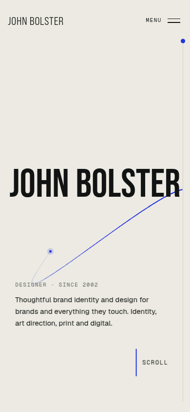

# UI Design System & Master Generation Blueprint: www-johnbolster-design

> **John Bolster · Brand Identity Designer and Art Director, Saratoga Spring...** (https://www.johnbolster.design/) — Independent brand identity designer and art director in Saratoga Springs, NY. Brand strategy, identity, print and web for businesses, hig...


---

## 1. Executive Visual Persona & Design Archetype

- **Brand Essence & Persona**: **John Bolster · Brand Identity Designer and Art Director, Saratoga Spring...** (`https://www.johnbolster.design/`). Independent brand identity designer and art director in Saratoga Springs, NY. Brand strategy, identity, print and web for businesses, hig...
- **Capture Provenance**: Live browser capture (`tier2_webgl`, HTTP `200`, captured `2026-11-23`).
- **Visual Archetype**: **Light-Gallery WebGL / Canvas Interactive Experience (`#eceae2` / `#4b5cff`)**.
- **Anti-AI-Slop Differentiators**:
  - **Live-Computed Chromatic Polarity**: Anchors the viewport in `#eceae2` (live computed `body` `background-color` (`computed_styles.json`)) paired with `#121413` primary typography and `#4b5cff` accents.
  - **Grounded Typographic Hierarchy**: Pairs `BebasProBold` for display copy (`JOHN BOLSTER`) with `Geist` and `Geist Mono`.
  - **Calibrated Spatial Grid & Motion**: Combines `1392px` container bounds (`gap: 12px`, padding `16px`) with `cubic-bezier(.7,0,.2,1)` easing and HTML5 `<canvas>` Interactive Viewport Surface.

---

## 2. Spatial Architecture & Modular Grid Mathematics



### Viewport Allocation & Container Geometry
- **Captured Viewport Dimensions**: Desktop `1440×900px` (`assets/desktop.png`, single-viewport 100vh live capture (900px)), Mobile `390×844px` (`assets/mobile.png`, single-viewport 100vh live capture (844px)).
- **Master Container Bounds**: `1392px` (measured `<main>` bounding box width within `1440px` desktop viewport).
- **Canvas Lateral Padding & Spacing**: `16px` lateral canvas padding with `12px` grid gap.
- **Border Radius Scale**: `2px`, `50%`, `999px`, `10px`.

### Responsive Breakpoint Architecture
- **Desktop Layout**: Multi-column CSS Grid / Flexbox layout at `1440px` (`max-width: 1392px`, `gap: 12px`).
- **Mobile Layout**: Single-column vertical stack at `390px` viewport width with `16px` horizontal padding.
- **Extracted CSS Media Queries**: `@media (max-width:760px)`, `@media (prefers-reduced-motion:reduce)`, `@media (max-width:760px)and (max-height:780px)`, `@media (max-width:400px)`.

---

## 3. Color System, Materiality & Atmospheric Lighting

### Semantic Palette & Source Grounding
| Semantic Role | Ground-Truth Value | Extracted Live / CSS Source |
|---|---|---|
| **Primary Canvas Substrate** | `#eceae2` | live computed `body` `background-color` (`computed_styles.json`) |
| **Primary Typography Ink** | `#121413` | live computed `h1` `color` (`computed_styles.json`) |
| **Elevated Surface / Card Substrate** | `#ffa500` | `#distinkt { background: orange }` (`#ffa500`) |
| **Interactive Accent / Highlight** | `#4b5cff` | `#menu .menu-sub a:hover { color: #4b5cff }` |
| **Secondary / Muted Copy** | `#5e6360` | `var(--muted)` in `:root` |
| **Structural Hairline Border** | `#2234e0` | `var(--line)` in `:root` |
| **Variable Token (`--hair`)** | `#d3d0c6` | `var(--hair)` in `:root` |
| **Variable Token (`--orange`)** | `#f47920` | `var(--orange)` in `:root` |
| **Variable Token (`--black`)** | `#0a0a0a` | `var(--black)` in `:root` |

### Sanitized Root CSS Variables (`ui-ux.md` Ground Truth)
| Variable Name | Extracted Value | Semantic Role |
|---|---|---|
| `--bg` | `#ECEAE2` | Canvas / Surface Token |
| `--ink` | `#121413` | Typography Ink Token |
| `--muted` | `#5E6360` | Color / Atmospheric Token |
| `--hair` | `#D3D0C6` | Color / Atmospheric Token |
| `--line` | `#2234E0` | Color / Atmospheric Token |
| `--orange` | `#F47920` | Color / Atmospheric Token |
| `--black` | `#0A0A0A` | Canvas / Surface Token |
| `--display` | `"BebasPro","Bebas Neue","Arial Narrow",Impact,sans-serif` | Design System Custom Token |
| `--body` | `"Geist",ui-sans-serif,system-ui,sans-serif` | Dimension / Scale Token |
| `--mono` | `"Geist Mono",ui-monospace,Menlo,monospace` | Typography / Scale Token |
| `--serif` | `"DM Serif Display",Georgia,serif` | Typography / Scale Token |
| `--gut` | `max(16px, env(safe-area-inset-left, 0px))` | Dimension / Scale Token |
| `--gutR` | `max(16px, env(safe-area-inset-right, 0px))` | Dimension / Scale Token |
| `--fp` | `1` | Design System Custom Token |
| `--sc` | `var(--ink)` | Design System Custom Token |
| `--on` | `clamp(0, calc((var(--fp) * 1.7 - var(--li,0) * .22) * 15 - var(--i)), 1)` | Design System Custom Token |

---

## 4. Typographic Scale & Editorial Hierarchy

### Font Family Stacks
- **Display Typography**: `BebasProBold`.
- **Primary Body Stack**: `Geist`.
- **Technical / Metadata Stack**: `Geist Mono`.

### Typographic Scale & Rules (Live Computed & Stylesheet Grounded)
- **Hero Display (`H1`)**: live computed `h1` (`font-size: 252px`, `line-height: 216.72px`, `font-weight: 400`); CSS variables `--display: "BebasPro","Bebas Neue","Arial Narrow",Impact,sans-serif`.
- **Section Heading (`H2`)**: live computed `h2` (`font-size: 123.84px`, `line-height: 106.502px`, `font-weight: 400`).
- **Body Copy**: live computed `body` (`font-size: 16px`, `line-height: 24.8px`, `font-weight: 400`); CSS variables `--body: "Geist",ui-sans-serif,system-ui,sans-serif`; rule `p` (`font-size: clamp(15px,1.15vw,18px)`, `line-height: 1.5`).
- **Metadata & Navigation Labels**: live computed `nav/a` (`font-size: 16px`, `line-height: 24.8px`, `font-weight: 400`); CSS variables `--mono: "Geist Mono",ui-monospace,Menlo,monospace`; rule `.mono` (`font-size: 12px`).

---

## 5. Choreographed Motion & Interaction Physics

### Primary Easing Curves
- **Extracted Timing Functions**: `cubic-bezier(.7,0,.2,1)`, `cubic-bezier(.2,.8,.2,1)`, `cubic-bezier(.3,1.6,.4,1)`.

### Per-Element Transition & Choreography Rules
- **Selector `.burger i:after`**: `transition: transform .5s cubic-bezier(.7,0,.2,1)` extracted from `www-johnbolster-design` stylesheet.
- **Selector `#menu`**: `transition: clip-path .9s cubic-bezier(.7,0,.2,1)` extracted from `www-johnbolster-design` stylesheet.
- **Selector `#menu a`**: `transition: transform .9s cubic-bezier(.7,0,.2,1)` extracted from `www-johnbolster-design` stylesheet.
- **Extracted Easing Curve (`cubic-bezier(.7,0,.2,1)`)**: Governs interactive state transitions across `<header.bar>` and `<section.st:nth(2)>`.
- **Runtime Interaction Engine**: Integrates HTML5 `<canvas>` Interactive Viewport Surface with `prefers-reduced-motion: reduce` fallback guards.

---

## 6. Component Wireframe & Structural DOM Map

### Visual Layout Schematic — Desktop (`1440px`, Grounded in `dom.html` & Landmark Bounding Boxes)
```
┌────────────────────────────────────────────────────────────────────────┐
│ DESKTOP VIEWPORT (1440px) — John Bolster · Brand Identity Designer and │
│ ====================================================================== │
│ [ <header.bar> (1440x64px)            | 01 About · 02 Journey · 03 W ] │
│ ---------------------------------------------------------------------- │
│ | HERO STAGE: <section.st> (w=1392px)                                | │
│ | H1: JOHN BOLSTER                                                   | │
│ | Substrate: #eceae2 | Ink: #121413 | Accent: #4b5cff                | │
│ ---------------------------------------------------------------------- │
│ | SHOWCASE GRID (<section.st:nth(2)>) max-w: 1392px                  | │
│ | +------------------------------+  +------------------------------+ | │
│ | | J o h n B o l s t e r        |  | L e t ' s m a k e s o m e t  | | │
│ | +------------------------------+  +------------------------------+ | │
│ ---------------------------------------------------------------------- │
│ | DETAIL MODULE (<section.st:nth(3)>) — I n d e p e n d e n t        | │
│ ---------------------------------------------------------------------- │
│ [ FOOTER (<footer.burger>     ) | https://www.johnbolster.design/      │
└────────────────────────────────────────────────────────────────────────┘
```

### Visual Layout Schematic — Mobile Reflow (`390px`)
```
┌────────────────────────────────────────────────────────────────────────┐
│ MOBILE VIEWPORT REFLOW (390px) — Single-Column Stack (gap: 12px)       │
│ ====================================================================== │
│ [ HEADER BAR (<header.bar>            ) | Compact Menu (390px)         │
│ ---------------------------------------------------------------------- │
│ | HERO STAGE (<section.st>) — 390px Vertical Lead                    | │
│ | H1: JOHN BOLSTER                                                   | │
│ ---------------------------------------------------------------------- │
│ | SHOWCASE STACK (<section.st:nth(2)>) — 1-Col Stack                 | │
│ | [ Item 1: J o h n B o l s t e r                                  ] | │
│ | [ Item 2: L e t ' s m a k e s o m e t h i n g                    ] | │
│ ---------------------------------------------------------------------- │
│ | DETAIL STACK (<section.st:nth(3)>) — 1-Col (I n d e p e n d e )    | │
│ ---------------------------------------------------------------------- │
│ [ FOOTER (<footer.burger>     ) | Stacked 390px Colophon               │
└────────────────────────────────────────────────────────────────────────┘
```

### Granular DOM Region Breakdown
1. **Brand Header & Navigation Bar (<header.bar> — `www-johnbolster-design`)**:
   - Landmark `<header class="bar">` (`1440x64px`) hosting `John Bolster · Brand Identity Design` navigation (`01 About · 02 Journey · 03 What I do · 04 Work · 05 Distinkt`), DOM attributes (`data-sdkn="@vercel/analytics"`, `data-sdkv="2.0.1"`, `data-go="hero"`, `data-go="about"`), and stylesheet rule `html { background:var(--bg) }`.
2. **Hero Stage & Focal Lead (<section.st> — `JOHN BOLSTER`)**:
   - Landmark `<section class="st">` presenting display lead `JOHN BOLSTER` and copy excerpt *"Thoughtful brand identity and design for brands and everything th"* over `#eceae2` canvas and `#121413` ink.
3. **Primary Showcase & Content Grid (<section.st:nth(2)> — `J o h n B o l s t e r`)**:
   - Landmark `<section class="st">` rendering section `J o h n B o l s t e r` with copy *"Designer · Since 2002"*, asset references (`favicon-32.png`, `icon-512.png`, `apple-touch-icon.png`, `bebas-neue-pro-semiexp-bold.woff2`), and grid rule `body::-webkit-scrollbar { display:none;width:0;height:0 }`.
4. **Interactive Detail & Feature Matrix (<section.st:nth(3)> — `L e t ' s m a k e s o m e t h i n `)**:
   - Landmark `<section class="st">` framing `L e t ' s m a k e s o m e t h i n g` and `I n d e p e n d e n t B r a n d D e s i g n e r` (*"I n d e p e n d e n t B r a n d D e s i g n e r"*) with `#ffa500` surface cards, `#4b5cff` accents, and `img { max-width:100%;display:block }`.
5. **Colophon & Global Directory Footer (<footer.burger> — `https://www.johnbolster.design/`)**:
   - Landmark `<footer class="burger">` anchoring `John Bolster · Brand Identity De` footer links (`01 About · 02 Journey · 03 What I do · 04 Work · 05 Distinkt`), copy *"I n d e p e n d e n t"*, and `#2234e0` structural dividers.

---

## 7. Master Zero-Shot AI Generation Prompt

```markdown
# Master Zero-Shot Frontend Generation Prompt: www-johnbolster-design (John Bolster · Brand Identity Designer and Art Director, Saratoga Spring...)

You are a principal frontend architect and design systems engineer. Build a complete, production-ready web application replicating the exact design system, DOM landmarks, typographic hierarchy, color tokens, and motion physics of `www-johnbolster-design` (**John Bolster · Brand Identity Designer and Art Director, Saratoga Spring...** — `https://www.johnbolster.design/`).

### 1. Visual Archetype & Anti-AI-Slop Mandates
- **Archetype**: Light-Gallery WebGL / Canvas Interactive Experience (`#eceae2` / `#4b5cff`).
- **Identity & Domain Context**: Independent brand identity designer and art director in Saratoga Springs, NY. Brand strategy, identity, print and web for businesses, hig...
- **Primary Substrate**: `#eceae2` (live computed `body` `background-color` (`computed_styles.json`)), **Primary Ink**: `#121413`, **Accent / Highlight**: `#4b5cff`.
- **Site-Specific Differentiators**:
  - **Live-Computed Chromatic Polarity**: Anchors the viewport in `#eceae2` (live computed `body` `background-color` (`computed_styles.json`)) paired with `#121413` primary typography and `#4b5cff` accents.
  - **Grounded Typographic Hierarchy**: Pairs `BebasProBold` for display copy (`JOHN BOLSTER`) with `Geist` and `Geist Mono`.
  - **Calibrated Spatial Grid & Motion**: Combines `1392px` container bounds (`gap: 12px`, padding `16px`) with `cubic-bezier(.7,0,.2,1)` easing and HTML5 `<canvas>` Interactive Viewport Surface.

### 2. Ground-Truth CSS Variables (`:root` Token Contract)
Declare and consume these exact custom properties extracted from `www-johnbolster-design` in your global stylesheet:

:root {
  /* John Bolster · Brand Identity Designer and Art Director, Saratoga Spring... (www-johnbolster-design) — Live-Grounded CSS Variables */
  --bg: #ECEAE2; /* Canvas / Surface Token (www-johnbolster-design) */
  --ink: #121413; /* Typography Ink Token (www-johnbolster-design) */
  --muted: #5E6360; /* Color / Atmospheric Token (www-johnbolster-design) */
  --hair: #D3D0C6; /* Color / Atmospheric Token (www-johnbolster-design) */
  --line: #2234E0; /* Color / Atmospheric Token (www-johnbolster-design) */
  --orange: #F47920; /* Color / Atmospheric Token (www-johnbolster-design) */
  --black: #0A0A0A; /* Canvas / Surface Token (www-johnbolster-design) */
  --display: "BebasPro","Bebas Neue","Arial Narrow",Impact,sans-serif; /* Design System Custom Token (www-johnbolster-design) */
  --body: "Geist",ui-sans-serif,system-ui,sans-serif; /* Dimension / Scale Token (www-johnbolster-design) */
  --mono: "Geist Mono",ui-monospace,Menlo,monospace; /* Typography / Scale Token (www-johnbolster-design) */
  --serif: "DM Serif Display",Georgia,serif; /* Typography / Scale Token (www-johnbolster-design) */
  --gut: max(16px, env(safe-area-inset-left, 0px)); /* Dimension / Scale Token (www-johnbolster-design) */
  --gutR: max(16px, env(safe-area-inset-right, 0px)); /* Dimension / Scale Token (www-johnbolster-design) */
  --fp: 1; /* Design System Custom Token (www-johnbolster-design) */
  --sc: var(--ink); /* Design System Custom Token (www-johnbolster-design) */
  --on: clamp(0, calc((var(--fp) * 1.7 - var(--li,0) * .22) * 15 - var(--i)), 1); /* Design System Custom Token (www-johnbolster-design) */
}

### 3. Semantic Color & Materiality Contract
Map every surface, ink, and border strictly to these source-grounded tokens:
- **Primary Canvas Substrate**: `#eceae2` — grounded in live computed `body` `background-color` (`computed_styles.json`)
- **Primary Typography Ink**: `#121413` — grounded in live computed `h1` `color` (`computed_styles.json`)
- **Elevated Surface / Card Substrate**: `#ffa500` — grounded in `#distinkt { background: orange }` (`#ffa500`)
- **Interactive Accent / Highlight**: `#4b5cff` — grounded in `#menu .menu-sub a:hover { color: #4b5cff }`
- **Secondary / Muted Copy**: `#5e6360` — grounded in `var(--muted)` in `:root`
- **Structural Hairline Border**: `#2234e0` — grounded in `var(--line)` in `:root`
- **Variable Token (`--hair`)**: `#d3d0c6` — grounded in `var(--hair)` in `:root`
- **Variable Token (`--orange`)**: `#f47920` — grounded in `var(--orange)` in `:root`
- **Variable Token (`--black`)**: `#0a0a0a` — grounded in `var(--black)` in `:root`

### 4. Spatial Grid, Container Bounds & Responsive Breakpoints
- **Desktop Viewport Reference**: `1440×900px` (single-viewport 100vh live capture (900px), `1440px` standard desktop width).
- **Mobile Viewport Reference**: `390×844px` (single-viewport 100vh live capture (844px), `390px` standard mobile width).
- **Container Max-Width**: `1392px` (measured `<main>` bounding box width within `1440px` desktop viewport)
- **Padding & Gutters**: `16px` lateral canvas padding with `12px` grid gap
- **Desktop Grid**: Multi-column CSS Grid / Flexbox layout at `1440px` (`max-width: 1392px`, `gap: 12px`)
- **Mobile Adaptation**: Single-column vertical stack at `390px` viewport width with `16px` horizontal padding
- **Media Queries**: `@media (max-width:760px)`, `@media (prefers-reduced-motion:reduce)`, `@media (max-width:760px)and (max-height:780px)`, `@media (max-width:400px)`
- **Corner Radii**: `2px`, `50%`, `999px`, `10px`

### 5. Typography & Editorial Scale Contract
- **Display Font Stack**: `BebasProBold`
- **Body Font Stack**: `Geist`
- **Monospace / Technical Font Stack**: `Geist Mono`
- **H1 Display Rule**: live computed `h1` (`font-size: 252px`, `line-height: 216.72px`, `font-weight: 400`); CSS variables `--display: "BebasPro","Bebas Neue","Arial Narrow",Impact,sans-serif`
- **H2 Section Rule**: live computed `h2` (`font-size: 123.84px`, `line-height: 106.502px`, `font-weight: 400`)
- **Body Copy Rule**: live computed `body` (`font-size: 16px`, `line-height: 24.8px`, `font-weight: 400`); CSS variables `--body: "Geist",ui-sans-serif,system-ui,sans-serif`; rule `p` (`font-size: clamp(15px,1.15vw,18px)`, `line-height: 1.5`)
- **Metadata & Index Rule**: live computed `nav/a` (`font-size: 16px`, `line-height: 24.8px`, `font-weight: 400`); CSS variables `--mono: "Geist Mono",ui-monospace,Menlo,monospace`; rule `.mono` (`font-size: 12px`)

### 6. Component Hierarchy, Verbatim Copy & Real DOM Landmarks
Scaffold `www-johnbolster-design` (`John Bolster · Brand Identity Designer and Art Director, Saratoga Spring...`) with these exact structural regions, extracted copy, and CSS rules from `dom.html`:
1. **Brand Header & Navigation Bar (<header.bar> — `www-johnbolster-design`)**:
   - DOM & Selectors: Landmark `<header class="bar">` (`1440x64px`) hosting `John Bolster · Brand Identity Design` navigation (`01 About · 02 Journey · 03 What I do · 04 Work · 05 Distinkt`), DOM attributes (`data-sdkn="@vercel/analytics"`, `data-sdkv="2.0.1"`, `data-go="hero"`, `data-go="about"`), and stylesheet rule `html { background:var(--bg) }`.
   - Responsive Contract: Header `Brand Header & Navigation Bar (<header.bar> — `www-johnbolster-design`)` (`www-johnbolster-design`) adapts across `@media (max-width:760px)`, `@media (prefers-reduced-motion:reduce)`, `@media (max-width:760px)and (max-height:780px)`, `@media (max-width:400px)` with `cubic-bezier(.7,0,.2,1)`, `cubic-bezier(.2,.8,.2,1)`, `cubic-bezier(.3,1.6,.4,1)` transitions and links `01 About · 02 Journey · 03 What I do · 04 Work · 05 Distinkt`.
2. **Hero Stage & Focal Lead (<section.st> — `JOHN BOLSTER`)**:
   - DOM & Selectors: Landmark `<section class="st">` presenting display lead `JOHN BOLSTER` and copy excerpt *"Thoughtful brand identity and design for brands and everything th"* over `#eceae2` canvas and `#121413` ink.
   - Responsive Contract: Hero stage (`1440×900px` desktop / `390×844px` mobile) sets `#eceae2` background with `#121413` headline `JOHN BOLSTER`.
3. **Primary Showcase & Content Grid (<section.st:nth(2)> — `J o h n B o l s t e r`)**:
   - DOM & Selectors: Landmark `<section class="st">` rendering section `J o h n B o l s t e r` with copy *"Designer · Since 2002"*, asset references (`favicon-32.png`, `icon-512.png`, `apple-touch-icon.png`, `bebas-neue-pro-semiexp-bold.woff2`), and grid rule `body::-webkit-scrollbar { display:none;width:0;height:0 }`.
   - Responsive Contract: Showcase grid `Primary Showcase & Content Grid (<section.st:nth(2)> — `J o h n B o l s t e r`)` applies Multi-column CSS Grid / Flexbox layout at `1440px` (`max-width: 1392px`, `gap: 12px`) on desktop and Single-column vertical stack at `390px` viewport width with `16px` horizontal padding on mobile.
4. **Interactive Detail & Feature Matrix (<section.st:nth(3)> — `L e t ' s m a k e s o m e t h i n `)**:
   - DOM & Selectors: Landmark `<section class="st">` framing `L e t ' s m a k e s o m e t h i n g` and `I n d e p e n d e n t B r a n d D e s i g n e r` (*"I n d e p e n d e n t B r a n d D e s i g n e r"*) with `#ffa500` surface cards, `#4b5cff` accents, and `img { max-width:100%;display:block }`.
   - Responsive Contract: Detail module `Interactive Detail & Feature Matrix (<section.st:nth(3)> — `L e t ' s m a k e s o m e t h i n `)` uses `2px`, `50%`, `999px`, `10px` radii, `#4b5cff` highlights, and assets (favicon-32.png, icon-512.png, apple-touch-icon.png).
5. **Colophon & Global Directory Footer (<footer.burger> — `https://www.johnbolster.design/`)**:
   - DOM & Selectors: Landmark `<footer class="burger">` anchoring `John Bolster · Brand Identity De` footer links (`01 About · 02 Journey · 03 What I do · 04 Work · 05 Distinkt`), copy *"I n d e p e n d e n t"*, and `#2234e0` structural dividers.
   - Responsive Contract: Footer `Colophon & Global Directory Footer (<footer.burger> — `https://www.johnbolster.design/`)` aligns to `1392px` (measured `<main>` bounding box width within `1440px` desktop viewport) with `16px` lateral canvas padding with `12px` grid gap and attributes (data-sdkn="@vercel/analytics", data-sdkv="2.0.1", data-go="hero").

#### Verbatim DOM Copy Excerpts (`dom.html`)
- Copy Excerpt 1: *"Thoughtful brand identity and design for brands and everything they touch. Identit..."*
- Copy Excerpt 2: *"Designer · Since 2002"*
- Copy Excerpt 3: *"I n d e p e n d e n t B r a n d D e s i g n e r"*
- Copy Excerpt 4: *"I n d e p e n d e n t"*

### 7. Motion, Extracted Stylesheet Rules & Interaction Choreography
- **Primary Easing Functions**: `cubic-bezier(.7,0,.2,1)`, `cubic-bezier(.2,.8,.2,1)`, `cubic-bezier(.3,1.6,.4,1)`
- **Extracted Stylesheet Rules (`www-johnbolster-design`)**:
- `html { background:var(--bg) }`
- `body::-webkit-scrollbar { display:none;width:0;height:0 }`
- `img { max-width:100%;display:block }`
- `button { font:inherit;color:inherit;background:none;border:0;padding:0;cursor:poi... }`
- `focus-visible { outline:2px solid var(--line);outline-offset:4px;border-radius:2px }`
- **Per-Selector Transition Rules**:
- **Selector `.burger i:after`**: `transition: transform .5s cubic-bezier(.7,0,.2,1)` extracted from `www-johnbolster-design` stylesheet.
- **Selector `#menu`**: `transition: clip-path .9s cubic-bezier(.7,0,.2,1)` extracted from `www-johnbolster-design` stylesheet.
- **Selector `#menu a`**: `transition: transform .9s cubic-bezier(.7,0,.2,1)` extracted from `www-johnbolster-design` stylesheet.
- **Extracted Easing Curve (`cubic-bezier(.7,0,.2,1)`)**: Governs interactive state transitions across `<header.bar>` and `<section.st:nth(2)>`.
- **Runtime Interaction Engine**: Integrates HTML5 `<canvas>` Interactive Viewport Surface with `prefers-reduced-motion: reduce` fallback guards.

### 8. Technical Deliverables
- Implement in Next.js (App Router) with TypeScript and Tailwind CSS consuming the `:root` custom properties defined above for `www-johnbolster-design`.
- Reproduce both the `1440px` desktop architecture and `390px` mobile breakpoint transitions, preserving semantic HTML5 landmarks (`<header>`, `<nav>`, `<main>`, `<section>`, `<footer>`) and `prefers-reduced-motion` accessibility guards.
```
