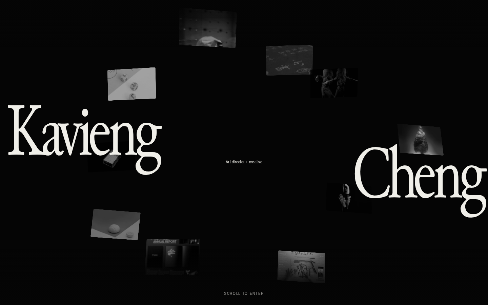

# UI Design System & Master Generation Blueprint: www-kaviengcreative-com

> **Kavieng Cheng · Art Director and Creative** (https://www.kaviengcreative.com/) — Kavieng Cheng is a Hong Kong-based art director and creative working across advertising, product, fine art and photography.



---

## 1. Executive Visual Persona & Design Archetype

- **Brand Essence & Persona**: **Kavieng Cheng · Art Director and Creative** (`https://www.kaviengcreative.com/`). Kavieng Cheng is a Hong Kong-based art director and creative working across advertising, product, fine art and photography.
- **Capture Provenance**: Live browser capture (`tier1_fast`, HTTP `200`, captured `2026-11-23`).
- **Visual Archetype**: **High-Contrast Obsidian / Atmospheric Design System (`#050505` canvas, `#f0efe9` ink, `#62625e` accent)**.
- **Anti-AI-Slop Differentiators**:
  - **Live-Computed Chromatic Polarity**: Anchors the viewport in `#050505` (live computed `body` `background-color` (`computed_styles.json`)) paired with `#f0efe9` primary typography and `#62625e` accents.
  - **Grounded Typographic Hierarchy**: Pairs `Heros` for display copy (`KAVIENG CHENG`) with `Heros` and `Junicode`.
  - **Calibrated Spatial Grid & Motion**: Combines `1440px` container bounds (`gap: 18px`, padding `24px`) with `cubic-bezier(.16,1,.3,1)` easing.

---

## 2. Spatial Architecture & Modular Grid Mathematics


### Viewport Allocation & Container Geometry
- **Captured Viewport Dimensions**: Desktop `1440×900px` (`assets/desktop.png`, single-viewport 100vh live capture (900px)), Mobile `390×844px` (`assets/mobile.png`, single-viewport 100vh live capture (844px)).
- **Master Container Bounds**: `1440px` (full-bleed `100%` desktop stage measured on `1440px` viewport).
- **Canvas Lateral Padding & Spacing**: `24px` lateral canvas padding with `18px` grid gap.
- **Border Radius Scale**: `8px`, `50%`, `5px`, `6px`.

### Responsive Breakpoint Architecture
- **Desktop Layout**: Multi-column CSS Grid / Flexbox layout at `1440px` (`max-width: 1440px`, `gap: 18px`).
- **Mobile Layout**: Single-column vertical stack at `390px` viewport width with `24px` horizontal padding.
- **Extracted CSS Media Queries**: `@media (max-width:700px)`, `@media (max-width:900px)`, `@media (prefers-reduced-motion:reduce)`, `@media (max-width:380px)`.

---

## 3. Color System, Materiality & Atmospheric Lighting

### Semantic Palette & Source Grounding
| Semantic Role | Ground-Truth Value | Extracted Live / CSS Source |
|---|---|---|
| **Primary Canvas Substrate** | `#050505` | live computed `body` `background-color` (`computed_styles.json`) |
| **Primary Typography Ink** | `#f0efe9` | live computed `h1` `color` (`computed_styles.json`) |
| **Elevated Surface / Card Substrate** | `#000000` | `html { background: black }` (`#000000`) |
| **Interactive Accent / Highlight** | `#62625e` | `.filter-projects button span:la... { color: #62625e }` |
| **Secondary / Muted Copy** | `#0a0a09` | `var(--hard-ink)` in `:root` |
| **Structural Hairline Border** | `#060606` | `var(--rule-dark)` in `:root` (`rgba(10, 10, 9, .19)`) |
| **Variable Token (`--page-grey`)** | `#c9c8c3` | `var(--page-grey)` in `:root` |
| **Variable Token (`--graphite`)** | `#8a8a84` | `var(--graphite)` in `:root` |
| **Variable Token (`--silver`)** | `#aaa9a2` | `var(--silver)` in `:root` |

### Sanitized Root CSS Variables (`ui-ux.md` Ground Truth)
| Variable Name | Extracted Value | Semantic Role |
|---|---|---|
| `--archive-black` | `#050505` | Canvas / Surface Token |
| `--paper` | `#f0efe9` | Canvas / Surface Token |
| `--page-grey` | `#c9c8c3` | Color / Atmospheric Token |
| `--hard-ink` | `#0a0a09` | Typography Ink Token |
| `--graphite` | `#8a8a84` | Color / Atmospheric Token |
| `--silver` | `#aaa9a2` | Color / Atmospheric Token |
| `--rule-dark` | `rgba(10, 10, 9, .19)` | Canvas / Surface Token |
| `--rule-light` | `rgba(240, 239, 233, .19)` | Canvas / Surface Token |
| `--gutter` | `40px` | Layout / Spatial Grid Token |
| `--perspective-blur` | `0px` | Elevation / Border Token |
| `--www-kaviengcreat-bg` | `#050505` | Canvas Substrate (from live computed `body` `background-color` (`computed_styles.json`)) |
| `--www-kaviengcreat-ink` | `#f0efe9` | Primary Typography Ink (computed-derived) |
| `--www-kaviengcreat-surface` | `#000000` | Surface Substrate (computed-derived) |
| `--www-kaviengcreat-accent` | `#62625e` | Interactive Accent (computed-derived) |
| `--www-kaviengcreat-muted` | `#0a0a09` | Secondary Ink (computed-derived) |
| `--www-kaviengcreat-border` | `#060606` | Structural Border (computed-derived) |

---

## 4. Typographic Scale & Editorial Hierarchy

### Font Family Stacks
- **Display Typography**: `Heros`.
- **Primary Body Stack**: `Heros`.
- **Technical / Metadata Stack**: `Junicode`.

### Typographic Scale & Rules (Live Computed & Stylesheet Grounded)
- **Hero Display (`H1`)**: live computed `h1` (`font-size: 18px`, `line-height: 13.68px`, `font-weight: 700`, `letter-spacing: -0.45px`); rule `h1` (`letter-spacing: -.055em`).
- **Section Heading (`H2`)**: observed font-size ladder: `18px`, `16px`, `13px`, `12px`, `11px`.
- **Body Copy**: live computed `body` (`font-size: 16px`, `line-height: normal`, `font-weight: 400`); rule `p` (`letter-spacing: -.006em`).
- **Metadata & Navigation Labels**: live computed `nav/a` (`font-size: 16px`, `line-height: normal`, `font-weight: 400`).

---

## 5. Choreographed Motion & Interaction Physics

### Primary Easing Curves
- **Extracted Timing Functions**: `cubic-bezier(.16,1,.3,1)`, `cubic-bezier(.3,1,.4,1)`.

### Per-Element Transition & Choreography Rules
- **Selector `.tile:before`**: `transition: opacity .36s cubic-bezier(.16,1,.3,1)` extracted from `www-kaviengcreative-com` stylesheet.
- **Selector `.tile img`**: `transition: filter .36s cubic-bezier(.16,1,.3,1)` extracted from `www-kaviengcreative-com` stylesheet.
- **Selector `.focus-reticle`**: `transition: opacity .18s ease` extracted from `www-kaviengcreative-com` stylesheet.
- **Extracted Easing Curve (`cubic-bezier(.16,1,.3,1)`)**: Governs interactive state transitions across `<header.archive-header>` and `<section.view-shell:nth(2)>`.
- **State & Hover Choreography**: Opacity and transform transitions on `<section.view-shell>` and `<section.view-shell:nth(2)>` interactive targets.

---

## 6. Component Wireframe & Structural DOM Map

### Visual Layout Schematic — Desktop (`1440px`, Grounded in `dom.html` & Landmark Bounding Boxes)
```
┌────────────────────────────────────────────────────────────────────────┐
│ DESKTOP VIEWPORT (1440px) — Kavieng Cheng · Art Director and Creative  │
│ ====================================================================== │
│ [ <header.archive-header (1440x66px)  | Archive · About · Awards · P ] │
│ ---------------------------------------------------------------------- │
│ | HERO STAGE: <section.view-shell> (w=1440px)                        | │
│ | H1: KAVIENG CHENG                                                  | │
│ | Substrate: #050505 | Ink: #f0efe9 | Accent: #62625e                | │
│ ---------------------------------------------------------------------- │
│ | SHOWCASE GRID (<section.view-shell:nth(2)) max-w: 1440px           | │
│ | +------------------------------+  +------------------------------+ | │
│ | | Kavieng Cheng                |  | The UN-billed Space          | | │
│ | +------------------------------+  +------------------------------+ | │
│ ---------------------------------------------------------------------- │
│ | DETAIL MODULE (<section.view-shell:nth(3)) — The Touch Annual Repo | │
│ ---------------------------------------------------------------------- │
│ [ FOOTER (<footer.loader__hint) | https://www.kaviengcreative.com/     │
└────────────────────────────────────────────────────────────────────────┘
```

### Visual Layout Schematic — Mobile Reflow (`390px`)
```
┌────────────────────────────────────────────────────────────────────────┐
│ MOBILE VIEWPORT REFLOW (390px) — Single-Column Stack (gap: 18px)       │
│ ====================================================================== │
│ [ HEADER BAR (<header.archive-header> ) | Compact Menu (390px)         │
│ ---------------------------------------------------------------------- │
│ | HERO STAGE (<section.view-shell>) — 390px Vertical Lead            | │
│ | H1: KAVIENG CHENG                                                  | │
│ ---------------------------------------------------------------------- │
│ | SHOWCASE STACK (<section.view-shell:nt) — 1-Col Stack              | │
│ | [ Item 1: Kavieng Cheng                                          ] | │
│ | [ Item 2: The UN-billed Space                                    ] | │
│ ---------------------------------------------------------------------- │
│ | DETAIL STACK (<section.view-shell:nth() — 1-Col (The Touch Annual R) │
│ ---------------------------------------------------------------------- │
│ [ FOOTER (<footer.loader__hint) | Stacked 390px Colophon               │
└────────────────────────────────────────────────────────────────────────┘
```

### Granular DOM Region Breakdown
1. **Brand Header & Navigation Bar (<header.archive-header> — `www-kaviengcreative-com`)**:
   - Landmark `<header class="archive-header">` (`1440x66px`) hosting `Kavieng Cheng · Art Director and Cre` navigation (`Archive · About · Awards · Press · Private`), DOM attributes (`data-route="archive"`, `data-route="archive"`, `data-route="about"`, `data-route="awards"`), and stylesheet rule `app { width:100%;height:100%;margin:0;overflow:hidden }`.
2. **Hero Stage & Focal Lead (<section.view-shell> — `KAVIENG CHENG`)**:
   - Landmark `<section class="view-shell">` presenting display lead `KAVIENG CHENG` and copy excerpt *"Art director + creative"* over `#050505` canvas and `#f0efe9` ink.
3. **Primary Showcase & Content Grid (<section.view-shell:nth(2)> — `Kavieng Cheng`)**:
   - Landmark `<section class="view-shell">` rendering section `Kavieng Cheng` with copy *"The UN-billed Space"*, asset references (`favicon.ico`, `favicon.svg`, `apple-touch-icon.png`, `main-C5DSeFRy.js`), and grid rule `html { background:var(--archive-black) }`.
4. **Interactive Detail & Feature Matrix (<section.view-shell:nth(3)> — `The UN-billed Space`)**:
   - Landmark `<section class="view-shell">` framing `The UN-billed Space` and `The Touch Annual Report` (*"The Touch Annual Report"*) with `#000000` surface cards, `#62625e` accents, and `body { background:var(--archive-black);color:var(--paper);font-family:Heros,Ari... }`.
5. **Colophon & Global Directory Footer (<footer.loader__hint> — `https://www.kaviengcreative.com/`)**:
   - Landmark `<footer class="loader__hint">` anchoring `Kavieng Cheng · Art Director and` footer links (`Archive · About · Awards · Press · Private`), copy *"The Cigarette Book"*, and `#060606` structural dividers.

---

## 7. Master Zero-Shot AI Generation Prompt

```markdown
# Master Zero-Shot Frontend Generation Prompt: www-kaviengcreative-com (Kavieng Cheng · Art Director and Creative)

You are a principal frontend architect and design systems engineer. Build a complete, production-ready web application replicating the exact design system, DOM landmarks, typographic hierarchy, color tokens, and motion physics of `www-kaviengcreative-com` (**Kavieng Cheng · Art Director and Creative** — `https://www.kaviengcreative.com/`).

### 1. Visual Archetype & Anti-AI-Slop Mandates
- **Archetype**: High-Contrast Obsidian / Atmospheric Design System (`#050505` canvas, `#f0efe9` ink, `#62625e` accent).
- **Identity & Domain Context**: Kavieng Cheng is a Hong Kong-based art director and creative working across advertising, product, fine art and photography.
- **Primary Substrate**: `#050505` (live computed `body` `background-color` (`computed_styles.json`)), **Primary Ink**: `#f0efe9`, **Accent / Highlight**: `#62625e`.
- **Site-Specific Differentiators**:
  - **Live-Computed Chromatic Polarity**: Anchors the viewport in `#050505` (live computed `body` `background-color` (`computed_styles.json`)) paired with `#f0efe9` primary typography and `#62625e` accents.
  - **Grounded Typographic Hierarchy**: Pairs `Heros` for display copy (`KAVIENG CHENG`) with `Heros` and `Junicode`.
  - **Calibrated Spatial Grid & Motion**: Combines `1440px` container bounds (`gap: 18px`, padding `24px`) with `cubic-bezier(.16,1,.3,1)` easing.

### 2. Ground-Truth CSS Variables (`:root` Token Contract)
Declare and consume these exact custom properties extracted from `www-kaviengcreative-com` in your global stylesheet:

:root {
  /* Kavieng Cheng · Art Director and Creative (www-kaviengcreative-com) — Live-Grounded CSS Variables */
  --archive-black: #050505; /* Canvas / Surface Token (www-kaviengcreative-com) */
  --paper: #f0efe9; /* Canvas / Surface Token (www-kaviengcreative-com) */
  --page-grey: #c9c8c3; /* Color / Atmospheric Token (www-kaviengcreative-com) */
  --hard-ink: #0a0a09; /* Typography Ink Token (www-kaviengcreative-com) */
  --graphite: #8a8a84; /* Color / Atmospheric Token (www-kaviengcreative-com) */
  --silver: #aaa9a2; /* Color / Atmospheric Token (www-kaviengcreative-com) */
  --rule-dark: rgba(10, 10, 9, .19); /* Canvas / Surface Token (www-kaviengcreative-com) */
  --rule-light: rgba(240, 239, 233, .19); /* Canvas / Surface Token (www-kaviengcreative-com) */
  --gutter: 40px; /* Layout / Spatial Grid Token (www-kaviengcreative-com) */
  --perspective-blur: 0px; /* Elevation / Border Token (www-kaviengcreative-com) */
  --www-kaviengcreat-bg: #050505; /* Canvas Substrate (from live computed `body` `background-color` (`computed_styles.json`)) (www-kaviengcreative-com) */
  --www-kaviengcreat-ink: #f0efe9; /* Primary Typography Ink (computed-derived) (www-kaviengcreative-com) */
  --www-kaviengcreat-surface: #000000; /* Surface Substrate (computed-derived) (www-kaviengcreative-com) */
  --www-kaviengcreat-accent: #62625e; /* Interactive Accent (computed-derived) (www-kaviengcreative-com) */
  --www-kaviengcreat-muted: #0a0a09; /* Secondary Ink (computed-derived) (www-kaviengcreative-com) */
  --www-kaviengcreat-border: #060606; /* Structural Border (computed-derived) (www-kaviengcreative-com) */
}

### 3. Semantic Color & Materiality Contract
Map every surface, ink, and border strictly to these source-grounded tokens:
- **Primary Canvas Substrate**: `#050505` — grounded in live computed `body` `background-color` (`computed_styles.json`)
- **Primary Typography Ink**: `#f0efe9` — grounded in live computed `h1` `color` (`computed_styles.json`)
- **Elevated Surface / Card Substrate**: `#000000` — grounded in `html { background: black }` (`#000000`)
- **Interactive Accent / Highlight**: `#62625e` — grounded in `.filter-projects button span:la... { color: #62625e }`
- **Secondary / Muted Copy**: `#0a0a09` — grounded in `var(--hard-ink)` in `:root`
- **Structural Hairline Border**: `#060606` — grounded in `var(--rule-dark)` in `:root` (`rgba(10, 10, 9, .19)`)
- **Variable Token (`--page-grey`)**: `#c9c8c3` — grounded in `var(--page-grey)` in `:root`
- **Variable Token (`--graphite`)**: `#8a8a84` — grounded in `var(--graphite)` in `:root`
- **Variable Token (`--silver`)**: `#aaa9a2` — grounded in `var(--silver)` in `:root`

### 4. Spatial Grid, Container Bounds & Responsive Breakpoints
- **Desktop Viewport Reference**: `1440×900px` (single-viewport 100vh live capture (900px), `1440px` standard desktop width).
- **Mobile Viewport Reference**: `390×844px` (single-viewport 100vh live capture (844px), `390px` standard mobile width).
- **Container Max-Width**: `1440px` (full-bleed `100%` desktop stage measured on `1440px` viewport)
- **Padding & Gutters**: `24px` lateral canvas padding with `18px` grid gap
- **Desktop Grid**: Multi-column CSS Grid / Flexbox layout at `1440px` (`max-width: 1440px`, `gap: 18px`)
- **Mobile Adaptation**: Single-column vertical stack at `390px` viewport width with `24px` horizontal padding
- **Media Queries**: `@media (max-width:700px)`, `@media (max-width:900px)`, `@media (prefers-reduced-motion:reduce)`, `@media (max-width:380px)`
- **Corner Radii**: `8px`, `50%`, `5px`, `6px`

### 5. Typography & Editorial Scale Contract
- **Display Font Stack**: `Heros`
- **Body Font Stack**: `Heros`
- **Monospace / Technical Font Stack**: `Junicode`
- **H1 Display Rule**: live computed `h1` (`font-size: 18px`, `line-height: 13.68px`, `font-weight: 700`, `letter-spacing: -0.45px`); rule `h1` (`letter-spacing: -.055em`)
- **H2 Section Rule**: observed font-size ladder: `18px`, `16px`, `13px`, `12px`, `11px`
- **Body Copy Rule**: live computed `body` (`font-size: 16px`, `line-height: normal`, `font-weight: 400`); rule `p` (`letter-spacing: -.006em`)
- **Metadata & Index Rule**: live computed `nav/a` (`font-size: 16px`, `line-height: normal`, `font-weight: 400`)

### 6. Component Hierarchy, Verbatim Copy & Real DOM Landmarks
Scaffold `www-kaviengcreative-com` (`Kavieng Cheng · Art Director and Creative`) with these exact structural regions, extracted copy, and CSS rules from `dom.html`:
1. **Brand Header & Navigation Bar (<header.archive-header> — `www-kaviengcreative-com`)**:
   - DOM & Selectors: Landmark `<header class="archive-header">` (`1440x66px`) hosting `Kavieng Cheng · Art Director and Cre` navigation (`Archive · About · Awards · Press · Private`), DOM attributes (`data-route="archive"`, `data-route="archive"`, `data-route="about"`, `data-route="awards"`), and stylesheet rule `app { width:100%;height:100%;margin:0;overflow:hidden }`.
   - Responsive Contract: Header `Brand Header & Navigation Bar (<header.archive-header> — `www-kaviengcreative-com`)` (`www-kaviengcreative-com`) adapts across `@media (max-width:700px)`, `@media (max-width:900px)`, `@media (prefers-reduced-motion:reduce)`, `@media (max-width:380px)` with `cubic-bezier(.16,1,.3,1)`, `cubic-bezier(.3,1,.4,1)` transitions and links `Archive · About · Awards · Press · Private`.
2. **Hero Stage & Focal Lead (<section.view-shell> — `KAVIENG CHENG`)**:
   - DOM & Selectors: Landmark `<section class="view-shell">` presenting display lead `KAVIENG CHENG` and copy excerpt *"Art director + creative"* over `#050505` canvas and `#f0efe9` ink.
   - Responsive Contract: Hero stage (`1440×900px` desktop / `390×844px` mobile) sets `#050505` background with `#f0efe9` headline `KAVIENG CHENG`.
3. **Primary Showcase & Content Grid (<section.view-shell:nth(2)> — `Kavieng Cheng`)**:
   - DOM & Selectors: Landmark `<section class="view-shell">` rendering section `Kavieng Cheng` with copy *"The UN-billed Space"*, asset references (`favicon.ico`, `favicon.svg`, `apple-touch-icon.png`, `main-C5DSeFRy.js`), and grid rule `html { background:var(--archive-black) }`.
   - Responsive Contract: Showcase grid `Primary Showcase & Content Grid (<section.view-shell:nth(2)> — `Kavieng Cheng`)` applies Multi-column CSS Grid / Flexbox layout at `1440px` (`max-width: 1440px`, `gap: 18px`) on desktop and Single-column vertical stack at `390px` viewport width with `24px` horizontal padding on mobile.
4. **Interactive Detail & Feature Matrix (<section.view-shell:nth(3)> — `The UN-billed Space`)**:
   - DOM & Selectors: Landmark `<section class="view-shell">` framing `The UN-billed Space` and `The Touch Annual Report` (*"The Touch Annual Report"*) with `#000000` surface cards, `#62625e` accents, and `body { background:var(--archive-black);color:var(--paper);font-family:Heros,Ari... }`.
   - Responsive Contract: Detail module `Interactive Detail & Feature Matrix (<section.view-shell:nth(3)> — `The UN-billed Space`)` uses `8px`, `50%`, `5px`, `6px` radii, `#62625e` highlights, and assets (favicon.ico, favicon.svg, apple-touch-icon.png).
5. **Colophon & Global Directory Footer (<footer.loader__hint> — `https://www.kaviengcreative.com/`)**:
   - DOM & Selectors: Landmark `<footer class="loader__hint">` anchoring `Kavieng Cheng · Art Director and` footer links (`Archive · About · Awards · Press · Private`), copy *"The Cigarette Book"*, and `#060606` structural dividers.
   - Responsive Contract: Footer `Colophon & Global Directory Footer (<footer.loader__hint> — `https://www.kaviengcreative.com/`)` aligns to `1440px` (full-bleed `100%` desktop stage measured on `1440px` viewport) with `24px` lateral canvas padding with `18px` grid gap and attributes (data-route="archive", data-route="archive", data-route="about").

#### Verbatim DOM Copy Excerpts (`dom.html`)
- Copy Excerpt 1: *"Art director + creative"*
- Copy Excerpt 2: *"The UN-billed Space"*
- Copy Excerpt 3: *"The Touch Annual Report"*
- Copy Excerpt 4: *"The Cigarette Book"*

### 7. Motion, Extracted Stylesheet Rules & Interaction Choreography
- **Primary Easing Functions**: `cubic-bezier(.16,1,.3,1)`, `cubic-bezier(.3,1,.4,1)`
- **Extracted Stylesheet Rules (`www-kaviengcreative-com`)**:
- `app { width:100%;height:100%;margin:0;overflow:hidden }`
- `html { background:var(--archive-black) }`
- `body { background:var(--archive-black);color:var(--paper);font-family:Heros,Ari... }`
- `img { max-width:100%;-webkit-user-select:none;user-select:none;-webkit-user-dr... }`
- `selection { background:var(--hard-ink);color:var(--paper) }`
- **Per-Selector Transition Rules**:
- **Selector `.tile:before`**: `transition: opacity .36s cubic-bezier(.16,1,.3,1)` extracted from `www-kaviengcreative-com` stylesheet.
- **Selector `.tile img`**: `transition: filter .36s cubic-bezier(.16,1,.3,1)` extracted from `www-kaviengcreative-com` stylesheet.
- **Selector `.focus-reticle`**: `transition: opacity .18s ease` extracted from `www-kaviengcreative-com` stylesheet.
- **Extracted Easing Curve (`cubic-bezier(.16,1,.3,1)`)**: Governs interactive state transitions across `<header.archive-header>` and `<section.view-shell:nth(2)>`.
- **State & Hover Choreography**: Opacity and transform transitions on `<section.view-shell>` and `<section.view-shell:nth(2)>` interactive targets.

### 8. Technical Deliverables
- Implement in Next.js (App Router) with TypeScript and Tailwind CSS consuming the `:root` custom properties defined above for `www-kaviengcreative-com`.
- Reproduce both the `1440px` desktop architecture and `390px` mobile breakpoint transitions, preserving semantic HTML5 landmarks (`<header>`, `<nav>`, `<main>`, `<section>`, `<footer>`) and `prefers-reduced-motion` accessibility guards.
```
