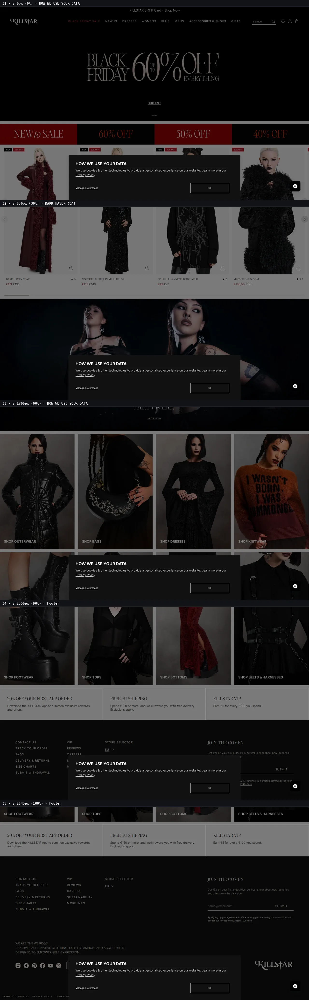
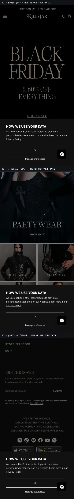

# UI Design System & Master Generation Blueprint: www-killstar-com

> **KILLSTAR** (https://www.killstar.com/) — Clothing & Lifestyle company with a twist of darkness, channeling emotional power and raw energy into every thread.





---

## 1. Executive Visual Persona & Design Archetype

- **Brand Essence & Persona**: **KILLSTAR** (`https://www.killstar.com/`). Clothing & Lifestyle company with a twist of darkness, channeling emotional power and raw energy into every thread.
- **Capture Provenance**: Live browser capture (`tier1_fast`, HTTP `200`, captured `2026-11-24`).
- **Visual Archetype**: **Light-Substrate Editorial & Modular Grid System (`#f5f5f5` canvas, `#111111` ink, `#f1c40f` accent)**.
- **Anti-AI-Slop Differentiators**:
  - **Live-Computed Chromatic Polarity**: Anchors the viewport in `#f5f5f5` (live computed `main` `background-color` (`computed_styles.json`)) paired with `#111111` primary typography and `#f1c40f` accents.
  - **Grounded Typographic Hierarchy**: Uses `Inter` across display (`Dark Haven Coat`) and body copy.
  - **Calibrated Spatial Grid & Motion**: Combines `1440px` container bounds (`gap: 4px`, padding `.75rem`) with `cubic-bezier(0.4,0,0.2,1)` easing and Swiper Touch Carousel Engine, Barba.js Page Transition Router.

---

## 2. Spatial Architecture & Modular Grid Mathematics

### Viewport Allocation & Container Geometry
- **Captured Journey Filmstrips**: Desktop `1280×4140px` (`assets/desktop-journey.webp`, `5` keyframes up to `y=2845px` / doc `3745px`), Mobile `390×2616px` (`assets/mobile-journey.webp`, `3` keyframes).
- **Master Container Bounds**: `1440px` (full-bleed `100%` desktop stage measured on `1440px` viewport).
- **Canvas Lateral Padding & Spacing**: `.75rem` lateral canvas padding with `4px` grid gap.
- **Border Radius Scale**: `5px`, `25px`, `6px`, `20%`.

### Responsive Breakpoint Architecture
- **Desktop Layout**: Multi-column CSS Grid / Flexbox layout at `1440px` (`max-width: 1440px`, `gap: 4px`).
- **Mobile Layout**: Single-column vertical stack at `390px` viewport width with `.75rem` horizontal padding.
- **Extracted CSS Media Queries**: `@media screen and (max-width:440px)`, `@media (max-width:1024px)`, `@media (max-width:768px)`, `@media (min-width:1220px)`.

---

## 3. Color System, Materiality & Atmospheric Lighting

### Semantic Palette & Source Grounding
| Semantic Role | Ground-Truth Value | Extracted Live / CSS Source |
|---|---|---|
| **Primary Canvas Substrate** | `#f5f5f5` | live computed `main` `background-color` (`computed_styles.json`) |
| **Primary Typography Ink** | `#111111` | live computed `main` `color` (`computed_styles.json`) |
| **Elevated Surface / Card Substrate** | `#faf9f8` | `var(--atlas-background-main)` in `:root` |
| **Interactive Accent / Highlight** | `#f1c40f` | `rm-box .jconfirm-buttons button... { background-color: #f1c40f }` |
| **Secondary / Muted Copy** | `#747576` | `var(--atlas-text-placeholder)` in `:root` |
| **Structural Hairline Border** | `#41a1e6` | `var(--atlas-border-focus)` in `:root` |
| **Variable Token (`--color-white`)** | `#dcdcd0` | `var(--color-white)` in `:root` |
| **Variable Token (`--color-stone`)** | `#b3ada1` | `var(--color-stone)` in `:root` |
| **Variable Token (`--color-shadow`)** | `#232323` | `var(--color-shadow)` in `:root` |
| **Variable Token (`--color-midnight-light`)** | `#3b3838` | `var(--color-midnight-light)` in `:root` |
| **Variable Token (`--color-bone`)** | `#ebebeb` | `var(--color-bone)` in `:root` |
| **Variable Token (`--color-bone-dark`)** | `#d4d4d4` | `var(--color-bone-dark)` in `:root` |
| **Variable Token (`--color-success`)** | `#32c079` | `var(--color-success)` in `:root` |
| **Variable Token (`--color-failure`)** | `#8b0910` | `var(--color-failure)` in `:root` |
| **Variable Token (`--color-warning`)** | `#ffaa33` | `var(--color-warning)` in `:root` |
| **Variable Token (`--atlas-background-content`)** | `#ffffff` | `var(--atlas-background-content)` in `:root` |
| **Variable Token (`--atlas-background-success`)** | `#518b22` | `var(--atlas-background-success)` in `:root` |
| **Variable Token (`--atlas-background-error`)** | `#be2119` | `var(--atlas-background-error)` in `:root` |
| **Variable Token (`--atlas-text-primary`)** | `#1d1e20` | `var(--atlas-text-primary)` in `:root` |

### Sanitized Root CSS Variables (`ui-ux.md` Ground Truth)
| Variable Name | Extracted Value | Semantic Role |
|---|---|---|
| `--color-white` | `#DCDCD0` | Canvas / Surface Token |
| `--color-stone` | `#B3ADA1` | Brand / Palette Token |
| `--color-midnight` | `#111` | Brand / Palette Token |
| `--color-shadow` | `#232323` | Brand / Palette Token |
| `--color-midnight-light` | `#3B3838` | Canvas / Surface Token |
| `--color-bone-light` | `#f5f5f5` | Canvas / Surface Token |
| `--color-bone` | `#ebebeb` | Brand / Palette Token |
| `--color-bone-dark` | `#d4d4d4` | Canvas / Surface Token |
| `--color-success` | `#32C079` | Brand / Palette Token |
| `--color-failure` | `#8b0910` | Brand / Palette Token |
| `--color-warning` | `#FFAA33` | Brand / Palette Token |
| `--atlas-background-main` | `#faf9f8` | Canvas / Surface Token |
| `--atlas-background-content` | `#ffffff` | Canvas / Surface Token |
| `--atlas-background-success` | `#518b22` | Canvas / Surface Token |
| `--atlas-background-error` | `#be2119` | Canvas / Surface Token |
| `--atlas-text-primary` | `#1d1e20` | Typography Ink Token |

---

## 4. Typographic Scale & Editorial Hierarchy

### Font Family Stacks
- **Display Typography**: `Inter`.
- **Primary Body Stack**: `Inter`.
- **Technical / Metadata Stack**: not declared in live computed styles (uses primary stack / `ui-monospace`).

### Typographic Scale & Rules (Live Computed & Stylesheet Grounded)
- **Hero Display (`H1`)**: CSS variables `--atlas-font-size-display: 40px`, `--atlas-line-height-display: 52px`, `--atlas-margin-display: 24px`; rule `.title` (`font-size: 13px`).
- **Section Heading (`H2`)**: CSS variables `--atlas-font-size-h2: 32px`, `--atlas-line-height-h2: 40px`, `--atlas-margin-h2: 24px`; rule `h2` (`font-size: 2.5em`, `font-weight: 900`).
- **Body Copy**: live computed `body` (`font-size: 16px`, `line-height: 20px`, `font-weight: 400`); rule `p` (`line-height: 1.6`).
- **Metadata & Navigation Labels**: live computed `nav/a` (`font-size: 16px`, `line-height: 20px`, `font-weight: 400`); CSS variables `--atlas-font-size-small: 14px`, `--atlas-line-height-small: 20px`, `--atlas-margin-small: 8px`; rule `.label` (`font-size: .875em`, `letter-spacing: 2.8px`, `font-weight: 500`).

---

## 5. Choreographed Motion & Interaction Physics

### Primary Easing Curves
- **Extracted Timing Functions**: `cubic-bezier(0.4,0,0.2,1)`, `cubic-bezier(0.34,1.15,0.64,1)`, `cubic-bezier(0.6,0,0.4,1)`.

### Per-Element Transition & Choreography Rules
- **Selector `.button`**: `transition: all .3s ease-in-out` extracted from `www-killstar-com` stylesheet.
- **Selector `.button:after`**: `transition: transform .3s ease-in-out` extracted from `www-killstar-com` stylesheet.
- **Selector `button.route-continue-without-cov...`**: `transition: all .3s ease-in-out` extracted from `www-killstar-com` stylesheet.
- **Extracted Easing Curve (`cubic-bezier(0.4,0,0.2,1)`)**: Governs interactive state transitions across `<header.shopify-section>` and `<section.section-model-image-blocks>`.
- **Runtime Interaction Engine**: Integrates Swiper Touch Carousel Engine, Barba.js Page Transition Router with `prefers-reduced-motion: reduce` fallback guards.
### Measured Runtime Scroll & Interaction Telemetry (`behavioral_journey_v2`)
- **Scroll Driver Mode**: `native` (max document height `3745px`, deepest scrollY reached `2845px` across `5` desktop keyframes).
- **Detected Scroll / Motion Libraries**: Native browser scroll / standard CSS transitions.
- **Nav / Drawer Probe**: Tested trigger `Bag` (diff `0.025`, below state-capture threshold).
- **Hover Physics (`first_card` · `section-model-image-blocks__entry`)**: Computed transition `0s` / `ease` (no static color/transform shift captured at rest).
- **Interactive Control Probe (`carousel_next` · `carousel_next`)**: Triggered visual diff `11.297` (attr ` -> `, captured in `assets/state-interactive.webp`).
- **Route Transition Architecture**: First internal navigation (`/pages/black-friday`) measured as `direct` in `4957ms`.

---

## 6. Component Wireframe & Structural DOM Map

### Visual Layout Schematic — Desktop (`1440px`, Grounded in `dom.html` & Landmark Bounding Boxes)
```
┌────────────────────────────────────────────────────────────────────────┐
│ DESKTOP VIEWPORT (1440px) — KILLSTAR                                   │
│ ====================================================================== │
│ [ <header.shopify-sectio (1440x71px)  | NEW IN · DRESSES · WOMENS ·  ] │
│ ---------------------------------------------------------------------- │
│ | HERO STAGE: <section.shopify-section> (w=1440px)                   | │
│ | H1: Dark Haven Coat                                                | │
│ | Substrate: #f5f5f5 | Ink: #111111 | Accent: #f1c40f                | │
│ ---------------------------------------------------------------------- │
│ | SHOWCASE GRID (<section.section-model-ima) max-w: 1440px           | │
│ | +------------------------------+  +------------------------------+ | │
│ | | Nocturnal Sequin Maxi Dress  |  | Spiderella Knitted Sweater   | | │
│ | +------------------------------+  +------------------------------+ | │
│ ---------------------------------------------------------------------- │
│ | DETAIL MODULE (<section.section-full-widt) — MIST OF DAWN COAT     | │
│ ---------------------------------------------------------------------- │
│ [ FOOTER (<footer.shopify-sect) | https://www.killstar.com/            │
└────────────────────────────────────────────────────────────────────────┘
```

### Visual Layout Schematic — Mobile Reflow (`390px`)
```
┌────────────────────────────────────────────────────────────────────────┐
│ MOBILE VIEWPORT REFLOW (390px) — Single-Column Stack (gap: 4px)        │
│ ====================================================================== │
│ [ HEADER BAR (<header.shopify-section>) | Compact Menu (390px)         │
│ ---------------------------------------------------------------------- │
│ | HERO STAGE (<section.shopify-section) — 390px Vertical Lead        | │
│ | H1: Dark Haven Coat                                                | │
│ ---------------------------------------------------------------------- │
│ | SHOWCASE STACK (<section.section-model) — 1-Col Stack              | │
│ | [ Item 1: Nocturnal Sequin Maxi Dress                            ] | │
│ | [ Item 2: Spiderella Knitted Sweater                             ] | │
│ ---------------------------------------------------------------------- │
│ | DETAIL STACK (<section.section-full-wi) — 1-Col (MIST OF DAWN COAT)  │
│ ---------------------------------------------------------------------- │
│ [ FOOTER (<footer.shopify-sect) | Stacked 390px Colophon               │
└────────────────────────────────────────────────────────────────────────┘
```

### Granular DOM Region Breakdown
1. **Brand Header & Navigation Bar (<header.shopify-section> — `www-killstar-com`)**:
   - Landmark `<header class="shopify-section shopify-section-group-header-group">` (`1440x71px`) hosting `KILLSTAR` navigation (`NEW IN · DRESSES · WOMENS · PLUS · MENS`), DOM attributes (`data-source-attribution="shopify.exit_intersti..."`, `data-shop-id="53907226789"`, `data-venmo-supported="false"`, `data-environment="production"`), and stylesheet rule `button { box-sizing:border-box;margin:0;padding:0 }`.
2. **Hero Stage & Focal Lead (<section.shopify-section> — `Dark Haven Coat`)**:
   - Landmark `<section class="shopify-section section-full-width-media">` presenting display lead `Dark Haven Coat` and copy excerpt *"We use cookies & other technologies to provide a personalised exp"* over `#f5f5f5` canvas and `#111111` ink.
3. **Primary Showcase & Content Grid (<section.section-model-image-blocks> — `Nocturnal Sequin Maxi Dress`)**:
   - Landmark `<section class="shopify-section section-model-image-blocks">` rendering section `Nocturnal Sequin Maxi Dress` with copy *"Please select a Size"*, asset references (`reamaze-push.js`, `tp.min.js`, `37086_1783060609.js`, `init.js`), and grid rule `section { display:block }`.
4. **Interactive Detail & Feature Matrix (<section.section-full-width-media> — `Spiderella Knitted Sweater`)**:
   - Landmark `<section class="shopify-section section-full-width-media">` framing `Spiderella Knitted Sweater` and `MIST OF DAWN COAT` (*"Please select a Colour"*) with `#faf9f8` surface cards, `#f1c40f` accents, and `table { border-collapse:collapse;border-spacing:0 }`.
5. **Colophon & Global Directory Footer (<footer.shopify-section> — `https://www.killstar.com/`)**:
   - Landmark `<footer class="shopify-section shopify-section-group-footer-group">` anchoring `KILLSTAR` footer links (`NEW IN · DRESSES · WOMENS · PLUS · MENS`), copy *"70% Polyurethane 22% Viscose 4% Polyester 2% Cotton 2% Metal"*, and `#41a1e6` structural dividers.
### Full Vertical Scroll Sequence (Desktop `1440×900` Keyframes)
- **Step 01** (`y=0px`, `0%`): Active landmark `HOW WE USE YOUR DATA` · sticky/fixed elements: `2`
- **Step 02** (`y=850px`, `30%`): Active landmark `DARK HAVEN COAT` · sticky/fixed elements: `1`
- **Step 03** (`y=1700px`, `60%`): Active landmark `HOW WE USE YOUR DATA` · sticky/fixed elements: `1`
- **Step 04** (`y=2550px`, `90%`): Active landmark `Footer` · sticky/fixed elements: `1`
- **Step 05** (`y=2845px`, `100%`): Active landmark `Footer` · sticky/fixed elements: `1`

### Multi-Page Internal Route Map
- **Detail Route (`/pages/black-friday`)**: `https://eu.killstar.com/pages/black-friday` — H1: `BLACK FRIDAY`, scrollHeight `5595px`, transition `direct` (`4957ms`)
- **Detail Route (`/collections/new`)**: `https://eu.killstar.com/collections/new` — H1: `ALL NEW IN`, scrollHeight `14493px`, transition `direct` (`3602ms`)
- **Detail Route (`/collections/womens-dresses`)**: `https://eu.killstar.com/collections/womens-dresses` — H1: `WOMENS DRESSES`, scrollHeight `14575px`, transition `direct` (`8661ms`)

---

## 7. Master Zero-Shot AI Generation Prompt

```markdown
# Master Zero-Shot Frontend Generation Prompt: www-killstar-com (KILLSTAR)

You are a principal frontend architect and design systems engineer. Build a complete, production-ready web application replicating the exact design system, DOM landmarks, typographic hierarchy, color tokens, and motion physics of `www-killstar-com` (**KILLSTAR** — `https://www.killstar.com/`).

### 1. Visual Archetype & Anti-AI-Slop Mandates
- **Archetype**: Light-Substrate Editorial & Modular Grid System (`#f5f5f5` canvas, `#111111` ink, `#f1c40f` accent).
- **Identity & Domain Context**: Clothing & Lifestyle company with a twist of darkness, channeling emotional power and raw energy into every thread.
- **Primary Substrate**: `#f5f5f5` (live computed `main` `background-color` (`computed_styles.json`)), **Primary Ink**: `#111111`, **Accent / Highlight**: `#f1c40f`.
- **Site-Specific Differentiators**:
  - **Live-Computed Chromatic Polarity**: Anchors the viewport in `#f5f5f5` (live computed `main` `background-color` (`computed_styles.json`)) paired with `#111111` primary typography and `#f1c40f` accents.
  - **Grounded Typographic Hierarchy**: Uses `Inter` across display (`Dark Haven Coat`) and body copy.
  - **Calibrated Spatial Grid & Motion**: Combines `1440px` container bounds (`gap: 4px`, padding `.75rem`) with `cubic-bezier(0.4,0,0.2,1)` easing and Swiper Touch Carousel Engine, Barba.js Page Transition Router.

### 2. Ground-Truth CSS Variables (`:root` Token Contract)
Declare and consume these exact custom properties extracted from `www-killstar-com` in your global stylesheet:

:root {
  /* KILLSTAR (www-killstar-com) — Live-Grounded CSS Variables */
  --color-white: #DCDCD0; /* Canvas / Surface Token (www-killstar-com) */
  --color-stone: #B3ADA1; /* Brand / Palette Token (www-killstar-com) */
  --color-midnight: #111; /* Brand / Palette Token (www-killstar-com) */
  --color-shadow: #232323; /* Brand / Palette Token (www-killstar-com) */
  --color-midnight-light: #3B3838; /* Canvas / Surface Token (www-killstar-com) */
  --color-bone-light: #f5f5f5; /* Canvas / Surface Token (www-killstar-com) */
  --color-bone: #ebebeb; /* Brand / Palette Token (www-killstar-com) */
  --color-bone-dark: #d4d4d4; /* Canvas / Surface Token (www-killstar-com) */
  --color-success: #32C079; /* Brand / Palette Token (www-killstar-com) */
  --color-failure: #8b0910; /* Brand / Palette Token (www-killstar-com) */
  --color-warning: #FFAA33; /* Brand / Palette Token (www-killstar-com) */
  --atlas-background-main: #faf9f8; /* Canvas / Surface Token (www-killstar-com) */
  --atlas-background-content: #ffffff; /* Canvas / Surface Token (www-killstar-com) */
  --atlas-background-success: #518b22; /* Canvas / Surface Token (www-killstar-com) */
  --atlas-background-error: #be2119; /* Canvas / Surface Token (www-killstar-com) */
  --atlas-text-primary: #1d1e20; /* Typography Ink Token (www-killstar-com) */
}

### 3. Semantic Color & Materiality Contract
Map every surface, ink, and border strictly to these source-grounded tokens:
- **Primary Canvas Substrate**: `#f5f5f5` — grounded in live computed `main` `background-color` (`computed_styles.json`)
- **Primary Typography Ink**: `#111111` — grounded in live computed `main` `color` (`computed_styles.json`)
- **Elevated Surface / Card Substrate**: `#faf9f8` — grounded in `var(--atlas-background-main)` in `:root`
- **Interactive Accent / Highlight**: `#f1c40f` — grounded in `rm-box .jconfirm-buttons button... { background-color: #f1c40f }`
- **Secondary / Muted Copy**: `#747576` — grounded in `var(--atlas-text-placeholder)` in `:root`
- **Structural Hairline Border**: `#41a1e6` — grounded in `var(--atlas-border-focus)` in `:root`
- **Variable Token (`--color-white`)**: `#dcdcd0` — grounded in `var(--color-white)` in `:root`
- **Variable Token (`--color-stone`)**: `#b3ada1` — grounded in `var(--color-stone)` in `:root`
- **Variable Token (`--color-shadow`)**: `#232323` — grounded in `var(--color-shadow)` in `:root`
- **Variable Token (`--color-midnight-light`)**: `#3b3838` — grounded in `var(--color-midnight-light)` in `:root`
- **Variable Token (`--color-bone`)**: `#ebebeb` — grounded in `var(--color-bone)` in `:root`
- **Variable Token (`--color-bone-dark`)**: `#d4d4d4` — grounded in `var(--color-bone-dark)` in `:root`
- **Variable Token (`--color-success`)**: `#32c079` — grounded in `var(--color-success)` in `:root`
- **Variable Token (`--color-failure`)**: `#8b0910` — grounded in `var(--color-failure)` in `:root`
- **Variable Token (`--color-warning`)**: `#ffaa33` — grounded in `var(--color-warning)` in `:root`
- **Variable Token (`--atlas-background-content`)**: `#ffffff` — grounded in `var(--atlas-background-content)` in `:root`
- **Variable Token (`--atlas-background-success`)**: `#518b22` — grounded in `var(--atlas-background-success)` in `:root`
- **Variable Token (`--atlas-background-error`)**: `#be2119` — grounded in `var(--atlas-background-error)` in `:root`
- **Variable Token (`--atlas-text-primary`)**: `#1d1e20` — grounded in `var(--atlas-text-primary)` in `:root`

### 4. Spatial Grid, Container Bounds & Responsive Breakpoints
- **Desktop Viewport Reference**: `1280×4140px` (multi-frame vertical journey filmstrip (4140px), `1440px` standard desktop width).
- **Mobile Viewport Reference**: `390×2616px` (multi-frame vertical journey filmstrip (2616px), `390px` standard mobile width).
- **Container Max-Width**: `1440px` (full-bleed `100%` desktop stage measured on `1440px` viewport)
- **Padding & Gutters**: `.75rem` lateral canvas padding with `4px` grid gap
- **Desktop Grid**: Multi-column CSS Grid / Flexbox layout at `1440px` (`max-width: 1440px`, `gap: 4px`)
- **Mobile Adaptation**: Single-column vertical stack at `390px` viewport width with `.75rem` horizontal padding
- **Media Queries**: `@media screen and (max-width:440px)`, `@media (max-width:1024px)`, `@media (max-width:768px)`, `@media (min-width:1220px)`
- **Corner Radii**: `5px`, `25px`, `6px`, `20%`

### 5. Typography & Editorial Scale Contract
- **Display Font Stack**: `Inter`
- **Body Font Stack**: `Inter`
- **Monospace / Technical Font Stack**: not declared in live computed styles (uses primary stack / `ui-monospace`)
- **H1 Display Rule**: CSS variables `--atlas-font-size-display: 40px`, `--atlas-line-height-display: 52px`, `--atlas-margin-display: 24px`; rule `.title` (`font-size: 13px`)
- **H2 Section Rule**: CSS variables `--atlas-font-size-h2: 32px`, `--atlas-line-height-h2: 40px`, `--atlas-margin-h2: 24px`; rule `h2` (`font-size: 2.5em`, `font-weight: 900`)
- **Body Copy Rule**: live computed `body` (`font-size: 16px`, `line-height: 20px`, `font-weight: 400`); rule `p` (`line-height: 1.6`)
- **Metadata & Index Rule**: live computed `nav/a` (`font-size: 16px`, `line-height: 20px`, `font-weight: 400`); CSS variables `--atlas-font-size-small: 14px`, `--atlas-line-height-small: 20px`, `--atlas-margin-small: 8px`; rule `.label` (`font-size: .875em`, `letter-spacing: 2.8px`, `font-weight: 500`)

### 6. Component Hierarchy, Verbatim Copy & Real DOM Landmarks
Scaffold `www-killstar-com` (`KILLSTAR`) with these exact structural regions, extracted copy, and CSS rules from `dom.html`:
1. **Brand Header & Navigation Bar (<header.shopify-section> — `www-killstar-com`)**:
   - DOM & Selectors: Landmark `<header class="shopify-section shopify-section-group-header-group">` (`1440x71px`) hosting `KILLSTAR` navigation (`NEW IN · DRESSES · WOMENS · PLUS · MENS`), DOM attributes (`data-source-attribution="shopify.exit_intersti..."`, `data-shop-id="53907226789"`, `data-venmo-supported="false"`, `data-environment="production"`), and stylesheet rule `button { box-sizing:border-box;margin:0;padding:0 }`.
   - Responsive Contract: Header `Brand Header & Navigation Bar (<header.shopify-section> — `www-killstar-com`)` (`www-killstar-com`) adapts across `@media screen and (max-width:440px)`, `@media (max-width:1024px)`, `@media (max-width:768px)`, `@media (min-width:1220px)` with `cubic-bezier(0.4,0,0.2,1)`, `cubic-bezier(0.34,1.15,0.64,1)`, `cubic-bezier(0.6,0,0.4,1)` transitions and links `NEW IN · DRESSES · WOMENS · PLUS · MENS`.
2. **Hero Stage & Focal Lead (<section.shopify-section> — `Dark Haven Coat`)**:
   - DOM & Selectors: Landmark `<section class="shopify-section section-full-width-media">` presenting display lead `Dark Haven Coat` and copy excerpt *"We use cookies & other technologies to provide a personalised exp"* over `#f5f5f5` canvas and `#111111` ink.
   - Responsive Contract: Hero stage (`1280×4140px` desktop / `390×2616px` mobile) sets `#f5f5f5` background with `#111111` headline `Dark Haven Coat`.
3. **Primary Showcase & Content Grid (<section.section-model-image-blocks> — `Nocturnal Sequin Maxi Dress`)**:
   - DOM & Selectors: Landmark `<section class="shopify-section section-model-image-blocks">` rendering section `Nocturnal Sequin Maxi Dress` with copy *"Please select a Size"*, asset references (`reamaze-push.js`, `tp.min.js`, `37086_1783060609.js`, `init.js`), and grid rule `section { display:block }`.
   - Responsive Contract: Showcase grid `Primary Showcase & Content Grid (<section.section-model-image-blocks> — `Nocturnal Sequin Maxi Dress`)` applies Multi-column CSS Grid / Flexbox layout at `1440px` (`max-width: 1440px`, `gap: 4px`) on desktop and Single-column vertical stack at `390px` viewport width with `.75rem` horizontal padding on mobile.
4. **Interactive Detail & Feature Matrix (<section.section-full-width-media> — `Spiderella Knitted Sweater`)**:
   - DOM & Selectors: Landmark `<section class="shopify-section section-full-width-media">` framing `Spiderella Knitted Sweater` and `MIST OF DAWN COAT` (*"Please select a Colour"*) with `#faf9f8` surface cards, `#f1c40f` accents, and `table { border-collapse:collapse;border-spacing:0 }`.
   - Responsive Contract: Detail module `Interactive Detail & Feature Matrix (<section.section-full-width-media> — `Spiderella Knitted Sweater`)` uses `5px`, `25px`, `6px`, `20%` radii, `#f1c40f` highlights, and assets (reamaze-push.js, tp.min.js, 37086_1783060609.js).
5. **Colophon & Global Directory Footer (<footer.shopify-section> — `https://www.killstar.com/`)**:
   - DOM & Selectors: Landmark `<footer class="shopify-section shopify-section-group-footer-group">` anchoring `KILLSTAR` footer links (`NEW IN · DRESSES · WOMENS · PLUS · MENS`), copy *"70% Polyurethane 22% Viscose 4% Polyester 2% Cotton 2% Metal"*, and `#41a1e6` structural dividers.
   - Responsive Contract: Footer `Colophon & Global Directory Footer (<footer.shopify-section> — `https://www.killstar.com/`)` aligns to `1440px` (full-bleed `100%` desktop stage measured on `1440px` viewport) with `.75rem` lateral canvas padding with `4px` grid gap and attributes (data-source-attribution="shopify.exit_intersti...", data-shop-id="53907226789", data-venmo-supported="false").

#### Verbatim DOM Copy Excerpts (`dom.html`)
- Copy Excerpt 1: *"We use cookies & other technologies to provide a personalised experience on our we..."*
- Copy Excerpt 2: *"Please select a Size"*
- Copy Excerpt 3: *"Please select a Colour"*
- Copy Excerpt 4: *"70% Polyurethane 22% Viscose 4% Polyester 2% Cotton 2% Metal fibre"*

### 7. Motion, Extracted Stylesheet Rules & Interaction Choreography
- **Primary Easing Functions**: `cubic-bezier(0.4,0,0.2,1)`, `cubic-bezier(0.34,1.15,0.64,1)`, `cubic-bezier(0.6,0,0.4,1)`
- **Extracted Stylesheet Rules (`www-killstar-com`)**:
- `button { box-sizing:border-box;margin:0;padding:0 }`
- `section { display:block }`
- `table { border-collapse:collapse;border-spacing:0 }`
- `mark { font-weight:600;font-style:inherit }`
- `var { font-style:italic;font-weight:inherit }`
- **Per-Selector Transition Rules**:
- **Selector `.button`**: `transition: all .3s ease-in-out` extracted from `www-killstar-com` stylesheet.
- **Selector `.button:after`**: `transition: transform .3s ease-in-out` extracted from `www-killstar-com` stylesheet.
- **Selector `button.route-continue-without-cov...`**: `transition: all .3s ease-in-out` extracted from `www-killstar-com` stylesheet.
- **Extracted Easing Curve (`cubic-bezier(0.4,0,0.2,1)`)**: Governs interactive state transitions across `<header.shopify-section>` and `<section.section-model-image-blocks>`.
- **Runtime Interaction Engine**: Integrates Swiper Touch Carousel Engine, Barba.js Page Transition Router with `prefers-reduced-motion: reduce` fallback guards.
### 7b. Full-Page Scroll Choreography, Interactive States & Multi-Page Routes
- **Scroll Mechanics**: Implement `native` vertical progression up to `3745px` across 5 distinct viewport chapters.
- **Vertical Chapter Sequence**: HOW WE USE YOUR DATA (0%) -> DARK HAVEN COAT (30%) -> HOW WE USE YOUR DATA (60%) -> Footer (90%) -> Footer (100%).
- **Multi-Page Routes**: Scaffold internal routes `/pages/black-friday` (detail, direct), `/collections/new` (detail, direct), `/collections/womens-dresses` (detail, direct) sharing the global header/footer shell and design tokens.

### 8. Technical Deliverables
- Implement in Next.js (App Router) with TypeScript and Tailwind CSS consuming the `:root` custom properties defined above for `www-killstar-com`.
- Reproduce both the `1440px` desktop architecture and `390px` mobile breakpoint transitions, preserving semantic HTML5 landmarks (`<header>`, `<nav>`, `<main>`, `<section>`, `<footer>`) and `prefers-reduced-motion` accessibility guards.
```
---

## 8. Full-Page Scroll Journey, Interactive States & Subpage Inventory

### Desktop Scroll Keyframes (`1440×900` WebP)
| Step | Scroll Y | Progress | Active Landmark / Section | Sticky/Fixed | Visual Asset |
| :---: | :---: | :---: | :--- | :---: | :--- |
| `#01` | `0px` | `0%` | HOW WE USE YOUR DATA | `2` | [desktop-step-01.webp](assets/desktop-step-01.webp) |
| `#02` | `850px` | `30%` | DARK HAVEN COAT | `1` | [desktop-step-02.webp](assets/desktop-step-02.webp) |
| `#03` | `1700px` | `60%` | HOW WE USE YOUR DATA | `1` | [desktop-step-03.webp](assets/desktop-step-03.webp) |
| `#04` | `2550px` | `90%` | Footer | `1` | [desktop-step-04.webp](assets/desktop-step-04.webp) |
| `#05` | `2845px` | `100%` | Footer | `1` | [desktop-step-05.webp](assets/desktop-step-05.webp) |

### Mobile Condensed Keyframes (`390×844` WebP)
| Step | Scroll Y | Progress | Active Landmark | Visual Asset |
| :---: | :---: | :---: | :--- | :--- |
| `#01` | `0px` | `0%` | HOW WE USE YOUR DATA | [mobile-step-01.webp](assets/mobile-step-01.webp) |
| `#02` | `1765px` | `50%` | HOW WE USE YOUR DATA | [mobile-step-02.webp](assets/mobile-step-02.webp) |
| `#03` | `3531px` | `100%` | HOW WE USE YOUR DATA | [mobile-step-03.webp](assets/mobile-step-03.webp) |

### Interactive UI State Captures (`1440×900` WebP)
| State Type | Trigger / Observation | Visual Asset |
| :--- | :--- | :--- |
| `interactive_control` | Control `carousel_next` (`carousel_next`, diff `11.297`) | [state-interactive.webp](assets/state-interactive.webp) |

### Internal Subpage Filmstrips (`1080px` Wide WebP)
| # | Template | Route URL | H1 / Title | Scroll Height | Transition | Filmstrip Asset |
| :-: | :---: | :--- | :--- | :---: | :---: | :--- |
| `1` | `detail` | `https://eu.killstar.com/pages/black-friday` | BLACK FRIDAY | `5595px` | `direct` (`4957ms`) | [subpage-01-pages-black-friday.webp](assets/subpage-01-pages-black-friday.webp) |
| `2` | `detail` | `https://eu.killstar.com/collections/new` | ALL NEW IN | `14493px` | `direct` (`3602ms`) | [subpage-02-collections-new.webp](assets/subpage-02-collections-new.webp) |
| `3` | `detail` | `https://eu.killstar.com/collections/womens-dresses` | WOMENS DRESSES | `14575px` | `direct` (`8661ms`) | [subpage-03-collections-womens-dresses.webp](assets/subpage-03-collections-womens-dresses.webp) |

