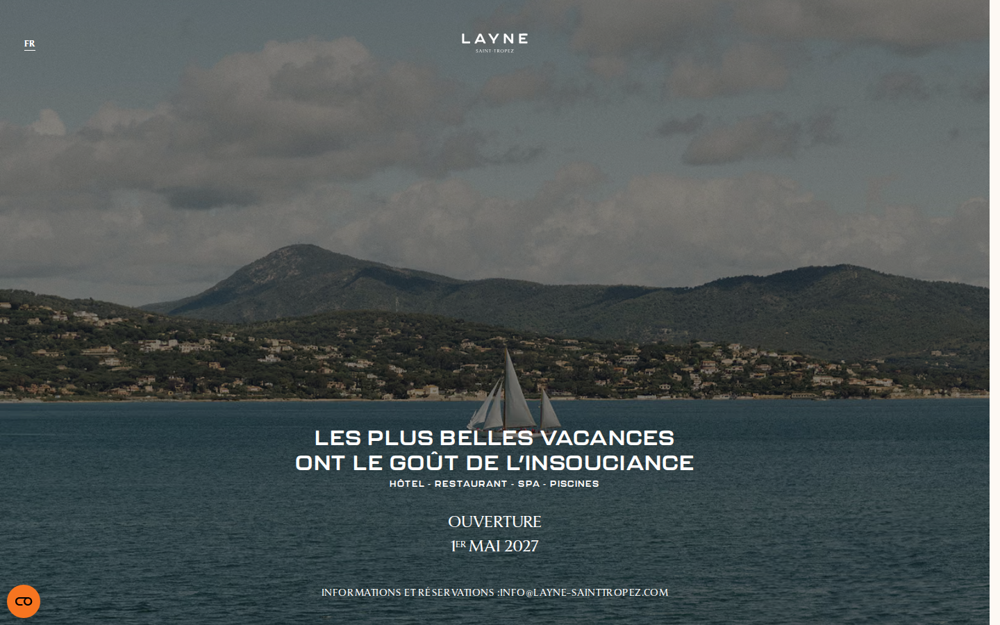
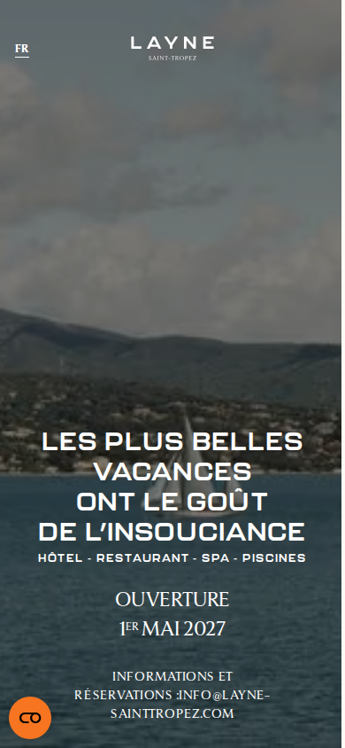

# UI Design System & Master Generation Blueprint: www-kubehotel-saint-tropez-com_fr

> **Layne Saint-Tropez, hôtel 5 étoiles : ouverture le 1er mai 2027** (https://www.kubehotel-saint-tropez.com/fr) — Face au golfe de Saint-Tropez, découvrez Layne, un nouvel hôtel 5 étoiles à Gassin. Ouverture le 1er mai 2027. Contact : info@layne-saint...



---

## 1. Executive Visual Persona & Design Archetype

- **Brand Essence & Persona**: **Layne Saint-Tropez, hôtel 5 étoiles : ouverture le 1er mai 2027** (`https://www.kubehotel-saint-tropez.com/fr`). Face au golfe de Saint-Tropez, découvrez Layne, un nouvel hôtel 5 étoiles à Gassin. Ouverture le 1er mai 2027. Contact : info@layne-saint...
- **Final Redirected URL**: [https://www.layne-sainttropez.com/fr](https://www.layne-sainttropez.com/fr)
- **Capture Provenance**: Live browser capture (`tier1_fast`, HTTP `200`, captured `2026-11-23`).
- **Visual Archetype**: **Light-Substrate Editorial & Modular Grid System (`#fdf9f4` canvas, `#000000` ink, `#0082f3` accent)**.
- **Anti-AI-Slop Differentiators**:
  - **Live-Computed Chromatic Polarity**: Anchors the viewport in `#fdf9f4` (live computed `body` `background-color` (`computed_styles.json`)) paired with `#000000` primary typography and `#0082f3` accents.
  - **Grounded Typographic Hierarchy**: Pairs `Kallisto` for display copy (`LES PLUS BELLES VACANCES ONT LE GOÛT`) with `Anth` and not declared in live computed styles (uses primary stack / `ui-monospace`).
  - **Calibrated Spatial Grid & Motion**: Combines `100vw` container bounds (`gap: 16px`, padding `9px`) with `cubic-bezier(.175,.885,.32,1.275)` easing and Lenis Smooth Scroll (`data-lenis`), GSAP Timeline & ScrollTrigger.

---

## 2. Spatial Architecture & Modular Grid Mathematics



### Viewport Allocation & Container Geometry
- **Captured Viewport Dimensions**: Desktop `1440×900px` (`assets/desktop.png`, single-viewport 100vh live capture (900px)), Mobile `390×844px` (`assets/mobile.png`, single-viewport 100vh live capture (844px)).
- **Master Container Bounds**: `100vw` (non-`@media` desktop container stylesheet rule).
- **Canvas Lateral Padding & Spacing**: `9px` lateral canvas padding with `16px` grid gap.
- **Border Radius Scale**: `50%`, `10px`, `3px`, `100%`.

### Responsive Breakpoint Architecture
- **Desktop Layout**: Multi-column CSS Grid / Flexbox layout at `1440px` (`max-width: 100vw`, `gap: 16px`).
- **Mobile Layout**: Single-column vertical stack at `390px` viewport width with `9px` horizontal padding.
- **Extracted CSS Media Queries**: `@media screen and (max-width:991px)`, `@media screen and (max-width:767px)`, `@media screen and (max-width:479px)`, `@media (min-width:768px)`.

---

## 3. Color System, Materiality & Atmospheric Lighting

### Semantic Palette & Source Grounding
| Semantic Role | Ground-Truth Value | Extracted Live / CSS Source |
|---|---|---|
| **Primary Canvas Substrate** | `#fdf9f4` | live computed `body` `background-color` (`computed_styles.json`) |
| **Primary Typography Ink** | `#000000` | live computed `main` `color` (`computed_styles.json`) |
| **Elevated Surface / Card Substrate** | `#ffff00` | `mark { background: #ffff00 }` |
| **Interactive Accent / Highlight** | `#0082f3` | `.w-dropdown-link.w--current { color: #0082f3 }` |
| **Secondary / Muted Copy** | `#ffffff` | live computed `p` `color` (`computed_styles.json`) |
| **Structural Hairline Border** | `#e2e2e2` | `blockquote { border-left: #e2e2e2 }` |

### Sanitized Root CSS Variables (`ui-ux.md` Ground Truth)
| Variable Name | Extracted Value | Semantic Role |
|---|---|---|
| `--_theme---background` | `var(--swatch--beige)` | Canvas / Surface Token |
| `--_text-style---font-family` | `var(--_typography---font--primary-family)` | Typography Ink Token |
| `--_theme---text` | `var(--swatch--black)` | Typography Ink Token |
| `--_text-style---font-size` | `var(--_typography---font-size--text-main)` | Typography Ink Token |
| `--_text-style---line-height` | `var(--_typography---line-height--large)` | Typography Ink Token |
| `--_text-style---font-weight` | `var(--_typography---font--primary-light)` | Typography Ink Token |
| `--_text-style---letter-spacing` | `var(--_typography---letter-spacing--tight)` | Typography Ink Token |
| `--radius--main` | `.5rem` | Elevation / Border Token |
| `--_theme---background-2` | `var(--swatch--beige-2)` | Canvas / Surface Token |
| `--site--column-count` | `12` | Layout / Spatial Grid Token |
| `--_responsive---large` | `1` | Design System Custom Token |
| `--_responsive---medium` | `0` | Design System Custom Token |
| `--_responsive---small` | `0` | Design System Custom Token |
| `--_responsive---xsmall` | `0` | Design System Custom Token |
| `--max-width--small` | `calc(var(--site--viewport-max)*1rem)` | Layout / Spatial Grid Token |
| `--_gap---size` | `var(--site--gutter)` | Layout / Spatial Grid Token |

---

## 4. Typographic Scale & Editorial Hierarchy

### Font Family Stacks
- **Display Typography**: `Kallisto`.
- **Primary Body Stack**: `Anth`.
- **Technical / Metadata Stack**: not declared in live computed styles (uses primary stack / `ui-monospace`).

### Typographic Scale & Rules (Live Computed & Stylesheet Grounded)
- **Hero Display (`H1`)**: live computed `h1` (`font-size: 30.3333px`, `line-height: normal`, `font-weight: 700`, `letter-spacing: 1.21333px`); rule `h1` (`font-size: var(--_text-style---font-size)`, `line-height: var(--_text-style---l...`, `letter-spacing: var(--_text-style---l...`, `font-weight: var(--_text-s...`).
- **Section Heading (`H2`)**: rule `h2` (`font-size: var(--_text-style---font-size)`, `line-height: var(--_text-style---l...`, `letter-spacing: var(--_text-style---l...`, `font-weight: var(--_text-s...`).
- **Body Copy**: live computed `body` (`font-size: 14px`, `line-height: 21px`, `font-weight: 300`, `letter-spacing: -0.28px`); rule `p` (`line-height: var(--_typography---l...`).
- **Metadata & Navigation Labels**: live computed `nav/a` (`font-size: 14px`, `line-height: 21px`, `font-weight: 300`, `letter-spacing: -0.28px`); CSS variables `--_text-style---letter-spacing: var(--_typography---letter-spacing--tight)`, `--_responsive---small: 0`, `--_responsive---xsmall: 0`.

---

## 5. Choreographed Motion & Interaction Physics

### Primary Easing Curves
- **Extracted Timing Functions**: `cubic-bezier(.175,.885,.32,1.275)`.

### Per-Element Transition & Choreography Rules
- **Selector `.swiper-pagination`**: `transition: .3s opacity` extracted from `www-kubehotel-saint-tropez-com_fr` stylesheet.
- **Selector `n-bullets-dynamic .swiper-paginat...`**: `transition: .2s transform,.2s top` extracted from `www-kubehotel-saint-tropez-com_fr` stylesheet.
- **Selector `n-bullets-dynamic .swiper-paginat...`**: `transition: .2s transform,.2s left` extracted from `www-kubehotel-saint-tropez-com_fr` stylesheet.
- **Extracted Easing Curve (`cubic-bezier(.175,.885,.32,1.275)`)**: Governs interactive state transitions across `<header.hero_header_wrap>` and `<section.u-section>`.
- **Runtime Interaction Engine**: Integrates Lenis Smooth Scroll (`data-lenis`), GSAP Timeline & ScrollTrigger, Swiper Touch Carousel Engine with `prefers-reduced-motion: reduce` fallback guards.

---

## 6. Component Wireframe & Structural DOM Map

### Visual Layout Schematic — Desktop (`1440px`, Grounded in `dom.html` & Landmark Bounding Boxes)
```
┌────────────────────────────────────────────────────────────────────────┐
│ DESKTOP VIEWPORT (1440px) — Layne Saint-Tropez, hôtel 5 étoiles : ouve │
│ ====================================================================== │
│ [ <header.hero_header_wr (1356x40px)  | fr · en · it · ru            ] │
│ ---------------------------------------------------------------------- │
│ | HERO STAGE: <section.hero_wrap> (w=1425px)                         | │
│ | H1: LES PLUS BELLES VACANCES ONT LE GOÛT DE L’INSOUCI...           | │
│ | Substrate: #fdf9f4 | Ink: #000000 | Accent: #0082f3                | │
│ ---------------------------------------------------------------------- │
│ | SHOWCASE GRID (<section.u-section>) max-w: 100vw                   | │
│ | +------------------------------+  +------------------------------+ | │
│ | | Les plus belles vacances ont |  | Hôtel - Restaurant - Spa - P | | │
│ | +------------------------------+  +------------------------------+ | │
│ ---------------------------------------------------------------------- │
│ | DETAIL MODULE (<section.u-theme-dark>) — Ouverture 1 er mai 20     | │
│ ---------------------------------------------------------------------- │
│ [ FOOTER (<footer.CybotCookieb) | https://www.kubehotel-saint-tropez.  │
└────────────────────────────────────────────────────────────────────────┘
```

### Visual Layout Schematic — Mobile Reflow (`390px`)
```
┌────────────────────────────────────────────────────────────────────────┐
│ MOBILE VIEWPORT REFLOW (390px) — Single-Column Stack (gap: 16px)       │
│ ====================================================================== │
│ [ HEADER BAR (<header.hero_header_wrap) | Compact Menu (390px)         │
│ ---------------------------------------------------------------------- │
│ | HERO STAGE (<section.hero_wrap>) — 390px Vertical Lead             | │
│ | H1: LES PLUS BELLES VACANCES ONT LE GOÛT DE L’INSOUCI...           | │
│ ---------------------------------------------------------------------- │
│ | SHOWCASE STACK (<section.u-section>) — 1-Col Stack                 | │
│ | [ Item 1: Les plus belles vacances ont le goût de l’insouci...   ] | │
│ | [ Item 2: Hôtel - Restaurant - Spa - Piscines                    ] | │
│ ---------------------------------------------------------------------- │
│ | DETAIL STACK (<section.u-theme-dark>) — 1-Col (Ouverture 1 er mai) | │
│ ---------------------------------------------------------------------- │
│ [ FOOTER (<footer.CybotCookieb) | Stacked 390px Colophon               │
└────────────────────────────────────────────────────────────────────────┘
```

### Granular DOM Region Breakdown
1. **Brand Header & Navigation Bar (<header.hero_header_wrap> — `www-kubehotel-saint-tropez-com_fr`)**:
   - Landmark `<header class="hero_header_wrap">` (`1356x40px`) hosting `Layne Saint-Tropez, hôtel 5 étoiles ` navigation (`fr · en · it · ru`), DOM attributes (`data-wf-domain="www.layne-sainttropez..."`, `data-wf-page="69c122f05101301b0245c797"`, `data-wf-site="69c122f05101301b0245c7c6"`, `data-nosnippet`), and stylesheet rule `root { --swiper-theme-color:007aff }`.
2. **Hero Stage & Focal Lead (<section.hero_wrap> — `LES PLUS BELLES VACANCES ONT LE GO`)**:
   - Landmark `<section class="hero_wrap u-section">` presenting display lead `LES PLUS BELLES VACANCES ONT LE GOÛT DE L’INSOUCI...` and copy excerpt *"HÔTEL - RESTAURANT - SPA - PISCINES"* over `#fdf9f4` canvas and `#000000` ink.
3. **Primary Showcase & Content Grid (<section.u-section> — `Les plus belles vacances ont le go`)**:
   - Landmark `<section class="hero_wrap u-section">` rendering section `Les plus belles vacances ont le goût de l’insouci...` with copy *"Hôtel - Restaurant - Spa - Piscines"*, asset references (`cdn.prod.website-files.com`, `layne-sainttropez.webflow.shared....`, `state.js`, `widgetIcon.min.js`), and grid rule `.swiper { margin-left:auto;margin-right:auto;position:relative;overflow:hidden;lis... }`.
4. **Interactive Detail & Feature Matrix (<section.u-theme-dark> — `Hôtel - Restaurant - Spa - Piscine`)**:
   - Landmark `<section class="hero_wrap u-section">` framing `Hôtel - Restaurant - Spa - Piscines` and `Ouverture 1 er mai 2027` (*"Ouverture 1 er mai 2027"*) with `#ffff00` surface cards, `#0082f3` accents, and `.swiper-vertical>.swiper-wrapper { flex-direction:column }`.
5. **Colophon & Global Directory Footer (<footer.CybotCookiebotDialogContentWrapper> — `https://www.kubehotel-saint-tropez.com/fr`)**:
   - Landmark `<footer class="CybotCookiebotDialogContentWrapper">` anchoring `Layne Saint-Tropez, hôtel 5 étoi` footer links (`fr · en · it · ru`), copy *"Informations et réservations : info@layne-sainttropez.com"*, and `#e2e2e2` structural dividers.

---

## 7. Master Zero-Shot AI Generation Prompt

```markdown
# Master Zero-Shot Frontend Generation Prompt: www-kubehotel-saint-tropez-com_fr (Layne Saint-Tropez, hôtel 5 étoiles : ouverture le 1er mai 2027)

You are a principal frontend architect and design systems engineer. Build a complete, production-ready web application replicating the exact design system, DOM landmarks, typographic hierarchy, color tokens, and motion physics of `www-kubehotel-saint-tropez-com_fr` (**Layne Saint-Tropez, hôtel 5 étoiles : ouverture le 1er mai 2027** — `https://www.kubehotel-saint-tropez.com/fr`).

### 1. Visual Archetype & Anti-AI-Slop Mandates
- **Archetype**: Light-Substrate Editorial & Modular Grid System (`#fdf9f4` canvas, `#000000` ink, `#0082f3` accent).
- **Identity & Domain Context**: Face au golfe de Saint-Tropez, découvrez Layne, un nouvel hôtel 5 étoiles à Gassin. Ouverture le 1er mai 2027. Contact : info@layne-saint...
- **Primary Substrate**: `#fdf9f4` (live computed `body` `background-color` (`computed_styles.json`)), **Primary Ink**: `#000000`, **Accent / Highlight**: `#0082f3`.
- **Site-Specific Differentiators**:
  - **Live-Computed Chromatic Polarity**: Anchors the viewport in `#fdf9f4` (live computed `body` `background-color` (`computed_styles.json`)) paired with `#000000` primary typography and `#0082f3` accents.
  - **Grounded Typographic Hierarchy**: Pairs `Kallisto` for display copy (`LES PLUS BELLES VACANCES ONT LE GOÛT`) with `Anth` and not declared in live computed styles (uses primary stack / `ui-monospace`).
  - **Calibrated Spatial Grid & Motion**: Combines `100vw` container bounds (`gap: 16px`, padding `9px`) with `cubic-bezier(.175,.885,.32,1.275)` easing and Lenis Smooth Scroll (`data-lenis`), GSAP Timeline & ScrollTrigger.

### 2. Ground-Truth CSS Variables (`:root` Token Contract)
Declare and consume these exact custom properties extracted from `www-kubehotel-saint-tropez-com_fr` in your global stylesheet:

:root {
  /* Layne Saint-Tropez, hôtel 5 étoiles : ouverture le 1er mai 2027 (www-kubehotel-saint-tropez-com_fr) — Live-Grounded CSS Variables */
  --_theme---background: var(--swatch--beige); /* Canvas / Surface Token (www-kubehotel-saint-tropez-com_fr) */
  --_text-style---font-family: var(--_typography---font--primary-family); /* Typography Ink Token (www-kubehotel-saint-tropez-com_fr) */
  --_theme---text: var(--swatch--black); /* Typography Ink Token (www-kubehotel-saint-tropez-com_fr) */
  --_text-style---font-size: var(--_typography---font-size--text-main); /* Typography Ink Token (www-kubehotel-saint-tropez-com_fr) */
  --_text-style---line-height: var(--_typography---line-height--large); /* Typography Ink Token (www-kubehotel-saint-tropez-com_fr) */
  --_text-style---font-weight: var(--_typography---font--primary-light); /* Typography Ink Token (www-kubehotel-saint-tropez-com_fr) */
  --_text-style---letter-spacing: var(--_typography---letter-spacing--tight); /* Typography Ink Token (www-kubehotel-saint-tropez-com_fr) */
  --radius--main: .5rem; /* Elevation / Border Token (www-kubehotel-saint-tropez-com_fr) */
  --_theme---background-2: var(--swatch--beige-2); /* Canvas / Surface Token (www-kubehotel-saint-tropez-com_fr) */
  --site--column-count: 12; /* Layout / Spatial Grid Token (www-kubehotel-saint-tropez-com_fr) */
  --_responsive---large: 1; /* Design System Custom Token (www-kubehotel-saint-tropez-com_fr) */
  --_responsive---medium: 0; /* Design System Custom Token (www-kubehotel-saint-tropez-com_fr) */
  --_responsive---small: 0; /* Design System Custom Token (www-kubehotel-saint-tropez-com_fr) */
  --_responsive---xsmall: 0; /* Design System Custom Token (www-kubehotel-saint-tropez-com_fr) */
  --max-width--small: calc(var(--site--viewport-max)*1rem); /* Layout / Spatial Grid Token (www-kubehotel-saint-tropez-com_fr) */
  --_gap---size: var(--site--gutter); /* Layout / Spatial Grid Token (www-kubehotel-saint-tropez-com_fr) */
}

### 3. Semantic Color & Materiality Contract
Map every surface, ink, and border strictly to these source-grounded tokens:
- **Primary Canvas Substrate**: `#fdf9f4` — grounded in live computed `body` `background-color` (`computed_styles.json`)
- **Primary Typography Ink**: `#000000` — grounded in live computed `main` `color` (`computed_styles.json`)
- **Elevated Surface / Card Substrate**: `#ffff00` — grounded in `mark { background: #ffff00 }`
- **Interactive Accent / Highlight**: `#0082f3` — grounded in `.w-dropdown-link.w--current { color: #0082f3 }`
- **Secondary / Muted Copy**: `#ffffff` — grounded in live computed `p` `color` (`computed_styles.json`)
- **Structural Hairline Border**: `#e2e2e2` — grounded in `blockquote { border-left: #e2e2e2 }`

### 4. Spatial Grid, Container Bounds & Responsive Breakpoints
- **Desktop Viewport Reference**: `1440×900px` (single-viewport 100vh live capture (900px), `1440px` standard desktop width).
- **Mobile Viewport Reference**: `390×844px` (single-viewport 100vh live capture (844px), `390px` standard mobile width).
- **Container Max-Width**: `100vw` (non-`@media` desktop container stylesheet rule)
- **Padding & Gutters**: `9px` lateral canvas padding with `16px` grid gap
- **Desktop Grid**: Multi-column CSS Grid / Flexbox layout at `1440px` (`max-width: 100vw`, `gap: 16px`)
- **Mobile Adaptation**: Single-column vertical stack at `390px` viewport width with `9px` horizontal padding
- **Media Queries**: `@media screen and (max-width:991px)`, `@media screen and (max-width:767px)`, `@media screen and (max-width:479px)`, `@media (min-width:768px)`
- **Corner Radii**: `50%`, `10px`, `3px`, `100%`

### 5. Typography & Editorial Scale Contract
- **Display Font Stack**: `Kallisto`
- **Body Font Stack**: `Anth`
- **Monospace / Technical Font Stack**: not declared in live computed styles (uses primary stack / `ui-monospace`)
- **H1 Display Rule**: live computed `h1` (`font-size: 30.3333px`, `line-height: normal`, `font-weight: 700`, `letter-spacing: 1.21333px`); rule `h1` (`font-size: var(--_text-style---font-size)`, `line-height: var(--_text-style---l...`, `letter-spacing: var(--_text-style---l...`, `font-weight: var(--_text-s...`)
- **H2 Section Rule**: rule `h2` (`font-size: var(--_text-style---font-size)`, `line-height: var(--_text-style---l...`, `letter-spacing: var(--_text-style---l...`, `font-weight: var(--_text-s...`)
- **Body Copy Rule**: live computed `body` (`font-size: 14px`, `line-height: 21px`, `font-weight: 300`, `letter-spacing: -0.28px`); rule `p` (`line-height: var(--_typography---l...`)
- **Metadata & Index Rule**: live computed `nav/a` (`font-size: 14px`, `line-height: 21px`, `font-weight: 300`, `letter-spacing: -0.28px`); CSS variables `--_text-style---letter-spacing: var(--_typography---letter-spacing--tight)`, `--_responsive---small: 0`, `--_responsive---xsmall: 0`

### 6. Component Hierarchy, Verbatim Copy & Real DOM Landmarks
Scaffold `www-kubehotel-saint-tropez-com_fr` (`Layne Saint-Tropez, hôtel 5 étoiles : ouverture le 1er mai 2027`) with these exact structural regions, extracted copy, and CSS rules from `dom.html`:
1. **Brand Header & Navigation Bar (<header.hero_header_wrap> — `www-kubehotel-saint-tropez-com_fr`)**:
   - DOM & Selectors: Landmark `<header class="hero_header_wrap">` (`1356x40px`) hosting `Layne Saint-Tropez, hôtel 5 étoiles ` navigation (`fr · en · it · ru`), DOM attributes (`data-wf-domain="www.layne-sainttropez..."`, `data-wf-page="69c122f05101301b0245c797"`, `data-wf-site="69c122f05101301b0245c7c6"`, `data-nosnippet`), and stylesheet rule `root { --swiper-theme-color:007aff }`.
   - Responsive Contract: Header `Brand Header & Navigation Bar (<header.hero_header_wrap> — `www-kubehotel-saint-tropez-com_fr`)` (`www-kubehotel-saint-tropez-com_fr`) adapts across `@media screen and (max-width:991px)`, `@media screen and (max-width:767px)`, `@media screen and (max-width:479px)`, `@media (min-width:768px)` with `cubic-bezier(.175,.885,.32,1.275)` transitions and links `fr · en · it · ru`.
2. **Hero Stage & Focal Lead (<section.hero_wrap> — `LES PLUS BELLES VACANCES ONT LE GO`)**:
   - DOM & Selectors: Landmark `<section class="hero_wrap u-section">` presenting display lead `LES PLUS BELLES VACANCES ONT LE GOÛT DE L’INSOUCI...` and copy excerpt *"HÔTEL - RESTAURANT - SPA - PISCINES"* over `#fdf9f4` canvas and `#000000` ink.
   - Responsive Contract: Hero stage (`1440×900px` desktop / `390×844px` mobile) sets `#fdf9f4` background with `#000000` headline `LES PLUS BELLES VACANCES ONT LE GOÛT DE L’INSOUCI...`.
3. **Primary Showcase & Content Grid (<section.u-section> — `Les plus belles vacances ont le go`)**:
   - DOM & Selectors: Landmark `<section class="hero_wrap u-section">` rendering section `Les plus belles vacances ont le goût de l’insouci...` with copy *"Hôtel - Restaurant - Spa - Piscines"*, asset references (`cdn.prod.website-files.com`, `layne-sainttropez.webflow.shared....`, `state.js`, `widgetIcon.min.js`), and grid rule `.swiper { margin-left:auto;margin-right:auto;position:relative;overflow:hidden;lis... }`.
   - Responsive Contract: Showcase grid `Primary Showcase & Content Grid (<section.u-section> — `Les plus belles vacances ont le go`)` applies Multi-column CSS Grid / Flexbox layout at `1440px` (`max-width: 100vw`, `gap: 16px`) on desktop and Single-column vertical stack at `390px` viewport width with `9px` horizontal padding on mobile.
4. **Interactive Detail & Feature Matrix (<section.u-theme-dark> — `Hôtel - Restaurant - Spa - Piscine`)**:
   - DOM & Selectors: Landmark `<section class="hero_wrap u-section">` framing `Hôtel - Restaurant - Spa - Piscines` and `Ouverture 1 er mai 2027` (*"Ouverture 1 er mai 2027"*) with `#ffff00` surface cards, `#0082f3` accents, and `.swiper-vertical>.swiper-wrapper { flex-direction:column }`.
   - Responsive Contract: Detail module `Interactive Detail & Feature Matrix (<section.u-theme-dark> — `Hôtel - Restaurant - Spa - Piscine`)` uses `50%`, `10px`, `3px`, `100%` radii, `#0082f3` highlights, and assets (cdn.prod.website-files.com, layne-sainttropez.webflow.shared...., state.js).
5. **Colophon & Global Directory Footer (<footer.CybotCookiebotDialogContentWrapper> — `https://www.kubehotel-saint-tropez.com/fr`)**:
   - DOM & Selectors: Landmark `<footer class="CybotCookiebotDialogContentWrapper">` anchoring `Layne Saint-Tropez, hôtel 5 étoi` footer links (`fr · en · it · ru`), copy *"Informations et réservations : info@layne-sainttropez.com"*, and `#e2e2e2` structural dividers.
   - Responsive Contract: Footer `Colophon & Global Directory Footer (<footer.CybotCookiebotDialogContentWrapper> — `https://www.kubehotel-saint-tropez.com/fr`)` aligns to `100vw` (non-`@media` desktop container stylesheet rule) with `9px` lateral canvas padding with `16px` grid gap and attributes (data-wf-domain="www.layne-sainttropez...", data-wf-page="69c122f05101301b0245c797", data-wf-site="69c122f05101301b0245c7c6").

#### Verbatim DOM Copy Excerpts (`dom.html`)
- Copy Excerpt 1: *"HÔTEL - RESTAURANT - SPA - PISCINES"*
- Copy Excerpt 2: *"Hôtel - Restaurant - Spa - Piscines"*
- Copy Excerpt 3: *"Ouverture 1 er mai 2027"*
- Copy Excerpt 4: *"Informations et réservations : info@layne-sainttropez.com"*

### 7. Motion, Extracted Stylesheet Rules & Interaction Choreography
- **Primary Easing Functions**: `cubic-bezier(.175,.885,.32,1.275)`
- **Extracted Stylesheet Rules (`www-kubehotel-saint-tropez-com_fr`)**:
- `root { --swiper-theme-color:007aff }`
- `.swiper { margin-left:auto;margin-right:auto;position:relative;overflow:hidden;lis... }`
- `.swiper-vertical>.swiper-wrapper { flex-direction:column }`
- `.swiper-wrapper { position:relative;width:100%;height:100%;z-index:1;display:flex;transiti... }`
- `.swiper-pointer-events { touch-action:pan-y }`
- **Per-Selector Transition Rules**:
- **Selector `.swiper-pagination`**: `transition: .3s opacity` extracted from `www-kubehotel-saint-tropez-com_fr` stylesheet.
- **Selector `n-bullets-dynamic .swiper-paginat...`**: `transition: .2s transform,.2s top` extracted from `www-kubehotel-saint-tropez-com_fr` stylesheet.
- **Selector `n-bullets-dynamic .swiper-paginat...`**: `transition: .2s transform,.2s left` extracted from `www-kubehotel-saint-tropez-com_fr` stylesheet.
- **Extracted Easing Curve (`cubic-bezier(.175,.885,.32,1.275)`)**: Governs interactive state transitions across `<header.hero_header_wrap>` and `<section.u-section>`.
- **Runtime Interaction Engine**: Integrates Lenis Smooth Scroll (`data-lenis`), GSAP Timeline & ScrollTrigger, Swiper Touch Carousel Engine with `prefers-reduced-motion: reduce` fallback guards.

### 8. Technical Deliverables
- Implement in Next.js (App Router) with TypeScript and Tailwind CSS consuming the `:root` custom properties defined above for `www-kubehotel-saint-tropez-com_fr`.
- Reproduce both the `1440px` desktop architecture and `390px` mobile breakpoint transitions, preserving semantic HTML5 landmarks (`<header>`, `<nav>`, `<main>`, `<section>`, `<footer>`) and `prefers-reduced-motion` accessibility guards.
```
