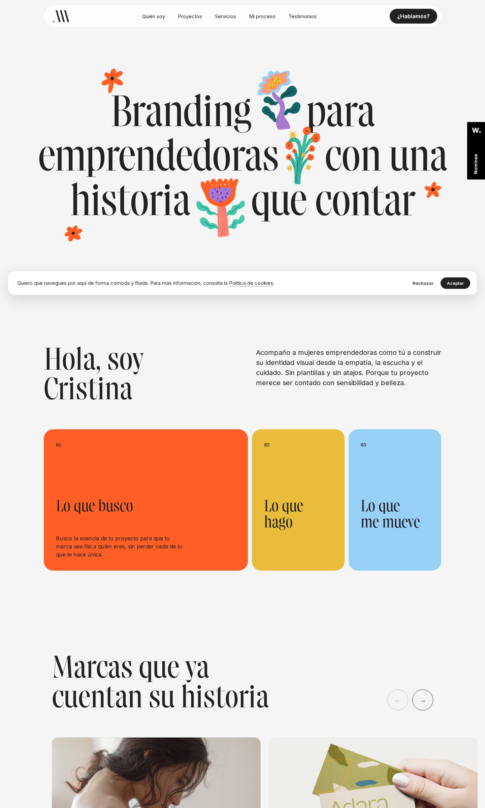

# UI Design System & Master Generation Blueprint: www-lamagadan-studio

> **La Magadán · Branding y diseño para emprendedoras** (https://www.lamagadan.studio/) — Soy Cristina, diseñadora y creativa en La Magadán. Ayudo a emprendedoras como tú a crear marcas que conectan, destacan y venden.



---

## 1. Executive Visual Persona & Design Archetype

- **Brand Essence & Persona**: **La Magadán · Branding y diseño para emprendedoras** (`https://www.lamagadan.studio/`). Soy Cristina, diseñadora y creativa en La Magadán. Ayudo a emprendedoras como tú a crear marcas que conectan, destacan y venden.
- **Visual Archetype**: **High-Contrast Obsidian / Atmospheric Design System (`#b00020` canvas, `#fff` ink, `#222` accent)**.
- **Anti-AI-Slop Differentiators**:
  - **Source-Grounded Chromatic Polarity**: Anchors the viewport in `#b00020` (`.sc-logic-error { background: #b00020 }`) paired with `#fff` primary typography and `#222` accents.
  - **Extracted Typographic Hierarchy**: Pairs `Instrument Serif` for display copy (`Branding para emprendedoras con una `) with `Inter` and `Geist Mono`.
  - **Calibrated Spatial Grid & Motion**: Combines `60ch` container bounds (`gap: 16px`, padding `4px`) with `cubic-bezier(0.4,0,0.2,1)` easing.

---

## 2. Spatial Architecture & Modular Grid Mathematics


### Viewport Allocation & Container Geometry
- **Captured Viewport Dimensions**: Desktop `1440×11027px` (`assets/desktop.png`, full-page scroll capture), Mobile `390×2400px` (`assets/mobile.png`, capped at 2400px multi-section capture).
- **Master Container Bounds**: `60ch` extracted from `www-lamagadan-studio` stylesheet.
- **Canvas Lateral Padding & Spacing**: `4px` lateral canvas padding with `16px` grid gap.
- **Border Radius Scale**: `2px`, `3px`, `4px`, `999px`.

### Responsive Breakpoint Architecture
- **Desktop Layout**: Multi-column CSS Grid / Flexbox layout at `1440px` (`max-width: 60ch`, `gap: 16px`).
- **Mobile Layout**: Single-column vertical stack at `390px` viewport width with `4px` horizontal padding.
- **Extracted CSS Media Queries**: `@media (prefers-reduced-motion:reduce)`.

---

## 3. Color System, Materiality & Atmospheric Lighting

### Semantic Palette & Source Grounding
| Semantic Role | Ground-Truth Value | Extracted CSS Source / Selector |
|---|---|---|
| **Primary Canvas Substrate** | `#b00020` | `.sc-logic-error { background: #b00020 }` |
| **Primary Typography Ink** | `#fff` | `.sc-logic-error { color: #fff }` |
| **Elevated Surface / Card Substrate** | `#F5F5F5` | `body { background: #F5F5F5 }` |
| **Interactive Accent / Highlight** | `#222` | `body { color: #222 }` |
| **Secondary / Muted Copy** | `#E9BC3C` | `a:hover { color: #E9BC3C }` |

### Sanitized Root CSS Variables (`ui-ux.md` Ground Truth)
| Variable Name | Extracted Value | Semantic Role |
|---|---|---|
| `--www-lamagadan-st-bg` | `#b00020` | Canvas Substrate (from `.sc-logic-error { background: #b00020 }`) |
| `--www-lamagadan-st-ink` | `#fff` | Primary Typography Ink (stylesheet-derived) |
| `--www-lamagadan-st-surface` | `#F5F5F5` | Surface Substrate (stylesheet-derived) |
| `--www-lamagadan-st-accent` | `#222` | Interactive Accent (stylesheet-derived) |
| `--www-lamagadan-st-muted` | `#E9BC3C` | Secondary Ink (stylesheet-derived) |
| `--www-lamagadan-st-border` | `#fff` | Structural Border (stylesheet-derived) |
| `--www-lamagadan-st-container` | `60ch` | Container Bound (stylesheet-derived) |
| `--www-lamagadan-st-gap` | `16px` | Grid Gutter (stylesheet-derived) |
| `--www-lamagadan-st-pad` | `4px` | Lateral Padding (stylesheet-derived) |
| `--www-lamagadan-st-ease` | `cubic-bezier(0.4,0,0.2,1)` | Primary Easing Function |
| `--www-lamagadan-st-radius` | `2px` | Corner Radius (stylesheet-derived) |
| `--www-lamagadan-st-fs-base` | `.85em` | Observed Font Size Token |

---

## 4. Typographic Scale & Editorial Hierarchy

### Font Family Stacks
- **Display Typography**: `Instrument Serif`.
- **Primary Body Stack**: `Inter`.
- **Technical / Metadata Stack**: `Geist Mono`.

### Typographic Scale & Rules (Extracted from Stylesheet & Variables)
- **Hero Display (`H1`)**: not explicitly declared on tag in static CSS (stylesheet font-size ladder: `.85em`, `15px`, `16px`, `clamp(48px, 9vw, 132px)`, `clamp(52px, 6.4vw, 96px)`).
- **Section Heading (`H2`)**: not explicitly declared on tag in static CSS (stylesheet font-size ladder: `.85em`, `15px`, `16px`, `clamp(48px, 9vw, 132px)`, `clamp(52px, 6.4vw, 96px)`).
- **Body Copy**: not explicitly declared on tag in static CSS (stylesheet font-size ladder: `.85em`, `15px`, `16px`, `clamp(48px, 9vw, 132px)`, `clamp(52px, 6.4vw, 96px)`).
- **Metadata & Navigation Labels**: not explicitly declared on tag in static CSS (stylesheet font-size ladder: `.85em`, `15px`, `16px`, `clamp(48px, 9vw, 132px)`, `clamp(52px, 6.4vw, 96px)`).

---

## 5. Choreographed Motion & Interaction Physics

### Primary Easing Curves
- **Extracted Timing Functions**: `cubic-bezier(0.4,0,0.2,1)`, `cubic-bezier(0.22,0.8,0.2,1)`, `cubic-bezier(0.65,0,0.25,1)`.

### Per-Element Transition & Choreography Rules
- **Selector `::after`**: `transition: 0s !important` extracted from `www-lamagadan-studio` stylesheet.
- **Selector `style]`**: `transition: background-color 1s cubic-bezier(0.4,0,0.2,1)` extracted from `www-lamagadan-studio` stylesheet.
- **Selector `style]`**: `transition: transform 0.5s cubic-bezier(0.4,0,0.2,1)` extracted from `www-lamagadan-studio` stylesheet.
- **Extracted Easing Curve (`cubic-bezier(0.4,0,0.2,1)`)**: Governs interactive state transitions across `<header.sc-host>` and `<section.scp1>`.
- **State & Hover Choreography**: Opacity and transform transitions on `<section.scp0>` and `<section.scp1>` interactive targets.

---

## 6. Component Wireframe & Structural DOM Map

### Visual Layout Schematic (Grounded in `dom.html` — `1440px` Desktop & `390px` Mobile Reflow)
```
┌────────────────────────────────────────────────────────────────────────┐
│ DESKTOP VIEWPORT (1440px) — La Magadán · Branding y diseño para empren │
│ ====================================================================== │
│ [ <header.sc-host>         | Quién soy · Proyectos · Servicios · Mi ]  │
│ ---------------------------------------------------------------------- │
│ | HERO STAGE: <section.scp0>                                       |   │
│ | H1: Branding para emprendedoras con una historia que...          |   │
│ | Substrate: #b00020    | Ink: #fff       | Accent: #222           |   │
│ ---------------------------------------------------------------------- │
│ | SHOWCASE GRID (<section.scp1>            ) max-w: 60ch           |   │
│ | +------------------------------+  +------------------------------+ | │
│ | | Hola, soy Cristina           |  | Lo que busco                 | | │
│ | +------------------------------+  +------------------------------+ | │
│ ---------------------------------------------------------------------- │
│ | MOBILE VIEWPORT REFLOW (390px) — Single-Column Stack (gap: 16px  ) | │
│ | [<header.sc-host>] -> [<section.scp0>] -> [<section.scp1>] |         │
│ ---------------------------------------------------------------------- │
│ [ FOOTER (<footer.scp3>         ) | https://www.lamagadan.studio/      │
└────────────────────────────────────────────────────────────────────────┘
```

### Granular DOM Region Breakdown
1. **Brand Header & Navigation Bar (<header.sc-host> — `www-lamagadan-studio`)**:
   - Landmark `<header class="sc-host">` hosting `La Magadán · Branding y diseño para ` navigation (`Quién soy · Proyectos · Servicios · Mi proceso · Testimonios`), DOM attributes (`data-dc-tpl="1"`, `data-dc-tpl="2"`, `data-dc-tpl="3"`, `data-dc-tpl="4"`), and stylesheet rule `l.sc-dc-streaming .sc-interp.sc-m... { position:relative; background:color-mix(in srgb,currentColor 5%,transpar... }`.
2. **Hero Stage & Focal Lead (<section.scp0> — `Branding para emprendedoras con un`)**:
   - Landmark `<section class="scp0">` presenting display lead `Branding para emprendedoras con una historia que...` and copy excerpt *"¿Hablamos? ¿Hablamos?"* over `#b00020` canvas and `#fff` ink.
3. **Primary Showcase & Content Grid (<section.scp1> — `Hola, soy Cristina`)**:
   - Landmark `<section class="scp1">` rendering section `Hola, soy Cristina` with copy *"Acompaño a mujeres emprendedoras como tú a construir su identidad"*, asset references (`favicon.png`, `apple-touch-icon.png`, `support.js`, `react.production.min.js`), and grid rule `before { animation:none; background:color-mix(in srgb,currentColor 8%,transparent) }`.
4. **Interactive Detail & Feature Matrix (<section.sc-interp> — `Lo que busco`)**:
   - Landmark `<section class="sc-interp">` framing `Lo que busco` and `Lo que hago` (*"01 Lo que busco Busco la esencia de tu proyecto para que tu marca"*) with `#F5F5F5` surface cards, `#222` accents, and `.sc-host.sc-has-error { position:relative }`.
5. **Colophon & Global Directory Footer (<footer.scp3> — `https://www.lamagadan.studio/`)**:
   - Landmark `<footer class="scp3">` anchoring `La Magadán · Branding y diseño p` footer links (`Quién soy · Proyectos · Servicios · Mi proceso · Testimonios`), copy *"Busco la esencia de tu proyecto para que tu marca sea fiel a"*, and `#fff` structural dividers.

---

## 7. Master Zero-Shot AI Generation Prompt

```markdown
# Master Zero-Shot Frontend Generation Prompt: www-lamagadan-studio (La Magadán · Branding y diseño para emprendedoras)

You are a principal frontend architect and design systems engineer. Build a complete, production-ready web application replicating the exact design system, DOM landmarks, typographic hierarchy, color tokens, and motion physics of `www-lamagadan-studio` (**La Magadán · Branding y diseño para emprendedoras** — `https://www.lamagadan.studio/`).

### 1. Visual Archetype & Anti-AI-Slop Mandates
- **Archetype**: High-Contrast Obsidian / Atmospheric Design System (`#b00020` canvas, `#fff` ink, `#222` accent).
- **Identity & Domain Context**: Soy Cristina, diseñadora y creativa en La Magadán. Ayudo a emprendedoras como tú a crear marcas que conectan, destacan y venden.
- **Primary Substrate**: `#b00020` (`.sc-logic-error { background: #b00020 }`), **Primary Ink**: `#fff`, **Accent / Highlight**: `#222`.
- **Site-Specific Differentiators**:
  - **Source-Grounded Chromatic Polarity**: Anchors the viewport in `#b00020` (`.sc-logic-error { background: #b00020 }`) paired with `#fff` primary typography and `#222` accents.
  - **Extracted Typographic Hierarchy**: Pairs `Instrument Serif` for display copy (`Branding para emprendedoras con una `) with `Inter` and `Geist Mono`.
  - **Calibrated Spatial Grid & Motion**: Combines `60ch` container bounds (`gap: 16px`, padding `4px`) with `cubic-bezier(0.4,0,0.2,1)` easing.

### 2. Ground-Truth CSS Variables (`:root` Token Contract)
Declare and consume these exact custom properties extracted from `www-lamagadan-studio` in your global stylesheet:

:root {
  /* La Magadán · Branding y diseño para emprendedoras (www-lamagadan-studio) — Ground-Truth Extracted CSS Variables */
  --www-lamagadan-st-bg: #b00020; /* Canvas Substrate (from `.sc-logic-error { background: #b00020 }`) (www-lamagadan-studio) */
  --www-lamagadan-st-ink: #fff; /* Primary Typography Ink (stylesheet-derived) (www-lamagadan-studio) */
  --www-lamagadan-st-surface: #F5F5F5; /* Surface Substrate (stylesheet-derived) (www-lamagadan-studio) */
  --www-lamagadan-st-accent: #222; /* Interactive Accent (stylesheet-derived) (www-lamagadan-studio) */
  --www-lamagadan-st-muted: #E9BC3C; /* Secondary Ink (stylesheet-derived) (www-lamagadan-studio) */
  --www-lamagadan-st-border: #fff; /* Structural Border (stylesheet-derived) (www-lamagadan-studio) */
  --www-lamagadan-st-container: 60ch; /* Container Bound (stylesheet-derived) (www-lamagadan-studio) */
  --www-lamagadan-st-gap: 16px; /* Grid Gutter (stylesheet-derived) (www-lamagadan-studio) */
  --www-lamagadan-st-pad: 4px; /* Lateral Padding (stylesheet-derived) (www-lamagadan-studio) */
  --www-lamagadan-st-ease: cubic-bezier(0.4,0,0.2,1); /* Primary Easing Function (www-lamagadan-studio) */
  --www-lamagadan-st-radius: 2px; /* Corner Radius (stylesheet-derived) (www-lamagadan-studio) */
  --www-lamagadan-st-fs-base: .85em; /* Observed Font Size Token (www-lamagadan-studio) */
}

### 3. Semantic Color & Materiality Contract
Map every surface, ink, and border strictly to these source-grounded tokens:
- **Primary Canvas Substrate**: `#b00020` — grounded in `.sc-logic-error { background: #b00020 }`
- **Primary Typography Ink**: `#fff` — grounded in `.sc-logic-error { color: #fff }`
- **Elevated Surface / Card Substrate**: `#F5F5F5` — grounded in `body { background: #F5F5F5 }`
- **Interactive Accent / Highlight**: `#222` — grounded in `body { color: #222 }`
- **Secondary / Muted Copy**: `#E9BC3C` — grounded in `a:hover { color: #E9BC3C }`

### 4. Spatial Grid, Container Bounds & Responsive Breakpoints
- **Desktop Viewport Reference**: `1440×11027px` (full-page scroll capture, `1440px` standard desktop width).
- **Mobile Viewport Reference**: `390×2400px` (capped at 2400px multi-section capture, `390px` standard mobile width).
- **Container Max-Width**: `60ch` extracted from `www-lamagadan-studio` stylesheet
- **Padding & Gutters**: `4px` lateral canvas padding with `16px` grid gap
- **Desktop Grid**: Multi-column CSS Grid / Flexbox layout at `1440px` (`max-width: 60ch`, `gap: 16px`)
- **Mobile Adaptation**: Single-column vertical stack at `390px` viewport width with `4px` horizontal padding
- **Media Queries**: `@media (prefers-reduced-motion:reduce)`
- **Corner Radii**: `2px`, `3px`, `4px`, `999px`

### 5. Typography & Editorial Scale Contract
- **Display Font Stack**: `Instrument Serif`
- **Body Font Stack**: `Inter`
- **Monospace / Technical Font Stack**: `Geist Mono`
- **H1 Display Rule**: not explicitly declared on tag in static CSS (stylesheet font-size ladder: `.85em`, `15px`, `16px`, `clamp(48px, 9vw, 132px)`, `clamp(52px, 6.4vw, 96px)`)
- **H2 Section Rule**: not explicitly declared on tag in static CSS (stylesheet font-size ladder: `.85em`, `15px`, `16px`, `clamp(48px, 9vw, 132px)`, `clamp(52px, 6.4vw, 96px)`)
- **Body Copy Rule**: not explicitly declared on tag in static CSS (stylesheet font-size ladder: `.85em`, `15px`, `16px`, `clamp(48px, 9vw, 132px)`, `clamp(52px, 6.4vw, 96px)`)
- **Metadata & Index Rule**: not explicitly declared on tag in static CSS (stylesheet font-size ladder: `.85em`, `15px`, `16px`, `clamp(48px, 9vw, 132px)`, `clamp(52px, 6.4vw, 96px)`)

### 6. Component Hierarchy, Verbatim Copy & Real DOM Landmarks
Scaffold `www-lamagadan-studio` (`La Magadán · Branding y diseño para emprendedoras`) with these exact structural regions, extracted copy, and CSS rules from `dom.html`:
1. **Brand Header & Navigation Bar (<header.sc-host> — `www-lamagadan-studio`)**:
   - DOM & Selectors: Landmark `<header class="sc-host">` hosting `La Magadán · Branding y diseño para ` navigation (`Quién soy · Proyectos · Servicios · Mi proceso · Testimonios`), DOM attributes (`data-dc-tpl="1"`, `data-dc-tpl="2"`, `data-dc-tpl="3"`, `data-dc-tpl="4"`), and stylesheet rule `l.sc-dc-streaming .sc-interp.sc-m... { position:relative; background:color-mix(in srgb,currentColor 5%,transpar... }`.
   - Responsive Contract: Header `Brand Header & Navigation Bar (<header.sc-host> — `www-lamagadan-studio`)` (`www-lamagadan-studio`) adapts across `@media (prefers-reduced-motion:reduce)` with `cubic-bezier(0.4,0,0.2,1)`, `cubic-bezier(0.22,0.8,0.2,1)`, `cubic-bezier(0.65,0,0.25,1)` transitions and links `Quién soy · Proyectos · Servicios · Mi proceso · Testimonios`.
2. **Hero Stage & Focal Lead (<section.scp0> — `Branding para emprendedoras con un`)**:
   - DOM & Selectors: Landmark `<section class="scp0">` presenting display lead `Branding para emprendedoras con una historia que...` and copy excerpt *"¿Hablamos? ¿Hablamos?"* over `#b00020` canvas and `#fff` ink.
   - Responsive Contract: Hero stage (`1440×11027px` desktop / `390×2400px` mobile) sets `#b00020` background with `#fff` headline `Branding para emprendedoras con una historia que...`.
3. **Primary Showcase & Content Grid (<section.scp1> — `Hola, soy Cristina`)**:
   - DOM & Selectors: Landmark `<section class="scp1">` rendering section `Hola, soy Cristina` with copy *"Acompaño a mujeres emprendedoras como tú a construir su identidad"*, asset references (`favicon.png`, `apple-touch-icon.png`, `support.js`, `react.production.min.js`), and grid rule `before { animation:none; background:color-mix(in srgb,currentColor 8%,transparent) }`.
   - Responsive Contract: Showcase grid `Primary Showcase & Content Grid (<section.scp1> — `Hola, soy Cristina`)` applies Multi-column CSS Grid / Flexbox layout at `1440px` (`max-width: 60ch`, `gap: 16px`) on desktop and Single-column vertical stack at `390px` viewport width with `4px` horizontal padding on mobile.
4. **Interactive Detail & Feature Matrix (<section.sc-interp> — `Lo que busco`)**:
   - DOM & Selectors: Landmark `<section class="sc-interp">` framing `Lo que busco` and `Lo que hago` (*"01 Lo que busco Busco la esencia de tu proyecto para que tu marca"*) with `#F5F5F5` surface cards, `#222` accents, and `.sc-host.sc-has-error { position:relative }`.
   - Responsive Contract: Detail module `Interactive Detail & Feature Matrix (<section.sc-interp> — `Lo que busco`)` uses `2px`, `3px`, `4px`, `999px` radii, `#222` highlights, and assets (favicon.png, apple-touch-icon.png, support.js).
5. **Colophon & Global Directory Footer (<footer.scp3> — `https://www.lamagadan.studio/`)**:
   - DOM & Selectors: Landmark `<footer class="scp3">` anchoring `La Magadán · Branding y diseño p` footer links (`Quién soy · Proyectos · Servicios · Mi proceso · Testimonios`), copy *"Busco la esencia de tu proyecto para que tu marca sea fiel a"*, and `#fff` structural dividers.
   - Responsive Contract: Footer `Colophon & Global Directory Footer (<footer.scp3> — `https://www.lamagadan.studio/`)` aligns to `60ch` extracted from `www-lamagadan-studio` stylesheet with `4px` lateral canvas padding with `16px` grid gap and attributes (data-dc-tpl="1", data-dc-tpl="2", data-dc-tpl="3").

#### Verbatim DOM Copy Excerpts (`dom.html`)
- Copy Excerpt 1: *"¿Hablamos? ¿Hablamos?"*
- Copy Excerpt 2: *"Acompaño a mujeres emprendedoras como tú a construir su identidad visual desde la..."*
- Copy Excerpt 3: *"01 Lo que busco Busco la esencia de tu proyecto para que tu marca sea fiel a quién..."*
- Copy Excerpt 4: *"Busco la esencia de tu proyecto para que tu marca sea fiel a quién eres, sin perde..."*

### 7. Motion, Extracted Stylesheet Rules & Interaction Choreography
- **Primary Easing Functions**: `cubic-bezier(0.4,0,0.2,1)`, `cubic-bezier(0.22,0.8,0.2,1)`, `cubic-bezier(0.65,0,0.25,1)`
- **Extracted Stylesheet Rules (`www-lamagadan-studio`)**:
- `l.sc-dc-streaming .sc-interp.sc-m... { position:relative; background:color-mix(in srgb,currentColor 5%,transpar... }`
- `before { animation:none; background:color-mix(in srgb,currentColor 8%,transparent) }`
- `.sc-host.sc-has-error { position:relative }`
- `page { margin: 0.5cm; }`
- `table { break-inside: avoid; }`
- **Per-Selector Transition Rules**:
- **Selector `::after`**: `transition: 0s !important` extracted from `www-lamagadan-studio` stylesheet.
- **Selector `style]`**: `transition: background-color 1s cubic-bezier(0.4,0,0.2,1)` extracted from `www-lamagadan-studio` stylesheet.
- **Selector `style]`**: `transition: transform 0.5s cubic-bezier(0.4,0,0.2,1)` extracted from `www-lamagadan-studio` stylesheet.
- **Extracted Easing Curve (`cubic-bezier(0.4,0,0.2,1)`)**: Governs interactive state transitions across `<header.sc-host>` and `<section.scp1>`.
- **State & Hover Choreography**: Opacity and transform transitions on `<section.scp0>` and `<section.scp1>` interactive targets.

### 8. Technical Deliverables
- Implement in Next.js (App Router) with TypeScript and Tailwind CSS consuming the `:root` custom properties defined above for `www-lamagadan-studio`.
- Reproduce both the `1440px` desktop architecture and `390px` mobile breakpoint transitions, preserving semantic HTML5 landmarks (`<header>`, `<nav>`, `<main>`, `<section>`, `<footer>`) and `prefers-reduced-motion` accessibility guards.
```
