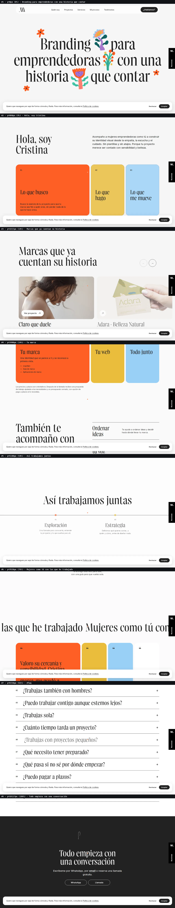

# UI Design System & Master Generation Blueprint: www-lamagadan-studio

> **La Magadán · Branding y diseño para emprendedoras** (https://www.lamagadan.studio/) — Soy Cristina, diseñadora y creativa en La Magadán. Ayudo a emprendedoras como tú a crear marcas que conectan, destacan y venden.




---

## 1. Executive Visual Persona & Design Archetype

- **Brand Essence & Persona**: **La Magadán · Branding y diseño para emprendedoras** (`https://www.lamagadan.studio/`). Soy Cristina, diseñadora y creativa en La Magadán. Ayudo a emprendedoras como tú a crear marcas que conectan, destacan y venden.
- **Capture Provenance**: Live browser capture (`tier1_fast`, HTTP `200`, captured `2026-11-24`).
- **Visual Archetype**: **Light-Substrate Editorial & Modular Grid System (`#f5f5f5` canvas, `#222222` ink, `#ff5f26` accent)**.
- **Anti-AI-Slop Differentiators**:
  - **Live-Computed Chromatic Polarity**: Anchors the viewport in `#f5f5f5` (live computed `body` `background-color` (`computed_styles.json`)) paired with `#222222` primary typography and `#ff5f26` accents.
  - **Grounded Typographic Hierarchy**: Pairs `Animal Condensed` for display copy (`Branding para emprendedoras con una `) with `Inter` and `Geist Mono`.
  - **Calibrated Spatial Grid & Motion**: Combines `1440px` container bounds (`gap: 16px`, padding `4px`) with `cubic-bezier(0.4,0,0.2,1)` easing.

---

## 2. Spatial Architecture & Modular Grid Mathematics

### Viewport Allocation & Container Geometry
- **Captured Journey Filmstrips**: Desktop `1280×6624px` (`assets/desktop-journey.webp`, `8` keyframes up to `y=10127px` / doc `11027px`), Mobile `390×2616px` (`assets/mobile-journey.webp`, `3` keyframes).
- **Master Container Bounds**: `1440px` (full-bleed `100%` desktop stage measured on `1440px` viewport).
- **Canvas Lateral Padding & Spacing**: `4px` lateral canvas padding with `16px` grid gap.
- **Border Radius Scale**: `28px`, `2px`, `3px`, `4px`.

### Responsive Breakpoint Architecture
- **Desktop Layout**: Multi-column CSS Grid / Flexbox layout at `1440px` (`max-width: 1440px`, `gap: 16px`).
- **Mobile Layout**: Single-column vertical stack at `390px` viewport width with `4px` horizontal padding.
- **Extracted CSS Media Queries**: `@media (prefers-reduced-motion:reduce)`.

---

## 3. Color System, Materiality & Atmospheric Lighting

### Semantic Palette & Source Grounding
| Semantic Role | Ground-Truth Value | Extracted Live / CSS Source |
|---|---|---|
| **Primary Canvas Substrate** | `#f5f5f5` | live computed `body` `background-color` (`computed_styles.json`) |
| **Primary Typography Ink** | `#222222` | live computed `h1` `color` (`computed_styles.json`) |
| **Elevated Surface / Card Substrate** | `#ff5f26` | live computed `button` `background-color` (`computed_styles.json`) |
| **Interactive Accent / Highlight** | `#ff5f26` | live computed `button` `background-color` (`computed_styles.json`) |
| **Secondary / Muted Copy** | `#ffffff` | live computed `footer` `color` (`computed_styles.json`) |
| **Structural Hairline Border** | `#7a7a7a` | `.sc-interp.sc-missing { border: #7a7a7a }` |

### Sanitized Root CSS Variables (`ui-ux.md` Ground Truth)
| Variable Name | Extracted Value | Semantic Role |
|---|---|---|
| `--www-lamagadan-st-bg` | `#f5f5f5` | Canvas Substrate (from live computed `body` `background-color` (`computed_styles.json`)) |
| `--www-lamagadan-st-ink` | `#222222` | Primary Typography Ink (computed-derived) |
| `--www-lamagadan-st-surface` | `#ff5f26` | Surface Substrate (computed-derived) |
| `--www-lamagadan-st-accent` | `#ff5f26` | Interactive Accent (computed-derived) |
| `--www-lamagadan-st-muted` | `#ffffff` | Secondary Ink (computed-derived) |
| `--www-lamagadan-st-border` | `#7a7a7a` | Structural Border (computed-derived) |
| `--www-lamagadan-st-container` | `1440px` | Container Bound (computed-derived) |
| `--www-lamagadan-st-gap` | `16px` | Grid Gutter (computed-derived) |
| `--www-lamagadan-st-pad` | `4px` | Lateral Padding (computed-derived) |
| `--www-lamagadan-st-ease` | `cubic-bezier(0.4,0,0.2,1)` | Primary Easing Function |
| `--www-lamagadan-st-radius` | `28px` | Corner Radius (computed-derived) |
| `--www-lamagadan-st-fs-base` | `129.6px` | Observed Font Size Token |

---

## 4. Typographic Scale & Editorial Hierarchy

### Font Family Stacks
- **Display Typography**: `Animal Condensed`.
- **Primary Body Stack**: `Inter`.
- **Technical / Metadata Stack**: `Geist Mono`.

### Typographic Scale & Rules (Live Computed & Stylesheet Grounded)
- **Hero Display (`H1`)**: live computed `h1` (`font-size: 129.6px`, `line-height: 132.192px`, `font-weight: 400`, `letter-spacing: -1.296px`).
- **Section Heading (`H2`)**: live computed `h2` (`font-size: 92.16px`, `line-height: 87.552px`, `font-weight: 400`).
- **Body Copy**: live computed `body` (`font-size: 16px`, `line-height: normal`, `font-weight: 400`).
- **Metadata & Navigation Labels**: live computed `nav/a` (`font-size: 16px`, `line-height: normal`, `font-weight: 400`).

---

## 5. Choreographed Motion & Interaction Physics

### Primary Easing Curves
- **Extracted Timing Functions**: `cubic-bezier(0.4,0,0.2,1)`, `cubic-bezier(0.22,0.8,0.2,1)`, `cubic-bezier(0.65,0,0.25,1)`.

### Per-Element Transition & Choreography Rules
- **Selector `::after`**: `transition: 0s !important` extracted from `www-lamagadan-studio` stylesheet.
- **Selector `style]`**: `transition: background-color 1s cubic-bezier(0.4,0,0.2,1)` extracted from `www-lamagadan-studio` stylesheet.
- **Selector `style]`**: `transition: transform 0.5s cubic-bezier(0.4,0,0.2,1)` extracted from `www-lamagadan-studio` stylesheet.
- **Extracted Easing Curve (`cubic-bezier(0.4,0,0.2,1)`)**: Governs interactive state transitions across `<header.sc-host>` and `<section.scp1>`.
- **State & Hover Choreography**: Opacity and transform transitions on `<section.scp0>` and `<section.scp1>` interactive targets.
### Measured Runtime Scroll & Interaction Telemetry (`behavioral_journey_v2`)
- **Scroll Driver Mode**: `native` (max document height `11027px`, deepest scrollY reached `10127px` across `8` desktop keyframes).
- **Detected Scroll / Motion Libraries**: Native browser scroll / standard CSS transitions.
- **Hover Physics (`primary_cta` · `Quién soy`)**: `opacity`: `1` -> `0.774482` (`transition-duration: 0.6s`, `timing: cubic-bezier(0.22, 0.8, 0.2, 1)`).
- **Route Transition Architecture**: First internal navigation (`/claro-que-duele.html`) measured as `direct` in `1346ms`.

---

## 6. Component Wireframe & Structural DOM Map

### Visual Layout Schematic — Desktop (`1440px`, Grounded in `dom.html` & Landmark Bounding Boxes)
```
┌────────────────────────────────────────────────────────────────────────┐
│ DESKTOP VIEWPORT (1440px) — La Magadán · Branding y diseño para empren │
│ ====================================================================== │
│ [ <header.sc-host> (1408x64px)        | Quién soy · Proyectos · Serv ] │
│ ---------------------------------------------------------------------- │
│ | HERO STAGE: <section.scp0> (w=1440px)                              | │
│ | H1: Branding para emprendedoras con una historia que...            | │
│ | Substrate: #f5f5f5 | Ink: #222222 | Accent: #ff5f26                | │
│ ---------------------------------------------------------------------- │
│ | SHOWCASE GRID (<section.scp1>) max-w: 1440px                       | │
│ | +------------------------------+  +------------------------------+ | │
│ | | Acompaño a mujeres emprended |  | ¿Hablamos? ¿Hablamos?        | | │
│ | +------------------------------+  +------------------------------+ | │
│ ---------------------------------------------------------------------- │
│ | DETAIL MODULE (<section.sc-interp>) — Busco la esencia de t        | │
│ ---------------------------------------------------------------------- │
│ [ FOOTER (<footer.scp3>       ) | https://www.lamagadan.studio/        │
└────────────────────────────────────────────────────────────────────────┘
```

### Visual Layout Schematic — Mobile Reflow (`390px`)
```
┌────────────────────────────────────────────────────────────────────────┐
│ MOBILE VIEWPORT REFLOW (390px) — Single-Column Stack (gap: 16px)       │
│ ====================================================================== │
│ [ HEADER BAR (<header.sc-host>        ) | Compact Menu (390px)         │
│ ---------------------------------------------------------------------- │
│ | HERO STAGE (<section.scp0>) — 390px Vertical Lead                  | │
│ | H1: Branding para emprendedoras con una historia que...            | │
│ ---------------------------------------------------------------------- │
│ | SHOWCASE STACK (<section.scp1>) — 1-Col Stack                      | │
│ | [ Item 1: Acompaño a mujeres emprendedoras como tú a const       ] | │
│ | [ Item 2: ¿Hablamos? ¿Hablamos?                                  ] | │
│ ---------------------------------------------------------------------- │
│ | DETAIL STACK (<section.sc-interp>) — 1-Col (Busco la esencia d)    | │
│ ---------------------------------------------------------------------- │
│ [ FOOTER (<footer.scp3>       ) | Stacked 390px Colophon               │
└────────────────────────────────────────────────────────────────────────┘
```

### Granular DOM Region Breakdown
1. **Brand Header & Navigation Bar (<header.sc-host> — `www-lamagadan-studio`)**:
   - Landmark `<header class="sc-host">` (`1408x64px`) hosting `La Magadán · Branding y diseño para ` navigation (`Quién soy · Proyectos · Servicios · Mi proceso · Testimonios`), DOM attributes (`data-dc-tpl="1"`, `data-dc-tpl="2"`, `data-dc-tpl="3"`, `data-dc-tpl="4"`), and stylesheet rule `l.sc-dc-streaming .sc-interp.sc-m... { position:relative; background:color-mix(in srgb,currentColor 5%,transpar... }`.
2. **Hero Stage & Focal Lead (<section.scp0> — `Branding para emprendedoras con un`)**:
   - Landmark `<section class="scp0">` presenting display lead `Branding para emprendedoras con una historia que...` and copy excerpt *"Acompaño a mujeres emprendedoras como tú a construir su identidad"* over `#f5f5f5` canvas and `#222222` ink.
3. **Primary Showcase & Content Grid (<section.scp1> — `Acompaño a mujeres emprendedoras c`)**:
   - Landmark `<section class="scp1">` rendering section `Acompaño a mujeres emprendedoras como tú a const` with copy *"¿Hablamos? ¿Hablamos?"*, asset references (`favicon.png`, `apple-touch-icon.png`, `support.js`, `react.production.min.js`), and grid rule `before { animation:none; background:color-mix(in srgb,currentColor 8%,transparent) }`.
4. **Interactive Detail & Feature Matrix (<section.sc-interp> — `¿Hablamos? ¿Hablamos?`)**:
   - Landmark `<section class="sc-interp">` framing `¿Hablamos? ¿Hablamos?` and `Busco la esencia de tu proyecto para que tu marc` (*"Busco la esencia de tu proyecto para que tu marca sea fiel a quié"*) with `#ff5f26` surface cards, `#ff5f26` accents, and `.sc-host.sc-has-error { position:relative }`.
5. **Colophon & Global Directory Footer (<footer.scp3> — `https://www.lamagadan.studio/`)**:
   - Landmark `<footer class="scp3">` anchoring `La Magadán · Branding y diseño p` footer links (`Quién soy · Proyectos · Servicios · Mi proceso · Testimonios`), copy *"Transformo tus ideas en relatos memorables: marcas que conec"*, and `#7a7a7a` structural dividers.
### Full Vertical Scroll Sequence (Desktop `1440×900` Keyframes)
- **Step 01** (`y=0px`, `0%`): Active landmark `Branding para emprendedoras con una historia que...` · sticky/fixed elements: `3`
- **Step 02** (`y=900px`, `9%`): Active landmark `Hola, soy Cristina` · sticky/fixed elements: `2`
- **Step 03** (`y=1815px`, `18%`): Active landmark `Marcas que ya cuentan su historia` · sticky/fixed elements: `2`
- **Step 04** (`y=3400px`, `34%`): Active landmark `Tu marca` · sticky/fixed elements: `2`
- **Step 05** (`y=5100px`, `50%`): Active landmark `Así trabajamos juntas` · sticky/fixed elements: `3`
- **Step 06** (`y=7650px`, `76%`): Active landmark `Mujeres como tú con las que he trabajado` · sticky/fixed elements: `3`
- **Step 07** (`y=9350px`, `92%`): Active landmark `#faq` · sticky/fixed elements: `2`
- **Step 08** (`y=10127px`, `100%`): Active landmark `Todo empieza con una conversación` · sticky/fixed elements: `2`

### Multi-Page Internal Route Map
- **Other Route (`/claro-que-duele.html`)**: `https://www.lamagadan.studio/claro-que-duele.html` — H1: `Claro que Duele`, scrollHeight `8115px`, transition `direct` (`1346ms`)
- **Other Route (`/adara.html`)**: `https://www.lamagadan.studio/adara.html` — H1: `Adara`, scrollHeight `7374px`, transition `direct` (`1184ms`)
- **Other Route (`/asan.html`)**: `https://www.lamagadan.studio/asan.html` — H1: `Asan`, scrollHeight `6756px`, transition `direct` (`1216ms`)

---

## 7. Master Zero-Shot AI Generation Prompt

```markdown
# Master Zero-Shot Frontend Generation Prompt: www-lamagadan-studio (La Magadán · Branding y diseño para emprendedoras)

You are a principal frontend architect and design systems engineer. Build a complete, production-ready web application replicating the exact design system, DOM landmarks, typographic hierarchy, color tokens, and motion physics of `www-lamagadan-studio` (**La Magadán · Branding y diseño para emprendedoras** — `https://www.lamagadan.studio/`).

### 1. Visual Archetype & Anti-AI-Slop Mandates
- **Archetype**: Light-Substrate Editorial & Modular Grid System (`#f5f5f5` canvas, `#222222` ink, `#ff5f26` accent).
- **Identity & Domain Context**: Soy Cristina, diseñadora y creativa en La Magadán. Ayudo a emprendedoras como tú a crear marcas que conectan, destacan y venden.
- **Primary Substrate**: `#f5f5f5` (live computed `body` `background-color` (`computed_styles.json`)), **Primary Ink**: `#222222`, **Accent / Highlight**: `#ff5f26`.
- **Site-Specific Differentiators**:
  - **Live-Computed Chromatic Polarity**: Anchors the viewport in `#f5f5f5` (live computed `body` `background-color` (`computed_styles.json`)) paired with `#222222` primary typography and `#ff5f26` accents.
  - **Grounded Typographic Hierarchy**: Pairs `Animal Condensed` for display copy (`Branding para emprendedoras con una `) with `Inter` and `Geist Mono`.
  - **Calibrated Spatial Grid & Motion**: Combines `1440px` container bounds (`gap: 16px`, padding `4px`) with `cubic-bezier(0.4,0,0.2,1)` easing.

### 2. Ground-Truth CSS Variables (`:root` Token Contract)
Declare and consume these exact custom properties extracted from `www-lamagadan-studio` in your global stylesheet:

:root {
  /* La Magadán · Branding y diseño para emprendedoras (www-lamagadan-studio) — Live-Grounded CSS Variables */
  --www-lamagadan-st-bg: #f5f5f5; /* Canvas Substrate (from live computed `body` `background-color` (`computed_styles.json`)) (www-lamagadan-studio) */
  --www-lamagadan-st-ink: #222222; /* Primary Typography Ink (computed-derived) (www-lamagadan-studio) */
  --www-lamagadan-st-surface: #ff5f26; /* Surface Substrate (computed-derived) (www-lamagadan-studio) */
  --www-lamagadan-st-accent: #ff5f26; /* Interactive Accent (computed-derived) (www-lamagadan-studio) */
  --www-lamagadan-st-muted: #ffffff; /* Secondary Ink (computed-derived) (www-lamagadan-studio) */
  --www-lamagadan-st-border: #7a7a7a; /* Structural Border (computed-derived) (www-lamagadan-studio) */
  --www-lamagadan-st-container: 1440px; /* Container Bound (computed-derived) (www-lamagadan-studio) */
  --www-lamagadan-st-gap: 16px; /* Grid Gutter (computed-derived) (www-lamagadan-studio) */
  --www-lamagadan-st-pad: 4px; /* Lateral Padding (computed-derived) (www-lamagadan-studio) */
  --www-lamagadan-st-ease: cubic-bezier(0.4,0,0.2,1); /* Primary Easing Function (www-lamagadan-studio) */
  --www-lamagadan-st-radius: 28px; /* Corner Radius (computed-derived) (www-lamagadan-studio) */
  --www-lamagadan-st-fs-base: 129.6px; /* Observed Font Size Token (www-lamagadan-studio) */
}

### 3. Semantic Color & Materiality Contract
Map every surface, ink, and border strictly to these source-grounded tokens:
- **Primary Canvas Substrate**: `#f5f5f5` — grounded in live computed `body` `background-color` (`computed_styles.json`)
- **Primary Typography Ink**: `#222222` — grounded in live computed `h1` `color` (`computed_styles.json`)
- **Elevated Surface / Card Substrate**: `#ff5f26` — grounded in live computed `button` `background-color` (`computed_styles.json`)
- **Interactive Accent / Highlight**: `#ff5f26` — grounded in live computed `button` `background-color` (`computed_styles.json`)
- **Secondary / Muted Copy**: `#ffffff` — grounded in live computed `footer` `color` (`computed_styles.json`)
- **Structural Hairline Border**: `#7a7a7a` — grounded in `.sc-interp.sc-missing { border: #7a7a7a }`

### 4. Spatial Grid, Container Bounds & Responsive Breakpoints
- **Desktop Viewport Reference**: `1280×6624px` (multi-frame vertical journey filmstrip (6624px), `1440px` standard desktop width).
- **Mobile Viewport Reference**: `390×2616px` (multi-frame vertical journey filmstrip (2616px), `390px` standard mobile width).
- **Container Max-Width**: `1440px` (full-bleed `100%` desktop stage measured on `1440px` viewport)
- **Padding & Gutters**: `4px` lateral canvas padding with `16px` grid gap
- **Desktop Grid**: Multi-column CSS Grid / Flexbox layout at `1440px` (`max-width: 1440px`, `gap: 16px`)
- **Mobile Adaptation**: Single-column vertical stack at `390px` viewport width with `4px` horizontal padding
- **Media Queries**: `@media (prefers-reduced-motion:reduce)`
- **Corner Radii**: `28px`, `2px`, `3px`, `4px`

### 5. Typography & Editorial Scale Contract
- **Display Font Stack**: `Animal Condensed`
- **Body Font Stack**: `Inter`
- **Monospace / Technical Font Stack**: `Geist Mono`
- **H1 Display Rule**: live computed `h1` (`font-size: 129.6px`, `line-height: 132.192px`, `font-weight: 400`, `letter-spacing: -1.296px`)
- **H2 Section Rule**: live computed `h2` (`font-size: 92.16px`, `line-height: 87.552px`, `font-weight: 400`)
- **Body Copy Rule**: live computed `body` (`font-size: 16px`, `line-height: normal`, `font-weight: 400`)
- **Metadata & Index Rule**: live computed `nav/a` (`font-size: 16px`, `line-height: normal`, `font-weight: 400`)

### 6. Component Hierarchy, Verbatim Copy & Real DOM Landmarks
Scaffold `www-lamagadan-studio` (`La Magadán · Branding y diseño para emprendedoras`) with these exact structural regions, extracted copy, and CSS rules from `dom.html`:
1. **Brand Header & Navigation Bar (<header.sc-host> — `www-lamagadan-studio`)**:
   - DOM & Selectors: Landmark `<header class="sc-host">` (`1408x64px`) hosting `La Magadán · Branding y diseño para ` navigation (`Quién soy · Proyectos · Servicios · Mi proceso · Testimonios`), DOM attributes (`data-dc-tpl="1"`, `data-dc-tpl="2"`, `data-dc-tpl="3"`, `data-dc-tpl="4"`), and stylesheet rule `l.sc-dc-streaming .sc-interp.sc-m... { position:relative; background:color-mix(in srgb,currentColor 5%,transpar... }`.
   - Responsive Contract: Header `Brand Header & Navigation Bar (<header.sc-host> — `www-lamagadan-studio`)` (`www-lamagadan-studio`) adapts across `@media (prefers-reduced-motion:reduce)` with `cubic-bezier(0.4,0,0.2,1)`, `cubic-bezier(0.22,0.8,0.2,1)`, `cubic-bezier(0.65,0,0.25,1)` transitions and links `Quién soy · Proyectos · Servicios · Mi proceso · Testimonios`.
2. **Hero Stage & Focal Lead (<section.scp0> — `Branding para emprendedoras con un`)**:
   - DOM & Selectors: Landmark `<section class="scp0">` presenting display lead `Branding para emprendedoras con una historia que...` and copy excerpt *"Acompaño a mujeres emprendedoras como tú a construir su identidad"* over `#f5f5f5` canvas and `#222222` ink.
   - Responsive Contract: Hero stage (`1280×6624px` desktop / `390×2616px` mobile) sets `#f5f5f5` background with `#222222` headline `Branding para emprendedoras con una historia que...`.
3. **Primary Showcase & Content Grid (<section.scp1> — `Acompaño a mujeres emprendedoras c`)**:
   - DOM & Selectors: Landmark `<section class="scp1">` rendering section `Acompaño a mujeres emprendedoras como tú a const` with copy *"¿Hablamos? ¿Hablamos?"*, asset references (`favicon.png`, `apple-touch-icon.png`, `support.js`, `react.production.min.js`), and grid rule `before { animation:none; background:color-mix(in srgb,currentColor 8%,transparent) }`.
   - Responsive Contract: Showcase grid `Primary Showcase & Content Grid (<section.scp1> — `Acompaño a mujeres emprendedoras c`)` applies Multi-column CSS Grid / Flexbox layout at `1440px` (`max-width: 1440px`, `gap: 16px`) on desktop and Single-column vertical stack at `390px` viewport width with `4px` horizontal padding on mobile.
4. **Interactive Detail & Feature Matrix (<section.sc-interp> — `¿Hablamos? ¿Hablamos?`)**:
   - DOM & Selectors: Landmark `<section class="sc-interp">` framing `¿Hablamos? ¿Hablamos?` and `Busco la esencia de tu proyecto para que tu marc` (*"Busco la esencia de tu proyecto para que tu marca sea fiel a quié"*) with `#ff5f26` surface cards, `#ff5f26` accents, and `.sc-host.sc-has-error { position:relative }`.
   - Responsive Contract: Detail module `Interactive Detail & Feature Matrix (<section.sc-interp> — `¿Hablamos? ¿Hablamos?`)` uses `28px`, `2px`, `3px`, `4px` radii, `#ff5f26` highlights, and assets (favicon.png, apple-touch-icon.png, support.js).
5. **Colophon & Global Directory Footer (<footer.scp3> — `https://www.lamagadan.studio/`)**:
   - DOM & Selectors: Landmark `<footer class="scp3">` anchoring `La Magadán · Branding y diseño p` footer links (`Quién soy · Proyectos · Servicios · Mi proceso · Testimonios`), copy *"Transformo tus ideas en relatos memorables: marcas que conec"*, and `#7a7a7a` structural dividers.
   - Responsive Contract: Footer `Colophon & Global Directory Footer (<footer.scp3> — `https://www.lamagadan.studio/`)` aligns to `1440px` (full-bleed `100%` desktop stage measured on `1440px` viewport) with `4px` lateral canvas padding with `16px` grid gap and attributes (data-dc-tpl="1", data-dc-tpl="2", data-dc-tpl="3").

#### Verbatim DOM Copy Excerpts (`dom.html`)
- Copy Excerpt 1: *"Acompaño a mujeres emprendedoras como tú a construir su identidad visual desde la..."*
- Copy Excerpt 2: *"¿Hablamos? ¿Hablamos?"*
- Copy Excerpt 3: *"Busco la esencia de tu proyecto para que tu marca sea fiel a quién eres, sin perde..."*
- Copy Excerpt 4: *"Transformo tus ideas en relatos memorables: marcas que conectan y emocionan a quie..."*

### 7. Motion, Extracted Stylesheet Rules & Interaction Choreography
- **Primary Easing Functions**: `cubic-bezier(0.4,0,0.2,1)`, `cubic-bezier(0.22,0.8,0.2,1)`, `cubic-bezier(0.65,0,0.25,1)`
- **Extracted Stylesheet Rules (`www-lamagadan-studio`)**:
- `l.sc-dc-streaming .sc-interp.sc-m... { position:relative; background:color-mix(in srgb,currentColor 5%,transpar... }`
- `before { animation:none; background:color-mix(in srgb,currentColor 8%,transparent) }`
- `.sc-host.sc-has-error { position:relative }`
- `page { margin: 0.5cm; }`
- `table { break-inside: avoid; }`
- **Per-Selector Transition Rules**:
- **Selector `::after`**: `transition: 0s !important` extracted from `www-lamagadan-studio` stylesheet.
- **Selector `style]`**: `transition: background-color 1s cubic-bezier(0.4,0,0.2,1)` extracted from `www-lamagadan-studio` stylesheet.
- **Selector `style]`**: `transition: transform 0.5s cubic-bezier(0.4,0,0.2,1)` extracted from `www-lamagadan-studio` stylesheet.
- **Extracted Easing Curve (`cubic-bezier(0.4,0,0.2,1)`)**: Governs interactive state transitions across `<header.sc-host>` and `<section.scp1>`.
- **State & Hover Choreography**: Opacity and transform transitions on `<section.scp0>` and `<section.scp1>` interactive targets.
### 7b. Full-Page Scroll Choreography, Interactive States & Multi-Page Routes
- **Scroll Mechanics**: Implement `native` vertical progression up to `11027px` across 8 distinct viewport chapters.
- **Vertical Chapter Sequence**: Branding para emprendedoras... (0%) -> Hola, soy Cristina (9%) -> Marcas que ya cuentan su hi... (18%) -> Tu marca (34%) -> Así trabajamos juntas (50%) -> Mujeres como tú con las que... (76%) -> #faq (92%) -> Todo empieza con una conver... (100%).
- **Hover Micro-Interaction (`primary_cta`)**: Animate `opacity` with `0.6s cubic-bezier(0.22, 0.8, 0.2, 1)`.
- **Multi-Page Routes**: Scaffold internal routes `/claro-que-duele.html` (other, direct), `/adara.html` (other, direct), `/asan.html` (other, direct) sharing the global header/footer shell and design tokens.

### 8. Technical Deliverables
- Implement in Next.js (App Router) with TypeScript and Tailwind CSS consuming the `:root` custom properties defined above for `www-lamagadan-studio`.
- Reproduce both the `1440px` desktop architecture and `390px` mobile breakpoint transitions, preserving semantic HTML5 landmarks (`<header>`, `<nav>`, `<main>`, `<section>`, `<footer>`) and `prefers-reduced-motion` accessibility guards.
```
---

## 8. Full-Page Scroll Journey, Interactive States & Subpage Inventory

### Desktop Scroll Keyframes (`1440×900` WebP)
| Step | Scroll Y | Progress | Active Landmark / Section | Sticky/Fixed | Visual Asset |
| :---: | :---: | :---: | :--- | :---: | :--- |
| `#01` | `0px` | `0%` | Branding para emprendedoras con una historia... | `3` | [desktop-step-01.webp](assets/desktop-step-01.webp) |
| `#02` | `900px` | `9%` | Hola, soy Cristina | `2` | [desktop-step-02.webp](assets/desktop-step-02.webp) |
| `#03` | `1815px` | `18%` | Marcas que ya cuentan su historia | `2` | [desktop-step-03.webp](assets/desktop-step-03.webp) |
| `#04` | `3400px` | `34%` | Tu marca | `2` | [desktop-step-04.webp](assets/desktop-step-04.webp) |
| `#05` | `5100px` | `50%` | Así trabajamos juntas | `3` | [desktop-step-05.webp](assets/desktop-step-05.webp) |
| `#06` | `7650px` | `76%` | Mujeres como tú con las que he trabajado | `3` | [desktop-step-06.webp](assets/desktop-step-06.webp) |
| `#07` | `9350px` | `92%` | #faq | `2` | [desktop-step-07.webp](assets/desktop-step-07.webp) |
| `#08` | `10127px` | `100%` | Todo empieza con una conversación | `2` | [desktop-step-08.webp](assets/desktop-step-08.webp) |

### Mobile Condensed Keyframes (`390×844` WebP)
| Step | Scroll Y | Progress | Active Landmark | Visual Asset |
| :---: | :---: | :---: | :--- | :--- |
| `#01` | `0px` | `0%` | Branding para emprendedoras con una histo... | [mobile-step-01.webp](assets/mobile-step-01.webp) |
| `#02` | `5430px` | `50%` | Así trabajamos juntas | [mobile-step-02.webp](assets/mobile-step-02.webp) |
| `#03` | `10860px` | `100%` | Todo empieza con una conversación | [mobile-step-03.webp](assets/mobile-step-03.webp) |

### Internal Subpage Filmstrips (`1080px` Wide WebP)
| # | Template | Route URL | H1 / Title | Scroll Height | Transition | Filmstrip Asset |
| :-: | :---: | :--- | :--- | :---: | :---: | :--- |
| `1` | `other` | `https://www.lamagadan.studio/claro-que-duele.html` | Claro que Duele | `8115px` | `direct` (`1346ms`) | [subpage-01-claro-que-duele-html.webp](assets/subpage-01-claro-que-duele-html.webp) |
| `2` | `other` | `https://www.lamagadan.studio/adara.html` | Adara | `7374px` | `direct` (`1184ms`) | [subpage-02-adara-html.webp](assets/subpage-02-adara-html.webp) |
| `3` | `other` | `https://www.lamagadan.studio/asan.html` | Asan | `6756px` | `direct` (`1216ms`) | [subpage-03-asan-html.webp](assets/subpage-03-asan-html.webp) |

