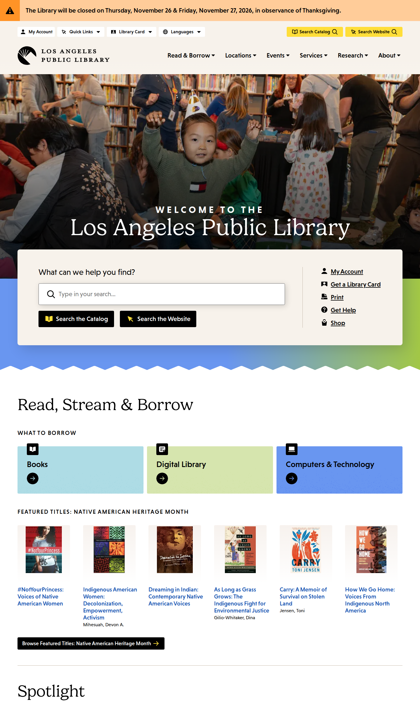
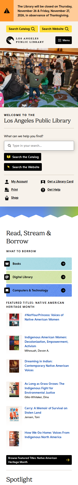

# UI Design System & Master Generation Blueprint: www-lapl-org

> **Homepage · Los Angeles Public Library** (https://www.lapl.org/) — Visit our catalog to search for books, movies, music and more.



---

## 1. Executive Visual Persona & Design Archetype

- **Brand Essence & Persona**: **Homepage · Los Angeles Public Library** (`https://www.lapl.org/`). Visit our catalog to search for books, movies, music and more.
- **Visual Archetype**: **Light-Substrate Editorial & Modular Grid System (`#ffccd5` canvas, `#bf2713` ink, `#bf2713` accent)**.
- **Anti-AI-Slop Differentiators**:
  - **Source-Grounded Chromatic Polarity**: Anchors the viewport in `#ffccd5` (`var(--lapl-clr-sunburn)` in `:root`) paired with `#bf2713` primary typography and `#bf2713` accents.
  - **Extracted Typographic Hierarchy**: Pairs `niveau-grotesk` for display copy (`Library Catalog`) with `gelica` and not declared in static CSS (uses primary stack / `ui-monospace`).
  - **Calibrated Spatial Grid & Motion**: Combines `767.98px` container bounds (`gap: 4px`, padding `10px`) with `cubic-bezier(0.45,0,0.55,1)` easing and Three.js / WebGL Canvas Pipeline.

---

## 2. Spatial Architecture & Modular Grid Mathematics



### Viewport Allocation & Container Geometry
- **Captured Viewport Dimensions**: Desktop `1440×7428px` (`assets/desktop.png`, full-page scroll capture), Mobile `390×2400px` (`assets/mobile.png`, capped at 2400px multi-section capture).
- **Master Container Bounds**: `767.98px` extracted from `www-lapl-org` stylesheet.
- **Canvas Lateral Padding & Spacing**: `10px` lateral canvas padding with `4px` grid gap.
- **Border Radius Scale**: `4px`, `8px`, `6px`, `50%`.

### Responsive Breakpoint Architecture
- **Desktop Layout**: Multi-column CSS Grid / Flexbox layout at `1440px` (`max-width: 767.98px`, `gap: 4px`).
- **Mobile Layout**: Single-column vertical stack at `390px` viewport width with `10px` horizontal padding.
- **Extracted CSS Media Queries**: `@media (min-width:576px)`, `@media (min-width:768px)`, `@media (min-width:1024px)`, `@media (min-width:1200px)`.

---

## 3. Color System, Materiality & Atmospheric Lighting

### Semantic Palette & Source Grounding
| Semantic Role | Ground-Truth Value | Extracted CSS Source / Selector |
|---|---|---|
| **Primary Canvas Substrate** | `#ffccd5` | `var(--lapl-clr-sunburn)` in `:root` |
| **Primary Typography Ink** | `#ff9eaf` | `var(--lapl-clr-coral)` in `:root` |
| **Elevated Surface / Card Substrate** | `#eb4646` | `var(--lapl-clr-red)` in `:root` |
| **Interactive Accent / Highlight** | `#bf2713` | `var(--lapl-clr-brick)` in `:root` |
| **Secondary / Muted Copy** | `#fc9` | `var(--lapl-clr-peach)` in `:root` |
| **Structural Hairline Border** | `#ff9326` | `var(--lapl-clr-orange)` in `:root` |
| **Variable Token (`--lapl-clr-burnt-orange`)** | `#bd5d2d` | `var(--lapl-clr-burnt-orange)` in `:root` |
| **Variable Token (`--lapl-clr-buttercream`)** | `#ffeba8` | `var(--lapl-clr-buttercream)` in `:root` |
| **Variable Token (`--lapl-clr-yellow`)** | `#ffde39` | `var(--lapl-clr-yellow)` in `:root` |
| **Variable Token (`--lapl-clr-gold`)** | `#eb9c00` | `var(--lapl-clr-gold)` in `:root` |
| **Variable Token (`--lapl-clr-sage`)** | `#d6e5ae` | `var(--lapl-clr-sage)` in `:root` |
| **Variable Token (`--lapl-clr-green`)** | `#a2c746` | `var(--lapl-clr-green)` in `:root` |
| **Variable Token (`--lapl-clr-dark-green`)** | `#20661a` | `var(--lapl-clr-dark-green)` in `:root` |
| **Variable Token (`--lapl-clr-robins-egg`)** | `#aedce5` | `var(--lapl-clr-robins-egg)` in `:root` |
| **Variable Token (`--lapl-clr-teal`)** | `#3cbcd6` | `var(--lapl-clr-teal)` in `:root` |

### Sanitized Root CSS Variables (`ui-ux.md` Ground Truth)
| Variable Name | Extracted Value | Semantic Role |
|---|---|---|
| `--lapl-transition-easeInOutQuad` | `cubic-bezier(0.45,0,0.55,1)` | Motion / Easing Token |
| `--lapl-clr-sunburn` | `#ffccd5` | Color / Atmospheric Token |
| `--lapl-clr-coral` | `#ff9eaf` | Color / Atmospheric Token |
| `--lapl-clr-red` | `#eb4646` | Color / Atmospheric Token |
| `--lapl-clr-brick` | `#bf2713` | Color / Atmospheric Token |
| `--lapl-clr-peach` | `#fc9` | Color / Atmospheric Token |
| `--lapl-clr-orange` | `#ff9326` | Color / Atmospheric Token |
| `--lapl-clr-burnt-orange` | `#bd5d2d` | Color / Atmospheric Token |
| `--lapl-clr-buttercream` | `#ffeba8` | Color / Atmospheric Token |
| `--lapl-clr-yellow` | `#ffde39` | Color / Atmospheric Token |
| `--lapl-clr-gold` | `#eb9c00` | Color / Atmospheric Token |
| `--lapl-clr-sage` | `#d6e5ae` | Color / Atmospheric Token |
| `--lapl-clr-green` | `#a2c746` | Color / Atmospheric Token |
| `--lapl-clr-dark-green` | `#20661a` | Canvas / Surface Token |
| `--lapl-clr-robins-egg` | `#aedce5` | Color / Atmospheric Token |
| `--lapl-clr-teal` | `#3cbcd6` | Color / Atmospheric Token |

---

## 4. Typographic Scale & Editorial Hierarchy

### Font Family Stacks
- **Display Typography**: `niveau-grotesk`.
- **Primary Body Stack**: `gelica`.
- **Technical / Metadata Stack**: not declared in static CSS (uses primary stack / `ui-monospace`).

### Typographic Scale & Rules (Extracted from Stylesheet & Variables)
- **Hero Display (`H1`)**: CSS variables `--lapl-fs-heading-h1-large: 2.25rem`, `--lapl-fs-heading-h1-regular: 2rem`, `--lapl-fs-heading-h1-small: 1.75rem`.
- **Section Heading (`H2`)**: CSS variables `--lapl-fs-heading-h2-regular: 1.75rem`, `--lapl-fs-heading-h2-small: 1.5rem`, `--lapl-fs-heading-h2-1xsmall: 1.375rem`; rule `,h2` (`font-weight: var(--lapl-fw...`).
- **Body Copy**: CSS variables `--lapl-fs-body-regular: 1rem`, `--lapl-fs-body-small: 0.875rem`, `--lapl-fs-body-1xsmall: 0.875rem`; rule `p` (`font-size: var(--lapl-fs-body-1xsmall)`, `line-height: var(--lapl-lh-body-1x...`).
- **Metadata & Navigation Labels**: CSS variables `--lapl-width-small: 1178px`, `--lapl-width-xsmall: 984px`, `--lapl-fs-heading-h1-small: 1.75rem`.

---

## 5. Choreographed Motion & Interaction Physics

### Primary Easing Curves
- **Extracted Timing Functions**: `cubic-bezier(0.45,0,0.55,1)`, `cubic-bezier(.4,0,.2,1)`.

### Per-Element Transition & Choreography Rules
- **Selector `:before`**: `transition: .01ms!important` extracted from `www-lapl-org` stylesheet.
- **Selector `.e-button`**: `transition: all .25s var(--lapl-transition-easeInOutQuad)` extracted from `www-lapl-org` stylesheet.
- **Selector `.e-button__text`**: `transition: background-size .35s var(--lapl-transition-easeInOutQuad)` extracted from `www-lapl-org` stylesheet.
- **Extracted Easing Curve (`cubic-bezier(0.45,0,0.55,1)`)**: Governs interactive state transitions across `<header.r-site-header>` and `<section.p-homepage__actions>`.
- **Runtime Interaction Engine**: Integrates Three.js / WebGL Canvas Pipeline with `prefers-reduced-motion: reduce` fallback guards.

---

## 6. Component Wireframe & Structural DOM Map

### Visual Layout Schematic (Grounded in `dom.html` — `1440px` Desktop & `390px` Mobile Reflow)
```
┌────────────────────────────────────────────────────────────────────────┐
│ DESKTOP VIEWPORT (1440px) — Homepage · Los Angeles Public Library      │
│ ====================================================================== │
│ [ <header.r-site-header>   | My Account · Get Help · Contact Us · L ]  │
│ ---------------------------------------------------------------------- │
│ | HERO STAGE: <article.p-homepage>                                 |   │
│ | H1: Library Catalog                                              |   │
│ | Substrate: #ffccd5    | Ink: #bf2713    | Accent: #bf2713        |   │
│ ---------------------------------------------------------------------- │
│ | SHOWCASE GRID (<section.p-homepage__actio) max-w: 767.98px       |   │
│ | +------------------------------+  +------------------------------+ | │
│ | | Books                        |  | Digital Library              | | │
│ | +------------------------------+  +------------------------------+ | │
│ ---------------------------------------------------------------------- │
│ | MOBILE VIEWPORT REFLOW (390px) — Single-Column Stack (gap: 4px   ) | │
│ | [<header.r-site-hea] -> [<article.p-homepag] -> [<section.p-homepag] │
│ ---------------------------------------------------------------------- │
│ [ FOOTER (<footer.r-site-footer>) | https://www.lapl.org/              │
└────────────────────────────────────────────────────────────────────────┘
```

### Granular DOM Region Breakdown
1. **Brand Header & Navigation Bar (<header.r-site-header> — `www-lapl-org`)**:
   - Landmark `<header class="r-site-header">` hosting `Homepage · Los Angeles Public Librar` navigation (`My Account · Get Help · Contact Us · Locations and Hours · Printing`), DOM attributes (`data-once="lapl-remove-is-loading"`, `data-off-canvas-main-canvas`, `data-component-id="lapl:site-header"`, `data-once="lapl-site-header"`), and stylesheet rule `.text-align-left { text-align:left; }`.
2. **Hero Stage & Focal Lead (<article.p-homepage> — `Library Catalog`)**:
   - Landmark `<article class="p-homepage">` presenting display lead `Library Catalog` and copy excerpt *"Skip to main content"* over `#ffccd5` canvas and `#bf2713` ink.
3. **Primary Showcase & Content Grid (<section.p-homepage__actions> — `Books`)**:
   - Landmark `<section class="p-homepage__actions">` rendering section `Books` with copy *"Skip to main navigation"*, asset references (`challenges.cloudflare.com`, `shim.js`, `zh-hant`, `favicon-default.svg`), and grid rule `.text-align-right { text-align:right; }`.
4. **Interactive Detail & Feature Matrix (<section.p-homepage__section> — `Digital Library`)**:
   - Landmark `<section class="p-homepage__section p-homepage__featured">` framing `Digital Library` and `More to Borrow` (*"Quick Links Get Help Contact Us Locations and Hours Printing"*) with `#eb4646` surface cards, `#bf2713` accents, and `.text-align-center { text-align:center; }`.
5. **Colophon & Global Directory Footer (<footer.r-site-footer> — `https://www.lapl.org/`)**:
   - Landmark `<footer class="r-site-footer">` anchoring `Homepage · Los Angeles Public Li` footer links (`My Account · Get Help · Contact Us · Locations and Hours · Printing`), copy *"Locations and Hours"*, and `#ff9326` structural dividers.

---

## 7. Master Zero-Shot AI Generation Prompt

```markdown
# Master Zero-Shot Frontend Generation Prompt: www-lapl-org (Homepage · Los Angeles Public Library)

You are a principal frontend architect and design systems engineer. Build a complete, production-ready web application replicating the exact design system, DOM landmarks, typographic hierarchy, color tokens, and motion physics of `www-lapl-org` (**Homepage · Los Angeles Public Library** — `https://www.lapl.org/`).

### 1. Visual Archetype & Anti-AI-Slop Mandates
- **Archetype**: Light-Substrate Editorial & Modular Grid System (`#ffccd5` canvas, `#bf2713` ink, `#bf2713` accent).
- **Identity & Domain Context**: Visit our catalog to search for books, movies, music and more.
- **Primary Substrate**: `#ffccd5` (`var(--lapl-clr-sunburn)` in `:root`), **Primary Ink**: `#bf2713`, **Accent / Highlight**: `#bf2713`.
- **Site-Specific Differentiators**:
  - **Source-Grounded Chromatic Polarity**: Anchors the viewport in `#ffccd5` (`var(--lapl-clr-sunburn)` in `:root`) paired with `#bf2713` primary typography and `#bf2713` accents.
  - **Extracted Typographic Hierarchy**: Pairs `niveau-grotesk` for display copy (`Library Catalog`) with `gelica` and not declared in static CSS (uses primary stack / `ui-monospace`).
  - **Calibrated Spatial Grid & Motion**: Combines `767.98px` container bounds (`gap: 4px`, padding `10px`) with `cubic-bezier(0.45,0,0.55,1)` easing and Three.js / WebGL Canvas Pipeline.

### 2. Ground-Truth CSS Variables (`:root` Token Contract)
Declare and consume these exact custom properties extracted from `www-lapl-org` in your global stylesheet:

:root {
  /* Homepage · Los Angeles Public Library (www-lapl-org) — Ground-Truth Extracted CSS Variables */
  --lapl-transition-easeInOutQuad: cubic-bezier(0.45,0,0.55,1); /* Motion / Easing Token (www-lapl-org) */
  --lapl-clr-sunburn: #ffccd5; /* Color / Atmospheric Token (www-lapl-org) */
  --lapl-clr-coral: #ff9eaf; /* Color / Atmospheric Token (www-lapl-org) */
  --lapl-clr-red: #eb4646; /* Color / Atmospheric Token (www-lapl-org) */
  --lapl-clr-brick: #bf2713; /* Color / Atmospheric Token (www-lapl-org) */
  --lapl-clr-peach: #fc9; /* Color / Atmospheric Token (www-lapl-org) */
  --lapl-clr-orange: #ff9326; /* Color / Atmospheric Token (www-lapl-org) */
  --lapl-clr-burnt-orange: #bd5d2d; /* Color / Atmospheric Token (www-lapl-org) */
  --lapl-clr-buttercream: #ffeba8; /* Color / Atmospheric Token (www-lapl-org) */
  --lapl-clr-yellow: #ffde39; /* Color / Atmospheric Token (www-lapl-org) */
  --lapl-clr-gold: #eb9c00; /* Color / Atmospheric Token (www-lapl-org) */
  --lapl-clr-sage: #d6e5ae; /* Color / Atmospheric Token (www-lapl-org) */
  --lapl-clr-green: #a2c746; /* Color / Atmospheric Token (www-lapl-org) */
  --lapl-clr-dark-green: #20661a; /* Canvas / Surface Token (www-lapl-org) */
  --lapl-clr-robins-egg: #aedce5; /* Color / Atmospheric Token (www-lapl-org) */
  --lapl-clr-teal: #3cbcd6; /* Color / Atmospheric Token (www-lapl-org) */
}

### 3. Semantic Color & Materiality Contract
Map every surface, ink, and border strictly to these source-grounded tokens:
- **Primary Canvas Substrate**: `#ffccd5` — grounded in `var(--lapl-clr-sunburn)` in `:root`
- **Primary Typography Ink**: `#ff9eaf` — grounded in `var(--lapl-clr-coral)` in `:root`
- **Elevated Surface / Card Substrate**: `#eb4646` — grounded in `var(--lapl-clr-red)` in `:root`
- **Interactive Accent / Highlight**: `#bf2713` — grounded in `var(--lapl-clr-brick)` in `:root`
- **Secondary / Muted Copy**: `#fc9` — grounded in `var(--lapl-clr-peach)` in `:root`
- **Structural Hairline Border**: `#ff9326` — grounded in `var(--lapl-clr-orange)` in `:root`
- **Variable Token (`--lapl-clr-burnt-orange`)**: `#bd5d2d` — grounded in `var(--lapl-clr-burnt-orange)` in `:root`
- **Variable Token (`--lapl-clr-buttercream`)**: `#ffeba8` — grounded in `var(--lapl-clr-buttercream)` in `:root`
- **Variable Token (`--lapl-clr-yellow`)**: `#ffde39` — grounded in `var(--lapl-clr-yellow)` in `:root`
- **Variable Token (`--lapl-clr-gold`)**: `#eb9c00` — grounded in `var(--lapl-clr-gold)` in `:root`
- **Variable Token (`--lapl-clr-sage`)**: `#d6e5ae` — grounded in `var(--lapl-clr-sage)` in `:root`
- **Variable Token (`--lapl-clr-green`)**: `#a2c746` — grounded in `var(--lapl-clr-green)` in `:root`
- **Variable Token (`--lapl-clr-dark-green`)**: `#20661a` — grounded in `var(--lapl-clr-dark-green)` in `:root`
- **Variable Token (`--lapl-clr-robins-egg`)**: `#aedce5` — grounded in `var(--lapl-clr-robins-egg)` in `:root`
- **Variable Token (`--lapl-clr-teal`)**: `#3cbcd6` — grounded in `var(--lapl-clr-teal)` in `:root`

### 4. Spatial Grid, Container Bounds & Responsive Breakpoints
- **Desktop Viewport Reference**: `1440×7428px` (full-page scroll capture, `1440px` standard desktop width).
- **Mobile Viewport Reference**: `390×2400px` (capped at 2400px multi-section capture, `390px` standard mobile width).
- **Container Max-Width**: `767.98px` extracted from `www-lapl-org` stylesheet
- **Padding & Gutters**: `10px` lateral canvas padding with `4px` grid gap
- **Desktop Grid**: Multi-column CSS Grid / Flexbox layout at `1440px` (`max-width: 767.98px`, `gap: 4px`)
- **Mobile Adaptation**: Single-column vertical stack at `390px` viewport width with `10px` horizontal padding
- **Media Queries**: `@media (min-width:576px)`, `@media (min-width:768px)`, `@media (min-width:1024px)`, `@media (min-width:1200px)`
- **Corner Radii**: `4px`, `8px`, `6px`, `50%`

### 5. Typography & Editorial Scale Contract
- **Display Font Stack**: `niveau-grotesk`
- **Body Font Stack**: `gelica`
- **Monospace / Technical Font Stack**: not declared in static CSS (uses primary stack / `ui-monospace`)
- **H1 Display Rule**: CSS variables `--lapl-fs-heading-h1-large: 2.25rem`, `--lapl-fs-heading-h1-regular: 2rem`, `--lapl-fs-heading-h1-small: 1.75rem`
- **H2 Section Rule**: CSS variables `--lapl-fs-heading-h2-regular: 1.75rem`, `--lapl-fs-heading-h2-small: 1.5rem`, `--lapl-fs-heading-h2-1xsmall: 1.375rem`; rule `,h2` (`font-weight: var(--lapl-fw...`)
- **Body Copy Rule**: CSS variables `--lapl-fs-body-regular: 1rem`, `--lapl-fs-body-small: 0.875rem`, `--lapl-fs-body-1xsmall: 0.875rem`; rule `p` (`font-size: var(--lapl-fs-body-1xsmall)`, `line-height: var(--lapl-lh-body-1x...`)
- **Metadata & Index Rule**: CSS variables `--lapl-width-small: 1178px`, `--lapl-width-xsmall: 984px`, `--lapl-fs-heading-h1-small: 1.75rem`

### 6. Component Hierarchy, Verbatim Copy & Real DOM Landmarks
Scaffold `www-lapl-org` (`Homepage · Los Angeles Public Library`) with these exact structural regions, extracted copy, and CSS rules from `dom.html`:
1. **Brand Header & Navigation Bar (<header.r-site-header> — `www-lapl-org`)**:
   - DOM & Selectors: Landmark `<header class="r-site-header">` hosting `Homepage · Los Angeles Public Librar` navigation (`My Account · Get Help · Contact Us · Locations and Hours · Printing`), DOM attributes (`data-once="lapl-remove-is-loading"`, `data-off-canvas-main-canvas`, `data-component-id="lapl:site-header"`, `data-once="lapl-site-header"`), and stylesheet rule `.text-align-left { text-align:left; }`.
   - Responsive Contract: Header `Brand Header & Navigation Bar (<header.r-site-header> — `www-lapl-org`)` (`www-lapl-org`) adapts across `@media (min-width:576px)`, `@media (min-width:768px)`, `@media (min-width:1024px)`, `@media (min-width:1200px)` with `cubic-bezier(0.45,0,0.55,1)`, `cubic-bezier(.4,0,.2,1)` transitions and links `My Account · Get Help · Contact Us · Locations and Hours · Printing`.
2. **Hero Stage & Focal Lead (<article.p-homepage> — `Library Catalog`)**:
   - DOM & Selectors: Landmark `<article class="p-homepage">` presenting display lead `Library Catalog` and copy excerpt *"Skip to main content"* over `#ffccd5` canvas and `#bf2713` ink.
   - Responsive Contract: Hero stage (`1440×7428px` desktop / `390×2400px` mobile) sets `#ffccd5` background with `#bf2713` headline `Library Catalog`.
3. **Primary Showcase & Content Grid (<section.p-homepage__actions> — `Books`)**:
   - DOM & Selectors: Landmark `<section class="p-homepage__actions">` rendering section `Books` with copy *"Skip to main navigation"*, asset references (`challenges.cloudflare.com`, `shim.js`, `zh-hant`, `favicon-default.svg`), and grid rule `.text-align-right { text-align:right; }`.
   - Responsive Contract: Showcase grid `Primary Showcase & Content Grid (<section.p-homepage__actions> — `Books`)` applies Multi-column CSS Grid / Flexbox layout at `1440px` (`max-width: 767.98px`, `gap: 4px`) on desktop and Single-column vertical stack at `390px` viewport width with `10px` horizontal padding on mobile.
4. **Interactive Detail & Feature Matrix (<section.p-homepage__section> — `Digital Library`)**:
   - DOM & Selectors: Landmark `<section class="p-homepage__section p-homepage__featured">` framing `Digital Library` and `More to Borrow` (*"Quick Links Get Help Contact Us Locations and Hours Printing"*) with `#eb4646` surface cards, `#bf2713` accents, and `.text-align-center { text-align:center; }`.
   - Responsive Contract: Detail module `Interactive Detail & Feature Matrix (<section.p-homepage__section> — `Digital Library`)` uses `4px`, `8px`, `6px`, `50%` radii, `#bf2713` highlights, and assets (challenges.cloudflare.com, shim.js, zh-hant).
5. **Colophon & Global Directory Footer (<footer.r-site-footer> — `https://www.lapl.org/`)**:
   - DOM & Selectors: Landmark `<footer class="r-site-footer">` anchoring `Homepage · Los Angeles Public Li` footer links (`My Account · Get Help · Contact Us · Locations and Hours · Printing`), copy *"Locations and Hours"*, and `#ff9326` structural dividers.
   - Responsive Contract: Footer `Colophon & Global Directory Footer (<footer.r-site-footer> — `https://www.lapl.org/`)` aligns to `767.98px` extracted from `www-lapl-org` stylesheet with `10px` lateral canvas padding with `4px` grid gap and attributes (data-once="lapl-remove-is-loading", data-off-canvas-main-canvas, data-component-id="lapl:site-header").

#### Verbatim DOM Copy Excerpts (`dom.html`)
- Copy Excerpt 1: *"Skip to main content"*
- Copy Excerpt 2: *"Skip to main navigation"*
- Copy Excerpt 3: *"Quick Links Get Help Contact Us Locations and Hours Printing"*
- Copy Excerpt 4: *"Locations and Hours"*

### 7. Motion, Extracted Stylesheet Rules & Interaction Choreography
- **Primary Easing Functions**: `cubic-bezier(0.45,0,0.55,1)`, `cubic-bezier(.4,0,.2,1)`
- **Extracted Stylesheet Rules (`www-lapl-org`)**:
- `.text-align-left { text-align:left; }`
- `.text-align-right { text-align:right; }`
- `.text-align-center { text-align:center; }`
- `.text-align-justify { text-align:justify; }`
- `.align-left { float:left; }`
- **Per-Selector Transition Rules**:
- **Selector `:before`**: `transition: .01ms!important` extracted from `www-lapl-org` stylesheet.
- **Selector `.e-button`**: `transition: all .25s var(--lapl-transition-easeInOutQuad)` extracted from `www-lapl-org` stylesheet.
- **Selector `.e-button__text`**: `transition: background-size .35s var(--lapl-transition-easeInOutQuad)` extracted from `www-lapl-org` stylesheet.
- **Extracted Easing Curve (`cubic-bezier(0.45,0,0.55,1)`)**: Governs interactive state transitions across `<header.r-site-header>` and `<section.p-homepage__actions>`.
- **Runtime Interaction Engine**: Integrates Three.js / WebGL Canvas Pipeline with `prefers-reduced-motion: reduce` fallback guards.

### 8. Technical Deliverables
- Implement in Next.js (App Router) with TypeScript and Tailwind CSS consuming the `:root` custom properties defined above for `www-lapl-org`.
- Reproduce both the `1440px` desktop architecture and `390px` mobile breakpoint transitions, preserving semantic HTML5 landmarks (`<header>`, `<nav>`, `<main>`, `<section>`, `<footer>`) and `prefers-reduced-motion` accessibility guards.
```
