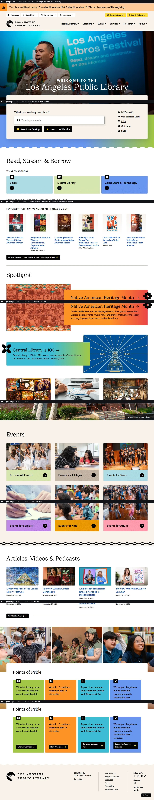
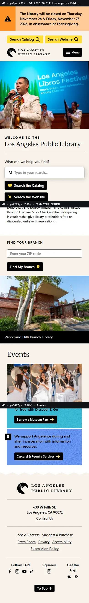

# UI Design System & Master Generation Blueprint: www-lapl-org

> **Homepage · Los Angeles Public Library** (https://www.lapl.org/) — The Library will be closed on Thursday, November 26 & Friday, November 27, 2026, in observance of Thanksgiving.





---

## 1. Executive Visual Persona & Design Archetype

- **Brand Essence & Persona**: **Homepage · Los Angeles Public Library** (`https://www.lapl.org/`). The Library will be closed on Thursday, November 26 & Friday, November 27, 2026, in observance of Thanksgiving.
- **Capture Provenance**: Live browser capture (`tier1_fast`, HTTP `200`, captured `2026-11-24`).
- **Visual Archetype**: **Light-Substrate Editorial & Modular Grid System (`#f7f2eb` canvas, `#000000` ink, `#ffff00` accent)**.
- **Anti-AI-Slop Differentiators**:
  - **Live-Computed Chromatic Polarity**: Anchors the viewport in `#f7f2eb` (live computed `body` `background-color` (`computed_styles.json`)) paired with `#000000` primary typography and `#ffff00` accents.
  - **Grounded Typographic Hierarchy**: Pairs `gelica` for display copy (`WELCOME TO THE Los Angeles Public Li`) with `niveau-grotesk`.
  - **Calibrated Spatial Grid & Motion**: Combines `1320px` container bounds (`gap: 4px`, padding `10px`) with `cubic-bezier(0.45,0,0.55,1)` easing and Three.js / WebGL Canvas Pipeline.

---

## 2. Spatial Architecture & Modular Grid Mathematics

### Viewport Allocation & Container Geometry
- **Captured Journey Filmstrips**: Desktop `1280×6624px` (`assets/desktop-journey.webp`, `8` keyframes up to `y=6537px` / doc `7437px`), Mobile `390×2616px` (`assets/mobile-journey.webp`, `3` keyframes).
- **Master Container Bounds**: `1320px` (measured widest bounded `<section>` landmark width on `1440px` desktop).
- **Canvas Lateral Padding & Spacing**: `10px` lateral canvas padding with `4px` grid gap.
- **Border Radius Scale**: `4px`, `0px 0px 4px 4px`, `8px`, `6px`.

### Responsive Breakpoint Architecture
- **Desktop Layout**: Multi-column CSS Grid / Flexbox layout at `1440px` (`max-width: 1320px`, `gap: 4px`).
- **Mobile Layout**: Single-column vertical stack at `390px` viewport width with `10px` horizontal padding.
- **Extracted CSS Media Queries**: `@media (min-width:576px)`, `@media (min-width:768px)`, `@media (min-width:1024px)`, `@media (min-width:1200px)`.

---

## 3. Color System, Materiality & Atmospheric Lighting

### Semantic Palette & Source Grounding
| Semantic Role | Ground-Truth Value | Extracted Live / CSS Source |
|---|---|---|
| **Primary Canvas Substrate** | `#f7f2eb` | live computed `body` `background-color` (`computed_styles.json`) |
| **Primary Typography Ink** | `#000000` | live computed `main` `color` (`computed_styles.json`) |
| **Elevated Surface / Card Substrate** | `#ffffff` | live computed `button` `background-color` (`computed_styles.json`) |
| **Interactive Accent / Highlight** | `#ffff00` | `ton--primary .e-button__suffix.... { background-color: yellow }` (`#ffff00`) |
| **Secondary / Muted Copy** | `#ff8fc7` | `var(--lapl-clr-pink)` in `:root` |
| **Structural Hairline Border** | `#808080` | `textarea:focus { border-color: #808080 }` |
| **Variable Token (`--lapl-clr-sunburn`)** | `#ffccd5` | `var(--lapl-clr-sunburn)` in `:root` |
| **Variable Token (`--lapl-clr-coral`)** | `#ff9eaf` | `var(--lapl-clr-coral)` in `:root` |
| **Variable Token (`--lapl-clr-red`)** | `#eb4646` | `var(--lapl-clr-red)` in `:root` |
| **Variable Token (`--lapl-clr-brick`)** | `#bf2713` | `var(--lapl-clr-brick)` in `:root` |
| **Variable Token (`--lapl-clr-peach`)** | `#ffcc99` | `var(--lapl-clr-peach)` in `:root` |
| **Variable Token (`--lapl-clr-orange`)** | `#ff9326` | `var(--lapl-clr-orange)` in `:root` |
| **Variable Token (`--lapl-clr-burnt-orange`)** | `#bd5d2d` | `var(--lapl-clr-burnt-orange)` in `:root` |
| **Variable Token (`--lapl-clr-buttercream`)** | `#ffeba8` | `var(--lapl-clr-buttercream)` in `:root` |
| **Variable Token (`--lapl-clr-yellow`)** | `#ffde39` | `var(--lapl-clr-yellow)` in `:root` |
| **Variable Token (`--lapl-clr-gold`)** | `#eb9c00` | `var(--lapl-clr-gold)` in `:root` |
| **Variable Token (`--lapl-clr-sage`)** | `#d6e5ae` | `var(--lapl-clr-sage)` in `:root` |
| **Variable Token (`--lapl-clr-green`)** | `#a2c746` | `var(--lapl-clr-green)` in `:root` |
| **Variable Token (`--lapl-clr-dark-green`)** | `#20661a` | `var(--lapl-clr-dark-green)` in `:root` |
| **Variable Token (`--lapl-clr-robins-egg`)** | `#aedce5` | `var(--lapl-clr-robins-egg)` in `:root` |
| **Variable Token (`--lapl-clr-teal`)** | `#3cbcd6` | `var(--lapl-clr-teal)` in `:root` |

### Sanitized Root CSS Variables (`ui-ux.md` Ground Truth)
| Variable Name | Extracted Value | Semantic Role |
|---|---|---|
| `--lapl-transition-easeInOutQuad` | `cubic-bezier(0.45,0,0.55,1)` | Motion / Easing Token |
| `--lapl-clr-sunburn` | `#ffccd5` | Color / Atmospheric Token |
| `--lapl-clr-coral` | `#ff9eaf` | Color / Atmospheric Token |
| `--lapl-clr-red` | `#eb4646` | Color / Atmospheric Token |
| `--lapl-clr-brick` | `#bf2713` | Color / Atmospheric Token |
| `--lapl-clr-peach` | `#fc9` | Color / Atmospheric Token |
| `--lapl-clr-orange` | `#ff9326` | Color / Atmospheric Token |
| `--lapl-clr-burnt-orange` | `#bd5d2d` | Color / Atmospheric Token |
| `--lapl-clr-buttercream` | `#ffeba8` | Color / Atmospheric Token |
| `--lapl-clr-yellow` | `#ffde39` | Color / Atmospheric Token |
| `--lapl-clr-gold` | `#eb9c00` | Color / Atmospheric Token |
| `--lapl-clr-sage` | `#d6e5ae` | Color / Atmospheric Token |
| `--lapl-clr-green` | `#a2c746` | Color / Atmospheric Token |
| `--lapl-clr-dark-green` | `#20661a` | Canvas / Surface Token |
| `--lapl-clr-robins-egg` | `#aedce5` | Color / Atmospheric Token |
| `--lapl-clr-teal` | `#3cbcd6` | Color / Atmospheric Token |

---

## 4. Typographic Scale & Editorial Hierarchy

### Font Family Stacks
- **Display Typography**: `gelica`.
- **Primary Body Stack**: `niveau-grotesk`.
- **Technical / Metadata Stack**: not declared in live computed styles (uses primary stack / `ui-monospace`).

### Typographic Scale & Rules (Live Computed & Stylesheet Grounded)
- **Hero Display (`H1`)**: live computed `h1` (`font-size: 56px`, `line-height: 68px`, `font-weight: 300`); CSS variables `--lapl-fs-heading-h1-large: 2.25rem`, `--lapl-fs-heading-h1-regular: 2rem`, `--lapl-fs-heading-h1-small: 1.75rem`.
- **Section Heading (`H2`)**: live computed `h2` (`font-size: 40px`, `line-height: 48px`, `font-weight: 300`); CSS variables `--lapl-fs-heading-h2-regular: 1.75rem`, `--lapl-fs-heading-h2-small: 1.5rem`, `--lapl-fs-heading-h2-1xsmall: 1.375rem`; rule `,h2` (`font-weight: var(--lapl-fw...`).
- **Body Copy**: live computed `body` (`font-size: 22px`, `line-height: 32px`, `font-weight: 400`); CSS variables `--lapl-fs-body-regular: 1rem`, `--lapl-fs-body-small: 0.875rem`, `--lapl-fs-body-1xsmall: 0.875rem`; rule `p` (`font-size: var(--lapl-fs-body-1xsmall)`, `line-height: var(--lapl-lh-body-1x...`).
- **Metadata & Navigation Labels**: live computed `nav/a` (`font-size: 22px`, `line-height: 32px`, `font-weight: 400`); CSS variables `--lapl-width-small: 1178px`, `--lapl-width-xsmall: 984px`, `--lapl-fs-heading-h1-small: 1.75rem`.

---

## 5. Choreographed Motion & Interaction Physics

### Primary Easing Curves
- **Extracted Timing Functions**: `cubic-bezier(0.45,0,0.55,1)`, `cubic-bezier(.4,0,.2,1)`.

### Per-Element Transition & Choreography Rules
- **Selector `:before`**: `transition: .01ms!important` extracted from `www-lapl-org` stylesheet.
- **Selector `.e-button`**: `transition: all .25s var(--lapl-transition-easeInOutQuad)` extracted from `www-lapl-org` stylesheet.
- **Selector `.e-button__text`**: `transition: background-size .35s var(--lapl-transition-easeInOutQuad)` extracted from `www-lapl-org` stylesheet.
- **Extracted Easing Curve (`cubic-bezier(0.45,0,0.55,1)`)**: Governs interactive state transitions across `<header.r-site-header>` and `<section.p-homepage__actions>`.
- **Runtime Interaction Engine**: Integrates Three.js / WebGL Canvas Pipeline with `prefers-reduced-motion: reduce` fallback guards.
### Measured Runtime Scroll & Interaction Telemetry (`behavioral_journey_v2`)
- **Scroll Driver Mode**: `native` (max document height `7437px`, deepest scrollY reached `6537px` across `8` desktop keyframes).
- **Detected Scroll / Motion Libraries**: Native browser scroll / standard CSS transitions.
- **Nav / Drawer Probe**: Tested trigger `Quick Links` (diff `1.549`, below state-capture threshold).
- **Hover Physics (`primary_cta` · `My Account`)**: `color`: `rgb(0, 0, 0)` -> `rgb(255, 255, 255)`; `backgroundColor`: `rgb(255, 255, 255)` -> `rgb(0, 0, 0)`; `borderColor`: `rgb(0, 0, 0)` -> `rgb(255, 255, 255)` (`transition-duration: 0.25s, 0.25s`, `timing: cubic-bezier(0.45, 0, 0.55, 1), cubic-bezier(0.45, 0, 0.55, 1)`).
- **Route Transition Architecture**: First internal navigation (`/library-card/borrowing-policies-and-information`) measured as `direct` in `496ms`.

---

## 6. Component Wireframe & Structural DOM Map

### Visual Layout Schematic — Desktop (`1440px`, Grounded in `dom.html` & Landmark Bounding Boxes)
```
┌────────────────────────────────────────────────────────────────────────┐
│ DESKTOP VIEWPORT (1440px) — Homepage · Los Angeles Public Library      │
│ ====================================================================== │
│ [ <header.r-site-header> (1440x182px) | My Account · Get Help · Cont ] │
│ ---------------------------------------------------------------------- │
│ | HERO STAGE: <article.p-homepage> (w=1440px)                        | │
│ | H1: WELCOME TO THE Los Angeles Public Library                      | │
│ | Substrate: #f7f2eb | Ink: #000000 | Accent: #ffff00                | │
│ ---------------------------------------------------------------------- │
│ | SHOWCASE GRID (<section.p-homepage__actio) max-w: 1320px           | │
│ | +------------------------------+  +------------------------------+ | │
│ | | Welcome to the Los Angeles P |  | What can we help you find?   | | │
│ | +------------------------------+  +------------------------------+ | │
│ ---------------------------------------------------------------------- │
│ | DETAIL MODULE (<section.p-homepage__secti) — Read, Stream & Borrow | │
│ ---------------------------------------------------------------------- │
│ [ FOOTER (<footer.r-site-foote) | https://www.lapl.org/                │
└────────────────────────────────────────────────────────────────────────┘
```

### Visual Layout Schematic — Mobile Reflow (`390px`)
```
┌────────────────────────────────────────────────────────────────────────┐
│ MOBILE VIEWPORT REFLOW (390px) — Single-Column Stack (gap: 4px)        │
│ ====================================================================== │
│ [ HEADER BAR (<header.r-site-header>  ) | Compact Menu (390px)         │
│ ---------------------------------------------------------------------- │
│ | HERO STAGE (<article.p-homepage>) — 390px Vertical Lead            | │
│ | H1: WELCOME TO THE Los Angeles Public Library                      | │
│ ---------------------------------------------------------------------- │
│ | SHOWCASE STACK (<section.p-homepage__a) — 1-Col Stack              | │
│ | [ Item 1: Welcome to the Los Angeles Public Library              ] | │
│ | [ Item 2: What can we help you find?                             ] | │
│ ---------------------------------------------------------------------- │
│ | DETAIL STACK (<section.p-homepage__sec) — 1-Col (Read, Stream & Bor) │
│ ---------------------------------------------------------------------- │
│ [ FOOTER (<footer.r-site-foote) | Stacked 390px Colophon               │
└────────────────────────────────────────────────────────────────────────┘
```

### Granular DOM Region Breakdown
1. **Brand Header & Navigation Bar (<header.r-site-header> — `www-lapl-org`)**:
   - Landmark `<header class="r-site-header">` (`1440x182px`) hosting `Homepage · Los Angeles Public Librar` navigation (`My Account · Get Help · Contact Us · Locations and Hours · Printing`), DOM attributes (`data-once="lapl-remove-is-loadin..."`, `data-off-canvas-main-canvas`, `data-component-id="lapl:alert"`, `data-component-id="lapl:site-header"`), and stylesheet rule `.text-align-left { text-align:left; }`.
2. **Hero Stage & Focal Lead (<article.p-homepage> — `WELCOME TO THE Los Angeles Public `)**:
   - Landmark `<article class="p-homepage">` presenting display lead `WELCOME TO THE Los Angeles Public Library` and copy excerpt *"The Library will be closed on Thursday, November 26 & Friday, Nov"* over `#f7f2eb` canvas and `#000000` ink.
3. **Primary Showcase & Content Grid (<section.p-homepage__actions> — `Welcome to the Los Angeles Public `)**:
   - Landmark `<section class="p-homepage__actions">` rendering section `Welcome to the Los Angeles Public Library` with copy *"Los Angeles Public Library"*, asset references (`challenges.cloudflare.com`, `shim.js`, `zh-hant`, `favicon-default.svg`), and grid rule `.text-align-right { text-align:right; }`.
4. **Interactive Detail & Feature Matrix (<section.p-homepage__section> — `What can we help you find?`)**:
   - Landmark `<section class="p-homepage__section p-homepage__featured">` framing `What can we help you find?` and `Read, Stream & Borrow` (*"Get a Library Card"*) with `#ffffff` surface cards, `#ffff00` accents, and `.text-align-center { text-align:center; }`.
5. **Colophon & Global Directory Footer (<footer.r-site-footer> — `https://www.lapl.org/`)**:
   - Landmark `<footer class="r-site-footer">` anchoring `Homepage · Los Angeles Public Li` footer links (`My Account · Get Help · Contact Us · Locations and Hours · Printing`), copy *"Computers & Technology"*, and `#808080` structural dividers.
### Full Vertical Scroll Sequence (Desktop `1440×900` Keyframes)
- **Step 01** (`y=0px`, `0%`): Active landmark `WELCOME TO THE Los Angeles Public Library` · sticky/fixed elements: `0`
- **Step 02** (`y=850px`, `13%`): Active landmark `What can we help you find?` · sticky/fixed elements: `0`
- **Step 03** (`y=1700px`, `26%`): Active landmark `#NotYourPrincess: Voices of Native American Women` · sticky/fixed elements: `0`
- **Step 04** (`y=2550px`, `39%`): Active landmark `Central Library is 100` · sticky/fixed elements: `0`
- **Step 05** (`y=4250px`, `65%`): Active landmark `Events` · sticky/fixed elements: `0`
- **Step 06** (`y=5100px`, `78%`): Active landmark `Events for Seniors` · sticky/fixed elements: `0`
- **Step 07** (`y=5950px`, `91%`): Active landmark `Points of Pride` · sticky/fixed elements: `0`
- **Step 08** (`y=6537px`, `100%`): Active landmark `Points of Pride` · sticky/fixed elements: `0`

### Multi-Page Internal Route Map
- **Detail Route (`/library-card/borrowing-policies-and-information`)**: `https://www.lapl.org/library-card/borrowing-policies-and-information` — H1: `Borrowing Policies and Information`, scrollHeight `4892px`, transition `direct` (`496ms`)
- **Detail Route (`/es/homepage`)**: `https://www.lapl.org/es/homepage` — H1: `WELCOME TO THE Los Angeles Public Library`, scrollHeight `7558px`, transition `direct` (`1060ms`)
- **Detail Route (`/fil/homepage`)**: `https://www.lapl.org/fil/homepage` — H1: `WELCOME TO THE Los Angeles Public Library`, scrollHeight `7671px`, transition `direct` (`893ms`)

---

## 7. Master Zero-Shot AI Generation Prompt

```markdown
# Master Zero-Shot Frontend Generation Prompt: www-lapl-org (Homepage · Los Angeles Public Library)

You are a principal frontend architect and design systems engineer. Build a complete, production-ready web application replicating the exact design system, DOM landmarks, typographic hierarchy, color tokens, and motion physics of `www-lapl-org` (**Homepage · Los Angeles Public Library** — `https://www.lapl.org/`).

### 1. Visual Archetype & Anti-AI-Slop Mandates
- **Archetype**: Light-Substrate Editorial & Modular Grid System (`#f7f2eb` canvas, `#000000` ink, `#ffff00` accent).
- **Identity & Domain Context**: The Library will be closed on Thursday, November 26 & Friday, November 27, 2026, in observance of Thanksgiving.
- **Primary Substrate**: `#f7f2eb` (live computed `body` `background-color` (`computed_styles.json`)), **Primary Ink**: `#000000`, **Accent / Highlight**: `#ffff00`.
- **Site-Specific Differentiators**:
  - **Live-Computed Chromatic Polarity**: Anchors the viewport in `#f7f2eb` (live computed `body` `background-color` (`computed_styles.json`)) paired with `#000000` primary typography and `#ffff00` accents.
  - **Grounded Typographic Hierarchy**: Pairs `gelica` for display copy (`WELCOME TO THE Los Angeles Public Li`) with `niveau-grotesk`.
  - **Calibrated Spatial Grid & Motion**: Combines `1320px` container bounds (`gap: 4px`, padding `10px`) with `cubic-bezier(0.45,0,0.55,1)` easing and Three.js / WebGL Canvas Pipeline.

### 2. Ground-Truth CSS Variables (`:root` Token Contract)
Declare and consume these exact custom properties extracted from `www-lapl-org` in your global stylesheet:

:root {
  /* Homepage · Los Angeles Public Library (www-lapl-org) — Live-Grounded CSS Variables */
  --lapl-transition-easeInOutQuad: cubic-bezier(0.45,0,0.55,1); /* Motion / Easing Token (www-lapl-org) */
  --lapl-clr-sunburn: #ffccd5; /* Color / Atmospheric Token (www-lapl-org) */
  --lapl-clr-coral: #ff9eaf; /* Color / Atmospheric Token (www-lapl-org) */
  --lapl-clr-red: #eb4646; /* Color / Atmospheric Token (www-lapl-org) */
  --lapl-clr-brick: #bf2713; /* Color / Atmospheric Token (www-lapl-org) */
  --lapl-clr-peach: #fc9; /* Color / Atmospheric Token (www-lapl-org) */
  --lapl-clr-orange: #ff9326; /* Color / Atmospheric Token (www-lapl-org) */
  --lapl-clr-burnt-orange: #bd5d2d; /* Color / Atmospheric Token (www-lapl-org) */
  --lapl-clr-buttercream: #ffeba8; /* Color / Atmospheric Token (www-lapl-org) */
  --lapl-clr-yellow: #ffde39; /* Color / Atmospheric Token (www-lapl-org) */
  --lapl-clr-gold: #eb9c00; /* Color / Atmospheric Token (www-lapl-org) */
  --lapl-clr-sage: #d6e5ae; /* Color / Atmospheric Token (www-lapl-org) */
  --lapl-clr-green: #a2c746; /* Color / Atmospheric Token (www-lapl-org) */
  --lapl-clr-dark-green: #20661a; /* Canvas / Surface Token (www-lapl-org) */
  --lapl-clr-robins-egg: #aedce5; /* Color / Atmospheric Token (www-lapl-org) */
  --lapl-clr-teal: #3cbcd6; /* Color / Atmospheric Token (www-lapl-org) */
}

### 3. Semantic Color & Materiality Contract
Map every surface, ink, and border strictly to these source-grounded tokens:
- **Primary Canvas Substrate**: `#f7f2eb` — grounded in live computed `body` `background-color` (`computed_styles.json`)
- **Primary Typography Ink**: `#000000` — grounded in live computed `main` `color` (`computed_styles.json`)
- **Elevated Surface / Card Substrate**: `#ffffff` — grounded in live computed `button` `background-color` (`computed_styles.json`)
- **Interactive Accent / Highlight**: `#ffff00` — grounded in `ton--primary .e-button__suffix.... { background-color: yellow }` (`#ffff00`)
- **Secondary / Muted Copy**: `#ff8fc7` — grounded in `var(--lapl-clr-pink)` in `:root`
- **Structural Hairline Border**: `#808080` — grounded in `textarea:focus { border-color: #808080 }`
- **Variable Token (`--lapl-clr-sunburn`)**: `#ffccd5` — grounded in `var(--lapl-clr-sunburn)` in `:root`
- **Variable Token (`--lapl-clr-coral`)**: `#ff9eaf` — grounded in `var(--lapl-clr-coral)` in `:root`
- **Variable Token (`--lapl-clr-red`)**: `#eb4646` — grounded in `var(--lapl-clr-red)` in `:root`
- **Variable Token (`--lapl-clr-brick`)**: `#bf2713` — grounded in `var(--lapl-clr-brick)` in `:root`
- **Variable Token (`--lapl-clr-peach`)**: `#ffcc99` — grounded in `var(--lapl-clr-peach)` in `:root`
- **Variable Token (`--lapl-clr-orange`)**: `#ff9326` — grounded in `var(--lapl-clr-orange)` in `:root`
- **Variable Token (`--lapl-clr-burnt-orange`)**: `#bd5d2d` — grounded in `var(--lapl-clr-burnt-orange)` in `:root`
- **Variable Token (`--lapl-clr-buttercream`)**: `#ffeba8` — grounded in `var(--lapl-clr-buttercream)` in `:root`
- **Variable Token (`--lapl-clr-yellow`)**: `#ffde39` — grounded in `var(--lapl-clr-yellow)` in `:root`
- **Variable Token (`--lapl-clr-gold`)**: `#eb9c00` — grounded in `var(--lapl-clr-gold)` in `:root`
- **Variable Token (`--lapl-clr-sage`)**: `#d6e5ae` — grounded in `var(--lapl-clr-sage)` in `:root`
- **Variable Token (`--lapl-clr-green`)**: `#a2c746` — grounded in `var(--lapl-clr-green)` in `:root`
- **Variable Token (`--lapl-clr-dark-green`)**: `#20661a` — grounded in `var(--lapl-clr-dark-green)` in `:root`
- **Variable Token (`--lapl-clr-robins-egg`)**: `#aedce5` — grounded in `var(--lapl-clr-robins-egg)` in `:root`
- **Variable Token (`--lapl-clr-teal`)**: `#3cbcd6` — grounded in `var(--lapl-clr-teal)` in `:root`

### 4. Spatial Grid, Container Bounds & Responsive Breakpoints
- **Desktop Viewport Reference**: `1280×6624px` (multi-frame vertical journey filmstrip (6624px), `1440px` standard desktop width).
- **Mobile Viewport Reference**: `390×2616px` (multi-frame vertical journey filmstrip (2616px), `390px` standard mobile width).
- **Container Max-Width**: `1320px` (measured widest bounded `<section>` landmark width on `1440px` desktop)
- **Padding & Gutters**: `10px` lateral canvas padding with `4px` grid gap
- **Desktop Grid**: Multi-column CSS Grid / Flexbox layout at `1440px` (`max-width: 1320px`, `gap: 4px`)
- **Mobile Adaptation**: Single-column vertical stack at `390px` viewport width with `10px` horizontal padding
- **Media Queries**: `@media (min-width:576px)`, `@media (min-width:768px)`, `@media (min-width:1024px)`, `@media (min-width:1200px)`
- **Corner Radii**: `4px`, `0px 0px 4px 4px`, `8px`, `6px`

### 5. Typography & Editorial Scale Contract
- **Display Font Stack**: `gelica`
- **Body Font Stack**: `niveau-grotesk`
- **Monospace / Technical Font Stack**: not declared in live computed styles (uses primary stack / `ui-monospace`)
- **H1 Display Rule**: live computed `h1` (`font-size: 56px`, `line-height: 68px`, `font-weight: 300`); CSS variables `--lapl-fs-heading-h1-large: 2.25rem`, `--lapl-fs-heading-h1-regular: 2rem`, `--lapl-fs-heading-h1-small: 1.75rem`
- **H2 Section Rule**: live computed `h2` (`font-size: 40px`, `line-height: 48px`, `font-weight: 300`); CSS variables `--lapl-fs-heading-h2-regular: 1.75rem`, `--lapl-fs-heading-h2-small: 1.5rem`, `--lapl-fs-heading-h2-1xsmall: 1.375rem`; rule `,h2` (`font-weight: var(--lapl-fw...`)
- **Body Copy Rule**: live computed `body` (`font-size: 22px`, `line-height: 32px`, `font-weight: 400`); CSS variables `--lapl-fs-body-regular: 1rem`, `--lapl-fs-body-small: 0.875rem`, `--lapl-fs-body-1xsmall: 0.875rem`; rule `p` (`font-size: var(--lapl-fs-body-1xsmall)`, `line-height: var(--lapl-lh-body-1x...`)
- **Metadata & Index Rule**: live computed `nav/a` (`font-size: 22px`, `line-height: 32px`, `font-weight: 400`); CSS variables `--lapl-width-small: 1178px`, `--lapl-width-xsmall: 984px`, `--lapl-fs-heading-h1-small: 1.75rem`

### 6. Component Hierarchy, Verbatim Copy & Real DOM Landmarks
Scaffold `www-lapl-org` (`Homepage · Los Angeles Public Library`) with these exact structural regions, extracted copy, and CSS rules from `dom.html`:
1. **Brand Header & Navigation Bar (<header.r-site-header> — `www-lapl-org`)**:
   - DOM & Selectors: Landmark `<header class="r-site-header">` (`1440x182px`) hosting `Homepage · Los Angeles Public Librar` navigation (`My Account · Get Help · Contact Us · Locations and Hours · Printing`), DOM attributes (`data-once="lapl-remove-is-loadin..."`, `data-off-canvas-main-canvas`, `data-component-id="lapl:alert"`, `data-component-id="lapl:site-header"`), and stylesheet rule `.text-align-left { text-align:left; }`.
   - Responsive Contract: Header `Brand Header & Navigation Bar (<header.r-site-header> — `www-lapl-org`)` (`www-lapl-org`) adapts across `@media (min-width:576px)`, `@media (min-width:768px)`, `@media (min-width:1024px)`, `@media (min-width:1200px)` with `cubic-bezier(0.45,0,0.55,1)`, `cubic-bezier(.4,0,.2,1)` transitions and links `My Account · Get Help · Contact Us · Locations and Hours · Printing`.
2. **Hero Stage & Focal Lead (<article.p-homepage> — `WELCOME TO THE Los Angeles Public `)**:
   - DOM & Selectors: Landmark `<article class="p-homepage">` presenting display lead `WELCOME TO THE Los Angeles Public Library` and copy excerpt *"The Library will be closed on Thursday, November 26 & Friday, Nov"* over `#f7f2eb` canvas and `#000000` ink.
   - Responsive Contract: Hero stage (`1280×6624px` desktop / `390×2616px` mobile) sets `#f7f2eb` background with `#000000` headline `WELCOME TO THE Los Angeles Public Library`.
3. **Primary Showcase & Content Grid (<section.p-homepage__actions> — `Welcome to the Los Angeles Public `)**:
   - DOM & Selectors: Landmark `<section class="p-homepage__actions">` rendering section `Welcome to the Los Angeles Public Library` with copy *"Los Angeles Public Library"*, asset references (`challenges.cloudflare.com`, `shim.js`, `zh-hant`, `favicon-default.svg`), and grid rule `.text-align-right { text-align:right; }`.
   - Responsive Contract: Showcase grid `Primary Showcase & Content Grid (<section.p-homepage__actions> — `Welcome to the Los Angeles Public `)` applies Multi-column CSS Grid / Flexbox layout at `1440px` (`max-width: 1320px`, `gap: 4px`) on desktop and Single-column vertical stack at `390px` viewport width with `10px` horizontal padding on mobile.
4. **Interactive Detail & Feature Matrix (<section.p-homepage__section> — `What can we help you find?`)**:
   - DOM & Selectors: Landmark `<section class="p-homepage__section p-homepage__featured">` framing `What can we help you find?` and `Read, Stream & Borrow` (*"Get a Library Card"*) with `#ffffff` surface cards, `#ffff00` accents, and `.text-align-center { text-align:center; }`.
   - Responsive Contract: Detail module `Interactive Detail & Feature Matrix (<section.p-homepage__section> — `What can we help you find?`)` uses `4px`, `0px 0px 4px 4px`, `8px`, `6px` radii, `#ffff00` highlights, and assets (challenges.cloudflare.com, shim.js, zh-hant).
5. **Colophon & Global Directory Footer (<footer.r-site-footer> — `https://www.lapl.org/`)**:
   - DOM & Selectors: Landmark `<footer class="r-site-footer">` anchoring `Homepage · Los Angeles Public Li` footer links (`My Account · Get Help · Contact Us · Locations and Hours · Printing`), copy *"Computers & Technology"*, and `#808080` structural dividers.
   - Responsive Contract: Footer `Colophon & Global Directory Footer (<footer.r-site-footer> — `https://www.lapl.org/`)` aligns to `1320px` (measured widest bounded `<section>` landmark width on `1440px` desktop) with `10px` lateral canvas padding with `4px` grid gap and attributes (data-once="lapl-remove-is-loadin...", data-off-canvas-main-canvas, data-component-id="lapl:alert").

#### Verbatim DOM Copy Excerpts (`dom.html`)
- Copy Excerpt 1: *"The Library will be closed on Thursday, November 26 & Friday, November 27, 2026, i..."*
- Copy Excerpt 2: *"Los Angeles Public Library"*
- Copy Excerpt 3: *"Get a Library Card"*
- Copy Excerpt 4: *"Computers & Technology"*

### 7. Motion, Extracted Stylesheet Rules & Interaction Choreography
- **Primary Easing Functions**: `cubic-bezier(0.45,0,0.55,1)`, `cubic-bezier(.4,0,.2,1)`
- **Extracted Stylesheet Rules (`www-lapl-org`)**:
- `.text-align-left { text-align:left; }`
- `.text-align-right { text-align:right; }`
- `.text-align-center { text-align:center; }`
- `.text-align-justify { text-align:justify; }`
- `.align-left { float:left; }`
- **Per-Selector Transition Rules**:
- **Selector `:before`**: `transition: .01ms!important` extracted from `www-lapl-org` stylesheet.
- **Selector `.e-button`**: `transition: all .25s var(--lapl-transition-easeInOutQuad)` extracted from `www-lapl-org` stylesheet.
- **Selector `.e-button__text`**: `transition: background-size .35s var(--lapl-transition-easeInOutQuad)` extracted from `www-lapl-org` stylesheet.
- **Extracted Easing Curve (`cubic-bezier(0.45,0,0.55,1)`)**: Governs interactive state transitions across `<header.r-site-header>` and `<section.p-homepage__actions>`.
- **Runtime Interaction Engine**: Integrates Three.js / WebGL Canvas Pipeline with `prefers-reduced-motion: reduce` fallback guards.
### 7b. Full-Page Scroll Choreography, Interactive States & Multi-Page Routes
- **Scroll Mechanics**: Implement `native` vertical progression up to `7437px` across 8 distinct viewport chapters.
- **Vertical Chapter Sequence**: WELCOME TO THE Los Angeles... (0%) -> What can we help you find? (13%) -> #NotYourPrincess: Voices of... (26%) -> Central Library is 100 (39%) -> Events (65%) -> Events for Seniors (78%) -> Points of Pride (91%) -> Points of Pride (100%).
- **Hover Micro-Interaction (`primary_cta`)**: Animate `color, backgroundColor, borderColor` with `0.25s, 0.25s cubic-bezier(0.45, 0, 0.55, 1), cubic-bezier(0.45, 0, 0.55, 1)`.
- **Multi-Page Routes**: Scaffold internal routes `/library-card/borrowing-policies-and-information` (detail, direct), `/es/homepage` (detail, direct), `/fil/homepage` (detail, direct) sharing the global header/footer shell and design tokens.

### 8. Technical Deliverables
- Implement in Next.js (App Router) with TypeScript and Tailwind CSS consuming the `:root` custom properties defined above for `www-lapl-org`.
- Reproduce both the `1440px` desktop architecture and `390px` mobile breakpoint transitions, preserving semantic HTML5 landmarks (`<header>`, `<nav>`, `<main>`, `<section>`, `<footer>`) and `prefers-reduced-motion` accessibility guards.
```
---

## 8. Full-Page Scroll Journey, Interactive States & Subpage Inventory

### Desktop Scroll Keyframes (`1440×900` WebP)
| Step | Scroll Y | Progress | Active Landmark / Section | Sticky/Fixed | Visual Asset |
| :---: | :---: | :---: | :--- | :---: | :--- |
| `#01` | `0px` | `0%` | WELCOME TO THE Los Angeles Public Library | `0` | [desktop-step-01.webp](assets/desktop-step-01.webp) |
| `#02` | `850px` | `13%` | What can we help you find? | `0` | [desktop-step-02.webp](assets/desktop-step-02.webp) |
| `#03` | `1700px` | `26%` | #NotYourPrincess: Voices of Native American W... | `0` | [desktop-step-03.webp](assets/desktop-step-03.webp) |
| `#04` | `2550px` | `39%` | Central Library is 100 | `0` | [desktop-step-04.webp](assets/desktop-step-04.webp) |
| `#05` | `4250px` | `65%` | Events | `0` | [desktop-step-05.webp](assets/desktop-step-05.webp) |
| `#06` | `5100px` | `78%` | Events for Seniors | `0` | [desktop-step-06.webp](assets/desktop-step-06.webp) |
| `#07` | `5950px` | `91%` | Points of Pride | `0` | [desktop-step-07.webp](assets/desktop-step-07.webp) |
| `#08` | `6537px` | `100%` | Points of Pride | `0` | [desktop-step-08.webp](assets/desktop-step-08.webp) |

### Mobile Condensed Keyframes (`390×844` WebP)
| Step | Scroll Y | Progress | Active Landmark | Visual Asset |
| :---: | :---: | :---: | :--- | :--- |
| `#01` | `0px` | `0%` | WELCOME TO THE Los Angeles Public Library | [mobile-step-01.webp](assets/mobile-step-01.webp) |
| `#02` | `4203px` | `50%` | FIND YOUR BRANCH | [mobile-step-02.webp](assets/mobile-step-02.webp) |
| `#03` | `8407px` | `100%` | Footer | [mobile-step-03.webp](assets/mobile-step-03.webp) |

### Internal Subpage Filmstrips (`1080px` Wide WebP)
| # | Template | Route URL | H1 / Title | Scroll Height | Transition | Filmstrip Asset |
| :-: | :---: | :--- | :--- | :---: | :---: | :--- |
| `1` | `detail` | `https://www.lapl.org/library-card/borrowing-policies-and-information` | Borrowing Policies and Information | `4892px` | `direct` (`496ms`) | [subpage-01-library-card-borrowing-policies-and-.webp](assets/subpage-01-library-card-borrowing-policies-and-.webp) |
| `2` | `detail` | `https://www.lapl.org/es/homepage` | WELCOME TO THE Los Angeles Public Lib... | `7558px` | `direct` (`1060ms`) | [subpage-02-es-homepage.webp](assets/subpage-02-es-homepage.webp) |
| `3` | `detail` | `https://www.lapl.org/fil/homepage` | WELCOME TO THE Los Angeles Public Lib... | `7671px` | `direct` (`893ms`) | [subpage-03-fil-homepage.webp](assets/subpage-03-fil-homepage.webp) |

