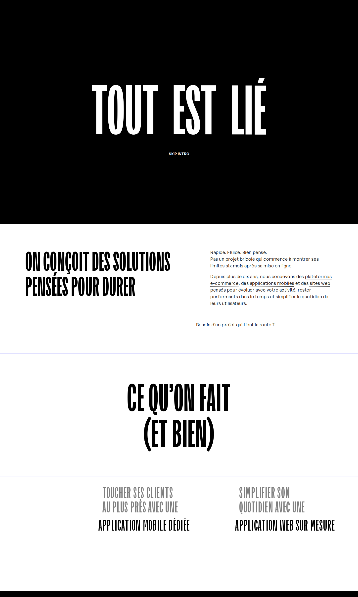

# UI Design System & Master Generation Blueprint: www-leadoff-fr

> **Agence digitale à Vannes : web, mobile & acquisition · LEADOFF** (https://www.leadoff.fr) — LEADOFF conçoit des applications web et mobiles, sites e-commerce et stratégies d’acquisition. Une équipe digitale experte basée à Vannes.



---

## 1. Executive Visual Persona & Design Archetype

- **Brand Essence & Persona**: **Agence digitale à Vannes : web, mobile & acquisition · LEADOFF** (`https://www.leadoff.fr`). LEADOFF conçoit des applications web et mobiles, sites e-commerce et stratégies d’acquisition. Une équipe digitale experte basée à Vannes.
- **Visual Archetype**: **High-Contrast Obsidian / Atmospheric Design System (`#00f` canvas, `#ff0` ink, `#7a00df` accent)**.
- **Anti-AI-Slop Differentiators**:
  - **Source-Grounded Chromatic Polarity**: Anchors the viewport in `#00f` (`var(--focus-color)` in `:root`) paired with `#ff0` primary typography and `#7a00df` accents.
  - **Extracted Typographic Hierarchy**: Pairs `NewTitle-Variable` for display copy (`Des applications et des sites qui pe`) with `GeneralSans-Variable` and not declared in static CSS (uses primary stack / `ui-monospace`).
  - **Calibrated Spatial Grid & Motion**: Combines `991px` container bounds (`gap: 24px`, padding `16px`) with `cubic-bezier(.16,1,.3,1)` easing and Barba.js Page Transition Router.

---

## 2. Spatial Architecture & Modular Grid Mathematics


### Viewport Allocation & Container Geometry
- **Captured Viewport Dimensions**: Desktop `1440×10652px` (`assets/desktop.png`, full-page scroll capture), Mobile `390×2400px` (`assets/mobile.png`, capped at 2400px multi-section capture).
- **Master Container Bounds**: `991px` extracted from `www-leadoff-fr` stylesheet.
- **Canvas Lateral Padding & Spacing**: `16px` lateral canvas padding with `24px` grid gap.
- **Border Radius Scale**: `8px`, `50%`, `999px`, `9999px`.

### Responsive Breakpoint Architecture
- **Desktop Layout**: Multi-column CSS Grid / Flexbox layout at `1440px` (`max-width: 991px`, `gap: 24px`).
- **Mobile Layout**: Single-column vertical stack at `390px` viewport width with `16px` horizontal padding.
- **Extracted CSS Media Queries**: `@media (min-width:768px)`, `@media (min-width:992px)`, `@media (prefers-reduced-motion:reduce)`, `@media (min-aspect-ratio:1/1) and (min-width:992px)`.

---

## 3. Color System, Materiality & Atmospheric Lighting

### Semantic Palette & Source Grounding
| Semantic Role | Ground-Truth Value | Extracted CSS Source / Selector |
|---|---|---|
| **Primary Canvas Substrate** | `#00f` | `var(--focus-color)` in `:root` |
| **Primary Typography Ink** | `#ff0` | `var(--menu-focus-color)` in `:root` |
| **Elevated Surface / Card Substrate** | `#000` | `var(--menu-focus-contrast)` in `:root` |
| **Interactive Accent / Highlight** | `#7a00df` | `var(--wp-block-synced-color)` in `:root` |
| **Secondary / Muted Copy** | `#ddd` | `var(--wp-editor-canvas-background)` in `:root` |
| **Structural Hairline Border** | `#007cba` | `var(--wp-admin-theme-color)` in `:root` |

### Sanitized Root CSS Variables (`ui-ux.md` Ground Truth)
| Variable Name | Extracted Value | Semantic Role |
|---|---|---|
| `--focus-color` | `#00f` | Brand / Palette Token |
| `--focus-ring-color` | `var(--focus-color)` | Brand / Palette Token |
| `--menu-focus-color` | `#ff0` | Brand / Palette Token |
| `--menu-focus-contrast` | `#000` | Color / Atmospheric Token |
| `--expandable-focus-color` | `#ff0` | Brand / Palette Token |
| `--editorial-expandable-focus-color` | `#ff0` | Brand / Palette Token |
| `--highlight-focus-color` | `#ff0` | Canvas / Surface Token |
| `--highlight-focus-contrast` | `#000` | Canvas / Surface Token |
| `--highlight-list-height` | `100vh` | Canvas / Surface Token |
| `--highlight-item-width` | `max(320px,min(84vw,420px))` | Canvas / Surface Token |
| `--highlight-image-height` | `max(240px,min(20vw,100vw))` | Canvas / Surface Token |
| `--wp-block-synced-color` | `#7a00df` | Brand / Palette Token |
| `--wp-block-synced-color--rgb` | `122,0,223` | Brand / Palette Token |
| `--wp-bound-block-color` | `var(--wp-block-synced-color)` | Brand / Palette Token |
| `--wp-editor-canvas-background` | `#ddd` | Canvas / Surface Token |
| `--wp-admin-theme-color` | `#007cba` | Brand / Palette Token |

---

## 4. Typographic Scale & Editorial Hierarchy

### Font Family Stacks
- **Display Typography**: `NewTitle-Variable`.
- **Primary Body Stack**: `GeneralSans-Variable`.
- **Technical / Metadata Stack**: not declared in static CSS (uses primary stack / `ui-monospace`).

### Typographic Scale & Rules (Extracted from Stylesheet & Variables)
- **Hero Display (`H1`)**: not explicitly declared on tag in static CSS (stylesheet font-size ladder: `16px`, `20px`, `13px`, `12px`, `10px`).
- **Section Heading (`H2`)**: rule `,h2` (`font-size: max(80px,min(10vw,100vw))`, `font-weight: 650`).
- **Body Copy**: rule `,p` (`font-size: max(18px,min(.9vw,100vw))`, `line-height: 1.5`, `letter-spacing: .03em`).
- **Metadata & Navigation Labels**: not explicitly declared on tag in static CSS (stylesheet font-size ladder: `16px`, `20px`, `13px`, `12px`, `10px`).

---

## 5. Choreographed Motion & Interaction Physics

### Primary Easing Curves
- **Extracted Timing Functions**: `cubic-bezier(.16,1,.3,1)`, `cubic-bezier(.4,0,.2,1)`.

### Per-Element Transition & Choreography Rules
- **Selector `.loader`**: `transition: opacity .45s ease,-webkit-transform .45s ease` extracted from `www-leadoff-fr` stylesheet.
- **Selector `.loader .loader-skip`**: `transition: color .2s ease,opacity .2s ease` extracted from `www-leadoff-fr` stylesheet.
- **Selector `.loader .loader-word-letter`**: `transition: opacity .24s ease,-webkit-transform .58s cubic-bezier(.16,1,.3,1)` extracted from `www-leadoff-fr` stylesheet.
- **Extracted Easing Curve (`cubic-bezier(.16,1,.3,1)`)**: Governs interactive state transitions across `<header.yoast-schema-graph>` and `<section.editorial-pitch>`.
- **Runtime Interaction Engine**: Integrates Barba.js Page Transition Router with `prefers-reduced-motion: reduce` fallback guards.

---

## 6. Component Wireframe & Structural DOM Map

### Visual Layout Schematic (Grounded in `dom.html` — `1440px` Desktop & `390px` Mobile Reflow)
```
┌────────────────────────────────────────────────────────────────────────┐
│ DESKTOP VIEWPORT (1440px) — Agence digitale à Vannes : web, mobile & a │
│ ====================================================================== │
│ [ <header.yoast-schema-gra | Services · Applications mobiles · Appl ]  │
│ ---------------------------------------------------------------------- │
│ | HERO STAGE: <section.observe-section>                            |   │
│ | H1: Des applications et des sites qui performent                 |   │
│ | Substrate: #00f       | Ink: #ff0       | Accent: #7a00df        |   │
│ ---------------------------------------------------------------------- │
│ | SHOWCASE GRID (<section.editorial-pitch> ) max-w: 991px          |   │
│ | +------------------------------+  +------------------------------+ | │
│ | | On conçoit des solutions pen |  | Ce qu’on fait (et bien)      | | │
│ | +------------------------------+  +------------------------------+ | │
│ ---------------------------------------------------------------------- │
│ | MOBILE VIEWPORT REFLOW (390px) — Single-Column Stack (gap: 24px  ) | │
│ | [<header.yoast-sche] -> [<section.observe-s] -> [<section.editorial] │
│ ---------------------------------------------------------------------- │
│ [ FOOTER (<footer.observe-sectio) | https://www.leadoff.fr             │
└────────────────────────────────────────────────────────────────────────┘
```

### Granular DOM Region Breakdown
1. **Brand Header & Navigation Bar (<header.yoast-schema-graph> — `www-leadoff-fr`)**:
   - Landmark `<header class="yoast-schema-graph">` hosting `Agence digitale à Vannes : web, mobi` navigation (`Services · Applications mobiles · Applications web · Sites e-commerce · Sites vitrine`), DOM attributes (`data-barba="wrapper"`, `data-storage-key="leadoff.loaderIntroSh..."`, `data-session-duration="1800000"`, `data-icon="false"`), and stylesheet rule `.loader.loader--hidden { opacity:0;-webkit-transform:scale(.98);transform:scale(.98) }`.
2. **Hero Stage & Focal Lead (<section.observe-section> — `Des applications et des sites qui `)**:
   - Landmark `<section class="observe-section bg-blue">` presenting display lead `Des applications et des sites qui performent` and copy excerpt *"Chargement du site"* over `#00f` canvas and `#ff0` ink.
3. **Primary Showcase & Content Grid (<section.editorial-pitch> — `On conçoit des solutions pensées p`)**:
   - Landmark `<section class="editorial-pitch observe-section">` rendering section `On conçoit des solutions pensées pour durer` with copy *"Services Applications mobiles Applications web Sites e-commerce S"*, asset references (`bundle.68ec1454.css`, `jquery.min.js`, `jquery-migrate.min.js`, `cropped-FAVICON-1-32x32.jpg`), and grid rule `.loader .loader-word { display:-webkit-box;display:-ms-flexbox;display:flex;overflow:hidden }`.
4. **Interactive Detail & Feature Matrix (<section.editorial-highlight> — `Ce qu’on fait (et bien)`)**:
   - Landmark `<section class="editorial-highlight observe-section">` framing `Ce qu’on fait (et bien)` and `Pourquoi LEADOFF et pas un autre` (*"Applications mobiles"*) with `#000` surface cards, `#7a00df` accents, and `.loader .loader-skip:focus-visible { color:ff0;outline:none }`.
5. **Colophon & Global Directory Footer (<footer.observe-section> — `https://www.leadoff.fr`)**:
   - Landmark `<footer class="observe-section bg-blue">` anchoring `Agence digitale à Vannes : web, ` footer links (`Services · Applications mobiles · Applications web · Sites e-commerce · Sites vitrine`), copy *"Sites pour collectivités"*, and `#007cba` structural dividers.

---

## 7. Master Zero-Shot AI Generation Prompt

```markdown
# Master Zero-Shot Frontend Generation Prompt: www-leadoff-fr (Agence digitale à Vannes : web, mobile & acquisition · LEADOFF)

You are a principal frontend architect and design systems engineer. Build a complete, production-ready web application replicating the exact design system, DOM landmarks, typographic hierarchy, color tokens, and motion physics of `www-leadoff-fr` (**Agence digitale à Vannes : web, mobile & acquisition · LEADOFF** — `https://www.leadoff.fr`).

### 1. Visual Archetype & Anti-AI-Slop Mandates
- **Archetype**: High-Contrast Obsidian / Atmospheric Design System (`#00f` canvas, `#ff0` ink, `#7a00df` accent).
- **Identity & Domain Context**: LEADOFF conçoit des applications web et mobiles, sites e-commerce et stratégies d’acquisition. Une équipe digitale experte basée à Vannes.
- **Primary Substrate**: `#00f` (`var(--focus-color)` in `:root`), **Primary Ink**: `#ff0`, **Accent / Highlight**: `#7a00df`.
- **Site-Specific Differentiators**:
  - **Source-Grounded Chromatic Polarity**: Anchors the viewport in `#00f` (`var(--focus-color)` in `:root`) paired with `#ff0` primary typography and `#7a00df` accents.
  - **Extracted Typographic Hierarchy**: Pairs `NewTitle-Variable` for display copy (`Des applications et des sites qui pe`) with `GeneralSans-Variable` and not declared in static CSS (uses primary stack / `ui-monospace`).
  - **Calibrated Spatial Grid & Motion**: Combines `991px` container bounds (`gap: 24px`, padding `16px`) with `cubic-bezier(.16,1,.3,1)` easing and Barba.js Page Transition Router.

### 2. Ground-Truth CSS Variables (`:root` Token Contract)
Declare and consume these exact custom properties extracted from `www-leadoff-fr` in your global stylesheet:

:root {
  /* Agence digitale à Vannes : web, mobile & acquisition · LEADOFF (www-leadoff-fr) — Ground-Truth Extracted CSS Variables */
  --focus-color: #00f; /* Brand / Palette Token (www-leadoff-fr) */
  --focus-ring-color: var(--focus-color); /* Brand / Palette Token (www-leadoff-fr) */
  --menu-focus-color: #ff0; /* Brand / Palette Token (www-leadoff-fr) */
  --menu-focus-contrast: #000; /* Color / Atmospheric Token (www-leadoff-fr) */
  --expandable-focus-color: #ff0; /* Brand / Palette Token (www-leadoff-fr) */
  --editorial-expandable-focus-color: #ff0; /* Brand / Palette Token (www-leadoff-fr) */
  --highlight-focus-color: #ff0; /* Canvas / Surface Token (www-leadoff-fr) */
  --highlight-focus-contrast: #000; /* Canvas / Surface Token (www-leadoff-fr) */
  --highlight-list-height: 100vh; /* Canvas / Surface Token (www-leadoff-fr) */
  --highlight-item-width: max(320px,min(84vw,420px)); /* Canvas / Surface Token (www-leadoff-fr) */
  --highlight-image-height: max(240px,min(20vw,100vw)); /* Canvas / Surface Token (www-leadoff-fr) */
  --wp-block-synced-color: #7a00df; /* Brand / Palette Token (www-leadoff-fr) */
  --wp-block-synced-color--rgb: 122,0,223; /* Brand / Palette Token (www-leadoff-fr) */
  --wp-bound-block-color: var(--wp-block-synced-color); /* Brand / Palette Token (www-leadoff-fr) */
  --wp-editor-canvas-background: #ddd; /* Canvas / Surface Token (www-leadoff-fr) */
  --wp-admin-theme-color: #007cba; /* Brand / Palette Token (www-leadoff-fr) */
}

### 3. Semantic Color & Materiality Contract
Map every surface, ink, and border strictly to these source-grounded tokens:
- **Primary Canvas Substrate**: `#00f` — grounded in `var(--focus-color)` in `:root`
- **Primary Typography Ink**: `#ff0` — grounded in `var(--menu-focus-color)` in `:root`
- **Elevated Surface / Card Substrate**: `#000` — grounded in `var(--menu-focus-contrast)` in `:root`
- **Interactive Accent / Highlight**: `#7a00df` — grounded in `var(--wp-block-synced-color)` in `:root`
- **Secondary / Muted Copy**: `#ddd` — grounded in `var(--wp-editor-canvas-background)` in `:root`
- **Structural Hairline Border**: `#007cba` — grounded in `var(--wp-admin-theme-color)` in `:root`

### 4. Spatial Grid, Container Bounds & Responsive Breakpoints
- **Desktop Viewport Reference**: `1440×10652px` (full-page scroll capture, `1440px` standard desktop width).
- **Mobile Viewport Reference**: `390×2400px` (capped at 2400px multi-section capture, `390px` standard mobile width).
- **Container Max-Width**: `991px` extracted from `www-leadoff-fr` stylesheet
- **Padding & Gutters**: `16px` lateral canvas padding with `24px` grid gap
- **Desktop Grid**: Multi-column CSS Grid / Flexbox layout at `1440px` (`max-width: 991px`, `gap: 24px`)
- **Mobile Adaptation**: Single-column vertical stack at `390px` viewport width with `16px` horizontal padding
- **Media Queries**: `@media (min-width:768px)`, `@media (min-width:992px)`, `@media (prefers-reduced-motion:reduce)`, `@media (min-aspect-ratio:1/1) and (min-width:992px)`
- **Corner Radii**: `8px`, `50%`, `999px`, `9999px`

### 5. Typography & Editorial Scale Contract
- **Display Font Stack**: `NewTitle-Variable`
- **Body Font Stack**: `GeneralSans-Variable`
- **Monospace / Technical Font Stack**: not declared in static CSS (uses primary stack / `ui-monospace`)
- **H1 Display Rule**: not explicitly declared on tag in static CSS (stylesheet font-size ladder: `16px`, `20px`, `13px`, `12px`, `10px`)
- **H2 Section Rule**: rule `,h2` (`font-size: max(80px,min(10vw,100vw))`, `font-weight: 650`)
- **Body Copy Rule**: rule `,p` (`font-size: max(18px,min(.9vw,100vw))`, `line-height: 1.5`, `letter-spacing: .03em`)
- **Metadata & Index Rule**: not explicitly declared on tag in static CSS (stylesheet font-size ladder: `16px`, `20px`, `13px`, `12px`, `10px`)

### 6. Component Hierarchy, Verbatim Copy & Real DOM Landmarks
Scaffold `www-leadoff-fr` (`Agence digitale à Vannes : web, mobile & acquisition · LEADOFF`) with these exact structural regions, extracted copy, and CSS rules from `dom.html`:
1. **Brand Header & Navigation Bar (<header.yoast-schema-graph> — `www-leadoff-fr`)**:
   - DOM & Selectors: Landmark `<header class="yoast-schema-graph">` hosting `Agence digitale à Vannes : web, mobi` navigation (`Services · Applications mobiles · Applications web · Sites e-commerce · Sites vitrine`), DOM attributes (`data-barba="wrapper"`, `data-storage-key="leadoff.loaderIntroSh..."`, `data-session-duration="1800000"`, `data-icon="false"`), and stylesheet rule `.loader.loader--hidden { opacity:0;-webkit-transform:scale(.98);transform:scale(.98) }`.
   - Responsive Contract: Header `Brand Header & Navigation Bar (<header.yoast-schema-graph> — `www-leadoff-fr`)` (`www-leadoff-fr`) adapts across `@media (min-width:768px)`, `@media (min-width:992px)`, `@media (prefers-reduced-motion:reduce)`, `@media (min-aspect-ratio:1/1) and (min-width:992px)` with `cubic-bezier(.16,1,.3,1)`, `cubic-bezier(.4,0,.2,1)` transitions and links `Services · Applications mobiles · Applications web · Sites e-commerce · Sites vitrine`.
2. **Hero Stage & Focal Lead (<section.observe-section> — `Des applications et des sites qui `)**:
   - DOM & Selectors: Landmark `<section class="observe-section bg-blue">` presenting display lead `Des applications et des sites qui performent` and copy excerpt *"Chargement du site"* over `#00f` canvas and `#ff0` ink.
   - Responsive Contract: Hero stage (`1440×10652px` desktop / `390×2400px` mobile) sets `#00f` background with `#ff0` headline `Des applications et des sites qui performent`.
3. **Primary Showcase & Content Grid (<section.editorial-pitch> — `On conçoit des solutions pensées p`)**:
   - DOM & Selectors: Landmark `<section class="editorial-pitch observe-section">` rendering section `On conçoit des solutions pensées pour durer` with copy *"Services Applications mobiles Applications web Sites e-commerce S"*, asset references (`bundle.68ec1454.css`, `jquery.min.js`, `jquery-migrate.min.js`, `cropped-FAVICON-1-32x32.jpg`), and grid rule `.loader .loader-word { display:-webkit-box;display:-ms-flexbox;display:flex;overflow:hidden }`.
   - Responsive Contract: Showcase grid `Primary Showcase & Content Grid (<section.editorial-pitch> — `On conçoit des solutions pensées p`)` applies Multi-column CSS Grid / Flexbox layout at `1440px` (`max-width: 991px`, `gap: 24px`) on desktop and Single-column vertical stack at `390px` viewport width with `16px` horizontal padding on mobile.
4. **Interactive Detail & Feature Matrix (<section.editorial-highlight> — `Ce qu’on fait (et bien)`)**:
   - DOM & Selectors: Landmark `<section class="editorial-highlight observe-section">` framing `Ce qu’on fait (et bien)` and `Pourquoi LEADOFF et pas un autre` (*"Applications mobiles"*) with `#000` surface cards, `#7a00df` accents, and `.loader .loader-skip:focus-visible { color:ff0;outline:none }`.
   - Responsive Contract: Detail module `Interactive Detail & Feature Matrix (<section.editorial-highlight> — `Ce qu’on fait (et bien)`)` uses `8px`, `50%`, `999px`, `9999px` radii, `#7a00df` highlights, and assets (bundle.68ec1454.css, jquery.min.js, jquery-migrate.min.js).
5. **Colophon & Global Directory Footer (<footer.observe-section> — `https://www.leadoff.fr`)**:
   - DOM & Selectors: Landmark `<footer class="observe-section bg-blue">` anchoring `Agence digitale à Vannes : web, ` footer links (`Services · Applications mobiles · Applications web · Sites e-commerce · Sites vitrine`), copy *"Sites pour collectivités"*, and `#007cba` structural dividers.
   - Responsive Contract: Footer `Colophon & Global Directory Footer (<footer.observe-section> — `https://www.leadoff.fr`)` aligns to `991px` extracted from `www-leadoff-fr` stylesheet with `16px` lateral canvas padding with `24px` grid gap and attributes (data-barba="wrapper", data-storage-key="leadoff.loaderIntroSh...", data-session-duration="1800000").

#### Verbatim DOM Copy Excerpts (`dom.html`)
- Copy Excerpt 1: *"Chargement du site"*
- Copy Excerpt 2: *"Services Applications mobiles Applications web Sites e-commerce Sites pour collect..."*
- Copy Excerpt 3: *"Applications mobiles"*
- Copy Excerpt 4: *"Sites pour collectivités"*

### 7. Motion, Extracted Stylesheet Rules & Interaction Choreography
- **Primary Easing Functions**: `cubic-bezier(.16,1,.3,1)`, `cubic-bezier(.4,0,.2,1)`
- **Extracted Stylesheet Rules (`www-leadoff-fr`)**:
- `.loader.loader--hidden { opacity:0;-webkit-transform:scale(.98);transform:scale(.98) }`
- `.loader .loader-word { display:-webkit-box;display:-ms-flexbox;display:flex;overflow:hidden }`
- `.loader .loader-skip:focus-visible { color:ff0;outline:none }`
- `.loader .loader-word-space { width:.22em }`
- `.loader .loader-logo svg { display:block;height:auto;width:100% }`
- **Per-Selector Transition Rules**:
- **Selector `.loader`**: `transition: opacity .45s ease,-webkit-transform .45s ease` extracted from `www-leadoff-fr` stylesheet.
- **Selector `.loader .loader-skip`**: `transition: color .2s ease,opacity .2s ease` extracted from `www-leadoff-fr` stylesheet.
- **Selector `.loader .loader-word-letter`**: `transition: opacity .24s ease,-webkit-transform .58s cubic-bezier(.16,1,.3,1)` extracted from `www-leadoff-fr` stylesheet.
- **Extracted Easing Curve (`cubic-bezier(.16,1,.3,1)`)**: Governs interactive state transitions across `<header.yoast-schema-graph>` and `<section.editorial-pitch>`.
- **Runtime Interaction Engine**: Integrates Barba.js Page Transition Router with `prefers-reduced-motion: reduce` fallback guards.

### 8. Technical Deliverables
- Implement in Next.js (App Router) with TypeScript and Tailwind CSS consuming the `:root` custom properties defined above for `www-leadoff-fr`.
- Reproduce both the `1440px` desktop architecture and `390px` mobile breakpoint transitions, preserving semantic HTML5 landmarks (`<header>`, `<nav>`, `<main>`, `<section>`, `<footer>`) and `prefers-reduced-motion` accessibility guards.
```
