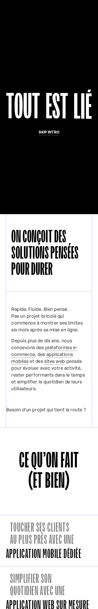

# UI Design System & Master Generation Blueprint: www-leadoff-fr

> **Agence digitale à Vannes : web, mobile & acquisition · LEADOFF** (https://www.leadoff.fr) — LEADOFF conçoit des applications web et mobiles, sites e-commerce et stratégies d’acquisition. Une équipe digitale experte basée à Vannes.


---

## 1. Executive Visual Persona & Design Archetype

- **Brand Essence & Persona**: **Agence digitale à Vannes : web, mobile & acquisition · LEADOFF** (`https://www.leadoff.fr`). LEADOFF conçoit des applications web et mobiles, sites e-commerce et stratégies d’acquisition. Une équipe digitale experte basée à Vannes.
- **Capture Provenance**: Live browser capture (`tier1_fast`, HTTP `200`, captured `2026-11-23`).
- **Visual Archetype**: **High-Contrast Obsidian / Atmospheric Design System (`#0000ff` canvas, `#ffffff` ink, `#ffff00` accent)**.
- **Anti-AI-Slop Differentiators**:
  - **Live-Computed Chromatic Polarity**: Anchors the viewport in `#0000ff` (live computed `section` `background-color` (`computed_styles.json`)) paired with `#ffffff` primary typography and `#ffff00` accents.
  - **Grounded Typographic Hierarchy**: Pairs `NewTitle-Variable` for display copy (`DES APPLICATIONS ET DES SITES QUI PE`) with `GeneralSans-Variable` and not declared in live computed styles (uses primary stack / `ui-monospace`).
  - **Calibrated Spatial Grid & Motion**: Combines `1440px` container bounds (`gap: 24px`, padding `16px`) with `cubic-bezier(.16,1,.3,1)` easing and Barba.js Page Transition Router.

---

## 2. Spatial Architecture & Modular Grid Mathematics



### Viewport Allocation & Container Geometry
- **Captured Viewport Dimensions**: Desktop `1440×2400px` (`assets/desktop.png`, clamped at 2400px live multi-section capture), Mobile `390×2400px` (`assets/mobile.png`, clamped at 2400px live multi-section capture).
- **Master Container Bounds**: `1440px` (non-`@media` desktop container stylesheet rule).
- **Canvas Lateral Padding & Spacing**: `16px` lateral canvas padding with `24px` grid gap.
- **Border Radius Scale**: `8px`, `50%`, `999px`, `9999px`.

### Responsive Breakpoint Architecture
- **Desktop Layout**: Multi-column CSS Grid / Flexbox layout at `1440px` (`max-width: 1440px`, `gap: 24px`).
- **Mobile Layout**: Single-column vertical stack at `390px` viewport width with `16px` horizontal padding.
- **Extracted CSS Media Queries**: `@media (min-width:768px)`, `@media (min-width:992px)`, `@media (prefers-reduced-motion:reduce)`, `@media (min-aspect-ratio:1/1) and (min-width:992px)`.

---

## 3. Color System, Materiality & Atmospheric Lighting

### Semantic Palette & Source Grounding
| Semantic Role | Ground-Truth Value | Extracted Live / CSS Source |
|---|---|---|
| **Primary Canvas Substrate** | `#0000ff` | live computed `section` `background-color` (`computed_styles.json`) |
| **Primary Typography Ink** | `#ffffff` | live computed `h1` `color` (`computed_styles.json`) |
| **Elevated Surface / Card Substrate** | `#000000` | `.loader.loader--black { background: #000000 }` |
| **Interactive Accent / Highlight** | `#ffff00` | live computed `a` `color` (`computed_styles.json`) |
| **Secondary / Muted Copy** | `#000000` | live computed `p` `color` (`computed_styles.json`) |
| **Structural Hairline Border** | `#000099` | `.bg-yellow .editorial-flow-cont... { border-color: #000099 }` |
| **Variable Token (`--wp-block-synced-color`)** | `#7a00df` | `var(--wp-block-synced-color)` in `:root` |
| **Variable Token (`--wp-editor-canvas-background`)** | `#dddddd` | `var(--wp-editor-canvas-background)` in `:root` |
| **Variable Token (`--wp-admin-theme-color`)** | `#007cba` | `var(--wp-admin-theme-color)` in `:root` |
| **Variable Token (`--wp-admin-theme-color-darker-10`)** | `#006ba1` | `var(--wp-admin-theme-color-darker-10)` in `:root` |
| **Variable Token (`--wp-admin-theme-color-darker-20`)** | `#005a87` | `var(--wp-admin-theme-color-darker-20)` in `:root` |

### Sanitized Root CSS Variables (`ui-ux.md` Ground Truth)
| Variable Name | Extracted Value | Semantic Role |
|---|---|---|
| `--focus-color` | `#00f` | Brand / Palette Token |
| `--focus-ring-color` | `var(--focus-color)` | Brand / Palette Token |
| `--wp-block-synced-color` | `#7a00df` | Brand / Palette Token |
| `--wp-block-synced-color--rgb` | `122,0,223` | Brand / Palette Token |
| `--wp-bound-block-color` | `var(--wp-block-synced-color)` | Brand / Palette Token |
| `--wp-editor-canvas-background` | `#ddd` | Canvas / Surface Token |
| `--wp-admin-theme-color` | `#007cba` | Brand / Palette Token |
| `--wp-admin-theme-color--rgb` | `0,124,186` | Brand / Palette Token |
| `--wp-admin-theme-color-darker-10` | `#006ba1` | Canvas / Surface Token |
| `--wp-admin-theme-color-darker-10--rgb` | `0,107,160.5` | Canvas / Surface Token |
| `--wp-admin-theme-color-darker-20` | `#005a87` | Canvas / Surface Token |
| `--wp-admin-theme-color-darker-20--rgb` | `0,90,135` | Canvas / Surface Token |
| `--wp-admin-border-width-focus` | `2px` | Layout / Spatial Grid Token |
| `--wp-admin--admin-bar--position-offset` | `var(--wp-admin--admin-bar--height,0px)` | Dimension / Scale Token |
| `--menu-focus-color` | `#ff0` | Brand / Palette Token |
| `--menu-focus-contrast` | `#000` | Color / Atmospheric Token |

---

## 4. Typographic Scale & Editorial Hierarchy

### Font Family Stacks
- **Display Typography**: `NewTitle-Variable`.
- **Primary Body Stack**: `GeneralSans-Variable`.
- **Technical / Metadata Stack**: not declared in live computed styles (uses primary stack / `ui-monospace`).

### Typographic Scale & Rules (Live Computed & Stylesheet Grounded)
- **Hero Display (`H1`)**: live computed `h1` (`font-size: 129.6px`, `line-height: 132.84px`, `font-weight: 650`, `letter-spacing: 1.296px`).
- **Section Heading (`H2`)**: live computed `h2` (`font-size: 100.8px`, `line-height: 100.8px`, `font-weight: 650`, `letter-spacing: 1.008px`); rule `,h2` (`font-size: max(80px,min(10vw,100vw))`, `font-weight: 650`).
- **Body Copy**: live computed `body` (`font-size: 16px`, `line-height: normal`, `font-weight: 400`); rule `,p` (`font-size: max(18px,min(.9vw,100vw))`, `line-height: 1.5`, `letter-spacing: .03em`).
- **Metadata & Navigation Labels**: live computed `nav/a` (`font-size: 16px`, `line-height: normal`, `font-weight: 400`).

---

## 5. Choreographed Motion & Interaction Physics

### Primary Easing Curves
- **Extracted Timing Functions**: `cubic-bezier(.16,1,.3,1)`, `cubic-bezier(.4,0,.2,1)`.

### Per-Element Transition & Choreography Rules
- **Selector `.loader`**: `transition: opacity .45s ease,-webkit-transform .45s ease` extracted from `www-leadoff-fr` stylesheet.
- **Selector `.loader .loader-skip`**: `transition: color .2s ease,opacity .2s ease` extracted from `www-leadoff-fr` stylesheet.
- **Selector `.loader .loader-word-letter`**: `transition: opacity .24s ease,-webkit-transform .58s cubic-bezier(.16,1,.3,1)` extracted from `www-leadoff-fr` stylesheet.
- **Extracted Easing Curve (`cubic-bezier(.16,1,.3,1)`)**: Governs interactive state transitions across `<header.yoast-schema-graph>` and `<section.editorial-pitch>`.
- **Runtime Interaction Engine**: Integrates Barba.js Page Transition Router with `prefers-reduced-motion: reduce` fallback guards.

---

## 6. Component Wireframe & Structural DOM Map

### Visual Layout Schematic — Desktop (`1440px`, Grounded in `dom.html` & Landmark Bounding Boxes)
```
┌────────────────────────────────────────────────────────────────────────┐
│ DESKTOP VIEWPORT (1440px) — Agence digitale à Vannes : web, mobile & a │
│ ====================================================================== │
│ [ <header.yoast-schema-g (1440x0px)   | Services · Applications mobi ] │
│ ---------------------------------------------------------------------- │
│ | HERO STAGE: <section.observe-section> (w=1440px)                   | │
│ | H1: DES APPLICATIONS ET DES SITES QUI PERFORMENT                   | │
│ | Substrate: #0000ff | Ink: #ffffff | Accent: #ffff00                | │
│ ---------------------------------------------------------------------- │
│ | SHOWCASE GRID (<section.editorial-pitch>) max-w: 1440px            | │
│ | +------------------------------+  +------------------------------+ | │
│ | | Des applications et des site |  | On conçoit des solutions pen | | │
│ | +------------------------------+  +------------------------------+ | │
│ ---------------------------------------------------------------------- │
│ | DETAIL MODULE (<section.editorial-highlig) — Ce qu’on fait (et bie | │
│ ---------------------------------------------------------------------- │
│ [ FOOTER (<footer.observe-sect) | https://www.leadoff.fr               │
└────────────────────────────────────────────────────────────────────────┘
```

### Visual Layout Schematic — Mobile Reflow (`390px`)
```
┌────────────────────────────────────────────────────────────────────────┐
│ MOBILE VIEWPORT REFLOW (390px) — Single-Column Stack (gap: 24px)       │
│ ====================================================================== │
│ [ HEADER BAR (<header.yoast-schema-gra) | Compact Menu (390px)         │
│ ---------------------------------------------------------------------- │
│ | HERO STAGE (<section.observe-section) — 390px Vertical Lead        | │
│ | H1: DES APPLICATIONS ET DES SITES QUI PERFORMENT                   | │
│ ---------------------------------------------------------------------- │
│ | SHOWCASE STACK (<section.editorial-pit) — 1-Col Stack              | │
│ | [ Item 1: Des applications et des sites qui performent           ] | │
│ | [ Item 2: On conçoit des solutions pensées pour durer            ] | │
│ ---------------------------------------------------------------------- │
│ | DETAIL STACK (<section.editorial-highl) — 1-Col (Ce qu’on fait (et ) │
│ ---------------------------------------------------------------------- │
│ [ FOOTER (<footer.observe-sect) | Stacked 390px Colophon               │
└────────────────────────────────────────────────────────────────────────┘
```

### Granular DOM Region Breakdown
1. **Brand Header & Navigation Bar (<header.yoast-schema-graph> — `www-leadoff-fr`)**:
   - Landmark `<header class="yoast-schema-graph">` (`1440x0px`) hosting `Agence digitale à Vannes : web, mobi` navigation (`Services · Applications mobiles · Applications web · Sites e-commerce · Sites vitrine`), DOM attributes (`data-barba="wrapper"`, `data-storage-key="leadoff.loaderIntroSh..."`, `data-session-duration="1800000"`, `data-icon="false"`), and stylesheet rule `.loader.loader--hidden { opacity:0;-webkit-transform:scale(.98);transform:scale(.98) }`.
2. **Hero Stage & Focal Lead (<section.observe-section> — `DES APPLICATIONS ET DES SITES QUI `)**:
   - Landmark `<section class="observe-section bg-blue">` presenting display lead `DES APPLICATIONS ET DES SITES QUI PERFORMENT` and copy excerpt *"Rapide. Fluide. Bien pensé. Pas un projet bricolé qui commence à "* over `#0000ff` canvas and `#ffffff` ink.
3. **Primary Showcase & Content Grid (<section.editorial-pitch> — `Des applications et des sites qui `)**:
   - Landmark `<section class="editorial-pitch observe-section">` rendering section `Des applications et des sites qui performent` with copy *"Un site web, une boutique en ligne, une application… C’est un inv"*, asset references (`bundle.68ec1454.css`, `jquery.min.js`, `jquery-migrate.min.js`, `cropped-FAVICON-1-32x32.jpg`), and grid rule `.loader .loader-word { display:-webkit-box;display:-ms-flexbox;display:flex;overflow:hidden }`.
4. **Interactive Detail & Feature Matrix (<section.editorial-highlight> — `On conçoit des solutions pensées p`)**:
   - Landmark `<section class="editorial-highlight observe-section">` framing `On conçoit des solutions pensées pour durer` and `Ce qu’on fait (et bien)` (*"Depuis plus de dix ans, nous concevons des plateformes e-commerce"*) with `#000000` surface cards, `#ffff00` accents, and `.loader .loader-skip:focus-visible { color:ff0;outline:none }`.
5. **Colophon & Global Directory Footer (<footer.observe-section> — `https://www.leadoff.fr`)**:
   - Landmark `<footer class="observe-section bg-blue">` anchoring `Agence digitale à Vannes : web, ` footer links (`Services · Applications mobiles · Applications web · Sites e-commerce · Sites vitrine`), copy *"toucher ses clients au plus près avec Une"*, and `#000099` structural dividers.

---

## 7. Master Zero-Shot AI Generation Prompt

```markdown
# Master Zero-Shot Frontend Generation Prompt: www-leadoff-fr (Agence digitale à Vannes : web, mobile & acquisition · LEADOFF)

You are a principal frontend architect and design systems engineer. Build a complete, production-ready web application replicating the exact design system, DOM landmarks, typographic hierarchy, color tokens, and motion physics of `www-leadoff-fr` (**Agence digitale à Vannes : web, mobile & acquisition · LEADOFF** — `https://www.leadoff.fr`).

### 1. Visual Archetype & Anti-AI-Slop Mandates
- **Archetype**: High-Contrast Obsidian / Atmospheric Design System (`#0000ff` canvas, `#ffffff` ink, `#ffff00` accent).
- **Identity & Domain Context**: LEADOFF conçoit des applications web et mobiles, sites e-commerce et stratégies d’acquisition. Une équipe digitale experte basée à Vannes.
- **Primary Substrate**: `#0000ff` (live computed `section` `background-color` (`computed_styles.json`)), **Primary Ink**: `#ffffff`, **Accent / Highlight**: `#ffff00`.
- **Site-Specific Differentiators**:
  - **Live-Computed Chromatic Polarity**: Anchors the viewport in `#0000ff` (live computed `section` `background-color` (`computed_styles.json`)) paired with `#ffffff` primary typography and `#ffff00` accents.
  - **Grounded Typographic Hierarchy**: Pairs `NewTitle-Variable` for display copy (`DES APPLICATIONS ET DES SITES QUI PE`) with `GeneralSans-Variable` and not declared in live computed styles (uses primary stack / `ui-monospace`).
  - **Calibrated Spatial Grid & Motion**: Combines `1440px` container bounds (`gap: 24px`, padding `16px`) with `cubic-bezier(.16,1,.3,1)` easing and Barba.js Page Transition Router.

### 2. Ground-Truth CSS Variables (`:root` Token Contract)
Declare and consume these exact custom properties extracted from `www-leadoff-fr` in your global stylesheet:

:root {
  /* Agence digitale à Vannes : web, mobile & acquisition · LEADOFF (www-leadoff-fr) — Live-Grounded CSS Variables */
  --focus-color: #00f; /* Brand / Palette Token (www-leadoff-fr) */
  --focus-ring-color: var(--focus-color); /* Brand / Palette Token (www-leadoff-fr) */
  --wp-block-synced-color: #7a00df; /* Brand / Palette Token (www-leadoff-fr) */
  --wp-block-synced-color--rgb: 122,0,223; /* Brand / Palette Token (www-leadoff-fr) */
  --wp-bound-block-color: var(--wp-block-synced-color); /* Brand / Palette Token (www-leadoff-fr) */
  --wp-editor-canvas-background: #ddd; /* Canvas / Surface Token (www-leadoff-fr) */
  --wp-admin-theme-color: #007cba; /* Brand / Palette Token (www-leadoff-fr) */
  --wp-admin-theme-color--rgb: 0,124,186; /* Brand / Palette Token (www-leadoff-fr) */
  --wp-admin-theme-color-darker-10: #006ba1; /* Canvas / Surface Token (www-leadoff-fr) */
  --wp-admin-theme-color-darker-10--rgb: 0,107,160.5; /* Canvas / Surface Token (www-leadoff-fr) */
  --wp-admin-theme-color-darker-20: #005a87; /* Canvas / Surface Token (www-leadoff-fr) */
  --wp-admin-theme-color-darker-20--rgb: 0,90,135; /* Canvas / Surface Token (www-leadoff-fr) */
  --wp-admin-border-width-focus: 2px; /* Layout / Spatial Grid Token (www-leadoff-fr) */
  --wp-admin--admin-bar--position-offset: var(--wp-admin--admin-bar--height,0px); /* Dimension / Scale Token (www-leadoff-fr) */
  --menu-focus-color: #ff0; /* Brand / Palette Token (www-leadoff-fr) */
  --menu-focus-contrast: #000; /* Color / Atmospheric Token (www-leadoff-fr) */
}

### 3. Semantic Color & Materiality Contract
Map every surface, ink, and border strictly to these source-grounded tokens:
- **Primary Canvas Substrate**: `#0000ff` — grounded in live computed `section` `background-color` (`computed_styles.json`)
- **Primary Typography Ink**: `#ffffff` — grounded in live computed `h1` `color` (`computed_styles.json`)
- **Elevated Surface / Card Substrate**: `#000000` — grounded in `.loader.loader--black { background: #000000 }`
- **Interactive Accent / Highlight**: `#ffff00` — grounded in live computed `a` `color` (`computed_styles.json`)
- **Secondary / Muted Copy**: `#000000` — grounded in live computed `p` `color` (`computed_styles.json`)
- **Structural Hairline Border**: `#000099` — grounded in `.bg-yellow .editorial-flow-cont... { border-color: #000099 }`
- **Variable Token (`--wp-block-synced-color`)**: `#7a00df` — grounded in `var(--wp-block-synced-color)` in `:root`
- **Variable Token (`--wp-editor-canvas-background`)**: `#dddddd` — grounded in `var(--wp-editor-canvas-background)` in `:root`
- **Variable Token (`--wp-admin-theme-color`)**: `#007cba` — grounded in `var(--wp-admin-theme-color)` in `:root`
- **Variable Token (`--wp-admin-theme-color-darker-10`)**: `#006ba1` — grounded in `var(--wp-admin-theme-color-darker-10)` in `:root`
- **Variable Token (`--wp-admin-theme-color-darker-20`)**: `#005a87` — grounded in `var(--wp-admin-theme-color-darker-20)` in `:root`

### 4. Spatial Grid, Container Bounds & Responsive Breakpoints
- **Desktop Viewport Reference**: `1440×2400px` (clamped at 2400px live multi-section capture, `1440px` standard desktop width).
- **Mobile Viewport Reference**: `390×2400px` (clamped at 2400px live multi-section capture, `390px` standard mobile width).
- **Container Max-Width**: `1440px` (non-`@media` desktop container stylesheet rule)
- **Padding & Gutters**: `16px` lateral canvas padding with `24px` grid gap
- **Desktop Grid**: Multi-column CSS Grid / Flexbox layout at `1440px` (`max-width: 1440px`, `gap: 24px`)
- **Mobile Adaptation**: Single-column vertical stack at `390px` viewport width with `16px` horizontal padding
- **Media Queries**: `@media (min-width:768px)`, `@media (min-width:992px)`, `@media (prefers-reduced-motion:reduce)`, `@media (min-aspect-ratio:1/1) and (min-width:992px)`
- **Corner Radii**: `8px`, `50%`, `999px`, `9999px`

### 5. Typography & Editorial Scale Contract
- **Display Font Stack**: `NewTitle-Variable`
- **Body Font Stack**: `GeneralSans-Variable`
- **Monospace / Technical Font Stack**: not declared in live computed styles (uses primary stack / `ui-monospace`)
- **H1 Display Rule**: live computed `h1` (`font-size: 129.6px`, `line-height: 132.84px`, `font-weight: 650`, `letter-spacing: 1.296px`)
- **H2 Section Rule**: live computed `h2` (`font-size: 100.8px`, `line-height: 100.8px`, `font-weight: 650`, `letter-spacing: 1.008px`); rule `,h2` (`font-size: max(80px,min(10vw,100vw))`, `font-weight: 650`)
- **Body Copy Rule**: live computed `body` (`font-size: 16px`, `line-height: normal`, `font-weight: 400`); rule `,p` (`font-size: max(18px,min(.9vw,100vw))`, `line-height: 1.5`, `letter-spacing: .03em`)
- **Metadata & Index Rule**: live computed `nav/a` (`font-size: 16px`, `line-height: normal`, `font-weight: 400`)

### 6. Component Hierarchy, Verbatim Copy & Real DOM Landmarks
Scaffold `www-leadoff-fr` (`Agence digitale à Vannes : web, mobile & acquisition · LEADOFF`) with these exact structural regions, extracted copy, and CSS rules from `dom.html`:
1. **Brand Header & Navigation Bar (<header.yoast-schema-graph> — `www-leadoff-fr`)**:
   - DOM & Selectors: Landmark `<header class="yoast-schema-graph">` (`1440x0px`) hosting `Agence digitale à Vannes : web, mobi` navigation (`Services · Applications mobiles · Applications web · Sites e-commerce · Sites vitrine`), DOM attributes (`data-barba="wrapper"`, `data-storage-key="leadoff.loaderIntroSh..."`, `data-session-duration="1800000"`, `data-icon="false"`), and stylesheet rule `.loader.loader--hidden { opacity:0;-webkit-transform:scale(.98);transform:scale(.98) }`.
   - Responsive Contract: Header `Brand Header & Navigation Bar (<header.yoast-schema-graph> — `www-leadoff-fr`)` (`www-leadoff-fr`) adapts across `@media (min-width:768px)`, `@media (min-width:992px)`, `@media (prefers-reduced-motion:reduce)`, `@media (min-aspect-ratio:1/1) and (min-width:992px)` with `cubic-bezier(.16,1,.3,1)`, `cubic-bezier(.4,0,.2,1)` transitions and links `Services · Applications mobiles · Applications web · Sites e-commerce · Sites vitrine`.
2. **Hero Stage & Focal Lead (<section.observe-section> — `DES APPLICATIONS ET DES SITES QUI `)**:
   - DOM & Selectors: Landmark `<section class="observe-section bg-blue">` presenting display lead `DES APPLICATIONS ET DES SITES QUI PERFORMENT` and copy excerpt *"Rapide. Fluide. Bien pensé. Pas un projet bricolé qui commence à "* over `#0000ff` canvas and `#ffffff` ink.
   - Responsive Contract: Hero stage (`1440×2400px` desktop / `390×2400px` mobile) sets `#0000ff` background with `#ffffff` headline `DES APPLICATIONS ET DES SITES QUI PERFORMENT`.
3. **Primary Showcase & Content Grid (<section.editorial-pitch> — `Des applications et des sites qui `)**:
   - DOM & Selectors: Landmark `<section class="editorial-pitch observe-section">` rendering section `Des applications et des sites qui performent` with copy *"Un site web, une boutique en ligne, une application… C’est un inv"*, asset references (`bundle.68ec1454.css`, `jquery.min.js`, `jquery-migrate.min.js`, `cropped-FAVICON-1-32x32.jpg`), and grid rule `.loader .loader-word { display:-webkit-box;display:-ms-flexbox;display:flex;overflow:hidden }`.
   - Responsive Contract: Showcase grid `Primary Showcase & Content Grid (<section.editorial-pitch> — `Des applications et des sites qui `)` applies Multi-column CSS Grid / Flexbox layout at `1440px` (`max-width: 1440px`, `gap: 24px`) on desktop and Single-column vertical stack at `390px` viewport width with `16px` horizontal padding on mobile.
4. **Interactive Detail & Feature Matrix (<section.editorial-highlight> — `On conçoit des solutions pensées p`)**:
   - DOM & Selectors: Landmark `<section class="editorial-highlight observe-section">` framing `On conçoit des solutions pensées pour durer` and `Ce qu’on fait (et bien)` (*"Depuis plus de dix ans, nous concevons des plateformes e-commerce"*) with `#000000` surface cards, `#ffff00` accents, and `.loader .loader-skip:focus-visible { color:ff0;outline:none }`.
   - Responsive Contract: Detail module `Interactive Detail & Feature Matrix (<section.editorial-highlight> — `On conçoit des solutions pensées p`)` uses `8px`, `50%`, `999px`, `9999px` radii, `#ffff00` highlights, and assets (bundle.68ec1454.css, jquery.min.js, jquery-migrate.min.js).
5. **Colophon & Global Directory Footer (<footer.observe-section> — `https://www.leadoff.fr`)**:
   - DOM & Selectors: Landmark `<footer class="observe-section bg-blue">` anchoring `Agence digitale à Vannes : web, ` footer links (`Services · Applications mobiles · Applications web · Sites e-commerce · Sites vitrine`), copy *"toucher ses clients au plus près avec Une"*, and `#000099` structural dividers.
   - Responsive Contract: Footer `Colophon & Global Directory Footer (<footer.observe-section> — `https://www.leadoff.fr`)` aligns to `1440px` (non-`@media` desktop container stylesheet rule) with `16px` lateral canvas padding with `24px` grid gap and attributes (data-barba="wrapper", data-storage-key="leadoff.loaderIntroSh...", data-session-duration="1800000").

#### Verbatim DOM Copy Excerpts (`dom.html`)
- Copy Excerpt 1: *"Rapide. Fluide. Bien pensé. Pas un projet bricolé qui commence à montrer ses limit..."*
- Copy Excerpt 2: *"Un site web, une boutique en ligne, une application… C’est un investissement. Pas..."*
- Copy Excerpt 3: *"Depuis plus de dix ans, nous concevons des plateformes e-commerce , des applicatio..."*
- Copy Excerpt 4: *"toucher ses clients au plus près avec Une"*

### 7. Motion, Extracted Stylesheet Rules & Interaction Choreography
- **Primary Easing Functions**: `cubic-bezier(.16,1,.3,1)`, `cubic-bezier(.4,0,.2,1)`
- **Extracted Stylesheet Rules (`www-leadoff-fr`)**:
- `.loader.loader--hidden { opacity:0;-webkit-transform:scale(.98);transform:scale(.98) }`
- `.loader .loader-word { display:-webkit-box;display:-ms-flexbox;display:flex;overflow:hidden }`
- `.loader .loader-skip:focus-visible { color:ff0;outline:none }`
- `.loader .loader-word-space { width:.22em }`
- `.loader .loader-logo svg { display:block;height:auto;width:100% }`
- **Per-Selector Transition Rules**:
- **Selector `.loader`**: `transition: opacity .45s ease,-webkit-transform .45s ease` extracted from `www-leadoff-fr` stylesheet.
- **Selector `.loader .loader-skip`**: `transition: color .2s ease,opacity .2s ease` extracted from `www-leadoff-fr` stylesheet.
- **Selector `.loader .loader-word-letter`**: `transition: opacity .24s ease,-webkit-transform .58s cubic-bezier(.16,1,.3,1)` extracted from `www-leadoff-fr` stylesheet.
- **Extracted Easing Curve (`cubic-bezier(.16,1,.3,1)`)**: Governs interactive state transitions across `<header.yoast-schema-graph>` and `<section.editorial-pitch>`.
- **Runtime Interaction Engine**: Integrates Barba.js Page Transition Router with `prefers-reduced-motion: reduce` fallback guards.

### 8. Technical Deliverables
- Implement in Next.js (App Router) with TypeScript and Tailwind CSS consuming the `:root` custom properties defined above for `www-leadoff-fr`.
- Reproduce both the `1440px` desktop architecture and `390px` mobile breakpoint transitions, preserving semantic HTML5 landmarks (`<header>`, `<nav>`, `<main>`, `<section>`, `<footer>`) and `prefers-reduced-motion` accessibility guards.
```
