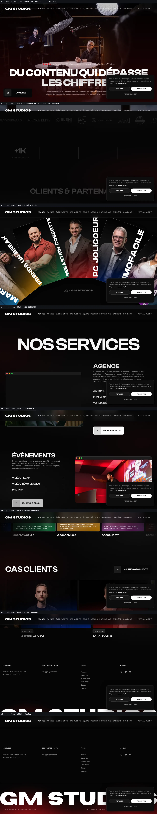
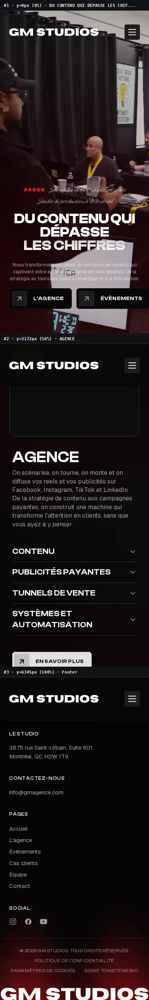

# UI Design System & Master Generation Blueprint: www-lesgmstudios-com

> **GM Studios — Du contenu qui dépasse les chiffres** (https://www.lesgmstudios.com/) — Agence de contenu & studio d'enregistrement à Montréal. 1 milliard de vues générées pour nos clients.





---

## 1. Executive Visual Persona & Design Archetype

- **Brand Essence & Persona**: **GM Studios — Du contenu qui dépasse les chiffres** (`https://www.lesgmstudios.com/`). Agence de contenu & studio d'enregistrement à Montréal. 1 milliard de vues générées pour nos clients.
- **Capture Provenance**: Live browser capture (`tier1_fast`, HTTP `200`, captured `2026-11-24`).
- **Visual Archetype**: **High-Contrast Obsidian / Atmospheric Design System (`#070707` canvas, `#ffffff` ink, `#00a2ff` accent)**.
- **Anti-AI-Slop Differentiators**:
  - **Live-Computed Chromatic Polarity**: Anchors the viewport in `#070707` (live computed `body` `background-color` (`computed_styles.json`)) paired with `#ffffff` primary typography and `#00a2ff` accents.
  - **Grounded Typographic Hierarchy**: Uses `clashDisplay` across display (`DU CONTENU QUI DÉPASSE LES CHIFFRES`) and body copy.
  - **Calibrated Spatial Grid & Motion**: Combines `1344px` container bounds (`gap: 24px`, padding `6rem`) with `cubic-bezier(.4,0,1,1)` easing and Three.js / WebGL Canvas Pipeline, Swiper Touch Carousel Engine.

---

## 2. Spatial Architecture & Modular Grid Mathematics

### Viewport Allocation & Container Geometry
- **Captured Journey Filmstrips**: Desktop `1280×6624px` (`assets/desktop-journey.webp`, `8` keyframes up to `y=6973px` / doc `7873px`), Mobile `390×2616px` (`assets/mobile-journey.webp`, `3` keyframes).
- **Master Container Bounds**: `1344px` (measured widest bounded `<section>` landmark width on `1440px` desktop).
- **Canvas Lateral Padding & Spacing**: `6rem` lateral canvas padding with `24px` grid gap.
- **Border Radius Scale**: `3.35544e+07px`, `8px`, `50%`, `.25rem`.

### Responsive Breakpoint Architecture
- **Desktop Layout**: Multi-column CSS Grid / Flexbox layout at `1440px` (`max-width: 1344px`, `gap: 24px`).
- **Mobile Layout**: Single-column vertical stack at `390px` viewport width with `6rem` horizontal padding.
- **Extracted CSS Media Queries**: `@media (min-width:40rem)`, `@media (min-width:48rem)`, `@media (min-width:64rem)`, `@media (min-width:80rem)`.

---

## 3. Color System, Materiality & Atmospheric Lighting

### Semantic Palette & Source Grounding
| Semantic Role | Ground-Truth Value | Extracted Live / CSS Source |
|---|---|---|
| **Primary Canvas Substrate** | `#070707` | live computed `body` `background-color` (`computed_styles.json`) |
| **Primary Typography Ink** | `#ffffff` | live computed `h1` `color` (`computed_styles.json`) |
| **Elevated Surface / Card Substrate** | `#0c0c0c` | `var(--color-bg-page)` in `:root` |
| **Interactive Accent / Highlight** | `#00a2ff` | `.selectable .vdpCellContent { color: #00a2ff }` |
| **Secondary / Muted Copy** | `#d0d5dd` | `var(--date-time-picker-disabled-text)` in `:root` |
| **Structural Hairline Border** | `#08090a` | `var(--appointment_widgets-border-color)` in `:root` (`1018281a`) |
| **Variable Token (`--color-black`)** | `#000000` | `var(--color-black)` in `:root` |

### Sanitized Root CSS Variables (`ui-ux.md` Ground Truth)
| Variable Name | Extracted Value | Semantic Role |
|---|---|---|
| `--container-max` | `1440px` | Layout / Spatial Grid Token |
| `--font-sans` | `var(--font-geist), system-ui, sans-serif` | Typography / Scale Token |
| `--color-black` | `#000` | Canvas / Surface Token |
| `--color-white` | `#fff` | Canvas / Surface Token |
| `--spacing` | `.25rem` | Layout / Spatial Grid Token |
| `--container-4xl` | `56rem` | Layout / Spatial Grid Token |
| `--text-sm` | `.875rem` | Typography Ink Token |
| `--text-sm--line-height` | `calc(1.25 / .875)` | Typography Ink Token |
| `--font-weight-normal` | `400` | Typography / Scale Token |
| `--font-weight-medium` | `500` | Typography / Scale Token |
| `--font-weight-semibold` | `600` | Typography / Scale Token |
| `--font-weight-bold` | `700` | Typography / Scale Token |
| `--leading-tight` | `1.25` | Typography / Scale Token |
| `--leading-snug` | `1.375` | Typography / Scale Token |
| `--radius-xs` | `4px` | Elevation / Border Token |
| `--radius-sm` | `8px` | Elevation / Border Token |

---

## 4. Typographic Scale & Editorial Hierarchy

### Font Family Stacks
- **Display Typography**: `clashDisplay`.
- **Primary Body Stack**: `clashDisplay`.
- **Technical / Metadata Stack**: not declared in live computed styles (uses primary stack / `ui-monospace`).

### Typographic Scale & Rules (Live Computed & Stylesheet Grounded)
- **Hero Display (`H1`)**: live computed `h1` (`font-size: 16px`, `line-height: 15.2px`, `font-weight: 400`, `letter-spacing: -0.16px`); CSS variables `--font-display: var(--font-clash), system-ui, sans-serif`; rule `h1` (`font-size: 2.5rem`).
- **Section Heading (`H2`)**: live computed `h2` (`font-size: 72px`, `line-height: 86.4px`, `font-weight: 600`); rule `h2` (`font-size: var(--h2-size,clamp(38px, 5.1...`).
- **Body Copy**: live computed `body` (`font-size: 16px`, `line-height: 24px`, `font-weight: 400`); rule `p` (`letter-spacing: 0`).
- **Metadata & Navigation Labels**: live computed `nav/a` (`font-size: 16px`, `line-height: 24px`, `font-weight: 400`); CSS variables `--text-sm: .875rem`, `--text-sm--line-height: calc(1.25 / .875)`, `--default-mono-font-family: var(--font-mono)`; rule `.label` (`font-size: 14px`, `font-weight: 500`).

---

## 5. Choreographed Motion & Interaction Physics

### Primary Easing Curves
- **Extracted Timing Functions**: `cubic-bezier(.4,0,1,1)`, `cubic-bezier(0,0,.2,1)`, `cubic-bezier(.4,0,.2,1)`.

### Per-Element Transition & Choreography Rules
- **Selector `.swiper-wrapper`**: `transition: var(--swiper-wrapper-transition-timing-function,initial)` extracted from `www-lesgmstudios-com` stylesheet.
- **Selector `.swiper-free-mode>.swiper-wrapper`**: `transition: ease-out` extracted from `www-lesgmstudios-com` stylesheet.
- **Selector `layer theme`**: `transition: .15s` extracted from `www-lesgmstudios-com` stylesheet.
- **Extracted Easing Curve (`cubic-bezier(.4,0,1,1)`)**: Governs interactive state transitions across `<header.inset-x-0>` and `<section.overflow-x-clip>`.
- **Runtime Interaction Engine**: Integrates Three.js / WebGL Canvas Pipeline, Swiper Touch Carousel Engine with `prefers-reduced-motion: reduce` fallback guards.
### Measured Runtime Scroll & Interaction Telemetry (`behavioral_journey_v2`)
- **Scroll Driver Mode**: `native` (max document height `7873px`, deepest scrollY reached `6973px` across `8` desktop keyframes).
- **Detected Scroll / Motion Libraries**: Native browser scroll / standard CSS transitions.
- **Hover Physics (`primary_cta` · `L'AGENCE`)**: Computed transition `0.2s` / `linear` (no static color/transform shift captured at rest).
- **Hover Physics (`first_card` · `ÉVÈNEMENTS`)**: Computed transition `0.2s` / `linear` (no static color/transform shift captured at rest).
- **Interactive Control Probe (`accordion` · `CONTENU`)**: Triggered visual diff `20.669` (attr `false -> true`, captured in `assets/state-interactive.webp`).
- **Route Transition Architecture**: First internal navigation (`/nos-resultats/justin-lalonde`) measured as `direct` in `1823ms`.

---

## 6. Component Wireframe & Structural DOM Map

### Visual Layout Schematic — Desktop (`1440px`, Grounded in `dom.html` & Landmark Bounding Boxes)
```
┌────────────────────────────────────────────────────────────────────────┐
│ DESKTOP VIEWPORT (1440px) — GM Studios — Du contenu qui dépasse les ch │
│ ====================================================================== │
│ [ <header.inset-x-0> (1440x97px)      | Accueil · Agence · Évènement ] │
│ ---------------------------------------------------------------------- │
│ | HERO STAGE: <section.inset-x-0> (w=1440px)                         | │
│ | H1: DU CONTENU QUI DÉPASSE LES CHIFFRES                            | │
│ | Substrate: #070707 | Ink: #ffffff | Accent: #00a2ff                | │
│ ---------------------------------------------------------------------- │
│ | SHOWCASE GRID (<section.overflow-x-clip>) max-w: 1344px            | │
│ | +------------------------------+  +------------------------------+ | │
│ | | Du contenu qui dé p asse les |  | Clients & Partenaires        | | │
│ | +------------------------------+  +------------------------------+ | │
│ ---------------------------------------------------------------------- │
│ | DETAIL MODULE (<section.noise-layer>) — Nos services               | │
│ ---------------------------------------------------------------------- │
│ [ FOOTER (<footer.overflow-x-c) | https://www.lesgmstudios.com/        │
└────────────────────────────────────────────────────────────────────────┘
```

### Visual Layout Schematic — Mobile Reflow (`390px`)
```
┌────────────────────────────────────────────────────────────────────────┐
│ MOBILE VIEWPORT REFLOW (390px) — Single-Column Stack (gap: 24px)       │
│ ====================================================================== │
│ [ HEADER BAR (<header.inset-x-0>      ) | Compact Menu (390px)         │
│ ---------------------------------------------------------------------- │
│ | HERO STAGE (<section.inset-x-0>) — 390px Vertical Lead             | │
│ | H1: DU CONTENU QUI DÉPASSE LES CHIFFRES                            | │
│ ---------------------------------------------------------------------- │
│ | SHOWCASE STACK (<section.overflow-x-cl) — 1-Col Stack              | │
│ | [ Item 1: Du contenu qui dé p asse les chiffres                  ] | │
│ | [ Item 2: Clients & Partenaires                                  ] | │
│ ---------------------------------------------------------------------- │
│ | DETAIL STACK (<section.noise-layer>) — 1-Col (Nos services)        | │
│ ---------------------------------------------------------------------- │
│ [ FOOTER (<footer.overflow-x-c) | Stacked 390px Colophon               │
└────────────────────────────────────────────────────────────────────────┘
```

### Granular DOM Region Breakdown
1. **Brand Header & Navigation Bar (<header.inset-x-0> — `www-lesgmstudios-com`)**:
   - Landmark `<header class="inset-x-0 top-0">` (`1440x97px`) hosting `GM Studios — Du contenu qui dépasse ` navigation (`Accueil · Agence · Évènements · Cas clients · Équipe`), DOM attributes (`data-precedence="next"`, `data-precedence="next"`, `data-precedence="next"`, `data-svg-origin="709.5 452.36"`), and stylesheet rule `root { --swiper-theme-color:007aff }`.
2. **Hero Stage & Focal Lead (<section.inset-x-0> — `DU CONTENU QUI DÉPASSE LES CHIFFRE`)**:
   - Landmark `<section class="inset-x-0 top-0">` presenting display lead `DU CONTENU QUI DÉPASSE LES CHIFFRES` and copy excerpt *"Acceptez les témoins marketing pour afficher la vidéo."* over `#070707` canvas and `#ffffff` ink.
3. **Primary Showcase & Content Grid (<section.overflow-x-clip> — `Du contenu qui dé p asse les chiff`)**:
   - Landmark `<section class="overflow-x-clip py-10">` rendering section `Du contenu qui dé p asse les chiffres` with copy *"Selon plus de 450 clients satisfaits"*, asset references (`ClashDisplay_Bold-s.p.2nvxwaktzfx...`, `ClashDisplay_Medium-s.p.0olkjtjdv...`, `ClashDisplay_Regular-s.p.2qbs-i2c...`, `ClashDisplay_Semibold-s.p.082yiqt...`), and grid rule `host { z-index:1;margin-left:auto;margin-right:auto;display:block;position:rela... }`.
4. **Interactive Detail & Feature Matrix (<section.noise-layer> — `Clients & Partenaires`)**:
   - Landmark `<section class="noise-layer py-32">` framing `Clients & Partenaires` and `Nos services` (*"Studio de production à Montréal"*) with `#0c0c0c` surface cards, `#00a2ff` accents, and `.swiper { z-index:1;margin-left:auto;margin-right:auto;padding:0;list-style:none;d... }`.
5. **Colophon & Global Directory Footer (<footer.overflow-x-clip> — `https://www.lesgmstudios.com/`)**:
   - Landmark `<footer class="overflow-x-clip bg-transparent">` anchoring `GM Studios — Du contenu qui dépa` footer links (`Accueil · Agence · Évènements · Cas clients · Équipe`), copy *"Du contenu qui dé p asse"*, and `#08090a` structural dividers.
### Full Vertical Scroll Sequence (Desktop `1440×900` Keyframes)
- **Step 01** (`y=0px`, `0%`): Active landmark `DU CONTENU QUI DÉPASSE LES CHIFFRES` · sticky/fixed elements: `3`
- **Step 02** (`y=850px`, `12%`): Active landmark `DU CONTENU QUI DÉPASSE LES CHIFFRES` · sticky/fixed elements: `3`
- **Step 03** (`y=1700px`, `24%`): Active landmark `Section @ 24%` · sticky/fixed elements: `2`
- **Step 04** (`y=3400px`, `49%`): Active landmark `NOS SERVICES` · sticky/fixed elements: `2`
- **Step 05** (`y=4250px`, `61%`): Active landmark `ÉVÈNEMENTS` · sticky/fixed elements: `2`
- **Step 06** (`y=5950px`, `85%`): Active landmark `@TANIA BERNARDO` · sticky/fixed elements: `2`
- **Step 07** (`y=6800px`, `98%`): Active landmark `JUSTIN LALONDE` · sticky/fixed elements: `2`
- **Step 08** (`y=6973px`, `100%`): Active landmark `Footer` · sticky/fixed elements: `2`

### Multi-Page Internal Route Map
- **Detail Route (`/nos-resultats/justin-lalonde`)**: `https://www.lesgmstudios.com/nos-resultats/justin-lalonde` — H1: `JUSTIN LALONDE`, scrollHeight `7449px`, transition `direct` (`1823ms`)
- **About Route (`/contact`)**: `https://www.lesgmstudios.com/contact` — H1: `PARLONS DE TON PROJET`, scrollHeight `1623px`, transition `direct` (`1115ms`)
- **Detail Route (`/nos-resultats/pc-jolicoeur`)**: `https://www.lesgmstudios.com/nos-resultats/pc-jolicoeur` — H1: `PC JOLICOEUR`, scrollHeight `5085px`, transition `direct` (`1003ms`)

---

## 7. Master Zero-Shot AI Generation Prompt

```markdown
# Master Zero-Shot Frontend Generation Prompt: www-lesgmstudios-com (GM Studios — Du contenu qui dépasse les chiffres)

You are a principal frontend architect and design systems engineer. Build a complete, production-ready web application replicating the exact design system, DOM landmarks, typographic hierarchy, color tokens, and motion physics of `www-lesgmstudios-com` (**GM Studios — Du contenu qui dépasse les chiffres** — `https://www.lesgmstudios.com/`).

### 1. Visual Archetype & Anti-AI-Slop Mandates
- **Archetype**: High-Contrast Obsidian / Atmospheric Design System (`#070707` canvas, `#ffffff` ink, `#00a2ff` accent).
- **Identity & Domain Context**: Agence de contenu & studio d'enregistrement à Montréal. 1 milliard de vues générées pour nos clients.
- **Primary Substrate**: `#070707` (live computed `body` `background-color` (`computed_styles.json`)), **Primary Ink**: `#ffffff`, **Accent / Highlight**: `#00a2ff`.
- **Site-Specific Differentiators**:
  - **Live-Computed Chromatic Polarity**: Anchors the viewport in `#070707` (live computed `body` `background-color` (`computed_styles.json`)) paired with `#ffffff` primary typography and `#00a2ff` accents.
  - **Grounded Typographic Hierarchy**: Uses `clashDisplay` across display (`DU CONTENU QUI DÉPASSE LES CHIFFRES`) and body copy.
  - **Calibrated Spatial Grid & Motion**: Combines `1344px` container bounds (`gap: 24px`, padding `6rem`) with `cubic-bezier(.4,0,1,1)` easing and Three.js / WebGL Canvas Pipeline, Swiper Touch Carousel Engine.

### 2. Ground-Truth CSS Variables (`:root` Token Contract)
Declare and consume these exact custom properties extracted from `www-lesgmstudios-com` in your global stylesheet:

:root {
  /* GM Studios — Du contenu qui dépasse les chiffres (www-lesgmstudios-com) — Live-Grounded CSS Variables */
  --container-max: 1440px; /* Layout / Spatial Grid Token (www-lesgmstudios-com) */
  --font-sans: var(--font-geist), system-ui, sans-serif; /* Typography / Scale Token (www-lesgmstudios-com) */
  --color-black: #000; /* Canvas / Surface Token (www-lesgmstudios-com) */
  --color-white: #fff; /* Canvas / Surface Token (www-lesgmstudios-com) */
  --spacing: .25rem; /* Layout / Spatial Grid Token (www-lesgmstudios-com) */
  --container-4xl: 56rem; /* Layout / Spatial Grid Token (www-lesgmstudios-com) */
  --text-sm: .875rem; /* Typography Ink Token (www-lesgmstudios-com) */
  --text-sm--line-height: calc(1.25 / .875); /* Typography Ink Token (www-lesgmstudios-com) */
  --font-weight-normal: 400; /* Typography / Scale Token (www-lesgmstudios-com) */
  --font-weight-medium: 500; /* Typography / Scale Token (www-lesgmstudios-com) */
  --font-weight-semibold: 600; /* Typography / Scale Token (www-lesgmstudios-com) */
  --font-weight-bold: 700; /* Typography / Scale Token (www-lesgmstudios-com) */
  --leading-tight: 1.25; /* Typography / Scale Token (www-lesgmstudios-com) */
  --leading-snug: 1.375; /* Typography / Scale Token (www-lesgmstudios-com) */
  --radius-xs: 4px; /* Elevation / Border Token (www-lesgmstudios-com) */
  --radius-sm: 8px; /* Elevation / Border Token (www-lesgmstudios-com) */
}

### 3. Semantic Color & Materiality Contract
Map every surface, ink, and border strictly to these source-grounded tokens:
- **Primary Canvas Substrate**: `#070707` — grounded in live computed `body` `background-color` (`computed_styles.json`)
- **Primary Typography Ink**: `#ffffff` — grounded in live computed `h1` `color` (`computed_styles.json`)
- **Elevated Surface / Card Substrate**: `#0c0c0c` — grounded in `var(--color-bg-page)` in `:root`
- **Interactive Accent / Highlight**: `#00a2ff` — grounded in `.selectable .vdpCellContent { color: #00a2ff }`
- **Secondary / Muted Copy**: `#d0d5dd` — grounded in `var(--date-time-picker-disabled-text)` in `:root`
- **Structural Hairline Border**: `#08090a` — grounded in `var(--appointment_widgets-border-color)` in `:root` (`1018281a`)
- **Variable Token (`--color-black`)**: `#000000` — grounded in `var(--color-black)` in `:root`

### 4. Spatial Grid, Container Bounds & Responsive Breakpoints
- **Desktop Viewport Reference**: `1280×6624px` (multi-frame vertical journey filmstrip (6624px), `1440px` standard desktop width).
- **Mobile Viewport Reference**: `390×2616px` (multi-frame vertical journey filmstrip (2616px), `390px` standard mobile width).
- **Container Max-Width**: `1344px` (measured widest bounded `<section>` landmark width on `1440px` desktop)
- **Padding & Gutters**: `6rem` lateral canvas padding with `24px` grid gap
- **Desktop Grid**: Multi-column CSS Grid / Flexbox layout at `1440px` (`max-width: 1344px`, `gap: 24px`)
- **Mobile Adaptation**: Single-column vertical stack at `390px` viewport width with `6rem` horizontal padding
- **Media Queries**: `@media (min-width:40rem)`, `@media (min-width:48rem)`, `@media (min-width:64rem)`, `@media (min-width:80rem)`
- **Corner Radii**: `3.35544e+07px`, `8px`, `50%`, `.25rem`

### 5. Typography & Editorial Scale Contract
- **Display Font Stack**: `clashDisplay`
- **Body Font Stack**: `clashDisplay`
- **Monospace / Technical Font Stack**: not declared in live computed styles (uses primary stack / `ui-monospace`)
- **H1 Display Rule**: live computed `h1` (`font-size: 16px`, `line-height: 15.2px`, `font-weight: 400`, `letter-spacing: -0.16px`); CSS variables `--font-display: var(--font-clash), system-ui, sans-serif`; rule `h1` (`font-size: 2.5rem`)
- **H2 Section Rule**: live computed `h2` (`font-size: 72px`, `line-height: 86.4px`, `font-weight: 600`); rule `h2` (`font-size: var(--h2-size,clamp(38px, 5.1...`)
- **Body Copy Rule**: live computed `body` (`font-size: 16px`, `line-height: 24px`, `font-weight: 400`); rule `p` (`letter-spacing: 0`)
- **Metadata & Index Rule**: live computed `nav/a` (`font-size: 16px`, `line-height: 24px`, `font-weight: 400`); CSS variables `--text-sm: .875rem`, `--text-sm--line-height: calc(1.25 / .875)`, `--default-mono-font-family: var(--font-mono)`; rule `.label` (`font-size: 14px`, `font-weight: 500`)

### 6. Component Hierarchy, Verbatim Copy & Real DOM Landmarks
Scaffold `www-lesgmstudios-com` (`GM Studios — Du contenu qui dépasse les chiffres`) with these exact structural regions, extracted copy, and CSS rules from `dom.html`:
1. **Brand Header & Navigation Bar (<header.inset-x-0> — `www-lesgmstudios-com`)**:
   - DOM & Selectors: Landmark `<header class="inset-x-0 top-0">` (`1440x97px`) hosting `GM Studios — Du contenu qui dépasse ` navigation (`Accueil · Agence · Évènements · Cas clients · Équipe`), DOM attributes (`data-precedence="next"`, `data-precedence="next"`, `data-precedence="next"`, `data-svg-origin="709.5 452.36"`), and stylesheet rule `root { --swiper-theme-color:007aff }`.
   - Responsive Contract: Header `Brand Header & Navigation Bar (<header.inset-x-0> — `www-lesgmstudios-com`)` (`www-lesgmstudios-com`) adapts across `@media (min-width:40rem)`, `@media (min-width:48rem)`, `@media (min-width:64rem)`, `@media (min-width:80rem)` with `cubic-bezier(.4,0,1,1)`, `cubic-bezier(0,0,.2,1)`, `cubic-bezier(.4,0,.2,1)` transitions and links `Accueil · Agence · Évènements · Cas clients · Équipe`.
2. **Hero Stage & Focal Lead (<section.inset-x-0> — `DU CONTENU QUI DÉPASSE LES CHIFFRE`)**:
   - DOM & Selectors: Landmark `<section class="inset-x-0 top-0">` presenting display lead `DU CONTENU QUI DÉPASSE LES CHIFFRES` and copy excerpt *"Acceptez les témoins marketing pour afficher la vidéo."* over `#070707` canvas and `#ffffff` ink.
   - Responsive Contract: Hero stage (`1280×6624px` desktop / `390×2616px` mobile) sets `#070707` background with `#ffffff` headline `DU CONTENU QUI DÉPASSE LES CHIFFRES`.
3. **Primary Showcase & Content Grid (<section.overflow-x-clip> — `Du contenu qui dé p asse les chiff`)**:
   - DOM & Selectors: Landmark `<section class="overflow-x-clip py-10">` rendering section `Du contenu qui dé p asse les chiffres` with copy *"Selon plus de 450 clients satisfaits"*, asset references (`ClashDisplay_Bold-s.p.2nvxwaktzfx...`, `ClashDisplay_Medium-s.p.0olkjtjdv...`, `ClashDisplay_Regular-s.p.2qbs-i2c...`, `ClashDisplay_Semibold-s.p.082yiqt...`), and grid rule `host { z-index:1;margin-left:auto;margin-right:auto;display:block;position:rela... }`.
   - Responsive Contract: Showcase grid `Primary Showcase & Content Grid (<section.overflow-x-clip> — `Du contenu qui dé p asse les chiff`)` applies Multi-column CSS Grid / Flexbox layout at `1440px` (`max-width: 1344px`, `gap: 24px`) on desktop and Single-column vertical stack at `390px` viewport width with `6rem` horizontal padding on mobile.
4. **Interactive Detail & Feature Matrix (<section.noise-layer> — `Clients & Partenaires`)**:
   - DOM & Selectors: Landmark `<section class="noise-layer py-32">` framing `Clients & Partenaires` and `Nos services` (*"Studio de production à Montréal"*) with `#0c0c0c` surface cards, `#00a2ff` accents, and `.swiper { z-index:1;margin-left:auto;margin-right:auto;padding:0;list-style:none;d... }`.
   - Responsive Contract: Detail module `Interactive Detail & Feature Matrix (<section.noise-layer> — `Clients & Partenaires`)` uses `3.35544e+07px`, `8px`, `50%`, `.25rem` radii, `#00a2ff` highlights, and assets (ClashDisplay_Bold-s.p.2nvxwaktzfx..., ClashDisplay_Medium-s.p.0olkjtjdv..., ClashDisplay_Regular-s.p.2qbs-i2c...).
5. **Colophon & Global Directory Footer (<footer.overflow-x-clip> — `https://www.lesgmstudios.com/`)**:
   - DOM & Selectors: Landmark `<footer class="overflow-x-clip bg-transparent">` anchoring `GM Studios — Du contenu qui dépa` footer links (`Accueil · Agence · Évènements · Cas clients · Équipe`), copy *"Du contenu qui dé p asse"*, and `#08090a` structural dividers.
   - Responsive Contract: Footer `Colophon & Global Directory Footer (<footer.overflow-x-clip> — `https://www.lesgmstudios.com/`)` aligns to `1344px` (measured widest bounded `<section>` landmark width on `1440px` desktop) with `6rem` lateral canvas padding with `24px` grid gap and attributes (data-precedence="next", data-precedence="next", data-precedence="next").

#### Verbatim DOM Copy Excerpts (`dom.html`)
- Copy Excerpt 1: *"Acceptez les témoins marketing pour afficher la vidéo."*
- Copy Excerpt 2: *"Selon plus de 450 clients satisfaits"*
- Copy Excerpt 3: *"Studio de production à Montréal"*
- Copy Excerpt 4: *"Du contenu qui dé p asse"*

### 7. Motion, Extracted Stylesheet Rules & Interaction Choreography
- **Primary Easing Functions**: `cubic-bezier(.4,0,1,1)`, `cubic-bezier(0,0,.2,1)`, `cubic-bezier(.4,0,.2,1)`
- **Extracted Stylesheet Rules (`www-lesgmstudios-com`)**:
- `root { --swiper-theme-color:007aff }`
- `host { z-index:1;margin-left:auto;margin-right:auto;display:block;position:rela... }`
- `.swiper { z-index:1;margin-left:auto;margin-right:auto;padding:0;list-style:none;d... }`
- `.swiper-vertical>.swiper-wrapper { flex-direction:column }`
- `.swiper-wrapper { transform:translate(0,0) }`
- **Per-Selector Transition Rules**:
- **Selector `.swiper-wrapper`**: `transition: var(--swiper-wrapper-transition-timing-function,initial)` extracted from `www-lesgmstudios-com` stylesheet.
- **Selector `.swiper-free-mode>.swiper-wrapper`**: `transition: ease-out` extracted from `www-lesgmstudios-com` stylesheet.
- **Selector `layer theme`**: `transition: .15s` extracted from `www-lesgmstudios-com` stylesheet.
- **Extracted Easing Curve (`cubic-bezier(.4,0,1,1)`)**: Governs interactive state transitions across `<header.inset-x-0>` and `<section.overflow-x-clip>`.
- **Runtime Interaction Engine**: Integrates Three.js / WebGL Canvas Pipeline, Swiper Touch Carousel Engine with `prefers-reduced-motion: reduce` fallback guards.
### 7b. Full-Page Scroll Choreography, Interactive States & Multi-Page Routes
- **Scroll Mechanics**: Implement `native` vertical progression up to `7873px` across 8 distinct viewport chapters.
- **Vertical Chapter Sequence**: DU CONTENU QUI DÉPASSE LES... (0%) -> DU CONTENU QUI DÉPASSE LES... (12%) -> Section @ 24% (24%) -> NOS SERVICES (49%) -> ÉVÈNEMENTS (61%) -> @TANIA BERNARDO (85%) -> JUSTIN LALONDE (98%) -> Footer (100%).
- **Multi-Page Routes**: Scaffold internal routes `/nos-resultats/justin-lalonde` (detail, direct), `/contact` (about, direct), `/nos-resultats/pc-jolicoeur` (detail, direct) sharing the global header/footer shell and design tokens.

### 8. Technical Deliverables
- Implement in Next.js (App Router) with TypeScript and Tailwind CSS consuming the `:root` custom properties defined above for `www-lesgmstudios-com`.
- Reproduce both the `1440px` desktop architecture and `390px` mobile breakpoint transitions, preserving semantic HTML5 landmarks (`<header>`, `<nav>`, `<main>`, `<section>`, `<footer>`) and `prefers-reduced-motion` accessibility guards.
```
---

## 8. Full-Page Scroll Journey, Interactive States & Subpage Inventory

### Desktop Scroll Keyframes (`1440×900` WebP)
| Step | Scroll Y | Progress | Active Landmark / Section | Sticky/Fixed | Visual Asset |
| :---: | :---: | :---: | :--- | :---: | :--- |
| `#01` | `0px` | `0%` | DU CONTENU QUI DÉPASSE LES CHIFFRES | `3` | [desktop-step-01.webp](assets/desktop-step-01.webp) |
| `#02` | `850px` | `12%` | DU CONTENU QUI DÉPASSE LES CHIFFRES | `3` | [desktop-step-02.webp](assets/desktop-step-02.webp) |
| `#03` | `1700px` | `24%` | Section @ 24% | `2` | [desktop-step-03.webp](assets/desktop-step-03.webp) |
| `#04` | `3400px` | `49%` | NOS SERVICES | `2` | [desktop-step-04.webp](assets/desktop-step-04.webp) |
| `#05` | `4250px` | `61%` | ÉVÈNEMENTS | `2` | [desktop-step-05.webp](assets/desktop-step-05.webp) |
| `#06` | `5950px` | `85%` | @TANIA BERNARDO | `2` | [desktop-step-06.webp](assets/desktop-step-06.webp) |
| `#07` | `6800px` | `98%` | JUSTIN LALONDE | `2` | [desktop-step-07.webp](assets/desktop-step-07.webp) |
| `#08` | `6973px` | `100%` | Footer | `2` | [desktop-step-08.webp](assets/desktop-step-08.webp) |

### Mobile Condensed Keyframes (`390×844` WebP)
| Step | Scroll Y | Progress | Active Landmark | Visual Asset |
| :---: | :---: | :---: | :--- | :--- |
| `#01` | `0px` | `0%` | DU CONTENU QUI DÉPASSE LES CHIFFRES | [mobile-step-01.webp](assets/mobile-step-01.webp) |
| `#02` | `3172px` | `50%` | AGENCE | [mobile-step-02.webp](assets/mobile-step-02.webp) |
| `#03` | `6345px` | `100%` | Footer | [mobile-step-03.webp](assets/mobile-step-03.webp) |

### Interactive UI State Captures (`1440×900` WebP)
| State Type | Trigger / Observation | Visual Asset |
| :--- | :--- | :--- |
| `interactive_control` | Control `accordion` (`CONTENU`, diff `20.669`) | [state-interactive.webp](assets/state-interactive.webp) |

### Internal Subpage Filmstrips (`1080px` Wide WebP)
| # | Template | Route URL | H1 / Title | Scroll Height | Transition | Filmstrip Asset |
| :-: | :---: | :--- | :--- | :---: | :---: | :--- |
| `1` | `detail` | `https://www.lesgmstudios.com/nos-resultats/justin-lalonde` | JUSTIN LALONDE | `7449px` | `direct` (`1823ms`) | [subpage-01-nos-resultats-justin-lalonde.webp](assets/subpage-01-nos-resultats-justin-lalonde.webp) |
| `2` | `about` | `https://www.lesgmstudios.com/contact` | PARLONS DE TON PROJET | `1623px` | `direct` (`1115ms`) | [subpage-02-contact.webp](assets/subpage-02-contact.webp) |
| `3` | `detail` | `https://www.lesgmstudios.com/nos-resultats/pc-jolicoeur` | PC JOLICOEUR | `5085px` | `direct` (`1003ms`) | [subpage-03-nos-resultats-pc-jolicoeur.webp](assets/subpage-03-nos-resultats-pc-jolicoeur.webp) |

