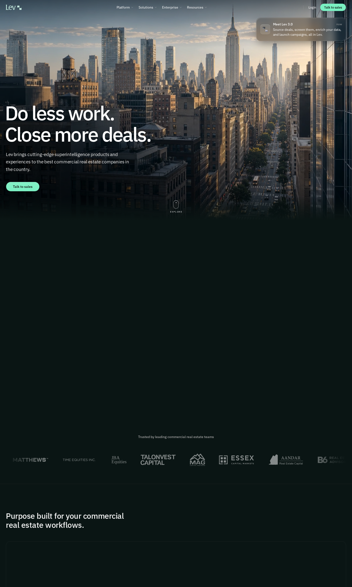
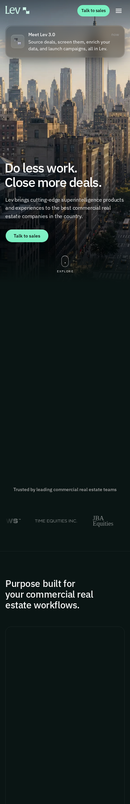

# UI Design System & Master Generation Blueprint: www-lev-com

> **Lev · The AI platform for commercial real estate** (https://www.lev.com/) — Lev combines the industry's largest source of real-time commercial real estate data with purpose-built AI to transform the way sponsors a...



---

## 1. Executive Visual Persona & Design Archetype

- **Brand Essence & Persona**: **Lev · The AI platform for commercial real estate** (`https://www.lev.com/`). Lev combines the industry's largest source of real-time commercial real estate data with purpose-built AI to transform the way sponsors a...
- **Capture Provenance**: Live browser capture (`tier1_fast`, HTTP `200`, captured `2026-11-23`).
- **Visual Archetype**: **Light-Gallery WebGL / Canvas Interactive Experience (`#ffffff` / `#5c7563`)**.
- **Anti-AI-Slop Differentiators**:
  - **Live-Computed Chromatic Polarity**: Anchors the viewport in `#ffffff` (live computed `browser-default` `background-color` (`computed_styles.json`)) paired with `#1d211e` primary typography and `#5c7563` accents.
  - **Grounded Typographic Hierarchy**: Pairs `IBM Plex Sans` for display copy (`Do less work. Close more deals.`) with `IBM Plex Sans` and `IBM Plex Mono`.
  - **Calibrated Spatial Grid & Motion**: Combines `96rem` container bounds (`gap: var(--spacing)`, padding `var(--container-lev-inline-padding)`) with `cubic-bezier(0,0,.2,1)` easing and Three.js / WebGL Canvas Pipeline, Framer Motion Layout Physics.

---

## 2. Spatial Architecture & Modular Grid Mathematics



### Viewport Allocation & Container Geometry
- **Captured Viewport Dimensions**: Desktop `1440×2400px` (`assets/desktop.png`, clamped at 2400px live multi-section capture), Mobile `390×2400px` (`assets/mobile.png`, clamped at 2400px live multi-section capture).
- **Master Container Bounds**: `96rem` (non-`@media` desktop container stylesheet rule).
- **Canvas Lateral Padding & Spacing**: `var(--container-lev-inline-padding)` lateral canvas padding with `var(--spacing)` grid gap.
- **Border Radius Scale**: `8px`, `.3125rem`, `.375rem`, `.25rem`.

### Responsive Breakpoint Architecture
- **Desktop Layout**: Multi-column CSS Grid / Flexbox layout at `1440px` (`max-width: 96rem`, `gap: var(--spacing)`).
- **Mobile Layout**: Single-column vertical stack at `390px` viewport width with `var(--container-lev-inline-padding)` horizontal padding.
- **Extracted CSS Media Queries**: `@media not all and (min-width:48rem)`, `@media (min-width:40rem)`, `@media (min-width:48rem)`, `@media (min-width:64rem)`.

---

## 3. Color System, Materiality & Atmospheric Lighting

### Semantic Palette & Source Grounding
| Semantic Role | Ground-Truth Value | Extracted Live / CSS Source |
|---|---|---|
| **Primary Canvas Substrate** | `#ffffff` | live computed `browser-default` `background-color` (`computed_styles.json`) |
| **Primary Typography Ink** | `#1d211e` | `var(--m-text)` in `:root` |
| **Elevated Surface / Card Substrate** | `#e7e5db` | `var(--illustration-surface)` in `:root` |
| **Interactive Accent / Highlight** | `#5c7563` | `var(--illustration-accent)` in `:root` |
| **Secondary / Muted Copy** | `#9da19f` | `var(--call-text-muted)` in `:root` |
| **Structural Hairline Border** | `#dde2de` | `var(--m-border)` in `:root` |

### Sanitized Root CSS Variables (`ui-ux.md` Ground Truth)
| Variable Name | Extracted Value | Semantic Role |
|---|---|---|
| `--primitive-black` | `0 0 0` | Canvas / Surface Token |
| `--primitive-white` | `1 0 0` | Canvas / Surface Token |
| `--primitive-neutral-950` | `.1448 0 0` | Design System Custom Token |
| `--primitive-neutral-900` | `.2046 0 0` | Design System Custom Token |
| `--primitive-neutral-800` | `.2686 0 0` | Design System Custom Token |
| `--primitive-neutral-700` | `.3715 0 0` | Design System Custom Token |
| `--primitive-neutral-600` | `.4386 0 0` | Design System Custom Token |
| `--primitive-neutral-500` | `.5555 0 0` | Design System Custom Token |
| `--primitive-neutral-400` | `.709 0 0` | Design System Custom Token |
| `--primitive-neutral-300` | `.8699 0 0` | Design System Custom Token |
| `--primitive-neutral-200` | `.9219 0 0` | Design System Custom Token |
| `--primitive-neutral-100` | `.9702 0 0` | Design System Custom Token |
| `--primitive-neutral-50` | `.9851 0 0` | Design System Custom Token |
| `--primitive-abyss-950` | `.1987 .0229 195.47` | Design System Custom Token |
| `--primitive-abyss-900` | `.2496 .0227 195.79` | Design System Custom Token |
| `--primitive-abyss-800` | `.2966 .0188 196.19` | Design System Custom Token |

---

## 4. Typographic Scale & Editorial Hierarchy

### Font Family Stacks
- **Display Typography**: `IBM Plex Sans`.
- **Primary Body Stack**: `IBM Plex Sans`.
- **Technical / Metadata Stack**: `IBM Plex Mono`.

### Typographic Scale & Rules (Live Computed & Stylesheet Grounded)
- **Hero Display (`H1`)**: live computed `h1` (`font-size: 80.64px`, `line-height: 86.2848px`, `font-weight: 500`, `letter-spacing: -3.6288px`); CSS variables `--text-4xl: 2.25rem`, `--text-4xl--line-height: calc(2.5 / 2.25)`, `--text-5xl: 3rem`; rule `h1` (`font-size: var(--text-size-base)`, `line-height: var(--tw-leading,var(...`).
- **Section Heading (`H2`)**: live computed `h2` (`font-size: 32px`, `line-height: 36.8px`, `font-weight: 500`, `letter-spacing: -0.48px`); CSS variables `--text-2xl--line-height: calc(2 / 1.5)`, `--text-3xl--line-height: calc(2.25 / 1.875)`; rule `h2` (`font-size: var(--text-size-base)`, `line-height: var(--tw-leading,var(...`).
- **Body Copy**: live computed `body` (`font-size: 16px`, `line-height: 24px`, `font-weight: 400`); CSS variables `--text-base--line-height: calc(1.5 / 1)`, `--insights-body: 13px`, `--mini-demo-body-size: 13px`; rule `p` (`line-height: 1.55`).
- **Metadata & Navigation Labels**: live computed `nav/a` (`font-size: 16px`, `line-height: 24px`, `font-weight: 400`); CSS variables `--font-mono: "IBM Plex Mono", ui-monospace, monospace`, `--text-xs--line-height: calc(1 / .75)`, `--text-sm--line-height: calc(1.25 / .875)`; rule `small` (`font-size: 11px`).

---

## 5. Choreographed Motion & Interaction Physics

### Primary Easing Curves
- **Extracted Timing Functions**: `cubic-bezier(0,0,.2,1)`, `cubic-bezier(.4,0,.2,1)`, `cubic-bezier(.4,0,.6,1)`.

### Per-Element Transition & Choreography Rules
- **Selector `layer theme`**: `transition: .15s` extracted from `www-lev-com` stylesheet.
- **Selector `body`**: `transition: background-color .3s,color .3s` extracted from `www-lev-com` stylesheet.
- **Selector `.transition`**: `transition: var(--tw-ease,var(--default-transition-timing-function))` extracted from `www-lev-com` stylesheet.
- **Extracted Easing Curve (`cubic-bezier(0,0,.2,1)`)**: Governs interactive state transitions across `<header.site-header>` and `<section.marketing-page-section>`.
- **Runtime Interaction Engine**: Integrates Three.js / WebGL Canvas Pipeline, Framer Motion Layout Physics with `prefers-reduced-motion: reduce` fallback guards.

---

## 6. Component Wireframe & Structural DOM Map

### Visual Layout Schematic — Desktop (`1440px`, Grounded in `dom.html` & Landmark Bounding Boxes)
```
┌────────────────────────────────────────────────────────────────────────┐
│ DESKTOP VIEWPORT (1440px) — Lev · The AI platform for commercial real  │
│ ====================================================================== │
│ [ <header.site-header> (1440x60px)    | Talk to sales                ] │
│ ---------------------------------------------------------------------- │
│ | HERO STAGE: <section.dark> (w=1440px)                              | │
│ | H1: Do less work. Close more deals.                                | │
│ | Substrate: #ffffff | Ink: #1d211e | Accent: #5c7563                | │
│ ---------------------------------------------------------------------- │
│ | SHOWCASE GRID (<section.marketing-page-se) max-w: 96rem            | │
│ | +------------------------------+  +------------------------------+ | │
│ | | Purpose built for your comme |  | Source new deals from billio | | │
│ | +------------------------------+  +------------------------------+ | │
│ ---------------------------------------------------------------------- │
│ | DETAIL MODULE (<section.border-rule>) — Screen deals in secon      | │
│ ---------------------------------------------------------------------- │
│ [ FOOTER (<footer.mt-7>       ) | https://www.lev.com/                 │
└────────────────────────────────────────────────────────────────────────┘
```

### Visual Layout Schematic — Mobile Reflow (`390px`)
```
┌────────────────────────────────────────────────────────────────────────┐
│ MOBILE VIEWPORT REFLOW (390px) — Single-Column Stack (gap: var(--sp)   │
│ ====================================================================== │
│ [ HEADER BAR (<header.site-header>    ) | Compact Menu (390px)         │
│ ---------------------------------------------------------------------- │
│ | HERO STAGE (<section.dark>) — 390px Vertical Lead                  | │
│ | H1: Do less work. Close more deals.                                | │
│ ---------------------------------------------------------------------- │
│ | SHOWCASE STACK (<section.marketing-pag) — 1-Col Stack              | │
│ | [ Item 1: Purpose built for your commercial real estate wor...   ] | │
│ | [ Item 2: Source new deals from billions of data points.         ] | │
│ ---------------------------------------------------------------------- │
│ | DETAIL STACK (<section.border-rule>) — 1-Col (Screen deals in se)  | │
│ ---------------------------------------------------------------------- │
│ [ FOOTER (<footer.mt-7>       ) | Stacked 390px Colophon               │
└────────────────────────────────────────────────────────────────────────┘
```

### Granular DOM Region Breakdown
1. **Brand Header & Navigation Bar (<header.site-header> — `www-lev-com`)**:
   - Landmark `<header class="site-header top-0">` (`1440x60px`) hosting `Lev · The AI platform for commercial` navigation (`Talk to sales`), DOM attributes (`data-scroll-behavior="smooth"`, `data-precedence="next"`, `data-precedence="next"`, `data-precedence="next"`), and stylesheet rule `host { --shimmer-angle:20deg }`.
2. **Hero Stage & Focal Lead (<section.dark> — `Do less work. Close more deals.`)**:
   - Landmark `<section class="dark">` presenting display lead `Do less work. Close more deals.` and copy excerpt *"Lev brings cutting-edge superintelligence products and experience"* over `#ffffff` canvas and `#1d211e` ink.
3. **Primary Showcase & Content Grid (<section.marketing-page-section> — `Purpose built for your commercial `)**:
   - Landmark `<section class="marketing-page-section scroll-mt-16">` rendering section `Purpose built for your commercial real estate wor...` with copy *"Trusted by leading commercial real estate teams"*, asset references (`matthews.svg`, `time-equities.svg`, `mag-capital.svg`, `essex-capital-markets.svg`), and grid rule `backdrop { box-sizing:border-box;border:0 solid;margin:0;padding:0 }`.
4. **Interactive Detail & Feature Matrix (<section.border-rule> — `Source new deals from billions of `)**:
   - Landmark `<section class="marketing-page-section border-rule">` framing `Source new deals from billions of data points.` and `Screen deals in seconds against your buy box.` (*"Source new deals from billions of data points. Find NYC sponsors "*) with `#e7e5db` surface cards, `#5c7563` accents, and `file-selector-button { box-sizing:border-box;border:0 solid;margin:0;padding:0 }`.
5. **Colophon & Global Directory Footer (<footer.mt-7> — `https://www.lev.com/`)**:
   - Landmark `<footer class="mt-7">` anchoring `Lev · The AI platform for commer` footer links (`Talk to sales`), copy *"new deals from billions of data points."*, and `#dde2de` structural dividers.

---

## 7. Master Zero-Shot AI Generation Prompt

```markdown
# Master Zero-Shot Frontend Generation Prompt: www-lev-com (Lev · The AI platform for commercial real estate)

You are a principal frontend architect and design systems engineer. Build a complete, production-ready web application replicating the exact design system, DOM landmarks, typographic hierarchy, color tokens, and motion physics of `www-lev-com` (**Lev · The AI platform for commercial real estate** — `https://www.lev.com/`).

### 1. Visual Archetype & Anti-AI-Slop Mandates
- **Archetype**: Light-Gallery WebGL / Canvas Interactive Experience (`#ffffff` / `#5c7563`).
- **Identity & Domain Context**: Lev combines the industry's largest source of real-time commercial real estate data with purpose-built AI to transform the way sponsors a...
- **Primary Substrate**: `#ffffff` (live computed `browser-default` `background-color` (`computed_styles.json`)), **Primary Ink**: `#1d211e`, **Accent / Highlight**: `#5c7563`.
- **Site-Specific Differentiators**:
  - **Live-Computed Chromatic Polarity**: Anchors the viewport in `#ffffff` (live computed `browser-default` `background-color` (`computed_styles.json`)) paired with `#1d211e` primary typography and `#5c7563` accents.
  - **Grounded Typographic Hierarchy**: Pairs `IBM Plex Sans` for display copy (`Do less work. Close more deals.`) with `IBM Plex Sans` and `IBM Plex Mono`.
  - **Calibrated Spatial Grid & Motion**: Combines `96rem` container bounds (`gap: var(--spacing)`, padding `var(--container-lev-inline-padding)`) with `cubic-bezier(0,0,.2,1)` easing and Three.js / WebGL Canvas Pipeline, Framer Motion Layout Physics.

### 2. Ground-Truth CSS Variables (`:root` Token Contract)
Declare and consume these exact custom properties extracted from `www-lev-com` in your global stylesheet:

:root {
  /* Lev · The AI platform for commercial real estate (www-lev-com) — Live-Grounded CSS Variables */
  --primitive-black: 0 0 0; /* Canvas / Surface Token (www-lev-com) */
  --primitive-white: 1 0 0; /* Canvas / Surface Token (www-lev-com) */
  --primitive-neutral-950: .1448 0 0; /* Design System Custom Token (www-lev-com) */
  --primitive-neutral-900: .2046 0 0; /* Design System Custom Token (www-lev-com) */
  --primitive-neutral-800: .2686 0 0; /* Design System Custom Token (www-lev-com) */
  --primitive-neutral-700: .3715 0 0; /* Design System Custom Token (www-lev-com) */
  --primitive-neutral-600: .4386 0 0; /* Design System Custom Token (www-lev-com) */
  --primitive-neutral-500: .5555 0 0; /* Design System Custom Token (www-lev-com) */
  --primitive-neutral-400: .709 0 0; /* Design System Custom Token (www-lev-com) */
  --primitive-neutral-300: .8699 0 0; /* Design System Custom Token (www-lev-com) */
  --primitive-neutral-200: .9219 0 0; /* Design System Custom Token (www-lev-com) */
  --primitive-neutral-100: .9702 0 0; /* Design System Custom Token (www-lev-com) */
  --primitive-neutral-50: .9851 0 0; /* Design System Custom Token (www-lev-com) */
  --primitive-abyss-950: .1987 .0229 195.47; /* Design System Custom Token (www-lev-com) */
  --primitive-abyss-900: .2496 .0227 195.79; /* Design System Custom Token (www-lev-com) */
  --primitive-abyss-800: .2966 .0188 196.19; /* Design System Custom Token (www-lev-com) */
}

### 3. Semantic Color & Materiality Contract
Map every surface, ink, and border strictly to these source-grounded tokens:
- **Primary Canvas Substrate**: `#ffffff` — grounded in live computed `browser-default` `background-color` (`computed_styles.json`)
- **Primary Typography Ink**: `#1d211e` — grounded in `var(--m-text)` in `:root`
- **Elevated Surface / Card Substrate**: `#e7e5db` — grounded in `var(--illustration-surface)` in `:root`
- **Interactive Accent / Highlight**: `#5c7563` — grounded in `var(--illustration-accent)` in `:root`
- **Secondary / Muted Copy**: `#9da19f` — grounded in `var(--call-text-muted)` in `:root`
- **Structural Hairline Border**: `#dde2de` — grounded in `var(--m-border)` in `:root`

### 4. Spatial Grid, Container Bounds & Responsive Breakpoints
- **Desktop Viewport Reference**: `1440×2400px` (clamped at 2400px live multi-section capture, `1440px` standard desktop width).
- **Mobile Viewport Reference**: `390×2400px` (clamped at 2400px live multi-section capture, `390px` standard mobile width).
- **Container Max-Width**: `96rem` (non-`@media` desktop container stylesheet rule)
- **Padding & Gutters**: `var(--container-lev-inline-padding)` lateral canvas padding with `var(--spacing)` grid gap
- **Desktop Grid**: Multi-column CSS Grid / Flexbox layout at `1440px` (`max-width: 96rem`, `gap: var(--spacing)`)
- **Mobile Adaptation**: Single-column vertical stack at `390px` viewport width with `var(--container-lev-inline-padding)` horizontal padding
- **Media Queries**: `@media not all and (min-width:48rem)`, `@media (min-width:40rem)`, `@media (min-width:48rem)`, `@media (min-width:64rem)`
- **Corner Radii**: `8px`, `.3125rem`, `.375rem`, `.25rem`

### 5. Typography & Editorial Scale Contract
- **Display Font Stack**: `IBM Plex Sans`
- **Body Font Stack**: `IBM Plex Sans`
- **Monospace / Technical Font Stack**: `IBM Plex Mono`
- **H1 Display Rule**: live computed `h1` (`font-size: 80.64px`, `line-height: 86.2848px`, `font-weight: 500`, `letter-spacing: -3.6288px`); CSS variables `--text-4xl: 2.25rem`, `--text-4xl--line-height: calc(2.5 / 2.25)`, `--text-5xl: 3rem`; rule `h1` (`font-size: var(--text-size-base)`, `line-height: var(--tw-leading,var(...`)
- **H2 Section Rule**: live computed `h2` (`font-size: 32px`, `line-height: 36.8px`, `font-weight: 500`, `letter-spacing: -0.48px`); CSS variables `--text-2xl--line-height: calc(2 / 1.5)`, `--text-3xl--line-height: calc(2.25 / 1.875)`; rule `h2` (`font-size: var(--text-size-base)`, `line-height: var(--tw-leading,var(...`)
- **Body Copy Rule**: live computed `body` (`font-size: 16px`, `line-height: 24px`, `font-weight: 400`); CSS variables `--text-base--line-height: calc(1.5 / 1)`, `--insights-body: 13px`, `--mini-demo-body-size: 13px`; rule `p` (`line-height: 1.55`)
- **Metadata & Index Rule**: live computed `nav/a` (`font-size: 16px`, `line-height: 24px`, `font-weight: 400`); CSS variables `--font-mono: "IBM Plex Mono", ui-monospace, monospace`, `--text-xs--line-height: calc(1 / .75)`, `--text-sm--line-height: calc(1.25 / .875)`; rule `small` (`font-size: 11px`)

### 6. Component Hierarchy, Verbatim Copy & Real DOM Landmarks
Scaffold `www-lev-com` (`Lev · The AI platform for commercial real estate`) with these exact structural regions, extracted copy, and CSS rules from `dom.html`:
1. **Brand Header & Navigation Bar (<header.site-header> — `www-lev-com`)**:
   - DOM & Selectors: Landmark `<header class="site-header top-0">` (`1440x60px`) hosting `Lev · The AI platform for commercial` navigation (`Talk to sales`), DOM attributes (`data-scroll-behavior="smooth"`, `data-precedence="next"`, `data-precedence="next"`, `data-precedence="next"`), and stylesheet rule `host { --shimmer-angle:20deg }`.
   - Responsive Contract: Header `Brand Header & Navigation Bar (<header.site-header> — `www-lev-com`)` (`www-lev-com`) adapts across `@media not all and (min-width:48rem)`, `@media (min-width:40rem)`, `@media (min-width:48rem)`, `@media (min-width:64rem)` with `cubic-bezier(0,0,.2,1)`, `cubic-bezier(.4,0,.2,1)`, `cubic-bezier(.4,0,.6,1)` transitions and links `Talk to sales`.
2. **Hero Stage & Focal Lead (<section.dark> — `Do less work. Close more deals.`)**:
   - DOM & Selectors: Landmark `<section class="dark">` presenting display lead `Do less work. Close more deals.` and copy excerpt *"Lev brings cutting-edge superintelligence products and experience"* over `#ffffff` canvas and `#1d211e` ink.
   - Responsive Contract: Hero stage (`1440×2400px` desktop / `390×2400px` mobile) sets `#ffffff` background with `#1d211e` headline `Do less work. Close more deals.`.
3. **Primary Showcase & Content Grid (<section.marketing-page-section> — `Purpose built for your commercial `)**:
   - DOM & Selectors: Landmark `<section class="marketing-page-section scroll-mt-16">` rendering section `Purpose built for your commercial real estate wor...` with copy *"Trusted by leading commercial real estate teams"*, asset references (`matthews.svg`, `time-equities.svg`, `mag-capital.svg`, `essex-capital-markets.svg`), and grid rule `backdrop { box-sizing:border-box;border:0 solid;margin:0;padding:0 }`.
   - Responsive Contract: Showcase grid `Primary Showcase & Content Grid (<section.marketing-page-section> — `Purpose built for your commercial `)` applies Multi-column CSS Grid / Flexbox layout at `1440px` (`max-width: 96rem`, `gap: var(--spacing)`) on desktop and Single-column vertical stack at `390px` viewport width with `var(--container-lev-inline-padding)` horizontal padding on mobile.
4. **Interactive Detail & Feature Matrix (<section.border-rule> — `Source new deals from billions of `)**:
   - DOM & Selectors: Landmark `<section class="marketing-page-section border-rule">` framing `Source new deals from billions of data points.` and `Screen deals in seconds against your buy box.` (*"Source new deals from billions of data points. Find NYC sponsors "*) with `#e7e5db` surface cards, `#5c7563` accents, and `file-selector-button { box-sizing:border-box;border:0 solid;margin:0;padding:0 }`.
   - Responsive Contract: Detail module `Interactive Detail & Feature Matrix (<section.border-rule> — `Source new deals from billions of `)` uses `8px`, `.3125rem`, `.375rem`, `.25rem` radii, `#5c7563` highlights, and assets (matthews.svg, time-equities.svg, mag-capital.svg).
5. **Colophon & Global Directory Footer (<footer.mt-7> — `https://www.lev.com/`)**:
   - DOM & Selectors: Landmark `<footer class="mt-7">` anchoring `Lev · The AI platform for commer` footer links (`Talk to sales`), copy *"new deals from billions of data points."*, and `#dde2de` structural dividers.
   - Responsive Contract: Footer `Colophon & Global Directory Footer (<footer.mt-7> — `https://www.lev.com/`)` aligns to `96rem` (non-`@media` desktop container stylesheet rule) with `var(--container-lev-inline-padding)` lateral canvas padding with `var(--spacing)` grid gap and attributes (data-scroll-behavior="smooth", data-precedence="next", data-precedence="next").

#### Verbatim DOM Copy Excerpts (`dom.html`)
- Copy Excerpt 1: *"Lev brings cutting-edge superintelligence products and experiences to the best com..."*
- Copy Excerpt 2: *"Trusted by leading commercial real estate teams"*
- Copy Excerpt 3: *"Source new deals from billions of data points. Find NYC sponsors with $20M+ constr..."*
- Copy Excerpt 4: *"new deals from billions of data points."*

### 7. Motion, Extracted Stylesheet Rules & Interaction Choreography
- **Primary Easing Functions**: `cubic-bezier(0,0,.2,1)`, `cubic-bezier(.4,0,.2,1)`, `cubic-bezier(.4,0,.6,1)`
- **Extracted Stylesheet Rules (`www-lev-com`)**:
- `host { --shimmer-angle:20deg }`
- `backdrop { box-sizing:border-box;border:0 solid;margin:0;padding:0 }`
- `file-selector-button { box-sizing:border-box;border:0 solid;margin:0;padding:0 }`
- `strong { font-weight:bolder }`
- `small { font-size:80% }`
- **Per-Selector Transition Rules**:
- **Selector `layer theme`**: `transition: .15s` extracted from `www-lev-com` stylesheet.
- **Selector `body`**: `transition: background-color .3s,color .3s` extracted from `www-lev-com` stylesheet.
- **Selector `.transition`**: `transition: var(--tw-ease,var(--default-transition-timing-function))` extracted from `www-lev-com` stylesheet.
- **Extracted Easing Curve (`cubic-bezier(0,0,.2,1)`)**: Governs interactive state transitions across `<header.site-header>` and `<section.marketing-page-section>`.
- **Runtime Interaction Engine**: Integrates Three.js / WebGL Canvas Pipeline, Framer Motion Layout Physics with `prefers-reduced-motion: reduce` fallback guards.

### 8. Technical Deliverables
- Implement in Next.js (App Router) with TypeScript and Tailwind CSS consuming the `:root` custom properties defined above for `www-lev-com`.
- Reproduce both the `1440px` desktop architecture and `390px` mobile breakpoint transitions, preserving semantic HTML5 landmarks (`<header>`, `<nav>`, `<main>`, `<section>`, `<footer>`) and `prefers-reduced-motion` accessibility guards.
```
