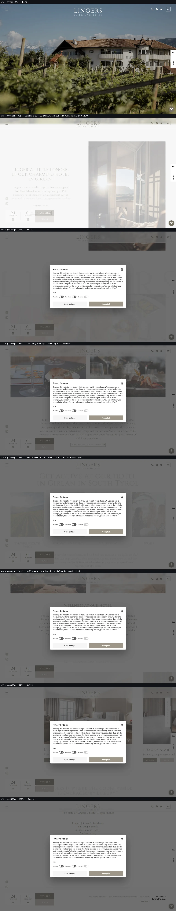
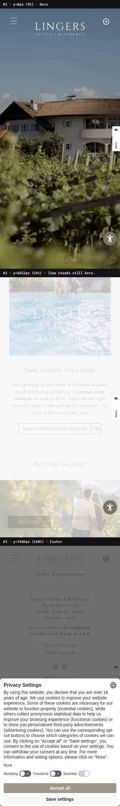

# UI Design System & Master Generation Blueprint: www-lingers-it_en

> **Lingers – your hotel in Girlan** (https://www.lingers.it/en) — Lingers is more than a hotel in Girlan. It’s your hideaway that makes you want to stay a little longer. And we can’t wait to welcome you.





---

## 1. Executive Visual Persona & Design Archetype

- **Brand Essence & Persona**: **Lingers – your hotel in Girlan** (`https://www.lingers.it/en`). Lingers is more than a hotel in Girlan. It’s your hideaway that makes you want to stay a little longer. And we can’t wait to welcome you.
- **Capture Provenance**: Live browser capture (`tier1_fast`, HTTP `200`, captured `2026-11-24`).
- **Visual Archetype**: **Light-Substrate Editorial & Modular Grid System (`#f7f7f7` canvas, `#777162` ink, `#000000` accent)**.
- **Anti-AI-Slop Differentiators**:
  - **Live-Computed Chromatic Polarity**: Anchors the viewport in `#f7f7f7` (live computed `body` `background-color` (`computed_styles.json`)) paired with `#777162` primary typography and `#000000` accents.
  - **Grounded Typographic Hierarchy**: Pairs `Cinzel` for display copy (`LINGER A LITTLE LONGER. IN OUR CHARM`) with `Cormorant Garamond` and `SFMono-Regular`.
  - **Calibrated Spatial Grid & Motion**: Combines `83em` container bounds (`gap: .3rem`, padding `36px`) with `cubic-bezier(.23,1,.32,1)` easing and Three.js / WebGL Canvas Pipeline, Swiper Touch Carousel Engine.

---

## 2. Spatial Architecture & Modular Grid Mathematics

### Viewport Allocation & Container Geometry
- **Captured Journey Filmstrips**: Desktop `1280×6624px` (`assets/desktop-journey.webp`, `8` keyframes up to `y=9886px` / doc `13480px`), Mobile `390×2616px` (`assets/mobile-journey.webp`, `3` keyframes).
- **Master Container Bounds**: `83em` (non-`@media` desktop container stylesheet rule).
- **Canvas Lateral Padding & Spacing**: `36px` lateral canvas padding with `.3rem` grid gap.
- **Border Radius Scale**: `2px`, `5px`, `100%`, `50%`.

### Responsive Breakpoint Architecture
- **Desktop Layout**: Multi-column CSS Grid / Flexbox layout at `1440px` (`max-width: 83em`, `gap: .3rem`).
- **Mobile Layout**: Single-column vertical stack at `390px` viewport width with `36px` horizontal padding.
- **Extracted CSS Media Queries**: `@media (max-width: 1024px)`, `@media (max-width: 767px)`, `@media (max-width: 1366px)`, `@media (min-width: 1025px)`.

---

## 3. Color System, Materiality & Atmospheric Lighting

### Semantic Palette & Source Grounding
| Semantic Role | Ground-Truth Value | Extracted Live / CSS Source |
|---|---|---|
| **Primary Canvas Substrate** | `#f7f7f7` | live computed `body` `background-color` (`computed_styles.json`) |
| **Primary Typography Ink** | `#777162` | live computed `h1` `color` (`computed_styles.json`) |
| **Elevated Surface / Card Substrate** | `#c4c4c4` | `var(--BN-dynform--clr-selection-bg)` in `:root` |
| **Interactive Accent / Highlight** | `#000000` | live computed `button` `background-color` (`computed_styles.json`) |
| **Secondary / Muted Copy** | `#9f9b91` | `var(--bl-color-secondary)` in `:root` |
| **Structural Hairline Border** | `#0084f8` | `var(--BN-dynform--clr-schema-1-border)` in `:root` |
| **Variable Token (`--BN-dynform--clr-selection-text`)** | `#0b0b0b` | `var(--BN-dynform--clr-selection-text)` in `:root` |
| **Variable Token (`--BN-dynform--clr-form-bg`)** | `#ffffff` | `var(--BN-dynform--clr-form-bg)` in `:root` |
| **Variable Token (`--BN-dynform--clr-button-bg`)** | `#2865ad` | `var(--BN-dynform--clr-button-bg)` in `:root` |
| **Variable Token (`--BN-dynform--clr-schema-2-bg`)** | `#e2f0fd` | `var(--BN-dynform--clr-schema-2-bg)` in `:root` |

### Sanitized Root CSS Variables (`ui-ux.md` Ground Truth)
| Variable Name | Extracted Value | Semantic Role |
|---|---|---|
| `--BN-dynform--ff` | `inherit` | Design System Custom Token |
| `--BN-dynform--fw-bold` | `700` | Design System Custom Token |
| `--BN-dynform--fw-light` | `300` | Canvas / Surface Token |
| `--BN-dynform--fw-regular` | `400` | Design System Custom Token |
| `--BN-dynform--clr-scrollbar-thumb` | `#C4C4C4` | Color / Atmospheric Token |
| `--BN-dynform--clr-scrollbar-track` | `transparent` | Design System Custom Token |
| `--BN-dynform--clr-selection-bg` | `#C4C4C4` | Canvas / Surface Token |
| `--BN-dynform--clr-selection-text` | `#0B0B0B` | Typography Ink Token |
| `--BN-dynform--clr-form-bg` | `#ffffff` | Canvas / Surface Token |
| `--BN-dynform--clr-button-bg` | `#2865AD` | Canvas / Surface Token |
| `--BN-dynform--clr-button-border` | `#2865AD` | Elevation / Border Token |
| `--BN-dynform--clr-button-text` | `#ffffff` | Typography Ink Token |
| `--BN-dynform--clr-schema-1-bg` | `#0084F8` | Canvas / Surface Token |
| `--BN-dynform--clr-schema-1-border` | `#0084F8` | Elevation / Border Token |
| `--BN-dynform--clr-schema-1-text` | `#ffffff` | Typography Ink Token |
| `--BN-dynform--clr-schema-2-bg` | `#E2F0FD` | Canvas / Surface Token |

---

## 4. Typographic Scale & Editorial Hierarchy

### Font Family Stacks
- **Display Typography**: `Cinzel`.
- **Primary Body Stack**: `Cormorant Garamond`.
- **Technical / Metadata Stack**: `SFMono-Regular`.

### Typographic Scale & Rules (Live Computed & Stylesheet Grounded)
- **Hero Display (`H1`)**: live computed `h1` (`font-size: 9.008px`, `line-height: 10.8096px`, `font-weight: 400`, `letter-spacing: 2.1px`); rule `h1` (`line-height: 1.2`, `letter-spacing: 2.1px`).
- **Section Heading (`H2`)**: live computed `h2` (`font-size: 9.008px`, `line-height: 9.008px`, `font-weight: 400`, `letter-spacing: 1.8px`); rule `h2` (`font-size: 1em`, `line-height: 1`, `letter-spacing: 1.8px`).
- **Body Copy**: live computed `body` (`font-size: 9.008px`, `line-height: 11.26px`, `font-weight: 400`); rule `p` (`font-size: 12px`).
- **Metadata & Navigation Labels**: live computed `nav/a` (`font-size: 9.008px`, `line-height: 11.26px`, `font-weight: 400`); rule `small` (`font-size: 80%`).

---

## 5. Choreographed Motion & Interaction Physics

### Primary Easing Curves
- **Extracted Timing Functions**: `cubic-bezier(.23,1,.32,1)`, `cubic-bezier(0,0,0.25,1)`, `cubic-bezier(0.215,0.61,0.355,1)`.

### Per-Element Transition & Choreography Rules
- **Selector `-module[data-id=TextPic] .DNA-mod...`**: `transition: transform 2s,opacity 2s` extracted from `www-lingers-it_en` stylesheet.
- **Selector `data-id=TextPicV2] .DNA-module__i...`**: `transition: background-color .25s` extracted from `www-lingers-it_en` stylesheet.
- **Selector `odule[data-id=TextPicV2] .DNA-mod...`**: `transition: transform 2s,opacity 2s` extracted from `www-lingers-it_en` stylesheet.
- **Extracted Easing Curve (`cubic-bezier(.23,1,.32,1)`)**: Governs interactive state transitions across `<header.DNA-section>` and `<section.DNA-module:nth(2)>`.
- **Runtime Interaction Engine**: Integrates Three.js / WebGL Canvas Pipeline, Swiper Touch Carousel Engine with `prefers-reduced-motion: reduce` fallback guards.
### Measured Runtime Scroll & Interaction Telemetry (`behavioral_journey_v2`)
- **Scroll Driver Mode**: `native` (max document height `13480px`, deepest scrollY reached `9886px` across `8` desktop keyframes).
- **Detected Scroll / Motion Libraries**: Native browser scroll / standard CSS transitions.
- **Route Transition Architecture**: First internal navigation (`/en/lingers/picture-gallery`) measured as `direct` in `1082ms`.

---

## 6. Component Wireframe & Structural DOM Map

### Visual Layout Schematic — Desktop (`1440px`, Grounded in `dom.html` & Landmark Bounding Boxes)
```
┌────────────────────────────────────────────────────────────────────────┐
│ DESKTOP VIEWPORT (1440px) — Lingers – your hotel in Girlan             │
│ ====================================================================== │
│ [ <header.DNA-section> (1440x0px)     | DE · IT · EN                 ] │
│ ---------------------------------------------------------------------- │
│ | HERO STAGE: <section.DNA-module> (w=1440px)                        | │
│ | H1: LINGER A LITTLE LONGER. IN OUR CHARMING HOTEL IN...            | │
│ | Substrate: #f7f7f7 | Ink: #777162 | Accent: #000000                | │
│ ---------------------------------------------------------------------- │
│ | SHOWCASE GRID (<section.DNA-module:nth(2)) max-w: 83em             | │
│ | +------------------------------+  +------------------------------+ | │
│ | | Linger a little longer. In o |  | Culinary concept: morning &  | | │
│ | +------------------------------+  +------------------------------+ | │
│ ---------------------------------------------------------------------- │
│ | DETAIL MODULE (<section.DNA-module:nth(3)) — Get active at our hot | │
│ ---------------------------------------------------------------------- │
│ [ FOOTER (<footer.DNA-section>) | https://www.lingers.it/en            │
└────────────────────────────────────────────────────────────────────────┘
```

### Visual Layout Schematic — Mobile Reflow (`390px`)
```
┌────────────────────────────────────────────────────────────────────────┐
│ MOBILE VIEWPORT REFLOW (390px) — Single-Column Stack (gap: .3rem)      │
│ ====================================================================== │
│ [ HEADER BAR (<header.DNA-section>    ) | Compact Menu (390px)         │
│ ---------------------------------------------------------------------- │
│ | HERO STAGE (<section.DNA-module>) — 390px Vertical Lead            | │
│ | H1: LINGER A LITTLE LONGER. IN OUR CHARMING HOTEL IN...            | │
│ ---------------------------------------------------------------------- │
│ | SHOWCASE STACK (<section.DNA-module:nt) — 1-Col Stack              | │
│ | [ Item 1: Linger a little longer. In our charming hotel in...    ] | │
│ | [ Item 2: Culinary concept: morning & afternoon                  ] | │
│ ---------------------------------------------------------------------- │
│ | DETAIL STACK (<section.DNA-module:nth() — 1-Col (Get active at our ) │
│ ---------------------------------------------------------------------- │
│ [ FOOTER (<footer.DNA-section>) | Stacked 390px Colophon               │
└────────────────────────────────────────────────────────────────────────┘
```

### Granular DOM Region Breakdown
1. **Brand Header & Navigation Bar (<header.DNA-section> — `www-lingers-it_en`)**:
   - Landmark `<header class="DNA-section">` (`1440x0px`) hosting `Lingers – your hotel in Girlan` navigation (`DE · IT · EN`), DOM attributes (`data-asset-id="Scss/presets"`, `data-asset-id="Scss/vendors"`, `data-asset-id="Globals/Main"`, `data-asset-id="Sections/Header"`), and stylesheet rule `page { margin:.5cm }`.
2. **Hero Stage & Focal Lead (<section.DNA-module> — `LINGER A LITTLE LONGER. IN OUR CHA`)**:
   - Landmark `<section class="DNA-module">` presenting display lead `LINGER A LITTLE LONGER. IN OUR CHARMING HOTEL IN...` and copy excerpt *"Lingers is an extraordinary place. Not your typical hotel in Girl"* over `#f7f7f7` canvas and `#777162` ink.
3. **Primary Showcase & Content Grid (<section.DNA-module:nth(2)> — `Linger a little longer. In our cha`)**:
   - Landmark `<section class="DNA-module">` rendering section `Linger a little longer. In our charming hotel in...` with copy *"Linger a little longer. In our charming hotel in Girlan."*, asset references (`favicon-96x96.png`, `favicon.svg`, `favicon.ico`, `apple-touch-icon.png`), and grid rule `body { font-family:Arial,sans-serif;font-size:12px }`.
4. **Interactive Detail & Feature Matrix (<section.DNA-module:nth(3)> — `Culinary concept: morning & aftern`)**:
   - Landmark `<section class="DNA-module">` framing `Culinary concept: morning & afternoon` and `Get active at our hotel in Girlan in South Tyrol` (*"Lingers is an extraordinary place. Not your typical hotel in Girl"*) with `#c4c4c4` surface cards, `#000000` accents, and `a:visited { text-decoration:none }`.
5. **Colophon & Global Directory Footer (<footer.DNA-section> — `https://www.lingers.it/en`)**:
   - Landmark `<footer class="DNA-section">` anchoring `Lingers – your hotel in Girlan` footer links (`DE · IT · EN`), copy *"We are the Lingers!"*, and `#0084f8` structural dividers.
### Full Vertical Scroll Sequence (Desktop `1440×900` Keyframes)
- **Step 01** (`y=0px`, `0%`): Active landmark `Hero` · sticky/fixed elements: `1`
- **Step 02** (`y=850px`, `7%`): Active landmark `LINGER A LITTLE LONGER. IN OUR CHARMING HOTEL IN...` · sticky/fixed elements: `1`
- **Step 03** (`y=1700px`, `14%`): Active landmark `c121` · sticky/fixed elements: `1`
- **Step 04** (`y=2550px`, `20%`): Active landmark `Culinary concept: morning & afternoon` · sticky/fixed elements: `1`
- **Step 05** (`y=3400px`, `27%`): Active landmark `Get active at our hotel in Girlan in South Tyrol` · sticky/fixed elements: `1`
- **Step 06** (`y=5950px`, `50%`): Active landmark `Wellness at our hotel in Girlan in South Tyrol` · sticky/fixed elements: `1`
- **Step 07** (`y=6800px`, `57%`): Active landmark `c124` · sticky/fixed elements: `1`
- **Step 08** (`y=9886px`, `100%`): Active landmark `Footer` · sticky/fixed elements: `1`

### Multi-Page Internal Route Map
- **Detail Route (`/en/lingers/picture-gallery`)**: `https://www.lingers.it/en/lingers/picture-gallery` — H1: `MOMENTS TO HOLD ON TO AND NEVER FORGET`, scrollHeight `5513px`, transition `direct` (`1082ms`)
- **Detail Route (`/en/stay/offers`)**: `https://www.lingers.it/en/stay/offers` — H1: `A WHOLE PACKAGE OF HOLIDAY HAPPINESS`, scrollHeight `2395px`, transition `direct` (`163ms`)
- **Detail Route (`/en/lingers`)**: `https://www.lingers.it/en/lingers` — H1: `A HIDEAWAY WHERE YOU’LL WANT TO LINGER A LITTLE L...`, scrollHeight `5563px`, transition `direct` (`130ms`)

---

## 7. Master Zero-Shot AI Generation Prompt

```markdown
# Master Zero-Shot Frontend Generation Prompt: www-lingers-it_en (Lingers – your hotel in Girlan)

You are a principal frontend architect and design systems engineer. Build a complete, production-ready web application replicating the exact design system, DOM landmarks, typographic hierarchy, color tokens, and motion physics of `www-lingers-it_en` (**Lingers – your hotel in Girlan** — `https://www.lingers.it/en`).

### 1. Visual Archetype & Anti-AI-Slop Mandates
- **Archetype**: Light-Substrate Editorial & Modular Grid System (`#f7f7f7` canvas, `#777162` ink, `#000000` accent).
- **Identity & Domain Context**: Lingers is more than a hotel in Girlan. It’s your hideaway that makes you want to stay a little longer. And we can’t wait to welcome you.
- **Primary Substrate**: `#f7f7f7` (live computed `body` `background-color` (`computed_styles.json`)), **Primary Ink**: `#777162`, **Accent / Highlight**: `#000000`.
- **Site-Specific Differentiators**:
  - **Live-Computed Chromatic Polarity**: Anchors the viewport in `#f7f7f7` (live computed `body` `background-color` (`computed_styles.json`)) paired with `#777162` primary typography and `#000000` accents.
  - **Grounded Typographic Hierarchy**: Pairs `Cinzel` for display copy (`LINGER A LITTLE LONGER. IN OUR CHARM`) with `Cormorant Garamond` and `SFMono-Regular`.
  - **Calibrated Spatial Grid & Motion**: Combines `83em` container bounds (`gap: .3rem`, padding `36px`) with `cubic-bezier(.23,1,.32,1)` easing and Three.js / WebGL Canvas Pipeline, Swiper Touch Carousel Engine.

### 2. Ground-Truth CSS Variables (`:root` Token Contract)
Declare and consume these exact custom properties extracted from `www-lingers-it_en` in your global stylesheet:

:root {
  /* Lingers – your hotel in Girlan (www-lingers-it_en) — Live-Grounded CSS Variables */
  --BN-dynform--ff: inherit; /* Design System Custom Token (www-lingers-it_en) */
  --BN-dynform--fw-bold: 700; /* Design System Custom Token (www-lingers-it_en) */
  --BN-dynform--fw-light: 300; /* Canvas / Surface Token (www-lingers-it_en) */
  --BN-dynform--fw-regular: 400; /* Design System Custom Token (www-lingers-it_en) */
  --BN-dynform--clr-scrollbar-thumb: #C4C4C4; /* Color / Atmospheric Token (www-lingers-it_en) */
  --BN-dynform--clr-scrollbar-track: transparent; /* Design System Custom Token (www-lingers-it_en) */
  --BN-dynform--clr-selection-bg: #C4C4C4; /* Canvas / Surface Token (www-lingers-it_en) */
  --BN-dynform--clr-selection-text: #0B0B0B; /* Typography Ink Token (www-lingers-it_en) */
  --BN-dynform--clr-form-bg: #ffffff; /* Canvas / Surface Token (www-lingers-it_en) */
  --BN-dynform--clr-button-bg: #2865AD; /* Canvas / Surface Token (www-lingers-it_en) */
  --BN-dynform--clr-button-border: #2865AD; /* Elevation / Border Token (www-lingers-it_en) */
  --BN-dynform--clr-button-text: #ffffff; /* Typography Ink Token (www-lingers-it_en) */
  --BN-dynform--clr-schema-1-bg: #0084F8; /* Canvas / Surface Token (www-lingers-it_en) */
  --BN-dynform--clr-schema-1-border: #0084F8; /* Elevation / Border Token (www-lingers-it_en) */
  --BN-dynform--clr-schema-1-text: #ffffff; /* Typography Ink Token (www-lingers-it_en) */
  --BN-dynform--clr-schema-2-bg: #E2F0FD; /* Canvas / Surface Token (www-lingers-it_en) */
}

### 3. Semantic Color & Materiality Contract
Map every surface, ink, and border strictly to these source-grounded tokens:
- **Primary Canvas Substrate**: `#f7f7f7` — grounded in live computed `body` `background-color` (`computed_styles.json`)
- **Primary Typography Ink**: `#777162` — grounded in live computed `h1` `color` (`computed_styles.json`)
- **Elevated Surface / Card Substrate**: `#c4c4c4` — grounded in `var(--BN-dynform--clr-selection-bg)` in `:root`
- **Interactive Accent / Highlight**: `#000000` — grounded in live computed `button` `background-color` (`computed_styles.json`)
- **Secondary / Muted Copy**: `#9f9b91` — grounded in `var(--bl-color-secondary)` in `:root`
- **Structural Hairline Border**: `#0084f8` — grounded in `var(--BN-dynform--clr-schema-1-border)` in `:root`
- **Variable Token (`--BN-dynform--clr-selection-text`)**: `#0b0b0b` — grounded in `var(--BN-dynform--clr-selection-text)` in `:root`
- **Variable Token (`--BN-dynform--clr-form-bg`)**: `#ffffff` — grounded in `var(--BN-dynform--clr-form-bg)` in `:root`
- **Variable Token (`--BN-dynform--clr-button-bg`)**: `#2865ad` — grounded in `var(--BN-dynform--clr-button-bg)` in `:root`
- **Variable Token (`--BN-dynform--clr-schema-2-bg`)**: `#e2f0fd` — grounded in `var(--BN-dynform--clr-schema-2-bg)` in `:root`

### 4. Spatial Grid, Container Bounds & Responsive Breakpoints
- **Desktop Viewport Reference**: `1280×6624px` (multi-frame vertical journey filmstrip (6624px), `1440px` standard desktop width).
- **Mobile Viewport Reference**: `390×2616px` (multi-frame vertical journey filmstrip (2616px), `390px` standard mobile width).
- **Container Max-Width**: `83em` (non-`@media` desktop container stylesheet rule)
- **Padding & Gutters**: `36px` lateral canvas padding with `.3rem` grid gap
- **Desktop Grid**: Multi-column CSS Grid / Flexbox layout at `1440px` (`max-width: 83em`, `gap: .3rem`)
- **Mobile Adaptation**: Single-column vertical stack at `390px` viewport width with `36px` horizontal padding
- **Media Queries**: `@media (max-width: 1024px)`, `@media (max-width: 767px)`, `@media (max-width: 1366px)`, `@media (min-width: 1025px)`
- **Corner Radii**: `2px`, `5px`, `100%`, `50%`

### 5. Typography & Editorial Scale Contract
- **Display Font Stack**: `Cinzel`
- **Body Font Stack**: `Cormorant Garamond`
- **Monospace / Technical Font Stack**: `SFMono-Regular`
- **H1 Display Rule**: live computed `h1` (`font-size: 9.008px`, `line-height: 10.8096px`, `font-weight: 400`, `letter-spacing: 2.1px`); rule `h1` (`line-height: 1.2`, `letter-spacing: 2.1px`)
- **H2 Section Rule**: live computed `h2` (`font-size: 9.008px`, `line-height: 9.008px`, `font-weight: 400`, `letter-spacing: 1.8px`); rule `h2` (`font-size: 1em`, `line-height: 1`, `letter-spacing: 1.8px`)
- **Body Copy Rule**: live computed `body` (`font-size: 9.008px`, `line-height: 11.26px`, `font-weight: 400`); rule `p` (`font-size: 12px`)
- **Metadata & Index Rule**: live computed `nav/a` (`font-size: 9.008px`, `line-height: 11.26px`, `font-weight: 400`); rule `small` (`font-size: 80%`)

### 6. Component Hierarchy, Verbatim Copy & Real DOM Landmarks
Scaffold `www-lingers-it_en` (`Lingers – your hotel in Girlan`) with these exact structural regions, extracted copy, and CSS rules from `dom.html`:
1. **Brand Header & Navigation Bar (<header.DNA-section> — `www-lingers-it_en`)**:
   - DOM & Selectors: Landmark `<header class="DNA-section">` (`1440x0px`) hosting `Lingers – your hotel in Girlan` navigation (`DE · IT · EN`), DOM attributes (`data-asset-id="Scss/presets"`, `data-asset-id="Scss/vendors"`, `data-asset-id="Globals/Main"`, `data-asset-id="Sections/Header"`), and stylesheet rule `page { margin:.5cm }`.
   - Responsive Contract: Header `Brand Header & Navigation Bar (<header.DNA-section> — `www-lingers-it_en`)` (`www-lingers-it_en`) adapts across `@media (max-width: 1024px)`, `@media (max-width: 767px)`, `@media (max-width: 1366px)`, `@media (min-width: 1025px)` with `cubic-bezier(.23,1,.32,1)`, `cubic-bezier(0,0,0.25,1)`, `cubic-bezier(0.215,0.61,0.355,1)` transitions and links `DE · IT · EN`.
2. **Hero Stage & Focal Lead (<section.DNA-module> — `LINGER A LITTLE LONGER. IN OUR CHA`)**:
   - DOM & Selectors: Landmark `<section class="DNA-module">` presenting display lead `LINGER A LITTLE LONGER. IN OUR CHARMING HOTEL IN...` and copy excerpt *"Lingers is an extraordinary place. Not your typical hotel in Girl"* over `#f7f7f7` canvas and `#777162` ink.
   - Responsive Contract: Hero stage (`1280×6624px` desktop / `390×2616px` mobile) sets `#f7f7f7` background with `#777162` headline `LINGER A LITTLE LONGER. IN OUR CHARMING HOTEL IN...`.
3. **Primary Showcase & Content Grid (<section.DNA-module:nth(2)> — `Linger a little longer. In our cha`)**:
   - DOM & Selectors: Landmark `<section class="DNA-module">` rendering section `Linger a little longer. In our charming hotel in...` with copy *"Linger a little longer. In our charming hotel in Girlan."*, asset references (`favicon-96x96.png`, `favicon.svg`, `favicon.ico`, `apple-touch-icon.png`), and grid rule `body { font-family:Arial,sans-serif;font-size:12px }`.
   - Responsive Contract: Showcase grid `Primary Showcase & Content Grid (<section.DNA-module:nth(2)> — `Linger a little longer. In our cha`)` applies Multi-column CSS Grid / Flexbox layout at `1440px` (`max-width: 83em`, `gap: .3rem`) on desktop and Single-column vertical stack at `390px` viewport width with `36px` horizontal padding on mobile.
4. **Interactive Detail & Feature Matrix (<section.DNA-module:nth(3)> — `Culinary concept: morning & aftern`)**:
   - DOM & Selectors: Landmark `<section class="DNA-module">` framing `Culinary concept: morning & afternoon` and `Get active at our hotel in Girlan in South Tyrol` (*"Lingers is an extraordinary place. Not your typical hotel in Girl"*) with `#c4c4c4` surface cards, `#000000` accents, and `a:visited { text-decoration:none }`.
   - Responsive Contract: Detail module `Interactive Detail & Feature Matrix (<section.DNA-module:nth(3)> — `Culinary concept: morning & aftern`)` uses `2px`, `5px`, `100%`, `50%` radii, `#000000` highlights, and assets (favicon-96x96.png, favicon.svg, favicon.ico).
5. **Colophon & Global Directory Footer (<footer.DNA-section> — `https://www.lingers.it/en`)**:
   - DOM & Selectors: Landmark `<footer class="DNA-section">` anchoring `Lingers – your hotel in Girlan` footer links (`DE · IT · EN`), copy *"We are the Lingers!"*, and `#0084f8` structural dividers.
   - Responsive Contract: Footer `Colophon & Global Directory Footer (<footer.DNA-section> — `https://www.lingers.it/en`)` aligns to `83em` (non-`@media` desktop container stylesheet rule) with `36px` lateral canvas padding with `.3rem` grid gap and attributes (data-asset-id="Scss/presets", data-asset-id="Scss/vendors", data-asset-id="Globals/Main").

#### Verbatim DOM Copy Excerpts (`dom.html`)
- Copy Excerpt 1: *"Lingers is an extraordinary place. Not your typical hotel in Girlan, but a charmin..."*
- Copy Excerpt 2: *"Linger a little longer. In our charming hotel in Girlan."*
- Copy Excerpt 3: *"Lingers is an extraordinary place. Not your typical hotel in Girlan , but a charmi..."*
- Copy Excerpt 4: *"We are the Lingers!"*

### 7. Motion, Extracted Stylesheet Rules & Interaction Choreography
- **Primary Easing Functions**: `cubic-bezier(.23,1,.32,1)`, `cubic-bezier(0,0,0.25,1)`, `cubic-bezier(0.215,0.61,0.355,1)`
- **Extracted Stylesheet Rules (`www-lingers-it_en`)**:
- `page { margin:.5cm }`
- `body { font-family:Arial,sans-serif;font-size:12px }`
- `a:visited { text-decoration:none }`
- `after { display:none }`
- `blockquote { border:1px solid 999;page-break-inside:avoid }`
- **Per-Selector Transition Rules**:
- **Selector `-module[data-id=TextPic] .DNA-mod...`**: `transition: transform 2s,opacity 2s` extracted from `www-lingers-it_en` stylesheet.
- **Selector `data-id=TextPicV2] .DNA-module__i...`**: `transition: background-color .25s` extracted from `www-lingers-it_en` stylesheet.
- **Selector `odule[data-id=TextPicV2] .DNA-mod...`**: `transition: transform 2s,opacity 2s` extracted from `www-lingers-it_en` stylesheet.
- **Extracted Easing Curve (`cubic-bezier(.23,1,.32,1)`)**: Governs interactive state transitions across `<header.DNA-section>` and `<section.DNA-module:nth(2)>`.
- **Runtime Interaction Engine**: Integrates Three.js / WebGL Canvas Pipeline, Swiper Touch Carousel Engine with `prefers-reduced-motion: reduce` fallback guards.
### 7b. Full-Page Scroll Choreography, Interactive States & Multi-Page Routes
- **Scroll Mechanics**: Implement `native` vertical progression up to `13480px` across 8 distinct viewport chapters.
- **Vertical Chapter Sequence**: Hero (0%) -> LINGER A LITTLE LONGER. IN... (7%) -> c121 (14%) -> Culinary concept: morning &... (20%) -> Get active at our hotel in... (27%) -> Wellness at our hotel in Gi... (50%) -> c124 (57%) -> Footer (100%).
- **Multi-Page Routes**: Scaffold internal routes `/en/lingers/picture-gallery` (detail, direct), `/en/stay/offers` (detail, direct), `/en/lingers` (detail, direct) sharing the global header/footer shell and design tokens.

### 8. Technical Deliverables
- Implement in Next.js (App Router) with TypeScript and Tailwind CSS consuming the `:root` custom properties defined above for `www-lingers-it_en`.
- Reproduce both the `1440px` desktop architecture and `390px` mobile breakpoint transitions, preserving semantic HTML5 landmarks (`<header>`, `<nav>`, `<main>`, `<section>`, `<footer>`) and `prefers-reduced-motion` accessibility guards.
```
---

## 8. Full-Page Scroll Journey, Interactive States & Subpage Inventory

### Desktop Scroll Keyframes (`1440×900` WebP)
| Step | Scroll Y | Progress | Active Landmark / Section | Sticky/Fixed | Visual Asset |
| :---: | :---: | :---: | :--- | :---: | :--- |
| `#01` | `0px` | `0%` | Hero | `1` | [desktop-step-01.webp](assets/desktop-step-01.webp) |
| `#02` | `850px` | `7%` | LINGER A LITTLE LONGER. IN OUR CHARMING HOTEL... | `1` | [desktop-step-02.webp](assets/desktop-step-02.webp) |
| `#03` | `1700px` | `14%` | c121 | `1` | [desktop-step-03.webp](assets/desktop-step-03.webp) |
| `#04` | `2550px` | `20%` | Culinary concept: morning & afternoon | `1` | [desktop-step-04.webp](assets/desktop-step-04.webp) |
| `#05` | `3400px` | `27%` | Get active at our hotel in Girlan in South Tyrol | `1` | [desktop-step-05.webp](assets/desktop-step-05.webp) |
| `#06` | `5950px` | `50%` | Wellness at our hotel in Girlan in South Tyrol | `1` | [desktop-step-06.webp](assets/desktop-step-06.webp) |
| `#07` | `6800px` | `57%` | c124 | `1` | [desktop-step-07.webp](assets/desktop-step-07.webp) |
| `#08` | `9886px` | `100%` | Footer | `1` | [desktop-step-08.webp](assets/desktop-step-08.webp) |

### Mobile Condensed Keyframes (`390×844` WebP)
| Step | Scroll Y | Progress | Active Landmark | Visual Asset |
| :---: | :---: | :---: | :--- | :--- |
| `#01` | `0px` | `0%` | Hero | [mobile-step-01.webp](assets/mobile-step-01.webp) |
| `#02` | `6052px` | `50%` | Time stands still here. | [mobile-step-02.webp](assets/mobile-step-02.webp) |
| `#03` | `7666px` | `100%` | Footer | [mobile-step-03.webp](assets/mobile-step-03.webp) |

### Internal Subpage Filmstrips (`1080px` Wide WebP)
| # | Template | Route URL | H1 / Title | Scroll Height | Transition | Filmstrip Asset |
| :-: | :---: | :--- | :--- | :---: | :---: | :--- |
| `1` | `detail` | `https://www.lingers.it/en/lingers/picture-gallery` | MOMENTS TO HOLD ON TO AND NEVER FORGET | `5513px` | `direct` (`1082ms`) | [subpage-01-en-lingers-picture-gallery.webp](assets/subpage-01-en-lingers-picture-gallery.webp) |
| `2` | `detail` | `https://www.lingers.it/en/stay/offers` | A WHOLE PACKAGE OF HOLIDAY HAPPINESS | `2395px` | `direct` (`163ms`) | [subpage-02-en-stay-offers.webp](assets/subpage-02-en-stay-offers.webp) |
| `3` | `detail` | `https://www.lingers.it/en/lingers` | A HIDEAWAY WHERE YOU’LL WANT TO LINGE... | `5563px` | `direct` (`130ms`) | [subpage-03-en-lingers.webp](assets/subpage-03-en-lingers.webp) |

