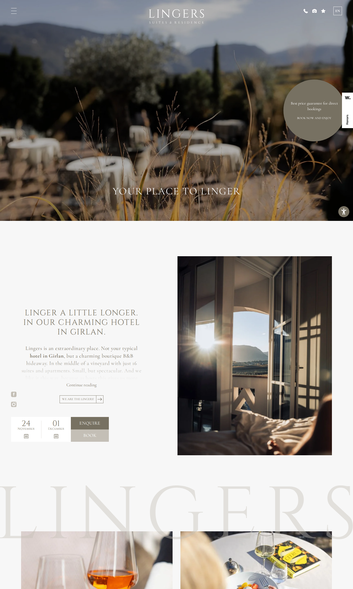
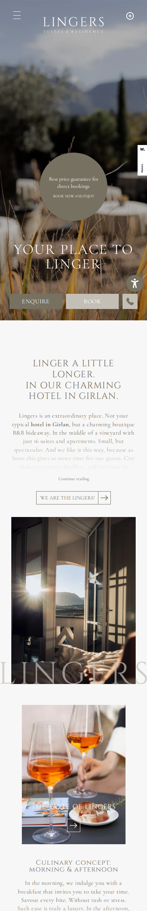

# UI Design System & Master Generation Blueprint: www-lingers-it_en

> **Lingers – your hotel in Girlan** (https://www.lingers.it/en) — Lingers is more than a hotel in Girlan. It’s your hideaway that makes you want to stay a little longer. And we can’t wait to welcome you.



---

## 1. Executive Visual Persona & Design Archetype

- **Brand Essence & Persona**: **Lingers – your hotel in Girlan** (`https://www.lingers.it/en`). Lingers is more than a hotel in Girlan. It’s your hideaway that makes you want to stay a little longer. And we can’t wait to welcome you.
- **Capture Provenance**: Live browser capture (`tier1_fast`, HTTP `200`, captured `2026-11-23`).
- **Visual Archetype**: **Light-Substrate Editorial & Modular Grid System (`#f7f7f7` canvas, `#777162` ink, `#000000` accent)**.
- **Anti-AI-Slop Differentiators**:
  - **Live-Computed Chromatic Polarity**: Anchors the viewport in `#f7f7f7` (live computed `body` `background-color` (`computed_styles.json`)) paired with `#777162` primary typography and `#000000` accents.
  - **Grounded Typographic Hierarchy**: Pairs `Cinzel` for display copy (`LINGER A LITTLE LONGER. IN OUR CHARM`) with `Cormorant Garamond` and `SFMono-Regular`.
  - **Calibrated Spatial Grid & Motion**: Combines `83em` container bounds (`gap: .3rem`, padding `8px`) with `cubic-bezier(0,0,0.25,1)` easing and Three.js / WebGL Canvas Pipeline, Swiper Touch Carousel Engine.

---

## 2. Spatial Architecture & Modular Grid Mathematics



### Viewport Allocation & Container Geometry
- **Captured Viewport Dimensions**: Desktop `1440×2400px` (`assets/desktop.png`, clamped at 2400px live multi-section capture), Mobile `390×2400px` (`assets/mobile.png`, clamped at 2400px live multi-section capture).
- **Master Container Bounds**: `83em` (non-`@media` desktop container stylesheet rule).
- **Canvas Lateral Padding & Spacing**: `8px` lateral canvas padding with `.3rem` grid gap.
- **Border Radius Scale**: `2px`, `50%`, `3px`, `8px`.

### Responsive Breakpoint Architecture
- **Desktop Layout**: Multi-column CSS Grid / Flexbox layout at `1440px` (`max-width: 83em`, `gap: .3rem`).
- **Mobile Layout**: Single-column vertical stack at `390px` viewport width with `8px` horizontal padding.
- **Extracted CSS Media Queries**: `@media (max-width: 1024px)`, `@media (max-width: 767px)`, `@media (min-width: 1025px)`, `@media (max-width: 320px)`.

---

## 3. Color System, Materiality & Atmospheric Lighting

### Semantic Palette & Source Grounding
| Semantic Role | Ground-Truth Value | Extracted Live / CSS Source |
|---|---|---|
| **Primary Canvas Substrate** | `#f7f7f7` | live computed `body` `background-color` (`computed_styles.json`) |
| **Primary Typography Ink** | `#777162` | live computed `h1` `color` (`computed_styles.json`) |
| **Elevated Surface / Card Substrate** | `#ffffff` | `.DNA-section__wrap--2 { background-color: #ffffff }` |
| **Interactive Accent / Highlight** | `#000000` | live computed `button` `background-color` (`computed_styles.json`) |
| **Secondary / Muted Copy** | `#9f9b91` | `var(--bl-color-secondary)` in `:root` |
| **Structural Hairline Border** | `#777162` | `.DNA-section__lang-menu { border: #777162 }` |

### Sanitized Root CSS Variables (`ui-ux.md` Ground Truth)
| Variable Name | Extracted Value | Semantic Role |
|---|---|---|
| `--track-width` | `52px` | Layout / Spatial Grid Token |
| `--track-height` | `28px` | Layout / Spatial Grid Token |
| `--thumb-size` | `23px` | Layout / Spatial Grid Token |
| `--thumb-gap` | `3px` | Layout / Spatial Grid Token |
| `--track-radius` | `999px` | Elevation / Border Token |
| `--vh` | `9px` | Layout / Spatial Grid Token |
| `--bl-size` | `45px` | Layout / Spatial Grid Token |
| `--bl-desktop-top` | `auto` | Design System Custom Token |
| `--bl-desktop-bottom` | `1.5em` | Dimension / Scale Token |
| `--bl-desktop-left` | `auto` | Design System Custom Token |
| `--bl-desktop-right` | `1.5em` | Dimension / Scale Token |
| `--bl-desktop-box-left` | `auto` | Design System Custom Token |
| `--bl-desktop-box-right` | `1.5em` | Dimension / Scale Token |
| `--bl-tablet-top` | `auto` | Design System Custom Token |
| `--bl-tablet-bottom` | `1em` | Dimension / Scale Token |
| `--bl-tablet-left` | `auto` | Design System Custom Token |

---

## 4. Typographic Scale & Editorial Hierarchy

### Font Family Stacks
- **Display Typography**: `Cinzel`.
- **Primary Body Stack**: `Cormorant Garamond`.
- **Technical / Metadata Stack**: `SFMono-Regular`.

### Typographic Scale & Rules (Live Computed & Stylesheet Grounded)
- **Hero Display (`H1`)**: live computed `h1` (`font-size: 9.008px`, `line-height: 10.8096px`, `font-weight: 400`, `letter-spacing: 2.1px`); rule `h1` (`line-height: 1.2`, `letter-spacing: 2.1px`).
- **Section Heading (`H2`)**: live computed `h2` (`font-size: 9.008px`, `line-height: 9.008px`, `font-weight: 400`, `letter-spacing: 1.8px`); rule `h2` (`font-size: 1em`, `line-height: 1`, `letter-spacing: 1.8px`).
- **Body Copy**: live computed `body` (`font-size: 9.008px`, `line-height: 11.26px`, `font-weight: 400`); rule `p` (`font-size: 12px`).
- **Metadata & Navigation Labels**: live computed `nav/a` (`font-size: 9.008px`, `line-height: 11.26px`, `font-weight: 400`); rule `small` (`font-size: 80%`).

---

## 5. Choreographed Motion & Interaction Physics

### Primary Easing Curves
- **Extracted Timing Functions**: `cubic-bezier(0,0,0.25,1)`, `cubic-bezier(0.215,0.61,0.355,1)`, `cubic-bezier(0.17,0.88,0.32,1.28)`.

### Per-Element Transition & Choreography Rules
- **Selector `ta-id=Footer] .DNA-section__lang-...`**: `transition: margin-left .25s ease-in-out` extracted from `www-lingers-it_en` stylesheet.
- **Selector `-id=Footer] .DNA-section__lang-me...`**: `transition: font-size .25s ease-in-out,opacity .25s` extracted from `www-lingers-it_en` stylesheet.
- **Selector `a-id=Footer] .DNA-section__quickl...`**: `transition: color .25s` extracted from `www-lingers-it_en` stylesheet.
- **Extracted Easing Curve (`cubic-bezier(0,0,0.25,1)`)**: Governs interactive state transitions across `<header.DNA-section>` and `<section.DNA-module:nth(2)>`.
- **Runtime Interaction Engine**: Integrates Three.js / WebGL Canvas Pipeline, Swiper Touch Carousel Engine with `prefers-reduced-motion: reduce` fallback guards.

---

## 6. Component Wireframe & Structural DOM Map

### Visual Layout Schematic — Desktop (`1440px`, Grounded in `dom.html` & Landmark Bounding Boxes)
```
┌────────────────────────────────────────────────────────────────────────┐
│ DESKTOP VIEWPORT (1440px) — Lingers – your hotel in Girlan             │
│ ====================================================================== │
│ [ <header.DNA-section> (1440x0px)     | DE · IT · EN                 ] │
│ ---------------------------------------------------------------------- │
│ | HERO STAGE: <section.DNA-module> (w=1440px)                        | │
│ | H1: LINGER A LITTLE LONGER. IN OUR CHARMING HOTEL IN...            | │
│ | Substrate: #f7f7f7 | Ink: #777162 | Accent: #000000                | │
│ ---------------------------------------------------------------------- │
│ | SHOWCASE GRID (<section.DNA-module:nth(2)) max-w: 83em             | │
│ | +------------------------------+  +------------------------------+ | │
│ | | Linger a little longer. In o |  | Culinary concept: morning &  | | │
│ | +------------------------------+  +------------------------------+ | │
│ ---------------------------------------------------------------------- │
│ | DETAIL MODULE (<section.DNA-module:nth(3)) — Get active at our hot | │
│ ---------------------------------------------------------------------- │
│ [ FOOTER (<footer.DNA-section>) | https://www.lingers.it/en            │
└────────────────────────────────────────────────────────────────────────┘
```

### Visual Layout Schematic — Mobile Reflow (`390px`)
```
┌────────────────────────────────────────────────────────────────────────┐
│ MOBILE VIEWPORT REFLOW (390px) — Single-Column Stack (gap: .3rem)      │
│ ====================================================================== │
│ [ HEADER BAR (<header.DNA-section>    ) | Compact Menu (390px)         │
│ ---------------------------------------------------------------------- │
│ | HERO STAGE (<section.DNA-module>) — 390px Vertical Lead            | │
│ | H1: LINGER A LITTLE LONGER. IN OUR CHARMING HOTEL IN...            | │
│ ---------------------------------------------------------------------- │
│ | SHOWCASE STACK (<section.DNA-module:nt) — 1-Col Stack              | │
│ | [ Item 1: Linger a little longer. In our charming hotel in...    ] | │
│ | [ Item 2: Culinary concept: morning & afternoon                  ] | │
│ ---------------------------------------------------------------------- │
│ | DETAIL STACK (<section.DNA-module:nth() — 1-Col (Get active at our ) │
│ ---------------------------------------------------------------------- │
│ [ FOOTER (<footer.DNA-section>) | Stacked 390px Colophon               │
└────────────────────────────────────────────────────────────────────────┘
```

### Granular DOM Region Breakdown
1. **Brand Header & Navigation Bar (<header.DNA-section> — `www-lingers-it_en`)**:
   - Landmark `<header class="DNA-section">` (`1440x0px`) hosting `Lingers – your hotel in Girlan` navigation (`DE · IT · EN`), DOM attributes (`data-asset-id="Scss/presets"`, `data-asset-id="Scss/vendors"`, `data-asset-id="Globals/Main"`, `data-asset-id="Sections/Header"`), and stylesheet rule `.DNA-section__overline { letter-spacing:.5px;text-align:center;text-transform:uppercase }`.
2. **Hero Stage & Focal Lead (<section.DNA-module> — `LINGER A LITTLE LONGER. IN OUR CHA`)**:
   - Landmark `<section class="DNA-module">` presenting display lead `LINGER A LITTLE LONGER. IN OUR CHARMING HOTEL IN...` and copy excerpt *"Lingers is an extraordinary place. Not your typical hotel in Girl"* over `#f7f7f7` canvas and `#777162` ink.
3. **Primary Showcase & Content Grid (<section.DNA-module:nth(2)> — `Linger a little longer. In our cha`)**:
   - Landmark `<section class="DNA-module">` rendering section `Linger a little longer. In our charming hotel in...` with copy *"Linger a little longer. In our charming hotel in Girlan."*, asset references (`favicon-96x96.png`, `favicon.svg`, `favicon.ico`, `apple-touch-icon.png`), and grid rule `.DNA-section__title { letter-spacing:1.4px }`.
4. **Interactive Detail & Feature Matrix (<section.DNA-module:nth(3)> — `Culinary concept: morning & aftern`)**:
   - Landmark `<section class="DNA-module">` framing `Culinary concept: morning & afternoon` and `Get active at our hotel in Girlan in South Tyrol` (*"Lingers is an extraordinary place. Not your typical hotel in Girl"*) with `#ffffff` surface cards, `#000000` accents, and `.DNA-section__wrap--2 { padding:8.5em 0;background-color:fff }`.
5. **Colophon & Global Directory Footer (<footer.DNA-section> — `https://www.lingers.it/en`)**:
   - Landmark `<footer class="DNA-section">` anchoring `Lingers – your hotel in Girlan` footer links (`DE · IT · EN`), copy *"We are the Lingers!"*, and `#777162` structural dividers.

---

## 7. Master Zero-Shot AI Generation Prompt

```markdown
# Master Zero-Shot Frontend Generation Prompt: www-lingers-it_en (Lingers – your hotel in Girlan)

You are a principal frontend architect and design systems engineer. Build a complete, production-ready web application replicating the exact design system, DOM landmarks, typographic hierarchy, color tokens, and motion physics of `www-lingers-it_en` (**Lingers – your hotel in Girlan** — `https://www.lingers.it/en`).

### 1. Visual Archetype & Anti-AI-Slop Mandates
- **Archetype**: Light-Substrate Editorial & Modular Grid System (`#f7f7f7` canvas, `#777162` ink, `#000000` accent).
- **Identity & Domain Context**: Lingers is more than a hotel in Girlan. It’s your hideaway that makes you want to stay a little longer. And we can’t wait to welcome you.
- **Primary Substrate**: `#f7f7f7` (live computed `body` `background-color` (`computed_styles.json`)), **Primary Ink**: `#777162`, **Accent / Highlight**: `#000000`.
- **Site-Specific Differentiators**:
  - **Live-Computed Chromatic Polarity**: Anchors the viewport in `#f7f7f7` (live computed `body` `background-color` (`computed_styles.json`)) paired with `#777162` primary typography and `#000000` accents.
  - **Grounded Typographic Hierarchy**: Pairs `Cinzel` for display copy (`LINGER A LITTLE LONGER. IN OUR CHARM`) with `Cormorant Garamond` and `SFMono-Regular`.
  - **Calibrated Spatial Grid & Motion**: Combines `83em` container bounds (`gap: .3rem`, padding `8px`) with `cubic-bezier(0,0,0.25,1)` easing and Three.js / WebGL Canvas Pipeline, Swiper Touch Carousel Engine.

### 2. Ground-Truth CSS Variables (`:root` Token Contract)
Declare and consume these exact custom properties extracted from `www-lingers-it_en` in your global stylesheet:

:root {
  /* Lingers – your hotel in Girlan (www-lingers-it_en) — Live-Grounded CSS Variables */
  --track-width: 52px; /* Layout / Spatial Grid Token (www-lingers-it_en) */
  --track-height: 28px; /* Layout / Spatial Grid Token (www-lingers-it_en) */
  --thumb-size: 23px; /* Layout / Spatial Grid Token (www-lingers-it_en) */
  --thumb-gap: 3px; /* Layout / Spatial Grid Token (www-lingers-it_en) */
  --track-radius: 999px; /* Elevation / Border Token (www-lingers-it_en) */
  --vh: 9px; /* Layout / Spatial Grid Token (www-lingers-it_en) */
  --bl-size: 45px; /* Layout / Spatial Grid Token (www-lingers-it_en) */
  --bl-desktop-top: auto; /* Design System Custom Token (www-lingers-it_en) */
  --bl-desktop-bottom: 1.5em; /* Dimension / Scale Token (www-lingers-it_en) */
  --bl-desktop-left: auto; /* Design System Custom Token (www-lingers-it_en) */
  --bl-desktop-right: 1.5em; /* Dimension / Scale Token (www-lingers-it_en) */
  --bl-desktop-box-left: auto; /* Design System Custom Token (www-lingers-it_en) */
  --bl-desktop-box-right: 1.5em; /* Dimension / Scale Token (www-lingers-it_en) */
  --bl-tablet-top: auto; /* Design System Custom Token (www-lingers-it_en) */
  --bl-tablet-bottom: 1em; /* Dimension / Scale Token (www-lingers-it_en) */
  --bl-tablet-left: auto; /* Design System Custom Token (www-lingers-it_en) */
}

### 3. Semantic Color & Materiality Contract
Map every surface, ink, and border strictly to these source-grounded tokens:
- **Primary Canvas Substrate**: `#f7f7f7` — grounded in live computed `body` `background-color` (`computed_styles.json`)
- **Primary Typography Ink**: `#777162` — grounded in live computed `h1` `color` (`computed_styles.json`)
- **Elevated Surface / Card Substrate**: `#ffffff` — grounded in `.DNA-section__wrap--2 { background-color: #ffffff }`
- **Interactive Accent / Highlight**: `#000000` — grounded in live computed `button` `background-color` (`computed_styles.json`)
- **Secondary / Muted Copy**: `#9f9b91` — grounded in `var(--bl-color-secondary)` in `:root`
- **Structural Hairline Border**: `#777162` — grounded in `.DNA-section__lang-menu { border: #777162 }`

### 4. Spatial Grid, Container Bounds & Responsive Breakpoints
- **Desktop Viewport Reference**: `1440×2400px` (clamped at 2400px live multi-section capture, `1440px` standard desktop width).
- **Mobile Viewport Reference**: `390×2400px` (clamped at 2400px live multi-section capture, `390px` standard mobile width).
- **Container Max-Width**: `83em` (non-`@media` desktop container stylesheet rule)
- **Padding & Gutters**: `8px` lateral canvas padding with `.3rem` grid gap
- **Desktop Grid**: Multi-column CSS Grid / Flexbox layout at `1440px` (`max-width: 83em`, `gap: .3rem`)
- **Mobile Adaptation**: Single-column vertical stack at `390px` viewport width with `8px` horizontal padding
- **Media Queries**: `@media (max-width: 1024px)`, `@media (max-width: 767px)`, `@media (min-width: 1025px)`, `@media (max-width: 320px)`
- **Corner Radii**: `2px`, `50%`, `3px`, `8px`

### 5. Typography & Editorial Scale Contract
- **Display Font Stack**: `Cinzel`
- **Body Font Stack**: `Cormorant Garamond`
- **Monospace / Technical Font Stack**: `SFMono-Regular`
- **H1 Display Rule**: live computed `h1` (`font-size: 9.008px`, `line-height: 10.8096px`, `font-weight: 400`, `letter-spacing: 2.1px`); rule `h1` (`line-height: 1.2`, `letter-spacing: 2.1px`)
- **H2 Section Rule**: live computed `h2` (`font-size: 9.008px`, `line-height: 9.008px`, `font-weight: 400`, `letter-spacing: 1.8px`); rule `h2` (`font-size: 1em`, `line-height: 1`, `letter-spacing: 1.8px`)
- **Body Copy Rule**: live computed `body` (`font-size: 9.008px`, `line-height: 11.26px`, `font-weight: 400`); rule `p` (`font-size: 12px`)
- **Metadata & Index Rule**: live computed `nav/a` (`font-size: 9.008px`, `line-height: 11.26px`, `font-weight: 400`); rule `small` (`font-size: 80%`)

### 6. Component Hierarchy, Verbatim Copy & Real DOM Landmarks
Scaffold `www-lingers-it_en` (`Lingers – your hotel in Girlan`) with these exact structural regions, extracted copy, and CSS rules from `dom.html`:
1. **Brand Header & Navigation Bar (<header.DNA-section> — `www-lingers-it_en`)**:
   - DOM & Selectors: Landmark `<header class="DNA-section">` (`1440x0px`) hosting `Lingers – your hotel in Girlan` navigation (`DE · IT · EN`), DOM attributes (`data-asset-id="Scss/presets"`, `data-asset-id="Scss/vendors"`, `data-asset-id="Globals/Main"`, `data-asset-id="Sections/Header"`), and stylesheet rule `.DNA-section__overline { letter-spacing:.5px;text-align:center;text-transform:uppercase }`.
   - Responsive Contract: Header `Brand Header & Navigation Bar (<header.DNA-section> — `www-lingers-it_en`)` (`www-lingers-it_en`) adapts across `@media (max-width: 1024px)`, `@media (max-width: 767px)`, `@media (min-width: 1025px)`, `@media (max-width: 320px)` with `cubic-bezier(0,0,0.25,1)`, `cubic-bezier(0.215,0.61,0.355,1)`, `cubic-bezier(0.17,0.88,0.32,1.28)` transitions and links `DE · IT · EN`.
2. **Hero Stage & Focal Lead (<section.DNA-module> — `LINGER A LITTLE LONGER. IN OUR CHA`)**:
   - DOM & Selectors: Landmark `<section class="DNA-module">` presenting display lead `LINGER A LITTLE LONGER. IN OUR CHARMING HOTEL IN...` and copy excerpt *"Lingers is an extraordinary place. Not your typical hotel in Girl"* over `#f7f7f7` canvas and `#777162` ink.
   - Responsive Contract: Hero stage (`1440×2400px` desktop / `390×2400px` mobile) sets `#f7f7f7` background with `#777162` headline `LINGER A LITTLE LONGER. IN OUR CHARMING HOTEL IN...`.
3. **Primary Showcase & Content Grid (<section.DNA-module:nth(2)> — `Linger a little longer. In our cha`)**:
   - DOM & Selectors: Landmark `<section class="DNA-module">` rendering section `Linger a little longer. In our charming hotel in...` with copy *"Linger a little longer. In our charming hotel in Girlan."*, asset references (`favicon-96x96.png`, `favicon.svg`, `favicon.ico`, `apple-touch-icon.png`), and grid rule `.DNA-section__title { letter-spacing:1.4px }`.
   - Responsive Contract: Showcase grid `Primary Showcase & Content Grid (<section.DNA-module:nth(2)> — `Linger a little longer. In our cha`)` applies Multi-column CSS Grid / Flexbox layout at `1440px` (`max-width: 83em`, `gap: .3rem`) on desktop and Single-column vertical stack at `390px` viewport width with `8px` horizontal padding on mobile.
4. **Interactive Detail & Feature Matrix (<section.DNA-module:nth(3)> — `Culinary concept: morning & aftern`)**:
   - DOM & Selectors: Landmark `<section class="DNA-module">` framing `Culinary concept: morning & afternoon` and `Get active at our hotel in Girlan in South Tyrol` (*"Lingers is an extraordinary place. Not your typical hotel in Girl"*) with `#ffffff` surface cards, `#000000` accents, and `.DNA-section__wrap--2 { padding:8.5em 0;background-color:fff }`.
   - Responsive Contract: Detail module `Interactive Detail & Feature Matrix (<section.DNA-module:nth(3)> — `Culinary concept: morning & aftern`)` uses `2px`, `50%`, `3px`, `8px` radii, `#000000` highlights, and assets (favicon-96x96.png, favicon.svg, favicon.ico).
5. **Colophon & Global Directory Footer (<footer.DNA-section> — `https://www.lingers.it/en`)**:
   - DOM & Selectors: Landmark `<footer class="DNA-section">` anchoring `Lingers – your hotel in Girlan` footer links (`DE · IT · EN`), copy *"We are the Lingers!"*, and `#777162` structural dividers.
   - Responsive Contract: Footer `Colophon & Global Directory Footer (<footer.DNA-section> — `https://www.lingers.it/en`)` aligns to `83em` (non-`@media` desktop container stylesheet rule) with `8px` lateral canvas padding with `.3rem` grid gap and attributes (data-asset-id="Scss/presets", data-asset-id="Scss/vendors", data-asset-id="Globals/Main").

#### Verbatim DOM Copy Excerpts (`dom.html`)
- Copy Excerpt 1: *"Lingers is an extraordinary place. Not your typical hotel in Girlan, but a charmin..."*
- Copy Excerpt 2: *"Linger a little longer. In our charming hotel in Girlan."*
- Copy Excerpt 3: *"Lingers is an extraordinary place. Not your typical hotel in Girlan , but a charmi..."*
- Copy Excerpt 4: *"We are the Lingers!"*

### 7. Motion, Extracted Stylesheet Rules & Interaction Choreography
- **Primary Easing Functions**: `cubic-bezier(0,0,0.25,1)`, `cubic-bezier(0.215,0.61,0.355,1)`, `cubic-bezier(0.17,0.88,0.32,1.28)`
- **Extracted Stylesheet Rules (`www-lingers-it_en`)**:
- `.DNA-section__overline { letter-spacing:.5px;text-align:center;text-transform:uppercase }`
- `.DNA-section__title { letter-spacing:1.4px }`
- `.DNA-section__wrap--2 { padding:8.5em 0;background-color:fff }`
- `.DNA-section__wrap--3 { padding-top:6em;padding-bottom:8em;display:flex;flex-direction:column }`
- `.DNA-section__container { display:flex;flex-direction:column }`
- **Per-Selector Transition Rules**:
- **Selector `ta-id=Footer] .DNA-section__lang-...`**: `transition: margin-left .25s ease-in-out` extracted from `www-lingers-it_en` stylesheet.
- **Selector `-id=Footer] .DNA-section__lang-me...`**: `transition: font-size .25s ease-in-out,opacity .25s` extracted from `www-lingers-it_en` stylesheet.
- **Selector `a-id=Footer] .DNA-section__quickl...`**: `transition: color .25s` extracted from `www-lingers-it_en` stylesheet.
- **Extracted Easing Curve (`cubic-bezier(0,0,0.25,1)`)**: Governs interactive state transitions across `<header.DNA-section>` and `<section.DNA-module:nth(2)>`.
- **Runtime Interaction Engine**: Integrates Three.js / WebGL Canvas Pipeline, Swiper Touch Carousel Engine with `prefers-reduced-motion: reduce` fallback guards.

### 8. Technical Deliverables
- Implement in Next.js (App Router) with TypeScript and Tailwind CSS consuming the `:root` custom properties defined above for `www-lingers-it_en`.
- Reproduce both the `1440px` desktop architecture and `390px` mobile breakpoint transitions, preserving semantic HTML5 landmarks (`<header>`, `<nav>`, `<main>`, `<section>`, `<footer>`) and `prefers-reduced-motion` accessibility guards.
```
