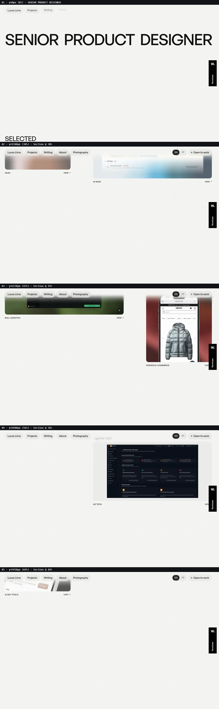
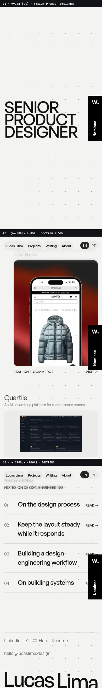

# UI Design System & Master Generation Blueprint: www-lucaslima-design

> **Lucas Lima · Product designer and design engineer** (https://www.lucaslima.design/) — Brazilian product designer working across SaaS, finance and AI. I work directly in code, exploring live interfaces and bridging design an...





---

## 1. Executive Visual Persona & Design Archetype

- **Brand Essence & Persona**: **Lucas Lima · Product designer and design engineer** (`https://www.lucaslima.design/`). Brazilian product designer working across SaaS, finance and AI. I work directly in code, exploring live interfaces and bridging design an...
- **Capture Provenance**: Live browser capture (`tier2_webgl`, HTTP `200`, captured `2026-11-24`).
- **Visual Archetype**: **Light-Gallery WebGL / Canvas Interactive Experience (`#f4f4f2` / `#1570ef`)**.
- **Anti-AI-Slop Differentiators**:
  - **Live-Computed Chromatic Polarity**: Anchors the viewport in `#f4f4f2` (live computed `body` `background-color` (`computed_styles.json`)) paired with `#121211` primary typography and `#1570ef` accents.
  - **Grounded Typographic Hierarchy**: Pairs `General Sans` for display copy (`SENIOR PRODUCT DESIGNER`) with `Inter Variable` and `Geist Mono`.
  - **Calibrated Spatial Grid & Motion**: Combines `96rem` container bounds (`gap: 8px`, padding `32px`) with `cubic-bezier(0,0,.2,1)` easing and Three.js / WebGL Canvas Pipeline.

---

## 2. Spatial Architecture & Modular Grid Mathematics

### Viewport Allocation & Container Geometry
- **Captured Journey Filmstrips**: Desktop `1280×4140px` (`assets/desktop-journey.webp`, `5` keyframes up to `y=3450px` / doc `5891px`), Mobile `390×2616px` (`assets/mobile-journey.webp`, `3` keyframes).
- **Master Container Bounds**: `96rem` (non-`@media` desktop container stylesheet rule).
- **Canvas Lateral Padding & Spacing**: `32px` lateral canvas padding with `8px` grid gap.
- **Border Radius Scale**: `99px`, `8px`, `.25rem`, `50%`.

### Responsive Breakpoint Architecture
- **Desktop Layout**: Multi-column CSS Grid / Flexbox layout at `1440px` (`max-width: 96rem`, `gap: 8px`).
- **Mobile Layout**: Single-column vertical stack at `390px` viewport width with `32px` horizontal padding.
- **Extracted CSS Media Queries**: `@media (width>=40rem)`, `@media (width>=48rem)`, `@media (width>=64rem)`, `@media (width>=80rem)`.

---

## 3. Color System, Materiality & Atmospheric Lighting

### Semantic Palette & Source Grounding
| Semantic Role | Ground-Truth Value | Extracted Live / CSS Source |
|---|---|---|
| **Primary Canvas Substrate** | `#f4f4f2` | live computed `body` `background-color` (`computed_styles.json`) |
| **Primary Typography Ink** | `#121211` | live computed `h1` `color` (`computed_styles.json`) |
| **Elevated Surface / Card Substrate** | `#f2f3f5` | `var(--color-card-surface)` in `:root` |
| **Interactive Accent / Highlight** | `#1570ef` | `var(--brand)` in `:root` |
| **Secondary / Muted Copy** | `#8a8983` | live computed `p` `color` (`computed_styles.json`) |
| **Structural Hairline Border** | `#d7d7d0` | `var(--brand-divider)` in `:root` |
| **Variable Token (`--color-gray-50`)** | `#fafafb` | `var(--color-gray-50)` in `:root` |
| **Variable Token (`--color-gray-200`)** | `#e9ebee` | `var(--color-gray-200)` in `:root` |
| **Variable Token (`--color-gray-300`)** | `#dce0e5` | `var(--color-gray-300)` in `:root` |
| **Variable Token (`--color-gray-400`)** | `#c1c6ce` | `var(--color-gray-400)` in `:root` |
| **Variable Token (`--color-gray-500`)** | `#737b88` | `var(--color-gray-500)` in `:root` |
| **Variable Token (`--color-gray-600`)** | `#626a76` | `var(--color-gray-600)` in `:root` |
| **Variable Token (`--color-gray-700`)** | `#454c57` | `var(--color-gray-700)` in `:root` |
| **Variable Token (`--color-gray-800`)** | `#2c313a` | `var(--color-gray-800)` in `:root` |
| **Variable Token (`--color-gray-900`)** | `#1c2027` | `var(--color-gray-900)` in `:root` |
| **Variable Token (`--color-gray-950`)** | `#101318` | `var(--color-gray-950)` in `:root` |
| **Variable Token (`--cover-surface`)** | `#e9ebef` | `var(--cover-surface)` in `:root` |
| **Variable Token (`--cover-hover`)** | `#e3e6eb` | `var(--cover-hover)` in `:root` |

### Sanitized Root CSS Variables (`ui-ux.md` Ground Truth)
| Variable Name | Extracted Value | Semantic Role |
|---|---|---|
| `--color-gray-50` | `#fafafb` | Brand / Palette Token |
| `--color-gray-100` | `#f2f3f5` | Brand / Palette Token |
| `--color-gray-200` | `#e9ebee` | Brand / Palette Token |
| `--color-gray-300` | `#dce0e5` | Brand / Palette Token |
| `--color-gray-400` | `#c1c6ce` | Brand / Palette Token |
| `--color-gray-500` | `#737b88` | Brand / Palette Token |
| `--color-gray-600` | `#626a76` | Brand / Palette Token |
| `--color-gray-700` | `#454c57` | Brand / Palette Token |
| `--color-gray-800` | `#2c313a` | Brand / Palette Token |
| `--color-gray-900` | `#1c2027` | Brand / Palette Token |
| `--color-gray-950` | `#101318` | Brand / Palette Token |
| `--color-card-surface` | `#f2f3f5` | Canvas / Surface Token |
| `--color-card-fade` | `#f2f3f5` | Brand / Palette Token |
| `--cover-surface` | `#e9ebef` | Canvas / Surface Token |
| `--cover-hover` | `#e3e6eb` | Color / Atmospheric Token |
| `--hairline` | `#1c202710` | Color / Atmospheric Token |

---

## 4. Typographic Scale & Editorial Hierarchy

### Font Family Stacks
- **Display Typography**: `General Sans`.
- **Primary Body Stack**: `Inter Variable`.
- **Technical / Metadata Stack**: `Geist Mono`.

### Typographic Scale & Rules (Live Computed & Stylesheet Grounded)
- **Hero Display (`H1`)**: live computed `h1` (`font-size: 102.237px`, `line-height: 92.0131px`, `font-weight: 500`, `letter-spacing: -4.60066px`); CSS variables `--brand-display: 4rem`; rule `h1` (`font-weight: 500`).
- **Section Heading (`H2`)**: live computed `h2` (`font-size: 14px`, `line-height: 20.3px`, `font-weight: 500`); rule `h2` (`letter-spacing: inherit`).
- **Body Copy**: live computed `body` (`font-size: 16px`, `line-height: 24px`, `font-weight: 400`); CSS variables `--brand-body: 1rem`.
- **Metadata & Navigation Labels**: live computed `nav/a` (`font-size: 17px`, `line-height: 24.65px`, `font-weight: 400`, `letter-spacing: -0.17px`); CSS variables `--font-mono: "Inter Variable", -apple-system, BlinkMacSystemFont, "Segoe UI", sans-serif`, `--brand-caption: .8125rem`, `--default-mono-font-family: var(--font-mono)`; rule `small` (`font-size: 12px`, `font-weight: 400`).

---

## 5. Choreographed Motion & Interaction Physics

### Primary Easing Curves
- **Extracted Timing Functions**: `cubic-bezier(0,0,.2,1)`, `cubic-bezier(.4,0,.2,1)`, `cubic-bezier(.23,1,.32,1)`.

### Per-Element Transition & Choreography Rules
- **Selector `layer theme`**: `transition: .15s` extracted from `www-lucaslima-design` stylesheet.
- **Selector `.transition`**: `transition: var(--tw-ease,var(--default-transition-timing-function))` extracted from `www-lucaslima-design` stylesheet.
- **Selector `.ease-out`**: `transition: var(--ease-out)` extracted from `www-lucaslima-design` stylesheet.
- **Extracted Easing Curve (`cubic-bezier(0,0,.2,1)`)**: Governs interactive state transitions across `<header.st-header>` and `<section.st-pad:nth(2)>`.
- **Runtime Interaction Engine**: Integrates Three.js / WebGL Canvas Pipeline with `prefers-reduced-motion: reduce` fallback guards.
### Measured Runtime Scroll & Interaction Telemetry (`behavioral_journey_v2`)
- **Scroll Driver Mode**: `wheel` (max document height `5891px`, deepest scrollY reached `3450px` across `5` desktop keyframes).
- **Detected Scroll / Motion Libraries**: `WebGL/Canvas`.
- **Hover Physics (`primary_cta` · `hello@lucaslima.design Copied`)**: Computed transition `0.2s` / `cubic-bezier(0.23, 1, 0.32, 1)` (no static color/transform shift captured at rest).
- **Route Transition Architecture**: First internal navigation (`/writing/on-the-design-process`) measured as `direct` in `563ms`.

---

## 6. Component Wireframe & Structural DOM Map

### Visual Layout Schematic — Desktop (`1440px`, Grounded in `dom.html` & Landmark Bounding Boxes)
```
┌────────────────────────────────────────────────────────────────────────┐
│ DESKTOP VIEWPORT (1440px) — Lucas Lima · Product designer and design e │
│ ====================================================================== │
│ [ <header.st-header> (1361x44px)      | Lucas Lima · Projects · Writ ] │
│ ---------------------------------------------------------------------- │
│ | HERO STAGE: <section.st-pad> (w=1425px)                            | │
│ | H1: SENIOR PRODUCT DESIGNER                                        | │
│ | Substrate: #f4f4f2 | Ink: #121211 | Accent: #1570ef                | │
│ ---------------------------------------------------------------------- │
│ | SHOWCASE GRID (<section.st-pad:nth(2)>) max-w: 96rem               | │
│ | +------------------------------+  +------------------------------+ | │
│ | | Senior Product Designer      |  | Selected work                | | │
│ | +------------------------------+  +------------------------------+ | │
│ ---------------------------------------------------------------------- │
│ | DETAIL MODULE (<section.st-pad:nth(3)>) — Things I make on the     | │
│ ---------------------------------------------------------------------- │
│ [ FOOTER (<footer.st-footer>  ) | https://www.lucaslima.design/        │
└────────────────────────────────────────────────────────────────────────┘
```

### Visual Layout Schematic — Mobile Reflow (`390px`)
```
┌────────────────────────────────────────────────────────────────────────┐
│ MOBILE VIEWPORT REFLOW (390px) — Single-Column Stack (gap: 8px)        │
│ ====================================================================== │
│ [ HEADER BAR (<header.st-header>      ) | Compact Menu (390px)         │
│ ---------------------------------------------------------------------- │
│ | HERO STAGE (<section.st-pad>) — 390px Vertical Lead                | │
│ | H1: SENIOR PRODUCT DESIGNER                                        | │
│ ---------------------------------------------------------------------- │
│ | SHOWCASE STACK (<section.st-pad:nth(2)) — 1-Col Stack              | │
│ | [ Item 1: Senior Product Designer                                ] | │
│ | [ Item 2: Selected work                                          ] | │
│ ---------------------------------------------------------------------- │
│ | DETAIL STACK (<section.st-pad:nth(3)>) — 1-Col (Things I make on t)  │
│ ---------------------------------------------------------------------- │
│ [ FOOTER (<footer.st-footer>  ) | Stacked 390px Colophon               │
└────────────────────────────────────────────────────────────────────────┘
```

### Granular DOM Region Breakdown
1. **Brand Header & Navigation Bar (<header.st-header> — `www-lucaslima-design`)**:
   - Landmark `<header class="st-header">` (`1361x44px`) hosting `Lucas Lima · Product designer and de` navigation (`Lucas Lima · Projects · Writing · About · Photography`), DOM attributes (`data-theme="light"`, `data-prerendered="true"`, `data-js="live"`, `data-app`), and stylesheet rule `backdrop { box-sizing:border-box;border:0 solid;margin:0;padding:0 }`.
2. **Hero Stage & Focal Lead (<section.st-pad> — `SENIOR PRODUCT DESIGNER`)**:
   - Landmark `<section class="st-pad">` presenting display lead `SENIOR PRODUCT DESIGNER` and copy excerpt *"Lucas Lima is a Brazilian designer and psychologist with a soft s"* over `#f4f4f2` canvas and `#121211` ink.
3. **Primary Showcase & Content Grid (<section.st-pad:nth(2)> — `Senior Product Designer`)**:
   - Landmark `<section class="st-pad">` rendering section `Senior Product Designer` with copy *"hello@lucaslima.design Copied"*, asset references (`general-sans-500.woff2`, `general-sans-400.woff2`, `favicon.ico`, `favicon.svg`), and grid rule `file-selector-button { box-sizing:border-box;border:0 solid;margin:0;padding:0 }`.
4. **Interactive Detail & Feature Matrix (<section.st-pad:nth(3)> — `Selected work`)**:
   - Landmark `<section class="st-pad">` framing `Selected work` and `Things I make on the side` (*"hello@lucaslima.design"*) with `#f2f3f5` surface cards, `#1570ef` accents, and `strong { font-weight:bolder }`.
5. **Colophon & Global Directory Footer (<footer.st-footer> — `https://www.lucaslima.design/`)**:
   - Landmark `<footer class="st-footer">` anchoring `Lucas Lima · Product designer an` footer links (`Lucas Lima · Projects · Writing · About · Photography`), copy *"Internal tools & ops"*, and `#d7d7d0` structural dividers.
### Full Vertical Scroll Sequence (Desktop `1440×900` Keyframes)
- **Step 01** (`y=0px`, `0%`): Active landmark `SENIOR PRODUCT DESIGNER` · sticky/fixed elements: `2`
- **Step 02** (`y=1500px`, `30%`): Active landmark `Section @ 30%` · sticky/fixed elements: `2`
- **Step 03** (`y=2150px`, `43%`): Active landmark `Section @ 43%` · sticky/fixed elements: `2`
- **Step 04** (`y=2800px`, `56%`): Active landmark `Section @ 56%` · sticky/fixed elements: `2`
- **Step 05** (`y=3450px`, `69%`): Active landmark `Section @ 69%` · sticky/fixed elements: `2`

### Multi-Page Internal Route Map
- **Detail Route (`/writing/on-the-design-process`)**: `https://www.lucaslima.design/writing/on-the-design-process` — H1: `On the design process`, scrollHeight `1865px`, transition `direct` (`563ms`)

---

## 7. Master Zero-Shot AI Generation Prompt

```markdown
# Master Zero-Shot Frontend Generation Prompt: www-lucaslima-design (Lucas Lima · Product designer and design engineer)

You are a principal frontend architect and design systems engineer. Build a complete, production-ready web application replicating the exact design system, DOM landmarks, typographic hierarchy, color tokens, and motion physics of `www-lucaslima-design` (**Lucas Lima · Product designer and design engineer** — `https://www.lucaslima.design/`).

### 1. Visual Archetype & Anti-AI-Slop Mandates
- **Archetype**: Light-Gallery WebGL / Canvas Interactive Experience (`#f4f4f2` / `#1570ef`).
- **Identity & Domain Context**: Brazilian product designer working across SaaS, finance and AI. I work directly in code, exploring live interfaces and bridging design an...
- **Primary Substrate**: `#f4f4f2` (live computed `body` `background-color` (`computed_styles.json`)), **Primary Ink**: `#121211`, **Accent / Highlight**: `#1570ef`.
- **Site-Specific Differentiators**:
  - **Live-Computed Chromatic Polarity**: Anchors the viewport in `#f4f4f2` (live computed `body` `background-color` (`computed_styles.json`)) paired with `#121211` primary typography and `#1570ef` accents.
  - **Grounded Typographic Hierarchy**: Pairs `General Sans` for display copy (`SENIOR PRODUCT DESIGNER`) with `Inter Variable` and `Geist Mono`.
  - **Calibrated Spatial Grid & Motion**: Combines `96rem` container bounds (`gap: 8px`, padding `32px`) with `cubic-bezier(0,0,.2,1)` easing and Three.js / WebGL Canvas Pipeline.

### 2. Ground-Truth CSS Variables (`:root` Token Contract)
Declare and consume these exact custom properties extracted from `www-lucaslima-design` in your global stylesheet:

:root {
  /* Lucas Lima · Product designer and design engineer (www-lucaslima-design) — Live-Grounded CSS Variables */
  --color-gray-50: #fafafb; /* Brand / Palette Token (www-lucaslima-design) */
  --color-gray-100: #f2f3f5; /* Brand / Palette Token (www-lucaslima-design) */
  --color-gray-200: #e9ebee; /* Brand / Palette Token (www-lucaslima-design) */
  --color-gray-300: #dce0e5; /* Brand / Palette Token (www-lucaslima-design) */
  --color-gray-400: #c1c6ce; /* Brand / Palette Token (www-lucaslima-design) */
  --color-gray-500: #737b88; /* Brand / Palette Token (www-lucaslima-design) */
  --color-gray-600: #626a76; /* Brand / Palette Token (www-lucaslima-design) */
  --color-gray-700: #454c57; /* Brand / Palette Token (www-lucaslima-design) */
  --color-gray-800: #2c313a; /* Brand / Palette Token (www-lucaslima-design) */
  --color-gray-900: #1c2027; /* Brand / Palette Token (www-lucaslima-design) */
  --color-gray-950: #101318; /* Brand / Palette Token (www-lucaslima-design) */
  --color-card-surface: #f2f3f5; /* Canvas / Surface Token (www-lucaslima-design) */
  --color-card-fade: #f2f3f5; /* Brand / Palette Token (www-lucaslima-design) */
  --cover-surface: #e9ebef; /* Canvas / Surface Token (www-lucaslima-design) */
  --cover-hover: #e3e6eb; /* Color / Atmospheric Token (www-lucaslima-design) */
  --hairline: #1c202710; /* Color / Atmospheric Token (www-lucaslima-design) */
}

### 3. Semantic Color & Materiality Contract
Map every surface, ink, and border strictly to these source-grounded tokens:
- **Primary Canvas Substrate**: `#f4f4f2` — grounded in live computed `body` `background-color` (`computed_styles.json`)
- **Primary Typography Ink**: `#121211` — grounded in live computed `h1` `color` (`computed_styles.json`)
- **Elevated Surface / Card Substrate**: `#f2f3f5` — grounded in `var(--color-card-surface)` in `:root`
- **Interactive Accent / Highlight**: `#1570ef` — grounded in `var(--brand)` in `:root`
- **Secondary / Muted Copy**: `#8a8983` — grounded in live computed `p` `color` (`computed_styles.json`)
- **Structural Hairline Border**: `#d7d7d0` — grounded in `var(--brand-divider)` in `:root`
- **Variable Token (`--color-gray-50`)**: `#fafafb` — grounded in `var(--color-gray-50)` in `:root`
- **Variable Token (`--color-gray-200`)**: `#e9ebee` — grounded in `var(--color-gray-200)` in `:root`
- **Variable Token (`--color-gray-300`)**: `#dce0e5` — grounded in `var(--color-gray-300)` in `:root`
- **Variable Token (`--color-gray-400`)**: `#c1c6ce` — grounded in `var(--color-gray-400)` in `:root`
- **Variable Token (`--color-gray-500`)**: `#737b88` — grounded in `var(--color-gray-500)` in `:root`
- **Variable Token (`--color-gray-600`)**: `#626a76` — grounded in `var(--color-gray-600)` in `:root`
- **Variable Token (`--color-gray-700`)**: `#454c57` — grounded in `var(--color-gray-700)` in `:root`
- **Variable Token (`--color-gray-800`)**: `#2c313a` — grounded in `var(--color-gray-800)` in `:root`
- **Variable Token (`--color-gray-900`)**: `#1c2027` — grounded in `var(--color-gray-900)` in `:root`
- **Variable Token (`--color-gray-950`)**: `#101318` — grounded in `var(--color-gray-950)` in `:root`
- **Variable Token (`--cover-surface`)**: `#e9ebef` — grounded in `var(--cover-surface)` in `:root`
- **Variable Token (`--cover-hover`)**: `#e3e6eb` — grounded in `var(--cover-hover)` in `:root`

### 4. Spatial Grid, Container Bounds & Responsive Breakpoints
- **Desktop Viewport Reference**: `1280×4140px` (multi-frame vertical journey filmstrip (4140px), `1440px` standard desktop width).
- **Mobile Viewport Reference**: `390×2616px` (multi-frame vertical journey filmstrip (2616px), `390px` standard mobile width).
- **Container Max-Width**: `96rem` (non-`@media` desktop container stylesheet rule)
- **Padding & Gutters**: `32px` lateral canvas padding with `8px` grid gap
- **Desktop Grid**: Multi-column CSS Grid / Flexbox layout at `1440px` (`max-width: 96rem`, `gap: 8px`)
- **Mobile Adaptation**: Single-column vertical stack at `390px` viewport width with `32px` horizontal padding
- **Media Queries**: `@media (width>=40rem)`, `@media (width>=48rem)`, `@media (width>=64rem)`, `@media (width>=80rem)`
- **Corner Radii**: `99px`, `8px`, `.25rem`, `50%`

### 5. Typography & Editorial Scale Contract
- **Display Font Stack**: `General Sans`
- **Body Font Stack**: `Inter Variable`
- **Monospace / Technical Font Stack**: `Geist Mono`
- **H1 Display Rule**: live computed `h1` (`font-size: 102.237px`, `line-height: 92.0131px`, `font-weight: 500`, `letter-spacing: -4.60066px`); CSS variables `--brand-display: 4rem`; rule `h1` (`font-weight: 500`)
- **H2 Section Rule**: live computed `h2` (`font-size: 14px`, `line-height: 20.3px`, `font-weight: 500`); rule `h2` (`letter-spacing: inherit`)
- **Body Copy Rule**: live computed `body` (`font-size: 16px`, `line-height: 24px`, `font-weight: 400`); CSS variables `--brand-body: 1rem`
- **Metadata & Index Rule**: live computed `nav/a` (`font-size: 17px`, `line-height: 24.65px`, `font-weight: 400`, `letter-spacing: -0.17px`); CSS variables `--font-mono: "Inter Variable", -apple-system, BlinkMacSystemFont, "Segoe UI", sans-serif`, `--brand-caption: .8125rem`, `--default-mono-font-family: var(--font-mono)`; rule `small` (`font-size: 12px`, `font-weight: 400`)

### 6. Component Hierarchy, Verbatim Copy & Real DOM Landmarks
Scaffold `www-lucaslima-design` (`Lucas Lima · Product designer and design engineer`) with these exact structural regions, extracted copy, and CSS rules from `dom.html`:
1. **Brand Header & Navigation Bar (<header.st-header> — `www-lucaslima-design`)**:
   - DOM & Selectors: Landmark `<header class="st-header">` (`1361x44px`) hosting `Lucas Lima · Product designer and de` navigation (`Lucas Lima · Projects · Writing · About · Photography`), DOM attributes (`data-theme="light"`, `data-prerendered="true"`, `data-js="live"`, `data-app`), and stylesheet rule `backdrop { box-sizing:border-box;border:0 solid;margin:0;padding:0 }`.
   - Responsive Contract: Header `Brand Header & Navigation Bar (<header.st-header> — `www-lucaslima-design`)` (`www-lucaslima-design`) adapts across `@media (width>=40rem)`, `@media (width>=48rem)`, `@media (width>=64rem)`, `@media (width>=80rem)` with `cubic-bezier(0,0,.2,1)`, `cubic-bezier(.4,0,.2,1)`, `cubic-bezier(.23,1,.32,1)` transitions and links `Lucas Lima · Projects · Writing · About · Photography`.
2. **Hero Stage & Focal Lead (<section.st-pad> — `SENIOR PRODUCT DESIGNER`)**:
   - DOM & Selectors: Landmark `<section class="st-pad">` presenting display lead `SENIOR PRODUCT DESIGNER` and copy excerpt *"Lucas Lima is a Brazilian designer and psychologist with a soft s"* over `#f4f4f2` canvas and `#121211` ink.
   - Responsive Contract: Hero stage (`1280×4140px` desktop / `390×2616px` mobile) sets `#f4f4f2` background with `#121211` headline `SENIOR PRODUCT DESIGNER`.
3. **Primary Showcase & Content Grid (<section.st-pad:nth(2)> — `Senior Product Designer`)**:
   - DOM & Selectors: Landmark `<section class="st-pad">` rendering section `Senior Product Designer` with copy *"hello@lucaslima.design Copied"*, asset references (`general-sans-500.woff2`, `general-sans-400.woff2`, `favicon.ico`, `favicon.svg`), and grid rule `file-selector-button { box-sizing:border-box;border:0 solid;margin:0;padding:0 }`.
   - Responsive Contract: Showcase grid `Primary Showcase & Content Grid (<section.st-pad:nth(2)> — `Senior Product Designer`)` applies Multi-column CSS Grid / Flexbox layout at `1440px` (`max-width: 96rem`, `gap: 8px`) on desktop and Single-column vertical stack at `390px` viewport width with `32px` horizontal padding on mobile.
4. **Interactive Detail & Feature Matrix (<section.st-pad:nth(3)> — `Selected work`)**:
   - DOM & Selectors: Landmark `<section class="st-pad">` framing `Selected work` and `Things I make on the side` (*"hello@lucaslima.design"*) with `#f2f3f5` surface cards, `#1570ef` accents, and `strong { font-weight:bolder }`.
   - Responsive Contract: Detail module `Interactive Detail & Feature Matrix (<section.st-pad:nth(3)> — `Selected work`)` uses `99px`, `8px`, `.25rem`, `50%` radii, `#1570ef` highlights, and assets (general-sans-500.woff2, general-sans-400.woff2, favicon.ico).
5. **Colophon & Global Directory Footer (<footer.st-footer> — `https://www.lucaslima.design/`)**:
   - DOM & Selectors: Landmark `<footer class="st-footer">` anchoring `Lucas Lima · Product designer an` footer links (`Lucas Lima · Projects · Writing · About · Photography`), copy *"Internal tools & ops"*, and `#d7d7d0` structural dividers.
   - Responsive Contract: Footer `Colophon & Global Directory Footer (<footer.st-footer> — `https://www.lucaslima.design/`)` aligns to `96rem` (non-`@media` desktop container stylesheet rule) with `32px` lateral canvas padding with `8px` grid gap and attributes (data-theme="light", data-prerendered="true", data-js="live").

#### Verbatim DOM Copy Excerpts (`dom.html`)
- Copy Excerpt 1: *"Lucas Lima is a Brazilian designer and psychologist with a soft spot for complex p..."*
- Copy Excerpt 2: *"hello@lucaslima.design Copied"*
- Copy Excerpt 3: *"hello@lucaslima.design"*
- Copy Excerpt 4: *"Internal tools & ops"*

### 7. Motion, Extracted Stylesheet Rules & Interaction Choreography
- **Primary Easing Functions**: `cubic-bezier(0,0,.2,1)`, `cubic-bezier(.4,0,.2,1)`, `cubic-bezier(.23,1,.32,1)`
- **Extracted Stylesheet Rules (`www-lucaslima-design`)**:
- `backdrop { box-sizing:border-box;border:0 solid;margin:0;padding:0 }`
- `file-selector-button { box-sizing:border-box;border:0 solid;margin:0;padding:0 }`
- `strong { font-weight:bolder }`
- `small { font-size:80% }`
- `sup { vertical-align:baseline;font-size:75%;line-height:0;position:relative }`
- **Per-Selector Transition Rules**:
- **Selector `layer theme`**: `transition: .15s` extracted from `www-lucaslima-design` stylesheet.
- **Selector `.transition`**: `transition: var(--tw-ease,var(--default-transition-timing-function))` extracted from `www-lucaslima-design` stylesheet.
- **Selector `.ease-out`**: `transition: var(--ease-out)` extracted from `www-lucaslima-design` stylesheet.
- **Extracted Easing Curve (`cubic-bezier(0,0,.2,1)`)**: Governs interactive state transitions across `<header.st-header>` and `<section.st-pad:nth(2)>`.
- **Runtime Interaction Engine**: Integrates Three.js / WebGL Canvas Pipeline with `prefers-reduced-motion: reduce` fallback guards.
### 7b. Full-Page Scroll Choreography, Interactive States & Multi-Page Routes
- **Scroll Mechanics**: Implement `wheel` vertical progression up to `5891px` across 5 distinct viewport chapters using WebGL/Canvas.
- **Vertical Chapter Sequence**: SENIOR PRODUCT DESIGNER (0%) -> Section @ 30% (30%) -> Section @ 43% (43%) -> Section @ 56% (56%) -> Section @ 69% (69%).
- **Multi-Page Routes**: Scaffold internal routes `/writing/on-the-design-process` (detail, direct) sharing the global header/footer shell and design tokens.

### 8. Technical Deliverables
- Implement in Next.js (App Router) with TypeScript and Tailwind CSS consuming the `:root` custom properties defined above for `www-lucaslima-design`.
- Reproduce both the `1440px` desktop architecture and `390px` mobile breakpoint transitions, preserving semantic HTML5 landmarks (`<header>`, `<nav>`, `<main>`, `<section>`, `<footer>`) and `prefers-reduced-motion` accessibility guards.
```
---

## 8. Full-Page Scroll Journey, Interactive States & Subpage Inventory

### Desktop Scroll Keyframes (`1440×900` WebP)
| Step | Scroll Y | Progress | Active Landmark / Section | Sticky/Fixed | Visual Asset |
| :---: | :---: | :---: | :--- | :---: | :--- |
| `#01` | `0px` | `0%` | SENIOR PRODUCT DESIGNER | `2` | [desktop-step-01.webp](assets/desktop-step-01.webp) |
| `#02` | `1500px` | `30%` | Section @ 30% | `2` | [desktop-step-02.webp](assets/desktop-step-02.webp) |
| `#03` | `2150px` | `43%` | Section @ 43% | `2` | [desktop-step-03.webp](assets/desktop-step-03.webp) |
| `#04` | `2800px` | `56%` | Section @ 56% | `2` | [desktop-step-04.webp](assets/desktop-step-04.webp) |
| `#05` | `3450px` | `69%` | Section @ 69% | `2` | [desktop-step-05.webp](assets/desktop-step-05.webp) |

### Mobile Condensed Keyframes (`390×844` WebP)
| Step | Scroll Y | Progress | Active Landmark | Visual Asset |
| :---: | :---: | :---: | :--- | :--- |
| `#01` | `0px` | `0%` | SENIOR PRODUCT DESIGNER | [mobile-step-01.webp](assets/mobile-step-01.webp) |
| `#02` | `2384px` | `50%` | Section @ 50% | [mobile-step-02.webp](assets/mobile-step-02.webp) |
| `#03` | `4768px` | `100%` | WRITING | [mobile-step-03.webp](assets/mobile-step-03.webp) |

### Internal Subpage Filmstrips (`1080px` Wide WebP)
| # | Template | Route URL | H1 / Title | Scroll Height | Transition | Filmstrip Asset |
| :-: | :---: | :--- | :--- | :---: | :---: | :--- |
| `1` | `detail` | `https://www.lucaslima.design/writing/on-the-design-process` | On the design process | `1865px` | `direct` (`563ms`) | [subpage-01-writing-on-the-design-process.webp](assets/subpage-01-writing-on-the-design-process.webp) |

