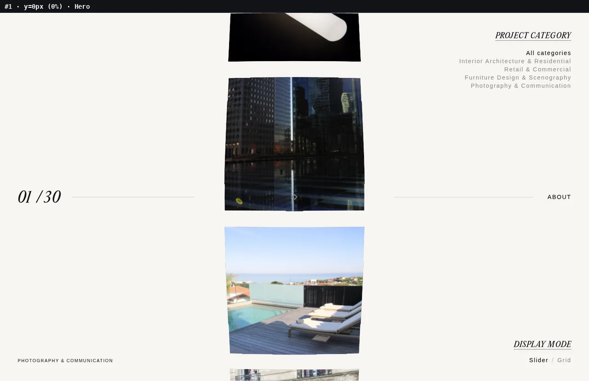
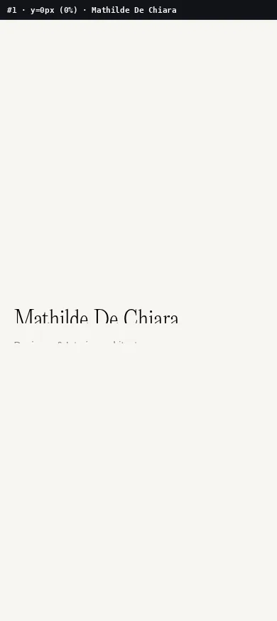

# UI Design System & Master Generation Blueprint: www-mathildedechiara-com

> **Mathilde De Chiara, designer and interior architect** (https://www.mathildedechiara.com/) — Portfolio of Mathilde De Chiara: interior architecture, scenography and object design, from the Basque Country to Paris. Projects, exhibi...





---

## 1. Executive Visual Persona & Design Archetype

- **Brand Essence & Persona**: **Mathilde De Chiara, designer and interior architect** (`https://www.mathildedechiara.com/`). Portfolio of Mathilde De Chiara: interior architecture, scenography and object design, from the Basque Country to Paris. Projects, exhibi...
- **Capture Provenance**: Live browser capture (`tier1_fast`, HTTP `200`, captured `2026-11-24`).
- **Visual Archetype**: **Light-Gallery WebGL / Canvas Interactive Experience (`#f7f5f2` / `#000000`)**.
- **Anti-AI-Slop Differentiators**:
  - **Live-Computed Chromatic Polarity**: Anchors the viewport in `#f7f5f2` (live computed `body` `background-color` (`computed_styles.json`)) paired with `#000000` primary typography and `#000000` accents.
  - **Grounded Typographic Hierarchy**: Pairs `PP Editorial New` for display copy (`Mathilde De Chiara, designer and int`) with `Helvetica Neue`.
  - **Calibrated Spatial Grid & Motion**: Combines `1440px` container bounds (`gap: 4px`, padding `5vw`) with `cubic-bezier(.87,0,.13,1)` easing and Lenis Smooth Scroll (`data-lenis`), GSAP Timeline & ScrollTrigger.

---

## 2. Spatial Architecture & Modular Grid Mathematics

### Viewport Allocation & Container Geometry
- **Captured Journey Filmstrips**: Desktop `1280×828px` (`assets/desktop-journey.webp`, `1` keyframes up to `y=0px` / doc `900px`), Mobile `390×872px` (`assets/mobile-journey.webp`, `1` keyframes).
- **Master Container Bounds**: `1440px` (full-bleed `100%` desktop stage measured on `1440px` viewport).
- **Canvas Lateral Padding & Spacing**: `5vw` lateral canvas padding with `4px` grid gap.
- **Border Radius Scale**: `0px` (sharp unrounded corners).

### Responsive Breakpoint Architecture
- **Desktop Layout**: Multi-column CSS Grid / Flexbox layout at `1440px` (`max-width: 1440px`, `gap: 4px`).
- **Mobile Layout**: Single-column vertical stack at `390px` viewport width with `5vw` horizontal padding.
- **Extracted CSS Media Queries**: `@media (prefers-reduced-motion: reduce)`, `@media (max-width: 1024px) and (min-width: 769px)`, `@media (max-width: 768px)`, `@media screen and (max-width: 768px)`.

---

## 3. Color System, Materiality & Atmospheric Lighting

### Semantic Palette & Source Grounding
| Semantic Role | Ground-Truth Value | Extracted Live / CSS Source |
|---|---|---|
| **Primary Canvas Substrate** | `#f7f5f2` | live computed `body` `background-color` (`computed_styles.json`) |
| **Primary Typography Ink** | `#000000` | live computed `button` `color` (`computed_styles.json`) |
| **Elevated Surface / Card Substrate** | `#f0f0f0` | `.editorial-block__image-wrap { background: #f0f0f0 }` |
| **Interactive Accent / Highlight** | `#000000` | live computed `button` `color` (`computed_styles.json`) |
| **Secondary / Muted Copy** | `#333333` | live computed `body` `color` (`computed_styles.json`) |
| **Structural Hairline Border** | `#f8f6f3` | `.grid--rows-overlay .grid__item { border: #f8f6f3 }` |

### Sanitized Root CSS Variables (`ui-ux.md` Ground Truth)
| Variable Name | Extracted Value | Semantic Role |
|---|---|---|
| `--bg` | `#f7f5f2` | Canvas / Surface Token |
| `--default-padding` | `5vw` | Layout / Spatial Grid Token |
| `--spacer-3xs` | `4px` | Layout / Spatial Grid Token |
| `--spacer-2xs` | `5px` | Layout / Spatial Grid Token |
| `--spacer-xs` | `10px` | Layout / Spatial Grid Token |
| `--hit-area` | `8px` | Dimension / Scale Token |
| `--spacer-s` | `20px` | Layout / Spatial Grid Token |
| `--spacer-sm` | `30px` | Layout / Spatial Grid Token |
| `--spacer-md` | `40px` | Layout / Spatial Grid Token |
| `--spacer-m` | `50px` | Layout / Spatial Grid Token |
| `--spacer-l` | `100px` | Layout / Spatial Grid Token |
| `--spacer-xl` | `200px` | Layout / Spatial Grid Token |
| `--spacer-xxl` | `300px` | Layout / Spatial Grid Token |
| `--font-primary` | `"PP Editorial New", Georgia, serif` | Brand / Palette Token |
| `--font-secondary` | `"Helvetica Neue", Helvetica, Arial, sans-serif` | Brand / Palette Token |
| `--page-px` | `clamp(16px, 3vw, 48px)` | Dimension / Scale Token |

---

## 4. Typographic Scale & Editorial Hierarchy

### Font Family Stacks
- **Display Typography**: `PP Editorial New`.
- **Primary Body Stack**: `Helvetica Neue`.
- **Technical / Metadata Stack**: not declared in live computed styles (uses primary stack / `ui-monospace`).

### Typographic Scale & Rules (Live Computed & Stylesheet Grounded)
- **Hero Display (`H1`)**: observed font-size ladder: `72px`, `16px`, `14.4px`, `13.3333px`, `100%`.
- **Section Heading (`H2`)**: live computed `h2` (`font-size: 72px`, `line-height: 79.2px`, `font-weight: 500`, `letter-spacing: -1.44px`); rule `,h2` (`font-weight: 500`).
- **Body Copy**: live computed `body` (`font-size: 16px`, `line-height: 16px`, `font-weight: 400`); rule `p` (`font-size: 14px`, `letter-spacing: .04em`).
- **Metadata & Navigation Labels**: live computed `nav/a` (`font-size: 16px`, `line-height: 16px`, `font-weight: 400`).

---

## 5. Choreographed Motion & Interaction Physics

### Primary Easing Curves
- **Extracted Timing Functions**: `cubic-bezier(.87,0,.13,1)`, `cubic-bezier(.22,.61,.36,1)`.

### Per-Element Transition & Choreography Rules
- **Selector `media (prefers-reduced-motion: re...`**: `transition: .01ms!important` extracted from `www-mathildedechiara-com` stylesheet.
- **Selector `.slider-overlay__thumb`**: `transition: opacity .3s` extracted from `www-mathildedechiara-com` stylesheet.
- **Selector `.mode-toggle`**: `transition: opacity .3s` extracted from `www-mathildedechiara-com` stylesheet.
- **Extracted Easing Curve (`cubic-bezier(.87,0,.13,1)`)**: Governs interactive state transitions across `<nav.home-page__filters>` and `<main.home-page>`.
- **Runtime Interaction Engine**: Integrates Lenis Smooth Scroll (`data-lenis`), GSAP Timeline & ScrollTrigger, HTML5 `<canvas>` Interactive Viewport Surface with `prefers-reduced-motion: reduce` fallback guards.
### Measured Runtime Scroll & Interaction Telemetry (`behavioral_journey_v2`)
- **Scroll Driver Mode**: `wheel` (max document height `900px`, deepest scrollY reached `0px` across `1` desktop keyframes).
- **Detected Scroll / Motion Libraries**: `Lenis`, `WebGL/Canvas`.
- **Interactive Control Probe (`carousel_next` · `Display modeSlider/Grid`)**: Triggered visual diff `47.417` (attr ` -> `, captured in `assets/state-interactive.webp`).

---

## 6. Component Wireframe & Structural DOM Map

### Visual Layout Schematic — Desktop (`1440px`, Grounded in `dom.html` & Landmark Bounding Boxes)
```
┌────────────────────────────────────────────────────────────────────────┐
│ DESKTOP VIEWPORT (1440px) — Mathilde De Chiara, designer and interior  │
│ ====================================================================== │
│ [ <nav.home-page__filter (274x143px)  | Overview · Index · Archive · ] │
│ ---------------------------------------------------------------------- │
│ | HERO STAGE: <main.page-content> (w=1440px)                         | │
│ | H1: Mathilde De Chiara, designer and interior archit               | │
│ | Substrate: #f7f5f2 | Ink: #000000 | Accent: #000000                | │
│ ---------------------------------------------------------------------- │
│ | SHOWCASE GRID (<main.home-page>) max-w: 1440px                     | │
│ | +------------------------------+  +------------------------------+ | │
│ | | Featured Work & Interactive  |  | Technical Architecture & Nar | | │
│ | +------------------------------+  +------------------------------+ | │
│ ---------------------------------------------------------------------- │
│ | DETAIL MODULE (<main.page-content:nth(2)>) — Global Directory & Co | │
│ ---------------------------------------------------------------------- │
│ [ FOOTER (<footer.home-page>  ) | https://www.mathildedechiara.com/    │
└────────────────────────────────────────────────────────────────────────┘
```

### Visual Layout Schematic — Mobile Reflow (`390px`)
```
┌────────────────────────────────────────────────────────────────────────┐
│ MOBILE VIEWPORT REFLOW (390px) — Single-Column Stack (gap: 4px)        │
│ ====================================================================== │
│ [ HEADER BAR (<nav.home-page__filters>) | Compact Menu (390px)         │
│ ---------------------------------------------------------------------- │
│ | HERO STAGE (<main.page-content>) — 390px Vertical Lead             | │
│ | H1: Mathilde De Chiara, designer and interior archit               | │
│ ---------------------------------------------------------------------- │
│ | SHOWCASE STACK (<main.home-page>) — 1-Col Stack                    | │
│ | [ Item 1: Featured Work & Interactive Showcase                   ] | │
│ | [ Item 2: Technical Architecture & Narrative                     ] | │
│ ---------------------------------------------------------------------- │
│ | DETAIL STACK (<main.page-content:nth(2) — 1-Col (Global Directory &) │
│ ---------------------------------------------------------------------- │
│ [ FOOTER (<footer.home-page>  ) | Stacked 390px Colophon               │
└────────────────────────────────────────────────────────────────────────┘
```

### Granular DOM Region Breakdown
1. **Brand Header & Navigation Bar (<nav.home-page__filters> — `www-mathildedechiara-com`)**:
   - Landmark `<nav class="home-page__filters">` (`274x143px`) hosting `Mathilde De Chiara, designer and int` navigation (`Overview · Index · Archive · About · Contact`), DOM attributes (`data-rh="true"`, `data-rh="true"`, `data-rh="true"`, `data-rh="true"`), and stylesheet rule `video { margin:0;padding:0;border:0;font-size:100%;vertical-align:baseline }`.
2. **Hero Stage & Focal Lead (<main.page-content> — `Mathilde De Chiara, designer and i`)**:
   - Landmark `<main class="page-content home-page">` presenting display lead `Mathilde De Chiara, designer and interior archit` and copy excerpt *"Photography & Communication"* over `#f7f5f2` canvas and `#000000` ink.
3. **Primary Showcase & Content Grid (<main.home-page> — `Featured Work & Interactive Showca`)**:
   - Landmark `<main class="page-content home-page">` rendering section `Featured Work & Interactive Showcase` with copy *"Mathilde De Chiara, designer and interior archit"*, asset references (`favicon.svg`, `apple-touch-icon.png`, `site.webmanifest`, `b2mcdo5v.apicdn.sanity.io`), and grid rule `section { display:block }`.
4. **Interactive Detail & Feature Matrix (<main.page-content:nth(2)> — `Technical Architecture & Narrative`)**:
   - Landmark `<main class="page-content home-page">` framing `Technical Architecture & Narrative` and `Global Directory & Contact` (*"Featured Work & Interactive Showcase"*) with `#f0f0f0` surface cards, `#000000` accents, and `body { line-height:1 }`.
5. **Colophon & Global Directory Footer (<footer.home-page> — `https://www.mathildedechiara.com/`)**:
   - Landmark `<footer class="home-page">` anchoring `Mathilde De Chiara, designer and` footer links (`Overview · Index · Archive · About · Contact`), copy *"Technical Architecture & Narrative"*, and `#f8f6f3` structural dividers.
### Full Vertical Scroll Sequence (Desktop `1440×900` Keyframes)
- **Step 01** (`y=0px`, `0%`): Active landmark `Hero` · sticky/fixed elements: `5`

---

## 7. Master Zero-Shot AI Generation Prompt

```markdown
# Master Zero-Shot Frontend Generation Prompt: www-mathildedechiara-com (Mathilde De Chiara, designer and interior architect)

You are a principal frontend architect and design systems engineer. Build a complete, production-ready web application replicating the exact design system, DOM landmarks, typographic hierarchy, color tokens, and motion physics of `www-mathildedechiara-com` (**Mathilde De Chiara, designer and interior architect** — `https://www.mathildedechiara.com/`).

### 1. Visual Archetype & Anti-AI-Slop Mandates
- **Archetype**: Light-Gallery WebGL / Canvas Interactive Experience (`#f7f5f2` / `#000000`).
- **Identity & Domain Context**: Portfolio of Mathilde De Chiara: interior architecture, scenography and object design, from the Basque Country to Paris. Projects, exhibi...
- **Primary Substrate**: `#f7f5f2` (live computed `body` `background-color` (`computed_styles.json`)), **Primary Ink**: `#000000`, **Accent / Highlight**: `#000000`.
- **Site-Specific Differentiators**:
  - **Live-Computed Chromatic Polarity**: Anchors the viewport in `#f7f5f2` (live computed `body` `background-color` (`computed_styles.json`)) paired with `#000000` primary typography and `#000000` accents.
  - **Grounded Typographic Hierarchy**: Pairs `PP Editorial New` for display copy (`Mathilde De Chiara, designer and int`) with `Helvetica Neue`.
  - **Calibrated Spatial Grid & Motion**: Combines `1440px` container bounds (`gap: 4px`, padding `5vw`) with `cubic-bezier(.87,0,.13,1)` easing and Lenis Smooth Scroll (`data-lenis`), GSAP Timeline & ScrollTrigger.

### 2. Ground-Truth CSS Variables (`:root` Token Contract)
Declare and consume these exact custom properties extracted from `www-mathildedechiara-com` in your global stylesheet:

:root {
  /* Mathilde De Chiara, designer and interior architect (www-mathildedechiara-com) — Live-Grounded CSS Variables */
  --bg: #f7f5f2; /* Canvas / Surface Token (www-mathildedechiara-com) */
  --default-padding: 5vw; /* Layout / Spatial Grid Token (www-mathildedechiara-com) */
  --spacer-3xs: 4px; /* Layout / Spatial Grid Token (www-mathildedechiara-com) */
  --spacer-2xs: 5px; /* Layout / Spatial Grid Token (www-mathildedechiara-com) */
  --spacer-xs: 10px; /* Layout / Spatial Grid Token (www-mathildedechiara-com) */
  --hit-area: 8px; /* Dimension / Scale Token (www-mathildedechiara-com) */
  --spacer-s: 20px; /* Layout / Spatial Grid Token (www-mathildedechiara-com) */
  --spacer-sm: 30px; /* Layout / Spatial Grid Token (www-mathildedechiara-com) */
  --spacer-md: 40px; /* Layout / Spatial Grid Token (www-mathildedechiara-com) */
  --spacer-m: 50px; /* Layout / Spatial Grid Token (www-mathildedechiara-com) */
  --spacer-l: 100px; /* Layout / Spatial Grid Token (www-mathildedechiara-com) */
  --spacer-xl: 200px; /* Layout / Spatial Grid Token (www-mathildedechiara-com) */
  --spacer-xxl: 300px; /* Layout / Spatial Grid Token (www-mathildedechiara-com) */
  --font-primary: "PP Editorial New", Georgia, serif; /* Brand / Palette Token (www-mathildedechiara-com) */
  --font-secondary: "Helvetica Neue", Helvetica, Arial, sans-serif; /* Brand / Palette Token (www-mathildedechiara-com) */
  --page-px: clamp(16px, 3vw, 48px); /* Dimension / Scale Token (www-mathildedechiara-com) */
}

### 3. Semantic Color & Materiality Contract
Map every surface, ink, and border strictly to these source-grounded tokens:
- **Primary Canvas Substrate**: `#f7f5f2` — grounded in live computed `body` `background-color` (`computed_styles.json`)
- **Primary Typography Ink**: `#000000` — grounded in live computed `button` `color` (`computed_styles.json`)
- **Elevated Surface / Card Substrate**: `#f0f0f0` — grounded in `.editorial-block__image-wrap { background: #f0f0f0 }`
- **Interactive Accent / Highlight**: `#000000` — grounded in live computed `button` `color` (`computed_styles.json`)
- **Secondary / Muted Copy**: `#333333` — grounded in live computed `body` `color` (`computed_styles.json`)
- **Structural Hairline Border**: `#f8f6f3` — grounded in `.grid--rows-overlay .grid__item { border: #f8f6f3 }`

### 4. Spatial Grid, Container Bounds & Responsive Breakpoints
- **Desktop Viewport Reference**: `1280×828px` (single-viewport 100vh live capture (900px), `1440px` standard desktop width).
- **Mobile Viewport Reference**: `390×872px` (full-page live capture (872px), `390px` standard mobile width).
- **Container Max-Width**: `1440px` (full-bleed `100%` desktop stage measured on `1440px` viewport)
- **Padding & Gutters**: `5vw` lateral canvas padding with `4px` grid gap
- **Desktop Grid**: Multi-column CSS Grid / Flexbox layout at `1440px` (`max-width: 1440px`, `gap: 4px`)
- **Mobile Adaptation**: Single-column vertical stack at `390px` viewport width with `5vw` horizontal padding
- **Media Queries**: `@media (prefers-reduced-motion: reduce)`, `@media (max-width: 1024px) and (min-width: 769px)`, `@media (max-width: 768px)`, `@media screen and (max-width: 768px)`
- **Corner Radii**: `0px` (sharp unrounded corners)

### 5. Typography & Editorial Scale Contract
- **Display Font Stack**: `PP Editorial New`
- **Body Font Stack**: `Helvetica Neue`
- **Monospace / Technical Font Stack**: not declared in live computed styles (uses primary stack / `ui-monospace`)
- **H1 Display Rule**: observed font-size ladder: `72px`, `16px`, `14.4px`, `13.3333px`, `100%`
- **H2 Section Rule**: live computed `h2` (`font-size: 72px`, `line-height: 79.2px`, `font-weight: 500`, `letter-spacing: -1.44px`); rule `,h2` (`font-weight: 500`)
- **Body Copy Rule**: live computed `body` (`font-size: 16px`, `line-height: 16px`, `font-weight: 400`); rule `p` (`font-size: 14px`, `letter-spacing: .04em`)
- **Metadata & Index Rule**: live computed `nav/a` (`font-size: 16px`, `line-height: 16px`, `font-weight: 400`)

### 6. Component Hierarchy, Verbatim Copy & Real DOM Landmarks
Scaffold `www-mathildedechiara-com` (`Mathilde De Chiara, designer and interior architect`) with these exact structural regions, extracted copy, and CSS rules from `dom.html`:
1. **Brand Header & Navigation Bar (<nav.home-page__filters> — `www-mathildedechiara-com`)**:
   - DOM & Selectors: Landmark `<nav class="home-page__filters">` (`274x143px`) hosting `Mathilde De Chiara, designer and int` navigation (`Overview · Index · Archive · About · Contact`), DOM attributes (`data-rh="true"`, `data-rh="true"`, `data-rh="true"`, `data-rh="true"`), and stylesheet rule `video { margin:0;padding:0;border:0;font-size:100%;vertical-align:baseline }`.
   - Responsive Contract: Header `Brand Header & Navigation Bar (<nav.home-page__filters> — `www-mathildedechiara-com`)` (`www-mathildedechiara-com`) adapts across `@media (prefers-reduced-motion: reduce)`, `@media (max-width: 1024px) and (min-width: 769px)`, `@media (max-width: 768px)`, `@media screen and (max-width: 768px)` with `cubic-bezier(.87,0,.13,1)`, `cubic-bezier(.22,.61,.36,1)` transitions and links `Overview · Index · Archive · About · Contact`.
2. **Hero Stage & Focal Lead (<main.page-content> — `Mathilde De Chiara, designer and i`)**:
   - DOM & Selectors: Landmark `<main class="page-content home-page">` presenting display lead `Mathilde De Chiara, designer and interior archit` and copy excerpt *"Photography & Communication"* over `#f7f5f2` canvas and `#000000` ink.
   - Responsive Contract: Hero stage (`1280×828px` desktop / `390×872px` mobile) sets `#f7f5f2` background with `#000000` headline `Mathilde De Chiara, designer and interior archit`.
3. **Primary Showcase & Content Grid (<main.home-page> — `Featured Work & Interactive Showca`)**:
   - DOM & Selectors: Landmark `<main class="page-content home-page">` rendering section `Featured Work & Interactive Showcase` with copy *"Mathilde De Chiara, designer and interior archit"*, asset references (`favicon.svg`, `apple-touch-icon.png`, `site.webmanifest`, `b2mcdo5v.apicdn.sanity.io`), and grid rule `section { display:block }`.
   - Responsive Contract: Showcase grid `Primary Showcase & Content Grid (<main.home-page> — `Featured Work & Interactive Showca`)` applies Multi-column CSS Grid / Flexbox layout at `1440px` (`max-width: 1440px`, `gap: 4px`) on desktop and Single-column vertical stack at `390px` viewport width with `5vw` horizontal padding on mobile.
4. **Interactive Detail & Feature Matrix (<main.page-content:nth(2)> — `Technical Architecture & Narrative`)**:
   - DOM & Selectors: Landmark `<main class="page-content home-page">` framing `Technical Architecture & Narrative` and `Global Directory & Contact` (*"Featured Work & Interactive Showcase"*) with `#f0f0f0` surface cards, `#000000` accents, and `body { line-height:1 }`.
   - Responsive Contract: Detail module `Interactive Detail & Feature Matrix (<main.page-content:nth(2)> — `Technical Architecture & Narrative`)` uses `0px` (sharp unrounded corners) radii, `#000000` highlights, and assets (favicon.svg, apple-touch-icon.png, site.webmanifest).
5. **Colophon & Global Directory Footer (<footer.home-page> — `https://www.mathildedechiara.com/`)**:
   - DOM & Selectors: Landmark `<footer class="home-page">` anchoring `Mathilde De Chiara, designer and` footer links (`Overview · Index · Archive · About · Contact`), copy *"Technical Architecture & Narrative"*, and `#f8f6f3` structural dividers.
   - Responsive Contract: Footer `Colophon & Global Directory Footer (<footer.home-page> — `https://www.mathildedechiara.com/`)` aligns to `1440px` (full-bleed `100%` desktop stage measured on `1440px` viewport) with `5vw` lateral canvas padding with `4px` grid gap and attributes (data-rh="true", data-rh="true", data-rh="true").

#### Verbatim DOM Copy Excerpts (`dom.html`)
- Copy Excerpt 1: *"Photography & Communication"*

### 7. Motion, Extracted Stylesheet Rules & Interaction Choreography
- **Primary Easing Functions**: `cubic-bezier(.87,0,.13,1)`, `cubic-bezier(.22,.61,.36,1)`
- **Extracted Stylesheet Rules (`www-mathildedechiara-com`)**:
- `video { margin:0;padding:0;border:0;font-size:100%;vertical-align:baseline }`
- `section { display:block }`
- `body { line-height:1 }`
- `q:after { content:"";content:none }`
- `table { border-collapse:collapse;border-spacing:0 }`
- **Per-Selector Transition Rules**:
- **Selector `media (prefers-reduced-motion: re...`**: `transition: .01ms!important` extracted from `www-mathildedechiara-com` stylesheet.
- **Selector `.slider-overlay__thumb`**: `transition: opacity .3s` extracted from `www-mathildedechiara-com` stylesheet.
- **Selector `.mode-toggle`**: `transition: opacity .3s` extracted from `www-mathildedechiara-com` stylesheet.
- **Extracted Easing Curve (`cubic-bezier(.87,0,.13,1)`)**: Governs interactive state transitions across `<nav.home-page__filters>` and `<main.home-page>`.
- **Runtime Interaction Engine**: Integrates Lenis Smooth Scroll (`data-lenis`), GSAP Timeline & ScrollTrigger, HTML5 `<canvas>` Interactive Viewport Surface with `prefers-reduced-motion: reduce` fallback guards.
### 7b. Full-Page Scroll Choreography, Interactive States & Multi-Page Routes
- **Scroll Mechanics**: Implement `wheel` vertical progression up to `900px` across 1 distinct viewport chapters using Lenis, WebGL/Canvas.
- **Vertical Chapter Sequence**: Hero (0%).

### 8. Technical Deliverables
- Implement in Next.js (App Router) with TypeScript and Tailwind CSS consuming the `:root` custom properties defined above for `www-mathildedechiara-com`.
- Reproduce both the `1440px` desktop architecture and `390px` mobile breakpoint transitions, preserving semantic HTML5 landmarks (`<header>`, `<nav>`, `<main>`, `<section>`, `<footer>`) and `prefers-reduced-motion` accessibility guards.
```
---

## 8. Full-Page Scroll Journey, Interactive States & Subpage Inventory

### Desktop Scroll Keyframes (`1440×900` WebP)
| Step | Scroll Y | Progress | Active Landmark / Section | Sticky/Fixed | Visual Asset |
| :---: | :---: | :---: | :--- | :---: | :--- |
| `#01` | `0px` | `0%` | Hero | `5` | [desktop-step-01.webp](assets/desktop-step-01.webp) |

### Mobile Condensed Keyframes (`390×844` WebP)
| Step | Scroll Y | Progress | Active Landmark | Visual Asset |
| :---: | :---: | :---: | :--- | :--- |
| `#01` | `0px` | `0%` | Mathilde De Chiara | [mobile-step-01.webp](assets/mobile-step-01.webp) |

### Interactive UI State Captures (`1440×900` WebP)
| State Type | Trigger / Observation | Visual Asset |
| :--- | :--- | :--- |
| `interactive_control` | Control `carousel_next` (`Display modeSlider/Grid`, diff `47.417`) | [state-interactive.webp](assets/state-interactive.webp) |

