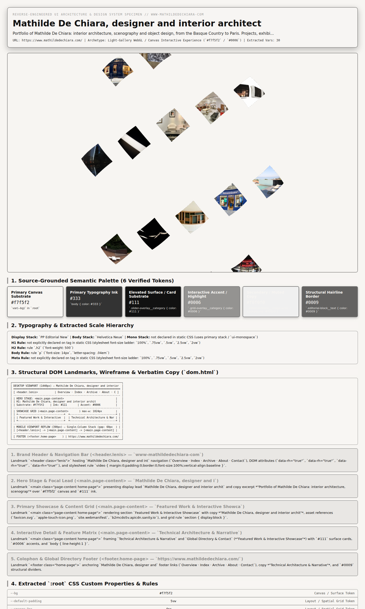
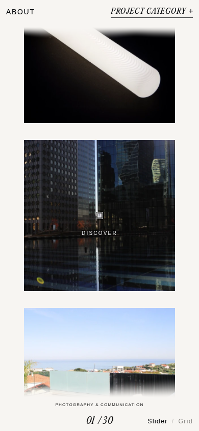

# UI Design System & Master Generation Blueprint: www-mathildedechiara-com

> **Mathilde De Chiara, designer and interior architect** (https://www.mathildedechiara.com/) — Portfolio of Mathilde De Chiara: interior architecture, scenography and object design, from the Basque Country to Paris. Projects, exhibi...



---

## 1. Executive Visual Persona & Design Archetype

- **Brand Essence & Persona**: **Mathilde De Chiara, designer and interior architect** (`https://www.mathildedechiara.com/`). Portfolio of Mathilde De Chiara: interior architecture, scenography and object design, from the Basque Country to Paris. Projects, exhibi...
- **Visual Archetype**: **Light-Gallery WebGL / Canvas Interactive Experience (`#f7f5f2` / `#0006`)**.
- **Anti-AI-Slop Differentiators**:
  - **Source-Grounded Chromatic Polarity**: Anchors the viewport in `#f7f5f2` (`var(--bg)` in `:root`) paired with `#111` primary typography and `#0006` accents.
  - **Extracted Typographic Hierarchy**: Pairs `PP Editorial New` for display copy (`Mathilde De Chiara, designer and int`) with `Helvetica Neue` and not declared in static CSS (uses primary stack / `ui-monospace`).
  - **Calibrated Spatial Grid & Motion**: Combines `1024px` container bounds (`gap: 60px`, padding `5vw`) with `cubic-bezier(.87,0,.13,1)` easing and Lenis Smooth Scroll (`data-lenis`), GSAP Timeline & ScrollTrigger.

---

## 2. Spatial Architecture & Modular Grid Mathematics



### Viewport Allocation & Container Geometry
- **Captured Viewport Dimensions**: Desktop `1440×2400px` (`assets/desktop.png`, capped at 2400px multi-section capture), Mobile `390×2400px` (`assets/mobile.png`, capped at 2400px multi-section capture).
- **Master Container Bounds**: `1024px` extracted from `www-mathildedechiara-com` stylesheet.
- **Canvas Lateral Padding & Spacing**: `5vw` lateral canvas padding with `60px` grid gap.
- **Border Radius Scale**: `0px` (sharp unrounded corners).

### Responsive Breakpoint Architecture
- **Desktop Layout**: Multi-column CSS Grid / Flexbox layout at `1440px` (`max-width: 1024px`, `gap: 60px`).
- **Mobile Layout**: Single-column vertical stack at `390px` viewport width with `5vw` horizontal padding.
- **Extracted CSS Media Queries**: `@media (prefers-reduced-motion: reduce)`, `@media (max-width: 1024px) and (min-width: 769px)`, `@media (max-width: 768px)`, `@media screen and (max-width: 768px)`.

---

## 3. Color System, Materiality & Atmospheric Lighting

### Semantic Palette & Source Grounding
| Semantic Role | Ground-Truth Value | Extracted CSS Source / Selector |
|---|---|---|
| **Primary Canvas Substrate** | `#f7f5f2` | `var(--bg)` in `:root` |
| **Primary Typography Ink** | `#333` | `body { color: #333 }` |
| **Elevated Surface / Card Substrate** | `#111` | `.slider-overlay__category { color: #111 }` |
| **Interactive Accent / Highlight** | `#0006` | `.grid-overlay__category { color: #0006 }` |
| **Secondary / Muted Copy** | `#f0f0f0` | `.editorial-block__image-wrap { background: #f0f0f0 }` |
| **Structural Hairline Border** | `#0009` | `.editorial-block__text { color: #0009 }` |

### Sanitized Root CSS Variables (`ui-ux.md` Ground Truth)
| Variable Name | Extracted Value | Semantic Role |
|---|---|---|
| `--bg` | `#f7f5f2` | Canvas / Surface Token |
| `--default-padding` | `5vw` | Layout / Spatial Grid Token |
| `--spacer-3xs` | `4px` | Layout / Spatial Grid Token |
| `--spacer-2xs` | `5px` | Layout / Spatial Grid Token |
| `--spacer-xs` | `10px` | Layout / Spatial Grid Token |
| `--hit-area` | `8px` | Dimension / Scale Token |
| `--spacer-s` | `20px` | Layout / Spatial Grid Token |
| `--spacer-sm` | `30px` | Layout / Spatial Grid Token |
| `--spacer-md` | `40px` | Layout / Spatial Grid Token |
| `--spacer-m` | `50px` | Layout / Spatial Grid Token |
| `--spacer-l` | `100px` | Layout / Spatial Grid Token |
| `--spacer-xl` | `200px` | Layout / Spatial Grid Token |
| `--spacer-xxl` | `300px` | Layout / Spatial Grid Token |
| `--font-primary` | `"PP Editorial New", Georgia, serif` | Brand / Palette Token |
| `--font-secondary` | `"Helvetica Neue", Helvetica, Arial, sans-serif` | Brand / Palette Token |
| `--page-px` | `clamp(16px, 3vw, 48px)` | Dimension / Scale Token |

---

## 4. Typographic Scale & Editorial Hierarchy

### Font Family Stacks
- **Display Typography**: `PP Editorial New`.
- **Primary Body Stack**: `Helvetica Neue`.
- **Technical / Metadata Stack**: not declared in static CSS (uses primary stack / `ui-monospace`).

### Typographic Scale & Rules (Extracted from Stylesheet & Variables)
- **Hero Display (`H1`)**: not explicitly declared on tag in static CSS (stylesheet font-size ladder: `100%`, `.75vw`, `.5vw`, `2.5vw`, `2vw`).
- **Section Heading (`H2`)**: rule `,h2` (`font-weight: 500`).
- **Body Copy**: rule `p` (`font-size: 14px`, `letter-spacing: .04em`).
- **Metadata & Navigation Labels**: not explicitly declared on tag in static CSS (stylesheet font-size ladder: `100%`, `.75vw`, `.5vw`, `2.5vw`, `2vw`).

---

## 5. Choreographed Motion & Interaction Physics

### Primary Easing Curves
- **Extracted Timing Functions**: `cubic-bezier(.87,0,.13,1)`, `cubic-bezier(.22,.61,.36,1)`.

### Per-Element Transition & Choreography Rules
- **Selector `media (prefers-reduced-motion: re...`**: `transition: .01ms!important` extracted from `www-mathildedechiara-com` stylesheet.
- **Selector `.slider-overlay__thumb`**: `transition: opacity .3s` extracted from `www-mathildedechiara-com` stylesheet.
- **Selector `.mode-toggle`**: `transition: opacity .3s` extracted from `www-mathildedechiara-com` stylesheet.
- **Extracted Easing Curve (`cubic-bezier(.87,0,.13,1)`)**: Governs interactive state transitions across `<header.lenis>` and `<main.page-content>`.
- **Runtime Interaction Engine**: Integrates Lenis Smooth Scroll (`data-lenis`), GSAP Timeline & ScrollTrigger, HTML5 `<canvas>` Interactive Viewport Surface with `prefers-reduced-motion: reduce` fallback guards.

---

## 6. Component Wireframe & Structural DOM Map

### Visual Layout Schematic (Grounded in `dom.html` — `1440px` Desktop & `390px` Mobile Reflow)
```
┌────────────────────────────────────────────────────────────────────────┐
│ DESKTOP VIEWPORT (1440px) — Mathilde De Chiara, designer and interior  │
│ ====================================================================== │
│ [ <header.lenis>           | Overview · Index · Archive · About · C ]  │
│ ---------------------------------------------------------------------- │
│ | HERO STAGE: <main.page-content>                                  |   │
│ | H1: Mathilde De Chiara, designer and interior archit             |   │
│ | Substrate: #f7f5f2    | Ink: #111       | Accent: #0006          |   │
│ ---------------------------------------------------------------------- │
│ | SHOWCASE GRID (<main.page-content>       ) max-w: 1024px         |   │
│ | +------------------------------+  +------------------------------+ | │
│ | | Featured Work & Interactive  |  | Technical Architecture & Nar | | │
│ | +------------------------------+  +------------------------------+ | │
│ ---------------------------------------------------------------------- │
│ | MOBILE VIEWPORT REFLOW (390px) — Single-Column Stack (gap: 60px  ) | │
│ | [<header.lenis>] -> [<main.page-content] -> [<main.page-content] |   │
│ ---------------------------------------------------------------------- │
│ [ FOOTER (<footer.home-page>    ) | https://www.mathildedechiara.com/  │
└────────────────────────────────────────────────────────────────────────┘
```

### Granular DOM Region Breakdown
1. **Brand Header & Navigation Bar (<header.lenis> — `www-mathildedechiara-com`)**:
   - Landmark `<header class="lenis">` hosting `Mathilde De Chiara, designer and int` navigation (`Overview · Index · Archive · About · Contact`), DOM attributes (`data-rh="true"`, `data-rh="true"`, `data-rh="true"`, `data-rh="true"`), and stylesheet rule `video { margin:0;padding:0;border:0;font-size:100%;vertical-align:baseline }`.
2. **Hero Stage & Focal Lead (<main.page-content> — `Mathilde De Chiara, designer and i`)**:
   - Landmark `<main class="page-content home-page">` presenting display lead `Mathilde De Chiara, designer and interior archit` and copy excerpt *"Portfolio of Mathilde De Chiara: interior architecture, scenograp"* over `#f7f5f2` canvas and `#111` ink.
3. **Primary Showcase & Content Grid (<main.page-content> — `Featured Work & Interactive Showca`)**:
   - Landmark `<main class="page-content home-page">` rendering section `Featured Work & Interactive Showcase` with copy *"Mathilde De Chiara, designer and interior archit"*, asset references (`favicon.svg`, `apple-touch-icon.png`, `site.webmanifest`, `b2mcdo5v.apicdn.sanity.io`), and grid rule `section { display:block }`.
4. **Interactive Detail & Feature Matrix (<main.page-content> — `Technical Architecture & Narrative`)**:
   - Landmark `<main class="page-content home-page">` framing `Technical Architecture & Narrative` and `Global Directory & Contact` (*"Featured Work & Interactive Showcase"*) with `#111` surface cards, `#0006` accents, and `body { line-height:1 }`.
5. **Colophon & Global Directory Footer (<footer.home-page> — `https://www.mathildedechiara.com/`)**:
   - Landmark `<footer class="home-page">` anchoring `Mathilde De Chiara, designer and` footer links (`Overview · Index · Archive · About · Contact`), copy *"Technical Architecture & Narrative"*, and `#0009` structural dividers.

---

## 7. Master Zero-Shot AI Generation Prompt

```markdown
# Master Zero-Shot Frontend Generation Prompt: www-mathildedechiara-com (Mathilde De Chiara, designer and interior architect)

You are a principal frontend architect and design systems engineer. Build a complete, production-ready web application replicating the exact design system, DOM landmarks, typographic hierarchy, color tokens, and motion physics of `www-mathildedechiara-com` (**Mathilde De Chiara, designer and interior architect** — `https://www.mathildedechiara.com/`).

### 1. Visual Archetype & Anti-AI-Slop Mandates
- **Archetype**: Light-Gallery WebGL / Canvas Interactive Experience (`#f7f5f2` / `#0006`).
- **Identity & Domain Context**: Portfolio of Mathilde De Chiara: interior architecture, scenography and object design, from the Basque Country to Paris. Projects, exhibi...
- **Primary Substrate**: `#f7f5f2` (`var(--bg)` in `:root`), **Primary Ink**: `#111`, **Accent / Highlight**: `#0006`.
- **Site-Specific Differentiators**:
  - **Source-Grounded Chromatic Polarity**: Anchors the viewport in `#f7f5f2` (`var(--bg)` in `:root`) paired with `#111` primary typography and `#0006` accents.
  - **Extracted Typographic Hierarchy**: Pairs `PP Editorial New` for display copy (`Mathilde De Chiara, designer and int`) with `Helvetica Neue` and not declared in static CSS (uses primary stack / `ui-monospace`).
  - **Calibrated Spatial Grid & Motion**: Combines `1024px` container bounds (`gap: 60px`, padding `5vw`) with `cubic-bezier(.87,0,.13,1)` easing and Lenis Smooth Scroll (`data-lenis`), GSAP Timeline & ScrollTrigger.

### 2. Ground-Truth CSS Variables (`:root` Token Contract)
Declare and consume these exact custom properties extracted from `www-mathildedechiara-com` in your global stylesheet:

:root {
  /* Mathilde De Chiara, designer and interior architect (www-mathildedechiara-com) — Ground-Truth Extracted CSS Variables */
  --bg: #f7f5f2; /* Canvas / Surface Token (www-mathildedechiara-com) */
  --default-padding: 5vw; /* Layout / Spatial Grid Token (www-mathildedechiara-com) */
  --spacer-3xs: 4px; /* Layout / Spatial Grid Token (www-mathildedechiara-com) */
  --spacer-2xs: 5px; /* Layout / Spatial Grid Token (www-mathildedechiara-com) */
  --spacer-xs: 10px; /* Layout / Spatial Grid Token (www-mathildedechiara-com) */
  --hit-area: 8px; /* Dimension / Scale Token (www-mathildedechiara-com) */
  --spacer-s: 20px; /* Layout / Spatial Grid Token (www-mathildedechiara-com) */
  --spacer-sm: 30px; /* Layout / Spatial Grid Token (www-mathildedechiara-com) */
  --spacer-md: 40px; /* Layout / Spatial Grid Token (www-mathildedechiara-com) */
  --spacer-m: 50px; /* Layout / Spatial Grid Token (www-mathildedechiara-com) */
  --spacer-l: 100px; /* Layout / Spatial Grid Token (www-mathildedechiara-com) */
  --spacer-xl: 200px; /* Layout / Spatial Grid Token (www-mathildedechiara-com) */
  --spacer-xxl: 300px; /* Layout / Spatial Grid Token (www-mathildedechiara-com) */
  --font-primary: "PP Editorial New", Georgia, serif; /* Brand / Palette Token (www-mathildedechiara-com) */
  --font-secondary: "Helvetica Neue", Helvetica, Arial, sans-serif; /* Brand / Palette Token (www-mathildedechiara-com) */
  --page-px: clamp(16px, 3vw, 48px); /* Dimension / Scale Token (www-mathildedechiara-com) */
}

### 3. Semantic Color & Materiality Contract
Map every surface, ink, and border strictly to these source-grounded tokens:
- **Primary Canvas Substrate**: `#f7f5f2` — grounded in `var(--bg)` in `:root`
- **Primary Typography Ink**: `#333` — grounded in `body { color: #333 }`
- **Elevated Surface / Card Substrate**: `#111` — grounded in `.slider-overlay__category { color: #111 }`
- **Interactive Accent / Highlight**: `#0006` — grounded in `.grid-overlay__category { color: #0006 }`
- **Secondary / Muted Copy**: `#f0f0f0` — grounded in `.editorial-block__image-wrap { background: #f0f0f0 }`
- **Structural Hairline Border**: `#0009` — grounded in `.editorial-block__text { color: #0009 }`

### 4. Spatial Grid, Container Bounds & Responsive Breakpoints
- **Desktop Viewport Reference**: `1440×2400px` (capped at 2400px multi-section capture, `1440px` standard desktop width).
- **Mobile Viewport Reference**: `390×2400px` (capped at 2400px multi-section capture, `390px` standard mobile width).
- **Container Max-Width**: `1024px` extracted from `www-mathildedechiara-com` stylesheet
- **Padding & Gutters**: `5vw` lateral canvas padding with `60px` grid gap
- **Desktop Grid**: Multi-column CSS Grid / Flexbox layout at `1440px` (`max-width: 1024px`, `gap: 60px`)
- **Mobile Adaptation**: Single-column vertical stack at `390px` viewport width with `5vw` horizontal padding
- **Media Queries**: `@media (prefers-reduced-motion: reduce)`, `@media (max-width: 1024px) and (min-width: 769px)`, `@media (max-width: 768px)`, `@media screen and (max-width: 768px)`
- **Corner Radii**: `0px` (sharp unrounded corners)

### 5. Typography & Editorial Scale Contract
- **Display Font Stack**: `PP Editorial New`
- **Body Font Stack**: `Helvetica Neue`
- **Monospace / Technical Font Stack**: not declared in static CSS (uses primary stack / `ui-monospace`)
- **H1 Display Rule**: not explicitly declared on tag in static CSS (stylesheet font-size ladder: `100%`, `.75vw`, `.5vw`, `2.5vw`, `2vw`)
- **H2 Section Rule**: rule `,h2` (`font-weight: 500`)
- **Body Copy Rule**: rule `p` (`font-size: 14px`, `letter-spacing: .04em`)
- **Metadata & Index Rule**: not explicitly declared on tag in static CSS (stylesheet font-size ladder: `100%`, `.75vw`, `.5vw`, `2.5vw`, `2vw`)

### 6. Component Hierarchy, Verbatim Copy & Real DOM Landmarks
Scaffold `www-mathildedechiara-com` (`Mathilde De Chiara, designer and interior architect`) with these exact structural regions, extracted copy, and CSS rules from `dom.html`:
1. **Brand Header & Navigation Bar (<header.lenis> — `www-mathildedechiara-com`)**:
   - DOM & Selectors: Landmark `<header class="lenis">` hosting `Mathilde De Chiara, designer and int` navigation (`Overview · Index · Archive · About · Contact`), DOM attributes (`data-rh="true"`, `data-rh="true"`, `data-rh="true"`, `data-rh="true"`), and stylesheet rule `video { margin:0;padding:0;border:0;font-size:100%;vertical-align:baseline }`.
   - Responsive Contract: Header `Brand Header & Navigation Bar (<header.lenis> — `www-mathildedechiara-com`)` (`www-mathildedechiara-com`) adapts across `@media (prefers-reduced-motion: reduce)`, `@media (max-width: 1024px) and (min-width: 769px)`, `@media (max-width: 768px)`, `@media screen and (max-width: 768px)` with `cubic-bezier(.87,0,.13,1)`, `cubic-bezier(.22,.61,.36,1)` transitions and links `Overview · Index · Archive · About · Contact`.
2. **Hero Stage & Focal Lead (<main.page-content> — `Mathilde De Chiara, designer and i`)**:
   - DOM & Selectors: Landmark `<main class="page-content home-page">` presenting display lead `Mathilde De Chiara, designer and interior archit` and copy excerpt *"Portfolio of Mathilde De Chiara: interior architecture, scenograp"* over `#f7f5f2` canvas and `#111` ink.
   - Responsive Contract: Hero stage (`1440×2400px` desktop / `390×2400px` mobile) sets `#f7f5f2` background with `#111` headline `Mathilde De Chiara, designer and interior archit`.
3. **Primary Showcase & Content Grid (<main.page-content> — `Featured Work & Interactive Showca`)**:
   - DOM & Selectors: Landmark `<main class="page-content home-page">` rendering section `Featured Work & Interactive Showcase` with copy *"Mathilde De Chiara, designer and interior archit"*, asset references (`favicon.svg`, `apple-touch-icon.png`, `site.webmanifest`, `b2mcdo5v.apicdn.sanity.io`), and grid rule `section { display:block }`.
   - Responsive Contract: Showcase grid `Primary Showcase & Content Grid (<main.page-content> — `Featured Work & Interactive Showca`)` applies Multi-column CSS Grid / Flexbox layout at `1440px` (`max-width: 1024px`, `gap: 60px`) on desktop and Single-column vertical stack at `390px` viewport width with `5vw` horizontal padding on mobile.
4. **Interactive Detail & Feature Matrix (<main.page-content> — `Technical Architecture & Narrative`)**:
   - DOM & Selectors: Landmark `<main class="page-content home-page">` framing `Technical Architecture & Narrative` and `Global Directory & Contact` (*"Featured Work & Interactive Showcase"*) with `#111` surface cards, `#0006` accents, and `body { line-height:1 }`.
   - Responsive Contract: Detail module `Interactive Detail & Feature Matrix (<main.page-content> — `Technical Architecture & Narrative`)` uses `0px` (sharp unrounded corners) radii, `#0006` highlights, and assets (favicon.svg, apple-touch-icon.png, site.webmanifest).
5. **Colophon & Global Directory Footer (<footer.home-page> — `https://www.mathildedechiara.com/`)**:
   - DOM & Selectors: Landmark `<footer class="home-page">` anchoring `Mathilde De Chiara, designer and` footer links (`Overview · Index · Archive · About · Contact`), copy *"Technical Architecture & Narrative"*, and `#0009` structural dividers.
   - Responsive Contract: Footer `Colophon & Global Directory Footer (<footer.home-page> — `https://www.mathildedechiara.com/`)` aligns to `1024px` extracted from `www-mathildedechiara-com` stylesheet with `5vw` lateral canvas padding with `60px` grid gap and attributes (data-rh="true", data-rh="true", data-rh="true").

#### Verbatim DOM Copy Excerpts (`dom.html`)
- Lead Copy: *"Portfolio of Mathilde De Chiara: interior architecture, scenography and object design, from the Basque Country to Paris. Projects, exhibi..."*

### 7. Motion, Extracted Stylesheet Rules & Interaction Choreography
- **Primary Easing Functions**: `cubic-bezier(.87,0,.13,1)`, `cubic-bezier(.22,.61,.36,1)`
- **Extracted Stylesheet Rules (`www-mathildedechiara-com`)**:
- `video { margin:0;padding:0;border:0;font-size:100%;vertical-align:baseline }`
- `section { display:block }`
- `body { line-height:1 }`
- `q:after { content:"";content:none }`
- `table { border-collapse:collapse;border-spacing:0 }`
- **Per-Selector Transition Rules**:
- **Selector `media (prefers-reduced-motion: re...`**: `transition: .01ms!important` extracted from `www-mathildedechiara-com` stylesheet.
- **Selector `.slider-overlay__thumb`**: `transition: opacity .3s` extracted from `www-mathildedechiara-com` stylesheet.
- **Selector `.mode-toggle`**: `transition: opacity .3s` extracted from `www-mathildedechiara-com` stylesheet.
- **Extracted Easing Curve (`cubic-bezier(.87,0,.13,1)`)**: Governs interactive state transitions across `<header.lenis>` and `<main.page-content>`.
- **Runtime Interaction Engine**: Integrates Lenis Smooth Scroll (`data-lenis`), GSAP Timeline & ScrollTrigger, HTML5 `<canvas>` Interactive Viewport Surface with `prefers-reduced-motion: reduce` fallback guards.

### 8. Technical Deliverables
- Implement in Next.js (App Router) with TypeScript and Tailwind CSS consuming the `:root` custom properties defined above for `www-mathildedechiara-com`.
- Reproduce both the `1440px` desktop architecture and `390px` mobile breakpoint transitions, preserving semantic HTML5 landmarks (`<header>`, `<nav>`, `<main>`, `<section>`, `<footer>`) and `prefers-reduced-motion` accessibility guards.
```
