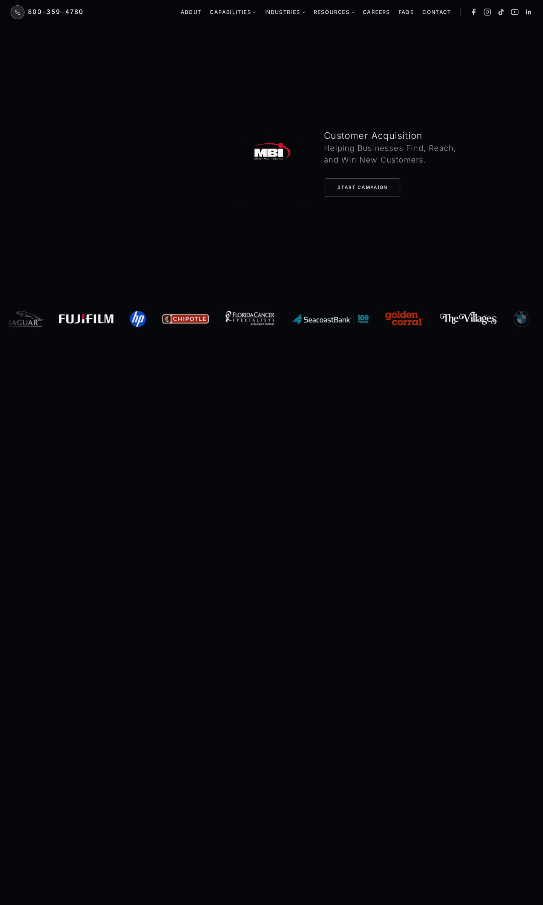
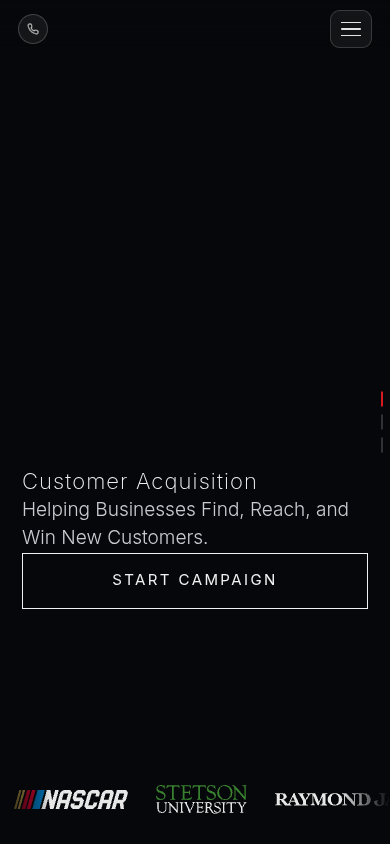

# UI Design System & Master Generation Blueprint: www-mbidirectmail-com

> **Direct Mail & Digital Marketing · Customer Acquisition · MBI** (https://www.mbidirectmail.com/) — MBI Direct Mail + Digital helps businesses find, reach, and win new customers: direct mail, print, digital, and seminar marketing from on...



---

## 1. Executive Visual Persona & Design Archetype

- **Brand Essence & Persona**: **Direct Mail & Digital Marketing · Customer Acquisition · MBI** (`https://www.mbidirectmail.com/`). MBI Direct Mail + Digital helps businesses find, reach, and win new customers: direct mail, print, digital, and seminar marketing from on...
- **Capture Provenance**: Live browser capture (`tier1_fast`, HTTP `200`, captured `2026-11-23`).
- **Visual Archetype**: **Dark-Substrate WebGL / Canvas Interactive Experience (`#06070a` / `#ff0000`)**.
- **Anti-AI-Slop Differentiators**:
  - **Live-Computed Chromatic Polarity**: Anchors the viewport in `#06070a` (live computed `body` `background-color` (`computed_styles.json`)) paired with `#ffffff` primary typography and `#ff0000` accents.
  - **Grounded Typographic Hierarchy**: Pairs `Inter` for display copy (`Customer Acquisition Helping Busines`) with `Inter` and not declared in live computed styles (uses primary stack / `ui-monospace`).
  - **Calibrated Spatial Grid & Motion**: Combines `1440px` container bounds (`gap: 22px`, padding `64.8px`) with `cubic-bezier(.4,0,.2,1)` easing and Lenis Smooth Scroll (`data-lenis`), GSAP Timeline & ScrollTrigger.

---

## 2. Spatial Architecture & Modular Grid Mathematics



### Viewport Allocation & Container Geometry
- **Captured Viewport Dimensions**: Desktop `1440×2400px` (`assets/desktop.png`, clamped at 2400px live multi-section capture), Mobile `390×844px` (`assets/mobile.png`, single-viewport 100vh live capture (844px)).
- **Master Container Bounds**: `1440px` (full-bleed `100%` desktop stage measured on `1440px` viewport).
- **Canvas Lateral Padding & Spacing**: `64.8px` lateral canvas padding with `22px` grid gap.
- **Border Radius Scale**: `50%`, `2px`, `1px`, `18px`.

### Responsive Breakpoint Architecture
- **Desktop Layout**: Multi-column CSS Grid / Flexbox layout at `1440px` (`max-width: 1440px`, `gap: 22px`).
- **Mobile Layout**: Single-column vertical stack at `390px` viewport width with `64.8px` horizontal padding.
- **Extracted CSS Media Queries**: `@media (max-width: 374px)`, `@media (prefers-reduced-motion:reduce)`, `@media (max-width:365px)`, `@media (max-width:389px)`.

---

## 3. Color System, Materiality & Atmospheric Lighting

### Semantic Palette & Source Grounding
| Semantic Role | Ground-Truth Value | Extracted Live / CSS Source |
|---|---|---|
| **Primary Canvas Substrate** | `#06070a` | live computed `body` `background-color` (`computed_styles.json`) |
| **Primary Typography Ink** | `#ffffff` | live computed `button` `color` (`computed_styles.json`) |
| **Elevated Surface / Card Substrate** | `#151515` | live computed `a` `background-color` (`computed_styles.json`) |
| **Interactive Accent / Highlight** | `#ff0000` | `#campaign-report .cr-delta.down { color: red }` (`#ff0000`) |
| **Secondary / Muted Copy** | `#6b7689` | `var(--cr-ink-soft)` in `:root` |
| **Structural Hairline Border** | `#1f2022` | `var(--line)` in `:root` (`rgba(255,255,255,0.10)`) |
| **Variable Token (`--surface`)** | `#111113` | `var(--surface)` in `:root` |
| **Variable Token (`--surface-soft`)** | `#1c1c20` | `var(--surface-soft)` in `:root` |
| **Variable Token (`--ink`)** | `#f0f0f2` | `var(--ink)` in `:root` |
| **Variable Token (`--muted`)** | `#6e6e78` | `var(--muted)` in `:root` |
| **Variable Token (`--honey`)** | `#9a9aa2` | `var(--honey)` in `:root` |
| **Variable Token (`--honey-bright`)** | `#c8c8d0` | `var(--honey-bright)` in `:root` |
| **Variable Token (`--honey-deep`)** | `#5a5a62` | `var(--honey-deep)` in `:root` |

### Sanitized Root CSS Variables (`ui-ux.md` Ground Truth)
| Variable Name | Extracted Value | Semantic Role |
|---|---|---|
| `--bg` | `#06070A` | Canvas / Surface Token |
| `--surface` | `#111113` | Canvas / Surface Token |
| `--surface-soft` | `#1c1c20` | Canvas / Surface Token |
| `--ink` | `#f0f0f2` | Typography Ink Token |
| `--muted` | `#6e6e78` | Color / Atmospheric Token |
| `--line` | `rgba(255,255,255,0.10)` | Color / Atmospheric Token |
| `--tunnel-line` | `rgba(255,255,255,0.12)` | Color / Atmospheric Token |
| `--tunnel-line-strong` | `rgba(255,255,255,0.18)` | Color / Atmospheric Token |
| `--tunnel-line-soft` | `rgba(255,255,255,0.04)` | Color / Atmospheric Token |
| `--tunnel-glow` | `rgba(255,255,255,0.10)` | Color / Atmospheric Token |
| `--honey` | `#9a9aa2` | Color / Atmospheric Token |
| `--honey-bright` | `#c8c8d0` | Color / Atmospheric Token |
| `--honey-deep` | `#5a5a62` | Color / Atmospheric Token |
| `--honey-soft` | `rgba(255,255,255,0.14)` | Color / Atmospheric Token |
| `--azure` | `#9a9aa2` | Color / Atmospheric Token |
| `--azure-deep` | `#5a5a62` | Color / Atmospheric Token |

---

## 4. Typographic Scale & Editorial Hierarchy

### Font Family Stacks
- **Display Typography**: `Inter`.
- **Primary Body Stack**: `Inter`.
- **Technical / Metadata Stack**: not declared in live computed styles (uses primary stack / `ui-monospace`).

### Typographic Scale & Rules (Live Computed & Stylesheet Grounded)
- **Hero Display (`H1`)**: live computed `h1` (`font-size: 24.0005px`, `line-height: 33.6007px`, `font-weight: 300`, `letter-spacing: 1.20002px`); rule `h1` (`font-size: 22px`, `line-height: 1.25`, `letter-spacing: .05em`, `font-weight: 400`).
- **Section Heading (`H2`)**: live computed `h2` (`font-size: 34.56px`, `line-height: 38.7072px`, `font-weight: 200`, `letter-spacing: -0.62208px`); rule `h2` (`font-size: clamp(38px,11.6vw,48px)`, `line-height: 1.0`, `letter-spacing: -.035em`, `font-weight: 100`).
- **Body Copy**: live computed `body` (`font-size: 16px`, `line-height: normal`, `font-weight: 400`); rule `.body` (`font-size: 18px`, `line-height: 1.55`, `font-weight: 400`).
- **Metadata & Navigation Labels**: live computed `nav/a` (`font-size: 16px`, `line-height: normal`, `font-weight: 400`).

---

## 5. Choreographed Motion & Interaction Physics

### Primary Easing Curves
- **Extracted Timing Functions**: `cubic-bezier(.4,0,.2,1)`, `cubic-bezier(.2,.9,.3,1)`, `cubic-bezier(.22,.61,.36,1)`.

### Per-Element Transition & Choreography Rules
- **Selector `html.mbe #hero-brand`**: `transition: background .3s ease` extracted from `www-mbidirectmail-com` stylesheet.
- **Selector `#mbe .mbe-qpop`**: `transition: opacity .2s linear, transform .35s cubic-bezier(.4,0,.2,1),...` extracted from `www-mbidirectmail-com` stylesheet.
- **Selector `#mbe .mbe-qpop.on`**: `transition: opacity .2s linear, transform .35s cubic-bezier(.4,0,.2,1)` extracted from `www-mbidirectmail-com` stylesheet.
- **Extracted Easing Curve (`cubic-bezier(.4,0,.2,1)`)**: Governs interactive state transitions across `<nav.hn-links>` and `<section.skip-link>`.
- **Runtime Interaction Engine**: Integrates Lenis Smooth Scroll (`data-lenis`), GSAP Timeline & ScrollTrigger, HTML5 `<canvas>` Interactive Viewport Surface with `prefers-reduced-motion: reduce` fallback guards.

---

## 6. Component Wireframe & Structural DOM Map

### Visual Layout Schematic — Desktop (`1440px`, Grounded in `dom.html` & Landmark Bounding Boxes)
```
┌────────────────────────────────────────────────────────────────────────┐
│ DESKTOP VIEWPORT (1440px) — Direct Mail & Digital Marketing · Customer │
│ ====================================================================== │
│ [ <nav.hn-links> (718x24px)           | About · Capabilities · All c ] │
│ ---------------------------------------------------------------------- │
│ | HERO STAGE: <section.solutions-section> (w=1440px)                 | │
│ | H1: Customer Acquisition Helping Businesses Find, Rea...           | │
│ | Substrate: #06070a | Ink: #ffffff | Accent: #ff0000                | │
│ ---------------------------------------------------------------------- │
│ | SHOWCASE GRID (<section.skip-link>) max-w: 1440px                  | │
│ | +------------------------------+  +------------------------------+ | │
│ | | A Marketing Partner.         |  | We find the right audience.  | | │
│ | +------------------------------+  +------------------------------+ | │
│ ---------------------------------------------------------------------- │
│ | DETAIL MODULE (<section.plo-overlay>) — One partner. One team      | │
│ ---------------------------------------------------------------------- │
│ [ FOOTER (<footer.print-signof) | https://www.mbidirectmail.com/       │
└────────────────────────────────────────────────────────────────────────┘
```

### Visual Layout Schematic — Mobile Reflow (`390px`)
```
┌────────────────────────────────────────────────────────────────────────┐
│ MOBILE VIEWPORT REFLOW (390px) — Single-Column Stack (gap: 22px)       │
│ ====================================================================== │
│ [ HEADER BAR (<nav.hn-links>          ) | Compact Menu (390px)         │
│ ---------------------------------------------------------------------- │
│ | HERO STAGE (<section.solutions-secti) — 390px Vertical Lead        | │
│ | H1: Customer Acquisition Helping Businesses Find, Rea...           | │
│ ---------------------------------------------------------------------- │
│ | SHOWCASE STACK (<section.skip-link>) — 1-Col Stack                 | │
│ | [ Item 1: A Marketing Partner.                                   ] | │
│ | [ Item 2: We find the right audience. We are experts at kno...   ] | │
│ ---------------------------------------------------------------------- │
│ | DETAIL STACK (<section.plo-overlay>) — 1-Col (One partner. One t)  | │
│ ---------------------------------------------------------------------- │
│ [ FOOTER (<footer.print-signof) | Stacked 390px Colophon               │
└────────────────────────────────────────────────────────────────────────┘
```

### Granular DOM Region Breakdown
1. **Brand Header & Navigation Bar (<nav.hn-links> — `www-mbidirectmail-com`)**:
   - Landmark `<nav class="hn-links">` (`718x24px`) hosting `Direct Mail & Digital Marketing · Cu` navigation (`About · Capabilities · All capabilities → · Industries · Automotive 6`), DOM attributes (`data-tier="lite:cores2,mem4"`, `data-site-reveal`, `data-v-page-load-overlay="none"`, `data-v-hero-logo="wide"`), and stylesheet rule `revealed-section { display: none !important; }`.
2. **Hero Stage & Focal Lead (<section.solutions-section> — `Customer Acquisition Helping Busin`)**:
   - Landmark `<section class="solutions-section">` presenting display lead `Customer Acquisition Helping Businesses Find, Rea...` and copy excerpt *"8 0 0 - 3 5 9 - 4 7 8 0"* over `#06070a` canvas and `#ffffff` ink.
3. **Primary Showcase & Content Grid (<section.skip-link> — `A Marketing Partner.`)**:
   - Landmark `<section class="skip-link">` rendering section `A Marketing Partner.` with copy *"Printing Commercial and variable-data printing, in-house."*, asset references (`favicon.svg`, `favicon.ico`, `lenis.min.js`, `d3-array.min.js`), and grid rule `mbe { display: none !important; }`.
4. **Interactive Detail & Feature Matrix (<section.plo-overlay> — `We find the right audience. We are`)**:
   - Landmark `<section class="plo-overlay">` framing `We find the right audience. We are experts at kno...` and `One partner. One team. Strategy to delivery.` (*"Commercial and variable-data printing, in-house."*) with `#151515` surface cards, `#ff0000` accents, and `html.mbe-lock body { overflow: hidden !important; }`.
5. **Colophon & Global Directory Footer (<footer.print-signoff> — `https://www.mbidirectmail.com/`)**:
   - Landmark `<footer class="print-signoff">` anchoring `Direct Mail & Digital Marketing ` footer links (`About · Capabilities · All capabilities → · Industries · Automotive 6`), copy *"Direct Mail Targeted campaigns, lists, and postal entry unde"*, and `#1f2022` structural dividers.

---

## 7. Master Zero-Shot AI Generation Prompt

```markdown
# Master Zero-Shot Frontend Generation Prompt: www-mbidirectmail-com (Direct Mail & Digital Marketing · Customer Acquisition · MBI)

You are a principal frontend architect and design systems engineer. Build a complete, production-ready web application replicating the exact design system, DOM landmarks, typographic hierarchy, color tokens, and motion physics of `www-mbidirectmail-com` (**Direct Mail & Digital Marketing · Customer Acquisition · MBI** — `https://www.mbidirectmail.com/`).

### 1. Visual Archetype & Anti-AI-Slop Mandates
- **Archetype**: Dark-Substrate WebGL / Canvas Interactive Experience (`#06070a` / `#ff0000`).
- **Identity & Domain Context**: MBI Direct Mail + Digital helps businesses find, reach, and win new customers: direct mail, print, digital, and seminar marketing from on...
- **Primary Substrate**: `#06070a` (live computed `body` `background-color` (`computed_styles.json`)), **Primary Ink**: `#ffffff`, **Accent / Highlight**: `#ff0000`.
- **Site-Specific Differentiators**:
  - **Live-Computed Chromatic Polarity**: Anchors the viewport in `#06070a` (live computed `body` `background-color` (`computed_styles.json`)) paired with `#ffffff` primary typography and `#ff0000` accents.
  - **Grounded Typographic Hierarchy**: Pairs `Inter` for display copy (`Customer Acquisition Helping Busines`) with `Inter` and not declared in live computed styles (uses primary stack / `ui-monospace`).
  - **Calibrated Spatial Grid & Motion**: Combines `1440px` container bounds (`gap: 22px`, padding `64.8px`) with `cubic-bezier(.4,0,.2,1)` easing and Lenis Smooth Scroll (`data-lenis`), GSAP Timeline & ScrollTrigger.

### 2. Ground-Truth CSS Variables (`:root` Token Contract)
Declare and consume these exact custom properties extracted from `www-mbidirectmail-com` in your global stylesheet:

:root {
  /* Direct Mail & Digital Marketing · Customer Acquisition · MBI (www-mbidirectmail-com) — Live-Grounded CSS Variables */
  --bg: #06070A; /* Canvas / Surface Token (www-mbidirectmail-com) */
  --surface: #111113; /* Canvas / Surface Token (www-mbidirectmail-com) */
  --surface-soft: #1c1c20; /* Canvas / Surface Token (www-mbidirectmail-com) */
  --ink: #f0f0f2; /* Typography Ink Token (www-mbidirectmail-com) */
  --muted: #6e6e78; /* Color / Atmospheric Token (www-mbidirectmail-com) */
  --line: rgba(255,255,255,0.10); /* Color / Atmospheric Token (www-mbidirectmail-com) */
  --tunnel-line: rgba(255,255,255,0.12); /* Color / Atmospheric Token (www-mbidirectmail-com) */
  --tunnel-line-strong: rgba(255,255,255,0.18); /* Color / Atmospheric Token (www-mbidirectmail-com) */
  --tunnel-line-soft: rgba(255,255,255,0.04); /* Color / Atmospheric Token (www-mbidirectmail-com) */
  --tunnel-glow: rgba(255,255,255,0.10); /* Color / Atmospheric Token (www-mbidirectmail-com) */
  --honey: #9a9aa2; /* Color / Atmospheric Token (www-mbidirectmail-com) */
  --honey-bright: #c8c8d0; /* Color / Atmospheric Token (www-mbidirectmail-com) */
  --honey-deep: #5a5a62; /* Color / Atmospheric Token (www-mbidirectmail-com) */
  --honey-soft: rgba(255,255,255,0.14); /* Color / Atmospheric Token (www-mbidirectmail-com) */
  --azure: #9a9aa2; /* Color / Atmospheric Token (www-mbidirectmail-com) */
  --azure-deep: #5a5a62; /* Color / Atmospheric Token (www-mbidirectmail-com) */
}

### 3. Semantic Color & Materiality Contract
Map every surface, ink, and border strictly to these source-grounded tokens:
- **Primary Canvas Substrate**: `#06070a` — grounded in live computed `body` `background-color` (`computed_styles.json`)
- **Primary Typography Ink**: `#ffffff` — grounded in live computed `button` `color` (`computed_styles.json`)
- **Elevated Surface / Card Substrate**: `#151515` — grounded in live computed `a` `background-color` (`computed_styles.json`)
- **Interactive Accent / Highlight**: `#ff0000` — grounded in `#campaign-report .cr-delta.down { color: red }` (`#ff0000`)
- **Secondary / Muted Copy**: `#6b7689` — grounded in `var(--cr-ink-soft)` in `:root`
- **Structural Hairline Border**: `#1f2022` — grounded in `var(--line)` in `:root` (`rgba(255,255,255,0.10)`)
- **Variable Token (`--surface`)**: `#111113` — grounded in `var(--surface)` in `:root`
- **Variable Token (`--surface-soft`)**: `#1c1c20` — grounded in `var(--surface-soft)` in `:root`
- **Variable Token (`--ink`)**: `#f0f0f2` — grounded in `var(--ink)` in `:root`
- **Variable Token (`--muted`)**: `#6e6e78` — grounded in `var(--muted)` in `:root`
- **Variable Token (`--honey`)**: `#9a9aa2` — grounded in `var(--honey)` in `:root`
- **Variable Token (`--honey-bright`)**: `#c8c8d0` — grounded in `var(--honey-bright)` in `:root`
- **Variable Token (`--honey-deep`)**: `#5a5a62` — grounded in `var(--honey-deep)` in `:root`

### 4. Spatial Grid, Container Bounds & Responsive Breakpoints
- **Desktop Viewport Reference**: `1440×2400px` (clamped at 2400px live multi-section capture, `1440px` standard desktop width).
- **Mobile Viewport Reference**: `390×844px` (single-viewport 100vh live capture (844px), `390px` standard mobile width).
- **Container Max-Width**: `1440px` (full-bleed `100%` desktop stage measured on `1440px` viewport)
- **Padding & Gutters**: `64.8px` lateral canvas padding with `22px` grid gap
- **Desktop Grid**: Multi-column CSS Grid / Flexbox layout at `1440px` (`max-width: 1440px`, `gap: 22px`)
- **Mobile Adaptation**: Single-column vertical stack at `390px` viewport width with `64.8px` horizontal padding
- **Media Queries**: `@media (max-width: 374px)`, `@media (prefers-reduced-motion:reduce)`, `@media (max-width:365px)`, `@media (max-width:389px)`
- **Corner Radii**: `50%`, `2px`, `1px`, `18px`

### 5. Typography & Editorial Scale Contract
- **Display Font Stack**: `Inter`
- **Body Font Stack**: `Inter`
- **Monospace / Technical Font Stack**: not declared in live computed styles (uses primary stack / `ui-monospace`)
- **H1 Display Rule**: live computed `h1` (`font-size: 24.0005px`, `line-height: 33.6007px`, `font-weight: 300`, `letter-spacing: 1.20002px`); rule `h1` (`font-size: 22px`, `line-height: 1.25`, `letter-spacing: .05em`, `font-weight: 400`)
- **H2 Section Rule**: live computed `h2` (`font-size: 34.56px`, `line-height: 38.7072px`, `font-weight: 200`, `letter-spacing: -0.62208px`); rule `h2` (`font-size: clamp(38px,11.6vw,48px)`, `line-height: 1.0`, `letter-spacing: -.035em`, `font-weight: 100`)
- **Body Copy Rule**: live computed `body` (`font-size: 16px`, `line-height: normal`, `font-weight: 400`); rule `.body` (`font-size: 18px`, `line-height: 1.55`, `font-weight: 400`)
- **Metadata & Index Rule**: live computed `nav/a` (`font-size: 16px`, `line-height: normal`, `font-weight: 400`)

### 6. Component Hierarchy, Verbatim Copy & Real DOM Landmarks
Scaffold `www-mbidirectmail-com` (`Direct Mail & Digital Marketing · Customer Acquisition · MBI`) with these exact structural regions, extracted copy, and CSS rules from `dom.html`:
1. **Brand Header & Navigation Bar (<nav.hn-links> — `www-mbidirectmail-com`)**:
   - DOM & Selectors: Landmark `<nav class="hn-links">` (`718x24px`) hosting `Direct Mail & Digital Marketing · Cu` navigation (`About · Capabilities · All capabilities → · Industries · Automotive 6`), DOM attributes (`data-tier="lite:cores2,mem4"`, `data-site-reveal`, `data-v-page-load-overlay="none"`, `data-v-hero-logo="wide"`), and stylesheet rule `revealed-section { display: none !important; }`.
   - Responsive Contract: Header `Brand Header & Navigation Bar (<nav.hn-links> — `www-mbidirectmail-com`)` (`www-mbidirectmail-com`) adapts across `@media (max-width: 374px)`, `@media (prefers-reduced-motion:reduce)`, `@media (max-width:365px)`, `@media (max-width:389px)` with `cubic-bezier(.4,0,.2,1)`, `cubic-bezier(.2,.9,.3,1)`, `cubic-bezier(.22,.61,.36,1)` transitions and links `About · Capabilities · All capabilities → · Industries · Automotive 6`.
2. **Hero Stage & Focal Lead (<section.solutions-section> — `Customer Acquisition Helping Busin`)**:
   - DOM & Selectors: Landmark `<section class="solutions-section">` presenting display lead `Customer Acquisition Helping Businesses Find, Rea...` and copy excerpt *"8 0 0 - 3 5 9 - 4 7 8 0"* over `#06070a` canvas and `#ffffff` ink.
   - Responsive Contract: Hero stage (`1440×2400px` desktop / `390×844px` mobile) sets `#06070a` background with `#ffffff` headline `Customer Acquisition Helping Businesses Find, Rea...`.
3. **Primary Showcase & Content Grid (<section.skip-link> — `A Marketing Partner.`)**:
   - DOM & Selectors: Landmark `<section class="skip-link">` rendering section `A Marketing Partner.` with copy *"Printing Commercial and variable-data printing, in-house."*, asset references (`favicon.svg`, `favicon.ico`, `lenis.min.js`, `d3-array.min.js`), and grid rule `mbe { display: none !important; }`.
   - Responsive Contract: Showcase grid `Primary Showcase & Content Grid (<section.skip-link> — `A Marketing Partner.`)` applies Multi-column CSS Grid / Flexbox layout at `1440px` (`max-width: 1440px`, `gap: 22px`) on desktop and Single-column vertical stack at `390px` viewport width with `64.8px` horizontal padding on mobile.
4. **Interactive Detail & Feature Matrix (<section.plo-overlay> — `We find the right audience. We are`)**:
   - DOM & Selectors: Landmark `<section class="plo-overlay">` framing `We find the right audience. We are experts at kno...` and `One partner. One team. Strategy to delivery.` (*"Commercial and variable-data printing, in-house."*) with `#151515` surface cards, `#ff0000` accents, and `html.mbe-lock body { overflow: hidden !important; }`.
   - Responsive Contract: Detail module `Interactive Detail & Feature Matrix (<section.plo-overlay> — `We find the right audience. We are`)` uses `50%`, `2px`, `1px`, `18px` radii, `#ff0000` highlights, and assets (favicon.svg, favicon.ico, lenis.min.js).
5. **Colophon & Global Directory Footer (<footer.print-signoff> — `https://www.mbidirectmail.com/`)**:
   - DOM & Selectors: Landmark `<footer class="print-signoff">` anchoring `Direct Mail & Digital Marketing ` footer links (`About · Capabilities · All capabilities → · Industries · Automotive 6`), copy *"Direct Mail Targeted campaigns, lists, and postal entry unde"*, and `#1f2022` structural dividers.
   - Responsive Contract: Footer `Colophon & Global Directory Footer (<footer.print-signoff> — `https://www.mbidirectmail.com/`)` aligns to `1440px` (full-bleed `100%` desktop stage measured on `1440px` viewport) with `64.8px` lateral canvas padding with `22px` grid gap and attributes (data-tier="lite:cores2,mem4", data-site-reveal, data-v-page-load-overlay="none").

#### Verbatim DOM Copy Excerpts (`dom.html`)
- Copy Excerpt 1: *"8 0 0 - 3 5 9 - 4 7 8 0"*
- Copy Excerpt 2: *"Printing Commercial and variable-data printing, in-house."*
- Copy Excerpt 3: *"Commercial and variable-data printing, in-house."*
- Copy Excerpt 4: *"Direct Mail Targeted campaigns, lists, and postal entry under one roof."*

### 7. Motion, Extracted Stylesheet Rules & Interaction Choreography
- **Primary Easing Functions**: `cubic-bezier(.4,0,.2,1)`, `cubic-bezier(.2,.9,.3,1)`, `cubic-bezier(.22,.61,.36,1)`
- **Extracted Stylesheet Rules (`www-mbidirectmail-com`)**:
- `revealed-section { display: none !important; }`
- `mbe { display: none !important; }`
- `html.mbe-lock body { overflow: hidden !important; }`
- `html.mbe body { overflow-x: clip; }`
- `html.mbe .mbe-bento-slot .s-cta { box-sizing: border-box; }`
- **Per-Selector Transition Rules**:
- **Selector `html.mbe #hero-brand`**: `transition: background .3s ease` extracted from `www-mbidirectmail-com` stylesheet.
- **Selector `#mbe .mbe-qpop`**: `transition: opacity .2s linear, transform .35s cubic-bezier(.4,0,.2,1),...` extracted from `www-mbidirectmail-com` stylesheet.
- **Selector `#mbe .mbe-qpop.on`**: `transition: opacity .2s linear, transform .35s cubic-bezier(.4,0,.2,1)` extracted from `www-mbidirectmail-com` stylesheet.
- **Extracted Easing Curve (`cubic-bezier(.4,0,.2,1)`)**: Governs interactive state transitions across `<nav.hn-links>` and `<section.skip-link>`.
- **Runtime Interaction Engine**: Integrates Lenis Smooth Scroll (`data-lenis`), GSAP Timeline & ScrollTrigger, HTML5 `<canvas>` Interactive Viewport Surface with `prefers-reduced-motion: reduce` fallback guards.

### 8. Technical Deliverables
- Implement in Next.js (App Router) with TypeScript and Tailwind CSS consuming the `:root` custom properties defined above for `www-mbidirectmail-com`.
- Reproduce both the `1440px` desktop architecture and `390px` mobile breakpoint transitions, preserving semantic HTML5 landmarks (`<header>`, `<nav>`, `<main>`, `<section>`, `<footer>`) and `prefers-reduced-motion` accessibility guards.
```
