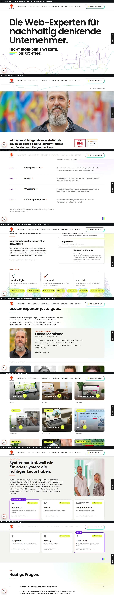
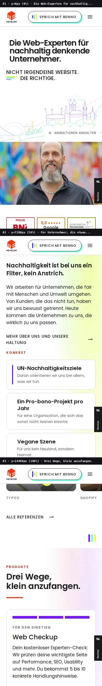

# UI Design System & Master Generation Blueprint: www-memedia-de

> **Webdesign München für nachhaltig denkende Unternehmer** (https://www.memedia.de) — Die Web-Experten für nachhaltig denkende Unternehmer: Strategie, Konzeption, Design und Umsetzung aus München. Websites, die Anfragen bri...





---

## 1. Executive Visual Persona & Design Archetype

- **Brand Essence & Persona**: **Webdesign München für nachhaltig denkende Unternehmer** (`https://www.memedia.de`). Die Web-Experten für nachhaltig denkende Unternehmer: Strategie, Konzeption, Design und Umsetzung aus München. Websites, die Anfragen bri...
- **Capture Provenance**: Live browser capture (`tier1_fast`, HTTP `200`, captured `2026-11-24`).
- **Visual Archetype**: **Light-Substrate Editorial & Modular Grid System (`#ffffff` canvas, `#1a1a1a` ink, `#f03714` accent)**.
- **Anti-AI-Slop Differentiators**:
  - **Live-Computed Chromatic Polarity**: Anchors the viewport in `#ffffff` (live computed `body` `background-color` (`computed_styles.json`)) paired with `#1a1a1a` primary typography and `#f03714` accents.
  - **Grounded Typographic Hierarchy**: Uses `Poppins` across display (`Die Web-Experten für nachhaltig denk`) and body copy.
  - **Calibrated Spatial Grid & Motion**: Combines `1440px` container bounds (`gap: 28px`, padding `var(--gutter)`) with `cubic-bezier(.2,.7,.2,1)` easing.

---

## 2. Spatial Architecture & Modular Grid Mathematics

### Viewport Allocation & Container Geometry
- **Captured Journey Filmstrips**: Desktop `1280×6624px` (`assets/desktop-journey.webp`, `8` keyframes up to `y=14400px` / doc `18690px`), Mobile `390×2616px` (`assets/mobile-journey.webp`, `3` keyframes).
- **Master Container Bounds**: `1440px` (full-bleed `100%` desktop stage measured on `1440px` viewport).
- **Canvas Lateral Padding & Spacing**: `var(--gutter)` lateral canvas padding with `28px` grid gap.
- **Border Radius Scale**: `999px`, `2px`, `50%`, `var(--radius)`.

### Responsive Breakpoint Architecture
- **Desktop Layout**: Multi-column CSS Grid / Flexbox layout at `1440px` (`max-width: 1440px`, `gap: 28px`).
- **Mobile Layout**: Single-column vertical stack at `390px` viewport width with `var(--gutter)` horizontal padding.
- **Extracted CSS Media Queries**: `@media (prefers-reduced-motion:reduce)`, `@media (min-width:900px)`, `@media (max-width:899px)`, `@media (min-width:1200px)`.

---

## 3. Color System, Materiality & Atmospheric Lighting

### Semantic Palette & Source Grounding
| Semantic Role | Ground-Truth Value | Extracted Live / CSS Source |
|---|---|---|
| **Primary Canvas Substrate** | `#ffffff` | live computed `body` `background-color` (`computed_styles.json`) |
| **Primary Typography Ink** | `#1a1a1a` | live computed `h1` `color` (`computed_styles.json`) |
| **Elevated Surface / Card Substrate** | `#f4f4f2` | `var(--surface-2)` in `:root` |
| **Interactive Accent / Highlight** | `#f03714` | `var(--brand)` in `:root` |
| **Secondary / Muted Copy** | `#666665` | `var(--ink-muted)` in `:root` |
| **Structural Hairline Border** | `#d8d8d6` | `var(--line)` in `:root` |
| **Variable Token (`--muted-on-dark`)** | `#b4b4b3` | `var(--muted-on-dark)` in `:root` |
| **Variable Token (`--label-on-dark`)** | `#9a9a99` | `var(--label-on-dark)` in `:root` |
| **Variable Token (`--line-soft`)** | `#ececea` | `var(--line-soft)` in `:root` |
| **Variable Token (`--line-dark`)** | `#414140` | `var(--line-dark)` in `:root` |
| **Variable Token (`--surface-3`)** | `#eaeae8` | `var(--surface-3)` in `:root` |
| **Variable Token (`--cta`)** | `#e0320f` | `var(--cta)` in `:root` |
| **Variable Token (`--brand-text`)** | `#c42a0c` | `var(--brand-text)` in `:root` |
| **Variable Token (`--coral`)** | `#ff9d80` | `var(--coral)` in `:root` |
| **Variable Token (`--lime`)** | `#e6f84a` | `var(--lime)` in `:root` |

### Sanitized Root CSS Variables (`ui-ux.md` Ground Truth)
| Variable Name | Extracted Value | Semantic Role |
|---|---|---|
| `--ink` | `#1a1a1a` | Typography Ink Token |
| `--ink-muted` | `#666665` | Typography Ink Token |
| `--ink-inverse` | `#ffffff` | Typography Ink Token |
| `--muted-on-dark` | `#b4b4b3` | Canvas / Surface Token |
| `--label-on-dark` | `#9a9a99` | Canvas / Surface Token |
| `--line` | `#d8d8d6` | Color / Atmospheric Token |
| `--line-soft` | `#ececea` | Color / Atmospheric Token |
| `--line-dark` | `#414140` | Canvas / Surface Token |
| `--surface` | `#ffffff` | Canvas / Surface Token |
| `--surface-2` | `#f4f4f2` | Canvas / Surface Token |
| `--surface-3` | `#eaeae8` | Canvas / Surface Token |
| `--brand` | `#f03714` | Brand / Palette Token |
| `--cta` | `#e0320f` | Brand / Palette Token |
| `--brand-text` | `#c42a0c` | Typography Ink Token |
| `--coral` | `#ff9d80` | Color / Atmospheric Token |
| `--lime` | `#e6f84a` | Color / Atmospheric Token |

---

## 4. Typographic Scale & Editorial Hierarchy

### Font Family Stacks
- **Display Typography**: `Poppins`.
- **Primary Body Stack**: `Poppins`.
- **Technical / Metadata Stack**: not declared in live computed styles (uses primary stack / `ui-monospace`).

### Typographic Scale & Rules (Live Computed & Stylesheet Grounded)
- **Hero Display (`H1`)**: live computed `h1` (`font-size: 112px`, `line-height: 112px`, `font-weight: 600`, `letter-spacing: -3.92px`).
- **Section Heading (`H2`)**: live computed `h2` (`font-size: 48px`, `line-height: 53.76px`, `font-weight: 600`, `letter-spacing: -0.72px`); CSS variables `--fs-h2: clamp(2rem,1.6rem + 1.556vw,3rem)`, `--fs-h2-s: clamp(1.625rem,1.3rem + 1vw,2.25rem)`; rule `h2` (`font-size: 1rem`, `font-weight: 600`).
- **Body Copy**: live computed `body` (`font-size: 18px`, `line-height: 28.8px`, `font-weight: 400`); CSS variables `--fs-body: clamp(1.0625rem,1rem + .15vw,1.125rem)`; rule `p` (`font-size: var(--fs-body)`, `line-height: 1.6`).
- **Metadata & Navigation Labels**: live computed `nav/a` (`font-size: 18px`, `line-height: 28.8px`, `font-weight: 400`); CSS variables `--fs-small: .9375rem`, `--fs-label: .8125rem`; rule `.meta` (`font-size: var(--fs-small)`).

---

## 5. Choreographed Motion & Interaction Physics

### Primary Easing Curves
- **Extracted Timing Functions**: `cubic-bezier(.2,.7,.2,1)`, `cubic-bezier(.16,.84,.3,1)`, `cubic-bezier(.45,.05,.25,1)`.

### Per-Element Transition & Choreography Rules
- **Selector `.btn`**: `transition: background-color .15s,border-color .15s,color .15s` extracted from `www-memedia-de` stylesheet.
- **Selector `.lk .c`**: `transition: background-color .2s` extracted from `www-memedia-de` stylesheet.
- **Selector `.lk .c svg`**: `transition: transform .2s` extracted from `www-memedia-de` stylesheet.
- **Extracted Easing Curve (`cubic-bezier(.2,.7,.2,1)`)**: Governs interactive state transitions across `<header.site-header>` and `<section.intro>`.
- **State & Hover Choreography**: Opacity and transform transitions on `<section.wp-block-group>` and `<section.intro>` interactive targets.
### Measured Runtime Scroll & Interaction Telemetry (`behavioral_journey_v2`)
- **Scroll Driver Mode**: `native` (max document height `18690px`, deepest scrollY reached `14400px` across `8` desktop keyframes).
- **Detected Scroll / Motion Libraries**: Native browser scroll / standard CSS transitions.
- **Nav / Drawer Probe (`LEISTUNGEN`)**: Triggered visual change (pixel diff `13.675`, captured in `assets/state-nav.webp`); revealed links: memedia Startseite, REFERENZEN, ÜBER UNS, BLOG, KONTAKT, SPRICH MIT BENNO.
- **Hover Physics (`primary_cta` · `REFERENZEN`)**: Computed transition `0.15s` / `ease` (no static color/transform shift captured at rest).
- **Interactive Control Probe (`accordion` · `Braucht meine Website einen Relau...`)**: Triggered visual diff `4.51` (attr ` -> `, captured in `assets/state-interactive.webp`).
- **Route Transition Architecture**: First internal navigation (`/blog/`) measured as `MPA` in `1100ms`.

---

## 6. Component Wireframe & Structural DOM Map

### Visual Layout Schematic — Desktop (`1440px`, Grounded in `dom.html` & Landmark Bounding Boxes)
```
┌────────────────────────────────────────────────────────────────────────┐
│ DESKTOP VIEWPORT (1440px) — Webdesign München für nachhaltig denkende  │
│ ====================================================================== │
│ [ <header.site-header> (1440x98px)    | Alle Leistungen · Konzeption ] │
│ ---------------------------------------------------------------------- │
│ | HERO STAGE: <section.wp-block-group> (w=1440px)                    | │
│ | H1: Die Web-Experten für nachhaltig denkende Unterneh...           | │
│ | Substrate: #ffffff | Ink: #1a1a1a | Accent: #f03714                | │
│ ---------------------------------------------------------------------- │
│ | SHOWCASE GRID (<section.intro>) max-w: 1440px                      | │
│ | +------------------------------+  +------------------------------+ | │
│ | | Was willst du eigentlich? Ei |  | Du willst eine hübsche Websi | | │
│ | +------------------------------+  +------------------------------+ | │
│ ---------------------------------------------------------------------- │
│ | DETAIL MODULE (<section.section>) — Du willst eine techni          | │
│ ---------------------------------------------------------------------- │
│ [ FOOTER (<footer.gr-foot>    ) | https://www.memedia.de               │
└────────────────────────────────────────────────────────────────────────┘
```

### Visual Layout Schematic — Mobile Reflow (`390px`)
```
┌────────────────────────────────────────────────────────────────────────┐
│ MOBILE VIEWPORT REFLOW (390px) — Single-Column Stack (gap: 28px)       │
│ ====================================================================== │
│ [ HEADER BAR (<header.site-header>    ) | Compact Menu (390px)         │
│ ---------------------------------------------------------------------- │
│ | HERO STAGE (<section.wp-block-group>) — 390px Vertical Lead        | │
│ | H1: Die Web-Experten für nachhaltig denkende Unterneh...           | │
│ ---------------------------------------------------------------------- │
│ | SHOWCASE STACK (<section.intro>) — 1-Col Stack                     | │
│ | [ Item 1: Was willst du eigentlich? Eine schöne Website?         ] | │
│ | [ Item 2: Du willst eine hübsche Website?                        ] | │
│ ---------------------------------------------------------------------- │
│ | DETAIL STACK (<section.section>) — 1-Col (Du willst eine tec)      | │
│ ---------------------------------------------------------------------- │
│ [ FOOTER (<footer.gr-foot>    ) | Stacked 390px Colophon               │
└────────────────────────────────────────────────────────────────────────┘
```

### Granular DOM Region Breakdown
1. **Brand Header & Navigation Bar (<header.site-header> — `www-memedia-de`)**:
   - Landmark `<header class="site-header">` (`1440x98px`) hosting `Webdesign München für nachhaltig den` navigation (`Alle Leistungen · Konzeption & UX · Design · Umsetzung · Betreuung & Support`), DOM attributes (`data-bereich="/leistungen/"`, `data-bereich="/technologien/"`, `data-bereich="/produkte/ /web-check..."`, `data-bereich="/referenzen/"`), and stylesheet rule `after { box-sizing:border-box }`.
2. **Hero Stage & Focal Lead (<section.wp-block-group> — `Die Web-Experten für nachhaltig de`)**:
   - Landmark `<section class="wp-block-group hero">` presenting display lead `Die Web-Experten für nachhaltig denkende Unterneh...` and copy excerpt *"NICHT IRGENDEINE WEBSITE."* over `#ffffff` canvas and `#1a1a1a` ink.
3. **Primary Showcase & Content Grid (<section.intro> — `Was willst du eigentlich? Eine sch`)**:
   - Landmark `<section class="wp-block-group intro">` rendering section `Was willst du eigentlich? Eine schöne Website?` with copy *"Die Web-Experten für"*, asset references (`poppins-latin-600-normal.woff2`, `poppins-latin-500-normal.woff2`, `favicon.svg`, `apple-touch-icon.png`), and grid rule `html { -webkit-text-size-adjust:100%;text-size-adjust:100%;scroll-behavior:smoo... }`.
4. **Interactive Detail & Feature Matrix (<section.section> — `Du willst eine hübsche Website?`)**:
   - Landmark `<section class="wp-block-group section">` framing `Du willst eine hübsche Website?` and `Du willst eine technisch optimierte Website?` (*"nachhaltig denkende"*) with `#f4f4f2` surface cards, `#f03714` accents, and `video { display:block;max-width:100% }`.
5. **Colophon & Global Directory Footer (<footer.gr-foot> — `https://www.memedia.de`)**:
   - Landmark `<footer class="gr-foot">` anchoring `Webdesign München für nachhaltig` footer links (`Alle Leistungen · Konzeption & UX · Design · Umsetzung · Betreuung & Support`), copy *"Nicht irgendeine Website."*, and `#d8d8d6` structural dividers.
### Full Vertical Scroll Sequence (Desktop `1440×900` Keyframes)
- **Step 01** (`y=0px`, `0%`): Active landmark `Die Web-Experten für nachhaltig denkende Unterneh...` · sticky/fixed elements: `2`
- **Step 02** (`y=850px`, `5%`): Active landmark `Section @ 5%` · sticky/fixed elements: `2`
- **Step 03** (`y=3400px`, `19%`): Active landmark `Design` · sticky/fixed elements: `2`
- **Step 04** (`y=5950px`, `33%`): Active landmark `Gemeinwohl-Ökonomie (öffnet neues Fenster)` · sticky/fixed elements: `2`
- **Step 05** (`y=8500px`, `48%`): Active landmark `Ein Ansprechpartner. Die besten Experten je Aufgabe.` · sticky/fixed elements: `2`
- **Step 06** (`y=11050px`, `62%`): Active landmark `Section @ 62%` · sticky/fixed elements: `2`
- **Step 07** (`y=13600px`, `76%`): Active landmark `Systemneutral, weil wir für jedes System die rich...` · sticky/fixed elements: `2`
- **Step 08** (`y=14400px`, `81%`): Active landmark `Shopware` · sticky/fixed elements: `2`

### Multi-Page Internal Route Map
- **Listing Route (`/blog/`)**: `https://www.memedia.de/blog/` — H1: `Zum Weiterlesen.`, scrollHeight `6342px`, transition `MPA` (`1100ms`)
- **Detail Route (`/leistungen/strategie/`)**: `https://www.memedia.de/leistungen/strategie/` — H1: `Strategie & Positionierung: das Fundament vor dem...`, scrollHeight `9816px`, transition `direct` (`840ms`)
- **Detail Route (`/leistungen/konzeption-ux/`)**: `https://www.memedia.de/leistungen/konzeption-ux/` — H1: `Konzeption & UX: der Plan, der aus Besuchern Anfr...`, scrollHeight `10055px`, transition `direct` (`542ms`)

---

## 7. Master Zero-Shot AI Generation Prompt

```markdown
# Master Zero-Shot Frontend Generation Prompt: www-memedia-de (Webdesign München für nachhaltig denkende Unternehmer)

You are a principal frontend architect and design systems engineer. Build a complete, production-ready web application replicating the exact design system, DOM landmarks, typographic hierarchy, color tokens, and motion physics of `www-memedia-de` (**Webdesign München für nachhaltig denkende Unternehmer** — `https://www.memedia.de`).

### 1. Visual Archetype & Anti-AI-Slop Mandates
- **Archetype**: Light-Substrate Editorial & Modular Grid System (`#ffffff` canvas, `#1a1a1a` ink, `#f03714` accent).
- **Identity & Domain Context**: Die Web-Experten für nachhaltig denkende Unternehmer: Strategie, Konzeption, Design und Umsetzung aus München. Websites, die Anfragen bri...
- **Primary Substrate**: `#ffffff` (live computed `body` `background-color` (`computed_styles.json`)), **Primary Ink**: `#1a1a1a`, **Accent / Highlight**: `#f03714`.
- **Site-Specific Differentiators**:
  - **Live-Computed Chromatic Polarity**: Anchors the viewport in `#ffffff` (live computed `body` `background-color` (`computed_styles.json`)) paired with `#1a1a1a` primary typography and `#f03714` accents.
  - **Grounded Typographic Hierarchy**: Uses `Poppins` across display (`Die Web-Experten für nachhaltig denk`) and body copy.
  - **Calibrated Spatial Grid & Motion**: Combines `1440px` container bounds (`gap: 28px`, padding `var(--gutter)`) with `cubic-bezier(.2,.7,.2,1)` easing.

### 2. Ground-Truth CSS Variables (`:root` Token Contract)
Declare and consume these exact custom properties extracted from `www-memedia-de` in your global stylesheet:

:root {
  /* Webdesign München für nachhaltig denkende Unternehmer (www-memedia-de) — Live-Grounded CSS Variables */
  --ink: #1a1a1a; /* Typography Ink Token (www-memedia-de) */
  --ink-muted: #666665; /* Typography Ink Token (www-memedia-de) */
  --ink-inverse: #ffffff; /* Typography Ink Token (www-memedia-de) */
  --muted-on-dark: #b4b4b3; /* Canvas / Surface Token (www-memedia-de) */
  --label-on-dark: #9a9a99; /* Canvas / Surface Token (www-memedia-de) */
  --line: #d8d8d6; /* Color / Atmospheric Token (www-memedia-de) */
  --line-soft: #ececea; /* Color / Atmospheric Token (www-memedia-de) */
  --line-dark: #414140; /* Canvas / Surface Token (www-memedia-de) */
  --surface: #ffffff; /* Canvas / Surface Token (www-memedia-de) */
  --surface-2: #f4f4f2; /* Canvas / Surface Token (www-memedia-de) */
  --surface-3: #eaeae8; /* Canvas / Surface Token (www-memedia-de) */
  --brand: #f03714; /* Brand / Palette Token (www-memedia-de) */
  --cta: #e0320f; /* Brand / Palette Token (www-memedia-de) */
  --brand-text: #c42a0c; /* Typography Ink Token (www-memedia-de) */
  --coral: #ff9d80; /* Color / Atmospheric Token (www-memedia-de) */
  --lime: #e6f84a; /* Color / Atmospheric Token (www-memedia-de) */
}

### 3. Semantic Color & Materiality Contract
Map every surface, ink, and border strictly to these source-grounded tokens:
- **Primary Canvas Substrate**: `#ffffff` — grounded in live computed `body` `background-color` (`computed_styles.json`)
- **Primary Typography Ink**: `#1a1a1a` — grounded in live computed `h1` `color` (`computed_styles.json`)
- **Elevated Surface / Card Substrate**: `#f4f4f2` — grounded in `var(--surface-2)` in `:root`
- **Interactive Accent / Highlight**: `#f03714` — grounded in `var(--brand)` in `:root`
- **Secondary / Muted Copy**: `#666665` — grounded in `var(--ink-muted)` in `:root`
- **Structural Hairline Border**: `#d8d8d6` — grounded in `var(--line)` in `:root`
- **Variable Token (`--muted-on-dark`)**: `#b4b4b3` — grounded in `var(--muted-on-dark)` in `:root`
- **Variable Token (`--label-on-dark`)**: `#9a9a99` — grounded in `var(--label-on-dark)` in `:root`
- **Variable Token (`--line-soft`)**: `#ececea` — grounded in `var(--line-soft)` in `:root`
- **Variable Token (`--line-dark`)**: `#414140` — grounded in `var(--line-dark)` in `:root`
- **Variable Token (`--surface-3`)**: `#eaeae8` — grounded in `var(--surface-3)` in `:root`
- **Variable Token (`--cta`)**: `#e0320f` — grounded in `var(--cta)` in `:root`
- **Variable Token (`--brand-text`)**: `#c42a0c` — grounded in `var(--brand-text)` in `:root`
- **Variable Token (`--coral`)**: `#ff9d80` — grounded in `var(--coral)` in `:root`
- **Variable Token (`--lime`)**: `#e6f84a` — grounded in `var(--lime)` in `:root`

### 4. Spatial Grid, Container Bounds & Responsive Breakpoints
- **Desktop Viewport Reference**: `1280×6624px` (multi-frame vertical journey filmstrip (6624px), `1440px` standard desktop width).
- **Mobile Viewport Reference**: `390×2616px` (multi-frame vertical journey filmstrip (2616px), `390px` standard mobile width).
- **Container Max-Width**: `1440px` (full-bleed `100%` desktop stage measured on `1440px` viewport)
- **Padding & Gutters**: `var(--gutter)` lateral canvas padding with `28px` grid gap
- **Desktop Grid**: Multi-column CSS Grid / Flexbox layout at `1440px` (`max-width: 1440px`, `gap: 28px`)
- **Mobile Adaptation**: Single-column vertical stack at `390px` viewport width with `var(--gutter)` horizontal padding
- **Media Queries**: `@media (prefers-reduced-motion:reduce)`, `@media (min-width:900px)`, `@media (max-width:899px)`, `@media (min-width:1200px)`
- **Corner Radii**: `999px`, `2px`, `50%`, `var(--radius)`

### 5. Typography & Editorial Scale Contract
- **Display Font Stack**: `Poppins`
- **Body Font Stack**: `Poppins`
- **Monospace / Technical Font Stack**: not declared in live computed styles (uses primary stack / `ui-monospace`)
- **H1 Display Rule**: live computed `h1` (`font-size: 112px`, `line-height: 112px`, `font-weight: 600`, `letter-spacing: -3.92px`)
- **H2 Section Rule**: live computed `h2` (`font-size: 48px`, `line-height: 53.76px`, `font-weight: 600`, `letter-spacing: -0.72px`); CSS variables `--fs-h2: clamp(2rem,1.6rem + 1.556vw,3rem)`, `--fs-h2-s: clamp(1.625rem,1.3rem + 1vw,2.25rem)`; rule `h2` (`font-size: 1rem`, `font-weight: 600`)
- **Body Copy Rule**: live computed `body` (`font-size: 18px`, `line-height: 28.8px`, `font-weight: 400`); CSS variables `--fs-body: clamp(1.0625rem,1rem + .15vw,1.125rem)`; rule `p` (`font-size: var(--fs-body)`, `line-height: 1.6`)
- **Metadata & Index Rule**: live computed `nav/a` (`font-size: 18px`, `line-height: 28.8px`, `font-weight: 400`); CSS variables `--fs-small: .9375rem`, `--fs-label: .8125rem`; rule `.meta` (`font-size: var(--fs-small)`)

### 6. Component Hierarchy, Verbatim Copy & Real DOM Landmarks
Scaffold `www-memedia-de` (`Webdesign München für nachhaltig denkende Unternehmer`) with these exact structural regions, extracted copy, and CSS rules from `dom.html`:
1. **Brand Header & Navigation Bar (<header.site-header> — `www-memedia-de`)**:
   - DOM & Selectors: Landmark `<header class="site-header">` (`1440x98px`) hosting `Webdesign München für nachhaltig den` navigation (`Alle Leistungen · Konzeption & UX · Design · Umsetzung · Betreuung & Support`), DOM attributes (`data-bereich="/leistungen/"`, `data-bereich="/technologien/"`, `data-bereich="/produkte/ /web-check..."`, `data-bereich="/referenzen/"`), and stylesheet rule `after { box-sizing:border-box }`.
   - Responsive Contract: Header `Brand Header & Navigation Bar (<header.site-header> — `www-memedia-de`)` (`www-memedia-de`) adapts across `@media (prefers-reduced-motion:reduce)`, `@media (min-width:900px)`, `@media (max-width:899px)`, `@media (min-width:1200px)` with `cubic-bezier(.2,.7,.2,1)`, `cubic-bezier(.16,.84,.3,1)`, `cubic-bezier(.45,.05,.25,1)` transitions and links `Alle Leistungen · Konzeption & UX · Design · Umsetzung · Betreuung & Support`.
2. **Hero Stage & Focal Lead (<section.wp-block-group> — `Die Web-Experten für nachhaltig de`)**:
   - DOM & Selectors: Landmark `<section class="wp-block-group hero">` presenting display lead `Die Web-Experten für nachhaltig denkende Unterneh...` and copy excerpt *"NICHT IRGENDEINE WEBSITE."* over `#ffffff` canvas and `#1a1a1a` ink.
   - Responsive Contract: Hero stage (`1280×6624px` desktop / `390×2616px` mobile) sets `#ffffff` background with `#1a1a1a` headline `Die Web-Experten für nachhaltig denkende Unterneh...`.
3. **Primary Showcase & Content Grid (<section.intro> — `Was willst du eigentlich? Eine sch`)**:
   - DOM & Selectors: Landmark `<section class="wp-block-group intro">` rendering section `Was willst du eigentlich? Eine schöne Website?` with copy *"Die Web-Experten für"*, asset references (`poppins-latin-600-normal.woff2`, `poppins-latin-500-normal.woff2`, `favicon.svg`, `apple-touch-icon.png`), and grid rule `html { -webkit-text-size-adjust:100%;text-size-adjust:100%;scroll-behavior:smoo... }`.
   - Responsive Contract: Showcase grid `Primary Showcase & Content Grid (<section.intro> — `Was willst du eigentlich? Eine sch`)` applies Multi-column CSS Grid / Flexbox layout at `1440px` (`max-width: 1440px`, `gap: 28px`) on desktop and Single-column vertical stack at `390px` viewport width with `var(--gutter)` horizontal padding on mobile.
4. **Interactive Detail & Feature Matrix (<section.section> — `Du willst eine hübsche Website?`)**:
   - DOM & Selectors: Landmark `<section class="wp-block-group section">` framing `Du willst eine hübsche Website?` and `Du willst eine technisch optimierte Website?` (*"nachhaltig denkende"*) with `#f4f4f2` surface cards, `#f03714` accents, and `video { display:block;max-width:100% }`.
   - Responsive Contract: Detail module `Interactive Detail & Feature Matrix (<section.section> — `Du willst eine hübsche Website?`)` uses `999px`, `2px`, `50%`, `var(--radius)` radii, `#f03714` highlights, and assets (poppins-latin-600-normal.woff2, poppins-latin-500-normal.woff2, favicon.svg).
5. **Colophon & Global Directory Footer (<footer.gr-foot> — `https://www.memedia.de`)**:
   - DOM & Selectors: Landmark `<footer class="gr-foot">` anchoring `Webdesign München für nachhaltig` footer links (`Alle Leistungen · Konzeption & UX · Design · Umsetzung · Betreuung & Support`), copy *"Nicht irgendeine Website."*, and `#d8d8d6` structural dividers.
   - Responsive Contract: Footer `Colophon & Global Directory Footer (<footer.gr-foot> — `https://www.memedia.de`)` aligns to `1440px` (full-bleed `100%` desktop stage measured on `1440px` viewport) with `var(--gutter)` lateral canvas padding with `28px` grid gap and attributes (data-bereich="/leistungen/", data-bereich="/technologien/", data-bereich="/produkte/ /web-check...").

#### Verbatim DOM Copy Excerpts (`dom.html`)
- Copy Excerpt 1: *"NICHT IRGENDEINE WEBSITE."*
- Copy Excerpt 2: *"Die Web-Experten für"*
- Copy Excerpt 3: *"nachhaltig denkende"*
- Copy Excerpt 4: *"Nicht irgendeine Website."*

### 7. Motion, Extracted Stylesheet Rules & Interaction Choreography
- **Primary Easing Functions**: `cubic-bezier(.2,.7,.2,1)`, `cubic-bezier(.16,.84,.3,1)`, `cubic-bezier(.45,.05,.25,1)`
- **Extracted Stylesheet Rules (`www-memedia-de`)**:
- `after { box-sizing:border-box }`
- `html { -webkit-text-size-adjust:100%;text-size-adjust:100%;scroll-behavior:smoo... }`
- `video { display:block;max-width:100% }`
- `img { height:auto }`
- `button { font:inherit;color:inherit }`
- **Per-Selector Transition Rules**:
- **Selector `.btn`**: `transition: background-color .15s,border-color .15s,color .15s` extracted from `www-memedia-de` stylesheet.
- **Selector `.lk .c`**: `transition: background-color .2s` extracted from `www-memedia-de` stylesheet.
- **Selector `.lk .c svg`**: `transition: transform .2s` extracted from `www-memedia-de` stylesheet.
- **Extracted Easing Curve (`cubic-bezier(.2,.7,.2,1)`)**: Governs interactive state transitions across `<header.site-header>` and `<section.intro>`.
- **State & Hover Choreography**: Opacity and transform transitions on `<section.wp-block-group>` and `<section.intro>` interactive targets.
### 7b. Full-Page Scroll Choreography, Interactive States & Multi-Page Routes
- **Scroll Mechanics**: Implement `native` vertical progression up to `18690px` across 8 distinct viewport chapters.
- **Vertical Chapter Sequence**: Die Web-Experten für nachha... (0%) -> Section @ 5% (5%) -> Design (19%) -> Gemeinwohl-Ökonomie (öffnet... (33%) -> Ein Ansprechpartner. Die be... (48%) -> Section @ 62% (62%) -> Systemneutral, weil wir für... (76%) -> Shopware (81%).
- **Navigation Drawer / Menu State**: Replicate interactive menu toggle (`LEISTUNGEN`) with Escape-to-close keyboard handling.
- **Multi-Page Routes**: Scaffold internal routes `/blog/` (listing, MPA), `/leistungen/strategie/` (detail, direct), `/leistungen/konzeption-ux/` (detail, direct) sharing the global header/footer shell and design tokens.

### 8. Technical Deliverables
- Implement in Next.js (App Router) with TypeScript and Tailwind CSS consuming the `:root` custom properties defined above for `www-memedia-de`.
- Reproduce both the `1440px` desktop architecture and `390px` mobile breakpoint transitions, preserving semantic HTML5 landmarks (`<header>`, `<nav>`, `<main>`, `<section>`, `<footer>`) and `prefers-reduced-motion` accessibility guards.
```
---

## 8. Full-Page Scroll Journey, Interactive States & Subpage Inventory

### Desktop Scroll Keyframes (`1440×900` WebP)
| Step | Scroll Y | Progress | Active Landmark / Section | Sticky/Fixed | Visual Asset |
| :---: | :---: | :---: | :--- | :---: | :--- |
| `#01` | `0px` | `0%` | Die Web-Experten für nachhaltig denkende Unte... | `2` | [desktop-step-01.webp](assets/desktop-step-01.webp) |
| `#02` | `850px` | `5%` | Section @ 5% | `2` | [desktop-step-02.webp](assets/desktop-step-02.webp) |
| `#03` | `3400px` | `19%` | Design | `2` | [desktop-step-03.webp](assets/desktop-step-03.webp) |
| `#04` | `5950px` | `33%` | Gemeinwohl-Ökonomie (öffnet neues Fenster) | `2` | [desktop-step-04.webp](assets/desktop-step-04.webp) |
| `#05` | `8500px` | `48%` | Ein Ansprechpartner. Die besten Experten je A... | `2` | [desktop-step-05.webp](assets/desktop-step-05.webp) |
| `#06` | `11050px` | `62%` | Section @ 62% | `2` | [desktop-step-06.webp](assets/desktop-step-06.webp) |
| `#07` | `13600px` | `76%` | Systemneutral, weil wir für jedes System die... | `2` | [desktop-step-07.webp](assets/desktop-step-07.webp) |
| `#08` | `14400px` | `81%` | Shopware | `2` | [desktop-step-08.webp](assets/desktop-step-08.webp) |

### Mobile Condensed Keyframes (`390×844` WebP)
| Step | Scroll Y | Progress | Active Landmark | Visual Asset |
| :---: | :---: | :---: | :--- | :--- |
| `#01` | `0px` | `0%` | Die Web-Experten für nachhaltig denkende... | [mobile-step-01.webp](assets/mobile-step-01.webp) |
| `#02` | `7200px` | `50%` | Für Unternehmer, die etwas Gutes bewirken... | [mobile-step-02.webp](assets/mobile-step-02.webp) |
| `#03` | `14400px` | `100%` | Drei Wege, klein anzufangen. | [mobile-step-03.webp](assets/mobile-step-03.webp) |

### Interactive UI State Captures (`1440×900` WebP)
| State Type | Trigger / Observation | Visual Asset |
| :--- | :--- | :--- |
| `nav_menu` | Nav/Menu opened (`LEISTUNGEN`, diff `13.675`) | [state-nav.webp](assets/state-nav.webp) |
| `interactive_control` | Control `accordion` (`Braucht meine Website einen R...`, diff `4.51`) | [state-interactive.webp](assets/state-interactive.webp) |

### Internal Subpage Filmstrips (`1080px` Wide WebP)
| # | Template | Route URL | H1 / Title | Scroll Height | Transition | Filmstrip Asset |
| :-: | :---: | :--- | :--- | :---: | :---: | :--- |
| `1` | `listing` | `https://www.memedia.de/blog/` | Zum Weiterlesen. | `6342px` | `MPA` (`1100ms`) | [subpage-01-blog.webp](assets/subpage-01-blog.webp) |
| `2` | `detail` | `https://www.memedia.de/leistungen/strategie/` | Strategie & Positionierung: das Funda... | `9816px` | `direct` (`840ms`) | [subpage-02-leistungen-strategie.webp](assets/subpage-02-leistungen-strategie.webp) |
| `3` | `detail` | `https://www.memedia.de/leistungen/konzeption-ux/` | Konzeption & UX: der Plan, der aus Be... | `10055px` | `direct` (`542ms`) | [subpage-03-leistungen-konzeption-ux.webp](assets/subpage-03-leistungen-konzeption-ux.webp) |

