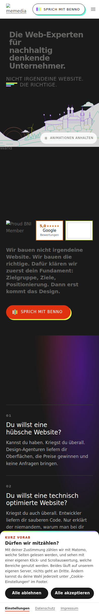

# UI Design System & Master Generation Blueprint: www-memedia-de

> **Webdesign München für nachhaltig denkende Unternehmer** (https://www.memedia.de) — Die Web-Experten für nachhaltig denkende Unternehmer: Strategie, Konzeption, Design und Umsetzung aus München. Websites, die Anfragen bri...


---

## 1. Executive Visual Persona & Design Archetype

- **Brand Essence & Persona**: **Webdesign München für nachhaltig denkende Unternehmer** (`https://www.memedia.de`). Die Web-Experten für nachhaltig denkende Unternehmer: Strategie, Konzeption, Design und Umsetzung aus München. Websites, die Anfragen bri...
- **Visual Archetype**: **High-Contrast Obsidian / Atmospheric Design System (`#1a1a1a` canvas, `#ffffff` ink, `#b4b4b3` accent)**.
- **Anti-AI-Slop Differentiators**:
  - **Source-Grounded Chromatic Polarity**: Anchors the viewport in `#1a1a1a` (`var(--ink)` in `:root`) paired with `#ffffff` primary typography and `#b4b4b3` accents.
  - **Extracted Typographic Hierarchy**: Pairs `Poppins Fallback` for display copy (`Die Web-Experten für nachhaltig denk`) with `Poppins` and not declared in static CSS (uses primary stack / `ui-monospace`).
  - **Calibrated Spatial Grid & Motion**: Combines `var(--max)` container bounds (`gap: var(--gap)`, padding `var(--gutter)`) with `cubic-bezier(.2,.7,.2,1)` easing.

---

## 2. Spatial Architecture & Modular Grid Mathematics



### Viewport Allocation & Container Geometry
- **Captured Viewport Dimensions**: Desktop `1440×18690px` (`assets/desktop.png`, full-page scroll capture), Mobile `390×2400px` (`assets/mobile.png`, capped at 2400px multi-section capture).
- **Master Container Bounds**: `var(--max)` extracted from `www-memedia-de` stylesheet.
- **Canvas Lateral Padding & Spacing**: `var(--gutter)` lateral canvas padding with `var(--gap)` grid gap.
- **Border Radius Scale**: `999px`, `2px`, `50%`, `var(--radius)`.

### Responsive Breakpoint Architecture
- **Desktop Layout**: Multi-column CSS Grid / Flexbox layout at `1440px` (`max-width: var(--max)`, `gap: var(--gap)`).
- **Mobile Layout**: Single-column vertical stack at `390px` viewport width with `var(--gutter)` horizontal padding.
- **Extracted CSS Media Queries**: `@media (prefers-reduced-motion:reduce)`, `@media (min-width:900px)`, `@media (max-width:899px)`, `@media (min-width:1200px)`.

---

## 3. Color System, Materiality & Atmospheric Lighting

### Semantic Palette & Source Grounding
| Semantic Role | Ground-Truth Value | Extracted CSS Source / Selector |
|---|---|---|
| **Primary Canvas Substrate** | `#1a1a1a` | `var(--ink)` in `:root` |
| **Primary Typography Ink** | `#666665` | `var(--ink-muted)` in `:root` |
| **Elevated Surface / Card Substrate** | `#ffffff` | `var(--ink-inverse)` in `:root` |
| **Interactive Accent / Highlight** | `#b4b4b3` | `var(--muted-on-dark)` in `:root` |
| **Secondary / Muted Copy** | `#9a9a99` | `var(--label-on-dark)` in `:root` |
| **Structural Hairline Border** | `#d8d8d6` | `var(--line)` in `:root` |
| **Variable Token (`--line-soft`)** | `#ececea` | `var(--line-soft)` in `:root` |
| **Variable Token (`--line-dark`)** | `#414140` | `var(--line-dark)` in `:root` |
| **Variable Token (`--surface-2`)** | `#f4f4f2` | `var(--surface-2)` in `:root` |
| **Variable Token (`--surface-3`)** | `#eaeae8` | `var(--surface-3)` in `:root` |
| **Variable Token (`--brand`)** | `#f03714` | `var(--brand)` in `:root` |
| **Variable Token (`--cta`)** | `#e0320f` | `var(--cta)` in `:root` |
| **Variable Token (`--brand-text`)** | `#c42a0c` | `var(--brand-text)` in `:root` |
| **Variable Token (`--coral`)** | `#ff9d80` | `var(--coral)` in `:root` |
| **Variable Token (`--lime`)** | `#e6f84a` | `var(--lime)` in `:root` |

### Sanitized Root CSS Variables (`ui-ux.md` Ground Truth)
| Variable Name | Extracted Value | Semantic Role |
|---|---|---|
| `--ink` | `#1a1a1a` | Typography Ink Token |
| `--ink-muted` | `#666665` | Typography Ink Token |
| `--ink-inverse` | `#ffffff` | Typography Ink Token |
| `--muted-on-dark` | `#b4b4b3` | Canvas / Surface Token |
| `--label-on-dark` | `#9a9a99` | Canvas / Surface Token |
| `--line` | `#d8d8d6` | Color / Atmospheric Token |
| `--line-soft` | `#ececea` | Color / Atmospheric Token |
| `--line-dark` | `#414140` | Canvas / Surface Token |
| `--surface` | `#ffffff` | Canvas / Surface Token |
| `--surface-2` | `#f4f4f2` | Canvas / Surface Token |
| `--surface-3` | `#eaeae8` | Canvas / Surface Token |
| `--brand` | `#f03714` | Brand / Palette Token |
| `--cta` | `#e0320f` | Brand / Palette Token |
| `--brand-text` | `#c42a0c` | Typography Ink Token |
| `--coral` | `#ff9d80` | Color / Atmospheric Token |
| `--lime` | `#e6f84a` | Color / Atmospheric Token |

---

## 4. Typographic Scale & Editorial Hierarchy

### Font Family Stacks
- **Display Typography**: `Poppins Fallback`.
- **Primary Body Stack**: `Poppins`.
- **Technical / Metadata Stack**: not declared in static CSS (uses primary stack / `ui-monospace`).

### Typographic Scale & Rules (Extracted from Stylesheet & Variables)
- **Hero Display (`H1`)**: not explicitly declared on tag in static CSS (stylesheet font-size ladder: `var(--fs-body)`, `var(--fs-label)`, `var(--fs-h2)`, `var(--fs-h2-s)`, `var(--fs-lead)`).
- **Section Heading (`H2`)**: CSS variables `--fs-h2: clamp(2rem,1.6rem + 1.556vw,3rem)`, `--fs-h2-s: clamp(1.625rem,1.3rem + 1vw,2.25rem)`; rule `h2` (`font-size: 1rem`, `font-weight: 600`).
- **Body Copy**: CSS variables `--fs-body: clamp(1.0625rem,1rem + .15vw,1.125rem)`; rule `p` (`font-size: var(--fs-body)`, `line-height: 1.6`).
- **Metadata & Navigation Labels**: CSS variables `--label-on-dark: #9a9a99`, `--fs-small: .9375rem`, `--fs-label: .8125rem`; rule `.meta` (`font-size: var(--fs-small)`).

---

## 5. Choreographed Motion & Interaction Physics

### Primary Easing Curves
- **Extracted Timing Functions**: `cubic-bezier(.2,.7,.2,1)`, `cubic-bezier(.16,.84,.3,1)`, `cubic-bezier(.45,.05,.25,1)`.

### Per-Element Transition & Choreography Rules
- **Selector `.btn`**: `transition: background-color .15s,border-color .15s,color .15s` extracted from `www-memedia-de` stylesheet.
- **Selector `.lk .c`**: `transition: background-color .2s` extracted from `www-memedia-de` stylesheet.
- **Selector `.lk .c svg`**: `transition: transform .2s` extracted from `www-memedia-de` stylesheet.
- **Extracted Easing Curve (`cubic-bezier(.2,.7,.2,1)`)**: Governs interactive state transitions across `<header.site-header>` and `<section.wp-block-group>`.
- **State & Hover Choreography**: Opacity and transform transitions on `<section.wp-block-group>` and `<section.wp-block-group>` interactive targets.

---

## 6. Component Wireframe & Structural DOM Map

### Visual Layout Schematic (Grounded in `dom.html` — `1440px` Desktop & `390px` Mobile Reflow)
```
┌────────────────────────────────────────────────────────────────────────┐
│ DESKTOP VIEWPORT (1440px) — Webdesign München für nachhaltig denkende  │
│ ====================================================================== │
│ [ <header.site-header>     | Alle Leistungen · Konzeption & UX · De ]  │
│ ---------------------------------------------------------------------- │
│ | HERO STAGE: <section.wp-block-group>                             |   │
│ | H1: Die Web-Experten für nachhaltig denkende Unterneh...         |   │
│ | Substrate: #1a1a1a    | Ink: #ffffff    | Accent: #b4b4b3        |   │
│ ---------------------------------------------------------------------- │
│ | SHOWCASE GRID (<section.wp-block-group>  ) max-w: var(--max)     |   │
│ | +------------------------------+  +------------------------------+ | │
│ | | Was willst du eigentlich? Ei |  | Du willst eine hübsche Websi | | │
│ | +------------------------------+  +------------------------------+ | │
│ ---------------------------------------------------------------------- │
│ | MOBILE VIEWPORT REFLOW (390px) — Single-Column Stack (gap: var(--) | │
│ | [<header.site-heade] -> [<section.wp-block-] -> [<section.wp-block-] │
│ ---------------------------------------------------------------------- │
│ [ FOOTER (<footer.gr-foot>      ) | https://www.memedia.de             │
└────────────────────────────────────────────────────────────────────────┘
```

### Granular DOM Region Breakdown
1. **Brand Header & Navigation Bar (<header.site-header> — `www-memedia-de`)**:
   - Landmark `<header class="site-header">` hosting `Webdesign München für nachhaltig den` navigation (`Alle Leistungen · Konzeption & UX · Design · Umsetzung · Betreuung & Support`), DOM attributes (`data-bereich="/leistungen/"`, `data-bereich="/technologien/"`, `data-bereich="/produkte/ /web-check..."`, `data-bereich="/referenzen/"`), and stylesheet rule `after { box-sizing:border-box }`.
2. **Hero Stage & Focal Lead (<section.wp-block-group> — `Die Web-Experten für nachhaltig de`)**:
   - Landmark `<section class="wp-block-group hero">` presenting display lead `Die Web-Experten für nachhaltig denkende Unterneh...` and copy excerpt *"Zum Inhalt springen"* over `#1a1a1a` canvas and `#ffffff` ink.
3. **Primary Showcase & Content Grid (<section.wp-block-group> — `Was willst du eigentlich? Eine sch`)**:
   - Landmark `<section class="wp-block-group intro">` rendering section `Was willst du eigentlich? Eine schöne Website?` with copy *"Leistungen Alle Leistungen Strategie & Positionierung Konzeption "*, asset references (`poppins-latin-600-normal.woff2`, `poppins-latin-500-normal.woff2`, `favicon.svg`, `apple-touch-icon.png`), and grid rule `html { -webkit-text-size-adjust:100%;text-size-adjust:100%;scroll-behavior:smoo... }`.
4. **Interactive Detail & Feature Matrix (<section.wp-block-group> — `Du willst eine hübsche Website?`)**:
   - Landmark `<section class="wp-block-group section">` framing `Du willst eine hübsche Website?` and `Du willst eine technisch optimierte Website?` (*"Strategie & Positionierung"*) with `#ffffff` surface cards, `#b4b4b3` accents, and `video { display:block;max-width:100% }`.
5. **Colophon & Global Directory Footer (<footer.gr-foot> — `https://www.memedia.de`)**:
   - Landmark `<footer class="gr-foot">` anchoring `Webdesign München für nachhaltig` footer links (`Alle Leistungen · Konzeption & UX · Design · Umsetzung · Betreuung & Support`), copy *"Betreuung & Support"*, and `#d8d8d6` structural dividers.

---

## 7. Master Zero-Shot AI Generation Prompt

```markdown
# Master Zero-Shot Frontend Generation Prompt: www-memedia-de (Webdesign München für nachhaltig denkende Unternehmer)

You are a principal frontend architect and design systems engineer. Build a complete, production-ready web application replicating the exact design system, DOM landmarks, typographic hierarchy, color tokens, and motion physics of `www-memedia-de` (**Webdesign München für nachhaltig denkende Unternehmer** — `https://www.memedia.de`).

### 1. Visual Archetype & Anti-AI-Slop Mandates
- **Archetype**: High-Contrast Obsidian / Atmospheric Design System (`#1a1a1a` canvas, `#ffffff` ink, `#b4b4b3` accent).
- **Identity & Domain Context**: Die Web-Experten für nachhaltig denkende Unternehmer: Strategie, Konzeption, Design und Umsetzung aus München. Websites, die Anfragen bri...
- **Primary Substrate**: `#1a1a1a` (`var(--ink)` in `:root`), **Primary Ink**: `#ffffff`, **Accent / Highlight**: `#b4b4b3`.
- **Site-Specific Differentiators**:
  - **Source-Grounded Chromatic Polarity**: Anchors the viewport in `#1a1a1a` (`var(--ink)` in `:root`) paired with `#ffffff` primary typography and `#b4b4b3` accents.
  - **Extracted Typographic Hierarchy**: Pairs `Poppins Fallback` for display copy (`Die Web-Experten für nachhaltig denk`) with `Poppins` and not declared in static CSS (uses primary stack / `ui-monospace`).
  - **Calibrated Spatial Grid & Motion**: Combines `var(--max)` container bounds (`gap: var(--gap)`, padding `var(--gutter)`) with `cubic-bezier(.2,.7,.2,1)` easing.

### 2. Ground-Truth CSS Variables (`:root` Token Contract)
Declare and consume these exact custom properties extracted from `www-memedia-de` in your global stylesheet:

:root {
  /* Webdesign München für nachhaltig denkende Unternehmer (www-memedia-de) — Ground-Truth Extracted CSS Variables */
  --ink: #1a1a1a; /* Typography Ink Token (www-memedia-de) */
  --ink-muted: #666665; /* Typography Ink Token (www-memedia-de) */
  --ink-inverse: #ffffff; /* Typography Ink Token (www-memedia-de) */
  --muted-on-dark: #b4b4b3; /* Canvas / Surface Token (www-memedia-de) */
  --label-on-dark: #9a9a99; /* Canvas / Surface Token (www-memedia-de) */
  --line: #d8d8d6; /* Color / Atmospheric Token (www-memedia-de) */
  --line-soft: #ececea; /* Color / Atmospheric Token (www-memedia-de) */
  --line-dark: #414140; /* Canvas / Surface Token (www-memedia-de) */
  --surface: #ffffff; /* Canvas / Surface Token (www-memedia-de) */
  --surface-2: #f4f4f2; /* Canvas / Surface Token (www-memedia-de) */
  --surface-3: #eaeae8; /* Canvas / Surface Token (www-memedia-de) */
  --brand: #f03714; /* Brand / Palette Token (www-memedia-de) */
  --cta: #e0320f; /* Brand / Palette Token (www-memedia-de) */
  --brand-text: #c42a0c; /* Typography Ink Token (www-memedia-de) */
  --coral: #ff9d80; /* Color / Atmospheric Token (www-memedia-de) */
  --lime: #e6f84a; /* Color / Atmospheric Token (www-memedia-de) */
}

### 3. Semantic Color & Materiality Contract
Map every surface, ink, and border strictly to these source-grounded tokens:
- **Primary Canvas Substrate**: `#1a1a1a` — grounded in `var(--ink)` in `:root`
- **Primary Typography Ink**: `#666665` — grounded in `var(--ink-muted)` in `:root`
- **Elevated Surface / Card Substrate**: `#ffffff` — grounded in `var(--ink-inverse)` in `:root`
- **Interactive Accent / Highlight**: `#b4b4b3` — grounded in `var(--muted-on-dark)` in `:root`
- **Secondary / Muted Copy**: `#9a9a99` — grounded in `var(--label-on-dark)` in `:root`
- **Structural Hairline Border**: `#d8d8d6` — grounded in `var(--line)` in `:root`
- **Variable Token (`--line-soft`)**: `#ececea` — grounded in `var(--line-soft)` in `:root`
- **Variable Token (`--line-dark`)**: `#414140` — grounded in `var(--line-dark)` in `:root`
- **Variable Token (`--surface-2`)**: `#f4f4f2` — grounded in `var(--surface-2)` in `:root`
- **Variable Token (`--surface-3`)**: `#eaeae8` — grounded in `var(--surface-3)` in `:root`
- **Variable Token (`--brand`)**: `#f03714` — grounded in `var(--brand)` in `:root`
- **Variable Token (`--cta`)**: `#e0320f` — grounded in `var(--cta)` in `:root`
- **Variable Token (`--brand-text`)**: `#c42a0c` — grounded in `var(--brand-text)` in `:root`
- **Variable Token (`--coral`)**: `#ff9d80` — grounded in `var(--coral)` in `:root`
- **Variable Token (`--lime`)**: `#e6f84a` — grounded in `var(--lime)` in `:root`

### 4. Spatial Grid, Container Bounds & Responsive Breakpoints
- **Desktop Viewport Reference**: `1440×18690px` (full-page scroll capture, `1440px` standard desktop width).
- **Mobile Viewport Reference**: `390×2400px` (capped at 2400px multi-section capture, `390px` standard mobile width).
- **Container Max-Width**: `var(--max)` extracted from `www-memedia-de` stylesheet
- **Padding & Gutters**: `var(--gutter)` lateral canvas padding with `var(--gap)` grid gap
- **Desktop Grid**: Multi-column CSS Grid / Flexbox layout at `1440px` (`max-width: var(--max)`, `gap: var(--gap)`)
- **Mobile Adaptation**: Single-column vertical stack at `390px` viewport width with `var(--gutter)` horizontal padding
- **Media Queries**: `@media (prefers-reduced-motion:reduce)`, `@media (min-width:900px)`, `@media (max-width:899px)`, `@media (min-width:1200px)`
- **Corner Radii**: `999px`, `2px`, `50%`, `var(--radius)`

### 5. Typography & Editorial Scale Contract
- **Display Font Stack**: `Poppins Fallback`
- **Body Font Stack**: `Poppins`
- **Monospace / Technical Font Stack**: not declared in static CSS (uses primary stack / `ui-monospace`)
- **H1 Display Rule**: not explicitly declared on tag in static CSS (stylesheet font-size ladder: `var(--fs-body)`, `var(--fs-label)`, `var(--fs-h2)`, `var(--fs-h2-s)`, `var(--fs-lead)`)
- **H2 Section Rule**: CSS variables `--fs-h2: clamp(2rem,1.6rem + 1.556vw,3rem)`, `--fs-h2-s: clamp(1.625rem,1.3rem + 1vw,2.25rem)`; rule `h2` (`font-size: 1rem`, `font-weight: 600`)
- **Body Copy Rule**: CSS variables `--fs-body: clamp(1.0625rem,1rem + .15vw,1.125rem)`; rule `p` (`font-size: var(--fs-body)`, `line-height: 1.6`)
- **Metadata & Index Rule**: CSS variables `--label-on-dark: #9a9a99`, `--fs-small: .9375rem`, `--fs-label: .8125rem`; rule `.meta` (`font-size: var(--fs-small)`)

### 6. Component Hierarchy, Verbatim Copy & Real DOM Landmarks
Scaffold `www-memedia-de` (`Webdesign München für nachhaltig denkende Unternehmer`) with these exact structural regions, extracted copy, and CSS rules from `dom.html`:
1. **Brand Header & Navigation Bar (<header.site-header> — `www-memedia-de`)**:
   - DOM & Selectors: Landmark `<header class="site-header">` hosting `Webdesign München für nachhaltig den` navigation (`Alle Leistungen · Konzeption & UX · Design · Umsetzung · Betreuung & Support`), DOM attributes (`data-bereich="/leistungen/"`, `data-bereich="/technologien/"`, `data-bereich="/produkte/ /web-check..."`, `data-bereich="/referenzen/"`), and stylesheet rule `after { box-sizing:border-box }`.
   - Responsive Contract: Header `Brand Header & Navigation Bar (<header.site-header> — `www-memedia-de`)` (`www-memedia-de`) adapts across `@media (prefers-reduced-motion:reduce)`, `@media (min-width:900px)`, `@media (max-width:899px)`, `@media (min-width:1200px)` with `cubic-bezier(.2,.7,.2,1)`, `cubic-bezier(.16,.84,.3,1)`, `cubic-bezier(.45,.05,.25,1)` transitions and links `Alle Leistungen · Konzeption & UX · Design · Umsetzung · Betreuung & Support`.
2. **Hero Stage & Focal Lead (<section.wp-block-group> — `Die Web-Experten für nachhaltig de`)**:
   - DOM & Selectors: Landmark `<section class="wp-block-group hero">` presenting display lead `Die Web-Experten für nachhaltig denkende Unterneh...` and copy excerpt *"Zum Inhalt springen"* over `#1a1a1a` canvas and `#ffffff` ink.
   - Responsive Contract: Hero stage (`1440×18690px` desktop / `390×2400px` mobile) sets `#1a1a1a` background with `#ffffff` headline `Die Web-Experten für nachhaltig denkende Unterneh...`.
3. **Primary Showcase & Content Grid (<section.wp-block-group> — `Was willst du eigentlich? Eine sch`)**:
   - DOM & Selectors: Landmark `<section class="wp-block-group intro">` rendering section `Was willst du eigentlich? Eine schöne Website?` with copy *"Leistungen Alle Leistungen Strategie & Positionierung Konzeption "*, asset references (`poppins-latin-600-normal.woff2`, `poppins-latin-500-normal.woff2`, `favicon.svg`, `apple-touch-icon.png`), and grid rule `html { -webkit-text-size-adjust:100%;text-size-adjust:100%;scroll-behavior:smoo... }`.
   - Responsive Contract: Showcase grid `Primary Showcase & Content Grid (<section.wp-block-group> — `Was willst du eigentlich? Eine sch`)` applies Multi-column CSS Grid / Flexbox layout at `1440px` (`max-width: var(--max)`, `gap: var(--gap)`) on desktop and Single-column vertical stack at `390px` viewport width with `var(--gutter)` horizontal padding on mobile.
4. **Interactive Detail & Feature Matrix (<section.wp-block-group> — `Du willst eine hübsche Website?`)**:
   - DOM & Selectors: Landmark `<section class="wp-block-group section">` framing `Du willst eine hübsche Website?` and `Du willst eine technisch optimierte Website?` (*"Strategie & Positionierung"*) with `#ffffff` surface cards, `#b4b4b3` accents, and `video { display:block;max-width:100% }`.
   - Responsive Contract: Detail module `Interactive Detail & Feature Matrix (<section.wp-block-group> — `Du willst eine hübsche Website?`)` uses `999px`, `2px`, `50%`, `var(--radius)` radii, `#b4b4b3` highlights, and assets (poppins-latin-600-normal.woff2, poppins-latin-500-normal.woff2, favicon.svg).
5. **Colophon & Global Directory Footer (<footer.gr-foot> — `https://www.memedia.de`)**:
   - DOM & Selectors: Landmark `<footer class="gr-foot">` anchoring `Webdesign München für nachhaltig` footer links (`Alle Leistungen · Konzeption & UX · Design · Umsetzung · Betreuung & Support`), copy *"Betreuung & Support"*, and `#d8d8d6` structural dividers.
   - Responsive Contract: Footer `Colophon & Global Directory Footer (<footer.gr-foot> — `https://www.memedia.de`)` aligns to `var(--max)` extracted from `www-memedia-de` stylesheet with `var(--gutter)` lateral canvas padding with `var(--gap)` grid gap and attributes (data-bereich="/leistungen/", data-bereich="/technologien/", data-bereich="/produkte/ /web-check...").

#### Verbatim DOM Copy Excerpts (`dom.html`)
- Copy Excerpt 1: *"Zum Inhalt springen"*
- Copy Excerpt 2: *"Leistungen Alle Leistungen Strategie & Positionierung Konzeption & UX Design Umset..."*
- Copy Excerpt 3: *"Strategie & Positionierung"*
- Copy Excerpt 4: *"Betreuung & Support"*

### 7. Motion, Extracted Stylesheet Rules & Interaction Choreography
- **Primary Easing Functions**: `cubic-bezier(.2,.7,.2,1)`, `cubic-bezier(.16,.84,.3,1)`, `cubic-bezier(.45,.05,.25,1)`
- **Extracted Stylesheet Rules (`www-memedia-de`)**:
- `after { box-sizing:border-box }`
- `html { -webkit-text-size-adjust:100%;text-size-adjust:100%;scroll-behavior:smoo... }`
- `video { display:block;max-width:100% }`
- `img { height:auto }`
- `button { font:inherit;color:inherit }`
- **Per-Selector Transition Rules**:
- **Selector `.btn`**: `transition: background-color .15s,border-color .15s,color .15s` extracted from `www-memedia-de` stylesheet.
- **Selector `.lk .c`**: `transition: background-color .2s` extracted from `www-memedia-de` stylesheet.
- **Selector `.lk .c svg`**: `transition: transform .2s` extracted from `www-memedia-de` stylesheet.
- **Extracted Easing Curve (`cubic-bezier(.2,.7,.2,1)`)**: Governs interactive state transitions across `<header.site-header>` and `<section.wp-block-group>`.
- **State & Hover Choreography**: Opacity and transform transitions on `<section.wp-block-group>` and `<section.wp-block-group>` interactive targets.

### 8. Technical Deliverables
- Implement in Next.js (App Router) with TypeScript and Tailwind CSS consuming the `:root` custom properties defined above for `www-memedia-de`.
- Reproduce both the `1440px` desktop architecture and `390px` mobile breakpoint transitions, preserving semantic HTML5 landmarks (`<header>`, `<nav>`, `<main>`, `<section>`, `<footer>`) and `prefers-reduced-motion` accessibility guards.
```
