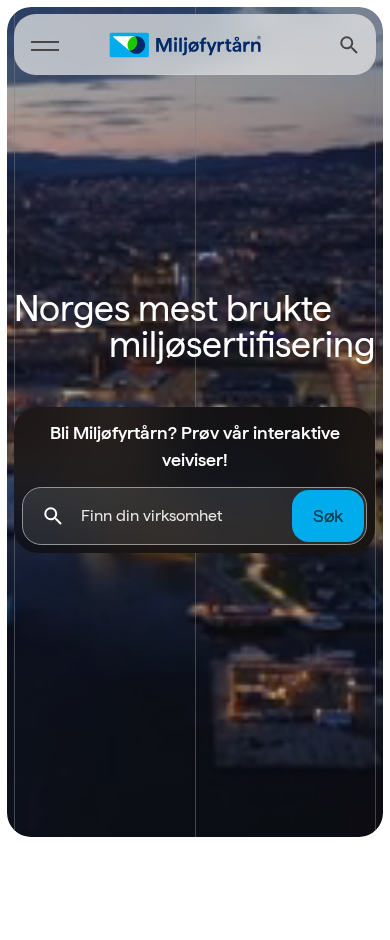

# UI Design System & Master Generation Blueprint: www-miljofyrtarn-no

> **Hjem · Miljøfyrtårn** (https://www.miljofyrtarn.no/) — Miljøfyrtårn er Norges ledende miljøsertifisering. Kom i gang med sertifisering og miljøledelse i LUMA – et verktøy som gjør arbeidet enk...


---

## 1. Executive Visual Persona & Design Archetype

- **Brand Essence & Persona**: **Hjem · Miljøfyrtårn** (`https://www.miljofyrtarn.no/`). Miljøfyrtårn er Norges ledende miljøsertifisering. Kom i gang med sertifisering og miljøledelse i LUMA – et verktøy som gjør arbeidet enk...
- **Visual Archetype**: **Light-Substrate Editorial & Modular Grid System (`#0000` canvas, `#000` ink, `#00aceb` accent)**.
- **Anti-AI-Slop Differentiators**:
  - **Source-Grounded Chromatic Polarity**: Anchors the viewport in `#0000` (`textarea { background-color: #0000 }`) paired with `#000` primary typography and `#00aceb` accents.
  - **Extracted Typographic Hierarchy**: Pairs `matterFont` for display copy (`Norges mest brukte miljøsertifiserin`) with `matterFont Fallback` and `SFMono-Regular`.
  - **Calibrated Spatial Grid & Motion**: Combines `30rem` container bounds (`gap: var(--spacing)`, padding `var(--lines-gutter)`) with `cubic-bezier(0,0,.2,1)` easing and Swiper Touch Carousel Engine.

---

## 2. Spatial Architecture & Modular Grid Mathematics



### Viewport Allocation & Container Geometry
- **Captured Viewport Dimensions**: Desktop `1440×17284px` (`assets/desktop.png`, full-page scroll capture), Mobile `390×2400px` (`assets/mobile.png`, capped at 2400px multi-section capture).
- **Master Container Bounds**: `30rem` extracted from `www-miljofyrtarn-no` stylesheet.
- **Canvas Lateral Padding & Spacing**: `var(--lines-gutter)` lateral canvas padding with `var(--spacing)` grid gap.
- **Border Radius Scale**: `.25rem`, `1.2rem`, `1.05rem`, `20px`.

### Responsive Breakpoint Architecture
- **Desktop Layout**: Multi-column CSS Grid / Flexbox layout at `1440px` (`max-width: 30rem`, `gap: var(--spacing)`).
- **Mobile Layout**: Single-column vertical stack at `390px` viewport width with `var(--lines-gutter)` horizontal padding.
- **Extracted CSS Media Queries**: `@media (min-width:30rem)`, `@media (min-width:40rem)`, `@media (min-width:48rem)`, `@media (min-width:64rem)`.

---

## 3. Color System, Materiality & Atmospheric Lighting

### Semantic Palette & Source Grounding
| Semantic Role | Ground-Truth Value | Extracted CSS Source / Selector |
|---|---|---|
| **Primary Canvas Substrate** | `#0000` | `textarea { background-color: #0000 }` |
| **Primary Typography Ink** | `#808080` | `::backdrop { border-color: gray }` (`#808080`) |
| **Elevated Surface / Card Substrate** | `#f73146` | `.custom-underline.orange:after { background-color: #f73146 }` |
| **Interactive Accent / Highlight** | `#00aceb` | `.custom-underline.blue:after { background-color: #00aceb }` |
| **Secondary / Muted Copy** | `#000` | `.border-black { border-color: #000 }` |
| **Structural Hairline Border** | `#1cc600` | `.border-green { border-color: #1cc600 }` |

### Sanitized Root CSS Variables (`ui-ux.md` Ground Truth)
| Variable Name | Extracted Value | Semantic Role |
|---|---|---|
| `--font-matter` | `"matterFont", "matterFont Fallback"` | Typography / Scale Token |
| `--spacing` | `.25rem` | Layout / Spatial Grid Token |
| `--container-xl` | `36rem` | Layout / Spatial Grid Token |
| `--font-weight-normal` | `400` | Typography / Scale Token |
| `--font-weight-medium` | `500` | Typography / Scale Token |
| `--font-weight-semibold` | `600` | Typography / Scale Token |
| `--font-weight-bold` | `700` | Typography / Scale Token |
| `--leading-tight` | `1.25` | Typography / Scale Token |
| `--leading-normal` | `1.5` | Typography / Scale Token |
| `--radius-md` | `.375rem` | Elevation / Border Token |
| `--radius-lg` | `.5rem` | Elevation / Border Token |
| `--radius-xl` | `.75rem` | Elevation / Border Token |
| `--radius-2xl` | `1rem` | Elevation / Border Token |
| `--ease-out` | `cubic-bezier(0, 0, .2, 1)` | Motion / Easing Token |
| `--ease-in-out` | `cubic-bezier(.4, 0, .2, 1)` | Motion / Easing Token |
| `--animate-pulse` | `pulse 2s cubic-bezier(.4, 0, .6, 1) infinite` | Motion / Easing Token |

---

## 4. Typographic Scale & Editorial Hierarchy

### Font Family Stacks
- **Display Typography**: `matterFont`.
- **Primary Body Stack**: `matterFont Fallback`.
- **Technical / Metadata Stack**: `SFMono-Regular`.

### Typographic Scale & Rules (Extracted from Stylesheet & Variables)
- **Hero Display (`H1`)**: not explicitly declared on tag in static CSS (stylesheet font-size ladder: `1em`, `80%`, `75%`, `1.75rem`, `2rem`).
- **Section Heading (`H2`)**: rule `h2` (`font-size: 1.75rem`, `line-height: 1`).
- **Body Copy**: not explicitly declared on tag in static CSS (stylesheet font-size ladder: `1em`, `80%`, `75%`, `1.75rem`, `2rem`).
- **Metadata & Navigation Labels**: CSS variables `--media-caption-h: 4rem`.

---

## 5. Choreographed Motion & Interaction Physics

### Primary Easing Curves
- **Extracted Timing Functions**: `cubic-bezier(0,0,.2,1)`, `cubic-bezier(.4,0,.2,1)`, `cubic-bezier(.4,0,.6,1)`.

### Per-Element Transition & Choreography Rules
- **Selector `layer theme`**: `transition: .15s` extracted from `www-miljofyrtarn-no` stylesheet.
- **Selector `.custom-underline:after`**: `transition: .3s` extracted from `www-miljofyrtarn-no` stylesheet.
- **Selector `.transition`**: `transition: var(--tw-ease,var(--default-transition-timing-function))` extracted from `www-miljofyrtarn-no` stylesheet.
- **Extracted Easing Curve (`cubic-bezier(0,0,.2,1)`)**: Governs interactive state transitions across `<nav.top-bar>` and `<section.image-fullscreen>`.
- **Runtime Interaction Engine**: Integrates Swiper Touch Carousel Engine with `prefers-reduced-motion: reduce` fallback guards.

---

## 6. Component Wireframe & Structural DOM Map

### Visual Layout Schematic (Grounded in `dom.html` — `1440px` Desktop & `390px` Mobile Reflow)
```
┌────────────────────────────────────────────────────────────────────────┐
│ DESKTOP VIEWPORT (1440px) — Hjem · Miljøfyrtårn                        │
│ ====================================================================== │
│ [ <nav.top-bar>            | Interaktiv veiviser · Start registreri ]  │
│ ---------------------------------------------------------------------- │
│ | HERO STAGE: <section.stage>                                      |   │
│ | H1: Norges mest brukte miljøsertifisering                        |   │
│ | Substrate: #0000      | Ink: #000       | Accent: #00aceb        |   │
│ ---------------------------------------------------------------------- │
│ | SHOWCASE GRID (<section.image-fullscreen>) max-w: 30rem          |   │
│ | +------------------------------+  +------------------------------+ | │
│ | | Fordi bærekraft er konkurran |  | Fornøyde kunder sier         | | │
│ | +------------------------------+  +------------------------------+ | │
│ ---------------------------------------------------------------------- │
│ | MOBILE VIEWPORT REFLOW (390px) — Single-Column Stack (gap: var(--) | │
│ | [<nav.top-bar>] -> [<section.stage>] -> [<section.image-ful] |       │
│ ---------------------------------------------------------------------- │
│ [ FOOTER (<footer.lines-scope>  ) | https://www.miljofyrtarn.no/       │
└────────────────────────────────────────────────────────────────────────┘
```

### Granular DOM Region Breakdown
1. **Brand Header & Navigation Bar (<nav.top-bar> — `www-miljofyrtarn-no`)**:
   - Landmark `<nav class="top-bar pointer-events-none">` hosting `Hjem · Miljøfyrtårn` navigation (`Interaktiv veiviser · Start registrering · Finn konsulent · Kundehistorier`), DOM attributes (`data-precedence="next"`, `data-href="/_next/static/chunks/..."`, `data-nosnippet`, `data-template="popup"`), and stylesheet rule `font_3b00f4b4-module__5KZDLG__cla... { font-family:matterFont,matterFont Fallback }`.
2. **Hero Stage & Focal Lead (<section.stage> — `Norges mest brukte miljøsertifiser`)**:
   - Landmark `<section class="stage relative">` presenting display lead `Norges mest brukte miljøsertifisering` and copy excerpt *"Nødvendig 24 Nødvendige cookies bidra til å gjøre en nettside bru"* over `#0000` canvas and `#000` ink.
3. **Primary Showcase & Content Grid (<section.image-fullscreen> — `Fordi bærekraft er konkurransekraf`)**:
   - Landmark `<section class="image-fullscreen lines-scope">` rendering section `Fordi bærekraft er konkurransekraft` with copy *"Cloudflare 1 Lær mer om denne leverandøren cf.turnstile.u Denne i"*, asset references (`MatterMedium-s.p.02fj0~m~0rj1..woff2`, `MatterRegular-s.p.111lwj_hik8ci.w...`, `MatterRegularItalic-s.p.013o7st81...`, `MatterSemiBold-s.p.0kyaxl0f.k2ut....`), and grid rule `rfont_3b00f4b4-module__5KZDLG__va... { --font-matter:"matterFont", "matterFont Fallback" }`.
4. **Interactive Detail & Feature Matrix (<section.image-group> — `Fornøyde kunder sier`)**:
   - Landmark `<section class="image-group lines-scope">` framing `Fornøyde kunder sier` and `Hvorfor bli Miljøfyrtårn` (*"Lær mer om denne leverandøren"*) with `#f73146` surface cards, `#00aceb` accents, and `backdrop { box-sizing:border-box;border:0 solid;margin:0;padding:0 }`.
5. **Colophon & Global Directory Footer (<footer.lines-scope> — `https://www.miljofyrtarn.no/`)**:
   - Landmark `<footer class="lines-scope overflow-clip">` anchoring `Hjem · Miljøfyrtårn` footer links (`Interaktiv veiviser · Start registrering · Finn konsulent · Kundehistorier`), copy *"Denne informasjonskapselen brukes til å skille mellom mennes"*, and `#1cc600` structural dividers.

---

## 7. Master Zero-Shot AI Generation Prompt

```markdown
# Master Zero-Shot Frontend Generation Prompt: www-miljofyrtarn-no (Hjem · Miljøfyrtårn)

You are a principal frontend architect and design systems engineer. Build a complete, production-ready web application replicating the exact design system, DOM landmarks, typographic hierarchy, color tokens, and motion physics of `www-miljofyrtarn-no` (**Hjem · Miljøfyrtårn** — `https://www.miljofyrtarn.no/`).

### 1. Visual Archetype & Anti-AI-Slop Mandates
- **Archetype**: Light-Substrate Editorial & Modular Grid System (`#0000` canvas, `#000` ink, `#00aceb` accent).
- **Identity & Domain Context**: Miljøfyrtårn er Norges ledende miljøsertifisering. Kom i gang med sertifisering og miljøledelse i LUMA – et verktøy som gjør arbeidet enk...
- **Primary Substrate**: `#0000` (`textarea { background-color: #0000 }`), **Primary Ink**: `#000`, **Accent / Highlight**: `#00aceb`.
- **Site-Specific Differentiators**:
  - **Source-Grounded Chromatic Polarity**: Anchors the viewport in `#0000` (`textarea { background-color: #0000 }`) paired with `#000` primary typography and `#00aceb` accents.
  - **Extracted Typographic Hierarchy**: Pairs `matterFont` for display copy (`Norges mest brukte miljøsertifiserin`) with `matterFont Fallback` and `SFMono-Regular`.
  - **Calibrated Spatial Grid & Motion**: Combines `30rem` container bounds (`gap: var(--spacing)`, padding `var(--lines-gutter)`) with `cubic-bezier(0,0,.2,1)` easing and Swiper Touch Carousel Engine.

### 2. Ground-Truth CSS Variables (`:root` Token Contract)
Declare and consume these exact custom properties extracted from `www-miljofyrtarn-no` in your global stylesheet:

:root {
  /* Hjem · Miljøfyrtårn (www-miljofyrtarn-no) — Ground-Truth Extracted CSS Variables */
  --font-matter: "matterFont", "matterFont Fallback"; /* Typography / Scale Token (www-miljofyrtarn-no) */
  --spacing: .25rem; /* Layout / Spatial Grid Token (www-miljofyrtarn-no) */
  --container-xl: 36rem; /* Layout / Spatial Grid Token (www-miljofyrtarn-no) */
  --font-weight-normal: 400; /* Typography / Scale Token (www-miljofyrtarn-no) */
  --font-weight-medium: 500; /* Typography / Scale Token (www-miljofyrtarn-no) */
  --font-weight-semibold: 600; /* Typography / Scale Token (www-miljofyrtarn-no) */
  --font-weight-bold: 700; /* Typography / Scale Token (www-miljofyrtarn-no) */
  --leading-tight: 1.25; /* Typography / Scale Token (www-miljofyrtarn-no) */
  --leading-normal: 1.5; /* Typography / Scale Token (www-miljofyrtarn-no) */
  --radius-md: .375rem; /* Elevation / Border Token (www-miljofyrtarn-no) */
  --radius-lg: .5rem; /* Elevation / Border Token (www-miljofyrtarn-no) */
  --radius-xl: .75rem; /* Elevation / Border Token (www-miljofyrtarn-no) */
  --radius-2xl: 1rem; /* Elevation / Border Token (www-miljofyrtarn-no) */
  --ease-out: cubic-bezier(0, 0, .2, 1); /* Motion / Easing Token (www-miljofyrtarn-no) */
  --ease-in-out: cubic-bezier(.4, 0, .2, 1); /* Motion / Easing Token (www-miljofyrtarn-no) */
  --animate-pulse: pulse 2s cubic-bezier(.4, 0, .6, 1) infinite; /* Motion / Easing Token (www-miljofyrtarn-no) */
}

### 3. Semantic Color & Materiality Contract
Map every surface, ink, and border strictly to these source-grounded tokens:
- **Primary Canvas Substrate**: `#0000` — grounded in `textarea { background-color: #0000 }`
- **Primary Typography Ink**: `#808080` — grounded in `::backdrop { border-color: gray }` (`#808080`)
- **Elevated Surface / Card Substrate**: `#f73146` — grounded in `.custom-underline.orange:after { background-color: #f73146 }`
- **Interactive Accent / Highlight**: `#00aceb` — grounded in `.custom-underline.blue:after { background-color: #00aceb }`
- **Secondary / Muted Copy**: `#000` — grounded in `.border-black { border-color: #000 }`
- **Structural Hairline Border**: `#1cc600` — grounded in `.border-green { border-color: #1cc600 }`

### 4. Spatial Grid, Container Bounds & Responsive Breakpoints
- **Desktop Viewport Reference**: `1440×17284px` (full-page scroll capture, `1440px` standard desktop width).
- **Mobile Viewport Reference**: `390×2400px` (capped at 2400px multi-section capture, `390px` standard mobile width).
- **Container Max-Width**: `30rem` extracted from `www-miljofyrtarn-no` stylesheet
- **Padding & Gutters**: `var(--lines-gutter)` lateral canvas padding with `var(--spacing)` grid gap
- **Desktop Grid**: Multi-column CSS Grid / Flexbox layout at `1440px` (`max-width: 30rem`, `gap: var(--spacing)`)
- **Mobile Adaptation**: Single-column vertical stack at `390px` viewport width with `var(--lines-gutter)` horizontal padding
- **Media Queries**: `@media (min-width:30rem)`, `@media (min-width:40rem)`, `@media (min-width:48rem)`, `@media (min-width:64rem)`
- **Corner Radii**: `.25rem`, `1.2rem`, `1.05rem`, `20px`

### 5. Typography & Editorial Scale Contract
- **Display Font Stack**: `matterFont`
- **Body Font Stack**: `matterFont Fallback`
- **Monospace / Technical Font Stack**: `SFMono-Regular`
- **H1 Display Rule**: not explicitly declared on tag in static CSS (stylesheet font-size ladder: `1em`, `80%`, `75%`, `1.75rem`, `2rem`)
- **H2 Section Rule**: rule `h2` (`font-size: 1.75rem`, `line-height: 1`)
- **Body Copy Rule**: not explicitly declared on tag in static CSS (stylesheet font-size ladder: `1em`, `80%`, `75%`, `1.75rem`, `2rem`)
- **Metadata & Index Rule**: CSS variables `--media-caption-h: 4rem`

### 6. Component Hierarchy, Verbatim Copy & Real DOM Landmarks
Scaffold `www-miljofyrtarn-no` (`Hjem · Miljøfyrtårn`) with these exact structural regions, extracted copy, and CSS rules from `dom.html`:
1. **Brand Header & Navigation Bar (<nav.top-bar> — `www-miljofyrtarn-no`)**:
   - DOM & Selectors: Landmark `<nav class="top-bar pointer-events-none">` hosting `Hjem · Miljøfyrtårn` navigation (`Interaktiv veiviser · Start registrering · Finn konsulent · Kundehistorier`), DOM attributes (`data-precedence="next"`, `data-href="/_next/static/chunks/..."`, `data-nosnippet`, `data-template="popup"`), and stylesheet rule `font_3b00f4b4-module__5KZDLG__cla... { font-family:matterFont,matterFont Fallback }`.
   - Responsive Contract: Header `Brand Header & Navigation Bar (<nav.top-bar> — `www-miljofyrtarn-no`)` (`www-miljofyrtarn-no`) adapts across `@media (min-width:30rem)`, `@media (min-width:40rem)`, `@media (min-width:48rem)`, `@media (min-width:64rem)` with `cubic-bezier(0,0,.2,1)`, `cubic-bezier(.4,0,.2,1)`, `cubic-bezier(.4,0,.6,1)` transitions and links `Interaktiv veiviser · Start registrering · Finn konsulent · Kundehistorier`.
2. **Hero Stage & Focal Lead (<section.stage> — `Norges mest brukte miljøsertifiser`)**:
   - DOM & Selectors: Landmark `<section class="stage relative">` presenting display lead `Norges mest brukte miljøsertifisering` and copy excerpt *"Nødvendig 24 Nødvendige cookies bidra til å gjøre en nettside bru"* over `#0000` canvas and `#000` ink.
   - Responsive Contract: Hero stage (`1440×17284px` desktop / `390×2400px` mobile) sets `#0000` background with `#000` headline `Norges mest brukte miljøsertifisering`.
3. **Primary Showcase & Content Grid (<section.image-fullscreen> — `Fordi bærekraft er konkurransekraf`)**:
   - DOM & Selectors: Landmark `<section class="image-fullscreen lines-scope">` rendering section `Fordi bærekraft er konkurransekraft` with copy *"Cloudflare 1 Lær mer om denne leverandøren cf.turnstile.u Denne i"*, asset references (`MatterMedium-s.p.02fj0~m~0rj1..woff2`, `MatterRegular-s.p.111lwj_hik8ci.w...`, `MatterRegularItalic-s.p.013o7st81...`, `MatterSemiBold-s.p.0kyaxl0f.k2ut....`), and grid rule `rfont_3b00f4b4-module__5KZDLG__va... { --font-matter:"matterFont", "matterFont Fallback" }`.
   - Responsive Contract: Showcase grid `Primary Showcase & Content Grid (<section.image-fullscreen> — `Fordi bærekraft er konkurransekraf`)` applies Multi-column CSS Grid / Flexbox layout at `1440px` (`max-width: 30rem`, `gap: var(--spacing)`) on desktop and Single-column vertical stack at `390px` viewport width with `var(--lines-gutter)` horizontal padding on mobile.
4. **Interactive Detail & Feature Matrix (<section.image-group> — `Fornøyde kunder sier`)**:
   - DOM & Selectors: Landmark `<section class="image-group lines-scope">` framing `Fornøyde kunder sier` and `Hvorfor bli Miljøfyrtårn` (*"Lær mer om denne leverandøren"*) with `#f73146` surface cards, `#00aceb` accents, and `backdrop { box-sizing:border-box;border:0 solid;margin:0;padding:0 }`.
   - Responsive Contract: Detail module `Interactive Detail & Feature Matrix (<section.image-group> — `Fornøyde kunder sier`)` uses `.25rem`, `1.2rem`, `1.05rem`, `20px` radii, `#00aceb` highlights, and assets (MatterMedium-s.p.02fj0~m~0rj1..woff2, MatterRegular-s.p.111lwj_hik8ci.w..., MatterRegularItalic-s.p.013o7st81...).
5. **Colophon & Global Directory Footer (<footer.lines-scope> — `https://www.miljofyrtarn.no/`)**:
   - DOM & Selectors: Landmark `<footer class="lines-scope overflow-clip">` anchoring `Hjem · Miljøfyrtårn` footer links (`Interaktiv veiviser · Start registrering · Finn konsulent · Kundehistorier`), copy *"Denne informasjonskapselen brukes til å skille mellom mennes"*, and `#1cc600` structural dividers.
   - Responsive Contract: Footer `Colophon & Global Directory Footer (<footer.lines-scope> — `https://www.miljofyrtarn.no/`)` aligns to `30rem` extracted from `www-miljofyrtarn-no` stylesheet with `var(--lines-gutter)` lateral canvas padding with `var(--spacing)` grid gap and attributes (data-precedence="next", data-href="/_next/static/chunks/...", data-nosnippet).

#### Verbatim DOM Copy Excerpts (`dom.html`)
- Copy Excerpt 1: *"Nødvendig 24 Nødvendige cookies bidra til å gjøre en nettside brukbart ved at grun..."*
- Copy Excerpt 2: *"Cloudflare 1 Lær mer om denne leverandøren cf.turnstile.u Denne informasjonskapsel..."*
- Copy Excerpt 3: *"Lær mer om denne leverandøren"*
- Copy Excerpt 4: *"Denne informasjonskapselen brukes til å skille mellom mennesker og roboter."*

### 7. Motion, Extracted Stylesheet Rules & Interaction Choreography
- **Primary Easing Functions**: `cubic-bezier(0,0,.2,1)`, `cubic-bezier(.4,0,.2,1)`, `cubic-bezier(.4,0,.6,1)`
- **Extracted Stylesheet Rules (`www-miljofyrtarn-no`)**:
- `font_3b00f4b4-module__5KZDLG__cla... { font-family:matterFont,matterFont Fallback }`
- `rfont_3b00f4b4-module__5KZDLG__va... { --font-matter:"matterFont", "matterFont Fallback" }`
- `backdrop { box-sizing:border-box;border:0 solid;margin:0;padding:0 }`
- `file-selector-button { box-sizing:border-box;border:0 solid;margin:0;padding:0 }`
- `strong { font-weight:bolder }`
- **Per-Selector Transition Rules**:
- **Selector `layer theme`**: `transition: .15s` extracted from `www-miljofyrtarn-no` stylesheet.
- **Selector `.custom-underline:after`**: `transition: .3s` extracted from `www-miljofyrtarn-no` stylesheet.
- **Selector `.transition`**: `transition: var(--tw-ease,var(--default-transition-timing-function))` extracted from `www-miljofyrtarn-no` stylesheet.
- **Extracted Easing Curve (`cubic-bezier(0,0,.2,1)`)**: Governs interactive state transitions across `<nav.top-bar>` and `<section.image-fullscreen>`.
- **Runtime Interaction Engine**: Integrates Swiper Touch Carousel Engine with `prefers-reduced-motion: reduce` fallback guards.

### 8. Technical Deliverables
- Implement in Next.js (App Router) with TypeScript and Tailwind CSS consuming the `:root` custom properties defined above for `www-miljofyrtarn-no`.
- Reproduce both the `1440px` desktop architecture and `390px` mobile breakpoint transitions, preserving semantic HTML5 landmarks (`<header>`, `<nav>`, `<main>`, `<section>`, `<footer>`) and `prefers-reduced-motion` accessibility guards.
```
