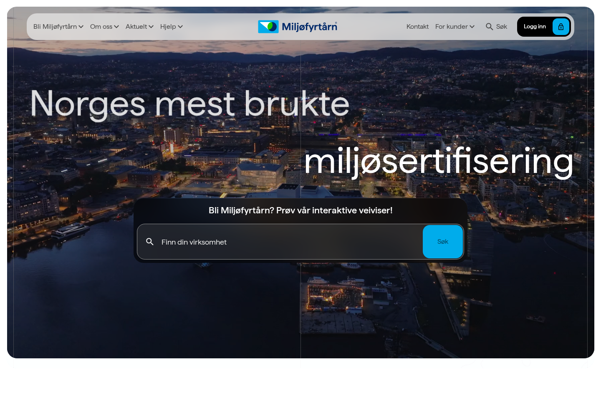

# UI Design System & Master Generation Blueprint: www-miljofyrtarn-no

> **Hjem · Miljøfyrtårn** (https://www.miljofyrtarn.no/) — Miljøfyrtårn er Norges ledende miljøsertifisering. Kom i gang med sertifisering og miljøledelse i LUMA – et verktøy som gjør arbeidet enk...



---

## 1. Executive Visual Persona & Design Archetype

- **Brand Essence & Persona**: **Hjem · Miljøfyrtårn** (`https://www.miljofyrtarn.no/`). Miljøfyrtårn er Norges ledende miljøsertifisering. Kom i gang med sertifisering og miljøledelse i LUMA – et verktøy som gjør arbeidet enk...
- **Capture Provenance**: Live browser capture (`tier1_fast`, HTTP `200`, captured `2026-11-23`).
- **Visual Archetype**: **Light-Substrate Editorial & Modular Grid System (`#ffffff` canvas, `#000000` ink, `#00aceb` accent)**.
- **Anti-AI-Slop Differentiators**:
  - **Live-Computed Chromatic Polarity**: Anchors the viewport in `#ffffff` (live computed `body` `background-color` (`computed_styles.json`)) paired with `#000000` primary typography and `#00aceb` accents.
  - **Grounded Typographic Hierarchy**: Pairs `matterFont` for display copy (`Norges mest brukte miljøsertifiserin`) with `matterFont` and `SFMono-Regular`.
  - **Calibrated Spatial Grid & Motion**: Combines `120rem` container bounds (`gap: var(--spacing)`, padding `var(--lines-gutter)`) with `cubic-bezier(0,0,.2,1)` easing and Swiper Touch Carousel Engine.

---

## 2. Spatial Architecture & Modular Grid Mathematics


### Viewport Allocation & Container Geometry
- **Captured Viewport Dimensions**: Desktop `1440×996px` (`assets/desktop.png`, full-page live capture (996px)), Mobile `390×940px` (`assets/mobile.png`, full-page live capture (940px)).
- **Master Container Bounds**: `120rem` (non-`@media` desktop container stylesheet rule).
- **Canvas Lateral Padding & Spacing**: `var(--lines-gutter)` lateral canvas padding with `var(--spacing)` grid gap.
- **Border Radius Scale**: `.25rem`, `1.2rem`, `1.05rem`, `20px`.

### Responsive Breakpoint Architecture
- **Desktop Layout**: Multi-column CSS Grid / Flexbox layout at `1440px` (`max-width: 120rem`, `gap: var(--spacing)`).
- **Mobile Layout**: Single-column vertical stack at `390px` viewport width with `var(--lines-gutter)` horizontal padding.
- **Extracted CSS Media Queries**: `@media (min-width:30rem)`, `@media (min-width:40rem)`, `@media (min-width:48rem)`, `@media (min-width:64rem)`.

---

## 3. Color System, Materiality & Atmospheric Lighting

### Semantic Palette & Source Grounding
| Semantic Role | Ground-Truth Value | Extracted Live / CSS Source |
|---|---|---|
| **Primary Canvas Substrate** | `#ffffff` | live computed `body` `background-color` (`computed_styles.json`) |
| **Primary Typography Ink** | `#000000` | live computed `main` `color` (`computed_styles.json`) |
| **Elevated Surface / Card Substrate** | `#e6e6e6` | `.bg-grey-20 { background-color: #e6e6e6 }` |
| **Interactive Accent / Highlight** | `#00aceb` | `stom-button.button-light .icon... { color: #00aceb }` |
| **Secondary / Muted Copy** | `#141414` | live computed `a` `color` (`computed_styles.json`) |
| **Structural Hairline Border** | `#e5e5e5` | `10 { border-color: #e5e5e5 }` |

### Sanitized Root CSS Variables (`ui-ux.md` Ground Truth)
| Variable Name | Extracted Value | Semantic Role |
|---|---|---|
| `--lines-gutter` | `clamp(.9rem, 1.11vw, 1.25rem)` | Layout / Spatial Grid Token |
| `--media-max-h` | `calc(100svh - 4.5rem - 3.25rem)` | Dimension / Scale Token |
| `--media-caption-h` | `4rem` | Dimension / Scale Token |
| `--media-min-w` | `24rem` | Dimension / Scale Token |
| `--font-matter` | `"matterFont", "matterFont Fallback"` | Typography / Scale Token |
| `--spacing` | `.25rem` | Layout / Spatial Grid Token |
| `--container-xl` | `36rem` | Layout / Spatial Grid Token |
| `--font-weight-normal` | `400` | Typography / Scale Token |
| `--font-weight-medium` | `500` | Typography / Scale Token |
| `--font-weight-semibold` | `600` | Typography / Scale Token |
| `--font-weight-bold` | `700` | Typography / Scale Token |
| `--leading-tight` | `1.25` | Typography / Scale Token |
| `--leading-normal` | `1.5` | Typography / Scale Token |
| `--radius-md` | `.375rem` | Elevation / Border Token |
| `--radius-lg` | `.5rem` | Elevation / Border Token |
| `--radius-xl` | `.75rem` | Elevation / Border Token |

---

## 4. Typographic Scale & Editorial Hierarchy

### Font Family Stacks
- **Display Typography**: `matterFont`.
- **Primary Body Stack**: `matterFont`.
- **Technical / Metadata Stack**: `SFMono-Regular`.

### Typographic Scale & Rules (Live Computed & Stylesheet Grounded)
- **Hero Display (`H1`)**: live computed `h1` (`font-size: 87.984px`, `line-height: 87.984px`, `font-weight: 400`).
- **Section Heading (`H2`)**: live computed `h2` (`font-size: 63.936px`, `line-height: 63.936px`, `font-weight: 400`); rule `h2` (`font-size: 1.75rem`, `line-height: 1`).
- **Body Copy**: live computed `body` (`font-size: 15.984px`, `line-height: 23.976px`, `font-weight: 400`).
- **Metadata & Navigation Labels**: live computed `nav/a` (`font-size: 15.984px`, `line-height: 23.976px`, `font-weight: 400`); CSS variables `--media-caption-h: 4rem`.

---

## 5. Choreographed Motion & Interaction Physics

### Primary Easing Curves
- **Extracted Timing Functions**: `cubic-bezier(0,0,.2,1)`, `cubic-bezier(.4,0,.2,1)`, `cubic-bezier(.4,0,.6,1)`.

### Per-Element Transition & Choreography Rules
- **Selector `layer theme`**: `transition: .15s` extracted from `www-miljofyrtarn-no` stylesheet.
- **Selector `.custom-underline:after`**: `transition: .3s` extracted from `www-miljofyrtarn-no` stylesheet.
- **Selector `.transition`**: `transition: var(--tw-ease,var(--default-transition-timing-function))` extracted from `www-miljofyrtarn-no` stylesheet.
- **Extracted Easing Curve (`cubic-bezier(0,0,.2,1)`)**: Governs interactive state transitions across `<nav.top-bar>` and `<section.image-fullscreen>`.
- **Runtime Interaction Engine**: Integrates Swiper Touch Carousel Engine with `prefers-reduced-motion: reduce` fallback guards.

---

## 6. Component Wireframe & Structural DOM Map

### Visual Layout Schematic — Desktop (`1440px`, Grounded in `dom.html` & Landmark Bounding Boxes)
```
┌────────────────────────────────────────────────────────────────────────┐
│ DESKTOP VIEWPORT (1440px) — Hjem · Miljøfyrtårn                        │
│ ====================================================================== │
│ [ <nav.top-bar> (1440x96px)           | Interaktiv veiviser · Start  ] │
│ ---------------------------------------------------------------------- │
│ | HERO STAGE: <section.stage> (w=1440px)                             | │
│ | H1: Norges mest brukte miljøsertifisering                          | │
│ | Substrate: #ffffff | Ink: #000000 | Accent: #00aceb                | │
│ ---------------------------------------------------------------------- │
│ | SHOWCASE GRID (<section.image-fullscreen>) max-w: 120rem           | │
│ | +------------------------------+  +------------------------------+ | │
│ | | Fordi bærekraft er konkurran |  | Fornøyde kunder sier         | | │
│ | +------------------------------+  +------------------------------+ | │
│ ---------------------------------------------------------------------- │
│ | DETAIL MODULE (<section.image-group>) — Hvorfor bli Miljøfyrt      | │
│ ---------------------------------------------------------------------- │
│ [ FOOTER (<footer.lines-scope>) | https://www.miljofyrtarn.no/         │
└────────────────────────────────────────────────────────────────────────┘
```

### Visual Layout Schematic — Mobile Reflow (`390px`)
```
┌────────────────────────────────────────────────────────────────────────┐
│ MOBILE VIEWPORT REFLOW (390px) — Single-Column Stack (gap: var(--sp)   │
│ ====================================================================== │
│ [ HEADER BAR (<nav.top-bar>           ) | Compact Menu (390px)         │
│ ---------------------------------------------------------------------- │
│ | HERO STAGE (<section.stage>) — 390px Vertical Lead                 | │
│ | H1: Norges mest brukte miljøsertifisering                          | │
│ ---------------------------------------------------------------------- │
│ | SHOWCASE STACK (<section.image-fullscr) — 1-Col Stack              | │
│ | [ Item 1: Fordi bærekraft er konkurransekraft                    ] | │
│ | [ Item 2: Fornøyde kunder sier                                   ] | │
│ ---------------------------------------------------------------------- │
│ | DETAIL STACK (<section.image-group>) — 1-Col (Hvorfor bli Miljøf)  | │
│ ---------------------------------------------------------------------- │
│ [ FOOTER (<footer.lines-scope>) | Stacked 390px Colophon               │
└────────────────────────────────────────────────────────────────────────┘
```

### Granular DOM Region Breakdown
1. **Brand Header & Navigation Bar (<nav.top-bar> — `www-miljofyrtarn-no`)**:
   - Landmark `<nav class="top-bar pointer-events-none">` (`1440x96px`) hosting `Hjem · Miljøfyrtårn` navigation (`Interaktiv veiviser · Start registrering · Finn konsulent · Kundehistorier · Om oss Om oss`), DOM attributes (`data-precedence="next"`, `data-href="/_next/static/chunks/..."`, `data-nosnippet`, `data-template="popup"`), and stylesheet rule `._5KZDLG_className { font-family:matterFont,matterFont Fallback }`.
2. **Hero Stage & Focal Lead (<section.stage> — `Norges mest brukte miljøsertifiser`)**:
   - Landmark `<section class="stage relative">` presenting display lead `Norges mest brukte miljøsertifisering` and copy excerpt *"Bli Miljøfyrtårn? Prøv vår interaktive veiviser!"* over `#ffffff` canvas and `#000000` ink.
3. **Primary Showcase & Content Grid (<section.image-fullscreen> — `Fordi bærekraft er konkurransekraf`)**:
   - Landmark `<section class="image-fullscreen lines-scope">` rendering section `Fordi bærekraft er konkurransekraft` with copy *"Norges mest brukte miljøsertifisering"*, asset references (`MatterMedium-s.p.07t3y7_ykvrde.woff2`, `MatterRegular-s.p.3jjuiv35wp9rz.w...`, `MatterRegularItalic-s.p.03ktjrzd9...`, `MatterSemiBold-s.p.1twnp8ioanuv2....`), and grid rule `._5KZDLG_variable { --font-matter:"matterFont", "matterFont Fallback" }`.
4. **Interactive Detail & Feature Matrix (<section.image-group> — `Fornøyde kunder sier`)**:
   - Landmark `<section class="image-group lines-scope">` framing `Fornøyde kunder sier` and `Hvorfor bli Miljøfyrtårn` (*"Norges mest brukte"*) with `#e6e6e6` surface cards, `#00aceb` accents, and `backdrop { box-sizing:border-box;border:0 solid;margin:0;padding:0 }`.
5. **Colophon & Global Directory Footer (<footer.lines-scope> — `https://www.miljofyrtarn.no/`)**:
   - Landmark `<footer class="lines-scope overflow-clip">` anchoring `Hjem · Miljøfyrtårn` footer links (`Interaktiv veiviser · Start registrering · Finn konsulent · Kundehistorier · Om oss Om oss`), copy *"miljøsertifisering"*, and `#e5e5e5` structural dividers.

---

## 7. Master Zero-Shot AI Generation Prompt

```markdown
# Master Zero-Shot Frontend Generation Prompt: www-miljofyrtarn-no (Hjem · Miljøfyrtårn)

You are a principal frontend architect and design systems engineer. Build a complete, production-ready web application replicating the exact design system, DOM landmarks, typographic hierarchy, color tokens, and motion physics of `www-miljofyrtarn-no` (**Hjem · Miljøfyrtårn** — `https://www.miljofyrtarn.no/`).

### 1. Visual Archetype & Anti-AI-Slop Mandates
- **Archetype**: Light-Substrate Editorial & Modular Grid System (`#ffffff` canvas, `#000000` ink, `#00aceb` accent).
- **Identity & Domain Context**: Miljøfyrtårn er Norges ledende miljøsertifisering. Kom i gang med sertifisering og miljøledelse i LUMA – et verktøy som gjør arbeidet enk...
- **Primary Substrate**: `#ffffff` (live computed `body` `background-color` (`computed_styles.json`)), **Primary Ink**: `#000000`, **Accent / Highlight**: `#00aceb`.
- **Site-Specific Differentiators**:
  - **Live-Computed Chromatic Polarity**: Anchors the viewport in `#ffffff` (live computed `body` `background-color` (`computed_styles.json`)) paired with `#000000` primary typography and `#00aceb` accents.
  - **Grounded Typographic Hierarchy**: Pairs `matterFont` for display copy (`Norges mest brukte miljøsertifiserin`) with `matterFont` and `SFMono-Regular`.
  - **Calibrated Spatial Grid & Motion**: Combines `120rem` container bounds (`gap: var(--spacing)`, padding `var(--lines-gutter)`) with `cubic-bezier(0,0,.2,1)` easing and Swiper Touch Carousel Engine.

### 2. Ground-Truth CSS Variables (`:root` Token Contract)
Declare and consume these exact custom properties extracted from `www-miljofyrtarn-no` in your global stylesheet:

:root {
  /* Hjem · Miljøfyrtårn (www-miljofyrtarn-no) — Live-Grounded CSS Variables */
  --lines-gutter: clamp(.9rem, 1.11vw, 1.25rem); /* Layout / Spatial Grid Token (www-miljofyrtarn-no) */
  --media-max-h: calc(100svh - 4.5rem - 3.25rem); /* Dimension / Scale Token (www-miljofyrtarn-no) */
  --media-caption-h: 4rem; /* Dimension / Scale Token (www-miljofyrtarn-no) */
  --media-min-w: 24rem; /* Dimension / Scale Token (www-miljofyrtarn-no) */
  --font-matter: "matterFont", "matterFont Fallback"; /* Typography / Scale Token (www-miljofyrtarn-no) */
  --spacing: .25rem; /* Layout / Spatial Grid Token (www-miljofyrtarn-no) */
  --container-xl: 36rem; /* Layout / Spatial Grid Token (www-miljofyrtarn-no) */
  --font-weight-normal: 400; /* Typography / Scale Token (www-miljofyrtarn-no) */
  --font-weight-medium: 500; /* Typography / Scale Token (www-miljofyrtarn-no) */
  --font-weight-semibold: 600; /* Typography / Scale Token (www-miljofyrtarn-no) */
  --font-weight-bold: 700; /* Typography / Scale Token (www-miljofyrtarn-no) */
  --leading-tight: 1.25; /* Typography / Scale Token (www-miljofyrtarn-no) */
  --leading-normal: 1.5; /* Typography / Scale Token (www-miljofyrtarn-no) */
  --radius-md: .375rem; /* Elevation / Border Token (www-miljofyrtarn-no) */
  --radius-lg: .5rem; /* Elevation / Border Token (www-miljofyrtarn-no) */
  --radius-xl: .75rem; /* Elevation / Border Token (www-miljofyrtarn-no) */
}

### 3. Semantic Color & Materiality Contract
Map every surface, ink, and border strictly to these source-grounded tokens:
- **Primary Canvas Substrate**: `#ffffff` — grounded in live computed `body` `background-color` (`computed_styles.json`)
- **Primary Typography Ink**: `#000000` — grounded in live computed `main` `color` (`computed_styles.json`)
- **Elevated Surface / Card Substrate**: `#e6e6e6` — grounded in `.bg-grey-20 { background-color: #e6e6e6 }`
- **Interactive Accent / Highlight**: `#00aceb` — grounded in `stom-button.button-light .icon... { color: #00aceb }`
- **Secondary / Muted Copy**: `#141414` — grounded in live computed `a` `color` (`computed_styles.json`)
- **Structural Hairline Border**: `#e5e5e5` — grounded in `10 { border-color: #e5e5e5 }`

### 4. Spatial Grid, Container Bounds & Responsive Breakpoints
- **Desktop Viewport Reference**: `1440×996px` (full-page live capture (996px), `1440px` standard desktop width).
- **Mobile Viewport Reference**: `390×940px` (full-page live capture (940px), `390px` standard mobile width).
- **Container Max-Width**: `120rem` (non-`@media` desktop container stylesheet rule)
- **Padding & Gutters**: `var(--lines-gutter)` lateral canvas padding with `var(--spacing)` grid gap
- **Desktop Grid**: Multi-column CSS Grid / Flexbox layout at `1440px` (`max-width: 120rem`, `gap: var(--spacing)`)
- **Mobile Adaptation**: Single-column vertical stack at `390px` viewport width with `var(--lines-gutter)` horizontal padding
- **Media Queries**: `@media (min-width:30rem)`, `@media (min-width:40rem)`, `@media (min-width:48rem)`, `@media (min-width:64rem)`
- **Corner Radii**: `.25rem`, `1.2rem`, `1.05rem`, `20px`

### 5. Typography & Editorial Scale Contract
- **Display Font Stack**: `matterFont`
- **Body Font Stack**: `matterFont`
- **Monospace / Technical Font Stack**: `SFMono-Regular`
- **H1 Display Rule**: live computed `h1` (`font-size: 87.984px`, `line-height: 87.984px`, `font-weight: 400`)
- **H2 Section Rule**: live computed `h2` (`font-size: 63.936px`, `line-height: 63.936px`, `font-weight: 400`); rule `h2` (`font-size: 1.75rem`, `line-height: 1`)
- **Body Copy Rule**: live computed `body` (`font-size: 15.984px`, `line-height: 23.976px`, `font-weight: 400`)
- **Metadata & Index Rule**: live computed `nav/a` (`font-size: 15.984px`, `line-height: 23.976px`, `font-weight: 400`); CSS variables `--media-caption-h: 4rem`

### 6. Component Hierarchy, Verbatim Copy & Real DOM Landmarks
Scaffold `www-miljofyrtarn-no` (`Hjem · Miljøfyrtårn`) with these exact structural regions, extracted copy, and CSS rules from `dom.html`:
1. **Brand Header & Navigation Bar (<nav.top-bar> — `www-miljofyrtarn-no`)**:
   - DOM & Selectors: Landmark `<nav class="top-bar pointer-events-none">` (`1440x96px`) hosting `Hjem · Miljøfyrtårn` navigation (`Interaktiv veiviser · Start registrering · Finn konsulent · Kundehistorier · Om oss Om oss`), DOM attributes (`data-precedence="next"`, `data-href="/_next/static/chunks/..."`, `data-nosnippet`, `data-template="popup"`), and stylesheet rule `._5KZDLG_className { font-family:matterFont,matterFont Fallback }`.
   - Responsive Contract: Header `Brand Header & Navigation Bar (<nav.top-bar> — `www-miljofyrtarn-no`)` (`www-miljofyrtarn-no`) adapts across `@media (min-width:30rem)`, `@media (min-width:40rem)`, `@media (min-width:48rem)`, `@media (min-width:64rem)` with `cubic-bezier(0,0,.2,1)`, `cubic-bezier(.4,0,.2,1)`, `cubic-bezier(.4,0,.6,1)` transitions and links `Interaktiv veiviser · Start registrering · Finn konsulent · Kundehistorier · Om oss Om oss`.
2. **Hero Stage & Focal Lead (<section.stage> — `Norges mest brukte miljøsertifiser`)**:
   - DOM & Selectors: Landmark `<section class="stage relative">` presenting display lead `Norges mest brukte miljøsertifisering` and copy excerpt *"Bli Miljøfyrtårn? Prøv vår interaktive veiviser!"* over `#ffffff` canvas and `#000000` ink.
   - Responsive Contract: Hero stage (`1440×996px` desktop / `390×940px` mobile) sets `#ffffff` background with `#000000` headline `Norges mest brukte miljøsertifisering`.
3. **Primary Showcase & Content Grid (<section.image-fullscreen> — `Fordi bærekraft er konkurransekraf`)**:
   - DOM & Selectors: Landmark `<section class="image-fullscreen lines-scope">` rendering section `Fordi bærekraft er konkurransekraft` with copy *"Norges mest brukte miljøsertifisering"*, asset references (`MatterMedium-s.p.07t3y7_ykvrde.woff2`, `MatterRegular-s.p.3jjuiv35wp9rz.w...`, `MatterRegularItalic-s.p.03ktjrzd9...`, `MatterSemiBold-s.p.1twnp8ioanuv2....`), and grid rule `._5KZDLG_variable { --font-matter:"matterFont", "matterFont Fallback" }`.
   - Responsive Contract: Showcase grid `Primary Showcase & Content Grid (<section.image-fullscreen> — `Fordi bærekraft er konkurransekraf`)` applies Multi-column CSS Grid / Flexbox layout at `1440px` (`max-width: 120rem`, `gap: var(--spacing)`) on desktop and Single-column vertical stack at `390px` viewport width with `var(--lines-gutter)` horizontal padding on mobile.
4. **Interactive Detail & Feature Matrix (<section.image-group> — `Fornøyde kunder sier`)**:
   - DOM & Selectors: Landmark `<section class="image-group lines-scope">` framing `Fornøyde kunder sier` and `Hvorfor bli Miljøfyrtårn` (*"Norges mest brukte"*) with `#e6e6e6` surface cards, `#00aceb` accents, and `backdrop { box-sizing:border-box;border:0 solid;margin:0;padding:0 }`.
   - Responsive Contract: Detail module `Interactive Detail & Feature Matrix (<section.image-group> — `Fornøyde kunder sier`)` uses `.25rem`, `1.2rem`, `1.05rem`, `20px` radii, `#00aceb` highlights, and assets (MatterMedium-s.p.07t3y7_ykvrde.woff2, MatterRegular-s.p.3jjuiv35wp9rz.w..., MatterRegularItalic-s.p.03ktjrzd9...).
5. **Colophon & Global Directory Footer (<footer.lines-scope> — `https://www.miljofyrtarn.no/`)**:
   - DOM & Selectors: Landmark `<footer class="lines-scope overflow-clip">` anchoring `Hjem · Miljøfyrtårn` footer links (`Interaktiv veiviser · Start registrering · Finn konsulent · Kundehistorier · Om oss Om oss`), copy *"miljøsertifisering"*, and `#e5e5e5` structural dividers.
   - Responsive Contract: Footer `Colophon & Global Directory Footer (<footer.lines-scope> — `https://www.miljofyrtarn.no/`)` aligns to `120rem` (non-`@media` desktop container stylesheet rule) with `var(--lines-gutter)` lateral canvas padding with `var(--spacing)` grid gap and attributes (data-precedence="next", data-href="/_next/static/chunks/...", data-nosnippet).

#### Verbatim DOM Copy Excerpts (`dom.html`)
- Copy Excerpt 1: *"Bli Miljøfyrtårn? Prøv vår interaktive veiviser!"*
- Copy Excerpt 2: *"Norges mest brukte miljøsertifisering"*
- Copy Excerpt 3: *"Norges mest brukte"*
- Copy Excerpt 4: *"miljøsertifisering"*

### 7. Motion, Extracted Stylesheet Rules & Interaction Choreography
- **Primary Easing Functions**: `cubic-bezier(0,0,.2,1)`, `cubic-bezier(.4,0,.2,1)`, `cubic-bezier(.4,0,.6,1)`
- **Extracted Stylesheet Rules (`www-miljofyrtarn-no`)**:
- `._5KZDLG_className { font-family:matterFont,matterFont Fallback }`
- `._5KZDLG_variable { --font-matter:"matterFont", "matterFont Fallback" }`
- `backdrop { box-sizing:border-box;border:0 solid;margin:0;padding:0 }`
- `file-selector-button { box-sizing:border-box;border:0 solid;margin:0;padding:0 }`
- `strong { font-weight:bolder }`
- **Per-Selector Transition Rules**:
- **Selector `layer theme`**: `transition: .15s` extracted from `www-miljofyrtarn-no` stylesheet.
- **Selector `.custom-underline:after`**: `transition: .3s` extracted from `www-miljofyrtarn-no` stylesheet.
- **Selector `.transition`**: `transition: var(--tw-ease,var(--default-transition-timing-function))` extracted from `www-miljofyrtarn-no` stylesheet.
- **Extracted Easing Curve (`cubic-bezier(0,0,.2,1)`)**: Governs interactive state transitions across `<nav.top-bar>` and `<section.image-fullscreen>`.
- **Runtime Interaction Engine**: Integrates Swiper Touch Carousel Engine with `prefers-reduced-motion: reduce` fallback guards.

### 8. Technical Deliverables
- Implement in Next.js (App Router) with TypeScript and Tailwind CSS consuming the `:root` custom properties defined above for `www-miljofyrtarn-no`.
- Reproduce both the `1440px` desktop architecture and `390px` mobile breakpoint transitions, preserving semantic HTML5 landmarks (`<header>`, `<nav>`, `<main>`, `<section>`, `<footer>`) and `prefers-reduced-motion` accessibility guards.
```
