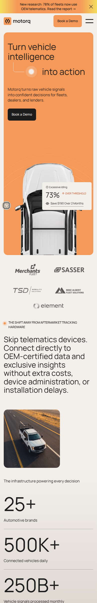

# UI Design System & Master Generation Blueprint: www-motorq-com

> **Motorq · Turn Connected Vehicle Data Into Decisions** (https://www.motorq.com/) — More than telematics. Motorq turns data from 25+ automaker brands into decisions, with no hardware to install. Run safer, leaner, more pr...


---

## 1. Executive Visual Persona & Design Archetype

- **Brand Essence & Persona**: **Motorq · Turn Connected Vehicle Data Into Decisions** (`https://www.motorq.com/`). More than telematics. Motorq turns data from 25+ automaker brands into decisions, with no hardware to install. Run safer, leaner, more pr...
- **Capture Provenance**: Live browser capture (`tier1_fast`, HTTP `200`, captured `2026-11-23`).
- **Visual Archetype**: **Light-Substrate Editorial & Modular Grid System (`#f3f0ec` canvas, `#1c1c1c` ink, `#ffa500` accent)**.
- **Anti-AI-Slop Differentiators**:
  - **Live-Computed Chromatic Polarity**: Anchors the viewport in `#f3f0ec` (live computed `body` `background-color` (`computed_styles.json`)) paired with `#1c1c1c` primary typography and `#ffa500` accents.
  - **Grounded Typographic Hierarchy**: Pairs `Manrope` for display copy (`Turn vehicle intelligence into actio`) with `Manrope` and not declared in live computed styles (uses primary stack / `ui-monospace`).
  - **Calibrated Spatial Grid & Motion**: Combines `100rem` container bounds (`gap: 16px`, padding `32px`) with `cubic-bezier(0.32,0.72,0,1)` easing and Lenis Smooth Scroll (`data-lenis`), GSAP Timeline & ScrollTrigger.

---

## 2. Spatial Architecture & Modular Grid Mathematics



### Viewport Allocation & Container Geometry
- **Captured Viewport Dimensions**: Desktop `1440×2400px` (`assets/desktop.png`, clamped at 2400px live multi-section capture), Mobile `390×2400px` (`assets/mobile.png`, clamped at 2400px live multi-section capture).
- **Master Container Bounds**: `100rem` (non-`@media` desktop container stylesheet rule).
- **Canvas Lateral Padding & Spacing**: `32px` lateral canvas padding with `16px` grid gap.
- **Border Radius Scale**: `3px`, `100%`, `50%`, `2px`.

### Responsive Breakpoint Architecture
- **Desktop Layout**: Multi-column CSS Grid / Flexbox layout at `1440px` (`max-width: 100rem`, `gap: 16px`).
- **Mobile Layout**: Single-column vertical stack at `390px` viewport width with `32px` horizontal padding.
- **Extracted CSS Media Queries**: `@media screen and (max-width:991px)`, `@media screen and (max-width:767px)`, `@media screen and (max-width:479px)`, `@media (min-width:768px)`.

---

## 3. Color System, Materiality & Atmospheric Lighting

### Semantic Palette & Source Grounding
| Semantic Role | Ground-Truth Value | Extracted Live / CSS Source |
|---|---|---|
| **Primary Canvas Substrate** | `#f3f0ec` | live computed `body` `background-color` (`computed_styles.json`) |
| **Primary Typography Ink** | `#1c1c1c` | live computed `h1` `color` (`computed_styles.json`) |
| **Elevated Surface / Card Substrate** | `#f59958` | live computed `footer` `background-color` (`computed_styles.json`) |
| **Interactive Accent / Highlight** | `#ffa500` | `.arrow-button:hover { color: orange }` (`#ffa500`) |
| **Secondary / Muted Copy** | `#686868` | `var(--_themes---form--input-placeholder)` in `:root` |
| **Structural Hairline Border** | `#c8c6c2` | `var(--_themes---form--input-border)` in `:root` (`1c1c1c33`) |

### Sanitized Root CSS Variables (`ui-ux.md` Ground Truth)
| Variable Name | Extracted Value | Semantic Role |
|---|---|---|
| `--_themes---background--primary` | `var(--_color-palette---cream)` | Canvas / Surface Token |
| `--_typography---base--font` | `var(--_typography---primary-font)` | Typography / Scale Token |
| `--_themes---typography--paragraph` | `var(--_color-palette---black)` | Brand / Palette Token |
| `--_typography---base--size` | `1rem` | Layout / Spatial Grid Token |
| `--_typography---base--line-height` | `1.4` | Typography / Scale Token |
| `--_typography---base--weight` | `var(--_typography---weights--400-normal)` | Design System Custom Token |
| `--_typography---base--letter-spacing` | `0rem` | Typography / Scale Token |
| `--_typography---primary-font` | `Manrope,Arial,sans-serif` | Brand / Palette Token |
| `--_themes---typography--heading` | `var(--_color-palette---black)` | Typography Ink Token |
| `--_typography---h1--size` | `3.5rem` | Typography / Scale Token |
| `--_typography---h1--line-height` | `1.1` | Typography / Scale Token |
| `--_typography---h1--weight` | `var(--_typography---weights--400-normal)` | Typography / Scale Token |
| `--_typography---h1--letter-spacing` | `0rem` | Typography / Scale Token |
| `--_typography---h2--size` | `3rem` | Typography / Scale Token |
| `--_typography---h2--line-height` | `1.1` | Typography / Scale Token |
| `--_typography---h2--weight` | `var(--_typography---weights--400-normal)` | Typography / Scale Token |

---

## 4. Typographic Scale & Editorial Hierarchy

### Font Family Stacks
- **Display Typography**: `Manrope`.
- **Primary Body Stack**: `Manrope`.
- **Technical / Metadata Stack**: not declared in live computed styles (uses primary stack / `ui-monospace`).

### Typographic Scale & Rules (Live Computed & Stylesheet Grounded)
- **Hero Display (`H1`)**: live computed `h1` (`font-size: 56px`, `line-height: 61.6px`, `font-weight: 400`); CSS variables `--_typography---h1--size: 3.5rem`, `--_typography---h1--line-height: 1.1`, `--_typography---h1--weight: var(--_typography---weights--400-normal)`; rule `h1` (`font-size: 2.125rem`).
- **Section Heading (`H2`)**: live computed `h2` (`font-size: 56px`, `line-height: 61.6px`, `font-weight: 400`); CSS variables `--_typography---h2--size: 3rem`, `--_typography---h2--line-height: 1.1`, `--_typography---h2--weight: var(--_typography---weights--400-normal)`; rule `h2` (`font-size: 1.125rem`, `font-weight: var(--_typogr...`).
- **Body Copy**: live computed `body` (`font-size: 16px`, `line-height: 22.4px`, `font-weight: 400`); CSS variables `--_themes---typography--paragraph: var(--_color-palette---black)`; rule `p` (`font-size: var(--_typography---text-md--...`, `line-height: 1.5`).
- **Metadata & Navigation Labels**: live computed `nav/a` (`font-size: 16px`, `line-height: 22.4px`, `font-weight: 400`); CSS variables `--_typography---base--letter-spacing: 0rem`, `--_typography---h1--letter-spacing: 0rem`, `--_typography---h2--letter-spacing: 0rem`.

---

## 5. Choreographed Motion & Interaction Physics

### Primary Easing Curves
- **Extracted Timing Functions**: `cubic-bezier(0.32,0.72,0,1)`, `cubic-bezier(.19,1,.22,1)`, `cubic-bezier(0.215,0.61,0.355,1)`.

### Per-Element Transition & Choreography Rules
- **Selector `.w-webflow-badge>img`**: `transition: unset` extracted from `www-motorq-com` stylesheet.
- **Selector `.w-slider-dot`**: `transition: background-color .1s,color .1s` extracted from `www-motorq-com` stylesheet.
- **Selector `.w-lightbox-control`**: `transition: all .3s` extracted from `www-motorq-com` stylesheet.
- **Extracted Easing Curve (`cubic-bezier(0.32,0.72,0,1)`)**: Governs interactive state transitions across `<nav.nav_menu>` and `<section.section>`.
- **Runtime Interaction Engine**: Integrates Lenis Smooth Scroll (`data-lenis`), GSAP Timeline & ScrollTrigger, Three.js / WebGL Canvas Pipeline, Swiper Touch Carousel Engine, Lottie Vector Animation Player with `prefers-reduced-motion: reduce` fallback guards.

---

## 6. Component Wireframe & Structural DOM Map

### Visual Layout Schematic — Desktop (`1440px`, Grounded in `dom.html` & Landmark Bounding Boxes)
```
┌────────────────────────────────────────────────────────────────────────┐
│ DESKTOP VIEWPORT (1440px) — Motorq · Turn Connected Vehicle Data Into  │
│ ====================================================================== │
│ [ <nav.nav_menu> (640x38px)           | Commercial Fleets · Rental F ] │
│ ---------------------------------------------------------------------- │
│ | HERO STAGE: <section.hero> (w=1440px)                              | │
│ | H1: Turn vehicle intelligence into action                          | │
│ | Substrate: #f3f0ec | Ink: #1c1c1c | Accent: #ffa500                | │
│ ---------------------------------------------------------------------- │
│ | SHOWCASE GRID (<section.section>) max-w: 100rem                    | │
│ | +------------------------------+  +------------------------------+ | │
│ | | Turn vehicle intelligence in |  | Live Webinar: Scaling Connec | | │
│ | +------------------------------+  +------------------------------+ | │
│ ---------------------------------------------------------------------- │
│ | DETAIL MODULE (<section.u-bg-transparent>) — Skip telematics devic | │
│ ---------------------------------------------------------------------- │
│ [ FOOTER (<footer.footer>     ) | https://www.motorq.com/              │
└────────────────────────────────────────────────────────────────────────┘
```

### Visual Layout Schematic — Mobile Reflow (`390px`)
```
┌────────────────────────────────────────────────────────────────────────┐
│ MOBILE VIEWPORT REFLOW (390px) — Single-Column Stack (gap: 16px)       │
│ ====================================================================== │
│ [ HEADER BAR (<nav.nav_menu>          ) | Compact Menu (390px)         │
│ ---------------------------------------------------------------------- │
│ | HERO STAGE (<section.hero>) — 390px Vertical Lead                  | │
│ | H1: Turn vehicle intelligence into action                          | │
│ ---------------------------------------------------------------------- │
│ | SHOWCASE STACK (<section.section>) — 1-Col Stack                   | │
│ | [ Item 1: Turn vehicle intelligence into action into action      ] | │
│ | [ Item 2: Live Webinar: Scaling Connected Fleets Without Ha...   ] | │
│ ---------------------------------------------------------------------- │
│ | DETAIL STACK (<section.u-bg-transparen) — 1-Col (Skip telematics de) │
│ ---------------------------------------------------------------------- │
│ [ FOOTER (<footer.footer>     ) | Stacked 390px Colophon               │
└────────────────────────────────────────────────────────────────────────┘
```

### Granular DOM Region Breakdown
1. **Brand Header & Navigation Bar (<nav.nav_menu> — `www-motorq-com`)**:
   - Landmark `<nav class="nav_menu w-nav-menu">` (`640x38px`) hosting `Motorq · Turn Connected Vehicle Data` navigation (`Commercial Fleets · Rental Fleets · Dealerships · Lenders · OEMs`), DOM attributes (`data-wf-domain="www.motorq.com"`, `data-wf-page="6a61fa87ccdad47899c19eb0"`, `data-wf-site="6a61fa87ccdad47899c19edd"`, `data-cky-tag="revisit-consent"`), and stylesheet rule `html { -webkit-text-size-adjust:100%;-ms-text-size-adjust:100%;font-family:sans... }`.
2. **Hero Stage & Focal Lead (<section.hero> — `Turn vehicle intelligence into act`)**:
   - Landmark `<section class="hero u-overflow-hidden">` presenting display lead `Turn vehicle intelligence into action` and copy excerpt *"Motorq turns raw vehicle signals into confident decisions for fle"* over `#f3f0ec` canvas and `#1c1c1c` ink.
3. **Primary Showcase & Content Grid (<section.section> — `Turn vehicle intelligence into act`)**:
   - Landmark `<section class="section u-bg-transparent">` rendering section `Turn vehicle intelligence into action into action` with copy *"Thursday, December 10"*, asset references (`cdn.prod.website-files.com`, `motorq123.webflow.shared.f3e1ce02...`, `script.js`, `gtm.js`), and grid rule `summary { display:block }`.
4. **Interactive Detail & Feature Matrix (<section.u-bg-transparent> — `Live Webinar: Scaling Connected Fl`)**:
   - Landmark `<section class="section u-bg-transparent">` framing `Live Webinar: Scaling Connected Fleets Without Ha...` and `Skip telematics devices. Connect directly to OEM-...` (*"The infrastructure powering every decision"*) with `#f59958` surface cards, `#ffa500` accents, and `video { vertical-align:baseline;display:inline-block }`.
5. **Colophon & Global Directory Footer (<footer.footer> — `https://www.motorq.com/`)**:
   - Landmark `<footer class="footer">` anchoring `Motorq · Turn Connected Vehicle ` footer links (`Commercial Fleets · Rental Fleets · Dealerships · Lenders · OEMs`), copy *"Vehicle-direct data from 25+ automotive brands, no hardware "*, and `#c8c6c2` structural dividers.

---

## 7. Master Zero-Shot AI Generation Prompt

```markdown
# Master Zero-Shot Frontend Generation Prompt: www-motorq-com (Motorq · Turn Connected Vehicle Data Into Decisions)

You are a principal frontend architect and design systems engineer. Build a complete, production-ready web application replicating the exact design system, DOM landmarks, typographic hierarchy, color tokens, and motion physics of `www-motorq-com` (**Motorq · Turn Connected Vehicle Data Into Decisions** — `https://www.motorq.com/`).

### 1. Visual Archetype & Anti-AI-Slop Mandates
- **Archetype**: Light-Substrate Editorial & Modular Grid System (`#f3f0ec` canvas, `#1c1c1c` ink, `#ffa500` accent).
- **Identity & Domain Context**: More than telematics. Motorq turns data from 25+ automaker brands into decisions, with no hardware to install. Run safer, leaner, more pr...
- **Primary Substrate**: `#f3f0ec` (live computed `body` `background-color` (`computed_styles.json`)), **Primary Ink**: `#1c1c1c`, **Accent / Highlight**: `#ffa500`.
- **Site-Specific Differentiators**:
  - **Live-Computed Chromatic Polarity**: Anchors the viewport in `#f3f0ec` (live computed `body` `background-color` (`computed_styles.json`)) paired with `#1c1c1c` primary typography and `#ffa500` accents.
  - **Grounded Typographic Hierarchy**: Pairs `Manrope` for display copy (`Turn vehicle intelligence into actio`) with `Manrope` and not declared in live computed styles (uses primary stack / `ui-monospace`).
  - **Calibrated Spatial Grid & Motion**: Combines `100rem` container bounds (`gap: 16px`, padding `32px`) with `cubic-bezier(0.32,0.72,0,1)` easing and Lenis Smooth Scroll (`data-lenis`), GSAP Timeline & ScrollTrigger.

### 2. Ground-Truth CSS Variables (`:root` Token Contract)
Declare and consume these exact custom properties extracted from `www-motorq-com` in your global stylesheet:

:root {
  /* Motorq · Turn Connected Vehicle Data Into Decisions (www-motorq-com) — Live-Grounded CSS Variables */
  --_themes---background--primary: var(--_color-palette---cream); /* Canvas / Surface Token (www-motorq-com) */
  --_typography---base--font: var(--_typography---primary-font); /* Typography / Scale Token (www-motorq-com) */
  --_themes---typography--paragraph: var(--_color-palette---black); /* Brand / Palette Token (www-motorq-com) */
  --_typography---base--size: 1rem; /* Layout / Spatial Grid Token (www-motorq-com) */
  --_typography---base--line-height: 1.4; /* Typography / Scale Token (www-motorq-com) */
  --_typography---base--weight: var(--_typography---weights--400-normal); /* Design System Custom Token (www-motorq-com) */
  --_typography---base--letter-spacing: 0rem; /* Typography / Scale Token (www-motorq-com) */
  --_typography---primary-font: Manrope,Arial,sans-serif; /* Brand / Palette Token (www-motorq-com) */
  --_themes---typography--heading: var(--_color-palette---black); /* Typography Ink Token (www-motorq-com) */
  --_typography---h1--size: 3.5rem; /* Typography / Scale Token (www-motorq-com) */
  --_typography---h1--line-height: 1.1; /* Typography / Scale Token (www-motorq-com) */
  --_typography---h1--weight: var(--_typography---weights--400-normal); /* Typography / Scale Token (www-motorq-com) */
  --_typography---h1--letter-spacing: 0rem; /* Typography / Scale Token (www-motorq-com) */
  --_typography---h2--size: 3rem; /* Typography / Scale Token (www-motorq-com) */
  --_typography---h2--line-height: 1.1; /* Typography / Scale Token (www-motorq-com) */
  --_typography---h2--weight: var(--_typography---weights--400-normal); /* Typography / Scale Token (www-motorq-com) */
}

### 3. Semantic Color & Materiality Contract
Map every surface, ink, and border strictly to these source-grounded tokens:
- **Primary Canvas Substrate**: `#f3f0ec` — grounded in live computed `body` `background-color` (`computed_styles.json`)
- **Primary Typography Ink**: `#1c1c1c` — grounded in live computed `h1` `color` (`computed_styles.json`)
- **Elevated Surface / Card Substrate**: `#f59958` — grounded in live computed `footer` `background-color` (`computed_styles.json`)
- **Interactive Accent / Highlight**: `#ffa500` — grounded in `.arrow-button:hover { color: orange }` (`#ffa500`)
- **Secondary / Muted Copy**: `#686868` — grounded in `var(--_themes---form--input-placeholder)` in `:root`
- **Structural Hairline Border**: `#c8c6c2` — grounded in `var(--_themes---form--input-border)` in `:root` (`1c1c1c33`)

### 4. Spatial Grid, Container Bounds & Responsive Breakpoints
- **Desktop Viewport Reference**: `1440×2400px` (clamped at 2400px live multi-section capture, `1440px` standard desktop width).
- **Mobile Viewport Reference**: `390×2400px` (clamped at 2400px live multi-section capture, `390px` standard mobile width).
- **Container Max-Width**: `100rem` (non-`@media` desktop container stylesheet rule)
- **Padding & Gutters**: `32px` lateral canvas padding with `16px` grid gap
- **Desktop Grid**: Multi-column CSS Grid / Flexbox layout at `1440px` (`max-width: 100rem`, `gap: 16px`)
- **Mobile Adaptation**: Single-column vertical stack at `390px` viewport width with `32px` horizontal padding
- **Media Queries**: `@media screen and (max-width:991px)`, `@media screen and (max-width:767px)`, `@media screen and (max-width:479px)`, `@media (min-width:768px)`
- **Corner Radii**: `3px`, `100%`, `50%`, `2px`

### 5. Typography & Editorial Scale Contract
- **Display Font Stack**: `Manrope`
- **Body Font Stack**: `Manrope`
- **Monospace / Technical Font Stack**: not declared in live computed styles (uses primary stack / `ui-monospace`)
- **H1 Display Rule**: live computed `h1` (`font-size: 56px`, `line-height: 61.6px`, `font-weight: 400`); CSS variables `--_typography---h1--size: 3.5rem`, `--_typography---h1--line-height: 1.1`, `--_typography---h1--weight: var(--_typography---weights--400-normal)`; rule `h1` (`font-size: 2.125rem`)
- **H2 Section Rule**: live computed `h2` (`font-size: 56px`, `line-height: 61.6px`, `font-weight: 400`); CSS variables `--_typography---h2--size: 3rem`, `--_typography---h2--line-height: 1.1`, `--_typography---h2--weight: var(--_typography---weights--400-normal)`; rule `h2` (`font-size: 1.125rem`, `font-weight: var(--_typogr...`)
- **Body Copy Rule**: live computed `body` (`font-size: 16px`, `line-height: 22.4px`, `font-weight: 400`); CSS variables `--_themes---typography--paragraph: var(--_color-palette---black)`; rule `p` (`font-size: var(--_typography---text-md--...`, `line-height: 1.5`)
- **Metadata & Index Rule**: live computed `nav/a` (`font-size: 16px`, `line-height: 22.4px`, `font-weight: 400`); CSS variables `--_typography---base--letter-spacing: 0rem`, `--_typography---h1--letter-spacing: 0rem`, `--_typography---h2--letter-spacing: 0rem`

### 6. Component Hierarchy, Verbatim Copy & Real DOM Landmarks
Scaffold `www-motorq-com` (`Motorq · Turn Connected Vehicle Data Into Decisions`) with these exact structural regions, extracted copy, and CSS rules from `dom.html`:
1. **Brand Header & Navigation Bar (<nav.nav_menu> — `www-motorq-com`)**:
   - DOM & Selectors: Landmark `<nav class="nav_menu w-nav-menu">` (`640x38px`) hosting `Motorq · Turn Connected Vehicle Data` navigation (`Commercial Fleets · Rental Fleets · Dealerships · Lenders · OEMs`), DOM attributes (`data-wf-domain="www.motorq.com"`, `data-wf-page="6a61fa87ccdad47899c19eb0"`, `data-wf-site="6a61fa87ccdad47899c19edd"`, `data-cky-tag="revisit-consent"`), and stylesheet rule `html { -webkit-text-size-adjust:100%;-ms-text-size-adjust:100%;font-family:sans... }`.
   - Responsive Contract: Header `Brand Header & Navigation Bar (<nav.nav_menu> — `www-motorq-com`)` (`www-motorq-com`) adapts across `@media screen and (max-width:991px)`, `@media screen and (max-width:767px)`, `@media screen and (max-width:479px)`, `@media (min-width:768px)` with `cubic-bezier(0.32,0.72,0,1)`, `cubic-bezier(.19,1,.22,1)`, `cubic-bezier(0.215,0.61,0.355,1)` transitions and links `Commercial Fleets · Rental Fleets · Dealerships · Lenders · OEMs`.
2. **Hero Stage & Focal Lead (<section.hero> — `Turn vehicle intelligence into act`)**:
   - DOM & Selectors: Landmark `<section class="hero u-overflow-hidden">` presenting display lead `Turn vehicle intelligence into action` and copy excerpt *"Motorq turns raw vehicle signals into confident decisions for fle"* over `#f3f0ec` canvas and `#1c1c1c` ink.
   - Responsive Contract: Hero stage (`1440×2400px` desktop / `390×2400px` mobile) sets `#f3f0ec` background with `#1c1c1c` headline `Turn vehicle intelligence into action`.
3. **Primary Showcase & Content Grid (<section.section> — `Turn vehicle intelligence into act`)**:
   - DOM & Selectors: Landmark `<section class="section u-bg-transparent">` rendering section `Turn vehicle intelligence into action into action` with copy *"Thursday, December 10"*, asset references (`cdn.prod.website-files.com`, `motorq123.webflow.shared.f3e1ce02...`, `script.js`, `gtm.js`), and grid rule `summary { display:block }`.
   - Responsive Contract: Showcase grid `Primary Showcase & Content Grid (<section.section> — `Turn vehicle intelligence into act`)` applies Multi-column CSS Grid / Flexbox layout at `1440px` (`max-width: 100rem`, `gap: 16px`) on desktop and Single-column vertical stack at `390px` viewport width with `32px` horizontal padding on mobile.
4. **Interactive Detail & Feature Matrix (<section.u-bg-transparent> — `Live Webinar: Scaling Connected Fl`)**:
   - DOM & Selectors: Landmark `<section class="section u-bg-transparent">` framing `Live Webinar: Scaling Connected Fleets Without Ha...` and `Skip telematics devices. Connect directly to OEM-...` (*"The infrastructure powering every decision"*) with `#f59958` surface cards, `#ffa500` accents, and `video { vertical-align:baseline;display:inline-block }`.
   - Responsive Contract: Detail module `Interactive Detail & Feature Matrix (<section.u-bg-transparent> — `Live Webinar: Scaling Connected Fl`)` uses `3px`, `100%`, `50%`, `2px` radii, `#ffa500` highlights, and assets (cdn.prod.website-files.com, motorq123.webflow.shared.f3e1ce02..., script.js).
5. **Colophon & Global Directory Footer (<footer.footer> — `https://www.motorq.com/`)**:
   - DOM & Selectors: Landmark `<footer class="footer">` anchoring `Motorq · Turn Connected Vehicle ` footer links (`Commercial Fleets · Rental Fleets · Dealerships · Lenders · OEMs`), copy *"Vehicle-direct data from 25+ automotive brands, no hardware "*, and `#c8c6c2` structural dividers.
   - Responsive Contract: Footer `Colophon & Global Directory Footer (<footer.footer> — `https://www.motorq.com/`)` aligns to `100rem` (non-`@media` desktop container stylesheet rule) with `32px` lateral canvas padding with `16px` grid gap and attributes (data-wf-domain="www.motorq.com", data-wf-page="6a61fa87ccdad47899c19eb0", data-wf-site="6a61fa87ccdad47899c19edd").

#### Verbatim DOM Copy Excerpts (`dom.html`)
- Copy Excerpt 1: *"Motorq turns raw vehicle signals into confident decisions for fleets, dealers, and..."*
- Copy Excerpt 2: *"Thursday, December 10"*
- Copy Excerpt 3: *"The infrastructure powering every decision"*
- Copy Excerpt 4: *"Vehicle-direct data from 25+ automotive brands, no hardware required."*

### 7. Motion, Extracted Stylesheet Rules & Interaction Choreography
- **Primary Easing Functions**: `cubic-bezier(0.32,0.72,0,1)`, `cubic-bezier(.19,1,.22,1)`, `cubic-bezier(0.215,0.61,0.355,1)`
- **Extracted Stylesheet Rules (`www-motorq-com`)**:
- `html { -webkit-text-size-adjust:100%;-ms-text-size-adjust:100%;font-family:sans... }`
- `summary { display:block }`
- `video { vertical-align:baseline;display:inline-block }`
- `template { display:none }`
- `strong { font-weight:700 }`
- **Per-Selector Transition Rules**:
- **Selector `.w-webflow-badge>img`**: `transition: unset` extracted from `www-motorq-com` stylesheet.
- **Selector `.w-slider-dot`**: `transition: background-color .1s,color .1s` extracted from `www-motorq-com` stylesheet.
- **Selector `.w-lightbox-control`**: `transition: all .3s` extracted from `www-motorq-com` stylesheet.
- **Extracted Easing Curve (`cubic-bezier(0.32,0.72,0,1)`)**: Governs interactive state transitions across `<nav.nav_menu>` and `<section.section>`.
- **Runtime Interaction Engine**: Integrates Lenis Smooth Scroll (`data-lenis`), GSAP Timeline & ScrollTrigger, Three.js / WebGL Canvas Pipeline, Swiper Touch Carousel Engine, Lottie Vector Animation Player with `prefers-reduced-motion: reduce` fallback guards.

### 8. Technical Deliverables
- Implement in Next.js (App Router) with TypeScript and Tailwind CSS consuming the `:root` custom properties defined above for `www-motorq-com`.
- Reproduce both the `1440px` desktop architecture and `390px` mobile breakpoint transitions, preserving semantic HTML5 landmarks (`<header>`, `<nav>`, `<main>`, `<section>`, `<footer>`) and `prefers-reduced-motion` accessibility guards.
```
