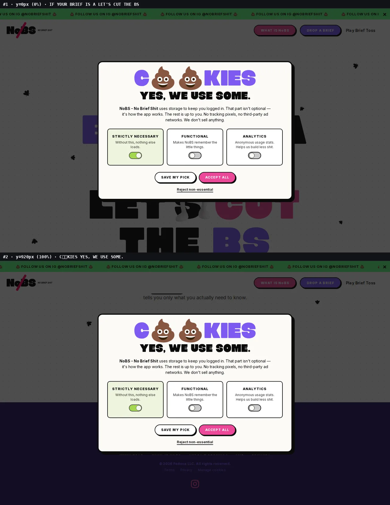
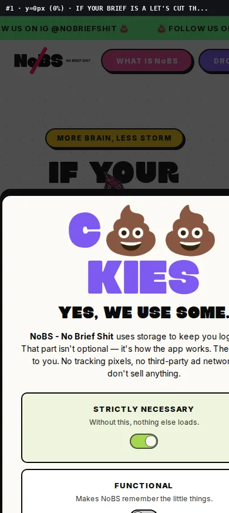

# UI Design System & Master Generation Blueprint: www-mynobs-co

> **NoBS - No Brief Shit** (https://www.mynobs.co) — 💩 It's simple: drop in the buzzword-stuffed brief, and NoBS cuts the BS, handing back only what you need to know to start your job.





---

## 1. Executive Visual Persona & Design Archetype

- **Brand Essence & Persona**: **NoBS - No Brief Shit** (`https://www.mynobs.co`). 💩 It's simple: drop in the buzzword-stuffed brief, and NoBS cuts the BS, handing back only what you need to know to start your job.
- **Capture Provenance**: Live browser capture (`tier1_fast`, HTTP `200`, captured `2026-11-24`).
- **Visual Archetype**: **Light-Substrate Editorial & Modular Grid System (`#fcfaf7` canvas, `#0a0a0a` ink, `#ff0066` accent)**.
- **Anti-AI-Slop Differentiators**:
  - **Live-Computed Chromatic Polarity**: Anchors the viewport in `#fcfaf7` (live computed `body` `background-color` (`computed_styles.json`)) paired with `#0a0a0a` primary typography and `#ff0066` accents.
  - **Grounded Typographic Hierarchy**: Pairs `Sugra` for display copy (`IF YOUR BRIEF IS A LET'S CUT THE BS`) with `Inter`.
  - **Calibrated Spatial Grid & Motion**: Combines `980px` container bounds (`gap: 16px`, padding `24px`) with `cubic-bezier(0.4,0,0.2,1)` easing.

---

## 2. Spatial Architecture & Modular Grid Mathematics

### Viewport Allocation & Container Geometry
- **Captured Journey Filmstrips**: Desktop `1280×1656px` (`assets/desktop-journey.webp`, `2` keyframes up to `y=920px` / doc `1820px`), Mobile `390×872px` (`assets/mobile-journey.webp`, `1` keyframes).
- **Master Container Bounds**: `980px` (non-`@media` desktop container stylesheet rule).
- **Canvas Lateral Padding & Spacing**: `24px` lateral canvas padding with `16px` grid gap.
- **Border Radius Scale**: `999px`, `3px`, `50%`, `4px`.

### Responsive Breakpoint Architecture
- **Desktop Layout**: Multi-column CSS Grid / Flexbox layout at `1440px` (`max-width: 980px`, `gap: 16px`).
- **Mobile Layout**: Single-column vertical stack at `390px` viewport width with `24px` horizontal padding.
- **Extracted CSS Media Queries**: `@media (max-width: 480px)`, `@media (max-width: 640px)`, `@media (max-width: 720px)`, `@media (max-width: 1100px)`.

---

## 3. Color System, Materiality & Atmospheric Lighting

### Semantic Palette & Source Grounding
| Semantic Role | Ground-Truth Value | Extracted Live / CSS Source |
|---|---|---|
| **Primary Canvas Substrate** | `#fcfaf7` | live computed `body` `background-color` (`computed_styles.json`) |
| **Primary Typography Ink** | `#0a0a0a` | live computed `h1` `color` (`computed_styles.json`) |
| **Elevated Surface / Card Substrate** | `#dedede` | `var(--disabled-card-bg)` in `:root` |
| **Interactive Accent / Highlight** | `#ff0066` | `.nbs-footer-link:hover { color: #ff0066 }` |
| **Secondary / Muted Copy** | `#ec4899` | `var(--pink)` in `:root` |
| **Structural Hairline Border** | `#a7a6a4` | `.nbs-account-row { border-bottom: #a7a6a4 }` |
| **Variable Token (`--purple`)** | `#7e5af2` | `var(--purple)` in `:root` |
| **Variable Token (`--purple-deep`)** | `#5b3bc4` | `var(--purple-deep)` in `:root` |
| **Variable Token (`--purple-dark`)** | `#2d1b69` | `var(--purple-dark)` in `:root` |
| **Variable Token (`--yellow`)** | `#facc15` | `var(--yellow)` in `:root` |
| **Variable Token (`--yellow-deep`)** | `#c2a011` | `var(--yellow-deep)` in `:root` |
| **Variable Token (`--peach-deep`)** | `#c2691a` | `var(--peach-deep)` in `:root` |
| **Variable Token (`--pink-deep`)** | `#b8276f` | `var(--pink-deep)` in `:root` |
| **Variable Token (`--peach`)** | `#fb923c` | `var(--peach)` in `:root` |
| **Variable Token (`--lime`)** | `#84cc16` | `var(--lime)` in `:root` |
| **Variable Token (`--sky`)** | `#0ea5e9` | `var(--sky)` in `:root` |
| **Variable Token (`--cream-darker`)** | `#f5f1e8` | `var(--cream-darker)` in `:root` |

### Sanitized Root CSS Variables (`ui-ux.md` Ground Truth)
| Variable Name | Extracted Value | Semantic Role |
|---|---|---|
| `--purple` | `#7E5AF2` | Color / Atmospheric Token |
| `--purple-deep` | `#5B3BC4` | Color / Atmospheric Token |
| `--purple-dark` | `#2D1B69` | Canvas / Surface Token |
| `--pink` | `#EC4899` | Typography Ink Token |
| `--yellow` | `#FACC15` | Color / Atmospheric Token |
| `--yellow-deep` | `#C2A011` | Color / Atmospheric Token |
| `--peach-deep` | `#C2691A` | Color / Atmospheric Token |
| `--pink-deep` | `#B8276F` | Typography Ink Token |
| `--peach` | `#FB923C` | Color / Atmospheric Token |
| `--lime` | `#84CC16` | Color / Atmospheric Token |
| `--sky` | `#0EA5E9` | Color / Atmospheric Token |
| `--cream` | `#FCFAF7` | Color / Atmospheric Token |
| `--cream-darker` | `#F5F1E8` | Canvas / Surface Token |
| `--ink` | `#0A0A0A` | Typography Ink Token |
| `--fs-body` | `18px` | Dimension / Scale Token |
| `--lh-body` | `1.55` | Design System Custom Token |

---

## 4. Typographic Scale & Editorial Hierarchy

### Font Family Stacks
- **Display Typography**: `Sugra`.
- **Primary Body Stack**: `Inter`.
- **Technical / Metadata Stack**: not declared in live computed styles (uses primary stack / `ui-monospace`).

### Typographic Scale & Rules (Live Computed & Stylesheet Grounded)
- **Hero Display (`H1`)**: live computed `h1` (`font-size: 150px`, `line-height: 138px`, `font-weight: 400`, `letter-spacing: 5px`); rule `.hero-title` (`font-size: 150px`, `line-height: 0.92`, `letter-spacing: 5px`, `font-weight: normal`).
- **Section Heading (`H2`)**: live computed `h2` (`font-size: 40px`, `line-height: 40px`, `font-weight: 700`, `letter-spacing: 1px`).
- **Body Copy**: live computed `body` (`font-size: 16px`, `line-height: normal`, `font-weight: 400`); CSS variables `--fs-body: 18px`, `--lh-body: 1.55`.
- **Metadata & Navigation Labels**: live computed `nav/a` (`font-size: 16px`, `line-height: normal`, `font-weight: 400`).

---

## 5. Choreographed Motion & Interaction Physics

### Primary Easing Curves
- **Extracted Timing Functions**: `cubic-bezier(0.4,0,0.2,1)`, `cubic-bezier(0.34,1.56,0.64,1)`, `cubic-bezier(0.2,0.8,0.2,1)`.

### Per-Element Transition & Choreography Rules
- **Selector `.nbs-nav-link`**: `transition: color 0.15s ease` extracted from `www-mynobs-co` stylesheet.
- **Selector `.nbs-nav-link.is-cta`**: `transition: transform 0.12s ease, box-shadow 0.12s ease` extracted from `www-mynobs-co` stylesheet.
- **Selector `.nbs-toggle-bar`**: `transition: transform 0.32s cubic-bezier(0.4,0,0.2,1), top 0.32s cubic-...` extracted from `www-mynobs-co` stylesheet.
- **Extracted Easing Curve (`cubic-bezier(0.4,0,0.2,1)`)**: Governs interactive state transitions across `<header.nbs-topbar>` and `<section.hero:nth(2)>`.
- **State & Hover Choreography**: Opacity and transform transitions on `<section.hero>` and `<section.hero:nth(2)>` interactive targets.
### Measured Runtime Scroll & Interaction Telemetry (`behavioral_journey_v2`)
- **Scroll Driver Mode**: `native` (max document height `1820px`, deepest scrollY reached `920px` across `2` desktop keyframes).
- **Detected Scroll / Motion Libraries**: Native browser scroll / standard CSS transitions.
- **Hover Physics (`primary_cta` · `WHAT IS NoBS`)**: Computed transition `0.12s, 0.12s` / `ease, ease` (no static color/transform shift captured at rest).
- **Route Transition Architecture**: First internal navigation (`/pages/login.html`) measured as `direct` in `524ms`.

---

## 6. Component Wireframe & Structural DOM Map

### Visual Layout Schematic — Desktop (`1440px`, Grounded in `dom.html` & Landmark Bounding Boxes)
```
┌────────────────────────────────────────────────────────────────────────┐
│ DESKTOP VIEWPORT (1440px) — NoBS - No Brief Shit                       │
│ ====================================================================== │
│ [ <header.nbs-topbar> (1440x80px)     | Overview · Index · Archive · ] │
│ ---------------------------------------------------------------------- │
│ | HERO STAGE: <section.hero> (w=1440px)                              | │
│ | H1: IF YOUR BRIEF IS A LET'S CUT THE BS                            | │
│ | Substrate: #fcfaf7 | Ink: #0a0a0a | Accent: #ff0066                | │
│ ---------------------------------------------------------------------- │
│ | SHOWCASE GRID (<section.hero:nth(2)>) max-w: 980px                 | │
│ | +------------------------------+  +------------------------------+ | │
│ | | Type, paste, or drop your br |  | Strictly necessary           | | │
│ | +------------------------------+  +------------------------------+ | │
│ ---------------------------------------------------------------------- │
│ | DETAIL MODULE (<section.hero:nth(3)>) — Without this, nothing      | │
│ ---------------------------------------------------------------------- │
│ [ FOOTER (<footer.nbs-footer> ) | https://www.mynobs.co                │
└────────────────────────────────────────────────────────────────────────┘
```

### Visual Layout Schematic — Mobile Reflow (`390px`)
```
┌────────────────────────────────────────────────────────────────────────┐
│ MOBILE VIEWPORT REFLOW (390px) — Single-Column Stack (gap: 16px)       │
│ ====================================================================== │
│ [ HEADER BAR (<header.nbs-topbar>     ) | Compact Menu (390px)         │
│ ---------------------------------------------------------------------- │
│ | HERO STAGE (<section.hero>) — 390px Vertical Lead                  | │
│ | H1: IF YOUR BRIEF IS A LET'S CUT THE BS                            | │
│ ---------------------------------------------------------------------- │
│ | SHOWCASE STACK (<section.hero:nth(2)>) — 1-Col Stack               | │
│ | [ Item 1: Type, paste, or drop your brief. No Brief Shit (       ] | │
│ | [ Item 2: Strictly necessary                                     ] | │
│ ---------------------------------------------------------------------- │
│ | DETAIL STACK (<section.hero:nth(3)>) — 1-Col (Without this, noth)  | │
│ ---------------------------------------------------------------------- │
│ [ FOOTER (<footer.nbs-footer> ) | Stacked 390px Colophon               │
└────────────────────────────────────────────────────────────────────────┘
```

### Granular DOM Region Breakdown
1. **Brand Header & Navigation Bar (<header.nbs-topbar> — `www-mynobs-co`)**:
   - Landmark `<header class="nbs-topbar">` (`1440x80px`) hosting `NoBS - No Brief Shit` navigation (`Overview · Index · Archive · About · Contact`), DOM attributes (`data-nobs-sentry-sdk="1"`, `data-page="login"`, `data-auth="out"`, `data-nav="exit-demo"`), and stylesheet rule `.nbs-logo { display: inline-flex; align-items: center; text-decoration: none; line-h... }`.
2. **Hero Stage & Focal Lead (<section.hero> — `IF YOUR BRIEF IS A LET'S CUT THE B`)**:
   - Landmark `<section class="hero">` presenting display lead `IF YOUR BRIEF IS A LET'S CUT THE BS` and copy excerpt *"Type, paste, or drop your brief. No Brief Shit (or NoBS, if we're"* over `#fcfaf7` canvas and `#0a0a0a` ink.
3. **Primary Showcase & Content Grid (<section.hero:nth(2)> — `Type, paste, or drop your brief. N`)**:
   - Landmark `<section class="hero">` rendering section `Type, paste, or drop your brief. No Brief Shit (` with copy *"Strictly necessary"*, asset references (`favicon.svg`, `fonts.googleapis.com`, `fonts.gstatic.com`, `css2`), and grid rule `.nbs-logo img { display: block; height: 60px; width: auto; }`.
4. **Interactive Detail & Feature Matrix (<section.hero:nth(3)> — `Strictly necessary`)**:
   - Landmark `<section class="hero">` framing `Strictly necessary` and `Without this, nothing else loads.` (*"Without this, nothing else loads."*) with `#dedede` surface cards, `#ff0066` accents, and `.nbs-topbar-skeleton { position: sticky; top: 0; z-index: 100; background: var(--cream); min-he... }`.
5. **Colophon & Global Directory Footer (<footer.nbs-footer> — `https://www.mynobs.co`)**:
   - Landmark `<footer class="nbs-footer">` anchoring `NoBS - No Brief Shit` footer links (`Overview · Index · Archive · About · Contact`), copy *"Makes NoBS remember the little things."*, and `#a7a6a4` structural dividers.
### Full Vertical Scroll Sequence (Desktop `1440×900` Keyframes)
- **Step 01** (`y=0px`, `0%`): Active landmark `IF YOUR BRIEF IS A LET'S CUT THE BS` · sticky/fixed elements: `3`
- **Step 02** (`y=920px`, `100%`): Active landmark `C💩💩KIES YES, WE USE SOME.` · sticky/fixed elements: `3`

### Multi-Page Internal Route Map
- **Detail Route (`/pages/login.html`)**: `https://www.mynobs.co/pages/login.html` — H1: `IF YOUR BRIEF IS A LET'S CUT THE BS`, scrollHeight `1820px`, transition `direct` (`524ms`)
- **Detail Route (`/pages/whatis.html`)**: `https://www.mynobs.co/pages/whatis.html` — H1: `THE BRIEF, EASIER`, scrollHeight `10673px`, transition `direct` (`788ms`)
- **Detail Route (`/pages/register.html`)**: `https://www.mynobs.co/pages/register.html` — H1: `H-E-L-P-! WE NEED SOMEBODY`, scrollHeight `3554px`, transition `direct` (`896ms`)

---

## 7. Master Zero-Shot AI Generation Prompt

```markdown
# Master Zero-Shot Frontend Generation Prompt: www-mynobs-co (NoBS - No Brief Shit)

You are a principal frontend architect and design systems engineer. Build a complete, production-ready web application replicating the exact design system, DOM landmarks, typographic hierarchy, color tokens, and motion physics of `www-mynobs-co` (**NoBS - No Brief Shit** — `https://www.mynobs.co`).

### 1. Visual Archetype & Anti-AI-Slop Mandates
- **Archetype**: Light-Substrate Editorial & Modular Grid System (`#fcfaf7` canvas, `#0a0a0a` ink, `#ff0066` accent).
- **Identity & Domain Context**: 💩 It's simple: drop in the buzzword-stuffed brief, and NoBS cuts the BS, handing back only what you need to know to start your job.
- **Primary Substrate**: `#fcfaf7` (live computed `body` `background-color` (`computed_styles.json`)), **Primary Ink**: `#0a0a0a`, **Accent / Highlight**: `#ff0066`.
- **Site-Specific Differentiators**:
  - **Live-Computed Chromatic Polarity**: Anchors the viewport in `#fcfaf7` (live computed `body` `background-color` (`computed_styles.json`)) paired with `#0a0a0a` primary typography and `#ff0066` accents.
  - **Grounded Typographic Hierarchy**: Pairs `Sugra` for display copy (`IF YOUR BRIEF IS A LET'S CUT THE BS`) with `Inter`.
  - **Calibrated Spatial Grid & Motion**: Combines `980px` container bounds (`gap: 16px`, padding `24px`) with `cubic-bezier(0.4,0,0.2,1)` easing.

### 2. Ground-Truth CSS Variables (`:root` Token Contract)
Declare and consume these exact custom properties extracted from `www-mynobs-co` in your global stylesheet:

:root {
  /* NoBS - No Brief Shit (www-mynobs-co) — Live-Grounded CSS Variables */
  --purple: #7E5AF2; /* Color / Atmospheric Token (www-mynobs-co) */
  --purple-deep: #5B3BC4; /* Color / Atmospheric Token (www-mynobs-co) */
  --purple-dark: #2D1B69; /* Canvas / Surface Token (www-mynobs-co) */
  --pink: #EC4899; /* Typography Ink Token (www-mynobs-co) */
  --yellow: #FACC15; /* Color / Atmospheric Token (www-mynobs-co) */
  --yellow-deep: #C2A011; /* Color / Atmospheric Token (www-mynobs-co) */
  --peach-deep: #C2691A; /* Color / Atmospheric Token (www-mynobs-co) */
  --pink-deep: #B8276F; /* Typography Ink Token (www-mynobs-co) */
  --peach: #FB923C; /* Color / Atmospheric Token (www-mynobs-co) */
  --lime: #84CC16; /* Color / Atmospheric Token (www-mynobs-co) */
  --sky: #0EA5E9; /* Color / Atmospheric Token (www-mynobs-co) */
  --cream: #FCFAF7; /* Color / Atmospheric Token (www-mynobs-co) */
  --cream-darker: #F5F1E8; /* Canvas / Surface Token (www-mynobs-co) */
  --ink: #0A0A0A; /* Typography Ink Token (www-mynobs-co) */
  --fs-body: 18px; /* Dimension / Scale Token (www-mynobs-co) */
  --lh-body: 1.55; /* Design System Custom Token (www-mynobs-co) */
}

### 3. Semantic Color & Materiality Contract
Map every surface, ink, and border strictly to these source-grounded tokens:
- **Primary Canvas Substrate**: `#fcfaf7` — grounded in live computed `body` `background-color` (`computed_styles.json`)
- **Primary Typography Ink**: `#0a0a0a` — grounded in live computed `h1` `color` (`computed_styles.json`)
- **Elevated Surface / Card Substrate**: `#dedede` — grounded in `var(--disabled-card-bg)` in `:root`
- **Interactive Accent / Highlight**: `#ff0066` — grounded in `.nbs-footer-link:hover { color: #ff0066 }`
- **Secondary / Muted Copy**: `#ec4899` — grounded in `var(--pink)` in `:root`
- **Structural Hairline Border**: `#a7a6a4` — grounded in `.nbs-account-row { border-bottom: #a7a6a4 }`
- **Variable Token (`--purple`)**: `#7e5af2` — grounded in `var(--purple)` in `:root`
- **Variable Token (`--purple-deep`)**: `#5b3bc4` — grounded in `var(--purple-deep)` in `:root`
- **Variable Token (`--purple-dark`)**: `#2d1b69` — grounded in `var(--purple-dark)` in `:root`
- **Variable Token (`--yellow`)**: `#facc15` — grounded in `var(--yellow)` in `:root`
- **Variable Token (`--yellow-deep`)**: `#c2a011` — grounded in `var(--yellow-deep)` in `:root`
- **Variable Token (`--peach-deep`)**: `#c2691a` — grounded in `var(--peach-deep)` in `:root`
- **Variable Token (`--pink-deep`)**: `#b8276f` — grounded in `var(--pink-deep)` in `:root`
- **Variable Token (`--peach`)**: `#fb923c` — grounded in `var(--peach)` in `:root`
- **Variable Token (`--lime`)**: `#84cc16` — grounded in `var(--lime)` in `:root`
- **Variable Token (`--sky`)**: `#0ea5e9` — grounded in `var(--sky)` in `:root`
- **Variable Token (`--cream-darker`)**: `#f5f1e8` — grounded in `var(--cream-darker)` in `:root`

### 4. Spatial Grid, Container Bounds & Responsive Breakpoints
- **Desktop Viewport Reference**: `1280×1656px` (full-page live capture (1656px), `1440px` standard desktop width).
- **Mobile Viewport Reference**: `390×872px` (full-page live capture (872px), `390px` standard mobile width).
- **Container Max-Width**: `980px` (non-`@media` desktop container stylesheet rule)
- **Padding & Gutters**: `24px` lateral canvas padding with `16px` grid gap
- **Desktop Grid**: Multi-column CSS Grid / Flexbox layout at `1440px` (`max-width: 980px`, `gap: 16px`)
- **Mobile Adaptation**: Single-column vertical stack at `390px` viewport width with `24px` horizontal padding
- **Media Queries**: `@media (max-width: 480px)`, `@media (max-width: 640px)`, `@media (max-width: 720px)`, `@media (max-width: 1100px)`
- **Corner Radii**: `999px`, `3px`, `50%`, `4px`

### 5. Typography & Editorial Scale Contract
- **Display Font Stack**: `Sugra`
- **Body Font Stack**: `Inter`
- **Monospace / Technical Font Stack**: not declared in live computed styles (uses primary stack / `ui-monospace`)
- **H1 Display Rule**: live computed `h1` (`font-size: 150px`, `line-height: 138px`, `font-weight: 400`, `letter-spacing: 5px`); rule `.hero-title` (`font-size: 150px`, `line-height: 0.92`, `letter-spacing: 5px`, `font-weight: normal`)
- **H2 Section Rule**: live computed `h2` (`font-size: 40px`, `line-height: 40px`, `font-weight: 700`, `letter-spacing: 1px`)
- **Body Copy Rule**: live computed `body` (`font-size: 16px`, `line-height: normal`, `font-weight: 400`); CSS variables `--fs-body: 18px`, `--lh-body: 1.55`
- **Metadata & Index Rule**: live computed `nav/a` (`font-size: 16px`, `line-height: normal`, `font-weight: 400`)

### 6. Component Hierarchy, Verbatim Copy & Real DOM Landmarks
Scaffold `www-mynobs-co` (`NoBS - No Brief Shit`) with these exact structural regions, extracted copy, and CSS rules from `dom.html`:
1. **Brand Header & Navigation Bar (<header.nbs-topbar> — `www-mynobs-co`)**:
   - DOM & Selectors: Landmark `<header class="nbs-topbar">` (`1440x80px`) hosting `NoBS - No Brief Shit` navigation (`Overview · Index · Archive · About · Contact`), DOM attributes (`data-nobs-sentry-sdk="1"`, `data-page="login"`, `data-auth="out"`, `data-nav="exit-demo"`), and stylesheet rule `.nbs-logo { display: inline-flex; align-items: center; text-decoration: none; line-h... }`.
   - Responsive Contract: Header `Brand Header & Navigation Bar (<header.nbs-topbar> — `www-mynobs-co`)` (`www-mynobs-co`) adapts across `@media (max-width: 480px)`, `@media (max-width: 640px)`, `@media (max-width: 720px)`, `@media (max-width: 1100px)` with `cubic-bezier(0.4,0,0.2,1)`, `cubic-bezier(0.34,1.56,0.64,1)`, `cubic-bezier(0.2,0.8,0.2,1)` transitions and links `Overview · Index · Archive · About · Contact`.
2. **Hero Stage & Focal Lead (<section.hero> — `IF YOUR BRIEF IS A LET'S CUT THE B`)**:
   - DOM & Selectors: Landmark `<section class="hero">` presenting display lead `IF YOUR BRIEF IS A LET'S CUT THE BS` and copy excerpt *"Type, paste, or drop your brief. No Brief Shit (or NoBS, if we're"* over `#fcfaf7` canvas and `#0a0a0a` ink.
   - Responsive Contract: Hero stage (`1280×1656px` desktop / `390×872px` mobile) sets `#fcfaf7` background with `#0a0a0a` headline `IF YOUR BRIEF IS A LET'S CUT THE BS`.
3. **Primary Showcase & Content Grid (<section.hero:nth(2)> — `Type, paste, or drop your brief. N`)**:
   - DOM & Selectors: Landmark `<section class="hero">` rendering section `Type, paste, or drop your brief. No Brief Shit (` with copy *"Strictly necessary"*, asset references (`favicon.svg`, `fonts.googleapis.com`, `fonts.gstatic.com`, `css2`), and grid rule `.nbs-logo img { display: block; height: 60px; width: auto; }`.
   - Responsive Contract: Showcase grid `Primary Showcase & Content Grid (<section.hero:nth(2)> — `Type, paste, or drop your brief. N`)` applies Multi-column CSS Grid / Flexbox layout at `1440px` (`max-width: 980px`, `gap: 16px`) on desktop and Single-column vertical stack at `390px` viewport width with `24px` horizontal padding on mobile.
4. **Interactive Detail & Feature Matrix (<section.hero:nth(3)> — `Strictly necessary`)**:
   - DOM & Selectors: Landmark `<section class="hero">` framing `Strictly necessary` and `Without this, nothing else loads.` (*"Without this, nothing else loads."*) with `#dedede` surface cards, `#ff0066` accents, and `.nbs-topbar-skeleton { position: sticky; top: 0; z-index: 100; background: var(--cream); min-he... }`.
   - Responsive Contract: Detail module `Interactive Detail & Feature Matrix (<section.hero:nth(3)> — `Strictly necessary`)` uses `999px`, `3px`, `50%`, `4px` radii, `#ff0066` highlights, and assets (favicon.svg, fonts.googleapis.com, fonts.gstatic.com).
5. **Colophon & Global Directory Footer (<footer.nbs-footer> — `https://www.mynobs.co`)**:
   - DOM & Selectors: Landmark `<footer class="nbs-footer">` anchoring `NoBS - No Brief Shit` footer links (`Overview · Index · Archive · About · Contact`), copy *"Makes NoBS remember the little things."*, and `#a7a6a4` structural dividers.
   - Responsive Contract: Footer `Colophon & Global Directory Footer (<footer.nbs-footer> — `https://www.mynobs.co`)` aligns to `980px` (non-`@media` desktop container stylesheet rule) with `24px` lateral canvas padding with `16px` grid gap and attributes (data-nobs-sentry-sdk="1", data-page="login", data-auth="out").

#### Verbatim DOM Copy Excerpts (`dom.html`)
- Copy Excerpt 1: *"Type, paste, or drop your brief. No Brief Shit (or NoBS, if we're close) tells you..."*
- Copy Excerpt 2: *"Strictly necessary"*
- Copy Excerpt 3: *"Without this, nothing else loads."*
- Copy Excerpt 4: *"Makes NoBS remember the little things."*

### 7. Motion, Extracted Stylesheet Rules & Interaction Choreography
- **Primary Easing Functions**: `cubic-bezier(0.4,0,0.2,1)`, `cubic-bezier(0.34,1.56,0.64,1)`, `cubic-bezier(0.2,0.8,0.2,1)`
- **Extracted Stylesheet Rules (`www-mynobs-co`)**:
- `.nbs-logo { display: inline-flex; align-items: center; text-decoration: none; line-h... }`
- `.nbs-logo img { display: block; height: 60px; width: auto; }`
- `.nbs-topbar-skeleton { position: sticky; top: 0; z-index: 100; background: var(--cream); min-he... }`
- `.nbs-nav-right { display: flex; align-items: center; gap: 14px; margin-left: auto; margin... }`
- `.nbs-nav-link.is-cta:hover { transform: translate(-2px, -2px); box-shadow: 5px 5px 0 var(--ink); colo... }`
- **Per-Selector Transition Rules**:
- **Selector `.nbs-nav-link`**: `transition: color 0.15s ease` extracted from `www-mynobs-co` stylesheet.
- **Selector `.nbs-nav-link.is-cta`**: `transition: transform 0.12s ease, box-shadow 0.12s ease` extracted from `www-mynobs-co` stylesheet.
- **Selector `.nbs-toggle-bar`**: `transition: transform 0.32s cubic-bezier(0.4,0,0.2,1), top 0.32s cubic-...` extracted from `www-mynobs-co` stylesheet.
- **Extracted Easing Curve (`cubic-bezier(0.4,0,0.2,1)`)**: Governs interactive state transitions across `<header.nbs-topbar>` and `<section.hero:nth(2)>`.
- **State & Hover Choreography**: Opacity and transform transitions on `<section.hero>` and `<section.hero:nth(2)>` interactive targets.
### 7b. Full-Page Scroll Choreography, Interactive States & Multi-Page Routes
- **Scroll Mechanics**: Implement `native` vertical progression up to `1820px` across 2 distinct viewport chapters.
- **Vertical Chapter Sequence**: IF YOUR BRIEF IS A LET'S CU... (0%) -> C💩💩KIES YES, WE USE SOME. (100%).
- **Multi-Page Routes**: Scaffold internal routes `/pages/login.html` (detail, direct), `/pages/whatis.html` (detail, direct), `/pages/register.html` (detail, direct) sharing the global header/footer shell and design tokens.

### 8. Technical Deliverables
- Implement in Next.js (App Router) with TypeScript and Tailwind CSS consuming the `:root` custom properties defined above for `www-mynobs-co`.
- Reproduce both the `1440px` desktop architecture and `390px` mobile breakpoint transitions, preserving semantic HTML5 landmarks (`<header>`, `<nav>`, `<main>`, `<section>`, `<footer>`) and `prefers-reduced-motion` accessibility guards.
```
---

## 8. Full-Page Scroll Journey, Interactive States & Subpage Inventory

### Desktop Scroll Keyframes (`1440×900` WebP)
| Step | Scroll Y | Progress | Active Landmark / Section | Sticky/Fixed | Visual Asset |
| :---: | :---: | :---: | :--- | :---: | :--- |
| `#01` | `0px` | `0%` | IF YOUR BRIEF IS A LET'S CUT THE BS | `3` | [desktop-step-01.webp](assets/desktop-step-01.webp) |
| `#02` | `920px` | `100%` | C💩💩KIES YES, WE USE SOME. | `3` | [desktop-step-02.webp](assets/desktop-step-02.webp) |

### Mobile Condensed Keyframes (`390×844` WebP)
| Step | Scroll Y | Progress | Active Landmark | Visual Asset |
| :---: | :---: | :---: | :--- | :--- |
| `#01` | `0px` | `0%` | IF YOUR BRIEF IS A LET'S CUT THE BS | [mobile-step-01.webp](assets/mobile-step-01.webp) |

### Internal Subpage Filmstrips (`1080px` Wide WebP)
| # | Template | Route URL | H1 / Title | Scroll Height | Transition | Filmstrip Asset |
| :-: | :---: | :--- | :--- | :---: | :---: | :--- |
| `1` | `detail` | `https://www.mynobs.co/pages/login.html` | IF YOUR BRIEF IS A LET'S CUT THE BS | `1820px` | `direct` (`524ms`) | [subpage-01-pages-login-html.webp](assets/subpage-01-pages-login-html.webp) |
| `2` | `detail` | `https://www.mynobs.co/pages/whatis.html` | THE BRIEF, EASIER | `10673px` | `direct` (`788ms`) | [subpage-02-pages-whatis-html.webp](assets/subpage-02-pages-whatis-html.webp) |
| `3` | `detail` | `https://www.mynobs.co/pages/register.html` | H-E-L-P-! WE NEED SOMEBODY | `3554px` | `direct` (`896ms`) | [subpage-03-pages-register-html.webp](assets/subpage-03-pages-register-html.webp) |

