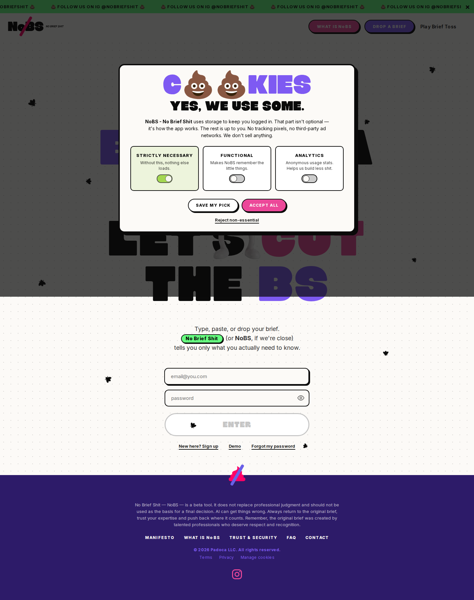
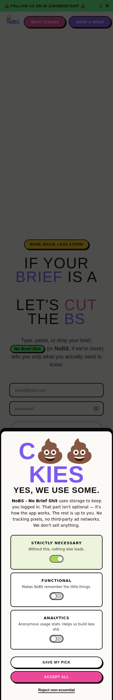

# UI Design System & Master Generation Blueprint: www-mynobs-co

> **NoBS - No Brief Shit** (https://www.mynobs.co) — 💩 It's simple: drop in the buzzword-stuffed brief, and NoBS cuts the BS, handing back only what you need to know to start your job.



---

## 1. Executive Visual Persona & Design Archetype

- **Brand Essence & Persona**: **NoBS - No Brief Shit** (`https://www.mynobs.co`). 💩 It's simple: drop in the buzzword-stuffed brief, and NoBS cuts the BS, handing back only what you need to know to start your job.
- **Visual Archetype**: **High-Contrast Obsidian / Atmospheric Design System (`#7E5AF2` canvas, `#FACC15` ink, `#EC4899` accent)**.
- **Anti-AI-Slop Differentiators**:
  - **Source-Grounded Chromatic Polarity**: Anchors the viewport in `#7E5AF2` (`var(--purple)` in `:root`) paired with `#FACC15` primary typography and `#EC4899` accents.
  - **Extracted Typographic Hierarchy**: Pairs `Sugra` for display copy (`IF YOUR BRIEF IS A LET'S CUT THE BS`) with `Sugra Fallback` and not declared in static CSS (uses primary stack / `ui-monospace`).
  - **Calibrated Spatial Grid & Motion**: Combines `480px` container bounds (`gap: 16px`, padding `10px`) with `cubic-bezier(0.45,0,0.2,1)` easing.

---

## 2. Spatial Architecture & Modular Grid Mathematics



### Viewport Allocation & Container Geometry
- **Captured Viewport Dimensions**: Desktop `1440×1820px` (`assets/desktop.png`, capped at 2400px multi-section capture), Mobile `390×2400px` (`assets/mobile.png`, capped at 2400px multi-section capture).
- **Master Container Bounds**: `480px` extracted from `www-mynobs-co` stylesheet.
- **Canvas Lateral Padding & Spacing**: `10px` lateral canvas padding with `16px` grid gap.
- **Border Radius Scale**: `999px`, `3px`, `50%`, `4px`.

### Responsive Breakpoint Architecture
- **Desktop Layout**: Multi-column CSS Grid / Flexbox layout at `1440px` (`max-width: 480px`, `gap: 16px`).
- **Mobile Layout**: Single-column vertical stack at `390px` viewport width with `10px` horizontal padding.
- **Extracted CSS Media Queries**: `@media (max-width: 480px)`, `@media (max-width: 640px)`, `@media (max-width: 720px)`, `@media (max-width: 1100px)`.

---

## 3. Color System, Materiality & Atmospheric Lighting

### Semantic Palette & Source Grounding
| Semantic Role | Ground-Truth Value | Extracted CSS Source / Selector |
|---|---|---|
| **Primary Canvas Substrate** | `#7E5AF2` | `var(--purple)` in `:root` |
| **Primary Typography Ink** | `#5B3BC4` | `var(--purple-deep)` in `:root` |
| **Elevated Surface / Card Substrate** | `#2D1B69` | `var(--purple-dark)` in `:root` |
| **Interactive Accent / Highlight** | `#EC4899` | `var(--pink)` in `:root` |
| **Secondary / Muted Copy** | `#FACC15` | `var(--yellow)` in `:root` |
| **Structural Hairline Border** | `#C2A011` | `var(--yellow-deep)` in `:root` |
| **Variable Token (`--peach-deep`)** | `#C2691A` | `var(--peach-deep)` in `:root` |
| **Variable Token (`--pink-deep`)** | `#B8276F` | `var(--pink-deep)` in `:root` |
| **Variable Token (`--peach`)** | `#FB923C` | `var(--peach)` in `:root` |
| **Variable Token (`--lime`)** | `#84CC16` | `var(--lime)` in `:root` |
| **Variable Token (`--sky`)** | `#0EA5E9` | `var(--sky)` in `:root` |
| **Variable Token (`--cream`)** | `#FCFAF7` | `var(--cream)` in `:root` |
| **Variable Token (`--cream-darker`)** | `#F5F1E8` | `var(--cream-darker)` in `:root` |
| **Variable Token (`--ink`)** | `#0A0A0A` | `var(--ink)` in `:root` |

### Sanitized Root CSS Variables (`ui-ux.md` Ground Truth)
| Variable Name | Extracted Value | Semantic Role |
|---|---|---|
| `--purple` | `#7E5AF2` | Color / Atmospheric Token |
| `--purple-deep` | `#5B3BC4` | Color / Atmospheric Token |
| `--purple-dark` | `#2D1B69` | Canvas / Surface Token |
| `--pink` | `#EC4899` | Typography Ink Token |
| `--yellow` | `#FACC15` | Color / Atmospheric Token |
| `--yellow-deep` | `#C2A011` | Color / Atmospheric Token |
| `--peach-deep` | `#C2691A` | Color / Atmospheric Token |
| `--pink-deep` | `#B8276F` | Typography Ink Token |
| `--peach` | `#FB923C` | Color / Atmospheric Token |
| `--lime` | `#84CC16` | Color / Atmospheric Token |
| `--sky` | `#0EA5E9` | Color / Atmospheric Token |
| `--cream` | `#FCFAF7` | Color / Atmospheric Token |
| `--cream-darker` | `#F5F1E8` | Canvas / Surface Token |
| `--ink` | `#0A0A0A` | Typography Ink Token |
| `--fs-body` | `18px` | Dimension / Scale Token |
| `--lh-body` | `1.55` | Design System Custom Token |

---

## 4. Typographic Scale & Editorial Hierarchy

### Font Family Stacks
- **Display Typography**: `Sugra`.
- **Primary Body Stack**: `Sugra Fallback`.
- **Technical / Metadata Stack**: not declared in static CSS (uses primary stack / `ui-monospace`).

### Typographic Scale & Rules (Extracted from Stylesheet & Variables)
- **Hero Display (`H1`)**: rule `.hero-title` (`font-size: 150px`, `line-height: 0.92`, `letter-spacing: 5px`, `font-weight: normal`).
- **Section Heading (`H2`)**: not explicitly declared on tag in static CSS (stylesheet font-size ladder: `14px`, `12px`, `9px`, `22px`, `11px`).
- **Body Copy**: CSS variables `--fs-body: 18px`, `--lh-body: 1.55`.
- **Metadata & Navigation Labels**: not explicitly declared on tag in static CSS (stylesheet font-size ladder: `14px`, `12px`, `9px`, `22px`, `11px`).

---

## 5. Choreographed Motion & Interaction Physics

### Primary Easing Curves
- **Extracted Timing Functions**: `cubic-bezier(0.45,0,0.2,1)`, `cubic-bezier(0.4,0,0.2,1)`, `cubic-bezier(0.34,1.56,0.64,1)`.

### Per-Element Transition & Choreography Rules
- **Selector `.floating-star`**: `transition: transform 0.9s cubic-bezier(0.45,0,0.2,1), opacity 0.9s ease` extracted from `www-mynobs-co` stylesheet.
- **Selector `.nbs-nav-link`**: `transition: color 0.15s ease` extracted from `www-mynobs-co` stylesheet.
- **Selector `.nbs-nav-link.is-cta`**: `transition: transform 0.12s ease, box-shadow 0.12s ease` extracted from `www-mynobs-co` stylesheet.
- **Extracted Easing Curve (`cubic-bezier(0.45,0,0.2,1)`)**: Governs interactive state transitions across `<header.nbs-topbar>` and `<section.hero>`.
- **State & Hover Choreography**: Opacity and transform transitions on `<section.hero>` and `<section.hero>` interactive targets.

---

## 6. Component Wireframe & Structural DOM Map

### Visual Layout Schematic (Grounded in `dom.html` — `1440px` Desktop & `390px` Mobile Reflow)
```
┌────────────────────────────────────────────────────────────────────────┐
│ DESKTOP VIEWPORT (1440px) — NoBS - No Brief Shit                       │
│ ====================================================================== │
│ [ <header.nbs-topbar>      | Exit demo · New brief · WHAT IS NoBS · ]  │
│ ---------------------------------------------------------------------- │
│ | HERO STAGE: <section.hero>                                       |   │
│ | H1: IF YOUR BRIEF IS A LET'S CUT THE BS                          |   │
│ | Substrate: #7E5AF2    | Ink: #FACC15    | Accent: #EC4899        |   │
│ ---------------------------------------------------------------------- │
│ | SHOWCASE GRID (<section.hero>            ) max-w: 480px          |   │
│ | +------------------------------+  +------------------------------+ | │
│ | | Forgot ?                     |  | C💩💩KIES Yes, we use some.    | | │
│ | +------------------------------+  +------------------------------+ | │
│ ---------------------------------------------------------------------- │
│ | MOBILE VIEWPORT REFLOW (390px) — Single-Column Stack (gap: 16px  ) | │
│ | [<header.nbs-topbar] -> [<section.hero>] -> [<section.hero>] |       │
│ ---------------------------------------------------------------------- │
│ [ FOOTER (<footer.nbs-footer>   ) | https://www.mynobs.co              │
└────────────────────────────────────────────────────────────────────────┘
```

### Granular DOM Region Breakdown
1. **Brand Header & Navigation Bar (<header.nbs-topbar> — `www-mynobs-co`)**:
   - Landmark `<header class="nbs-topbar">` hosting `NoBS - No Brief Shit` navigation (`Exit demo · New brief · WHAT IS NoBS · Drop a brief · Play Brief Toss`), DOM attributes (`data-nobs-sentry-sdk="1"`, `data-page="login"`, `data-auth="out"`, `data-nav="exit-demo"`), and stylesheet rule `html { font-synthesis: none; -webkit-font-smoothing: antialiased; -moz-osx-font... }`.
2. **Hero Stage & Focal Lead (<section.hero> — `IF YOUR BRIEF IS A LET'S CUT THE B`)**:
   - Landmark `<section class="hero">` presenting display lead `IF YOUR BRIEF IS A LET'S CUT THE BS` and copy excerpt *"💩 FOLLOW US ON IG @nobriefshit 💩"* over `#7E5AF2` canvas and `#FACC15` ink.
3. **Primary Showcase & Content Grid (<section.hero> — `Forgot ?`)**:
   - Landmark `<section class="hero">` rendering section `Forgot ?` with copy *"Type, paste, or drop your brief. No Brief Shit (or N o BS , if we"*, asset references (`favicon.svg`, `fonts.googleapis.com`, `fonts.gstatic.com`, `css2`), and grid rule `body { font-family: 'Inter', sans-serif; color: var(--ink); background: var(--c... }`.
4. **Interactive Detail & Feature Matrix (<section.hero> — `C💩💩KIES Yes, we use some.`)**:
   - Landmark `<section class="hero">` framing `C💩💩KIES Yes, we use some.` and `Forgot my password` (*"Forgot my password"*) with `#2D1B69` surface cards, `#EC4899` accents, and `.page-back-wrap { display: block; width: 100%; text-align: center; margin-top: var(--page-... }`.
5. **Colophon & Global Directory Footer (<footer.nbs-footer> — `https://www.mynobs.co`)**:
   - Landmark `<footer class="nbs-footer">` anchoring `NoBS - No Brief Shit` footer links (`Exit demo · New brief · WHAT IS NoBS · Drop a brief · Play Brief Toss`), copy *"Drop your email. If we know it, you'll get a reset link in t"*, and `#C2A011` structural dividers.

---

## 7. Master Zero-Shot AI Generation Prompt

```markdown
# Master Zero-Shot Frontend Generation Prompt: www-mynobs-co (NoBS - No Brief Shit)

You are a principal frontend architect and design systems engineer. Build a complete, production-ready web application replicating the exact design system, DOM landmarks, typographic hierarchy, color tokens, and motion physics of `www-mynobs-co` (**NoBS - No Brief Shit** — `https://www.mynobs.co`).

### 1. Visual Archetype & Anti-AI-Slop Mandates
- **Archetype**: High-Contrast Obsidian / Atmospheric Design System (`#7E5AF2` canvas, `#FACC15` ink, `#EC4899` accent).
- **Identity & Domain Context**: 💩 It's simple: drop in the buzzword-stuffed brief, and NoBS cuts the BS, handing back only what you need to know to start your job.
- **Primary Substrate**: `#7E5AF2` (`var(--purple)` in `:root`), **Primary Ink**: `#FACC15`, **Accent / Highlight**: `#EC4899`.
- **Site-Specific Differentiators**:
  - **Source-Grounded Chromatic Polarity**: Anchors the viewport in `#7E5AF2` (`var(--purple)` in `:root`) paired with `#FACC15` primary typography and `#EC4899` accents.
  - **Extracted Typographic Hierarchy**: Pairs `Sugra` for display copy (`IF YOUR BRIEF IS A LET'S CUT THE BS`) with `Sugra Fallback` and not declared in static CSS (uses primary stack / `ui-monospace`).
  - **Calibrated Spatial Grid & Motion**: Combines `480px` container bounds (`gap: 16px`, padding `10px`) with `cubic-bezier(0.45,0,0.2,1)` easing.

### 2. Ground-Truth CSS Variables (`:root` Token Contract)
Declare and consume these exact custom properties extracted from `www-mynobs-co` in your global stylesheet:

:root {
  /* NoBS - No Brief Shit (www-mynobs-co) — Ground-Truth Extracted CSS Variables */
  --purple: #7E5AF2; /* Color / Atmospheric Token (www-mynobs-co) */
  --purple-deep: #5B3BC4; /* Color / Atmospheric Token (www-mynobs-co) */
  --purple-dark: #2D1B69; /* Canvas / Surface Token (www-mynobs-co) */
  --pink: #EC4899; /* Typography Ink Token (www-mynobs-co) */
  --yellow: #FACC15; /* Color / Atmospheric Token (www-mynobs-co) */
  --yellow-deep: #C2A011; /* Color / Atmospheric Token (www-mynobs-co) */
  --peach-deep: #C2691A; /* Color / Atmospheric Token (www-mynobs-co) */
  --pink-deep: #B8276F; /* Typography Ink Token (www-mynobs-co) */
  --peach: #FB923C; /* Color / Atmospheric Token (www-mynobs-co) */
  --lime: #84CC16; /* Color / Atmospheric Token (www-mynobs-co) */
  --sky: #0EA5E9; /* Color / Atmospheric Token (www-mynobs-co) */
  --cream: #FCFAF7; /* Color / Atmospheric Token (www-mynobs-co) */
  --cream-darker: #F5F1E8; /* Canvas / Surface Token (www-mynobs-co) */
  --ink: #0A0A0A; /* Typography Ink Token (www-mynobs-co) */
  --fs-body: 18px; /* Dimension / Scale Token (www-mynobs-co) */
  --lh-body: 1.55; /* Design System Custom Token (www-mynobs-co) */
}

### 3. Semantic Color & Materiality Contract
Map every surface, ink, and border strictly to these source-grounded tokens:
- **Primary Canvas Substrate**: `#7E5AF2` — grounded in `var(--purple)` in `:root`
- **Primary Typography Ink**: `#5B3BC4` — grounded in `var(--purple-deep)` in `:root`
- **Elevated Surface / Card Substrate**: `#2D1B69` — grounded in `var(--purple-dark)` in `:root`
- **Interactive Accent / Highlight**: `#EC4899` — grounded in `var(--pink)` in `:root`
- **Secondary / Muted Copy**: `#FACC15` — grounded in `var(--yellow)` in `:root`
- **Structural Hairline Border**: `#C2A011` — grounded in `var(--yellow-deep)` in `:root`
- **Variable Token (`--peach-deep`)**: `#C2691A` — grounded in `var(--peach-deep)` in `:root`
- **Variable Token (`--pink-deep`)**: `#B8276F` — grounded in `var(--pink-deep)` in `:root`
- **Variable Token (`--peach`)**: `#FB923C` — grounded in `var(--peach)` in `:root`
- **Variable Token (`--lime`)**: `#84CC16` — grounded in `var(--lime)` in `:root`
- **Variable Token (`--sky`)**: `#0EA5E9` — grounded in `var(--sky)` in `:root`
- **Variable Token (`--cream`)**: `#FCFAF7` — grounded in `var(--cream)` in `:root`
- **Variable Token (`--cream-darker`)**: `#F5F1E8` — grounded in `var(--cream-darker)` in `:root`
- **Variable Token (`--ink`)**: `#0A0A0A` — grounded in `var(--ink)` in `:root`

### 4. Spatial Grid, Container Bounds & Responsive Breakpoints
- **Desktop Viewport Reference**: `1440×1820px` (capped at 2400px multi-section capture, `1440px` standard desktop width).
- **Mobile Viewport Reference**: `390×2400px` (capped at 2400px multi-section capture, `390px` standard mobile width).
- **Container Max-Width**: `480px` extracted from `www-mynobs-co` stylesheet
- **Padding & Gutters**: `10px` lateral canvas padding with `16px` grid gap
- **Desktop Grid**: Multi-column CSS Grid / Flexbox layout at `1440px` (`max-width: 480px`, `gap: 16px`)
- **Mobile Adaptation**: Single-column vertical stack at `390px` viewport width with `10px` horizontal padding
- **Media Queries**: `@media (max-width: 480px)`, `@media (max-width: 640px)`, `@media (max-width: 720px)`, `@media (max-width: 1100px)`
- **Corner Radii**: `999px`, `3px`, `50%`, `4px`

### 5. Typography & Editorial Scale Contract
- **Display Font Stack**: `Sugra`
- **Body Font Stack**: `Sugra Fallback`
- **Monospace / Technical Font Stack**: not declared in static CSS (uses primary stack / `ui-monospace`)
- **H1 Display Rule**: rule `.hero-title` (`font-size: 150px`, `line-height: 0.92`, `letter-spacing: 5px`, `font-weight: normal`)
- **H2 Section Rule**: not explicitly declared on tag in static CSS (stylesheet font-size ladder: `14px`, `12px`, `9px`, `22px`, `11px`)
- **Body Copy Rule**: CSS variables `--fs-body: 18px`, `--lh-body: 1.55`
- **Metadata & Index Rule**: not explicitly declared on tag in static CSS (stylesheet font-size ladder: `14px`, `12px`, `9px`, `22px`, `11px`)

### 6. Component Hierarchy, Verbatim Copy & Real DOM Landmarks
Scaffold `www-mynobs-co` (`NoBS - No Brief Shit`) with these exact structural regions, extracted copy, and CSS rules from `dom.html`:
1. **Brand Header & Navigation Bar (<header.nbs-topbar> — `www-mynobs-co`)**:
   - DOM & Selectors: Landmark `<header class="nbs-topbar">` hosting `NoBS - No Brief Shit` navigation (`Exit demo · New brief · WHAT IS NoBS · Drop a brief · Play Brief Toss`), DOM attributes (`data-nobs-sentry-sdk="1"`, `data-page="login"`, `data-auth="out"`, `data-nav="exit-demo"`), and stylesheet rule `html { font-synthesis: none; -webkit-font-smoothing: antialiased; -moz-osx-font... }`.
   - Responsive Contract: Header `Brand Header & Navigation Bar (<header.nbs-topbar> — `www-mynobs-co`)` (`www-mynobs-co`) adapts across `@media (max-width: 480px)`, `@media (max-width: 640px)`, `@media (max-width: 720px)`, `@media (max-width: 1100px)` with `cubic-bezier(0.45,0,0.2,1)`, `cubic-bezier(0.4,0,0.2,1)`, `cubic-bezier(0.34,1.56,0.64,1)` transitions and links `Exit demo · New brief · WHAT IS NoBS · Drop a brief · Play Brief Toss`.
2. **Hero Stage & Focal Lead (<section.hero> — `IF YOUR BRIEF IS A LET'S CUT THE B`)**:
   - DOM & Selectors: Landmark `<section class="hero">` presenting display lead `IF YOUR BRIEF IS A LET'S CUT THE BS` and copy excerpt *"💩 FOLLOW US ON IG @nobriefshit 💩"* over `#7E5AF2` canvas and `#FACC15` ink.
   - Responsive Contract: Hero stage (`1440×1820px` desktop / `390×2400px` mobile) sets `#7E5AF2` background with `#FACC15` headline `IF YOUR BRIEF IS A LET'S CUT THE BS`.
3. **Primary Showcase & Content Grid (<section.hero> — `Forgot ?`)**:
   - DOM & Selectors: Landmark `<section class="hero">` rendering section `Forgot ?` with copy *"Type, paste, or drop your brief. No Brief Shit (or N o BS , if we"*, asset references (`favicon.svg`, `fonts.googleapis.com`, `fonts.gstatic.com`, `css2`), and grid rule `body { font-family: 'Inter', sans-serif; color: var(--ink); background: var(--c... }`.
   - Responsive Contract: Showcase grid `Primary Showcase & Content Grid (<section.hero> — `Forgot ?`)` applies Multi-column CSS Grid / Flexbox layout at `1440px` (`max-width: 480px`, `gap: 16px`) on desktop and Single-column vertical stack at `390px` viewport width with `10px` horizontal padding on mobile.
4. **Interactive Detail & Feature Matrix (<section.hero> — `C💩💩KIES Yes, we use some.`)**:
   - DOM & Selectors: Landmark `<section class="hero">` framing `C💩💩KIES Yes, we use some.` and `Forgot my password` (*"Forgot my password"*) with `#2D1B69` surface cards, `#EC4899` accents, and `.page-back-wrap { display: block; width: 100%; text-align: center; margin-top: var(--page-... }`.
   - Responsive Contract: Detail module `Interactive Detail & Feature Matrix (<section.hero> — `C💩💩KIES Yes, we use some.`)` uses `999px`, `3px`, `50%`, `4px` radii, `#EC4899` highlights, and assets (favicon.svg, fonts.googleapis.com, fonts.gstatic.com).
5. **Colophon & Global Directory Footer (<footer.nbs-footer> — `https://www.mynobs.co`)**:
   - DOM & Selectors: Landmark `<footer class="nbs-footer">` anchoring `NoBS - No Brief Shit` footer links (`Exit demo · New brief · WHAT IS NoBS · Drop a brief · Play Brief Toss`), copy *"Drop your email. If we know it, you'll get a reset link in t"*, and `#C2A011` structural dividers.
   - Responsive Contract: Footer `Colophon & Global Directory Footer (<footer.nbs-footer> — `https://www.mynobs.co`)` aligns to `480px` extracted from `www-mynobs-co` stylesheet with `10px` lateral canvas padding with `16px` grid gap and attributes (data-nobs-sentry-sdk="1", data-page="login", data-auth="out").

#### Verbatim DOM Copy Excerpts (`dom.html`)
- Copy Excerpt 1: *"💩 FOLLOW US ON IG @nobriefshit 💩"*
- Copy Excerpt 2: *"Type, paste, or drop your brief. No Brief Shit (or N o BS , if we're close) tells..."*
- Copy Excerpt 3: *"Forgot my password"*
- Copy Excerpt 4: *"Drop your email. If we know it, you'll get a reset link in two minutes. If we don'..."*

### 7. Motion, Extracted Stylesheet Rules & Interaction Choreography
- **Primary Easing Functions**: `cubic-bezier(0.45,0,0.2,1)`, `cubic-bezier(0.4,0,0.2,1)`, `cubic-bezier(0.34,1.56,0.64,1)`
- **Extracted Stylesheet Rules (`www-mynobs-co`)**:
- `html { font-synthesis: none; -webkit-font-smoothing: antialiased; -moz-osx-font... }`
- `body { font-family: 'Inter', sans-serif; color: var(--ink); background: var(--c... }`
- `.page-back-wrap { display: block; width: 100%; text-align: center; margin-top: var(--page-... }`
- `.floating-star svg { width: 100%; height: 100%; pointer-events: none; display: block; }`
- `.floating-star.flew { opacity: 0; pointer-events: none; }`
- **Per-Selector Transition Rules**:
- **Selector `.floating-star`**: `transition: transform 0.9s cubic-bezier(0.45,0,0.2,1), opacity 0.9s ease` extracted from `www-mynobs-co` stylesheet.
- **Selector `.nbs-nav-link`**: `transition: color 0.15s ease` extracted from `www-mynobs-co` stylesheet.
- **Selector `.nbs-nav-link.is-cta`**: `transition: transform 0.12s ease, box-shadow 0.12s ease` extracted from `www-mynobs-co` stylesheet.
- **Extracted Easing Curve (`cubic-bezier(0.45,0,0.2,1)`)**: Governs interactive state transitions across `<header.nbs-topbar>` and `<section.hero>`.
- **State & Hover Choreography**: Opacity and transform transitions on `<section.hero>` and `<section.hero>` interactive targets.

### 8. Technical Deliverables
- Implement in Next.js (App Router) with TypeScript and Tailwind CSS consuming the `:root` custom properties defined above for `www-mynobs-co`.
- Reproduce both the `1440px` desktop architecture and `390px` mobile breakpoint transitions, preserving semantic HTML5 landmarks (`<header>`, `<nav>`, `<main>`, `<section>`, `<footer>`) and `prefers-reduced-motion` accessibility guards.
```
