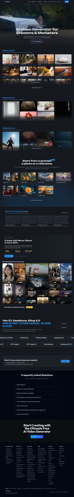
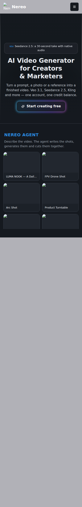

# UI Design System & Master Generation Blueprint: www-nereo-io

> **Nereo — AI Video Generator for Creators & Marketers** (https://www.nereo.io/) — Generate stunning 4K videos with AI. Create professional videos from text prompts with realistic physics and native audio. Start free today.



---

## 1. Executive Visual Persona & Design Archetype

- **Brand Essence & Persona**: **Nereo — AI Video Generator for Creators & Marketers** (`https://www.nereo.io/`). Generate stunning 4K videos with AI. Create professional videos from text prompts with realistic physics and native audio. Start free today.
- **Visual Archetype**: **High-Contrast Obsidian / Atmospheric Design System (`#404040` canvas, `#fff` ink, `#b1b1b7` accent)**.
- **Anti-AI-Slop Differentiators**:
  - **Source-Grounded Chromatic Polarity**: Anchors the viewport in `#404040` (`var(--sd-line2)` in `:root`) paired with `#fff` primary typography and `#b1b1b7` accents.
  - **Extracted Typographic Hierarchy**: Pairs `__Outfit_a80a2d` for display copy (`AI Video Generator for Creators & Ma`) with `__Outfit_Fallback_a80a2d` and `__IBM_Plex_Sans_Arabic_559684`.
  - **Calibrated Spatial Grid & Motion**: Combines `1200px` container bounds (`gap: .125rem`, padding `2rem`) with `cubic-bezier(.8,0,1,1)` easing and Three.js / WebGL Canvas Pipeline.

---

## 2. Spatial Architecture & Modular Grid Mathematics



### Viewport Allocation & Container Geometry
- **Captured Viewport Dimensions**: Desktop `1440×9591px` (`assets/desktop.png`, full-page scroll capture), Mobile `390×2400px` (`assets/mobile.png`, capped at 2400px multi-section capture).
- **Master Container Bounds**: `1200px` extracted from `www-nereo-io` stylesheet.
- **Canvas Lateral Padding & Spacing**: `2rem` lateral canvas padding with `.125rem` grid gap.
- **Border Radius Scale**: `.3125rem`, `.375rem`, `.75rem`, `.25rem`.

### Responsive Breakpoint Architecture
- **Desktop Layout**: Multi-column CSS Grid / Flexbox layout at `1440px` (`max-width: 1200px`, `gap: .125rem`).
- **Mobile Layout**: Single-column vertical stack at `390px` viewport width with `2rem` horizontal padding.
- **Extracted CSS Media Queries**: `@media (min-width:1200px)`, `@media (min-width:768px)`, `@media (min-width:1024px)`, `@media (prefers-reduced-motion:no-preference)`.

---

## 3. Color System, Materiality & Atmospheric Lighting

### Semantic Palette & Source Grounding
| Semantic Role | Ground-Truth Value | Extracted CSS Source / Selector |
|---|---|---|
| **Primary Canvas Substrate** | `#404040` | `var(--sd-line2)` in `:root` |
| **Primary Typography Ink** | `#262626` | `var(--sd-line)` in `:root` |
| **Elevated Surface / Card Substrate** | `#171717` | `var(--sd-paper)` in `:root` |
| **Interactive Accent / Highlight** | `#b1b1b7` | `var(--xy-edge-stroke-default)` in `:root` |
| **Secondary / Muted Copy** | `#555` | `var(--xy-edge-stroke-selected-default)` in `:root` |
| **Structural Hairline Border** | `#fff` | `var(--xy-minimap-background-color-default)` in `:root` |

### Sanitized Root CSS Variables (`ui-ux.md` Ground Truth)
| Variable Name | Extracted Value | Semantic Role |
|---|---|---|
| `--sidebar-background` | `var(--background)` | Canvas / Surface Token |
| `--sidebar-foreground` | `var(--foreground)` | Typography Ink Token |
| `--sidebar-primary` | `var(--primary)` | Brand / Palette Token |
| `--sidebar-primary-foreground` | `var(--primary-foreground)` | Typography Ink Token |
| `--sidebar-accent` | `var(--background)` | Brand / Palette Token |
| `--sidebar-accent-foreground` | `var(--primary)` | Typography Ink Token |
| `--sidebar-border` | `var(--border)` | Elevation / Border Token |
| `--sidebar-ring` | `var(--ring)` | Elevation / Border Token |
| `--ai-ad-step-angle` | `0deg` | Design System Custom Token |
| `--duration` | `38s` | Motion / Easing Token |
| `--font-display` | `var(--font-sans)` | Typography / Scale Token |
| `--gap` | `12px` | Layout / Spatial Grid Token |
| `--sd-line2` | `#404040!important` | Color / Atmospheric Token |
| `--sd-line` | `#262626!important` | Color / Atmospheric Token |
| `--sd-paper` | `#171717!important` | Canvas / Surface Token |
| `--sd-raise` | `#262626!important` | Color / Atmospheric Token |

---

## 4. Typographic Scale & Editorial Hierarchy

### Font Family Stacks
- **Display Typography**: `__Outfit_a80a2d`.
- **Primary Body Stack**: `__Outfit_Fallback_a80a2d`.
- **Technical / Metadata Stack**: `__IBM_Plex_Sans_Arabic_559684`.

### Typographic Scale & Rules (Extracted from Stylesheet & Variables)
- **Hero Display (`H1`)**: CSS variables `--font-display: var(--font-sans)`.
- **Section Heading (`H2`)**: rule `h2` (`font-size: 1.875rem`, `line-height: 2.25rem`).
- **Body Copy**: rule `p` (`line-height: 1.625`).
- **Metadata & Navigation Labels**: CSS variables `--xy-edge-label-background-color-default: #fff`, `--xy-edge-label-color-default: inherit`.

---

## 5. Choreographed Motion & Interaction Physics

### Primary Easing Curves
- **Extracted Timing Functions**: `cubic-bezier(.8,0,1,1)`, `cubic-bezier(0,0,.2,1)`, `cubic-bezier(.4,0,.6,1)`.

### Per-Element Transition & Choreography Rules
- **Selector `.transition`**: `transition: cubic-bezier(.8,0,1,1)` extracted from `www-nereo-io` stylesheet.
- **Selector `.transition-\[color\2c text-shadow\]`**: `transition: cubic-bezier(.8,0,1,1)` extracted from `www-nereo-io` stylesheet.
- **Selector `grid-template-rows\2c opacity\2c...`**: `transition: cubic-bezier(.8,0,1,1)` extracted from `www-nereo-io` stylesheet.
- **Extracted Easing Curve (`cubic-bezier(.8,0,1,1)`)**: Governs interactive state transitions across `<nav.hidden>` and `<section.relative>`.
- **Runtime Interaction Engine**: Integrates Three.js / WebGL Canvas Pipeline with `prefers-reduced-motion: reduce` fallback guards.

---

## 6. Component Wireframe & Structural DOM Map

### Visual Layout Schematic (Grounded in `dom.html` — `1440px` Desktop & `390px` Mobile Reflow)
```
┌────────────────────────────────────────────────────────────────────────┐
│ DESKTOP VIEWPORT (1440px) — Nereo — AI Video Generator for Creators &  │
│ ====================================================================== │
│ [ <nav.hidden>             | Nereo · Home · AI Anime Shorts · Text  ]  │
│ ---------------------------------------------------------------------- │
│ | HERO STAGE: <section.sticky>                                     |   │
│ | H1: AI Video Generator for Creators & Marketers                  |   │
│ | Substrate: #404040    | Ink: #fff       | Accent: #b1b1b7        |   │
│ ---------------------------------------------------------------------- │
│ | SHOWCASE GRID (<section.relative>        ) max-w: 1200px         |   │
│ | +------------------------------+  +------------------------------+ | │
│ | | Nereo Agent Describe the vid |  | Seedance 2.5 One continuous  | | │
│ | +------------------------------+  +------------------------------+ | │
│ ---------------------------------------------------------------------- │
│ | MOBILE VIEWPORT REFLOW (390px) — Single-Column Stack (gap: .125re) | │
│ | [<nav.hidden>] -> [<section.sticky>] -> [<section.relative>] |       │
│ ---------------------------------------------------------------------- │
│ [ FOOTER (<footer.antialiased>  ) | https://www.nereo.io/              │
└────────────────────────────────────────────────────────────────────────┘
```

### Granular DOM Region Breakdown
1. **Brand Header & Navigation Bar (<nav.hidden> — `www-nereo-io`)**:
   - Landmark `<nav class="hidden items-center">` hosting `Nereo — AI Video Generator for Creat` navigation (`Nereo · Home · AI Anime Shorts · Text to Video · Image to Video`), DOM attributes (`data-precedence="next"`, `data-precedence="next"`, `data-precedence="next"`, `data-precedence="next"`), and stylesheet rule `before { box-sizing:border-box;border:0 solid e5e7eb }`.
2. **Hero Stage & Focal Lead (<section.sticky> — `AI Video Generator for Creators & `)**:
   - Landmark `<section class="sticky top-0">` presenting display lead `AI Video Generator for Creators & Marketers` and copy excerpt *"Video Tools AI Anime Shorts Text to Video Flow AI Video Generator"* over `#404040` canvas and `#fff` ink.
3. **Primary Showcase & Content Grid (<section.relative> — `Nereo Agent Describe the video. Th`)**:
   - Landmark `<section class="relative overflow-hidden">` rendering section `Nereo Agent Describe the video. The agent writes...` with copy *"Flow AI Video Generator"*, asset references (`logo.png`, `322e14d06135256b.css`, `1957d3acd0c31940.css`, `935ae15180c0d693.css`), and grid rule `body { margin:0;line-height:inherit }`.
4. **Interactive Detail & Feature Matrix (<section.flex> — `Seedance 2.5 One continuous 30-sec`)**:
   - Landmark `<section class="flex flex-col">` framing `Seedance 2.5 One continuous 30-second take, nativ...` and `Seedance 2.0 Audio and video generated together,...` (*"Reference to Video"*) with `#171717` surface cards, `#b1b1b7` accents, and `strong { font-weight:bolder }`.
5. **Colophon & Global Directory Footer (<footer.antialiased> — `https://www.nereo.io/`)**:
   - Landmark `<footer class="antialiased">` anchoring `Nereo — AI Video Generator for C` footer links (`Nereo · Home · AI Anime Shorts · Text to Video · Image to Video`), copy *"ElevenLabs Alternative"*, and `#fff` structural dividers.

---

## 7. Master Zero-Shot AI Generation Prompt

```markdown
# Master Zero-Shot Frontend Generation Prompt: www-nereo-io (Nereo — AI Video Generator for Creators & Marketers)

You are a principal frontend architect and design systems engineer. Build a complete, production-ready web application replicating the exact design system, DOM landmarks, typographic hierarchy, color tokens, and motion physics of `www-nereo-io` (**Nereo — AI Video Generator for Creators & Marketers** — `https://www.nereo.io/`).

### 1. Visual Archetype & Anti-AI-Slop Mandates
- **Archetype**: High-Contrast Obsidian / Atmospheric Design System (`#404040` canvas, `#fff` ink, `#b1b1b7` accent).
- **Identity & Domain Context**: Generate stunning 4K videos with AI. Create professional videos from text prompts with realistic physics and native audio. Start free today.
- **Primary Substrate**: `#404040` (`var(--sd-line2)` in `:root`), **Primary Ink**: `#fff`, **Accent / Highlight**: `#b1b1b7`.
- **Site-Specific Differentiators**:
  - **Source-Grounded Chromatic Polarity**: Anchors the viewport in `#404040` (`var(--sd-line2)` in `:root`) paired with `#fff` primary typography and `#b1b1b7` accents.
  - **Extracted Typographic Hierarchy**: Pairs `__Outfit_a80a2d` for display copy (`AI Video Generator for Creators & Ma`) with `__Outfit_Fallback_a80a2d` and `__IBM_Plex_Sans_Arabic_559684`.
  - **Calibrated Spatial Grid & Motion**: Combines `1200px` container bounds (`gap: .125rem`, padding `2rem`) with `cubic-bezier(.8,0,1,1)` easing and Three.js / WebGL Canvas Pipeline.

### 2. Ground-Truth CSS Variables (`:root` Token Contract)
Declare and consume these exact custom properties extracted from `www-nereo-io` in your global stylesheet:

:root {
  /* Nereo — AI Video Generator for Creators & Marketers (www-nereo-io) — Ground-Truth Extracted CSS Variables */
  --sidebar-background: var(--background); /* Canvas / Surface Token (www-nereo-io) */
  --sidebar-foreground: var(--foreground); /* Typography Ink Token (www-nereo-io) */
  --sidebar-primary: var(--primary); /* Brand / Palette Token (www-nereo-io) */
  --sidebar-primary-foreground: var(--primary-foreground); /* Typography Ink Token (www-nereo-io) */
  --sidebar-accent: var(--background); /* Brand / Palette Token (www-nereo-io) */
  --sidebar-accent-foreground: var(--primary); /* Typography Ink Token (www-nereo-io) */
  --sidebar-border: var(--border); /* Elevation / Border Token (www-nereo-io) */
  --sidebar-ring: var(--ring); /* Elevation / Border Token (www-nereo-io) */
  --ai-ad-step-angle: 0deg; /* Design System Custom Token (www-nereo-io) */
  --duration: 38s; /* Motion / Easing Token (www-nereo-io) */
  --font-display: var(--font-sans); /* Typography / Scale Token (www-nereo-io) */
  --gap: 12px; /* Layout / Spatial Grid Token (www-nereo-io) */
  --sd-line2: #404040!important; /* Color / Atmospheric Token (www-nereo-io) */
  --sd-line: #262626!important; /* Color / Atmospheric Token (www-nereo-io) */
  --sd-paper: #171717!important; /* Canvas / Surface Token (www-nereo-io) */
  --sd-raise: #262626!important; /* Color / Atmospheric Token (www-nereo-io) */
}

### 3. Semantic Color & Materiality Contract
Map every surface, ink, and border strictly to these source-grounded tokens:
- **Primary Canvas Substrate**: `#404040` — grounded in `var(--sd-line2)` in `:root`
- **Primary Typography Ink**: `#262626` — grounded in `var(--sd-line)` in `:root`
- **Elevated Surface / Card Substrate**: `#171717` — grounded in `var(--sd-paper)` in `:root`
- **Interactive Accent / Highlight**: `#b1b1b7` — grounded in `var(--xy-edge-stroke-default)` in `:root`
- **Secondary / Muted Copy**: `#555` — grounded in `var(--xy-edge-stroke-selected-default)` in `:root`
- **Structural Hairline Border**: `#fff` — grounded in `var(--xy-minimap-background-color-default)` in `:root`

### 4. Spatial Grid, Container Bounds & Responsive Breakpoints
- **Desktop Viewport Reference**: `1440×9591px` (full-page scroll capture, `1440px` standard desktop width).
- **Mobile Viewport Reference**: `390×2400px` (capped at 2400px multi-section capture, `390px` standard mobile width).
- **Container Max-Width**: `1200px` extracted from `www-nereo-io` stylesheet
- **Padding & Gutters**: `2rem` lateral canvas padding with `.125rem` grid gap
- **Desktop Grid**: Multi-column CSS Grid / Flexbox layout at `1440px` (`max-width: 1200px`, `gap: .125rem`)
- **Mobile Adaptation**: Single-column vertical stack at `390px` viewport width with `2rem` horizontal padding
- **Media Queries**: `@media (min-width:1200px)`, `@media (min-width:768px)`, `@media (min-width:1024px)`, `@media (prefers-reduced-motion:no-preference)`
- **Corner Radii**: `.3125rem`, `.375rem`, `.75rem`, `.25rem`

### 5. Typography & Editorial Scale Contract
- **Display Font Stack**: `__Outfit_a80a2d`
- **Body Font Stack**: `__Outfit_Fallback_a80a2d`
- **Monospace / Technical Font Stack**: `__IBM_Plex_Sans_Arabic_559684`
- **H1 Display Rule**: CSS variables `--font-display: var(--font-sans)`
- **H2 Section Rule**: rule `h2` (`font-size: 1.875rem`, `line-height: 2.25rem`)
- **Body Copy Rule**: rule `p` (`line-height: 1.625`)
- **Metadata & Index Rule**: CSS variables `--xy-edge-label-background-color-default: #fff`, `--xy-edge-label-color-default: inherit`

### 6. Component Hierarchy, Verbatim Copy & Real DOM Landmarks
Scaffold `www-nereo-io` (`Nereo — AI Video Generator for Creators & Marketers`) with these exact structural regions, extracted copy, and CSS rules from `dom.html`:
1. **Brand Header & Navigation Bar (<nav.hidden> — `www-nereo-io`)**:
   - DOM & Selectors: Landmark `<nav class="hidden items-center">` hosting `Nereo — AI Video Generator for Creat` navigation (`Nereo · Home · AI Anime Shorts · Text to Video · Image to Video`), DOM attributes (`data-precedence="next"`, `data-precedence="next"`, `data-precedence="next"`, `data-precedence="next"`), and stylesheet rule `before { box-sizing:border-box;border:0 solid e5e7eb }`.
   - Responsive Contract: Header `Brand Header & Navigation Bar (<nav.hidden> — `www-nereo-io`)` (`www-nereo-io`) adapts across `@media (min-width:1200px)`, `@media (min-width:768px)`, `@media (min-width:1024px)`, `@media (prefers-reduced-motion:no-preference)` with `cubic-bezier(.8,0,1,1)`, `cubic-bezier(0,0,.2,1)`, `cubic-bezier(.4,0,.6,1)` transitions and links `Nereo · Home · AI Anime Shorts · Text to Video · Image to Video`.
2. **Hero Stage & Focal Lead (<section.sticky> — `AI Video Generator for Creators & `)**:
   - DOM & Selectors: Landmark `<section class="sticky top-0">` presenting display lead `AI Video Generator for Creators & Marketers` and copy excerpt *"Video Tools AI Anime Shorts Text to Video Flow AI Video Generator"* over `#404040` canvas and `#fff` ink.
   - Responsive Contract: Hero stage (`1440×9591px` desktop / `390×2400px` mobile) sets `#404040` background with `#fff` headline `AI Video Generator for Creators & Marketers`.
3. **Primary Showcase & Content Grid (<section.relative> — `Nereo Agent Describe the video. Th`)**:
   - DOM & Selectors: Landmark `<section class="relative overflow-hidden">` rendering section `Nereo Agent Describe the video. The agent writes...` with copy *"Flow AI Video Generator"*, asset references (`logo.png`, `322e14d06135256b.css`, `1957d3acd0c31940.css`, `935ae15180c0d693.css`), and grid rule `body { margin:0;line-height:inherit }`.
   - Responsive Contract: Showcase grid `Primary Showcase & Content Grid (<section.relative> — `Nereo Agent Describe the video. Th`)` applies Multi-column CSS Grid / Flexbox layout at `1440px` (`max-width: 1200px`, `gap: .125rem`) on desktop and Single-column vertical stack at `390px` viewport width with `2rem` horizontal padding on mobile.
4. **Interactive Detail & Feature Matrix (<section.flex> — `Seedance 2.5 One continuous 30-sec`)**:
   - DOM & Selectors: Landmark `<section class="flex flex-col">` framing `Seedance 2.5 One continuous 30-second take, nativ...` and `Seedance 2.0 Audio and video generated together,...` (*"Reference to Video"*) with `#171717` surface cards, `#b1b1b7` accents, and `strong { font-weight:bolder }`.
   - Responsive Contract: Detail module `Interactive Detail & Feature Matrix (<section.flex> — `Seedance 2.5 One continuous 30-sec`)` uses `.3125rem`, `.375rem`, `.75rem`, `.25rem` radii, `#b1b1b7` highlights, and assets (logo.png, 322e14d06135256b.css, 1957d3acd0c31940.css).
5. **Colophon & Global Directory Footer (<footer.antialiased> — `https://www.nereo.io/`)**:
   - DOM & Selectors: Landmark `<footer class="antialiased">` anchoring `Nereo — AI Video Generator for C` footer links (`Nereo · Home · AI Anime Shorts · Text to Video · Image to Video`), copy *"ElevenLabs Alternative"*, and `#fff` structural dividers.
   - Responsive Contract: Footer `Colophon & Global Directory Footer (<footer.antialiased> — `https://www.nereo.io/`)` aligns to `1200px` extracted from `www-nereo-io` stylesheet with `2rem` lateral canvas padding with `.125rem` grid gap and attributes (data-precedence="next", data-precedence="next", data-precedence="next").

#### Verbatim DOM Copy Excerpts (`dom.html`)
- Copy Excerpt 1: *"Video Tools AI Anime Shorts Text to Video Flow AI Video Generator Image to Video R..."*
- Copy Excerpt 2: *"Flow AI Video Generator"*
- Copy Excerpt 3: *"Reference to Video"*
- Copy Excerpt 4: *"ElevenLabs Alternative"*

### 7. Motion, Extracted Stylesheet Rules & Interaction Choreography
- **Primary Easing Functions**: `cubic-bezier(.8,0,1,1)`, `cubic-bezier(0,0,.2,1)`, `cubic-bezier(.4,0,.6,1)`
- **Extracted Stylesheet Rules (`www-nereo-io`)**:
- `before { box-sizing:border-box;border:0 solid e5e7eb }`
- `body { margin:0;line-height:inherit }`
- `strong { font-weight:bolder }`
- `small { font-size:80% }`
- `sup { font-size:75%;line-height:0;position:relative;vertical-align:baseline }`
- **Per-Selector Transition Rules**:
- **Selector `.transition`**: `transition: cubic-bezier(.8,0,1,1)` extracted from `www-nereo-io` stylesheet.
- **Selector `.transition-\[color\2c text-shadow\]`**: `transition: cubic-bezier(.8,0,1,1)` extracted from `www-nereo-io` stylesheet.
- **Selector `grid-template-rows\2c opacity\2c...`**: `transition: cubic-bezier(.8,0,1,1)` extracted from `www-nereo-io` stylesheet.
- **Extracted Easing Curve (`cubic-bezier(.8,0,1,1)`)**: Governs interactive state transitions across `<nav.hidden>` and `<section.relative>`.
- **Runtime Interaction Engine**: Integrates Three.js / WebGL Canvas Pipeline with `prefers-reduced-motion: reduce` fallback guards.

### 8. Technical Deliverables
- Implement in Next.js (App Router) with TypeScript and Tailwind CSS consuming the `:root` custom properties defined above for `www-nereo-io`.
- Reproduce both the `1440px` desktop architecture and `390px` mobile breakpoint transitions, preserving semantic HTML5 landmarks (`<header>`, `<nav>`, `<main>`, `<section>`, `<footer>`) and `prefers-reduced-motion` accessibility guards.
```
