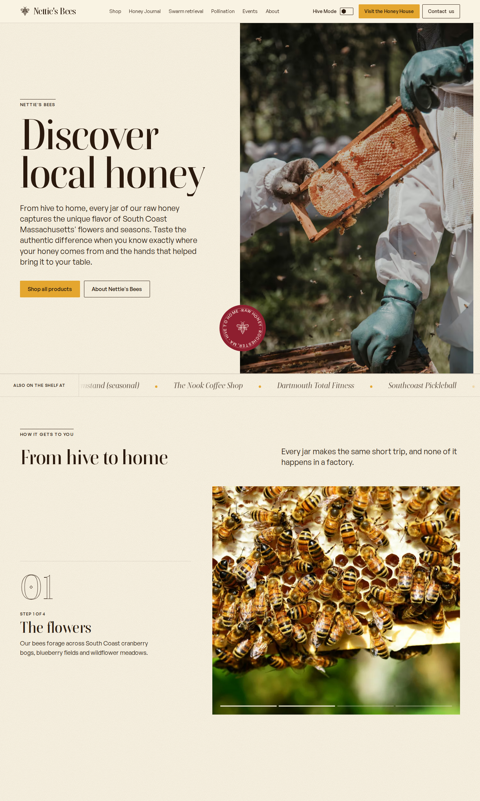
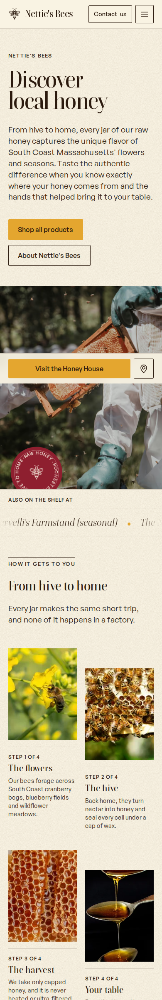

# UI Design System & Master Generation Blueprint: www-nettiesbees-com

> **Raw Local Honey in Rochester, MA · Nettie's Bees** (https://www.nettiesbees.com/) — Raw, unfiltered honey from South Coast Massachusetts hives. Visit our self-serve Honey House in Rochester, MA for seasonal honey, hot hon...



---

## 1. Executive Visual Persona & Design Archetype

- **Brand Essence & Persona**: **Raw Local Honey in Rochester, MA · Nettie's Bees** (`https://www.nettiesbees.com/`). Raw, unfiltered honey from South Coast Massachusetts hives. Visit our self-serve Honey House in Rochester, MA for seasonal honey, hot hon...
- **Visual Archetype**: **Light-Gallery WebGL / Canvas Interactive Experience (`#fff` / `#e4a62f`)**.
- **Anti-AI-Slop Differentiators**:
  - **Source-Grounded Chromatic Polarity**: Anchors the viewport in `#fff` (`var(--color-white)` in `:root`) paired with `#2b1a0e` primary typography and `#e4a62f` accents.
  - **Extracted Typographic Hierarchy**: Pairs `General Sans` for display copy (`Discover local honey`) with `Boska` and `SFMono-Regular`.
  - **Calibrated Spatial Grid & Motion**: Combines `40rem` container bounds (`gap: .4rem`, padding `2rem`) with `cubic-bezier(0,0,.2,1)` easing and Three.js / WebGL Canvas Pipeline.

---

## 2. Spatial Architecture & Modular Grid Mathematics



### Viewport Allocation & Container Geometry
- **Captured Viewport Dimensions**: Desktop `1440×14696px` (`assets/desktop.png`, full-page scroll capture), Mobile `390×2400px` (`assets/mobile.png`, capped at 2400px multi-section capture).
- **Master Container Bounds**: `40rem` extracted from `www-nettiesbees-com` stylesheet.
- **Canvas Lateral Padding & Spacing**: `2rem` lateral canvas padding with `.4rem` grid gap.
- **Border Radius Scale**: `2px`, `.3125rem`, `.375rem`, `.25rem`.

### Responsive Breakpoint Architecture
- **Desktop Layout**: Multi-column CSS Grid / Flexbox layout at `1440px` (`max-width: 40rem`, `gap: .4rem`).
- **Mobile Layout**: Single-column vertical stack at `390px` viewport width with `2rem` horizontal padding.
- **Extracted CSS Media Queries**: `@media (width>=40rem)`, `@media (width>=48rem)`, `@media (width>=64rem)`, `@media (width>=80rem)`.

---

## 3. Color System, Materiality & Atmospheric Lighting

### Semantic Palette & Source Grounding
| Semantic Role | Ground-Truth Value | Extracted CSS Source / Selector |
|---|---|---|
| **Primary Canvas Substrate** | `#fff` | `var(--color-white)` in `:root` |
| **Primary Typography Ink** | `#2b1a0e` | `var(--color-ink)` in `:root` |
| **Elevated Surface / Card Substrate** | `#f9f3e3` | `var(--color-cream)` in `:root` |
| **Interactive Accent / Highlight** | `#e4a62f` | `var(--color-amber)` in `:root` |
| **Secondary / Muted Copy** | `#8e1f2f` | `var(--color-cranberry)` in `:root` |
| **Structural Hairline Border** | `#9c86c9` | `var(--color-lavender)` in `:root` |

### Sanitized Root CSS Variables (`ui-ux.md` Ground Truth)
| Variable Name | Extracted Value | Semantic Role |
|---|---|---|
| `--font-sans` | `"General Sans", "Helvetica Neue", Arial, sans-serif` | Typography / Scale Token |
| `--color-white` | `#fff` | Canvas / Surface Token |
| `--spacing` | `.25rem` | Layout / Spatial Grid Token |
| `--container-xs` | `20rem` | Layout / Spatial Grid Token |
| `--container-sm` | `24rem` | Layout / Spatial Grid Token |
| `--container-md` | `28rem` | Layout / Spatial Grid Token |
| `--container-lg` | `32rem` | Layout / Spatial Grid Token |
| `--container-xl` | `36rem` | Layout / Spatial Grid Token |
| `--container-2xl` | `42rem` | Layout / Spatial Grid Token |
| `--container-3xl` | `48rem` | Layout / Spatial Grid Token |
| `--container-4xl` | `56rem` | Layout / Spatial Grid Token |
| `--container-5xl` | `64rem` | Layout / Spatial Grid Token |
| `--text-sm` | `.875rem` | Typography Ink Token |
| `--text-sm--line-height` | `calc(1.25 / .875)` | Typography Ink Token |
| `--text-base` | `1rem` | Typography Ink Token |
| `--text-base--line-height` | `calc(1.5 / 1)` | Typography Ink Token |

---

## 4. Typographic Scale & Editorial Hierarchy

### Font Family Stacks
- **Display Typography**: `General Sans`.
- **Primary Body Stack**: `Boska`.
- **Technical / Metadata Stack**: `SFMono-Regular`.

### Typographic Scale & Rules (Extracted from Stylesheet & Variables)
- **Hero Display (`H1`)**: CSS variables `--text-4xl: 2.25rem`, `--text-4xl--line-height: calc(2.5 / 2.25)`, `--text-5xl: 3rem`.
- **Section Heading (`H2`)**: CSS variables `--text-2xl: 1.5rem`, `--text-2xl--line-height: calc(2 / 1.5)`, `--text-3xl: 1.875rem`.
- **Body Copy**: CSS variables `--text-base: 1rem`, `--text-base--line-height: calc(1.5 / 1)`.
- **Metadata & Navigation Labels**: CSS variables `--text-sm: .875rem`, `--text-sm--line-height: calc(1.25 / .875)`, `--default-mono-font-family: var(--font-mono)`.

---

## 5. Choreographed Motion & Interaction Physics

### Primary Easing Curves
- **Extracted Timing Functions**: `cubic-bezier(0,0,.2,1)`, `cubic-bezier(.4,0,.2,1)`, `cubic-bezier(.2,.7,.1,1)`.

### Per-Element Transition & Choreography Rules
- **Selector `layer theme`**: `transition: .15s` extracted from `www-nettiesbees-com` stylesheet.
- **Selector `td)>a:not([class])`**: `transition: text-decoration-thickness var(--t1)` extracted from `www-nettiesbees-com` stylesheet.
- **Selector `layer utilities`**: `transition: color var(--t2) var(--ease-honey), border-color var(--t2) var(...` extracted from `www-nettiesbees-com` stylesheet.
- **Extracted Easing Curve (`cubic-bezier(0,0,.2,1)`)**: Governs interactive state transitions across `<header.sticky>` and `<section.stockists>`.
- **Runtime Interaction Engine**: Integrates Three.js / WebGL Canvas Pipeline with `prefers-reduced-motion: reduce` fallback guards.

---

## 6. Component Wireframe & Structural DOM Map

### Visual Layout Schematic (Grounded in `dom.html` — `1440px` Desktop & `390px` Mobile Reflow)
```
┌────────────────────────────────────────────────────────────────────────┐
│ DESKTOP VIEWPORT (1440px) — Raw Local Honey in Rochester, MA · Nettie' │
│ ====================================================================== │
│ [ <header.sticky>          | Shop · Honey Journal · Swarm retrieval ]  │
│ ---------------------------------------------------------------------- │
│ | HERO STAGE: <section.overflow-hidden>                            |   │
│ | H1: Discover local honey                                         |   │
│ | Substrate: #fff       | Ink: #2b1a0e    | Accent: #e4a62f        |   │
│ ---------------------------------------------------------------------- │
│ | SHOWCASE GRID (<section.stockists>       ) max-w: 40rem          |   │
│ | +------------------------------+  +------------------------------+ | │
│ | | Also on the shelf at         |  | From hive to home            | | │
│ | +------------------------------+  +------------------------------+ | │
│ ---------------------------------------------------------------------- │
│ | MOBILE VIEWPORT REFLOW (390px) — Single-Column Stack (gap: .4rem ) | │
│ | [<header.sticky>] -> [<section.overflow-] -> [<section.stockists] |  │
│ ---------------------------------------------------------------------- │
│ [ FOOTER (<footer.theme-invert> ) | https://www.nettiesbees.com/       │
└────────────────────────────────────────────────────────────────────────┘
```

### Granular DOM Region Breakdown
1. **Brand Header & Navigation Bar (<header.sticky> — `www-nettiesbees-com`)**:
   - Landmark `<header class="sticky top-0">` hosting `Raw Local Honey in Rochester, MA · N` navigation (`Shop · Honey Journal · Swarm retrieval · Pollination · Events`), DOM attributes (`data-season="fall"`, `data-hour="14"`, `data-month="10"`, `data-daypart="day"`), and stylesheet rule `backdrop { box-sizing:border-box;border:0 solid;margin:0;padding:0 }`.
2. **Hero Stage & Focal Lead (<section.overflow-hidden> — `Discover local honey`)**:
   - Landmark `<section class="overflow-hidden border-b">` presenting display lead `Discover local honey` and copy excerpt *"Nettie's Bees z z z Linksmų Kalėdų! Merry Christmas, in Lithuania"* over `#fff` canvas and `#2b1a0e` ink.
3. **Primary Showcase & Content Grid (<section.stockists> — `Also on the shelf at`)**:
   - Landmark `<section class="stockists border-y">` rendering section `Also on the shelf at` with copy *"Linksmų Kalėdų! Merry Christmas, in Lithuanian."*, asset references (`favicon.png`, `apple-touch-icon.png`, `sitemap-index.xml`, `rss.xml`), and grid rule `file-selector-button { box-sizing:border-box;border:0 solid;margin:0;padding:0 }`.
4. **Interactive Detail & Feature Matrix (<section.section> — `From hive to home`)**:
   - Landmark `<section class="section">` framing `From hive to home` and `The flowers` (*"Visit the Honey House"*) with `#f9f3e3` surface cards, `#e4a62f` accents, and `strong { font-weight:bolder }`.
5. **Colophon & Global Directory Footer (<footer.theme-invert> — `https://www.nettiesbees.com/`)**:
   - Landmark `<footer class="theme-invert relative">` anchoring `Raw Local Honey in Rochester, MA` footer links (`Shop · Honey Journal · Swarm retrieval · Pollination · Events`), copy *"From hive to home, every jar of our raw honey captures the u"*, and `#9c86c9` structural dividers.

---

## 7. Master Zero-Shot AI Generation Prompt

```markdown
# Master Zero-Shot Frontend Generation Prompt: www-nettiesbees-com (Raw Local Honey in Rochester, MA · Nettie's Bees)

You are a principal frontend architect and design systems engineer. Build a complete, production-ready web application replicating the exact design system, DOM landmarks, typographic hierarchy, color tokens, and motion physics of `www-nettiesbees-com` (**Raw Local Honey in Rochester, MA · Nettie's Bees** — `https://www.nettiesbees.com/`).

### 1. Visual Archetype & Anti-AI-Slop Mandates
- **Archetype**: Light-Gallery WebGL / Canvas Interactive Experience (`#fff` / `#e4a62f`).
- **Identity & Domain Context**: Raw, unfiltered honey from South Coast Massachusetts hives. Visit our self-serve Honey House in Rochester, MA for seasonal honey, hot hon...
- **Primary Substrate**: `#fff` (`var(--color-white)` in `:root`), **Primary Ink**: `#2b1a0e`, **Accent / Highlight**: `#e4a62f`.
- **Site-Specific Differentiators**:
  - **Source-Grounded Chromatic Polarity**: Anchors the viewport in `#fff` (`var(--color-white)` in `:root`) paired with `#2b1a0e` primary typography and `#e4a62f` accents.
  - **Extracted Typographic Hierarchy**: Pairs `General Sans` for display copy (`Discover local honey`) with `Boska` and `SFMono-Regular`.
  - **Calibrated Spatial Grid & Motion**: Combines `40rem` container bounds (`gap: .4rem`, padding `2rem`) with `cubic-bezier(0,0,.2,1)` easing and Three.js / WebGL Canvas Pipeline.

### 2. Ground-Truth CSS Variables (`:root` Token Contract)
Declare and consume these exact custom properties extracted from `www-nettiesbees-com` in your global stylesheet:

:root {
  /* Raw Local Honey in Rochester, MA · Nettie's Bees (www-nettiesbees-com) — Ground-Truth Extracted CSS Variables */
  --font-sans: "General Sans", "Helvetica Neue", Arial, sans-serif; /* Typography / Scale Token (www-nettiesbees-com) */
  --color-white: #fff; /* Canvas / Surface Token (www-nettiesbees-com) */
  --spacing: .25rem; /* Layout / Spatial Grid Token (www-nettiesbees-com) */
  --container-xs: 20rem; /* Layout / Spatial Grid Token (www-nettiesbees-com) */
  --container-sm: 24rem; /* Layout / Spatial Grid Token (www-nettiesbees-com) */
  --container-md: 28rem; /* Layout / Spatial Grid Token (www-nettiesbees-com) */
  --container-lg: 32rem; /* Layout / Spatial Grid Token (www-nettiesbees-com) */
  --container-xl: 36rem; /* Layout / Spatial Grid Token (www-nettiesbees-com) */
  --container-2xl: 42rem; /* Layout / Spatial Grid Token (www-nettiesbees-com) */
  --container-3xl: 48rem; /* Layout / Spatial Grid Token (www-nettiesbees-com) */
  --container-4xl: 56rem; /* Layout / Spatial Grid Token (www-nettiesbees-com) */
  --container-5xl: 64rem; /* Layout / Spatial Grid Token (www-nettiesbees-com) */
  --text-sm: .875rem; /* Typography Ink Token (www-nettiesbees-com) */
  --text-sm--line-height: calc(1.25 / .875); /* Typography Ink Token (www-nettiesbees-com) */
  --text-base: 1rem; /* Typography Ink Token (www-nettiesbees-com) */
  --text-base--line-height: calc(1.5 / 1); /* Typography Ink Token (www-nettiesbees-com) */
}

### 3. Semantic Color & Materiality Contract
Map every surface, ink, and border strictly to these source-grounded tokens:
- **Primary Canvas Substrate**: `#fff` — grounded in `var(--color-white)` in `:root`
- **Primary Typography Ink**: `#2b1a0e` — grounded in `var(--color-ink)` in `:root`
- **Elevated Surface / Card Substrate**: `#f9f3e3` — grounded in `var(--color-cream)` in `:root`
- **Interactive Accent / Highlight**: `#e4a62f` — grounded in `var(--color-amber)` in `:root`
- **Secondary / Muted Copy**: `#8e1f2f` — grounded in `var(--color-cranberry)` in `:root`
- **Structural Hairline Border**: `#9c86c9` — grounded in `var(--color-lavender)` in `:root`

### 4. Spatial Grid, Container Bounds & Responsive Breakpoints
- **Desktop Viewport Reference**: `1440×14696px` (full-page scroll capture, `1440px` standard desktop width).
- **Mobile Viewport Reference**: `390×2400px` (capped at 2400px multi-section capture, `390px` standard mobile width).
- **Container Max-Width**: `40rem` extracted from `www-nettiesbees-com` stylesheet
- **Padding & Gutters**: `2rem` lateral canvas padding with `.4rem` grid gap
- **Desktop Grid**: Multi-column CSS Grid / Flexbox layout at `1440px` (`max-width: 40rem`, `gap: .4rem`)
- **Mobile Adaptation**: Single-column vertical stack at `390px` viewport width with `2rem` horizontal padding
- **Media Queries**: `@media (width>=40rem)`, `@media (width>=48rem)`, `@media (width>=64rem)`, `@media (width>=80rem)`
- **Corner Radii**: `2px`, `.3125rem`, `.375rem`, `.25rem`

### 5. Typography & Editorial Scale Contract
- **Display Font Stack**: `General Sans`
- **Body Font Stack**: `Boska`
- **Monospace / Technical Font Stack**: `SFMono-Regular`
- **H1 Display Rule**: CSS variables `--text-4xl: 2.25rem`, `--text-4xl--line-height: calc(2.5 / 2.25)`, `--text-5xl: 3rem`
- **H2 Section Rule**: CSS variables `--text-2xl: 1.5rem`, `--text-2xl--line-height: calc(2 / 1.5)`, `--text-3xl: 1.875rem`
- **Body Copy Rule**: CSS variables `--text-base: 1rem`, `--text-base--line-height: calc(1.5 / 1)`
- **Metadata & Index Rule**: CSS variables `--text-sm: .875rem`, `--text-sm--line-height: calc(1.25 / .875)`, `--default-mono-font-family: var(--font-mono)`

### 6. Component Hierarchy, Verbatim Copy & Real DOM Landmarks
Scaffold `www-nettiesbees-com` (`Raw Local Honey in Rochester, MA · Nettie's Bees`) with these exact structural regions, extracted copy, and CSS rules from `dom.html`:
1. **Brand Header & Navigation Bar (<header.sticky> — `www-nettiesbees-com`)**:
   - DOM & Selectors: Landmark `<header class="sticky top-0">` hosting `Raw Local Honey in Rochester, MA · N` navigation (`Shop · Honey Journal · Swarm retrieval · Pollination · Events`), DOM attributes (`data-season="fall"`, `data-hour="14"`, `data-month="10"`, `data-daypart="day"`), and stylesheet rule `backdrop { box-sizing:border-box;border:0 solid;margin:0;padding:0 }`.
   - Responsive Contract: Header `Brand Header & Navigation Bar (<header.sticky> — `www-nettiesbees-com`)` (`www-nettiesbees-com`) adapts across `@media (width>=40rem)`, `@media (width>=48rem)`, `@media (width>=64rem)`, `@media (width>=80rem)` with `cubic-bezier(0,0,.2,1)`, `cubic-bezier(.4,0,.2,1)`, `cubic-bezier(.2,.7,.1,1)` transitions and links `Shop · Honey Journal · Swarm retrieval · Pollination · Events`.
2. **Hero Stage & Focal Lead (<section.overflow-hidden> — `Discover local honey`)**:
   - DOM & Selectors: Landmark `<section class="overflow-hidden border-b">` presenting display lead `Discover local honey` and copy excerpt *"Nettie's Bees z z z Linksmų Kalėdų! Merry Christmas, in Lithuania"* over `#fff` canvas and `#2b1a0e` ink.
   - Responsive Contract: Hero stage (`1440×14696px` desktop / `390×2400px` mobile) sets `#fff` background with `#2b1a0e` headline `Discover local honey`.
3. **Primary Showcase & Content Grid (<section.stockists> — `Also on the shelf at`)**:
   - DOM & Selectors: Landmark `<section class="stockists border-y">` rendering section `Also on the shelf at` with copy *"Linksmų Kalėdų! Merry Christmas, in Lithuanian."*, asset references (`favicon.png`, `apple-touch-icon.png`, `sitemap-index.xml`, `rss.xml`), and grid rule `file-selector-button { box-sizing:border-box;border:0 solid;margin:0;padding:0 }`.
   - Responsive Contract: Showcase grid `Primary Showcase & Content Grid (<section.stockists> — `Also on the shelf at`)` applies Multi-column CSS Grid / Flexbox layout at `1440px` (`max-width: 40rem`, `gap: .4rem`) on desktop and Single-column vertical stack at `390px` viewport width with `2rem` horizontal padding on mobile.
4. **Interactive Detail & Feature Matrix (<section.section> — `From hive to home`)**:
   - DOM & Selectors: Landmark `<section class="section">` framing `From hive to home` and `The flowers` (*"Visit the Honey House"*) with `#f9f3e3` surface cards, `#e4a62f` accents, and `strong { font-weight:bolder }`.
   - Responsive Contract: Detail module `Interactive Detail & Feature Matrix (<section.section> — `From hive to home`)` uses `2px`, `.3125rem`, `.375rem`, `.25rem` radii, `#e4a62f` highlights, and assets (favicon.png, apple-touch-icon.png, sitemap-index.xml).
5. **Colophon & Global Directory Footer (<footer.theme-invert> — `https://www.nettiesbees.com/`)**:
   - DOM & Selectors: Landmark `<footer class="theme-invert relative">` anchoring `Raw Local Honey in Rochester, MA` footer links (`Shop · Honey Journal · Swarm retrieval · Pollination · Events`), copy *"From hive to home, every jar of our raw honey captures the u"*, and `#9c86c9` structural dividers.
   - Responsive Contract: Footer `Colophon & Global Directory Footer (<footer.theme-invert> — `https://www.nettiesbees.com/`)` aligns to `40rem` extracted from `www-nettiesbees-com` stylesheet with `2rem` lateral canvas padding with `.4rem` grid gap and attributes (data-season="fall", data-hour="14", data-month="10").

#### Verbatim DOM Copy Excerpts (`dom.html`)
- Copy Excerpt 1: *"Nettie's Bees z z z Linksmų Kalėdų! Merry Christmas, in Lithuanian."*
- Copy Excerpt 2: *"Linksmų Kalėdų! Merry Christmas, in Lithuanian."*
- Copy Excerpt 3: *"Visit the Honey House"*
- Copy Excerpt 4: *"From hive to home, every jar of our raw honey captures the unique flavor of South..."*

### 7. Motion, Extracted Stylesheet Rules & Interaction Choreography
- **Primary Easing Functions**: `cubic-bezier(0,0,.2,1)`, `cubic-bezier(.4,0,.2,1)`, `cubic-bezier(.2,.7,.1,1)`
- **Extracted Stylesheet Rules (`www-nettiesbees-com`)**:
- `backdrop { box-sizing:border-box;border:0 solid;margin:0;padding:0 }`
- `file-selector-button { box-sizing:border-box;border:0 solid;margin:0;padding:0 }`
- `strong { font-weight:bolder }`
- `small { font-size:80% }`
- `sup { vertical-align:baseline;font-size:75%;line-height:0;position:relative }`
- **Per-Selector Transition Rules**:
- **Selector `layer theme`**: `transition: .15s` extracted from `www-nettiesbees-com` stylesheet.
- **Selector `td)>a:not([class])`**: `transition: text-decoration-thickness var(--t1)` extracted from `www-nettiesbees-com` stylesheet.
- **Selector `layer utilities`**: `transition: color var(--t2) var(--ease-honey), border-color var(--t2) var(...` extracted from `www-nettiesbees-com` stylesheet.
- **Extracted Easing Curve (`cubic-bezier(0,0,.2,1)`)**: Governs interactive state transitions across `<header.sticky>` and `<section.stockists>`.
- **Runtime Interaction Engine**: Integrates Three.js / WebGL Canvas Pipeline with `prefers-reduced-motion: reduce` fallback guards.

### 8. Technical Deliverables
- Implement in Next.js (App Router) with TypeScript and Tailwind CSS consuming the `:root` custom properties defined above for `www-nettiesbees-com`.
- Reproduce both the `1440px` desktop architecture and `390px` mobile breakpoint transitions, preserving semantic HTML5 landmarks (`<header>`, `<nav>`, `<main>`, `<section>`, `<footer>`) and `prefers-reduced-motion` accessibility guards.
```
