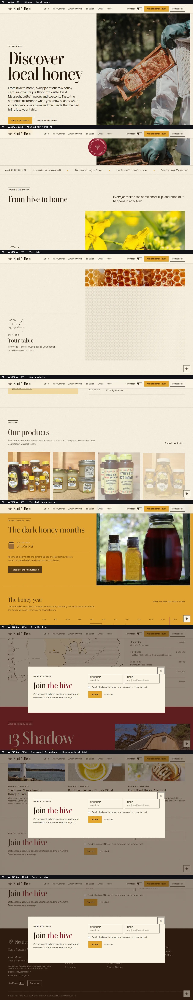
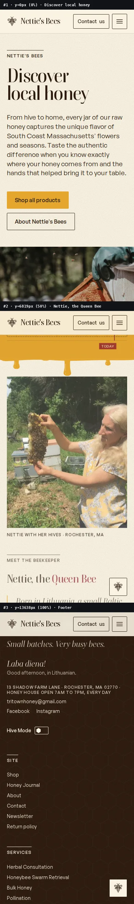

# UI Design System & Master Generation Blueprint: www-nettiesbees-com

> **Raw Local Honey in Rochester, MA · Nettie's Bees** (https://www.nettiesbees.com/) — Raw, unfiltered honey from South Coast Massachusetts hives. Visit our self-serve Honey House in Rochester, MA for seasonal honey, hot hon...





---

## 1. Executive Visual Persona & Design Archetype

- **Brand Essence & Persona**: **Raw Local Honey in Rochester, MA · Nettie's Bees** (`https://www.nettiesbees.com/`). Raw, unfiltered honey from South Coast Massachusetts hives. Visit our self-serve Honey House in Rochester, MA for seasonal honey, hot hon...
- **Capture Provenance**: Live browser capture (`tier1_fast`, HTTP `200`, captured `2026-11-24`).
- **Visual Archetype**: **Light-Gallery WebGL / Canvas Interactive Experience (`#f9f3e3` / `#e4a62f`)**.
- **Anti-AI-Slop Differentiators**:
  - **Live-Computed Chromatic Polarity**: Anchors the viewport in `#f9f3e3` (live computed `body` `background-color` (`computed_styles.json`)) paired with `#2b1a0e` primary typography and `#e4a62f` accents.
  - **Grounded Typographic Hierarchy**: Pairs `Boska` for display copy (`Discover local honey`) with `General Sans` and `SFMono-Regular`.
  - **Calibrated Spatial Grid & Motion**: Combines `96rem` container bounds (`gap: 24px`, padding `1.1rem`) with `cubic-bezier(0,0,.2,1)` easing and Three.js / WebGL Canvas Pipeline.

---

## 2. Spatial Architecture & Modular Grid Mathematics

### Viewport Allocation & Container Geometry
- **Captured Journey Filmstrips**: Desktop `1280×6624px` (`assets/desktop-journey.webp`, `8` keyframes up to `y=13299px` / doc `14833px`), Mobile `390×2616px` (`assets/mobile-journey.webp`, `3` keyframes).
- **Master Container Bounds**: `96rem` (non-`@media` desktop container stylesheet rule).
- **Canvas Lateral Padding & Spacing**: `1.1rem` lateral canvas padding with `24px` grid gap.
- **Border Radius Scale**: `2px`, `.3125rem`, `.375rem`, `.25rem`.

### Responsive Breakpoint Architecture
- **Desktop Layout**: Multi-column CSS Grid / Flexbox layout at `1440px` (`max-width: 96rem`, `gap: 24px`).
- **Mobile Layout**: Single-column vertical stack at `390px` viewport width with `1.1rem` horizontal padding.
- **Extracted CSS Media Queries**: `@media (width>=768px)`, `@media (prefers-reduced-motion:no-preference)`, `@media (prefers-reduced-motion:reduce)`, `@media (width<=767px)`.

---

## 3. Color System, Materiality & Atmospheric Lighting

### Semantic Palette & Source Grounding
| Semantic Role | Ground-Truth Value | Extracted Live / CSS Source |
|---|---|---|
| **Primary Canvas Substrate** | `#f9f3e3` | live computed `body` `background-color` (`computed_styles.json`) |
| **Primary Typography Ink** | `#2b1a0e` | live computed `h1` `color` (`computed_styles.json`) |
| **Elevated Surface / Card Substrate** | `#2b1a0e` | live computed `footer` `background-color` (`computed_styles.json`) |
| **Interactive Accent / Highlight** | `#e4a62f` | `var(--color-amber)` in `:root` |
| **Secondary / Muted Copy** | `#2b1a0e` | secondary opacity step of live computed `h1` `color` (`computed_styles.json`) |
| **Structural Hairline Border** | `#dad2c3` | `var(--color-line)` in `:root` |
| **Variable Token (`--color-white`)** | `#ffffff` | `var(--color-white)` in `:root` |

### Sanitized Root CSS Variables (`ui-ux.md` Ground Truth)
| Variable Name | Extracted Value | Semantic Role |
|---|---|---|
| `--t1` | `.22s` | Motion / Timing Token |
| `--t2` | `.6s` | Motion / Timing Token |
| `--t3` | `1.2s` | Motion / Timing Token |
| `--bg` | `var(--color-cream)` | Canvas / Surface Token |
| `--fg` | `var(--color-ink)` | Typography Ink Token |
| `--line` | `var(--color-line)` | Design System Custom Token |
| `--accent` | `var(--color-amber)` | Brand / Palette Token |
| `--on-accent` | `var(--color-ink)` | Brand / Palette Token |
| `--pop` | `var(--color-cranberry)` | Design System Custom Token |
| `--focus` | `var(--color-ink)` | Design System Custom Token |
| `--honey` | `var(--color-amber)` | Design System Custom Token |
| `--gap` | `1.5rem` | Layout / Spatial Grid Token |
| `--lit` | `1` | Design System Custom Token |
| `--font-sans` | `"General Sans", "Helvetica Neue", Arial, sans-serif` | Typography / Scale Token |
| `--color-white` | `#fff` | Canvas / Surface Token |
| `--spacing` | `.25rem` | Layout / Spatial Grid Token |

---

## 4. Typographic Scale & Editorial Hierarchy

### Font Family Stacks
- **Display Typography**: `Boska`.
- **Primary Body Stack**: `General Sans`.
- **Technical / Metadata Stack**: `SFMono-Regular`.

### Typographic Scale & Rules (Live Computed & Stylesheet Grounded)
- **Hero Display (`H1`)**: live computed `h1` (`font-size: 128px`, `line-height: 115.2px`, `font-weight: 500`, `letter-spacing: -3.84px`); CSS variables `--text-4xl: 2.25rem`, `--text-4xl--line-height: calc(2.5 / 2.25)`, `--text-5xl: 3rem`.
- **Section Heading (`H2`)**: live computed `h2` (`font-size: 60.48px`, `line-height: 63.504px`, `font-weight: 500`, `letter-spacing: -1.2096px`); CSS variables `--text-2xl: 1.5rem`, `--text-2xl--line-height: calc(2 / 1.5)`, `--text-3xl: 1.875rem`.
- **Body Copy**: live computed `body` (`font-size: 16px`, `line-height: 25.6px`, `font-weight: 400`); CSS variables `--text-base: 1rem`, `--text-base--line-height: calc(1.5 / 1)`.
- **Metadata & Navigation Labels**: live computed `nav/a` (`font-size: 16px`, `line-height: 25.6px`, `font-weight: 400`); CSS variables `--text-sm: .875rem`, `--text-sm--line-height: calc(1.25 / .875)`, `--default-mono-font-family: var(--font-mono)`.

---

## 5. Choreographed Motion & Interaction Physics

### Primary Easing Curves
- **Extracted Timing Functions**: `cubic-bezier(0,0,.2,1)`, `cubic-bezier(.4,0,.2,1)`, `cubic-bezier(.2,.7,.1,1)`.

### Per-Element Transition & Choreography Rules
- **Selector `kt4eed] .has-store[data-astro-cid...`**: `transition: fill var(--t2) var(--ease-honey)` extracted from `www-nettiesbees-com` stylesheet.
- **Selector `edia (prefers-reduced-motion:no-p...`**: `transition: stroke-dashoffset 2.6s var(--ease-honey)` extracted from `www-nettiesbees-com` stylesheet.
- **Selector `d-qckt4eed] circle[data-astro-cid...`**: `transition: stroke-dashoffset 1.6s var(--ease-honey) 1.2s, opacity var(--t...` extracted from `www-nettiesbees-com` stylesheet.
- **Extracted Easing Curve (`cubic-bezier(0,0,.2,1)`)**: Governs interactive state transitions across `<header.top-0>` and `<section.stockists>`.
- **Runtime Interaction Engine**: Integrates Three.js / WebGL Canvas Pipeline with `prefers-reduced-motion: reduce` fallback guards.
### Measured Runtime Scroll & Interaction Telemetry (`behavioral_journey_v2`)
- **Scroll Driver Mode**: `native` (max document height `14833px`, deepest scrollY reached `13299px` across `8` desktop keyframes).
- **Detected Scroll / Motion Libraries**: `WebGL/Canvas`.
- **Hover Physics (`primary_cta` · `Nettie's Bees`)**: Computed transition `0s` / `ease` (no static color/transform shift captured at rest).
- **Route Transition Architecture**: First internal navigation (`/post/raw-honey-vs-processed-honey-the-essential-differences`) measured as `direct` in `1627ms`.

---

## 6. Component Wireframe & Structural DOM Map

### Visual Layout Schematic — Desktop (`1440px`, Grounded in `dom.html` & Landmark Bounding Boxes)
```
┌────────────────────────────────────────────────────────────────────────┐
│ DESKTOP VIEWPORT (1440px) — Raw Local Honey in Rochester, MA · Nettie' │
│ ====================================================================== │
│ [ <header.top-0> (1440x69px)          | Shop · Honey Journal · Swarm ] │
│ ---------------------------------------------------------------------- │
│ | HERO STAGE: <section.hairline> (w=1440px)                          | │
│ | H1: Discover local honey                                           | │
│ | Substrate: #f9f3e3 | Ink: #2b1a0e | Accent: #e4a62f                | │
│ ---------------------------------------------------------------------- │
│ | SHOWCASE GRID (<section.stockists>) max-w: 96rem                   | │
│ | +------------------------------+  +------------------------------+ | │
│ | | Also on the shelf at         |  | From hive to home            | | │
│ | +------------------------------+  +------------------------------+ | │
│ ---------------------------------------------------------------------- │
│ | DETAIL MODULE (<section.section>) — From light to dark             | │
│ ---------------------------------------------------------------------- │
│ [ FOOTER (<footer.theme-invert) | https://www.nettiesbees.com/         │
└────────────────────────────────────────────────────────────────────────┘
```

### Visual Layout Schematic — Mobile Reflow (`390px`)
```
┌────────────────────────────────────────────────────────────────────────┐
│ MOBILE VIEWPORT REFLOW (390px) — Single-Column Stack (gap: 24px)       │
│ ====================================================================== │
│ [ HEADER BAR (<header.top-0>          ) | Compact Menu (390px)         │
│ ---------------------------------------------------------------------- │
│ | HERO STAGE (<section.hairline>) — 390px Vertical Lead              | │
│ | H1: Discover local honey                                           | │
│ ---------------------------------------------------------------------- │
│ | SHOWCASE STACK (<section.stockists>) — 1-Col Stack                 | │
│ | [ Item 1: Also on the shelf at                                   ] | │
│ | [ Item 2: From hive to home                                      ] | │
│ ---------------------------------------------------------------------- │
│ | DETAIL STACK (<section.section>) — 1-Col (From light to dark)      | │
│ ---------------------------------------------------------------------- │
│ [ FOOTER (<footer.theme-invert) | Stacked 390px Colophon               │
└────────────────────────────────────────────────────────────────────────┘
```

### Granular DOM Region Breakdown
1. **Brand Header & Navigation Bar (<header.top-0> — `www-nettiesbees-com`)**:
   - Landmark `<header class="top-0 z-40">` (`1440x69px`) hosting `Raw Local Honey in Rochester, MA · N` navigation (`Shop · Honey Journal · Swarm retrieval · Pollination · Events`), DOM attributes (`data-season="fall"`, `data-hour="13"`, `data-month="10"`, `data-daypart="day"`), and stylesheet rule `webkit-slider-runnable-track { background:0 0;height:100% }`.
2. **Hero Stage & Focal Lead (<section.hairline> — `Discover local honey`)**:
   - Landmark `<section class="hairline overflow-hidden">` presenting display lead `Discover local honey` and copy excerpt *"From hive to home, every jar of our raw honey captures the unique"* over `#f9f3e3` canvas and `#2b1a0e` ink.
3. **Primary Showcase & Content Grid (<section.stockists> — `Also on the shelf at`)**:
   - Landmark `<section class="stockists border-y">` rendering section `Also on the shelf at` with copy *"Cervelli's Farmstand (seasonal)"*, asset references (`favicon.png`, `apple-touch-icon.png`, `sitemap-index.xml`, `rss.xml`), and grid rule `moz-range-track { background:0 0;height:100% }`.
4. **Interactive Detail & Feature Matrix (<section.section> — `From hive to home`)**:
   - Landmark `<section class="section">` framing `From hive to home` and `From light to dark` (*"The Nook Coffee Shop"*) with `#2b1a0e` surface cards, `#e4a62f` accents, and `focus-visible { outline:2px solid var(--color-ink);outline-offset:4px }`.
5. **Colophon & Global Directory Footer (<footer.theme-invert> — `https://www.nettiesbees.com/`)**:
   - Landmark `<footer class="theme-invert relative">` anchoring `Raw Local Honey in Rochester, MA` footer links (`Shop · Honey Journal · Swarm retrieval · Pollination · Events`), copy *"Dartmouth Total Fitness"*, and `#dad2c3` structural dividers.
### Full Vertical Scroll Sequence (Desktop `1440×900` Keyframes)
- **Step 01** (`y=0px`, `0%`): Active landmark `Discover local honey` · sticky/fixed elements: `1`
- **Step 02** (`y=850px`, `6%`): Active landmark `ALSO ON THE SHELF AT` · sticky/fixed elements: `2`
- **Step 03** (`y=3400px`, `25%`): Active landmark `Your table` · sticky/fixed elements: `3`
- **Step 04** (`y=5950px`, `43%`): Active landmark `Our products` · sticky/fixed elements: `2`
- **Step 05** (`y=7650px`, `56%`): Active landmark `The dark honey months` · sticky/fixed elements: `2`
- **Step 06** (`y=10200px`, `77%`): Active landmark `Join the hive` · sticky/fixed elements: `2`
- **Step 07** (`y=12750px`, `96%`): Active landmark `Southcoast Massachusetts Honey: A Local Guide` · sticky/fixed elements: `2`
- **Step 08** (`y=13299px`, `100%`): Active landmark `Join the hive` · sticky/fixed elements: `2`

### Multi-Page Internal Route Map
- **Detail Route (`/post/raw-honey-vs-processed-honey-the-essential-differences`)**: `https://www.nettiesbees.com/post/raw-honey-vs-processed-honey-the-essential-differences` — H1: `Raw Honey vs Processed Honey: The Essential Diffe...`, scrollHeight `13727px`, transition `direct` (`1627ms`)
- **About Route (`/about-us`)**: `https://www.nettiesbees.com/about-us` — H1: `Nettie's Bees Story`, scrollHeight `4726px`, transition `direct` (`610ms`)
- **Detail Route (`/products/raw-honey`)**: `https://www.nettiesbees.com/products/raw-honey` — H1: `Raw Honey`, scrollHeight `2161px`, transition `direct` (`627ms`)

---

## 7. Master Zero-Shot AI Generation Prompt

```markdown
# Master Zero-Shot Frontend Generation Prompt: www-nettiesbees-com (Raw Local Honey in Rochester, MA · Nettie's Bees)

You are a principal frontend architect and design systems engineer. Build a complete, production-ready web application replicating the exact design system, DOM landmarks, typographic hierarchy, color tokens, and motion physics of `www-nettiesbees-com` (**Raw Local Honey in Rochester, MA · Nettie's Bees** — `https://www.nettiesbees.com/`).

### 1. Visual Archetype & Anti-AI-Slop Mandates
- **Archetype**: Light-Gallery WebGL / Canvas Interactive Experience (`#f9f3e3` / `#e4a62f`).
- **Identity & Domain Context**: Raw, unfiltered honey from South Coast Massachusetts hives. Visit our self-serve Honey House in Rochester, MA for seasonal honey, hot hon...
- **Primary Substrate**: `#f9f3e3` (live computed `body` `background-color` (`computed_styles.json`)), **Primary Ink**: `#2b1a0e`, **Accent / Highlight**: `#e4a62f`.
- **Site-Specific Differentiators**:
  - **Live-Computed Chromatic Polarity**: Anchors the viewport in `#f9f3e3` (live computed `body` `background-color` (`computed_styles.json`)) paired with `#2b1a0e` primary typography and `#e4a62f` accents.
  - **Grounded Typographic Hierarchy**: Pairs `Boska` for display copy (`Discover local honey`) with `General Sans` and `SFMono-Regular`.
  - **Calibrated Spatial Grid & Motion**: Combines `96rem` container bounds (`gap: 24px`, padding `1.1rem`) with `cubic-bezier(0,0,.2,1)` easing and Three.js / WebGL Canvas Pipeline.

### 2. Ground-Truth CSS Variables (`:root` Token Contract)
Declare and consume these exact custom properties extracted from `www-nettiesbees-com` in your global stylesheet:

:root {
  /* Raw Local Honey in Rochester, MA · Nettie's Bees (www-nettiesbees-com) — Live-Grounded CSS Variables */
  --t1: .22s; /* Motion / Timing Token (www-nettiesbees-com) */
  --t2: .6s; /* Motion / Timing Token (www-nettiesbees-com) */
  --t3: 1.2s; /* Motion / Timing Token (www-nettiesbees-com) */
  --bg: var(--color-cream); /* Canvas / Surface Token (www-nettiesbees-com) */
  --fg: var(--color-ink); /* Typography Ink Token (www-nettiesbees-com) */
  --line: var(--color-line); /* Design System Custom Token (www-nettiesbees-com) */
  --accent: var(--color-amber); /* Brand / Palette Token (www-nettiesbees-com) */
  --on-accent: var(--color-ink); /* Brand / Palette Token (www-nettiesbees-com) */
  --pop: var(--color-cranberry); /* Design System Custom Token (www-nettiesbees-com) */
  --focus: var(--color-ink); /* Design System Custom Token (www-nettiesbees-com) */
  --honey: var(--color-amber); /* Design System Custom Token (www-nettiesbees-com) */
  --gap: 1.5rem; /* Layout / Spatial Grid Token (www-nettiesbees-com) */
  --lit: 1; /* Design System Custom Token (www-nettiesbees-com) */
  --font-sans: "General Sans", "Helvetica Neue", Arial, sans-serif; /* Typography / Scale Token (www-nettiesbees-com) */
  --color-white: #fff; /* Canvas / Surface Token (www-nettiesbees-com) */
  --spacing: .25rem; /* Layout / Spatial Grid Token (www-nettiesbees-com) */
}

### 3. Semantic Color & Materiality Contract
Map every surface, ink, and border strictly to these source-grounded tokens:
- **Primary Canvas Substrate**: `#f9f3e3` — grounded in live computed `body` `background-color` (`computed_styles.json`)
- **Primary Typography Ink**: `#2b1a0e` — grounded in live computed `h1` `color` (`computed_styles.json`)
- **Elevated Surface / Card Substrate**: `#2b1a0e` — grounded in live computed `footer` `background-color` (`computed_styles.json`)
- **Interactive Accent / Highlight**: `#e4a62f` — grounded in `var(--color-amber)` in `:root`
- **Secondary / Muted Copy**: `#2b1a0e` — grounded in secondary opacity step of live computed `h1` `color` (`computed_styles.json`)
- **Structural Hairline Border**: `#dad2c3` — grounded in `var(--color-line)` in `:root`
- **Variable Token (`--color-white`)**: `#ffffff` — grounded in `var(--color-white)` in `:root`

### 4. Spatial Grid, Container Bounds & Responsive Breakpoints
- **Desktop Viewport Reference**: `1280×6624px` (multi-frame vertical journey filmstrip (6624px), `1440px` standard desktop width).
- **Mobile Viewport Reference**: `390×2616px` (multi-frame vertical journey filmstrip (2616px), `390px` standard mobile width).
- **Container Max-Width**: `96rem` (non-`@media` desktop container stylesheet rule)
- **Padding & Gutters**: `1.1rem` lateral canvas padding with `24px` grid gap
- **Desktop Grid**: Multi-column CSS Grid / Flexbox layout at `1440px` (`max-width: 96rem`, `gap: 24px`)
- **Mobile Adaptation**: Single-column vertical stack at `390px` viewport width with `1.1rem` horizontal padding
- **Media Queries**: `@media (width>=768px)`, `@media (prefers-reduced-motion:no-preference)`, `@media (prefers-reduced-motion:reduce)`, `@media (width<=767px)`
- **Corner Radii**: `2px`, `.3125rem`, `.375rem`, `.25rem`

### 5. Typography & Editorial Scale Contract
- **Display Font Stack**: `Boska`
- **Body Font Stack**: `General Sans`
- **Monospace / Technical Font Stack**: `SFMono-Regular`
- **H1 Display Rule**: live computed `h1` (`font-size: 128px`, `line-height: 115.2px`, `font-weight: 500`, `letter-spacing: -3.84px`); CSS variables `--text-4xl: 2.25rem`, `--text-4xl--line-height: calc(2.5 / 2.25)`, `--text-5xl: 3rem`
- **H2 Section Rule**: live computed `h2` (`font-size: 60.48px`, `line-height: 63.504px`, `font-weight: 500`, `letter-spacing: -1.2096px`); CSS variables `--text-2xl: 1.5rem`, `--text-2xl--line-height: calc(2 / 1.5)`, `--text-3xl: 1.875rem`
- **Body Copy Rule**: live computed `body` (`font-size: 16px`, `line-height: 25.6px`, `font-weight: 400`); CSS variables `--text-base: 1rem`, `--text-base--line-height: calc(1.5 / 1)`
- **Metadata & Index Rule**: live computed `nav/a` (`font-size: 16px`, `line-height: 25.6px`, `font-weight: 400`); CSS variables `--text-sm: .875rem`, `--text-sm--line-height: calc(1.25 / .875)`, `--default-mono-font-family: var(--font-mono)`

### 6. Component Hierarchy, Verbatim Copy & Real DOM Landmarks
Scaffold `www-nettiesbees-com` (`Raw Local Honey in Rochester, MA · Nettie's Bees`) with these exact structural regions, extracted copy, and CSS rules from `dom.html`:
1. **Brand Header & Navigation Bar (<header.top-0> — `www-nettiesbees-com`)**:
   - DOM & Selectors: Landmark `<header class="top-0 z-40">` (`1440x69px`) hosting `Raw Local Honey in Rochester, MA · N` navigation (`Shop · Honey Journal · Swarm retrieval · Pollination · Events`), DOM attributes (`data-season="fall"`, `data-hour="13"`, `data-month="10"`, `data-daypart="day"`), and stylesheet rule `webkit-slider-runnable-track { background:0 0;height:100% }`.
   - Responsive Contract: Header `Brand Header & Navigation Bar (<header.top-0> — `www-nettiesbees-com`)` (`www-nettiesbees-com`) adapts across `@media (width>=768px)`, `@media (prefers-reduced-motion:no-preference)`, `@media (prefers-reduced-motion:reduce)`, `@media (width<=767px)` with `cubic-bezier(0,0,.2,1)`, `cubic-bezier(.4,0,.2,1)`, `cubic-bezier(.2,.7,.1,1)` transitions and links `Shop · Honey Journal · Swarm retrieval · Pollination · Events`.
2. **Hero Stage & Focal Lead (<section.hairline> — `Discover local honey`)**:
   - DOM & Selectors: Landmark `<section class="hairline overflow-hidden">` presenting display lead `Discover local honey` and copy excerpt *"From hive to home, every jar of our raw honey captures the unique"* over `#f9f3e3` canvas and `#2b1a0e` ink.
   - Responsive Contract: Hero stage (`1280×6624px` desktop / `390×2616px` mobile) sets `#f9f3e3` background with `#2b1a0e` headline `Discover local honey`.
3. **Primary Showcase & Content Grid (<section.stockists> — `Also on the shelf at`)**:
   - DOM & Selectors: Landmark `<section class="stockists border-y">` rendering section `Also on the shelf at` with copy *"Cervelli's Farmstand (seasonal)"*, asset references (`favicon.png`, `apple-touch-icon.png`, `sitemap-index.xml`, `rss.xml`), and grid rule `moz-range-track { background:0 0;height:100% }`.
   - Responsive Contract: Showcase grid `Primary Showcase & Content Grid (<section.stockists> — `Also on the shelf at`)` applies Multi-column CSS Grid / Flexbox layout at `1440px` (`max-width: 96rem`, `gap: 24px`) on desktop and Single-column vertical stack at `390px` viewport width with `1.1rem` horizontal padding on mobile.
4. **Interactive Detail & Feature Matrix (<section.section> — `From hive to home`)**:
   - DOM & Selectors: Landmark `<section class="section">` framing `From hive to home` and `From light to dark` (*"The Nook Coffee Shop"*) with `#2b1a0e` surface cards, `#e4a62f` accents, and `focus-visible { outline:2px solid var(--color-ink);outline-offset:4px }`.
   - Responsive Contract: Detail module `Interactive Detail & Feature Matrix (<section.section> — `From hive to home`)` uses `2px`, `.3125rem`, `.375rem`, `.25rem` radii, `#e4a62f` highlights, and assets (favicon.png, apple-touch-icon.png, sitemap-index.xml).
5. **Colophon & Global Directory Footer (<footer.theme-invert> — `https://www.nettiesbees.com/`)**:
   - DOM & Selectors: Landmark `<footer class="theme-invert relative">` anchoring `Raw Local Honey in Rochester, MA` footer links (`Shop · Honey Journal · Swarm retrieval · Pollination · Events`), copy *"Dartmouth Total Fitness"*, and `#dad2c3` structural dividers.
   - Responsive Contract: Footer `Colophon & Global Directory Footer (<footer.theme-invert> — `https://www.nettiesbees.com/`)` aligns to `96rem` (non-`@media` desktop container stylesheet rule) with `1.1rem` lateral canvas padding with `24px` grid gap and attributes (data-season="fall", data-hour="13", data-month="10").

#### Verbatim DOM Copy Excerpts (`dom.html`)
- Copy Excerpt 1: *"From hive to home, every jar of our raw honey captures the unique flavor of South..."*
- Copy Excerpt 2: *"Cervelli's Farmstand (seasonal)"*
- Copy Excerpt 3: *"The Nook Coffee Shop"*
- Copy Excerpt 4: *"Dartmouth Total Fitness"*

### 7. Motion, Extracted Stylesheet Rules & Interaction Choreography
- **Primary Easing Functions**: `cubic-bezier(0,0,.2,1)`, `cubic-bezier(.4,0,.2,1)`, `cubic-bezier(.2,.7,.1,1)`
- **Extracted Stylesheet Rules (`www-nettiesbees-com`)**:
- `webkit-slider-runnable-track { background:0 0;height:100% }`
- `moz-range-track { background:0 0;height:100% }`
- `focus-visible { outline:2px solid var(--color-ink);outline-offset:4px }`
- `img { transition:transform 1.6s var(--ease-honey);transform:scale(1.08) }`
- `.on { clip-path:inset(0) }`
- **Per-Selector Transition Rules**:
- **Selector `kt4eed] .has-store[data-astro-cid...`**: `transition: fill var(--t2) var(--ease-honey)` extracted from `www-nettiesbees-com` stylesheet.
- **Selector `edia (prefers-reduced-motion:no-p...`**: `transition: stroke-dashoffset 2.6s var(--ease-honey)` extracted from `www-nettiesbees-com` stylesheet.
- **Selector `d-qckt4eed] circle[data-astro-cid...`**: `transition: stroke-dashoffset 1.6s var(--ease-honey) 1.2s, opacity var(--t...` extracted from `www-nettiesbees-com` stylesheet.
- **Extracted Easing Curve (`cubic-bezier(0,0,.2,1)`)**: Governs interactive state transitions across `<header.top-0>` and `<section.stockists>`.
- **Runtime Interaction Engine**: Integrates Three.js / WebGL Canvas Pipeline with `prefers-reduced-motion: reduce` fallback guards.
### 7b. Full-Page Scroll Choreography, Interactive States & Multi-Page Routes
- **Scroll Mechanics**: Implement `native` vertical progression up to `14833px` across 8 distinct viewport chapters using WebGL/Canvas.
- **Vertical Chapter Sequence**: Discover local honey (0%) -> ALSO ON THE SHELF AT (6%) -> Your table (25%) -> Our products (43%) -> The dark honey months (56%) -> Join the hive (77%) -> Southcoast Massachusetts Ho... (96%) -> Join the hive (100%).
- **Multi-Page Routes**: Scaffold internal routes `/post/raw-honey-vs-processed-honey-the-essential-differences` (detail, direct), `/about-us` (about, direct), `/products/raw-honey` (detail, direct) sharing the global header/footer shell and design tokens.

### 8. Technical Deliverables
- Implement in Next.js (App Router) with TypeScript and Tailwind CSS consuming the `:root` custom properties defined above for `www-nettiesbees-com`.
- Reproduce both the `1440px` desktop architecture and `390px` mobile breakpoint transitions, preserving semantic HTML5 landmarks (`<header>`, `<nav>`, `<main>`, `<section>`, `<footer>`) and `prefers-reduced-motion` accessibility guards.
```
---

## 8. Full-Page Scroll Journey, Interactive States & Subpage Inventory

### Desktop Scroll Keyframes (`1440×900` WebP)
| Step | Scroll Y | Progress | Active Landmark / Section | Sticky/Fixed | Visual Asset |
| :---: | :---: | :---: | :--- | :---: | :--- |
| `#01` | `0px` | `0%` | Discover local honey | `1` | [desktop-step-01.webp](assets/desktop-step-01.webp) |
| `#02` | `850px` | `6%` | ALSO ON THE SHELF AT | `2` | [desktop-step-02.webp](assets/desktop-step-02.webp) |
| `#03` | `3400px` | `25%` | Your table | `3` | [desktop-step-03.webp](assets/desktop-step-03.webp) |
| `#04` | `5950px` | `43%` | Our products | `2` | [desktop-step-04.webp](assets/desktop-step-04.webp) |
| `#05` | `7650px` | `56%` | The dark honey months | `2` | [desktop-step-05.webp](assets/desktop-step-05.webp) |
| `#06` | `10200px` | `77%` | Join the hive | `2` | [desktop-step-06.webp](assets/desktop-step-06.webp) |
| `#07` | `12750px` | `96%` | Southcoast Massachusetts Honey: A Local Guide | `2` | [desktop-step-07.webp](assets/desktop-step-07.webp) |
| `#08` | `13299px` | `100%` | Join the hive | `2` | [desktop-step-08.webp](assets/desktop-step-08.webp) |

### Mobile Condensed Keyframes (`390×844` WebP)
| Step | Scroll Y | Progress | Active Landmark | Visual Asset |
| :---: | :---: | :---: | :--- | :--- |
| `#01` | `0px` | `0%` | Discover local honey | [mobile-step-01.webp](assets/mobile-step-01.webp) |
| `#02` | `6819px` | `50%` | Nettie, the Queen Bee | [mobile-step-02.webp](assets/mobile-step-02.webp) |
| `#03` | `13638px` | `100%` | Footer | [mobile-step-03.webp](assets/mobile-step-03.webp) |

### Internal Subpage Filmstrips (`1080px` Wide WebP)
| # | Template | Route URL | H1 / Title | Scroll Height | Transition | Filmstrip Asset |
| :-: | :---: | :--- | :--- | :---: | :---: | :--- |
| `1` | `detail` | `https://www.nettiesbees.com/post/raw-honey-vs-processed-honey-the-essential-differences` | Raw Honey vs Processed Honey: The Ess... | `13727px` | `direct` (`1627ms`) | [subpage-01-post-raw-honey-vs-processed-honey-th.webp](assets/subpage-01-post-raw-honey-vs-processed-honey-th.webp) |
| `2` | `about` | `https://www.nettiesbees.com/about-us` | Nettie's Bees Story | `4726px` | `direct` (`610ms`) | [subpage-02-about-us.webp](assets/subpage-02-about-us.webp) |
| `3` | `detail` | `https://www.nettiesbees.com/products/raw-honey` | Raw Honey | `2161px` | `direct` (`627ms`) | [subpage-03-products-raw-honey.webp](assets/subpage-03-products-raw-honey.webp) |

