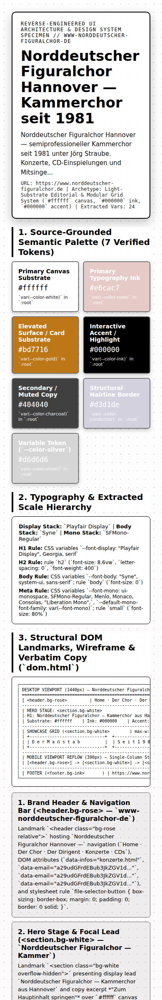

# UI Design System & Master Generation Blueprint: www-norddeutscher-figuralchor-de

> **Norddeutscher Figuralchor Hannover — Kammerchor seit 1981** (https://www.norddeutscher-figuralchor.de) — Norddeutscher Figuralchor Hannover — semiprofessioneller Kammerchor seit 1981 unter Jörg Straube. Konzerte, CD-Einspielungen und Mitsinge...


---

## 1. Executive Visual Persona & Design Archetype

- **Brand Essence & Persona**: **Norddeutscher Figuralchor Hannover — Kammerchor seit 1981** (`https://www.norddeutscher-figuralchor.de`). Norddeutscher Figuralchor Hannover — semiprofessioneller Kammerchor seit 1981 unter Jörg Straube. Konzerte, CD-Einspielungen und Mitsinge...
- **Visual Archetype**: **Light-Substrate Editorial & Modular Grid System (`#ffffff` canvas, `#000000` ink, `#000000` accent)**.
- **Anti-AI-Slop Differentiators**:
  - **Source-Grounded Chromatic Polarity**: Anchors the viewport in `#ffffff` (`var(--color-white)` in `:root`) paired with `#000000` primary typography and `#000000` accents.
  - **Extracted Typographic Hierarchy**: Pairs `Playfair Display` for display copy (`Norddeutscher Figuralchor — Kammerch`) with `Syne` and `SFMono-Regular`.
  - **Calibrated Spatial Grid & Motion**: Combines `40rem` container bounds (`gap: 14px`, padding `2vw`) with `cubic-bezier(0.4,0,0.2,1)` easing and GSAP Timeline & ScrollTrigger.

---

## 2. Spatial Architecture & Modular Grid Mathematics



### Viewport Allocation & Container Geometry
- **Captured Viewport Dimensions**: Desktop `1440×4112px` (`assets/desktop.png`, full-page scroll capture), Mobile `390×2400px` (`assets/mobile.png`, capped at 2400px multi-section capture).
- **Master Container Bounds**: `40rem` extracted from `www-norddeutscher-figuralchor-de` stylesheet.
- **Canvas Lateral Padding & Spacing**: `2vw` lateral canvas padding with `14px` grid gap.
- **Border Radius Scale**: `0.25rem`, `50%`, `16px`, `8px`.

### Responsive Breakpoint Architecture
- **Desktop Layout**: Multi-column CSS Grid / Flexbox layout at `1440px` (`max-width: 40rem`, `gap: 14px`).
- **Mobile Layout**: Single-column vertical stack at `390px` viewport width with `2vw` horizontal padding.
- **Extracted CSS Media Queries**: `@media (width >= 40rem)`, `@media (width >= 48rem)`, `@media (width >= 64rem)`, `@media (width >= 80rem)`.

---

## 3. Color System, Materiality & Atmospheric Lighting

### Semantic Palette & Source Grounding
| Semantic Role | Ground-Truth Value | Extracted CSS Source / Selector |
|---|---|---|
| **Primary Canvas Substrate** | `#ffffff` | `var(--color-white)` in `:root` |
| **Primary Typography Ink** | `#e6cac7` | `var(--color-rose)` in `:root` |
| **Elevated Surface / Card Substrate** | `#bd7716` | `var(--color-gold)` in `:root` |
| **Interactive Accent / Highlight** | `#000000` | `var(--color-ink)` in `:root` |
| **Secondary / Muted Copy** | `#404040` | `var(--color-charcoal)` in `:root` |
| **Structural Hairline Border** | `#d3d1de` | `var(--color-conductor)` in `:root` |
| **Variable Token (`--color-silver`)** | `#d6d6d6` | `var(--color-silver)` in `:root` |

### Sanitized Root CSS Variables (`ui-ux.md` Ground Truth)
| Variable Name | Extracted Value | Semantic Role |
|---|---|---|
| `--font-sans` | `ui-sans-serif, system-ui, sans-serif, "Apple Color Emoji",` | Typography / Scale Token |
| `--font-mono` | `ui-monospace, SFMono-Regular, Menlo, Monaco, Consolas, "Liberation Mono",` | Typography / Scale Token |
| `--color-white` | `#ffffff` | Canvas / Surface Token |
| `--font-weight-medium` | `500` | Typography / Scale Token |
| `--font-weight-bold` | `700` | Typography / Scale Token |
| `--ease-in-out` | `cubic-bezier(0.4, 0, 0.2, 1)` | Motion / Easing Token |
| `--default-transition-duration` | `150ms` | Motion / Easing Token |
| `--default-transition-timing-function` | `cubic-bezier(0.4, 0, 0.2, 1)` | Motion / Easing Token |
| `--default-font-family` | `var(--font-sans)` | Typography / Scale Token |
| `--default-mono-font-family` | `var(--font-mono)` | Typography / Scale Token |
| `--color-rose` | `#e6cac7` | Brand / Palette Token |
| `--color-gold` | `#bd7716` | Brand / Palette Token |
| `--color-ink` | `#000000` | Typography Ink Token |
| `--color-charcoal` | `#404040` | Brand / Palette Token |
| `--color-conductor` | `#d3d1de` | Brand / Palette Token |
| `--color-silver` | `#d6d6d6` | Brand / Palette Token |

---

## 4. Typographic Scale & Editorial Hierarchy

### Font Family Stacks
- **Display Typography**: `Playfair Display`.
- **Primary Body Stack**: `Syne`.
- **Technical / Metadata Stack**: `SFMono-Regular`.

### Typographic Scale & Rules (Extracted from Stylesheet & Variables)
- **Hero Display (`H1`)**: CSS variables `--font-display: "Playfair Display", Georgia, serif`.
- **Section Heading (`H2`)**: rule `h2` (`font-size: 8.6vw`, `letter-spacing: 0`, `font-weight: 400`).
- **Body Copy**: CSS variables `--font-body: "Syne", system-ui, sans-serif`; rule `body` (`font-size: 0`).
- **Metadata & Navigation Labels**: CSS variables `--font-mono: ui-monospace, SFMono-Regular, Menlo, Monaco, Consolas, "Liberation Mono",`, `--default-mono-font-family: var(--font-mono)`; rule `small` (`font-size: 80%`).

---

## 5. Choreographed Motion & Interaction Physics

### Primary Easing Curves
- **Extracted Timing Functions**: `cubic-bezier(0.4,0,0.2,1)`, `cubic-bezier(0.25,0.46,0.45,0.94)`, `cubic-bezier(0.65,0,0.35,1)`.

### Per-Element Transition & Choreography Rules
- **Selector `layer theme`**: `transition: 150ms` extracted from `www-norddeutscher-figuralchor-de` stylesheet.
- **Selector `.transition`**: `transition: var(--tw-ease, var(--default-transition-timing-function))` extracted from `www-norddeutscher-figuralchor-de` stylesheet.
- **Selector `.transition-colors`**: `transition: var(--tw-ease, var(--default-transition-timing-function))` extracted from `www-norddeutscher-figuralchor-de` stylesheet.
- **Extracted Easing Curve (`cubic-bezier(0.4,0,0.2,1)`)**: Governs interactive state transitions across `<header.bg-rose>` and `<section.bg-white>`.
- **Runtime Interaction Engine**: Integrates GSAP Timeline & ScrollTrigger with `prefers-reduced-motion: reduce` fallback guards.

---

## 6. Component Wireframe & Structural DOM Map

### Visual Layout Schematic (Grounded in `dom.html` — `1440px` Desktop & `390px` Mobile Reflow)
```
┌────────────────────────────────────────────────────────────────────────┐
│ DESKTOP VIEWPORT (1440px) — Norddeutscher Figuralchor Hannover — Kamme │
│ ====================================================================== │
│ [ <header.bg-rose>         | Home · Der Chor · Der Dirigent · Konze ]  │
│ ---------------------------------------------------------------------- │
│ | HERO STAGE: <section.bg-white>                                   |   │
│ | H1: Norddeutscher Figuralchor — Kammerchor aus Hannover          |   │
│ | Substrate: #ffffff    | Ink: #000000    | Accent: #000000        |   │
│ ---------------------------------------------------------------------- │
│ | SHOWCASE GRID (<section.bg-white>        ) max-w: 40rem          |   │
│ | +------------------------------+  +------------------------------+ | │
│ | | D e r M a ẞ s t a b          |  | S e i t 1 9 8 1 .            | | │
│ | +------------------------------+  +------------------------------+ | │
│ ---------------------------------------------------------------------- │
│ | MOBILE VIEWPORT REFLOW (390px) — Single-Column Stack (gap: 14px  ) | │
│ | [<header.bg-rose>] -> [<section.bg-white>] -> [<section.bg-white>] | │
│ ---------------------------------------------------------------------- │
│ [ FOOTER (<footer.bg-ink>       ) | https://www.norddeutscher-figuralc │
└────────────────────────────────────────────────────────────────────────┘
```

### Granular DOM Region Breakdown
1. **Brand Header & Navigation Bar (<header.bg-rose> — `www-norddeutscher-figuralchor-de`)**:
   - Landmark `<header class="bg-rose relative">` hosting `Norddeutscher Figuralchor Hannover —` navigation (`Home · Der Chor · Der Dirigent · Konzerte · CDs`), DOM attributes (`data-infos="konzerte.html"`, `data-email="a29udGFrdEBub3JkZGV1d..."`, `data-email="a29udGFrdEBub3JkZGV1d..."`, `data-email="a29udGFrdEBub3JkZGV1d..."`), and stylesheet rule `file-selector-button { box-sizing: border-box; margin: 0; padding: 0; border: 0 solid; }`.
2. **Hero Stage & Focal Lead (<section.bg-white> — `Norddeutscher Figuralchor — Kammer`)**:
   - Landmark `<section class="bg-white overflow-hidden">` presenting display lead `Norddeutscher Figuralchor — Kammerchor aus Hannover` and copy excerpt *"Zum Hauptinhalt springen"* over `#ffffff` canvas and `#000000` ink.
3. **Primary Showcase & Content Grid (<section.bg-white> — `D e r M a ẞ s t a b`)**:
   - Landmark `<section class="bg-white">` rendering section `D e r M a ẞ s t a b` with copy *"Der Maßstab seit 1981"*, asset references (`favicon-home.svg`, `favicon.ico`, `apple-touch-icon.png`, `PlayfairDisplay-Regular.woff2`), and grid rule `hr { height: 0; color: inherit; border-top-width: 1px; }`.
4. **Interactive Detail & Feature Matrix (<section.bg-charcoal> — `S e i t 1 9 8 1 .`)**:
   - Landmark `<section class="bg-charcoal">` framing `S e i t 1 9 8 1 .` and `wird Teil von einem.` (*"wird Teil von einem."*) with `#bd7716` surface cards, `#000000` accents, and `h6 { font-size: inherit; font-weight: inherit; }`.
5. **Colophon & Global Directory Footer (<footer.bg-ink> — `https://www.norddeutscher-figuralchor.de`)**:
   - Landmark `<footer class="bg-ink">` anchoring `Norddeutscher Figuralchor Hannov` footer links (`Home · Der Chor · Der Dirigent · Konzerte · CDs`), copy *"Der Norddeutsche Figuralchor gestaltet seit 1981 Konzerte, d"*, and `#d3d1de` structural dividers.

---

## 7. Master Zero-Shot AI Generation Prompt

```markdown
# Master Zero-Shot Frontend Generation Prompt: www-norddeutscher-figuralchor-de (Norddeutscher Figuralchor Hannover — Kammerchor seit 1981)

You are a principal frontend architect and design systems engineer. Build a complete, production-ready web application replicating the exact design system, DOM landmarks, typographic hierarchy, color tokens, and motion physics of `www-norddeutscher-figuralchor-de` (**Norddeutscher Figuralchor Hannover — Kammerchor seit 1981** — `https://www.norddeutscher-figuralchor.de`).

### 1. Visual Archetype & Anti-AI-Slop Mandates
- **Archetype**: Light-Substrate Editorial & Modular Grid System (`#ffffff` canvas, `#000000` ink, `#000000` accent).
- **Identity & Domain Context**: Norddeutscher Figuralchor Hannover — semiprofessioneller Kammerchor seit 1981 unter Jörg Straube. Konzerte, CD-Einspielungen und Mitsinge...
- **Primary Substrate**: `#ffffff` (`var(--color-white)` in `:root`), **Primary Ink**: `#000000`, **Accent / Highlight**: `#000000`.
- **Site-Specific Differentiators**:
  - **Source-Grounded Chromatic Polarity**: Anchors the viewport in `#ffffff` (`var(--color-white)` in `:root`) paired with `#000000` primary typography and `#000000` accents.
  - **Extracted Typographic Hierarchy**: Pairs `Playfair Display` for display copy (`Norddeutscher Figuralchor — Kammerch`) with `Syne` and `SFMono-Regular`.
  - **Calibrated Spatial Grid & Motion**: Combines `40rem` container bounds (`gap: 14px`, padding `2vw`) with `cubic-bezier(0.4,0,0.2,1)` easing and GSAP Timeline & ScrollTrigger.

### 2. Ground-Truth CSS Variables (`:root` Token Contract)
Declare and consume these exact custom properties extracted from `www-norddeutscher-figuralchor-de` in your global stylesheet:

:root {
  /* Norddeutscher Figuralchor Hannover — Kammerchor seit 1981 (www-norddeutscher-figuralchor-de) — Ground-Truth Extracted CSS Variables */
  --font-sans: ui-sans-serif, system-ui, sans-serif, "Apple Color Emoji",; /* Typography / Scale Token (www-norddeutscher-figuralchor-de) */
  --font-mono: ui-monospace, SFMono-Regular, Menlo, Monaco, Consolas, "Liberation Mono",; /* Typography / Scale Token (www-norddeutscher-figuralchor-de) */
  --color-white: #ffffff; /* Canvas / Surface Token (www-norddeutscher-figuralchor-de) */
  --font-weight-medium: 500; /* Typography / Scale Token (www-norddeutscher-figuralchor-de) */
  --font-weight-bold: 700; /* Typography / Scale Token (www-norddeutscher-figuralchor-de) */
  --ease-in-out: cubic-bezier(0.4, 0, 0.2, 1); /* Motion / Easing Token (www-norddeutscher-figuralchor-de) */
  --default-transition-duration: 150ms; /* Motion / Easing Token (www-norddeutscher-figuralchor-de) */
  --default-transition-timing-function: cubic-bezier(0.4, 0, 0.2, 1); /* Motion / Easing Token (www-norddeutscher-figuralchor-de) */
  --default-font-family: var(--font-sans); /* Typography / Scale Token (www-norddeutscher-figuralchor-de) */
  --default-mono-font-family: var(--font-mono); /* Typography / Scale Token (www-norddeutscher-figuralchor-de) */
  --color-rose: #e6cac7; /* Brand / Palette Token (www-norddeutscher-figuralchor-de) */
  --color-gold: #bd7716; /* Brand / Palette Token (www-norddeutscher-figuralchor-de) */
  --color-ink: #000000; /* Typography Ink Token (www-norddeutscher-figuralchor-de) */
  --color-charcoal: #404040; /* Brand / Palette Token (www-norddeutscher-figuralchor-de) */
  --color-conductor: #d3d1de; /* Brand / Palette Token (www-norddeutscher-figuralchor-de) */
  --color-silver: #d6d6d6; /* Brand / Palette Token (www-norddeutscher-figuralchor-de) */
}

### 3. Semantic Color & Materiality Contract
Map every surface, ink, and border strictly to these source-grounded tokens:
- **Primary Canvas Substrate**: `#ffffff` — grounded in `var(--color-white)` in `:root`
- **Primary Typography Ink**: `#e6cac7` — grounded in `var(--color-rose)` in `:root`
- **Elevated Surface / Card Substrate**: `#bd7716` — grounded in `var(--color-gold)` in `:root`
- **Interactive Accent / Highlight**: `#000000` — grounded in `var(--color-ink)` in `:root`
- **Secondary / Muted Copy**: `#404040` — grounded in `var(--color-charcoal)` in `:root`
- **Structural Hairline Border**: `#d3d1de` — grounded in `var(--color-conductor)` in `:root`
- **Variable Token (`--color-silver`)**: `#d6d6d6` — grounded in `var(--color-silver)` in `:root`

### 4. Spatial Grid, Container Bounds & Responsive Breakpoints
- **Desktop Viewport Reference**: `1440×4112px` (full-page scroll capture, `1440px` standard desktop width).
- **Mobile Viewport Reference**: `390×2400px` (capped at 2400px multi-section capture, `390px` standard mobile width).
- **Container Max-Width**: `40rem` extracted from `www-norddeutscher-figuralchor-de` stylesheet
- **Padding & Gutters**: `2vw` lateral canvas padding with `14px` grid gap
- **Desktop Grid**: Multi-column CSS Grid / Flexbox layout at `1440px` (`max-width: 40rem`, `gap: 14px`)
- **Mobile Adaptation**: Single-column vertical stack at `390px` viewport width with `2vw` horizontal padding
- **Media Queries**: `@media (width >= 40rem)`, `@media (width >= 48rem)`, `@media (width >= 64rem)`, `@media (width >= 80rem)`
- **Corner Radii**: `0.25rem`, `50%`, `16px`, `8px`

### 5. Typography & Editorial Scale Contract
- **Display Font Stack**: `Playfair Display`
- **Body Font Stack**: `Syne`
- **Monospace / Technical Font Stack**: `SFMono-Regular`
- **H1 Display Rule**: CSS variables `--font-display: "Playfair Display", Georgia, serif`
- **H2 Section Rule**: rule `h2` (`font-size: 8.6vw`, `letter-spacing: 0`, `font-weight: 400`)
- **Body Copy Rule**: CSS variables `--font-body: "Syne", system-ui, sans-serif`; rule `body` (`font-size: 0`)
- **Metadata & Index Rule**: CSS variables `--font-mono: ui-monospace, SFMono-Regular, Menlo, Monaco, Consolas, "Liberation Mono",`, `--default-mono-font-family: var(--font-mono)`; rule `small` (`font-size: 80%`)

### 6. Component Hierarchy, Verbatim Copy & Real DOM Landmarks
Scaffold `www-norddeutscher-figuralchor-de` (`Norddeutscher Figuralchor Hannover — Kammerchor seit 1981`) with these exact structural regions, extracted copy, and CSS rules from `dom.html`:
1. **Brand Header & Navigation Bar (<header.bg-rose> — `www-norddeutscher-figuralchor-de`)**:
   - DOM & Selectors: Landmark `<header class="bg-rose relative">` hosting `Norddeutscher Figuralchor Hannover —` navigation (`Home · Der Chor · Der Dirigent · Konzerte · CDs`), DOM attributes (`data-infos="konzerte.html"`, `data-email="a29udGFrdEBub3JkZGV1d..."`, `data-email="a29udGFrdEBub3JkZGV1d..."`, `data-email="a29udGFrdEBub3JkZGV1d..."`), and stylesheet rule `file-selector-button { box-sizing: border-box; margin: 0; padding: 0; border: 0 solid; }`.
   - Responsive Contract: Header `Brand Header & Navigation Bar (<header.bg-rose> — `www-norddeutscher-figuralchor-de`)` (`www-norddeutscher-figuralchor-de`) adapts across `@media (width >= 40rem)`, `@media (width >= 48rem)`, `@media (width >= 64rem)`, `@media (width >= 80rem)` with `cubic-bezier(0.4,0,0.2,1)`, `cubic-bezier(0.25,0.46,0.45,0.94)`, `cubic-bezier(0.65,0,0.35,1)` transitions and links `Home · Der Chor · Der Dirigent · Konzerte · CDs`.
2. **Hero Stage & Focal Lead (<section.bg-white> — `Norddeutscher Figuralchor — Kammer`)**:
   - DOM & Selectors: Landmark `<section class="bg-white overflow-hidden">` presenting display lead `Norddeutscher Figuralchor — Kammerchor aus Hannover` and copy excerpt *"Zum Hauptinhalt springen"* over `#ffffff` canvas and `#000000` ink.
   - Responsive Contract: Hero stage (`1440×4112px` desktop / `390×2400px` mobile) sets `#ffffff` background with `#000000` headline `Norddeutscher Figuralchor — Kammerchor aus Hannover`.
3. **Primary Showcase & Content Grid (<section.bg-white> — `D e r M a ẞ s t a b`)**:
   - DOM & Selectors: Landmark `<section class="bg-white">` rendering section `D e r M a ẞ s t a b` with copy *"Der Maßstab seit 1981"*, asset references (`favicon-home.svg`, `favicon.ico`, `apple-touch-icon.png`, `PlayfairDisplay-Regular.woff2`), and grid rule `hr { height: 0; color: inherit; border-top-width: 1px; }`.
   - Responsive Contract: Showcase grid `Primary Showcase & Content Grid (<section.bg-white> — `D e r M a ẞ s t a b`)` applies Multi-column CSS Grid / Flexbox layout at `1440px` (`max-width: 40rem`, `gap: 14px`) on desktop and Single-column vertical stack at `390px` viewport width with `2vw` horizontal padding on mobile.
4. **Interactive Detail & Feature Matrix (<section.bg-charcoal> — `S e i t 1 9 8 1 .`)**:
   - DOM & Selectors: Landmark `<section class="bg-charcoal">` framing `S e i t 1 9 8 1 .` and `wird Teil von einem.` (*"wird Teil von einem."*) with `#bd7716` surface cards, `#000000` accents, and `h6 { font-size: inherit; font-weight: inherit; }`.
   - Responsive Contract: Detail module `Interactive Detail & Feature Matrix (<section.bg-charcoal> — `S e i t 1 9 8 1 .`)` uses `0.25rem`, `50%`, `16px`, `8px` radii, `#000000` highlights, and assets (favicon-home.svg, favicon.ico, apple-touch-icon.png).
5. **Colophon & Global Directory Footer (<footer.bg-ink> — `https://www.norddeutscher-figuralchor.de`)**:
   - DOM & Selectors: Landmark `<footer class="bg-ink">` anchoring `Norddeutscher Figuralchor Hannov` footer links (`Home · Der Chor · Der Dirigent · Konzerte · CDs`), copy *"Der Norddeutsche Figuralchor gestaltet seit 1981 Konzerte, d"*, and `#d3d1de` structural dividers.
   - Responsive Contract: Footer `Colophon & Global Directory Footer (<footer.bg-ink> — `https://www.norddeutscher-figuralchor.de`)` aligns to `40rem` extracted from `www-norddeutscher-figuralchor-de` stylesheet with `2vw` lateral canvas padding with `14px` grid gap and attributes (data-infos="konzerte.html", data-email="a29udGFrdEBub3JkZGV1d...", data-email="a29udGFrdEBub3JkZGV1d...").

#### Verbatim DOM Copy Excerpts (`dom.html`)
- Copy Excerpt 1: *"Zum Hauptinhalt springen"*
- Copy Excerpt 2: *"Der Maßstab seit 1981"*
- Copy Excerpt 3: *"wird Teil von einem."*
- Copy Excerpt 4: *"Der Norddeutsche Figuralchor gestaltet seit 1981 Konzerte, die Menschen bewegen —..."*

### 7. Motion, Extracted Stylesheet Rules & Interaction Choreography
- **Primary Easing Functions**: `cubic-bezier(0.4,0,0.2,1)`, `cubic-bezier(0.25,0.46,0.45,0.94)`, `cubic-bezier(0.65,0,0.35,1)`
- **Extracted Stylesheet Rules (`www-norddeutscher-figuralchor-de`)**:
- `file-selector-button { box-sizing: border-box; margin: 0; padding: 0; border: 0 solid; }`
- `hr { height: 0; color: inherit; border-top-width: 1px; }`
- `h6 { font-size: inherit; font-weight: inherit; }`
- `strong { font-weight: bolder; }`
- `small { font-size: 80%; }`
- **Per-Selector Transition Rules**:
- **Selector `layer theme`**: `transition: 150ms` extracted from `www-norddeutscher-figuralchor-de` stylesheet.
- **Selector `.transition`**: `transition: var(--tw-ease, var(--default-transition-timing-function))` extracted from `www-norddeutscher-figuralchor-de` stylesheet.
- **Selector `.transition-colors`**: `transition: var(--tw-ease, var(--default-transition-timing-function))` extracted from `www-norddeutscher-figuralchor-de` stylesheet.
- **Extracted Easing Curve (`cubic-bezier(0.4,0,0.2,1)`)**: Governs interactive state transitions across `<header.bg-rose>` and `<section.bg-white>`.
- **Runtime Interaction Engine**: Integrates GSAP Timeline & ScrollTrigger with `prefers-reduced-motion: reduce` fallback guards.

### 8. Technical Deliverables
- Implement in Next.js (App Router) with TypeScript and Tailwind CSS consuming the `:root` custom properties defined above for `www-norddeutscher-figuralchor-de`.
- Reproduce both the `1440px` desktop architecture and `390px` mobile breakpoint transitions, preserving semantic HTML5 landmarks (`<header>`, `<nav>`, `<main>`, `<section>`, `<footer>`) and `prefers-reduced-motion` accessibility guards.
```
