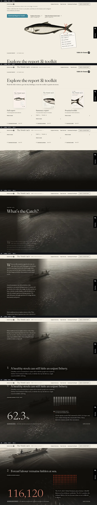
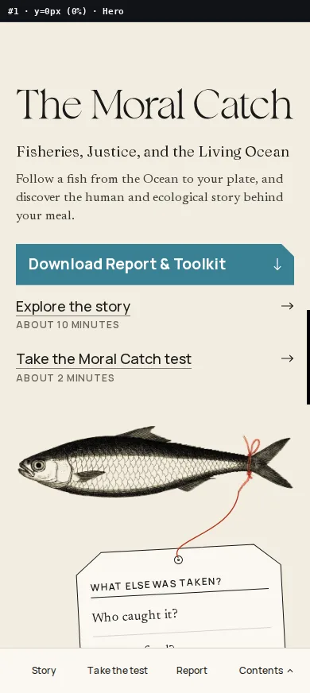

# UI Design System & Master Generation Blueprint: www-oceans-faith_moralcatch

> **The Moral Catch: Fisheries & Ocean Justice — Faiths for Oceans** (https://www.oceans.faith/moralcatch) — Explore fisheries, ocean life and workers’ rights. Read The Moral Catch report, take the two-minute meal test, and use the faith institut...





---

## 1. Executive Visual Persona & Design Archetype

- **Brand Essence & Persona**: **The Moral Catch: Fisheries & Ocean Justice — Faiths for Oceans** (`https://www.oceans.faith/moralcatch`). Explore fisheries, ocean life and workers’ rights. Read The Moral Catch report, take the two-minute meal test, and use the faith institut...
- **Capture Provenance**: Live browser capture (`tier1_fast`, HTTP `200`, captured `2026-11-24`).
- **Visual Archetype**: **Light-Substrate Editorial & Modular Grid System (`#f3ede1` canvas, `#000000` ink, `#e4351e` accent)**.
- **Anti-AI-Slop Differentiators**:
  - **Live-Computed Chromatic Polarity**: Anchors the viewport in `#f3ede1` (live computed `body` `background-color` (`computed_styles.json`)) paired with `#000000` primary typography and `#e4351e` accents.
  - **Grounded Typographic Hierarchy**: Pairs `Merriweather Sans` for display copy (`Stay Connected`) with `Lato`.
  - **Calibrated Spatial Grid & Motion**: Combines `1440px` container bounds (`gap: var(--form-field-checkbox-space-between-icon-and-text)`, padding `17px`) with `cubic-bezier(.5,0,1,.5)` easing and Three.js / WebGL Canvas Pipeline, Barba.js Page Transition Router.

---

## 2. Spatial Architecture & Modular Grid Mathematics

### Viewport Allocation & Container Geometry
- **Captured Journey Filmstrips**: Desktop `1280×6624px` (`assets/desktop-journey.webp`, `8` keyframes up to `y=0px` / doc `900px`), Mobile `390×872px` (`assets/mobile-journey.webp`, `1` keyframes).
- **Master Container Bounds**: `1440px` (full-bleed `100%` viewport stage).
- **Canvas Lateral Padding & Spacing**: `17px` lateral canvas padding with `var(--form-field-checkbox-space-between-icon-and-text)` grid gap.
- **Border Radius Scale**: `3px`, `.4rem`, `0.4rem`, `var(--pill-border-radius)`.

### Responsive Breakpoint Architecture
- **Desktop Layout**: Multi-column CSS Grid / Flexbox layout at `1440px` (`max-width: 1440px`, `gap: var(--form-field-checkbox-space-between-icon-and-text)`).
- **Mobile Layout**: Single-column vertical stack at `390px` viewport width with `17px` horizontal padding.
- **Extracted CSS Media Queries**: `@media (prefers-reduced-motion)`, `@media (prefers-reduced-motion:reduce)`, `@media screen and (max-width:767px)`, `@media screen and (max-width:1024px)`.

---

## 3. Color System, Materiality & Atmospheric Lighting

### Semantic Palette & Source Grounding
| Semantic Role | Ground-Truth Value | Extracted Live / CSS Source |
|---|---|---|
| **Primary Canvas Substrate** | `#f3ede1` | live computed `body` `background-color` (`computed_styles.json`) |
| **Primary Typography Ink** | `#000000` | live computed `main` `color` (`computed_styles.json`) |
| **Elevated Surface / Card Substrate** | `#ffffff` | `d .sqs-site-style-form .form-it... { background-color: white }` (`#ffffff`) |
| **Interactive Accent / Highlight** | `#e4351e` | `ontent .buttons .confirmation-b... { background-color: #e4351e }` |
| **Secondary / Muted Copy** | `#0f4157` | live computed `h1` `color` (`computed_styles.json`) |
| **Structural Hairline Border** | `#e7e7e7` | `rapper .InlineWidgetDropDown-No... { border-right: #e7e7e7 }` |

### Sanitized Root CSS Variables (`ui-ux.md` Ground Truth)
| Variable Name | Extracted Value | Semantic Role |
|---|---|---|
| `--tweak-form-block-title-color-on-background` | `#000` | Canvas / Surface Token |
| `--tweak-form-block-caption-color-on-background` | `#000` | Canvas / Surface Token |
| `--tweak-form-block-option-color-on-background` | `#000` | Canvas / Surface Token |
| `--overlap-image-width-flex-offset` | `calc((var(--image-block-overlap-image-width) - 50%) * 2)` | Layout / Spatial Grid Token |
| `--overlap-title-width-offset` | `50%` | Layout / Spatial Grid Token |
| `--collage-image-width-flex-offset` | `calc((var(--image-block-collage-image-width) - 50%) * 2)` | Layout / Spatial Grid Token |
| `--collage-content-width-flex-offset` | `calc((var(--image-block-collage-image-content-width) - 50%) * 2)` | Layout / Spatial Grid Token |
| `--fallback-white-hsl` | `0, 0%, 98%` | Canvas / Surface Token |
| `--fallback-black-hsl` | `0, 0%, 0%` | Canvas / Surface Token |
| `--solid-alpha-modifier` | `1` | Design System Custom Token |
| `--solid-hover-alpha-modifier` | `0.6` | Design System Custom Token |
| `--outline-hover-alpha-modifier` | `0.4` | Elevation / Border Token |
| `--inverted-solid-hover-alpha-modifier` | `var(--solid-hover-alpha-modifier)` | Design System Custom Token |
| `--inverted-outline-hover-alpha-modifier` | `var(--outline-hover-alpha-modifier)` | Elevation / Border Token |
| `--solid-focus-alpha-modifier` | `1` | Design System Custom Token |
| `--outline-focus-alpha-modifier` | `0.4` | Elevation / Border Token |

---

## 4. Typographic Scale & Editorial Hierarchy

### Font Family Stacks
- **Display Typography**: `Merriweather Sans`.
- **Primary Body Stack**: `Lato`.
- **Technical / Metadata Stack**: not declared in live computed styles (uses primary stack / `ui-monospace`).

### Typographic Scale & Rules (Live Computed & Stylesheet Grounded)
- **Hero Display (`H1`)**: live computed `h1` (`font-size: 40px`, `line-height: 40px`, `font-weight: 700`); CSS variables `--heading-1-size: 4rem`, `--heading-1-size-value: 4`; rule `.title` (`font-size: 1rem`, `line-height: 1.4`, `font-weight: 500`).
- **Section Heading (`H2`)**: CSS variables `--heading-2-size: 2.8rem`, `--heading-2-size-value: 2.8`.
- **Body Copy**: live computed `body` (`font-size: 16px`, `line-height: normal`, `font-weight: 400`); CSS variables `--body-font-font-family: "Lato"`, `--body-font-font-style: normal`, `--body-font-font-weight: 400`; rule `p` (`line-height: 1.68em`).
- **Metadata & Navigation Labels**: live computed `nav/a` (`font-size: 16px`, `line-height: 16px`, `font-weight: 400`); CSS variables `--heading-font-letter-spacing: 0em`, `--body-font-letter-spacing: 0em`, `--meta-font-font-family: "Poppins"`; rule `.caption` (`font-size: 12px`).

---

## 5. Choreographed Motion & Interaction Physics

### Primary Easing Curves
- **Extracted Timing Functions**: `cubic-bezier(.5,0,1,.5)`, `cubic-bezier(.4,0,.2,1)`, `cubic-bezier(0.33,1,0.68,1)`.

### Per-Element Transition & Choreography Rules
- **Selector `aption-overlay-hover .image-capti...`**: `transition: opacity .1s ease-out` extracted from `www-oceans-faith_moralcatch` stylesheet.
- **Selector `layout-caption-overlay-hover .ima...`**: `transition: margin-bottom .1s ease-out` extracted from `www-oceans-faith_moralcatch` stylesheet.
- **Selector `apper.animation-disabled .sqs-ima...`**: `transition: none!important` extracted from `www-oceans-faith_moralcatch` stylesheet.
- **Extracted Easing Curve (`cubic-bezier(.5,0,1,.5)`)**: Governs interactive state transitions across `<header.bright-inverse>` and `<section.region>`.
- **Runtime Interaction Engine**: Integrates Three.js / WebGL Canvas Pipeline, Barba.js Page Transition Router with `prefers-reduced-motion: reduce` fallback guards.
### Measured Runtime Scroll & Interaction Telemetry (`behavioral_journey_v2`)
- **Scroll Driver Mode**: `wheel` (max document height `900px`, deepest scrollY reached `0px` across `8` desktop keyframes).
- **Detected Scroll / Motion Libraries**: Native browser scroll / standard CSS transitions.
- **Route Transition Architecture**: First internal navigation (`/team`) measured as `direct` in `3096ms`.

---

## 6. Component Wireframe & Structural DOM Map

### Visual Layout Schematic — Desktop (`1440px`, Grounded in `dom.html` & Landmark Bounding Boxes)
```
┌────────────────────────────────────────────────────────────────────────┐
│ DESKTOP VIEWPORT (1440px) — The Moral Catch: Fisheries & Ocean Justice │
│ ====================================================================== │
│ [ <header.bright-inverse (1440px)     | EVENTS · SIGN THE DECLARATIO ] │
│ ---------------------------------------------------------------------- │
│ | HERO STAGE: <article.page-regions> (w=1440px)                      | │
│ | H1: Stay Connected                                                 | │
│ | Substrate: #f3ede1 | Ink: #000000 | Accent: #e4351e                | │
│ ---------------------------------------------------------------------- │
│ | SHOWCASE GRID (<section.region>) max-w: 1440px                     | │
│ | +------------------------------+  +------------------------------+ | │
│ | | Faiths for Oceans © 2026     |  | MULTI-FAITH DECLARATION      | | │
│ | +------------------------------+  +------------------------------+ | │
│ ---------------------------------------------------------------------- │
│ | DETAIL MODULE (<section.page-section>) — The illustrated story     | │
│ ---------------------------------------------------------------------- │
│ [ FOOTER (<footer.sections>   ) | https://www.oceans.faith/moralcatch  │
└────────────────────────────────────────────────────────────────────────┘
```

### Visual Layout Schematic — Mobile Reflow (`390px`)
```
┌────────────────────────────────────────────────────────────────────────┐
│ MOBILE VIEWPORT REFLOW (390px) — Single-Column Stack (gap: var(--fo)   │
│ ====================================================================== │
│ [ HEADER BAR (<header.bright-inverse> ) | Compact Menu (390px)         │
│ ---------------------------------------------------------------------- │
│ | HERO STAGE (<article.page-regions>) — 390px Vertical Lead          | │
│ | H1: Stay Connected                                                 | │
│ ---------------------------------------------------------------------- │
│ | SHOWCASE STACK (<section.region>) — 1-Col Stack                    | │
│ | [ Item 1: Faiths for Oceans © 2026                               ] | │
│ | [ Item 2: MULTI-FAITH DECLARATION                                ] | │
│ ---------------------------------------------------------------------- │
│ | DETAIL STACK (<section.page-section>) — 1-Col (The illustrated st) | │
│ ---------------------------------------------------------------------- │
│ [ FOOTER (<footer.sections>   ) | Stacked 390px Colophon               │
└────────────────────────────────────────────────────────────────────────┘
```

### Granular DOM Region Breakdown
1. **Brand Header & Navigation Bar (<header.bright-inverse> — `www-oceans-faith_moralcatch`)**:
   - Landmark `<header class="bright-inverse header">` (`1440px`) hosting `The Moral Catch: Fisheries & Ocean J` navigation (`EVENTS · SIGN THE DECLARATION · SIGNATORIES · PUBLICATIONS · GLOSSARY`), DOM attributes (`data-sqsp-font-ids="6a3137d3494e3c6626e63..."`, `data-name="static-context"`, `data-animation-state="booted"`, `data-test="header"`), and stylesheet rule `dgetWrapper .TockInlineButton-con... { border-radius:3px }`.
2. **Hero Stage & Focal Lead (<article.page-regions> — `Stay Connected`)**:
   - Landmark `<article class="page-regions">` presenting display lead `Stay Connected` and copy excerpt *"Faiths for Oceans © 2026"* over `#f3ede1` canvas and `#000000` ink.
3. **Primary Showcase & Content Grid (<section.region> — `Faiths for Oceans © 2026`)**:
   - Landmark `<section class="region">` rendering section `Faiths for Oceans © 2026` with copy *"MULTI-FAITH DECLARATION"*, asset references (`popup-overlay-f39ec8cdc95ccd84-mi...`, `tc.min.js`, `popup-overlay-eb69d574e194d111-mi...`, `favicon.ico`), and grid rule `hover { opacity:.8 }`.
4. **Interactive Detail & Feature Matrix (<section.page-section> — `MULTI-FAITH DECLARATION`)**:
   - Landmark `<section class="page-section full-bleed-section">` framing `MULTI-FAITH DECLARATION` and `The illustrated story needs JavaScript. You can ` (*"The illustrated story needs JavaScript. You can download the repo"*) with `#ffffff` surface cards, `#e4351e` accents, and `.btn:hover { background-color:transparent!important }`.
5. **Colophon & Global Directory Footer (<footer.sections> — `https://www.oceans.faith/moralcatch`)**:
   - Landmark `<footer class="sections">` anchoring `The Moral Catch: Fisheries & Oce` footer links (`EVENTS · SIGN THE DECLARATION · SIGNATORIES · PUBLICATIONS · GLOSSARY`), copy *"Join our mailing list to receive the latest news, updates an"*, and `#e7e7e7` structural dividers.
### Full Vertical Scroll Sequence (Desktop `1440×900` Keyframes)
- **Step 01** (`y=0px`, `0%`): Active landmark `Hero` · sticky/fixed elements: `1`
- **Step 02** (`y=0px`, `8%`): Active landmark `Hero` · sticky/fixed elements: `1`
- **Step 03** (`y=0px`, `17%`): Active landmark `Hero` · sticky/fixed elements: `1`
- **Step 04** (`y=0px`, `25%`): Active landmark `Hero` · sticky/fixed elements: `1`
- **Step 05** (`y=0px`, `33%`): Active landmark `Hero` · sticky/fixed elements: `1`
- **Step 06** (`y=0px`, `42%`): Active landmark `Hero` · sticky/fixed elements: `1`
- **Step 07** (`y=0px`, `50%`): Active landmark `Hero` · sticky/fixed elements: `1`
- **Step 08** (`y=0px`, `58%`): Active landmark `Hero` · sticky/fixed elements: `1`

### Multi-Page Internal Route Map
- **About Route (`/team`)**: `https://www.oceans.faith/team` — H1: `TEAM — Faiths for Oceans`, scrollHeight `2020px`, transition `direct` (`3096ms`)
- **About Route (`/about`)**: `https://www.oceans.faith/about` — H1: `MISSION — Faiths for Oceans`, scrollHeight `2531px`, transition `direct` (`1107ms`)
- **Other Route (`/`)**: `https://www.oceans.faith/` — H1: `FAITH COMMUNITIES, ACTING TOGETHER FOR THE OCEAN.`, scrollHeight `10465px`, transition `direct` (`3044ms`)

---

## 7. Master Zero-Shot AI Generation Prompt

```markdown
# Master Zero-Shot Frontend Generation Prompt: www-oceans-faith_moralcatch (The Moral Catch: Fisheries & Ocean Justice — Faiths for Oceans)

You are a principal frontend architect and design systems engineer. Build a complete, production-ready web application replicating the exact design system, DOM landmarks, typographic hierarchy, color tokens, and motion physics of `www-oceans-faith_moralcatch` (**The Moral Catch: Fisheries & Ocean Justice — Faiths for Oceans** — `https://www.oceans.faith/moralcatch`).

### 1. Visual Archetype & Anti-AI-Slop Mandates
- **Archetype**: Light-Substrate Editorial & Modular Grid System (`#f3ede1` canvas, `#000000` ink, `#e4351e` accent).
- **Identity & Domain Context**: Explore fisheries, ocean life and workers’ rights. Read The Moral Catch report, take the two-minute meal test, and use the faith institut...
- **Primary Substrate**: `#f3ede1` (live computed `body` `background-color` (`computed_styles.json`)), **Primary Ink**: `#000000`, **Accent / Highlight**: `#e4351e`.
- **Site-Specific Differentiators**:
  - **Live-Computed Chromatic Polarity**: Anchors the viewport in `#f3ede1` (live computed `body` `background-color` (`computed_styles.json`)) paired with `#000000` primary typography and `#e4351e` accents.
  - **Grounded Typographic Hierarchy**: Pairs `Merriweather Sans` for display copy (`Stay Connected`) with `Lato`.
  - **Calibrated Spatial Grid & Motion**: Combines `1440px` container bounds (`gap: var(--form-field-checkbox-space-between-icon-and-text)`, padding `17px`) with `cubic-bezier(.5,0,1,.5)` easing and Three.js / WebGL Canvas Pipeline, Barba.js Page Transition Router.

### 2. Ground-Truth CSS Variables (`:root` Token Contract)
Declare and consume these exact custom properties extracted from `www-oceans-faith_moralcatch` in your global stylesheet:

:root {
  /* The Moral Catch: Fisheries & Ocean Justice — Faiths for Oceans (www-oceans-faith_moralcatch) — Live-Grounded CSS Variables */
  --tweak-form-block-title-color-on-background: #000; /* Canvas / Surface Token (www-oceans-faith_moralcatch) */
  --tweak-form-block-caption-color-on-background: #000; /* Canvas / Surface Token (www-oceans-faith_moralcatch) */
  --tweak-form-block-option-color-on-background: #000; /* Canvas / Surface Token (www-oceans-faith_moralcatch) */
  --overlap-image-width-flex-offset: calc((var(--image-block-overlap-image-width) - 50%) * 2); /* Layout / Spatial Grid Token (www-oceans-faith_moralcatch) */
  --overlap-title-width-offset: 50%; /* Layout / Spatial Grid Token (www-oceans-faith_moralcatch) */
  --collage-image-width-flex-offset: calc((var(--image-block-collage-image-width) - 50%) * 2); /* Layout / Spatial Grid Token (www-oceans-faith_moralcatch) */
  --collage-content-width-flex-offset: calc((var(--image-block-collage-image-content-width) - 50%) * 2); /* Layout / Spatial Grid Token (www-oceans-faith_moralcatch) */
  --fallback-white-hsl: 0, 0%, 98%; /* Canvas / Surface Token (www-oceans-faith_moralcatch) */
  --fallback-black-hsl: 0, 0%, 0%; /* Canvas / Surface Token (www-oceans-faith_moralcatch) */
  --solid-alpha-modifier: 1; /* Design System Custom Token (www-oceans-faith_moralcatch) */
  --solid-hover-alpha-modifier: 0.6; /* Design System Custom Token (www-oceans-faith_moralcatch) */
  --outline-hover-alpha-modifier: 0.4; /* Elevation / Border Token (www-oceans-faith_moralcatch) */
  --inverted-solid-hover-alpha-modifier: var(--solid-hover-alpha-modifier); /* Design System Custom Token (www-oceans-faith_moralcatch) */
  --inverted-outline-hover-alpha-modifier: var(--outline-hover-alpha-modifier); /* Elevation / Border Token (www-oceans-faith_moralcatch) */
  --solid-focus-alpha-modifier: 1; /* Design System Custom Token (www-oceans-faith_moralcatch) */
  --outline-focus-alpha-modifier: 0.4; /* Elevation / Border Token (www-oceans-faith_moralcatch) */
}

### 3. Semantic Color & Materiality Contract
Map every surface, ink, and border strictly to these source-grounded tokens:
- **Primary Canvas Substrate**: `#f3ede1` — grounded in live computed `body` `background-color` (`computed_styles.json`)
- **Primary Typography Ink**: `#000000` — grounded in live computed `main` `color` (`computed_styles.json`)
- **Elevated Surface / Card Substrate**: `#ffffff` — grounded in `d .sqs-site-style-form .form-it... { background-color: white }` (`#ffffff`)
- **Interactive Accent / Highlight**: `#e4351e` — grounded in `ontent .buttons .confirmation-b... { background-color: #e4351e }`
- **Secondary / Muted Copy**: `#0f4157` — grounded in live computed `h1` `color` (`computed_styles.json`)
- **Structural Hairline Border**: `#e7e7e7` — grounded in `rapper .InlineWidgetDropDown-No... { border-right: #e7e7e7 }`

### 4. Spatial Grid, Container Bounds & Responsive Breakpoints
- **Desktop Viewport Reference**: `1280×6624px` (multi-frame vertical journey filmstrip (6624px), `1440px` standard desktop width).
- **Mobile Viewport Reference**: `390×872px` (full-page live capture (872px), `390px` standard mobile width).
- **Container Max-Width**: `1440px` (full-bleed `100%` viewport stage)
- **Padding & Gutters**: `17px` lateral canvas padding with `var(--form-field-checkbox-space-between-icon-and-text)` grid gap
- **Desktop Grid**: Multi-column CSS Grid / Flexbox layout at `1440px` (`max-width: 1440px`, `gap: var(--form-field-checkbox-space-between-icon-and-text)`)
- **Mobile Adaptation**: Single-column vertical stack at `390px` viewport width with `17px` horizontal padding
- **Media Queries**: `@media (prefers-reduced-motion)`, `@media (prefers-reduced-motion:reduce)`, `@media screen and (max-width:767px)`, `@media screen and (max-width:1024px)`
- **Corner Radii**: `3px`, `.4rem`, `0.4rem`, `var(--pill-border-radius)`

### 5. Typography & Editorial Scale Contract
- **Display Font Stack**: `Merriweather Sans`
- **Body Font Stack**: `Lato`
- **Monospace / Technical Font Stack**: not declared in live computed styles (uses primary stack / `ui-monospace`)
- **H1 Display Rule**: live computed `h1` (`font-size: 40px`, `line-height: 40px`, `font-weight: 700`); CSS variables `--heading-1-size: 4rem`, `--heading-1-size-value: 4`; rule `.title` (`font-size: 1rem`, `line-height: 1.4`, `font-weight: 500`)
- **H2 Section Rule**: CSS variables `--heading-2-size: 2.8rem`, `--heading-2-size-value: 2.8`
- **Body Copy Rule**: live computed `body` (`font-size: 16px`, `line-height: normal`, `font-weight: 400`); CSS variables `--body-font-font-family: "Lato"`, `--body-font-font-style: normal`, `--body-font-font-weight: 400`; rule `p` (`line-height: 1.68em`)
- **Metadata & Index Rule**: live computed `nav/a` (`font-size: 16px`, `line-height: 16px`, `font-weight: 400`); CSS variables `--heading-font-letter-spacing: 0em`, `--body-font-letter-spacing: 0em`, `--meta-font-font-family: "Poppins"`; rule `.caption` (`font-size: 12px`)

### 6. Component Hierarchy, Verbatim Copy & Real DOM Landmarks
Scaffold `www-oceans-faith_moralcatch` (`The Moral Catch: Fisheries & Ocean Justice — Faiths for Oceans`) with these exact structural regions, extracted copy, and CSS rules from `dom.html`:
1. **Brand Header & Navigation Bar (<header.bright-inverse> — `www-oceans-faith_moralcatch`)**:
   - DOM & Selectors: Landmark `<header class="bright-inverse header">` (`1440px`) hosting `The Moral Catch: Fisheries & Ocean J` navigation (`EVENTS · SIGN THE DECLARATION · SIGNATORIES · PUBLICATIONS · GLOSSARY`), DOM attributes (`data-sqsp-font-ids="6a3137d3494e3c6626e63..."`, `data-name="static-context"`, `data-animation-state="booted"`, `data-test="header"`), and stylesheet rule `dgetWrapper .TockInlineButton-con... { border-radius:3px }`.
   - Responsive Contract: Header `Brand Header & Navigation Bar (<header.bright-inverse> — `www-oceans-faith_moralcatch`)` (`www-oceans-faith_moralcatch`) adapts across `@media (prefers-reduced-motion)`, `@media (prefers-reduced-motion:reduce)`, `@media screen and (max-width:767px)`, `@media screen and (max-width:1024px)` with `cubic-bezier(.5,0,1,.5)`, `cubic-bezier(.4,0,.2,1)`, `cubic-bezier(0.33,1,0.68,1)` transitions and links `EVENTS · SIGN THE DECLARATION · SIGNATORIES · PUBLICATIONS · GLOSSARY`.
2. **Hero Stage & Focal Lead (<article.page-regions> — `Stay Connected`)**:
   - DOM & Selectors: Landmark `<article class="page-regions">` presenting display lead `Stay Connected` and copy excerpt *"Faiths for Oceans © 2026"* over `#f3ede1` canvas and `#000000` ink.
   - Responsive Contract: Hero stage (`1280×6624px` desktop / `390×872px` mobile) sets `#f3ede1` background with `#000000` headline `Stay Connected`.
3. **Primary Showcase & Content Grid (<section.region> — `Faiths for Oceans © 2026`)**:
   - DOM & Selectors: Landmark `<section class="region">` rendering section `Faiths for Oceans © 2026` with copy *"MULTI-FAITH DECLARATION"*, asset references (`popup-overlay-f39ec8cdc95ccd84-mi...`, `tc.min.js`, `popup-overlay-eb69d574e194d111-mi...`, `favicon.ico`), and grid rule `hover { opacity:.8 }`.
   - Responsive Contract: Showcase grid `Primary Showcase & Content Grid (<section.region> — `Faiths for Oceans © 2026`)` applies Multi-column CSS Grid / Flexbox layout at `1440px` (`max-width: 1440px`, `gap: var(--form-field-checkbox-space-between-icon-and-text)`) on desktop and Single-column vertical stack at `390px` viewport width with `17px` horizontal padding on mobile.
4. **Interactive Detail & Feature Matrix (<section.page-section> — `MULTI-FAITH DECLARATION`)**:
   - DOM & Selectors: Landmark `<section class="page-section full-bleed-section">` framing `MULTI-FAITH DECLARATION` and `The illustrated story needs JavaScript. You can ` (*"The illustrated story needs JavaScript. You can download the repo"*) with `#ffffff` surface cards, `#e4351e` accents, and `.btn:hover { background-color:transparent!important }`.
   - Responsive Contract: Detail module `Interactive Detail & Feature Matrix (<section.page-section> — `MULTI-FAITH DECLARATION`)` uses `3px`, `.4rem`, `0.4rem`, `var(--pill-border-radius)` radii, `#e4351e` highlights, and assets (popup-overlay-f39ec8cdc95ccd84-mi..., tc.min.js, popup-overlay-eb69d574e194d111-mi...).
5. **Colophon & Global Directory Footer (<footer.sections> — `https://www.oceans.faith/moralcatch`)**:
   - DOM & Selectors: Landmark `<footer class="sections">` anchoring `The Moral Catch: Fisheries & Oce` footer links (`EVENTS · SIGN THE DECLARATION · SIGNATORIES · PUBLICATIONS · GLOSSARY`), copy *"Join our mailing list to receive the latest news, updates an"*, and `#e7e7e7` structural dividers.
   - Responsive Contract: Footer `Colophon & Global Directory Footer (<footer.sections> — `https://www.oceans.faith/moralcatch`)` aligns to `1440px` (full-bleed `100%` viewport stage) with `17px` lateral canvas padding with `var(--form-field-checkbox-space-between-icon-and-text)` grid gap and attributes (data-sqsp-font-ids="6a3137d3494e3c6626e63...", data-name="static-context", data-animation-state="booted").

#### Verbatim DOM Copy Excerpts (`dom.html`)
- Copy Excerpt 1: *"Faiths for Oceans © 2026"*
- Copy Excerpt 2: *"MULTI-FAITH DECLARATION"*
- Copy Excerpt 3: *"The illustrated story needs JavaScript. You can download the report , read the sum..."*
- Copy Excerpt 4: *"Join our mailing list to receive the latest news, updates and resources direct to..."*

### 7. Motion, Extracted Stylesheet Rules & Interaction Choreography
- **Primary Easing Functions**: `cubic-bezier(.5,0,1,.5)`, `cubic-bezier(.4,0,.2,1)`, `cubic-bezier(0.33,1,0.68,1)`
- **Extracted Stylesheet Rules (`www-oceans-faith_moralcatch`)**:
- `dgetWrapper .TockInlineButton-con... { border-radius:3px }`
- `hover { opacity:.8 }`
- `.btn:hover { background-color:transparent!important }`
- `n-style-outline .user-items-list-... { background:0 0 }`
- `e-outline .user-items-list-simple... { background-color:transparent }`
- **Per-Selector Transition Rules**:
- **Selector `aption-overlay-hover .image-capti...`**: `transition: opacity .1s ease-out` extracted from `www-oceans-faith_moralcatch` stylesheet.
- **Selector `layout-caption-overlay-hover .ima...`**: `transition: margin-bottom .1s ease-out` extracted from `www-oceans-faith_moralcatch` stylesheet.
- **Selector `apper.animation-disabled .sqs-ima...`**: `transition: none!important` extracted from `www-oceans-faith_moralcatch` stylesheet.
- **Extracted Easing Curve (`cubic-bezier(.5,0,1,.5)`)**: Governs interactive state transitions across `<header.bright-inverse>` and `<section.region>`.
- **Runtime Interaction Engine**: Integrates Three.js / WebGL Canvas Pipeline, Barba.js Page Transition Router with `prefers-reduced-motion: reduce` fallback guards.
### 7b. Full-Page Scroll Choreography, Interactive States & Multi-Page Routes
- **Scroll Mechanics**: Implement `wheel` vertical progression up to `900px` across 8 distinct viewport chapters.
- **Vertical Chapter Sequence**: Hero (0%) -> Hero (8%) -> Hero (17%) -> Hero (25%) -> Hero (33%) -> Hero (42%) -> Hero (50%) -> Hero (58%).
- **Multi-Page Routes**: Scaffold internal routes `/team` (about, direct), `/about` (about, direct), `/` (other, direct) sharing the global header/footer shell and design tokens.

### 8. Technical Deliverables
- Implement in Next.js (App Router) with TypeScript and Tailwind CSS consuming the `:root` custom properties defined above for `www-oceans-faith_moralcatch`.
- Reproduce both the `1440px` desktop architecture and `390px` mobile breakpoint transitions, preserving semantic HTML5 landmarks (`<header>`, `<nav>`, `<main>`, `<section>`, `<footer>`) and `prefers-reduced-motion` accessibility guards.
```
---

## 8. Full-Page Scroll Journey, Interactive States & Subpage Inventory

### Desktop Scroll Keyframes (`1440×900` WebP)
| Step | Scroll Y | Progress | Active Landmark / Section | Sticky/Fixed | Visual Asset |
| :---: | :---: | :---: | :--- | :---: | :--- |
| `#01` | `0px` | `0%` | Hero | `1` | [desktop-step-01.webp](assets/desktop-step-01.webp) |
| `#02` | `0px` | `8%` | Hero | `1` | [desktop-step-02.webp](assets/desktop-step-02.webp) |
| `#03` | `0px` | `17%` | Hero | `1` | [desktop-step-03.webp](assets/desktop-step-03.webp) |
| `#04` | `0px` | `25%` | Hero | `1` | [desktop-step-04.webp](assets/desktop-step-04.webp) |
| `#05` | `0px` | `33%` | Hero | `1` | [desktop-step-05.webp](assets/desktop-step-05.webp) |
| `#06` | `0px` | `42%` | Hero | `1` | [desktop-step-06.webp](assets/desktop-step-06.webp) |
| `#07` | `0px` | `50%` | Hero | `1` | [desktop-step-07.webp](assets/desktop-step-07.webp) |
| `#08` | `0px` | `58%` | Hero | `1` | [desktop-step-08.webp](assets/desktop-step-08.webp) |

### Mobile Condensed Keyframes (`390×844` WebP)
| Step | Scroll Y | Progress | Active Landmark | Visual Asset |
| :---: | :---: | :---: | :--- | :--- |
| `#01` | `0px` | `0%` | Hero | [mobile-step-01.webp](assets/mobile-step-01.webp) |

### Internal Subpage Filmstrips (`1080px` Wide WebP)
| # | Template | Route URL | H1 / Title | Scroll Height | Transition | Filmstrip Asset |
| :-: | :---: | :--- | :--- | :---: | :---: | :--- |
| `1` | `about` | `https://www.oceans.faith/team` | TEAM — Faiths for Oceans | `2020px` | `direct` (`3096ms`) | [subpage-01-team.webp](assets/subpage-01-team.webp) |
| `2` | `about` | `https://www.oceans.faith/about` | MISSION — Faiths for Oceans | `2531px` | `direct` (`1107ms`) | [subpage-02-about.webp](assets/subpage-02-about.webp) |
| `3` | `other` | `https://www.oceans.faith/` | FAITH COMMUNITIES, ACTING TOGETHER FO... | `10465px` | `direct` (`3044ms`) | [subpage-03-page.webp](assets/subpage-03-page.webp) |

