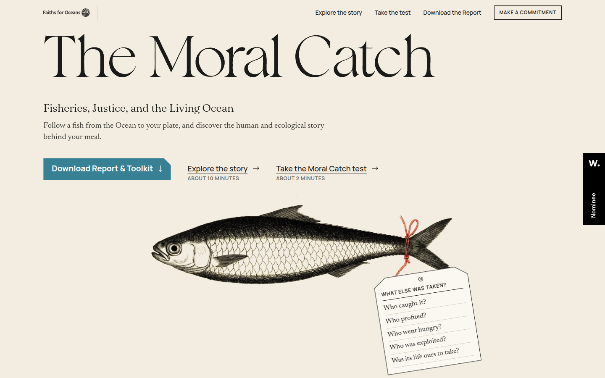
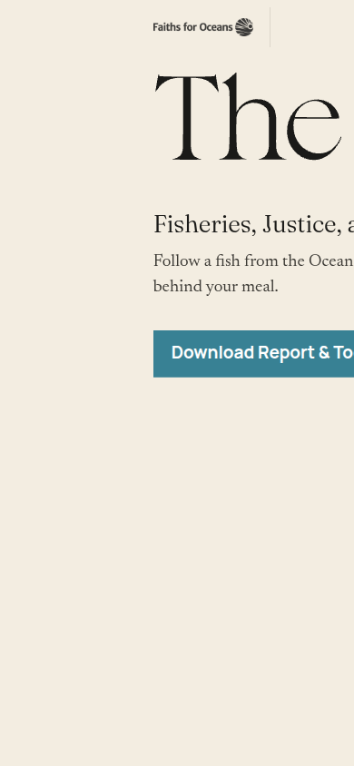

# UI Design System & Master Generation Blueprint: www-oceans-faith_moralcatch

> **The Moral Catch: Fisheries & Ocean Justice — Faiths for Oceans** (https://www.oceans.faith/moralcatch) — Explore fisheries, ocean life and workers’ rights. Read The Moral Catch report, take the two-minute meal test, and use the faith institut...



---

## 1. Executive Visual Persona & Design Archetype

- **Brand Essence & Persona**: **The Moral Catch: Fisheries & Ocean Justice — Faiths for Oceans** (`https://www.oceans.faith/moralcatch`). Explore fisheries, ocean life and workers’ rights. Read The Moral Catch report, take the two-minute meal test, and use the faith institut...
- **Capture Provenance**: Live browser capture (`tier2_webgl`, HTTP `200`, captured `2026-11-23`).
- **Visual Archetype**: **Light-Substrate Editorial & Modular Grid System (`#f3ede1` canvas, `#000000` ink, `#ffffff` accent)**.
- **Anti-AI-Slop Differentiators**:
  - **Live-Computed Chromatic Polarity**: Anchors the viewport in `#f3ede1` (live computed `body` `background-color` (`computed_styles.json`)) paired with `#000000` primary typography and `#ffffff` accents.
  - **Grounded Typographic Hierarchy**: Pairs `Merriweather Sans` for display copy (`Stay Connected`) with `Lato` and not declared in live computed styles (uses primary stack / `ui-monospace`).
  - **Calibrated Spatial Grid & Motion**: Combines `1440px` container bounds (`gap: 8px`, padding `3px`) with `cubic-bezier(.23,1,.32,1)` easing and Three.js / WebGL Canvas Pipeline, Barba.js Page Transition Router.

---

## 2. Spatial Architecture & Modular Grid Mathematics



### Viewport Allocation & Container Geometry
- **Captured Viewport Dimensions**: Desktop `1440×900px` (`assets/desktop.png`, single-viewport 100vh live capture (900px)), Mobile `390×844px` (`assets/mobile.png`, single-viewport 100vh live capture (844px)).
- **Master Container Bounds**: `1440px` (full-bleed `100%` viewport stage).
- **Canvas Lateral Padding & Spacing**: `3px` lateral canvas padding with `8px` grid gap.
- **Border Radius Scale**: `6px`, `11px`, `50%`, `2px`.

### Responsive Breakpoint Architecture
- **Desktop Layout**: Multi-column CSS Grid / Flexbox layout at `1440px` (`max-width: 1440px`, `gap: 8px`).
- **Mobile Layout**: Single-column vertical stack at `390px` viewport width with `3px` horizontal padding.
- **Extracted CSS Media Queries**: `@media screen and (max-width:640px)`, `@media (max-width:600px)`, `@media screen and (max-width:432px)`, `@media screen and (min-width:433px)`.

---

## 3. Color System, Materiality & Atmospheric Lighting

### Semantic Palette & Source Grounding
| Semantic Role | Ground-Truth Value | Extracted Live / CSS Source |
|---|---|---|
| **Primary Canvas Substrate** | `#f3ede1` | live computed `body` `background-color` (`computed_styles.json`) |
| **Primary Typography Ink** | `#000000` | live computed `main` `color` (`computed_styles.json`) |
| **Elevated Surface / Card Substrate** | `#e7e7e7` | `.commerce-mini-cart-item-image-... { background-color: #e7e7e7 }` |
| **Interactive Accent / Highlight** | `#ffffff` | live computed `a` `color` (`computed_styles.json`) |
| **Secondary / Muted Copy** | `#0f4157` | live computed `h1` `color` (`computed_styles.json`) |
| **Structural Hairline Border** | `#999999` | `orm-wrapper .field-list .sectio... { border-bottom: #999999 }` |

### Sanitized Root CSS Variables (`ui-ux.md` Ground Truth)
| Variable Name | Extracted Value | Semantic Role |
|---|---|---|
| `--commerce-mini-cart-image-size` | `60px` | Layout / Spatial Grid Token |
| `--commerce-mini-cart-image-placeholder-size` | `22px` | Layout / Spatial Grid Token |
| `--grid-gutter` | `calc(var(--sqs-mobile-site-gutter, 6vw) - 11.0px)` | Layout / Spatial Grid Token |
| `--cell-max-width` | `calc( ( var(--sqs-site-max-width, 1500px) - (11.0px * (8 - 1)) ) / 8 )` | Layout / Spatial Grid Token |
| `--inset-padding` | `calc(var(--sqs-site-gutter) * 2)` | Layout / Spatial Grid Token |
| `--row-height-scaling-factor` | `0.0215` | Layout / Spatial Grid Token |
| `--opacity` | `100%` | Dimension / Scale Token |
| `--translate-x` | `0px` | Dimension / Scale Token |
| `--translate-y` | `0px` | Dimension / Scale Token |
| `--rotation` | `0deg` | Design System Custom Token |
| `--scale-x` | `100%` | Dimension / Scale Token |
| `--scale-y` | `100%` | Dimension / Scale Token |
| `--skew-x` | `0deg` | Design System Custom Token |
| `--skew-y` | `0deg` | Design System Custom Token |
| `--origin-x` | `50%` | Dimension / Scale Token |
| `--origin-y` | `50%` | Dimension / Scale Token |

---

## 4. Typographic Scale & Editorial Hierarchy

### Font Family Stacks
- **Display Typography**: `Merriweather Sans`.
- **Primary Body Stack**: `Lato`.
- **Technical / Metadata Stack**: not declared in live computed styles (uses primary stack / `ui-monospace`).

### Typographic Scale & Rules (Live Computed & Stylesheet Grounded)
- **Hero Display (`H1`)**: live computed `h1` (`font-size: 40px`, `line-height: 40px`, `font-weight: 700`); rule `h1` (`line-height: 1em`).
- **Section Heading (`H2`)**: observed font-size ladder: `40px`, `16px`, `22.912px`, `15px`, `12px`.
- **Body Copy**: live computed `body` (`font-size: 16px`, `line-height: normal`, `font-weight: 400`); rule `p` (`font-size: 16px`, `line-height: 22px`).
- **Metadata & Navigation Labels**: live computed `nav/a` (`font-size: 16px`, `line-height: 16px`, `font-weight: 400`); rule `.caption` (`font-size: 12px`).

---

## 5. Choreographed Motion & Interaction Physics

### Primary Easing Curves
- **Extracted Timing Functions**: `cubic-bezier(.23,1,.32,1)`, `cubic-bezier(.33,0,.2,1)`, `cubic-bezier(0,.9,.33,1)`.

### Per-Element Transition & Choreography Rules
- **Selector `.commerce-reserved-cart-container`**: `transition: top .4s` extracted from `www-oceans-faith_moralcatch` stylesheet.
- **Selector `.template-cart-item-added-popover`**: `transition: transform .15s 50ms,opacity .2s` extracted from `www-oceans-faith_moralcatch` stylesheet.
- **Selector `uttons .commerce-mini-cart-view-c...`**: `transition: background-color .1s linear,color .1s linear` extracted from `www-oceans-faith_moralcatch` stylesheet.
- **Extracted Easing Curve (`cubic-bezier(.23,1,.32,1)`)**: Governs interactive state transitions across `<header.bright-inverse>` and `<section.region>`.
- **Runtime Interaction Engine**: Integrates Three.js / WebGL Canvas Pipeline, Barba.js Page Transition Router with `prefers-reduced-motion: reduce` fallback guards.

---

## 6. Component Wireframe & Structural DOM Map

### Visual Layout Schematic — Desktop (`1440px`, Grounded in `dom.html` & Landmark Bounding Boxes)
```
┌────────────────────────────────────────────────────────────────────────┐
│ DESKTOP VIEWPORT (1440px) — The Moral Catch: Fisheries & Ocean Justice │
│ ====================================================================== │
│ [ <header.bright-inverse (1440px)     | EVENTS · SIGN THE DECLARATIO ] │
│ ---------------------------------------------------------------------- │
│ | HERO STAGE: <article.page-regions> (w=1440px)                      | │
│ | H1: Stay Connected                                                 | │
│ | Substrate: #f3ede1 | Ink: #000000 | Accent: #ffffff                | │
│ ---------------------------------------------------------------------- │
│ | SHOWCASE GRID (<section.region>) max-w: 1440px                     | │
│ | +------------------------------+  +------------------------------+ | │
│ | | Faiths for Oceans © 2026     |  | MULTI-FAITH DECLARATION      | | │
│ | +------------------------------+  +------------------------------+ | │
│ ---------------------------------------------------------------------- │
│ | DETAIL MODULE (<section.page-section>) — The illustrated story     | │
│ ---------------------------------------------------------------------- │
│ [ FOOTER (<footer.sections>   ) | https://www.oceans.faith/moralcatch  │
└────────────────────────────────────────────────────────────────────────┘
```

### Visual Layout Schematic — Mobile Reflow (`390px`)
```
┌────────────────────────────────────────────────────────────────────────┐
│ MOBILE VIEWPORT REFLOW (390px) — Single-Column Stack (gap: 8px)        │
│ ====================================================================== │
│ [ HEADER BAR (<header.bright-inverse> ) | Compact Menu (390px)         │
│ ---------------------------------------------------------------------- │
│ | HERO STAGE (<article.page-regions>) — 390px Vertical Lead          | │
│ | H1: Stay Connected                                                 | │
│ ---------------------------------------------------------------------- │
│ | SHOWCASE STACK (<section.region>) — 1-Col Stack                    | │
│ | [ Item 1: Faiths for Oceans © 2026                               ] | │
│ | [ Item 2: MULTI-FAITH DECLARATION                                ] | │
│ ---------------------------------------------------------------------- │
│ | DETAIL STACK (<section.page-section>) — 1-Col (The illustrated st) | │
│ ---------------------------------------------------------------------- │
│ [ FOOTER (<footer.sections>   ) | Stacked 390px Colophon               │
└────────────────────────────────────────────────────────────────────────┘
```

### Granular DOM Region Breakdown
1. **Brand Header & Navigation Bar (<header.bright-inverse> — `www-oceans-faith_moralcatch`)**:
   - Landmark `<header class="bright-inverse header">` (`1440px`) hosting `The Moral Catch: Fisheries & Ocean J` navigation (`EVENTS · SIGN THE DECLARATION · SIGNATORIES · PUBLICATIONS · GLOSSARY`), DOM attributes (`data-sqsp-font-ids="6a3136d96307d35684222..."`, `data-name="static-context"`, `data-animation-state="booted"`, `data-test="header"`), and stylesheet rule `.uppercase { text-transform:uppercase }`.
2. **Hero Stage & Focal Lead (<article.page-regions> — `Stay Connected`)**:
   - Landmark `<article class="page-regions">` presenting display lead `Stay Connected` and copy excerpt *"Faiths for Oceans © 2026"* over `#f3ede1` canvas and `#000000` ink.
3. **Primary Showcase & Content Grid (<section.region> — `Faiths for Oceans © 2026`)**:
   - Landmark `<section class="region">` rendering section `Faiths for Oceans © 2026` with copy *"MULTI-FAITH DECLARATION"*, asset references (`popup-overlay-f39ec8cdc95ccd84-mi...`, `popup-overlay-eb69d574e194d111-mi...`, `favicon.ico`, `moralcatch`), and grid rule `rce-reserved-cart-container--anim... { animation:.4s cubic-bezier(.23,1,.32,1) 1s both commerce-reserved-cart-s... }`.
4. **Interactive Detail & Feature Matrix (<section.page-section> — `MULTI-FAITH DECLARATION`)**:
   - Landmark `<section class="page-section full-bleed-section">` framing `MULTI-FAITH DECLARATION` and `The illustrated story needs JavaScript. You can ` (*"The illustrated story needs JavaScript. You can download the repo"*) with `#e7e7e7` surface cards, `#ffffff` accents, and `mmerce-reserved-cart-container--c... { animation:.35s cubic-bezier(.23,1,.32,1) forwards commerce-reserved-cart... }`.
5. **Colophon & Global Directory Footer (<footer.sections> — `https://www.oceans.faith/moralcatch`)**:
   - Landmark `<footer class="sections">` anchoring `The Moral Catch: Fisheries & Oce` footer links (`EVENTS · SIGN THE DECLARATION · SIGNATORIES · PUBLICATIONS · GLOSSARY`), copy *"Join our mailing list to receive the latest news, updates an"*, and `#999999` structural dividers.

---

## 7. Master Zero-Shot AI Generation Prompt

```markdown
# Master Zero-Shot Frontend Generation Prompt: www-oceans-faith_moralcatch (The Moral Catch: Fisheries & Ocean Justice — Faiths for Oceans)

You are a principal frontend architect and design systems engineer. Build a complete, production-ready web application replicating the exact design system, DOM landmarks, typographic hierarchy, color tokens, and motion physics of `www-oceans-faith_moralcatch` (**The Moral Catch: Fisheries & Ocean Justice — Faiths for Oceans** — `https://www.oceans.faith/moralcatch`).

### 1. Visual Archetype & Anti-AI-Slop Mandates
- **Archetype**: Light-Substrate Editorial & Modular Grid System (`#f3ede1` canvas, `#000000` ink, `#ffffff` accent).
- **Identity & Domain Context**: Explore fisheries, ocean life and workers’ rights. Read The Moral Catch report, take the two-minute meal test, and use the faith institut...
- **Primary Substrate**: `#f3ede1` (live computed `body` `background-color` (`computed_styles.json`)), **Primary Ink**: `#000000`, **Accent / Highlight**: `#ffffff`.
- **Site-Specific Differentiators**:
  - **Live-Computed Chromatic Polarity**: Anchors the viewport in `#f3ede1` (live computed `body` `background-color` (`computed_styles.json`)) paired with `#000000` primary typography and `#ffffff` accents.
  - **Grounded Typographic Hierarchy**: Pairs `Merriweather Sans` for display copy (`Stay Connected`) with `Lato` and not declared in live computed styles (uses primary stack / `ui-monospace`).
  - **Calibrated Spatial Grid & Motion**: Combines `1440px` container bounds (`gap: 8px`, padding `3px`) with `cubic-bezier(.23,1,.32,1)` easing and Three.js / WebGL Canvas Pipeline, Barba.js Page Transition Router.

### 2. Ground-Truth CSS Variables (`:root` Token Contract)
Declare and consume these exact custom properties extracted from `www-oceans-faith_moralcatch` in your global stylesheet:

:root {
  /* The Moral Catch: Fisheries & Ocean Justice — Faiths for Oceans (www-oceans-faith_moralcatch) — Live-Grounded CSS Variables */
  --commerce-mini-cart-image-size: 60px; /* Layout / Spatial Grid Token (www-oceans-faith_moralcatch) */
  --commerce-mini-cart-image-placeholder-size: 22px; /* Layout / Spatial Grid Token (www-oceans-faith_moralcatch) */
  --grid-gutter: calc(var(--sqs-mobile-site-gutter, 6vw) - 11.0px); /* Layout / Spatial Grid Token (www-oceans-faith_moralcatch) */
  --cell-max-width: calc( ( var(--sqs-site-max-width, 1500px) - (11.0px * (8 - 1)) ) / 8 ); /* Layout / Spatial Grid Token (www-oceans-faith_moralcatch) */
  --inset-padding: calc(var(--sqs-site-gutter) * 2); /* Layout / Spatial Grid Token (www-oceans-faith_moralcatch) */
  --row-height-scaling-factor: 0.0215; /* Layout / Spatial Grid Token (www-oceans-faith_moralcatch) */
  --opacity: 100%; /* Dimension / Scale Token (www-oceans-faith_moralcatch) */
  --translate-x: 0px; /* Dimension / Scale Token (www-oceans-faith_moralcatch) */
  --translate-y: 0px; /* Dimension / Scale Token (www-oceans-faith_moralcatch) */
  --rotation: 0deg; /* Design System Custom Token (www-oceans-faith_moralcatch) */
  --scale-x: 100%; /* Dimension / Scale Token (www-oceans-faith_moralcatch) */
  --scale-y: 100%; /* Dimension / Scale Token (www-oceans-faith_moralcatch) */
  --skew-x: 0deg; /* Design System Custom Token (www-oceans-faith_moralcatch) */
  --skew-y: 0deg; /* Design System Custom Token (www-oceans-faith_moralcatch) */
  --origin-x: 50%; /* Dimension / Scale Token (www-oceans-faith_moralcatch) */
  --origin-y: 50%; /* Dimension / Scale Token (www-oceans-faith_moralcatch) */
}

### 3. Semantic Color & Materiality Contract
Map every surface, ink, and border strictly to these source-grounded tokens:
- **Primary Canvas Substrate**: `#f3ede1` — grounded in live computed `body` `background-color` (`computed_styles.json`)
- **Primary Typography Ink**: `#000000` — grounded in live computed `main` `color` (`computed_styles.json`)
- **Elevated Surface / Card Substrate**: `#e7e7e7` — grounded in `.commerce-mini-cart-item-image-... { background-color: #e7e7e7 }`
- **Interactive Accent / Highlight**: `#ffffff` — grounded in live computed `a` `color` (`computed_styles.json`)
- **Secondary / Muted Copy**: `#0f4157` — grounded in live computed `h1` `color` (`computed_styles.json`)
- **Structural Hairline Border**: `#999999` — grounded in `orm-wrapper .field-list .sectio... { border-bottom: #999999 }`

### 4. Spatial Grid, Container Bounds & Responsive Breakpoints
- **Desktop Viewport Reference**: `1440×900px` (single-viewport 100vh live capture (900px), `1440px` standard desktop width).
- **Mobile Viewport Reference**: `390×844px` (single-viewport 100vh live capture (844px), `390px` standard mobile width).
- **Container Max-Width**: `1440px` (full-bleed `100%` viewport stage)
- **Padding & Gutters**: `3px` lateral canvas padding with `8px` grid gap
- **Desktop Grid**: Multi-column CSS Grid / Flexbox layout at `1440px` (`max-width: 1440px`, `gap: 8px`)
- **Mobile Adaptation**: Single-column vertical stack at `390px` viewport width with `3px` horizontal padding
- **Media Queries**: `@media screen and (max-width:640px)`, `@media (max-width:600px)`, `@media screen and (max-width:432px)`, `@media screen and (min-width:433px)`
- **Corner Radii**: `6px`, `11px`, `50%`, `2px`

### 5. Typography & Editorial Scale Contract
- **Display Font Stack**: `Merriweather Sans`
- **Body Font Stack**: `Lato`
- **Monospace / Technical Font Stack**: not declared in live computed styles (uses primary stack / `ui-monospace`)
- **H1 Display Rule**: live computed `h1` (`font-size: 40px`, `line-height: 40px`, `font-weight: 700`); rule `h1` (`line-height: 1em`)
- **H2 Section Rule**: observed font-size ladder: `40px`, `16px`, `22.912px`, `15px`, `12px`
- **Body Copy Rule**: live computed `body` (`font-size: 16px`, `line-height: normal`, `font-weight: 400`); rule `p` (`font-size: 16px`, `line-height: 22px`)
- **Metadata & Index Rule**: live computed `nav/a` (`font-size: 16px`, `line-height: 16px`, `font-weight: 400`); rule `.caption` (`font-size: 12px`)

### 6. Component Hierarchy, Verbatim Copy & Real DOM Landmarks
Scaffold `www-oceans-faith_moralcatch` (`The Moral Catch: Fisheries & Ocean Justice — Faiths for Oceans`) with these exact structural regions, extracted copy, and CSS rules from `dom.html`:
1. **Brand Header & Navigation Bar (<header.bright-inverse> — `www-oceans-faith_moralcatch`)**:
   - DOM & Selectors: Landmark `<header class="bright-inverse header">` (`1440px`) hosting `The Moral Catch: Fisheries & Ocean J` navigation (`EVENTS · SIGN THE DECLARATION · SIGNATORIES · PUBLICATIONS · GLOSSARY`), DOM attributes (`data-sqsp-font-ids="6a3136d96307d35684222..."`, `data-name="static-context"`, `data-animation-state="booted"`, `data-test="header"`), and stylesheet rule `.uppercase { text-transform:uppercase }`.
   - Responsive Contract: Header `Brand Header & Navigation Bar (<header.bright-inverse> — `www-oceans-faith_moralcatch`)` (`www-oceans-faith_moralcatch`) adapts across `@media screen and (max-width:640px)`, `@media (max-width:600px)`, `@media screen and (max-width:432px)`, `@media screen and (min-width:433px)` with `cubic-bezier(.23,1,.32,1)`, `cubic-bezier(.33,0,.2,1)`, `cubic-bezier(0,.9,.33,1)` transitions and links `EVENTS · SIGN THE DECLARATION · SIGNATORIES · PUBLICATIONS · GLOSSARY`.
2. **Hero Stage & Focal Lead (<article.page-regions> — `Stay Connected`)**:
   - DOM & Selectors: Landmark `<article class="page-regions">` presenting display lead `Stay Connected` and copy excerpt *"Faiths for Oceans © 2026"* over `#f3ede1` canvas and `#000000` ink.
   - Responsive Contract: Hero stage (`1440×900px` desktop / `390×844px` mobile) sets `#f3ede1` background with `#000000` headline `Stay Connected`.
3. **Primary Showcase & Content Grid (<section.region> — `Faiths for Oceans © 2026`)**:
   - DOM & Selectors: Landmark `<section class="region">` rendering section `Faiths for Oceans © 2026` with copy *"MULTI-FAITH DECLARATION"*, asset references (`popup-overlay-f39ec8cdc95ccd84-mi...`, `popup-overlay-eb69d574e194d111-mi...`, `favicon.ico`, `moralcatch`), and grid rule `rce-reserved-cart-container--anim... { animation:.4s cubic-bezier(.23,1,.32,1) 1s both commerce-reserved-cart-s... }`.
   - Responsive Contract: Showcase grid `Primary Showcase & Content Grid (<section.region> — `Faiths for Oceans © 2026`)` applies Multi-column CSS Grid / Flexbox layout at `1440px` (`max-width: 1440px`, `gap: 8px`) on desktop and Single-column vertical stack at `390px` viewport width with `3px` horizontal padding on mobile.
4. **Interactive Detail & Feature Matrix (<section.page-section> — `MULTI-FAITH DECLARATION`)**:
   - DOM & Selectors: Landmark `<section class="page-section full-bleed-section">` framing `MULTI-FAITH DECLARATION` and `The illustrated story needs JavaScript. You can ` (*"The illustrated story needs JavaScript. You can download the repo"*) with `#e7e7e7` surface cards, `#ffffff` accents, and `mmerce-reserved-cart-container--c... { animation:.35s cubic-bezier(.23,1,.32,1) forwards commerce-reserved-cart... }`.
   - Responsive Contract: Detail module `Interactive Detail & Feature Matrix (<section.page-section> — `MULTI-FAITH DECLARATION`)` uses `6px`, `11px`, `50%`, `2px` radii, `#ffffff` highlights, and assets (popup-overlay-f39ec8cdc95ccd84-mi..., popup-overlay-eb69d574e194d111-mi..., favicon.ico).
5. **Colophon & Global Directory Footer (<footer.sections> — `https://www.oceans.faith/moralcatch`)**:
   - DOM & Selectors: Landmark `<footer class="sections">` anchoring `The Moral Catch: Fisheries & Oce` footer links (`EVENTS · SIGN THE DECLARATION · SIGNATORIES · PUBLICATIONS · GLOSSARY`), copy *"Join our mailing list to receive the latest news, updates an"*, and `#999999` structural dividers.
   - Responsive Contract: Footer `Colophon & Global Directory Footer (<footer.sections> — `https://www.oceans.faith/moralcatch`)` aligns to `1440px` (full-bleed `100%` viewport stage) with `3px` lateral canvas padding with `8px` grid gap and attributes (data-sqsp-font-ids="6a3136d96307d35684222...", data-name="static-context", data-animation-state="booted").

#### Verbatim DOM Copy Excerpts (`dom.html`)
- Copy Excerpt 1: *"Faiths for Oceans © 2026"*
- Copy Excerpt 2: *"MULTI-FAITH DECLARATION"*
- Copy Excerpt 3: *"The illustrated story needs JavaScript. You can download the report , read the sum..."*
- Copy Excerpt 4: *"Join our mailing list to receive the latest news, updates and resources direct to..."*

### 7. Motion, Extracted Stylesheet Rules & Interaction Choreography
- **Primary Easing Functions**: `cubic-bezier(.23,1,.32,1)`, `cubic-bezier(.33,0,.2,1)`, `cubic-bezier(0,.9,.33,1)`
- **Extracted Stylesheet Rules (`www-oceans-faith_moralcatch`)**:
- `.uppercase { text-transform:uppercase }`
- `rce-reserved-cart-container--anim... { animation:.4s cubic-bezier(.23,1,.32,1) 1s both commerce-reserved-cart-s... }`
- `mmerce-reserved-cart-container--c... { animation:.35s cubic-bezier(.23,1,.32,1) forwards commerce-reserved-cart... }`
- `.commerce-reserved-cart-container { left:0;right:0;top:var(--commerce-reserved-cart-margin-top,0);border-rad... }`
- `.commerce-reserved-cart-dismiss { cursor:pointer;background:0 0;border:none;flex-shrink:0;justify-content:... }`
- **Per-Selector Transition Rules**:
- **Selector `.commerce-reserved-cart-container`**: `transition: top .4s` extracted from `www-oceans-faith_moralcatch` stylesheet.
- **Selector `.template-cart-item-added-popover`**: `transition: transform .15s 50ms,opacity .2s` extracted from `www-oceans-faith_moralcatch` stylesheet.
- **Selector `uttons .commerce-mini-cart-view-c...`**: `transition: background-color .1s linear,color .1s linear` extracted from `www-oceans-faith_moralcatch` stylesheet.
- **Extracted Easing Curve (`cubic-bezier(.23,1,.32,1)`)**: Governs interactive state transitions across `<header.bright-inverse>` and `<section.region>`.
- **Runtime Interaction Engine**: Integrates Three.js / WebGL Canvas Pipeline, Barba.js Page Transition Router with `prefers-reduced-motion: reduce` fallback guards.

### 8. Technical Deliverables
- Implement in Next.js (App Router) with TypeScript and Tailwind CSS consuming the `:root` custom properties defined above for `www-oceans-faith_moralcatch`.
- Reproduce both the `1440px` desktop architecture and `390px` mobile breakpoint transitions, preserving semantic HTML5 landmarks (`<header>`, `<nav>`, `<main>`, `<section>`, `<footer>`) and `prefers-reduced-motion` accessibility guards.
```
