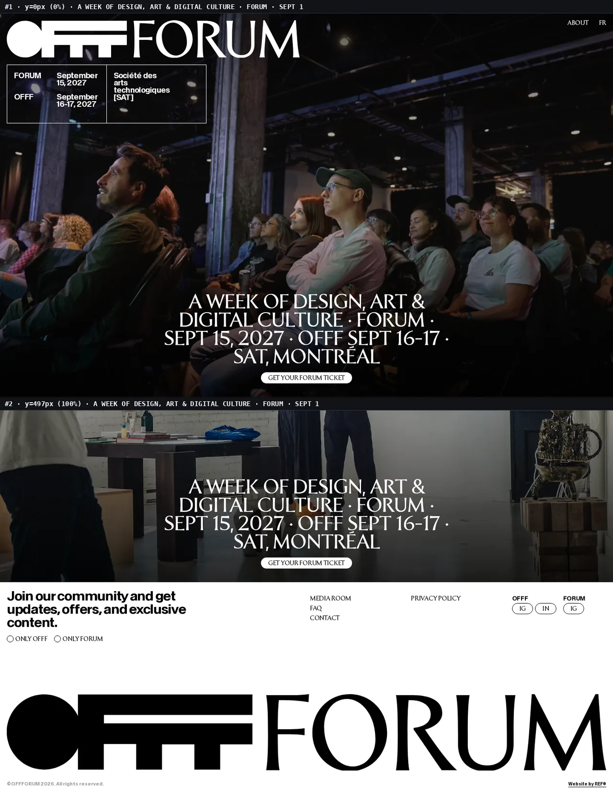
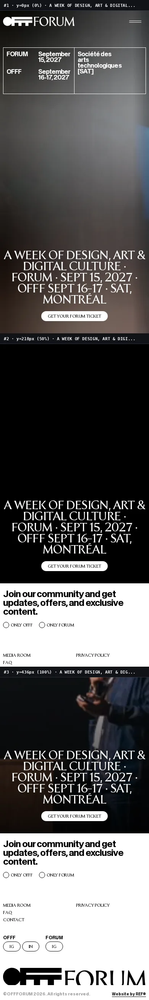

# UI Design System & Master Generation Blueprint: www-offforum-com

> **A WEEK OF DESIGN, ART & DIGITAL CULTURE · FORUM · SEPT 15, 2027 · OFFF S...** (https://www.offforum.com/) — A one-week festival convening designers, artists, and digital culture practitioners.





---

## 1. Executive Visual Persona & Design Archetype

- **Brand Essence & Persona**: **A WEEK OF DESIGN, ART & DIGITAL CULTURE · FORUM · SEPT 15, 2027 · OFFF S...** (`https://www.offforum.com/`). A one-week festival convening designers, artists, and digital culture practitioners.
- **Capture Provenance**: Live browser capture (`tier1_fast`, HTTP `200`, captured `2026-11-24`).
- **Visual Archetype**: **High-Contrast Obsidian / Atmospheric Design System (`#000000` canvas, `#ffffff` ink, `#808080` accent)**.
- **Anti-AI-Slop Differentiators**:
  - **Live-Computed Chromatic Polarity**: Anchors the viewport in `#000000` (live computed `html` `background-color` (`computed_styles.json`)) paired with `#ffffff` primary typography and `#808080` accents.
  - **Grounded Typographic Hierarchy**: Pairs `Forvm` for display copy (`A WEEK OF DESIGN, ART & DIGITAL CULT`) with `Baikal` and `SFMono-Regular`.
  - **Calibrated Spatial Grid & Motion**: Combines `1440px` container bounds (`gap: 0px (flush layout)`, padding `8px`) with `cubic-bezier(.4,0,.2,1)` easing and Lenis Smooth Scroll (`data-lenis`), Three.js / WebGL Canvas Pipeline.

---

## 2. Spatial Architecture & Modular Grid Mathematics

### Viewport Allocation & Container Geometry
- **Captured Journey Filmstrips**: Desktop `1280×1656px` (`assets/desktop-journey.webp`, `2` keyframes up to `y=497px` / doc `1397px`), Mobile `390×2616px` (`assets/mobile-journey.webp`, `3` keyframes).
- **Master Container Bounds**: `1440px` (full-bleed `100%` desktop stage measured on `1440px` viewport).
- **Canvas Lateral Padding & Spacing**: `8px` lateral canvas padding with `0px (flush layout)` grid gap.
- **Border Radius Scale**: `40px`, `2147483647px`, `var(--radius)`, `var(--box-radius)`.

### Responsive Breakpoint Architecture
- **Desktop Layout**: Multi-column CSS Grid / Flexbox layout at `1440px` (`max-width: 1440px`, `gap: 0px (flush layout)`).
- **Mobile Layout**: Single-column vertical stack at `390px` viewport width with `8px` horizontal padding.
- **Extracted CSS Media Queries**: `@media (width>=48rem)`, `@media (width>=64rem)`, `@media (width>=40rem)`, `@media (width>=80rem)`.

---

## 3. Color System, Materiality & Atmospheric Lighting

### Semantic Palette & Source Grounding
| Semantic Role | Ground-Truth Value | Extracted Live / CSS Source |
|---|---|---|
| **Primary Canvas Substrate** | `#000000` | live computed `html` `background-color` (`computed_styles.json`) |
| **Primary Typography Ink** | `#ffffff` | live computed `h1` `color` (`computed_styles.json`) |
| **Elevated Surface / Card Substrate** | `#ff0000` | `.bg-red { background-color: red }` (`#ff0000`) |
| **Interactive Accent / Highlight** | `#808080` | `.button-basic-primary:disabled { background-color: grey }` (`#808080`) |
| **Secondary / Muted Copy** | `#808080` | `.button-basic-secondary:disabled { color: grey }` (`#808080`) |
| **Structural Hairline Border** | `#808080` | `.button-basic-primary:disabled { border-color: #808080 }` |

### Sanitized Root CSS Variables (`ui-ux.md` Ground Truth)
| Variable Name | Extracted Value | Semantic Role |
|---|---|---|
| `--spacing` | `.1rem` | Layout / Spatial Grid Token |
| `--font-weight-semibold` | `600` | Typography / Scale Token |
| `--ease-in-out` | `cubic-bezier(.4, 0, .2, 1)` | Motion / Easing Token |
| `--aspect-video` | `16 / 9` | Design System Custom Token |
| `--default-transition-duration` | `.15s` | Motion / Easing Token |
| `--default-transition-timing-function` | `cubic-bezier(.4, 0, .2, 1)` | Motion / Easing Token |
| `--font-baikal` | `"Baikal", sans-serif` | Typography / Scale Token |
| `--font-forvm` | `"Forvm", serif` | Typography / Scale Token |
| `--text-body-mobile` | `1.8rem` | Typography Ink Token |
| `--text-body-mobile--line-height` | `2rem` | Typography Ink Token |
| `--text-body-mobile--font-weight` | `600` | Typography Ink Token |
| `--text-body-mobile--letter-spacing` | `-.04em` | Typography Ink Token |
| `--text-body-desktop` | `2.4rem` | Typography Ink Token |
| `--text-body-desktop--line-height` | `2.6rem` | Typography Ink Token |
| `--text-body-desktop--font-weight` | `600` | Typography Ink Token |
| `--text-body-desktop--letter-spacing` | `-.04em` | Typography Ink Token |

---

## 4. Typographic Scale & Editorial Hierarchy

### Font Family Stacks
- **Display Typography**: `Forvm`.
- **Primary Body Stack**: `Baikal`.
- **Technical / Metadata Stack**: `SFMono-Regular`.

### Typographic Scale & Rules (Live Computed & Stylesheet Grounded)
- **Hero Display (`H1`)**: live computed `h1` (`font-size: 45px`, `line-height: 43px`, `font-weight: 400`, `letter-spacing: -0.9px`); CSS variables `--text-h1-mobile-offf: 3.2rem`, `--text-h1-mobile-offf--line-height: 3.1rem`, `--text-h1-mobile-offf--font-weight: 600`.
- **Section Heading (`H2`)**: live computed `h3 (primary section heading)` (`font-size: 32px`, `line-height: 31px`, `font-weight: 600`, `letter-spacing: -1.28px`); CSS variables `--text-h2-mobile-offf: 3.2rem`, `--text-h2-mobile-offf--line-height: 3.1rem`, `--text-h2-mobile-offf--font-weight: 600`; rule `h2` (`font-size: var(--text-body-mobile)`, `line-height: var(--tw-leading,var(...`, `letter-spacing: var(--tw-tracking,var...`, `font-weight: var(--tw-font...`).
- **Body Copy**: live computed `body` (`font-size: 10px`, `line-height: 15px`, `font-weight: 400`); CSS variables `--text-body-mobile: 1.8rem`, `--text-body-mobile--line-height: 2rem`, `--text-body-mobile--font-weight: 600`.
- **Metadata & Navigation Labels**: live computed `nav/a` (`font-size: 10px`, `line-height: 15px`, `font-weight: 400`); CSS variables `--text-body-mobile--letter-spacing: -.04em`, `--text-body-desktop--letter-spacing: -.04em`, `--text-body-2-mobile--letter-spacing: -.02em`.

---

## 5. Choreographed Motion & Interaction Physics

### Primary Easing Curves
- **Extracted Timing Functions**: `cubic-bezier(.4,0,.2,1)`, `cubic-bezier(.76,0,.24,1)`, `cubic-bezier(.87,0,.13,1)`.

### Per-Element Transition & Choreography Rules
- **Selector `layer theme`**: `transition: .15s` extracted from `www-offforum-com` stylesheet.
- **Selector `.button-basic-primary`**: `transition: var(--tw-ease,var(--default-transition-timing-function))` extracted from `www-offforum-com` stylesheet.
- **Selector `.button-basic-secondary`**: `transition: var(--tw-ease,var(--default-transition-timing-function))` extracted from `www-offforum-com` stylesheet.
- **Extracted Easing Curve (`cubic-bezier(.4,0,.2,1)`)**: Governs interactive state transitions across `<header.header>` and `<main.min-h-screen:nth(2)>`.
- **Runtime Interaction Engine**: Integrates Lenis Smooth Scroll (`data-lenis`), Three.js / WebGL Canvas Pipeline, Framer Motion Layout Physics with `prefers-reduced-motion: reduce` fallback guards.
### Measured Runtime Scroll & Interaction Telemetry (`behavioral_journey_v2`)
- **Scroll Driver Mode**: `native` (max document height `1397px`, deepest scrollY reached `497px` across `2` desktop keyframes).
- **Detected Scroll / Motion Libraries**: `Lenis`.
- **Hover Physics (`primary_cta` · `GET YOUR FORUM TICKET`)**: `color`: `rgb(0, 0, 0)` -> `rgb(255, 255, 255)`; `backgroundColor`: `rgb(255, 255, 255)` -> `rgba(0, 0, 0, 0)`; `borderColor`: `rgba(0, 0, 0, 0)` -> `rgb(255, 255, 255)` (`transition-duration: 0.1s`, `timing: cubic-bezier(0.4, 0, 0.2, 1)`).
- **Route Transition Architecture**: First internal navigation (`/about/`) measured as `MPA` in `1774ms`.

---

## 6. Component Wireframe & Structural DOM Map

### Visual Layout Schematic — Desktop (`1440px`, Grounded in `dom.html` & Landmark Bounding Boxes)
```
┌────────────────────────────────────────────────────────────────────────┐
│ DESKTOP VIEWPORT (1440px) — A WEEK OF DESIGN, ART & DIGITAL CULTURE ·  │
│ ====================================================================== │
│ [ <header.header> (1440x120px)        | About                        ] │
│ ---------------------------------------------------------------------- │
│ | HERO STAGE: <main.min-h-screen> (w=1440px)                         | │
│ | H1: A WEEK OF DESIGN, ART & DIGITAL CULTURE · FORUM ·...           | │
│ | Substrate: #000000 | Ink: #ffffff | Accent: #808080                | │
│ ---------------------------------------------------------------------- │
│ | SHOWCASE GRID (<main.min-h-screen:nth(2)>) max-w: 1440px           | │
│ | +------------------------------+  +------------------------------+ | │
│ | | Join our community and get u |  | GET YOUR FORUM TICKET        | | │
│ | +------------------------------+  +------------------------------+ | │
│ ---------------------------------------------------------------------- │
│ | DETAIL MODULE (<main.min-h-screen:nth(3)>) — www-offforum-com Arch | │
│ ---------------------------------------------------------------------- │
│ [ FOOTER (<footer.container-ma) | https://www.offforum.com/            │
└────────────────────────────────────────────────────────────────────────┘
```

### Visual Layout Schematic — Mobile Reflow (`390px`)
```
┌────────────────────────────────────────────────────────────────────────┐
│ MOBILE VIEWPORT REFLOW (390px) — Single-Column Stack (gap: 0px (flu)   │
│ ====================================================================== │
│ [ HEADER BAR (<header.header>         ) | Compact Menu (390px)         │
│ ---------------------------------------------------------------------- │
│ | HERO STAGE (<main.min-h-screen>) — 390px Vertical Lead             | │
│ | H1: A WEEK OF DESIGN, ART & DIGITAL CULTURE · FORUM ·...           | │
│ ---------------------------------------------------------------------- │
│ | SHOWCASE STACK (<main.min-h-screen:nth) — 1-Col Stack              | │
│ | [ Item 1: Join our community and get updates, offers, and e...   ] | │
│ | [ Item 2: GET YOUR FORUM TICKET                                  ] | │
│ ---------------------------------------------------------------------- │
│ | DETAIL STACK (<main.min-h-screen:nth(3) — 1-Col (www-offforum-com A) │
│ ---------------------------------------------------------------------- │
│ [ FOOTER (<footer.container-ma) | Stacked 390px Colophon               │
└────────────────────────────────────────────────────────────────────────┘
```

### Granular DOM Region Breakdown
1. **Brand Header & Navigation Bar (<header.header> — `www-offforum-com`)**:
   - Landmark `<header class="header h-header-height">` (`1440x120px`) hosting `A WEEK OF DESIGN, ART & DIGITAL CULT` navigation (`About`), DOM attributes (`data-svg-origin="609.3610229492188 0"`, `data-svg-origin="-0.09765620529651642..."`, `data-nuxt-data="nuxt-app"`, `data-ssr="true"`), and stylesheet rule `before { box-sizing:border-box;border:0 solid;margin:0;padding:0 }`.
2. **Hero Stage & Focal Lead (<main.min-h-screen> — `A WEEK OF DESIGN, ART & DIGITAL CU`)**:
   - Landmark `<main class="min-h-screen">` presenting display lead `A WEEK OF DESIGN, ART & DIGITAL CULTURE · FORUM ·...` and copy excerpt *"©OFFFORUM 2026. All rights reserved."* over `#000000` canvas and `#ffffff` ink.
3. **Primary Showcase & Content Grid (<main.min-h-screen:nth(2)> — `Join our community and get updates`)**:
   - Landmark `<main class="min-h-screen">` rendering section `Join our community and get updates, offers, and e...` with copy *"GET YOUR FORUM TICKET"*, asset references (`gtm.js`, `entry.CI2s3_W4.css`, `_payload.json`, `f8tcD554.js`), and grid rule `file-selector-button { box-sizing:border-box;border:0 solid;margin:0;padding:0 }`.
4. **Interactive Detail & Feature Matrix (<main.min-h-screen:nth(3)> — `GET YOUR FORUM TICKET`)**:
   - Landmark `<main class="min-h-screen">` framing `GET YOUR FORUM TICKET` and `www-offforum-com Archive & Directory` (*"Join our community and get updates, offers, and e..."*) with `#ff0000` surface cards, `#808080` accents, and `strong { font-weight:bolder }`.
5. **Colophon & Global Directory Footer (<footer.container-main> — `https://www.offforum.com/`)**:
   - Landmark `<footer class="container-main">` anchoring `A WEEK OF DESIGN, ART & DIGITAL ` footer links (`About`), copy *"GET YOUR FORUM TICKET"*, and `#808080` structural dividers.
### Full Vertical Scroll Sequence (Desktop `1440×900` Keyframes)
- **Step 01** (`y=0px`, `0%`): Active landmark `A WEEK OF DESIGN, ART & DIGITAL CULTURE · FORUM ·...` · sticky/fixed elements: `0`
- **Step 02** (`y=497px`, `100%`): Active landmark `A WEEK OF DESIGN, ART & DIGITAL CULTURE · FORUM ·...` · sticky/fixed elements: `0`

### Multi-Page Internal Route Map
- **About Route (`/about/`)**: `https://www.offforum.com/about/` — H1: `About`, scrollHeight `5167px`, transition `MPA` (`1774ms`)
- **Other Route (`/fr/`)**: `https://www.offforum.com/fr/` — H1: `UNE SEMAINE DE DESIGN, D’ART & CULTURE NUMÉRIQUE...`, scrollHeight `1397px`, transition `direct` (`1038ms`)
- **Other Route (`/media-room/`)**: `https://www.offforum.com/media-room/` — H1: `Media room`, scrollHeight `4364px`, transition `direct` (`1278ms`)

---

## 7. Master Zero-Shot AI Generation Prompt

```markdown
# Master Zero-Shot Frontend Generation Prompt: www-offforum-com (A WEEK OF DESIGN, ART & DIGITAL CULTURE · FORUM · SEPT 15, 2027 · OFFF S...)

You are a principal frontend architect and design systems engineer. Build a complete, production-ready web application replicating the exact design system, DOM landmarks, typographic hierarchy, color tokens, and motion physics of `www-offforum-com` (**A WEEK OF DESIGN, ART & DIGITAL CULTURE · FORUM · SEPT 15, 2027 · OFFF S...** — `https://www.offforum.com/`).

### 1. Visual Archetype & Anti-AI-Slop Mandates
- **Archetype**: High-Contrast Obsidian / Atmospheric Design System (`#000000` canvas, `#ffffff` ink, `#808080` accent).
- **Identity & Domain Context**: A one-week festival convening designers, artists, and digital culture practitioners.
- **Primary Substrate**: `#000000` (live computed `html` `background-color` (`computed_styles.json`)), **Primary Ink**: `#ffffff`, **Accent / Highlight**: `#808080`.
- **Site-Specific Differentiators**:
  - **Live-Computed Chromatic Polarity**: Anchors the viewport in `#000000` (live computed `html` `background-color` (`computed_styles.json`)) paired with `#ffffff` primary typography and `#808080` accents.
  - **Grounded Typographic Hierarchy**: Pairs `Forvm` for display copy (`A WEEK OF DESIGN, ART & DIGITAL CULT`) with `Baikal` and `SFMono-Regular`.
  - **Calibrated Spatial Grid & Motion**: Combines `1440px` container bounds (`gap: 0px (flush layout)`, padding `8px`) with `cubic-bezier(.4,0,.2,1)` easing and Lenis Smooth Scroll (`data-lenis`), Three.js / WebGL Canvas Pipeline.

### 2. Ground-Truth CSS Variables (`:root` Token Contract)
Declare and consume these exact custom properties extracted from `www-offforum-com` in your global stylesheet:

:root {
  /* A WEEK OF DESIGN, ART & DIGITAL CULTURE · FORUM · SEPT 15, 2027 · OFFF S... (www-offforum-com) — Live-Grounded CSS Variables */
  --spacing: .1rem; /* Layout / Spatial Grid Token (www-offforum-com) */
  --font-weight-semibold: 600; /* Typography / Scale Token (www-offforum-com) */
  --ease-in-out: cubic-bezier(.4, 0, .2, 1); /* Motion / Easing Token (www-offforum-com) */
  --aspect-video: 16 / 9; /* Design System Custom Token (www-offforum-com) */
  --default-transition-duration: .15s; /* Motion / Easing Token (www-offforum-com) */
  --default-transition-timing-function: cubic-bezier(.4, 0, .2, 1); /* Motion / Easing Token (www-offforum-com) */
  --font-baikal: "Baikal", sans-serif; /* Typography / Scale Token (www-offforum-com) */
  --font-forvm: "Forvm", serif; /* Typography / Scale Token (www-offforum-com) */
  --text-body-mobile: 1.8rem; /* Typography Ink Token (www-offforum-com) */
  --text-body-mobile--line-height: 2rem; /* Typography Ink Token (www-offforum-com) */
  --text-body-mobile--font-weight: 600; /* Typography Ink Token (www-offforum-com) */
  --text-body-mobile--letter-spacing: -.04em; /* Typography Ink Token (www-offforum-com) */
  --text-body-desktop: 2.4rem; /* Typography Ink Token (www-offforum-com) */
  --text-body-desktop--line-height: 2.6rem; /* Typography Ink Token (www-offforum-com) */
  --text-body-desktop--font-weight: 600; /* Typography Ink Token (www-offforum-com) */
  --text-body-desktop--letter-spacing: -.04em; /* Typography Ink Token (www-offforum-com) */
}

### 3. Semantic Color & Materiality Contract
Map every surface, ink, and border strictly to these source-grounded tokens:
- **Primary Canvas Substrate**: `#000000` — grounded in live computed `html` `background-color` (`computed_styles.json`)
- **Primary Typography Ink**: `#ffffff` — grounded in live computed `h1` `color` (`computed_styles.json`)
- **Elevated Surface / Card Substrate**: `#ff0000` — grounded in `.bg-red { background-color: red }` (`#ff0000`)
- **Interactive Accent / Highlight**: `#808080` — grounded in `.button-basic-primary:disabled { background-color: grey }` (`#808080`)
- **Secondary / Muted Copy**: `#808080` — grounded in `.button-basic-secondary:disabled { color: grey }` (`#808080`)
- **Structural Hairline Border**: `#808080` — grounded in `.button-basic-primary:disabled { border-color: #808080 }`

### 4. Spatial Grid, Container Bounds & Responsive Breakpoints
- **Desktop Viewport Reference**: `1280×1656px` (full-page live capture (1656px), `1440px` standard desktop width).
- **Mobile Viewport Reference**: `390×2616px` (multi-frame vertical journey filmstrip (2616px), `390px` standard mobile width).
- **Container Max-Width**: `1440px` (full-bleed `100%` desktop stage measured on `1440px` viewport)
- **Padding & Gutters**: `8px` lateral canvas padding with `0px (flush layout)` grid gap
- **Desktop Grid**: Multi-column CSS Grid / Flexbox layout at `1440px` (`max-width: 1440px`, `gap: 0px (flush layout)`)
- **Mobile Adaptation**: Single-column vertical stack at `390px` viewport width with `8px` horizontal padding
- **Media Queries**: `@media (width>=48rem)`, `@media (width>=64rem)`, `@media (width>=40rem)`, `@media (width>=80rem)`
- **Corner Radii**: `40px`, `2147483647px`, `var(--radius)`, `var(--box-radius)`

### 5. Typography & Editorial Scale Contract
- **Display Font Stack**: `Forvm`
- **Body Font Stack**: `Baikal`
- **Monospace / Technical Font Stack**: `SFMono-Regular`
- **H1 Display Rule**: live computed `h1` (`font-size: 45px`, `line-height: 43px`, `font-weight: 400`, `letter-spacing: -0.9px`); CSS variables `--text-h1-mobile-offf: 3.2rem`, `--text-h1-mobile-offf--line-height: 3.1rem`, `--text-h1-mobile-offf--font-weight: 600`
- **H2 Section Rule**: live computed `h3 (primary section heading)` (`font-size: 32px`, `line-height: 31px`, `font-weight: 600`, `letter-spacing: -1.28px`); CSS variables `--text-h2-mobile-offf: 3.2rem`, `--text-h2-mobile-offf--line-height: 3.1rem`, `--text-h2-mobile-offf--font-weight: 600`; rule `h2` (`font-size: var(--text-body-mobile)`, `line-height: var(--tw-leading,var(...`, `letter-spacing: var(--tw-tracking,var...`, `font-weight: var(--tw-font...`)
- **Body Copy Rule**: live computed `body` (`font-size: 10px`, `line-height: 15px`, `font-weight: 400`); CSS variables `--text-body-mobile: 1.8rem`, `--text-body-mobile--line-height: 2rem`, `--text-body-mobile--font-weight: 600`
- **Metadata & Index Rule**: live computed `nav/a` (`font-size: 10px`, `line-height: 15px`, `font-weight: 400`); CSS variables `--text-body-mobile--letter-spacing: -.04em`, `--text-body-desktop--letter-spacing: -.04em`, `--text-body-2-mobile--letter-spacing: -.02em`

### 6. Component Hierarchy, Verbatim Copy & Real DOM Landmarks
Scaffold `www-offforum-com` (`A WEEK OF DESIGN, ART & DIGITAL CULTURE · FORUM · SEPT 15, 2027 · OFFF S...`) with these exact structural regions, extracted copy, and CSS rules from `dom.html`:
1. **Brand Header & Navigation Bar (<header.header> — `www-offforum-com`)**:
   - DOM & Selectors: Landmark `<header class="header h-header-height">` (`1440x120px`) hosting `A WEEK OF DESIGN, ART & DIGITAL CULT` navigation (`About`), DOM attributes (`data-svg-origin="609.3610229492188 0"`, `data-svg-origin="-0.09765620529651642..."`, `data-nuxt-data="nuxt-app"`, `data-ssr="true"`), and stylesheet rule `before { box-sizing:border-box;border:0 solid;margin:0;padding:0 }`.
   - Responsive Contract: Header `Brand Header & Navigation Bar (<header.header> — `www-offforum-com`)` (`www-offforum-com`) adapts across `@media (width>=48rem)`, `@media (width>=64rem)`, `@media (width>=40rem)`, `@media (width>=80rem)` with `cubic-bezier(.4,0,.2,1)`, `cubic-bezier(.76,0,.24,1)`, `cubic-bezier(.87,0,.13,1)` transitions and links `About`.
2. **Hero Stage & Focal Lead (<main.min-h-screen> — `A WEEK OF DESIGN, ART & DIGITAL CU`)**:
   - DOM & Selectors: Landmark `<main class="min-h-screen">` presenting display lead `A WEEK OF DESIGN, ART & DIGITAL CULTURE · FORUM ·...` and copy excerpt *"©OFFFORUM 2026. All rights reserved."* over `#000000` canvas and `#ffffff` ink.
   - Responsive Contract: Hero stage (`1280×1656px` desktop / `390×2616px` mobile) sets `#000000` background with `#ffffff` headline `A WEEK OF DESIGN, ART & DIGITAL CULTURE · FORUM ·...`.
3. **Primary Showcase & Content Grid (<main.min-h-screen:nth(2)> — `Join our community and get updates`)**:
   - DOM & Selectors: Landmark `<main class="min-h-screen">` rendering section `Join our community and get updates, offers, and e...` with copy *"GET YOUR FORUM TICKET"*, asset references (`gtm.js`, `entry.CI2s3_W4.css`, `_payload.json`, `f8tcD554.js`), and grid rule `file-selector-button { box-sizing:border-box;border:0 solid;margin:0;padding:0 }`.
   - Responsive Contract: Showcase grid `Primary Showcase & Content Grid (<main.min-h-screen:nth(2)> — `Join our community and get updates`)` applies Multi-column CSS Grid / Flexbox layout at `1440px` (`max-width: 1440px`, `gap: 0px (flush layout)`) on desktop and Single-column vertical stack at `390px` viewport width with `8px` horizontal padding on mobile.
4. **Interactive Detail & Feature Matrix (<main.min-h-screen:nth(3)> — `GET YOUR FORUM TICKET`)**:
   - DOM & Selectors: Landmark `<main class="min-h-screen">` framing `GET YOUR FORUM TICKET` and `www-offforum-com Archive & Directory` (*"Join our community and get updates, offers, and e..."*) with `#ff0000` surface cards, `#808080` accents, and `strong { font-weight:bolder }`.
   - Responsive Contract: Detail module `Interactive Detail & Feature Matrix (<main.min-h-screen:nth(3)> — `GET YOUR FORUM TICKET`)` uses `40px`, `2147483647px`, `var(--radius)`, `var(--box-radius)` radii, `#808080` highlights, and assets (gtm.js, entry.CI2s3_W4.css, _payload.json).
5. **Colophon & Global Directory Footer (<footer.container-main> — `https://www.offforum.com/`)**:
   - DOM & Selectors: Landmark `<footer class="container-main">` anchoring `A WEEK OF DESIGN, ART & DIGITAL ` footer links (`About`), copy *"GET YOUR FORUM TICKET"*, and `#808080` structural dividers.
   - Responsive Contract: Footer `Colophon & Global Directory Footer (<footer.container-main> — `https://www.offforum.com/`)` aligns to `1440px` (full-bleed `100%` desktop stage measured on `1440px` viewport) with `8px` lateral canvas padding with `0px (flush layout)` grid gap and attributes (data-svg-origin="609.3610229492188 0", data-svg-origin="-0.09765620529651642...", data-nuxt-data="nuxt-app").

#### Verbatim DOM Copy Excerpts (`dom.html`)
- Copy Excerpt 1: *"©OFFFORUM 2026. All rights reserved."*
- Copy Excerpt 2: *"GET YOUR FORUM TICKET"*

### 7. Motion, Extracted Stylesheet Rules & Interaction Choreography
- **Primary Easing Functions**: `cubic-bezier(.4,0,.2,1)`, `cubic-bezier(.76,0,.24,1)`, `cubic-bezier(.87,0,.13,1)`
- **Extracted Stylesheet Rules (`www-offforum-com`)**:
- `before { box-sizing:border-box;border:0 solid;margin:0;padding:0 }`
- `file-selector-button { box-sizing:border-box;border:0 solid;margin:0;padding:0 }`
- `strong { font-weight:bolder }`
- `small { font-size:80% }`
- `sup { vertical-align:baseline;font-size:75%;line-height:0;position:relative }`
- **Per-Selector Transition Rules**:
- **Selector `layer theme`**: `transition: .15s` extracted from `www-offforum-com` stylesheet.
- **Selector `.button-basic-primary`**: `transition: var(--tw-ease,var(--default-transition-timing-function))` extracted from `www-offforum-com` stylesheet.
- **Selector `.button-basic-secondary`**: `transition: var(--tw-ease,var(--default-transition-timing-function))` extracted from `www-offforum-com` stylesheet.
- **Extracted Easing Curve (`cubic-bezier(.4,0,.2,1)`)**: Governs interactive state transitions across `<header.header>` and `<main.min-h-screen:nth(2)>`.
- **Runtime Interaction Engine**: Integrates Lenis Smooth Scroll (`data-lenis`), Three.js / WebGL Canvas Pipeline, Framer Motion Layout Physics with `prefers-reduced-motion: reduce` fallback guards.
### 7b. Full-Page Scroll Choreography, Interactive States & Multi-Page Routes
- **Scroll Mechanics**: Implement `native` vertical progression up to `1397px` across 2 distinct viewport chapters using Lenis.
- **Vertical Chapter Sequence**: A WEEK OF DESIGN, ART & DIG... (0%) -> A WEEK OF DESIGN, ART & DIG... (100%).
- **Hover Micro-Interaction (`primary_cta`)**: Animate `color, backgroundColor, borderColor` with `0.1s cubic-bezier(0.4, 0, 0.2, 1)`.
- **Multi-Page Routes**: Scaffold internal routes `/about/` (about, MPA), `/fr/` (other, direct), `/media-room/` (other, direct) sharing the global header/footer shell and design tokens.

### 8. Technical Deliverables
- Implement in Next.js (App Router) with TypeScript and Tailwind CSS consuming the `:root` custom properties defined above for `www-offforum-com`.
- Reproduce both the `1440px` desktop architecture and `390px` mobile breakpoint transitions, preserving semantic HTML5 landmarks (`<header>`, `<nav>`, `<main>`, `<section>`, `<footer>`) and `prefers-reduced-motion` accessibility guards.
```
---

## 8. Full-Page Scroll Journey, Interactive States & Subpage Inventory

### Desktop Scroll Keyframes (`1440×900` WebP)
| Step | Scroll Y | Progress | Active Landmark / Section | Sticky/Fixed | Visual Asset |
| :---: | :---: | :---: | :--- | :---: | :--- |
| `#01` | `0px` | `0%` | A WEEK OF DESIGN, ART & DIGITAL CULTURE · FOR... | `0` | [desktop-step-01.webp](assets/desktop-step-01.webp) |
| `#02` | `497px` | `100%` | A WEEK OF DESIGN, ART & DIGITAL CULTURE · FOR... | `0` | [desktop-step-02.webp](assets/desktop-step-02.webp) |

### Mobile Condensed Keyframes (`390×844` WebP)
| Step | Scroll Y | Progress | Active Landmark | Visual Asset |
| :---: | :---: | :---: | :--- | :--- |
| `#01` | `0px` | `0%` | A WEEK OF DESIGN, ART & DIGITAL CULTURE ·... | [mobile-step-01.webp](assets/mobile-step-01.webp) |
| `#02` | `218px` | `50%` | A WEEK OF DESIGN, ART & DIGITAL CULTURE ·... | [mobile-step-02.webp](assets/mobile-step-02.webp) |
| `#03` | `436px` | `100%` | A WEEK OF DESIGN, ART & DIGITAL CULTURE ·... | [mobile-step-03.webp](assets/mobile-step-03.webp) |

### Internal Subpage Filmstrips (`1080px` Wide WebP)
| # | Template | Route URL | H1 / Title | Scroll Height | Transition | Filmstrip Asset |
| :-: | :---: | :--- | :--- | :---: | :---: | :--- |
| `1` | `about` | `https://www.offforum.com/about/` | About | `5167px` | `MPA` (`1774ms`) | [subpage-01-about.webp](assets/subpage-01-about.webp) |
| `2` | `other` | `https://www.offforum.com/fr/` | UNE SEMAINE DE DESIGN, D’ART & CULTUR... | `1397px` | `direct` (`1038ms`) | [subpage-02-fr.webp](assets/subpage-02-fr.webp) |
| `3` | `other` | `https://www.offforum.com/media-room/` | Media room | `4364px` | `direct` (`1278ms`) | [subpage-03-media-room.webp](assets/subpage-03-media-room.webp) |

