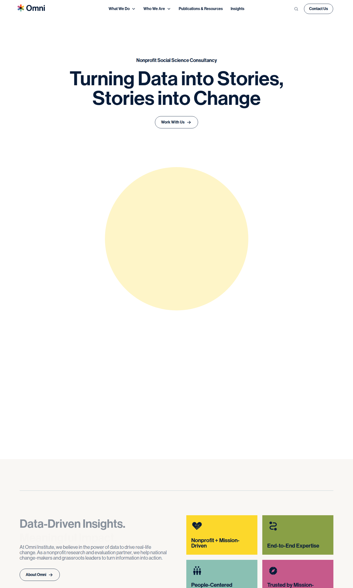
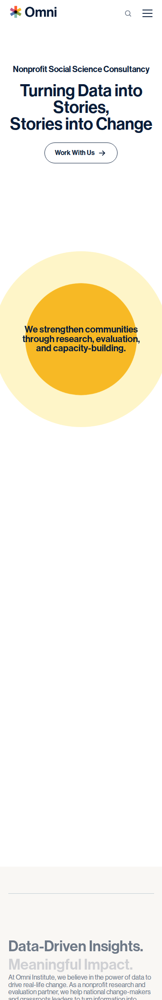

# UI Design System & Master Generation Blueprint: www-omni-org

> **Omni Institute** (https://www.omni.org) — At Omni Institute, we believe in the power of data to drive real-life change. As a nonprofit research and evaluation partner, we help nat...



---

## 1. Executive Visual Persona & Design Archetype

- **Brand Essence & Persona**: **Omni Institute** (`https://www.omni.org`). At Omni Institute, we believe in the power of data to drive real-life change. As a nonprofit research and evaluation partner, we help nat...
- **Capture Provenance**: Live browser capture (`tier1_fast`, HTTP `200`, captured `2026-11-23`).
- **Visual Archetype**: **Light-Substrate Editorial & Modular Grid System (`#ffffff` canvas, `#081c39` ink, `#ffa500` accent)**.
- **Anti-AI-Slop Differentiators**:
  - **Live-Computed Chromatic Polarity**: Anchors the viewport in `#ffffff` (live computed `body` `background-color` (`computed_styles.json`)) paired with `#081c39` primary typography and `#ffa500` accents.
  - **Grounded Typographic Hierarchy**: Pairs `neue-haas-grotesk-display` for display copy (`Nonprofit Social Science Consultancy`) with `neue-haas-grotesk-display` and `Sometype Mono`.
  - **Calibrated Spatial Grid & Motion**: Combines `1920px` container bounds (`gap: 16px`, padding `9px`) with `cubic-bezier(0.25,0.1,0.25,1)` easing and GSAP Timeline & ScrollTrigger, Lottie Vector Animation Player.

---

## 2. Spatial Architecture & Modular Grid Mathematics



### Viewport Allocation & Container Geometry
- **Captured Viewport Dimensions**: Desktop `1440×2400px` (`assets/desktop.png`, clamped at 2400px live multi-section capture), Mobile `390×2400px` (`assets/mobile.png`, clamped at 2400px live multi-section capture).
- **Master Container Bounds**: `1920px` (non-`@media` desktop container stylesheet rule).
- **Canvas Lateral Padding & Spacing**: `9px` lateral canvas padding with `16px` grid gap.
- **Border Radius Scale**: `3px`, `100%`, `50%`, `2px`.

### Responsive Breakpoint Architecture
- **Desktop Layout**: Multi-column CSS Grid / Flexbox layout at `1440px` (`max-width: 1920px`, `gap: 16px`).
- **Mobile Layout**: Single-column vertical stack at `390px` viewport width with `9px` horizontal padding.
- **Extracted CSS Media Queries**: `@media screen and (max-width:991px)`, `@media screen and (max-width:767px)`, `@media screen and (max-width:479px)`, `@media (min-width:768px)`.

---

## 3. Color System, Materiality & Atmospheric Lighting

### Semantic Palette & Source Grounding
| Semantic Role | Ground-Truth Value | Extracted Live / CSS Source |
|---|---|---|
| **Primary Canvas Substrate** | `#ffffff` | live computed `body` `background-color` (`computed_styles.json`) |
| **Primary Typography Ink** | `#081c39` | live computed `h1` `color` (`computed_styles.json`) |
| **Elevated Surface / Card Substrate** | `#ffff00` | `mark { background: #ffff00 }` |
| **Interactive Accent / Highlight** | `#ffa500` | `.button.is-secondary.is-icon.or... { color: orange }` (`#ffa500`) |
| **Secondary / Muted Copy** | `#5776b2` | `var(--_primitives---colors--periwinkle-600)` in `:root` |
| **Structural Hairline Border** | `#e2e2e2` | `blockquote { border-left: #e2e2e2 }` |
| **Variable Token (`--_primitives---colors--steel-blue-200`)** | `#bfcbd3` | `var(--_primitives---colors--steel-blue-200)` in `:root` |
| **Variable Token (`--_primitives---colors--steel-blue-400`)** | `#677384` | `var(--_primitives---colors--steel-blue-400)` in `:root` |
| **Variable Token (`--_primitives---colors--periwinkle-200`)** | `#d4ddeb` | `var(--_primitives---colors--periwinkle-200)` in `:root` |
| **Variable Token (`--_primitives---colors--plum-600`)** | `#921c4c` | `var(--_primitives---colors--plum-600)` in `:root` |
| **Variable Token (`--_primitives---colors--orange-600`)** | `#cc4100` | `var(--_primitives---colors--orange-600)` in `:root` |

### Sanitized Root CSS Variables (`ui-ux.md` Ground Truth)
| Variable Name | Extracted Value | Semantic Role |
|---|---|---|
| `--color-scheme-1--background` | `var(--_primitives---colors--white)` | Canvas / Surface Token |
| `--_typography---font-styles--body` | `neue-haas-grotesk-display,sans-serif` | Typography / Scale Token |
| `--color-scheme-1--headers` | `var(--_primitives---colors--navy)` | Brand / Palette Token |
| `--_typography---font-styles--heading` | `neue-haas-grotesk-display,sans-serif` | Typography Ink Token |
| `--_typography---font-styles--eyebrows` | `"Sometype Mono",sans-serif` | Typography / Scale Token |
| `--color-scheme-1--paragraphs` | `var(--_primitives---colors--steel-blue-400)` | Brand / Palette Token |
| `--_primitives---colors--periwinkle-600` | `#5776b2` | Typography Ink Token |
| `--_primitives---colors--steel-blue-200` | `#bfcbd3` | Brand / Palette Token |
| `--_primitives---colors--navy` | `#081c39` | Brand / Palette Token |
| `--_primitives---colors--white` | `#fff` | Canvas / Surface Token |
| `--_ui-styles---radius--large` | `100px` | Elevation / Border Token |
| `--_primitives---colors--steel-blue-400` | `#677384` | Brand / Palette Token |
| `--_primitives---opacity--transparent` | `transparent` | Design System Custom Token |
| `--_primitives---colors--periwinkle-200` | `#d4ddeb` | Typography Ink Token |
| `--_primitives---colors--plum-600` | `#921c4c` | Brand / Palette Token |
| `--_primitives---colors--orange-600` | `#cc4100` | Brand / Palette Token |

---

## 4. Typographic Scale & Editorial Hierarchy

### Font Family Stacks
- **Display Typography**: `neue-haas-grotesk-display`.
- **Primary Body Stack**: `neue-haas-grotesk-display`.
- **Technical / Metadata Stack**: `Sometype Mono`.

### Typographic Scale & Rules (Live Computed & Stylesheet Grounded)
- **Hero Display (`H1`)**: live computed `h1` (`font-size: 20px`, `line-height: 24px`, `font-weight: 700`).
- **Section Heading (`H2`)**: live computed `h2` (`font-size: 80px`, `line-height: 80px`, `font-weight: 700`).
- **Body Copy**: live computed `body` (`font-size: 16px`, `line-height: 24px`, `font-weight: 400`); CSS variables `--_typography---font-styles--body: neue-haas-grotesk-display,sans-serif`; rule `p` (`line-height: 1.7`).
- **Metadata & Navigation Labels**: live computed `nav/a` (`font-size: 16px`, `line-height: 24px`, `font-weight: 400`); CSS variables `--_ui-styles---radius--small: 8px`.

---

## 5. Choreographed Motion & Interaction Physics

### Primary Easing Curves
- **Extracted Timing Functions**: `cubic-bezier(0.25,0.1,0.25,1)`.

### Per-Element Transition & Choreography Rules
- **Selector `.w-webflow-badge>img`**: `transition: unset` extracted from `www-omni-org` stylesheet.
- **Selector `.w-slider-dot`**: `transition: background-color .1s,color .1s` extracted from `www-omni-org` stylesheet.
- **Selector `.w-lightbox-control`**: `transition: all .3s` extracted from `www-omni-org` stylesheet.
- **Standard CSS Easing (`cubic-bezier(0.25,0.1,0.25,1)`)**: Default timing curve (no custom `cubic-bezier()` declared in captured CSS).
- **Runtime Interaction Engine**: Integrates GSAP Timeline & ScrollTrigger, Lottie Vector Animation Player with `prefers-reduced-motion: reduce` fallback guards.

---

## 6. Component Wireframe & Structural DOM Map

### Visual Layout Schematic — Desktop (`1440px`, Grounded in `dom.html` & Landmark Bounding Boxes)
```
┌────────────────────────────────────────────────────────────────────────┐
│ DESKTOP VIEWPORT (1440px) — Omni Institute                             │
│ ====================================================================== │
│ [ <header.section_header (1440x524px) | Community Health · Behaviora ] │
│ ---------------------------------------------------------------------- │
│ | HERO STAGE: <section.section_layout488> (w=1440px)                 | │
│ | H1: Nonprofit Social Science Consultancy                           | │
│ | Substrate: #ffffff | Ink: #081c39 | Accent: #ffa500                | │
│ ---------------------------------------------------------------------- │
│ | SHOWCASE GRID (<section.background-color-) max-w: 1920px           | │
│ | +------------------------------+  +------------------------------+ | │
│ | | Turning Data into Stories, S |  | We strengthen communities th | | │
│ | +------------------------------+  +------------------------------+ | │
│ ---------------------------------------------------------------------- │
│ | DETAIL MODULE (<section.section_layout516) — Data-Driven Insights. | │
│ ---------------------------------------------------------------------- │
│ [ FOOTER (<footer.footer6_comp) | https://www.omni.org                 │
└────────────────────────────────────────────────────────────────────────┘
```

### Visual Layout Schematic — Mobile Reflow (`390px`)
```
┌────────────────────────────────────────────────────────────────────────┐
│ MOBILE VIEWPORT REFLOW (390px) — Single-Column Stack (gap: 16px)       │
│ ====================================================================== │
│ [ HEADER BAR (<header.section_header23) | Compact Menu (390px)         │
│ ---------------------------------------------------------------------- │
│ | HERO STAGE (<section.section_layout4) — 390px Vertical Lead        | │
│ | H1: Nonprofit Social Science Consultancy                           | │
│ ---------------------------------------------------------------------- │
│ | SHOWCASE STACK (<section.background-co) — 1-Col Stack              | │
│ | [ Item 1: Turning Data into Stories, Stories into Change         ] | │
│ | [ Item 2: We strengthen communities through research, evalu...   ] | │
│ ---------------------------------------------------------------------- │
│ | DETAIL STACK (<section.section_layout5) — 1-Col (Data-Driven Insigh) │
│ ---------------------------------------------------------------------- │
│ [ FOOTER (<footer.footer6_comp) | Stacked 390px Colophon               │
└────────────────────────────────────────────────────────────────────────┘
```

### Granular DOM Region Breakdown
1. **Brand Header & Navigation Bar (<header.section_header23> — `www-omni-org`)**:
   - Landmark `<header class="section_header23">` (`1440x524px`) hosting `Omni Institute` navigation (`Community Health · Behavioral Health · Children & Families · Economic Security · Justice`), DOM attributes (`data-wf-domain="www.omni.org"`, `data-wf-page="682b5468dca036bcf33813c0"`, `data-wf-site="682b5467dca036bcf33811dc"`, `data-animation="default"`), and stylesheet rule `html { -webkit-text-size-adjust:100%;-ms-text-size-adjust:100%;font-family:sans... }`.
2. **Hero Stage & Focal Lead (<section.section_layout488> — `Nonprofit Social Science Consultan`)**:
   - Landmark `<section class="section_layout488">` presenting display lead `Nonprofit Social Science Consultancy` and copy excerpt *"At Omni Institute, we believe in the power of data to drive real-"* over `#ffffff` canvas and `#081c39` ink.
3. **Primary Showcase & Content Grid (<section.background-color-ivory> — `Turning Data into Stories, Stories`)**:
   - Landmark `<section class="background-color-ivory">` rendering section `Turning Data into Stories, Stories into Change` with copy *"Rigorous, Human-First Research"*, asset references (`cdn.prod.website-files.com`, `omni-institute.webflow.shared.add...`, `fonts.googleapis.com`, `fonts.gstatic.com`), and grid rule `summary { display:block }`.
4. **Interactive Detail & Feature Matrix (<section.section_layout516> — `We strengthen communities through `)**:
   - Landmark `<section class="section_layout516">` framing `We strengthen communities through research, evalu...` and `Data-Driven Insights. Meaningful Impact.` (*"Committed to Actionable Impact"*) with `#ffff00` surface cards, `#ffa500` accents, and `video { vertical-align:baseline;display:inline-block }`.
5. **Colophon & Global Directory Footer (<footer.footer6_component> — `https://www.omni.org`)**:
   - Landmark `<footer class="footer6_component">` anchoring `Omni Institute` footer links (`Community Health · Behavioral Health · Children & Families · Economic Security · Justice`), copy *"Organizational Development"*, and `#e2e2e2` structural dividers.

---

## 7. Master Zero-Shot AI Generation Prompt

```markdown
# Master Zero-Shot Frontend Generation Prompt: www-omni-org (Omni Institute)

You are a principal frontend architect and design systems engineer. Build a complete, production-ready web application replicating the exact design system, DOM landmarks, typographic hierarchy, color tokens, and motion physics of `www-omni-org` (**Omni Institute** — `https://www.omni.org`).

### 1. Visual Archetype & Anti-AI-Slop Mandates
- **Archetype**: Light-Substrate Editorial & Modular Grid System (`#ffffff` canvas, `#081c39` ink, `#ffa500` accent).
- **Identity & Domain Context**: At Omni Institute, we believe in the power of data to drive real-life change. As a nonprofit research and evaluation partner, we help nat...
- **Primary Substrate**: `#ffffff` (live computed `body` `background-color` (`computed_styles.json`)), **Primary Ink**: `#081c39`, **Accent / Highlight**: `#ffa500`.
- **Site-Specific Differentiators**:
  - **Live-Computed Chromatic Polarity**: Anchors the viewport in `#ffffff` (live computed `body` `background-color` (`computed_styles.json`)) paired with `#081c39` primary typography and `#ffa500` accents.
  - **Grounded Typographic Hierarchy**: Pairs `neue-haas-grotesk-display` for display copy (`Nonprofit Social Science Consultancy`) with `neue-haas-grotesk-display` and `Sometype Mono`.
  - **Calibrated Spatial Grid & Motion**: Combines `1920px` container bounds (`gap: 16px`, padding `9px`) with `cubic-bezier(0.25,0.1,0.25,1)` easing and GSAP Timeline & ScrollTrigger, Lottie Vector Animation Player.

### 2. Ground-Truth CSS Variables (`:root` Token Contract)
Declare and consume these exact custom properties extracted from `www-omni-org` in your global stylesheet:

:root {
  /* Omni Institute (www-omni-org) — Live-Grounded CSS Variables */
  --color-scheme-1--background: var(--_primitives---colors--white); /* Canvas / Surface Token (www-omni-org) */
  --_typography---font-styles--body: neue-haas-grotesk-display,sans-serif; /* Typography / Scale Token (www-omni-org) */
  --color-scheme-1--headers: var(--_primitives---colors--navy); /* Brand / Palette Token (www-omni-org) */
  --_typography---font-styles--heading: neue-haas-grotesk-display,sans-serif; /* Typography Ink Token (www-omni-org) */
  --_typography---font-styles--eyebrows: "Sometype Mono",sans-serif; /* Typography / Scale Token (www-omni-org) */
  --color-scheme-1--paragraphs: var(--_primitives---colors--steel-blue-400); /* Brand / Palette Token (www-omni-org) */
  --_primitives---colors--periwinkle-600: #5776b2; /* Typography Ink Token (www-omni-org) */
  --_primitives---colors--steel-blue-200: #bfcbd3; /* Brand / Palette Token (www-omni-org) */
  --_primitives---colors--navy: #081c39; /* Brand / Palette Token (www-omni-org) */
  --_primitives---colors--white: #fff; /* Canvas / Surface Token (www-omni-org) */
  --_ui-styles---radius--large: 100px; /* Elevation / Border Token (www-omni-org) */
  --_primitives---colors--steel-blue-400: #677384; /* Brand / Palette Token (www-omni-org) */
  --_primitives---opacity--transparent: transparent; /* Design System Custom Token (www-omni-org) */
  --_primitives---colors--periwinkle-200: #d4ddeb; /* Typography Ink Token (www-omni-org) */
  --_primitives---colors--plum-600: #921c4c; /* Brand / Palette Token (www-omni-org) */
  --_primitives---colors--orange-600: #cc4100; /* Brand / Palette Token (www-omni-org) */
}

### 3. Semantic Color & Materiality Contract
Map every surface, ink, and border strictly to these source-grounded tokens:
- **Primary Canvas Substrate**: `#ffffff` — grounded in live computed `body` `background-color` (`computed_styles.json`)
- **Primary Typography Ink**: `#081c39` — grounded in live computed `h1` `color` (`computed_styles.json`)
- **Elevated Surface / Card Substrate**: `#ffff00` — grounded in `mark { background: #ffff00 }`
- **Interactive Accent / Highlight**: `#ffa500` — grounded in `.button.is-secondary.is-icon.or... { color: orange }` (`#ffa500`)
- **Secondary / Muted Copy**: `#5776b2` — grounded in `var(--_primitives---colors--periwinkle-600)` in `:root`
- **Structural Hairline Border**: `#e2e2e2` — grounded in `blockquote { border-left: #e2e2e2 }`
- **Variable Token (`--_primitives---colors--steel-blue-200`)**: `#bfcbd3` — grounded in `var(--_primitives---colors--steel-blue-200)` in `:root`
- **Variable Token (`--_primitives---colors--steel-blue-400`)**: `#677384` — grounded in `var(--_primitives---colors--steel-blue-400)` in `:root`
- **Variable Token (`--_primitives---colors--periwinkle-200`)**: `#d4ddeb` — grounded in `var(--_primitives---colors--periwinkle-200)` in `:root`
- **Variable Token (`--_primitives---colors--plum-600`)**: `#921c4c` — grounded in `var(--_primitives---colors--plum-600)` in `:root`
- **Variable Token (`--_primitives---colors--orange-600`)**: `#cc4100` — grounded in `var(--_primitives---colors--orange-600)` in `:root`

### 4. Spatial Grid, Container Bounds & Responsive Breakpoints
- **Desktop Viewport Reference**: `1440×2400px` (clamped at 2400px live multi-section capture, `1440px` standard desktop width).
- **Mobile Viewport Reference**: `390×2400px` (clamped at 2400px live multi-section capture, `390px` standard mobile width).
- **Container Max-Width**: `1920px` (non-`@media` desktop container stylesheet rule)
- **Padding & Gutters**: `9px` lateral canvas padding with `16px` grid gap
- **Desktop Grid**: Multi-column CSS Grid / Flexbox layout at `1440px` (`max-width: 1920px`, `gap: 16px`)
- **Mobile Adaptation**: Single-column vertical stack at `390px` viewport width with `9px` horizontal padding
- **Media Queries**: `@media screen and (max-width:991px)`, `@media screen and (max-width:767px)`, `@media screen and (max-width:479px)`, `@media (min-width:768px)`
- **Corner Radii**: `3px`, `100%`, `50%`, `2px`

### 5. Typography & Editorial Scale Contract
- **Display Font Stack**: `neue-haas-grotesk-display`
- **Body Font Stack**: `neue-haas-grotesk-display`
- **Monospace / Technical Font Stack**: `Sometype Mono`
- **H1 Display Rule**: live computed `h1` (`font-size: 20px`, `line-height: 24px`, `font-weight: 700`)
- **H2 Section Rule**: live computed `h2` (`font-size: 80px`, `line-height: 80px`, `font-weight: 700`)
- **Body Copy Rule**: live computed `body` (`font-size: 16px`, `line-height: 24px`, `font-weight: 400`); CSS variables `--_typography---font-styles--body: neue-haas-grotesk-display,sans-serif`; rule `p` (`line-height: 1.7`)
- **Metadata & Index Rule**: live computed `nav/a` (`font-size: 16px`, `line-height: 24px`, `font-weight: 400`); CSS variables `--_ui-styles---radius--small: 8px`

### 6. Component Hierarchy, Verbatim Copy & Real DOM Landmarks
Scaffold `www-omni-org` (`Omni Institute`) with these exact structural regions, extracted copy, and CSS rules from `dom.html`:
1. **Brand Header & Navigation Bar (<header.section_header23> — `www-omni-org`)**:
   - DOM & Selectors: Landmark `<header class="section_header23">` (`1440x524px`) hosting `Omni Institute` navigation (`Community Health · Behavioral Health · Children & Families · Economic Security · Justice`), DOM attributes (`data-wf-domain="www.omni.org"`, `data-wf-page="682b5468dca036bcf33813c0"`, `data-wf-site="682b5467dca036bcf33811dc"`, `data-animation="default"`), and stylesheet rule `html { -webkit-text-size-adjust:100%;-ms-text-size-adjust:100%;font-family:sans... }`.
   - Responsive Contract: Header `Brand Header & Navigation Bar (<header.section_header23> — `www-omni-org`)` (`www-omni-org`) adapts across `@media screen and (max-width:991px)`, `@media screen and (max-width:767px)`, `@media screen and (max-width:479px)`, `@media (min-width:768px)` with `cubic-bezier(0.25,0.1,0.25,1)` transitions and links `Community Health · Behavioral Health · Children & Families · Economic Security · Justice`.
2. **Hero Stage & Focal Lead (<section.section_layout488> — `Nonprofit Social Science Consultan`)**:
   - DOM & Selectors: Landmark `<section class="section_layout488">` presenting display lead `Nonprofit Social Science Consultancy` and copy excerpt *"At Omni Institute, we believe in the power of data to drive real-"* over `#ffffff` canvas and `#081c39` ink.
   - Responsive Contract: Hero stage (`1440×2400px` desktop / `390×2400px` mobile) sets `#ffffff` background with `#081c39` headline `Nonprofit Social Science Consultancy`.
3. **Primary Showcase & Content Grid (<section.background-color-ivory> — `Turning Data into Stories, Stories`)**:
   - DOM & Selectors: Landmark `<section class="background-color-ivory">` rendering section `Turning Data into Stories, Stories into Change` with copy *"Rigorous, Human-First Research"*, asset references (`cdn.prod.website-files.com`, `omni-institute.webflow.shared.add...`, `fonts.googleapis.com`, `fonts.gstatic.com`), and grid rule `summary { display:block }`.
   - Responsive Contract: Showcase grid `Primary Showcase & Content Grid (<section.background-color-ivory> — `Turning Data into Stories, Stories`)` applies Multi-column CSS Grid / Flexbox layout at `1440px` (`max-width: 1920px`, `gap: 16px`) on desktop and Single-column vertical stack at `390px` viewport width with `9px` horizontal padding on mobile.
4. **Interactive Detail & Feature Matrix (<section.section_layout516> — `We strengthen communities through `)**:
   - DOM & Selectors: Landmark `<section class="section_layout516">` framing `We strengthen communities through research, evalu...` and `Data-Driven Insights. Meaningful Impact.` (*"Committed to Actionable Impact"*) with `#ffff00` surface cards, `#ffa500` accents, and `video { vertical-align:baseline;display:inline-block }`.
   - Responsive Contract: Detail module `Interactive Detail & Feature Matrix (<section.section_layout516> — `We strengthen communities through `)` uses `3px`, `100%`, `50%`, `2px` radii, `#ffa500` highlights, and assets (cdn.prod.website-files.com, omni-institute.webflow.shared.add..., fonts.googleapis.com).
5. **Colophon & Global Directory Footer (<footer.footer6_component> — `https://www.omni.org`)**:
   - DOM & Selectors: Landmark `<footer class="footer6_component">` anchoring `Omni Institute` footer links (`Community Health · Behavioral Health · Children & Families · Economic Security · Justice`), copy *"Organizational Development"*, and `#e2e2e2` structural dividers.
   - Responsive Contract: Footer `Colophon & Global Directory Footer (<footer.footer6_component> — `https://www.omni.org`)` aligns to `1920px` (non-`@media` desktop container stylesheet rule) with `9px` lateral canvas padding with `16px` grid gap and attributes (data-wf-domain="www.omni.org", data-wf-page="682b5468dca036bcf33813c0", data-wf-site="682b5467dca036bcf33811dc").

#### Verbatim DOM Copy Excerpts (`dom.html`)
- Copy Excerpt 1: *"At Omni Institute, we believe in the power of data to drive real-life change. As a..."*
- Copy Excerpt 2: *"Rigorous, Human-First Research"*
- Copy Excerpt 3: *"Committed to Actionable Impact"*
- Copy Excerpt 4: *"Organizational Development"*

### 7. Motion, Extracted Stylesheet Rules & Interaction Choreography
- **Primary Easing Functions**: `cubic-bezier(0.25,0.1,0.25,1)`
- **Extracted Stylesheet Rules (`www-omni-org`)**:
- `html { -webkit-text-size-adjust:100%;-ms-text-size-adjust:100%;font-family:sans... }`
- `summary { display:block }`
- `video { vertical-align:baseline;display:inline-block }`
- `template { display:none }`
- `strong { font-weight:700 }`
- **Per-Selector Transition Rules**:
- **Selector `.w-webflow-badge>img`**: `transition: unset` extracted from `www-omni-org` stylesheet.
- **Selector `.w-slider-dot`**: `transition: background-color .1s,color .1s` extracted from `www-omni-org` stylesheet.
- **Selector `.w-lightbox-control`**: `transition: all .3s` extracted from `www-omni-org` stylesheet.
- **Standard CSS Easing (`cubic-bezier(0.25,0.1,0.25,1)`)**: Default timing curve (no custom `cubic-bezier()` declared in captured CSS).
- **Runtime Interaction Engine**: Integrates GSAP Timeline & ScrollTrigger, Lottie Vector Animation Player with `prefers-reduced-motion: reduce` fallback guards.

### 8. Technical Deliverables
- Implement in Next.js (App Router) with TypeScript and Tailwind CSS consuming the `:root` custom properties defined above for `www-omni-org`.
- Reproduce both the `1440px` desktop architecture and `390px` mobile breakpoint transitions, preserving semantic HTML5 landmarks (`<header>`, `<nav>`, `<main>`, `<section>`, `<footer>`) and `prefers-reduced-motion` accessibility guards.
```
