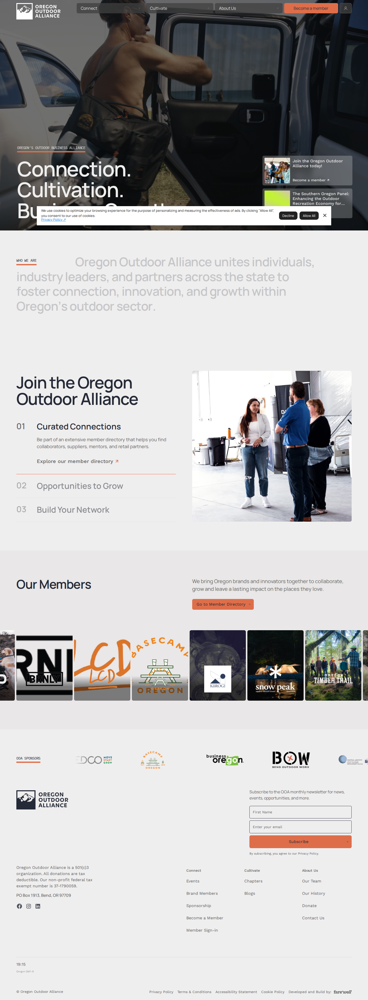
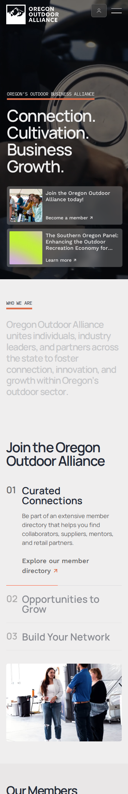

# UI Design System & Master Generation Blueprint: www-oregonoutdooralliance-org

> **Oregon Outdoor Alliance · Growing Oregon’s Outdoor Industry** (https://www.oregonoutdooralliance.org/) — Connect with Oregon’s outdoor community. Explore events, resources, and partnerships that help outdoor brands and leaders grow and thrive.



---

## 1. Executive Visual Persona & Design Archetype

- **Brand Essence & Persona**: **Oregon Outdoor Alliance · Growing Oregon’s Outdoor Industry** (`https://www.oregonoutdooralliance.org/`). Connect with Oregon’s outdoor community. Explore events, resources, and partnerships that help outdoor brands and leaders grow and thrive.
- **Visual Archetype**: **High-Contrast Obsidian / Atmospheric Design System (`#ba4722` canvas, `#fff` ink, `#242a37` accent)**.
- **Anti-AI-Slop Differentiators**:
  - **Source-Grounded Chromatic Polarity**: Anchors the viewport in `#ba4722` (`var(--swatch--brand-dark)` in `:root`) paired with `#fff` primary typography and `#242a37` accents.
  - **Extracted Typographic Hierarchy**: Pairs `Worksans Variablefont Wght` for display copy (`Oregon’s Outdoor Business Alliance`) with `Manrope Variablefont Wght` and `Ibmplexmono`.
  - **Calibrated Spatial Grid & Motion**: Combines `940px` container bounds (`gap: 16px`, padding `9px`) with `cubic-bezier(.625,.05,0,1)` easing and Lenis Smooth Scroll (`data-lenis`), GSAP Timeline & ScrollTrigger.

---

## 2. Spatial Architecture & Modular Grid Mathematics



### Viewport Allocation & Container Geometry
- **Captured Viewport Dimensions**: Desktop `1440×3905px` (`assets/desktop.png`, full-page scroll capture), Mobile `390×2400px` (`assets/mobile.png`, capped at 2400px multi-section capture).
- **Master Container Bounds**: `940px` extracted from `www-oregonoutdooralliance-org` stylesheet.
- **Canvas Lateral Padding & Spacing**: `9px` lateral canvas padding with `16px` grid gap.
- **Border Radius Scale**: `3px`, `100%`, `50%`, `2px`.

### Responsive Breakpoint Architecture
- **Desktop Layout**: Multi-column CSS Grid / Flexbox layout at `1440px` (`max-width: 940px`, `gap: 16px`).
- **Mobile Layout**: Single-column vertical stack at `390px` viewport width with `9px` horizontal padding.
- **Extracted CSS Media Queries**: `@media screen and (max-width: 991px)`, `@media screen and (max-width: 767px)`, `@media screen and (max-width: 479px)`, `@media (min-width: 768px)`.

---

## 3. Color System, Materiality & Atmospheric Lighting

### Semantic Palette & Source Grounding
| Semantic Role | Ground-Truth Value | Extracted CSS Source / Selector |
|---|---|---|
| **Primary Canvas Substrate** | `#ba4722` | `var(--swatch--brand-dark)` in `:root` |
| **Primary Typography Ink** | `#efeeee` | `var(--swatch--light-200)` in `:root` |
| **Elevated Surface / Card Substrate** | `#fff` | `var(--swatch--white)` in `:root` |
| **Interactive Accent / Highlight** | `#242a37` | `var(--swatch--neutral-dark-100)` in `:root` |
| **Secondary / Muted Copy** | `#de6e4a` | `var(--swatch--brand-base)` in `:root` |
| **Structural Hairline Border** | `#101319` | `var(--swatch--dark-900)` in `:root` |

### Sanitized Root CSS Variables (`ui-ux.md` Ground Truth)
| Variable Name | Extracted Value | Semantic Role |
|---|---|---|
| `--_theme---background` | `var(--swatch--light-200)` | Canvas / Surface Token |
| `--_text-style---font-family` | `var(--_typography---font--primary-family)` | Typography Ink Token |
| `--_theme---text` | `var(--swatch--dark-400)` | Typography Ink Token |
| `--_text-style---font-size` | `var(--_typography---font-size--text-main)` | Typography Ink Token |
| `--_text-style---line-height` | `var(--_typography---line-height--1-5)` | Typography Ink Token |
| `--_text-style---font-weight` | `var(--_typography---font--primary-regular)` | Typography Ink Token |
| `--_text-style---letter-spacing` | `var(--_typography---letter-spacing--0em)` | Typography Ink Token |
| `--_theme---heading` | `var(--swatch--dark-800)` | Typography Ink Token |
| `--_text-style---margin-top` | `var(--_spacing---space--4)` | Typography Ink Token |
| `--_text-style---margin-bottom` | `var(--_spacing---space--4)` | Typography Ink Token |
| `--_spacing---space--6` | `var(--size--2-5rem)` | Layout / Spatial Grid Token |
| `--_spacing---space--7` | `var(--size--3rem)` | Layout / Spatial Grid Token |
| `--swatch--brand` | `var(--swatch--brand-base)` | Brand / Palette Token |
| `--radius--small` | `.375rem` | Elevation / Border Token |
| `--container--main` | `90rem` | Layout / Spatial Grid Token |
| `--container--small` | `66.25rem` | Layout / Spatial Grid Token |

---

## 4. Typographic Scale & Editorial Hierarchy

### Font Family Stacks
- **Display Typography**: `Worksans Variablefont Wght`.
- **Primary Body Stack**: `Manrope Variablefont Wght`.
- **Technical / Metadata Stack**: `Ibmplexmono`.

### Typographic Scale & Rules (Extracted from Stylesheet & Variables)
- **Hero Display (`H1`)**: CSS variables `--_typography---font-size--display: var(--size--7rem)`, `--_typography---font-size--h1: var(--size--5rem)`; rule `h1` (`font-size: 2em`).
- **Section Heading (`H2`)**: CSS variables `--_typography---font-size--h2: var(--size--4rem)`; rule `h2` (`font-size: 32px`, `line-height: 36px`).
- **Body Copy**: CSS variables `--ez-body-lock-z-index: 2147483600`; rule `body` (`font-size: 14px`, `line-height: 20px`).
- **Metadata & Navigation Labels**: CSS variables `--_text-style---letter-spacing: var(--_typography---letter-spacing--0em)`, `--radius--small: .375rem`, `--container--small: 66.25rem`; rule `small` (`font-size: 80%`).

---

## 5. Choreographed Motion & Interaction Physics

### Primary Easing Curves
- **Extracted Timing Functions**: `cubic-bezier(.625,.05,0,1)`, `cubic-bezier(0.17,0,0.2,1)`, `cubic-bezier(0.5,0,0.83,1)`.

### Per-Element Transition & Choreography Rules
- **Selector `.w-webflow-badge > img`**: `transition: unset` extracted from `www-oregonoutdooralliance-org` stylesheet.
- **Selector `.w-slider-dot`**: `transition: background-color .1s, color .1s` extracted from `www-oregonoutdooralliance-org` stylesheet.
- **Selector `.w-lightbox-control`**: `transition: all .3s` extracted from `www-oregonoutdooralliance-org` stylesheet.
- **Extracted Easing Curve (`cubic-bezier(.625,.05,0,1)`)**: Governs interactive state transitions across `<nav.nav_desktop_layout>` and `<section.page_wrap>`.
- **Runtime Interaction Engine**: Integrates Lenis Smooth Scroll (`data-lenis`), GSAP Timeline & ScrollTrigger, Three.js / WebGL Canvas Pipeline with `prefers-reduced-motion: reduce` fallback guards.

---

## 6. Component Wireframe & Structural DOM Map

### Visual Layout Schematic (Grounded in `dom.html` — `1440px` Desktop & `390px` Mobile Reflow)
```
┌────────────────────────────────────────────────────────────────────────┐
│ DESKTOP VIEWPORT (1440px) — Oregon Outdoor Alliance · Growing Oregon’s │
│ ====================================================================== │
│ [ <nav.nav_desktop_layout> | Connect · Events · Brand Members · Spo ]  │
│ ---------------------------------------------------------------------- │
│ | HERO STAGE: <section.page_hero>                                  |   │
│ | H1: Oregon’s Outdoor Business Alliance                           |   │
│ | Substrate: #ba4722    | Ink: #fff       | Accent: #242a37        |   │
│ ---------------------------------------------------------------------- │
│ | SHOWCASE GRID (<section.page_wrap>       ) max-w: 940px          |   │
│ | +------------------------------+  +------------------------------+ | │
│ | | Connection. Cultivation. Bus |  | Who We Are                   | | │
│ | +------------------------------+  +------------------------------+ | │
│ ---------------------------------------------------------------------- │
│ | MOBILE VIEWPORT REFLOW (390px) — Single-Column Stack (gap: 16px  ) | │
│ | [<nav.nav_desktop_l] -> [<section.page_hero] -> [<section.page_wrap] │
│ ---------------------------------------------------------------------- │
│ [ FOOTER (<footer.footer_wrap>  ) | https://www.oregonoutdooralliance. │
└────────────────────────────────────────────────────────────────────────┘
```

### Granular DOM Region Breakdown
1. **Brand Header & Navigation Bar (<nav.nav_desktop_layout> — `www-oregonoutdooralliance-org`)**:
   - Landmark `<nav class="nav_desktop_layout u-position-relative">` hosting `Oregon Outdoor Alliance · Growing Or` navigation (`Connect · Events · Brand Members · Sponsorship · Cultivate`), DOM attributes (`data-wf-domain="www.oregonoutdooralli..."`, `data-wf-page="68029c5c43248225ae283f85"`, `data-wf-site="68029c5c43248225ae283f91"`, `data-delay="0"`), and stylesheet rule `html { -webkit-text-size-adjust: 100%; -ms-text-size-adjust: 100%; font-family:... }`.
2. **Hero Stage & Focal Lead (<section.page_hero> — `Oregon’s Outdoor Business Alliance`)**:
   - Landmark `<section class="page_hero u-position-relative">` presenting display lead `Oregon’s Outdoor Business Alliance` and copy excerpt *"Skip to main content"* over `#ba4722` canvas and `#fff` ink.
3. **Primary Showcase & Content Grid (<section.page_wrap> — `Connection. Cultivation. Business `)**:
   - Landmark `<section class="page_wrap">` rendering section `Connection. Cultivation. Business Growth.` with copy *"Connect Connect Events Brand Members Sponsorship"*, asset references (`cdn.prod.website-files.com`, `261-ooa.webflow.shared.517ddcbf1.css`, `437a9f0a-aec5-11f0-9d68-0bd0c0028851`, `gtm.js`), and grid rule `body { margin: 0; }`.
4. **Interactive Detail & Feature Matrix (<section.page_code_wrap> — `Who We Are`)**:
   - Landmark `<section class="page_code_wrap">` framing `Who We Are` and `Join the Oregon Outdoor Alliance` (*"Cultivate Cultivate Chapters Blog Job Board"*) with `#fff` surface cards, `#242a37` accents, and `summary { display: block; }`.
5. **Colophon & Global Directory Footer (<footer.footer_wrap> — `https://www.oregonoutdooralliance.org/`)**:
   - Landmark `<footer class="footer_wrap u-overflow-hidden">` anchoring `Oregon Outdoor Alliance · Growin` footer links (`Connect · Events · Brand Members · Sponsorship · Cultivate`), copy *"About Us About Us Our Team Our History Contact Us"*, and `#101319` structural dividers.

---

## 7. Master Zero-Shot AI Generation Prompt

```markdown
# Master Zero-Shot Frontend Generation Prompt: www-oregonoutdooralliance-org (Oregon Outdoor Alliance · Growing Oregon’s Outdoor Industry)

You are a principal frontend architect and design systems engineer. Build a complete, production-ready web application replicating the exact design system, DOM landmarks, typographic hierarchy, color tokens, and motion physics of `www-oregonoutdooralliance-org` (**Oregon Outdoor Alliance · Growing Oregon’s Outdoor Industry** — `https://www.oregonoutdooralliance.org/`).

### 1. Visual Archetype & Anti-AI-Slop Mandates
- **Archetype**: High-Contrast Obsidian / Atmospheric Design System (`#ba4722` canvas, `#fff` ink, `#242a37` accent).
- **Identity & Domain Context**: Connect with Oregon’s outdoor community. Explore events, resources, and partnerships that help outdoor brands and leaders grow and thrive.
- **Primary Substrate**: `#ba4722` (`var(--swatch--brand-dark)` in `:root`), **Primary Ink**: `#fff`, **Accent / Highlight**: `#242a37`.
- **Site-Specific Differentiators**:
  - **Source-Grounded Chromatic Polarity**: Anchors the viewport in `#ba4722` (`var(--swatch--brand-dark)` in `:root`) paired with `#fff` primary typography and `#242a37` accents.
  - **Extracted Typographic Hierarchy**: Pairs `Worksans Variablefont Wght` for display copy (`Oregon’s Outdoor Business Alliance`) with `Manrope Variablefont Wght` and `Ibmplexmono`.
  - **Calibrated Spatial Grid & Motion**: Combines `940px` container bounds (`gap: 16px`, padding `9px`) with `cubic-bezier(.625,.05,0,1)` easing and Lenis Smooth Scroll (`data-lenis`), GSAP Timeline & ScrollTrigger.

### 2. Ground-Truth CSS Variables (`:root` Token Contract)
Declare and consume these exact custom properties extracted from `www-oregonoutdooralliance-org` in your global stylesheet:

:root {
  /* Oregon Outdoor Alliance · Growing Oregon’s Outdoor Industry (www-oregonoutdooralliance-org) — Ground-Truth Extracted CSS Variables */
  --_theme---background: var(--swatch--light-200); /* Canvas / Surface Token (www-oregonoutdooralliance-org) */
  --_text-style---font-family: var(--_typography---font--primary-family); /* Typography Ink Token (www-oregonoutdooralliance-org) */
  --_theme---text: var(--swatch--dark-400); /* Typography Ink Token (www-oregonoutdooralliance-org) */
  --_text-style---font-size: var(--_typography---font-size--text-main); /* Typography Ink Token (www-oregonoutdooralliance-org) */
  --_text-style---line-height: var(--_typography---line-height--1-5); /* Typography Ink Token (www-oregonoutdooralliance-org) */
  --_text-style---font-weight: var(--_typography---font--primary-regular); /* Typography Ink Token (www-oregonoutdooralliance-org) */
  --_text-style---letter-spacing: var(--_typography---letter-spacing--0em); /* Typography Ink Token (www-oregonoutdooralliance-org) */
  --_theme---heading: var(--swatch--dark-800); /* Typography Ink Token (www-oregonoutdooralliance-org) */
  --_text-style---margin-top: var(--_spacing---space--4); /* Typography Ink Token (www-oregonoutdooralliance-org) */
  --_text-style---margin-bottom: var(--_spacing---space--4); /* Typography Ink Token (www-oregonoutdooralliance-org) */
  --_spacing---space--6: var(--size--2-5rem); /* Layout / Spatial Grid Token (www-oregonoutdooralliance-org) */
  --_spacing---space--7: var(--size--3rem); /* Layout / Spatial Grid Token (www-oregonoutdooralliance-org) */
  --swatch--brand: var(--swatch--brand-base); /* Brand / Palette Token (www-oregonoutdooralliance-org) */
  --radius--small: .375rem; /* Elevation / Border Token (www-oregonoutdooralliance-org) */
  --container--main: 90rem; /* Layout / Spatial Grid Token (www-oregonoutdooralliance-org) */
  --container--small: 66.25rem; /* Layout / Spatial Grid Token (www-oregonoutdooralliance-org) */
}

### 3. Semantic Color & Materiality Contract
Map every surface, ink, and border strictly to these source-grounded tokens:
- **Primary Canvas Substrate**: `#ba4722` — grounded in `var(--swatch--brand-dark)` in `:root`
- **Primary Typography Ink**: `#efeeee` — grounded in `var(--swatch--light-200)` in `:root`
- **Elevated Surface / Card Substrate**: `#fff` — grounded in `var(--swatch--white)` in `:root`
- **Interactive Accent / Highlight**: `#242a37` — grounded in `var(--swatch--neutral-dark-100)` in `:root`
- **Secondary / Muted Copy**: `#de6e4a` — grounded in `var(--swatch--brand-base)` in `:root`
- **Structural Hairline Border**: `#101319` — grounded in `var(--swatch--dark-900)` in `:root`

### 4. Spatial Grid, Container Bounds & Responsive Breakpoints
- **Desktop Viewport Reference**: `1440×3905px` (full-page scroll capture, `1440px` standard desktop width).
- **Mobile Viewport Reference**: `390×2400px` (capped at 2400px multi-section capture, `390px` standard mobile width).
- **Container Max-Width**: `940px` extracted from `www-oregonoutdooralliance-org` stylesheet
- **Padding & Gutters**: `9px` lateral canvas padding with `16px` grid gap
- **Desktop Grid**: Multi-column CSS Grid / Flexbox layout at `1440px` (`max-width: 940px`, `gap: 16px`)
- **Mobile Adaptation**: Single-column vertical stack at `390px` viewport width with `9px` horizontal padding
- **Media Queries**: `@media screen and (max-width: 991px)`, `@media screen and (max-width: 767px)`, `@media screen and (max-width: 479px)`, `@media (min-width: 768px)`
- **Corner Radii**: `3px`, `100%`, `50%`, `2px`

### 5. Typography & Editorial Scale Contract
- **Display Font Stack**: `Worksans Variablefont Wght`
- **Body Font Stack**: `Manrope Variablefont Wght`
- **Monospace / Technical Font Stack**: `Ibmplexmono`
- **H1 Display Rule**: CSS variables `--_typography---font-size--display: var(--size--7rem)`, `--_typography---font-size--h1: var(--size--5rem)`; rule `h1` (`font-size: 2em`)
- **H2 Section Rule**: CSS variables `--_typography---font-size--h2: var(--size--4rem)`; rule `h2` (`font-size: 32px`, `line-height: 36px`)
- **Body Copy Rule**: CSS variables `--ez-body-lock-z-index: 2147483600`; rule `body` (`font-size: 14px`, `line-height: 20px`)
- **Metadata & Index Rule**: CSS variables `--_text-style---letter-spacing: var(--_typography---letter-spacing--0em)`, `--radius--small: .375rem`, `--container--small: 66.25rem`; rule `small` (`font-size: 80%`)

### 6. Component Hierarchy, Verbatim Copy & Real DOM Landmarks
Scaffold `www-oregonoutdooralliance-org` (`Oregon Outdoor Alliance · Growing Oregon’s Outdoor Industry`) with these exact structural regions, extracted copy, and CSS rules from `dom.html`:
1. **Brand Header & Navigation Bar (<nav.nav_desktop_layout> — `www-oregonoutdooralliance-org`)**:
   - DOM & Selectors: Landmark `<nav class="nav_desktop_layout u-position-relative">` hosting `Oregon Outdoor Alliance · Growing Or` navigation (`Connect · Events · Brand Members · Sponsorship · Cultivate`), DOM attributes (`data-wf-domain="www.oregonoutdooralli..."`, `data-wf-page="68029c5c43248225ae283f85"`, `data-wf-site="68029c5c43248225ae283f91"`, `data-delay="0"`), and stylesheet rule `html { -webkit-text-size-adjust: 100%; -ms-text-size-adjust: 100%; font-family:... }`.
   - Responsive Contract: Header `Brand Header & Navigation Bar (<nav.nav_desktop_layout> — `www-oregonoutdooralliance-org`)` (`www-oregonoutdooralliance-org`) adapts across `@media screen and (max-width: 991px)`, `@media screen and (max-width: 767px)`, `@media screen and (max-width: 479px)`, `@media (min-width: 768px)` with `cubic-bezier(.625,.05,0,1)`, `cubic-bezier(0.17,0,0.2,1)`, `cubic-bezier(0.5,0,0.83,1)` transitions and links `Connect · Events · Brand Members · Sponsorship · Cultivate`.
2. **Hero Stage & Focal Lead (<section.page_hero> — `Oregon’s Outdoor Business Alliance`)**:
   - DOM & Selectors: Landmark `<section class="page_hero u-position-relative">` presenting display lead `Oregon’s Outdoor Business Alliance` and copy excerpt *"Skip to main content"* over `#ba4722` canvas and `#fff` ink.
   - Responsive Contract: Hero stage (`1440×3905px` desktop / `390×2400px` mobile) sets `#ba4722` background with `#fff` headline `Oregon’s Outdoor Business Alliance`.
3. **Primary Showcase & Content Grid (<section.page_wrap> — `Connection. Cultivation. Business `)**:
   - DOM & Selectors: Landmark `<section class="page_wrap">` rendering section `Connection. Cultivation. Business Growth.` with copy *"Connect Connect Events Brand Members Sponsorship"*, asset references (`cdn.prod.website-files.com`, `261-ooa.webflow.shared.517ddcbf1.css`, `437a9f0a-aec5-11f0-9d68-0bd0c0028851`, `gtm.js`), and grid rule `body { margin: 0; }`.
   - Responsive Contract: Showcase grid `Primary Showcase & Content Grid (<section.page_wrap> — `Connection. Cultivation. Business `)` applies Multi-column CSS Grid / Flexbox layout at `1440px` (`max-width: 940px`, `gap: 16px`) on desktop and Single-column vertical stack at `390px` viewport width with `9px` horizontal padding on mobile.
4. **Interactive Detail & Feature Matrix (<section.page_code_wrap> — `Who We Are`)**:
   - DOM & Selectors: Landmark `<section class="page_code_wrap">` framing `Who We Are` and `Join the Oregon Outdoor Alliance` (*"Cultivate Cultivate Chapters Blog Job Board"*) with `#fff` surface cards, `#242a37` accents, and `summary { display: block; }`.
   - Responsive Contract: Detail module `Interactive Detail & Feature Matrix (<section.page_code_wrap> — `Who We Are`)` uses `3px`, `100%`, `50%`, `2px` radii, `#242a37` highlights, and assets (cdn.prod.website-files.com, 261-ooa.webflow.shared.517ddcbf1.css, 437a9f0a-aec5-11f0-9d68-0bd0c0028851).
5. **Colophon & Global Directory Footer (<footer.footer_wrap> — `https://www.oregonoutdooralliance.org/`)**:
   - DOM & Selectors: Landmark `<footer class="footer_wrap u-overflow-hidden">` anchoring `Oregon Outdoor Alliance · Growin` footer links (`Connect · Events · Brand Members · Sponsorship · Cultivate`), copy *"About Us About Us Our Team Our History Contact Us"*, and `#101319` structural dividers.
   - Responsive Contract: Footer `Colophon & Global Directory Footer (<footer.footer_wrap> — `https://www.oregonoutdooralliance.org/`)` aligns to `940px` extracted from `www-oregonoutdooralliance-org` stylesheet with `9px` lateral canvas padding with `16px` grid gap and attributes (data-wf-domain="www.oregonoutdooralli...", data-wf-page="68029c5c43248225ae283f85", data-wf-site="68029c5c43248225ae283f91").

#### Verbatim DOM Copy Excerpts (`dom.html`)
- Copy Excerpt 1: *"Skip to main content"*
- Copy Excerpt 2: *"Connect Connect Events Brand Members Sponsorship"*
- Copy Excerpt 3: *"Cultivate Cultivate Chapters Blog Job Board"*
- Copy Excerpt 4: *"About Us About Us Our Team Our History Contact Us"*

### 7. Motion, Extracted Stylesheet Rules & Interaction Choreography
- **Primary Easing Functions**: `cubic-bezier(.625,.05,0,1)`, `cubic-bezier(0.17,0,0.2,1)`, `cubic-bezier(0.5,0,0.83,1)`
- **Extracted Stylesheet Rules (`www-oregonoutdooralliance-org`)**:
- `html { -webkit-text-size-adjust: 100%; -ms-text-size-adjust: 100%; font-family:... }`
- `body { margin: 0; }`
- `summary { display: block; }`
- `video { vertical-align: baseline; display: inline-block; }`
- `template { display: none; }`
- **Per-Selector Transition Rules**:
- **Selector `.w-webflow-badge > img`**: `transition: unset` extracted from `www-oregonoutdooralliance-org` stylesheet.
- **Selector `.w-slider-dot`**: `transition: background-color .1s, color .1s` extracted from `www-oregonoutdooralliance-org` stylesheet.
- **Selector `.w-lightbox-control`**: `transition: all .3s` extracted from `www-oregonoutdooralliance-org` stylesheet.
- **Extracted Easing Curve (`cubic-bezier(.625,.05,0,1)`)**: Governs interactive state transitions across `<nav.nav_desktop_layout>` and `<section.page_wrap>`.
- **Runtime Interaction Engine**: Integrates Lenis Smooth Scroll (`data-lenis`), GSAP Timeline & ScrollTrigger, Three.js / WebGL Canvas Pipeline with `prefers-reduced-motion: reduce` fallback guards.

### 8. Technical Deliverables
- Implement in Next.js (App Router) with TypeScript and Tailwind CSS consuming the `:root` custom properties defined above for `www-oregonoutdooralliance-org`.
- Reproduce both the `1440px` desktop architecture and `390px` mobile breakpoint transitions, preserving semantic HTML5 landmarks (`<header>`, `<nav>`, `<main>`, `<section>`, `<footer>`) and `prefers-reduced-motion` accessibility guards.
```
