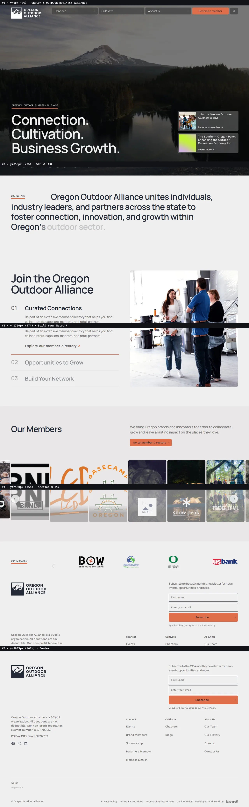
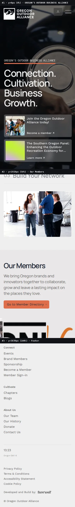

# UI Design System & Master Generation Blueprint: www-oregonoutdooralliance-org

> **Oregon Outdoor Alliance · Growing Oregon’s Outdoor Industry** (https://www.oregonoutdooralliance.org/) — Connect with Oregon’s outdoor community. Explore events, resources, and partnerships that help outdoor brands and leaders grow and thrive.





---

## 1. Executive Visual Persona & Design Archetype

- **Brand Essence & Persona**: **Oregon Outdoor Alliance · Growing Oregon’s Outdoor Industry** (`https://www.oregonoutdooralliance.org/`). Connect with Oregon’s outdoor community. Explore events, resources, and partnerships that help outdoor brands and leaders grow and thrive.
- **Capture Provenance**: Live browser capture (`tier1_fast`, HTTP `200`, captured `2026-11-24`).
- **Visual Archetype**: **Light-Substrate Editorial & Modular Grid System (`#efeeee` canvas, `#616161` ink, `#0082f3` accent)**.
- **Anti-AI-Slop Differentiators**:
  - **Live-Computed Chromatic Polarity**: Anchors the viewport in `#efeeee` (live computed `body` `background-color` (`computed_styles.json`)) paired with `#616161` primary typography and `#0082f3` accents.
  - **Grounded Typographic Hierarchy**: Pairs `Ibmplexmono` for display copy (`OREGON’S OUTDOOR BUSINESS ALLIANCE`) with `Manrope Variablefont Wght` and `Ibmplexmono`.
  - **Calibrated Spatial Grid & Motion**: Combines `120rem` container bounds (`gap: 16px`, padding `9px`) with `cubic-bezier(.625,.05,0,1)` easing and Lenis Smooth Scroll (`data-lenis`), GSAP Timeline & ScrollTrigger.

---

## 2. Spatial Architecture & Modular Grid Mathematics

### Viewport Allocation & Container Geometry
- **Captured Journey Filmstrips**: Desktop `1280×4140px` (`assets/desktop-journey.webp`, `5` keyframes up to `y=3005px` / doc `3905px`), Mobile `390×2616px` (`assets/mobile-journey.webp`, `3` keyframes).
- **Master Container Bounds**: `120rem` (non-`@media` desktop container stylesheet rule).
- **Canvas Lateral Padding & Spacing**: `9px` lateral canvas padding with `16px` grid gap.
- **Border Radius Scale**: `100%`, `3px`, `50%`, `2px`.

### Responsive Breakpoint Architecture
- **Desktop Layout**: Multi-column CSS Grid / Flexbox layout at `1440px` (`max-width: 120rem`, `gap: 16px`).
- **Mobile Layout**: Single-column vertical stack at `390px` viewport width with `9px` horizontal padding.
- **Extracted CSS Media Queries**: `@media screen and (max-width: 991px)`, `@media screen and (max-width: 767px)`, `@media screen and (max-width: 479px)`, `@media (min-width: 768px)`.

---

## 3. Color System, Materiality & Atmospheric Lighting

### Semantic Palette & Source Grounding
| Semantic Role | Ground-Truth Value | Extracted Live / CSS Source |
|---|---|---|
| **Primary Canvas Substrate** | `#efeeee` | live computed `body` `background-color` (`computed_styles.json`) |
| **Primary Typography Ink** | `#616161` | live computed `main` `color` (`computed_styles.json`) |
| **Elevated Surface / Card Substrate** | `#ffffff` | live computed `button` `background-color` (`computed_styles.json`) |
| **Interactive Accent / Highlight** | `#0082f3` | `.w-dropdown-link.w--current { color: #0082f3 }` |
| **Secondary / Muted Copy** | `#eeeeee` | live computed `h1` `color` (`computed_styles.json`) |
| **Structural Hairline Border** | `#ffffff` | `var(--ez-banner-border)` in `:root` |

### Sanitized Root CSS Variables (`ui-ux.md` Ground Truth)
| Variable Name | Extracted Value | Semantic Role |
|---|---|---|
| `--_theme---background` | `var(--swatch--light-200)` | Canvas / Surface Token |
| `--_text-style---font-family` | `var(--_typography---font--primary-family)` | Typography Ink Token |
| `--_theme---text` | `var(--swatch--dark-400)` | Typography Ink Token |
| `--_text-style---font-size` | `var(--_typography---font-size--text-main)` | Typography Ink Token |
| `--_text-style---line-height` | `var(--_typography---line-height--1-5)` | Typography Ink Token |
| `--_text-style---font-weight` | `var(--_typography---font--primary-regular)` | Typography Ink Token |
| `--_text-style---letter-spacing` | `var(--_typography---letter-spacing--0em)` | Typography Ink Token |
| `--_theme---heading` | `var(--swatch--dark-800)` | Typography Ink Token |
| `--_text-style---margin-top` | `var(--_spacing---space--4)` | Typography Ink Token |
| `--_text-style---margin-bottom` | `var(--_spacing---space--4)` | Typography Ink Token |
| `--_spacing---space--6` | `var(--size--2-5rem)` | Layout / Spatial Grid Token |
| `--_spacing---space--7` | `var(--size--3rem)` | Layout / Spatial Grid Token |
| `--swatch--brand` | `var(--swatch--brand-base)` | Brand / Palette Token |
| `--radius--small` | `.375rem` | Elevation / Border Token |
| `--container--main` | `90rem` | Layout / Spatial Grid Token |
| `--container--small` | `66.25rem` | Layout / Spatial Grid Token |

---

## 4. Typographic Scale & Editorial Hierarchy

### Font Family Stacks
- **Display Typography**: `Ibmplexmono`.
- **Primary Body Stack**: `Manrope Variablefont Wght`.
- **Technical / Metadata Stack**: `Ibmplexmono`.

### Typographic Scale & Rules (Live Computed & Stylesheet Grounded)
- **Hero Display (`H1`)**: live computed `h1` (`font-size: 14px`, `line-height: 18.2px`, `font-weight: 400`, `letter-spacing: -0.144px`); CSS variables `--_typography---font-size--display: var(--size--7rem)`, `--_typography---font-size--h1: var(--size--5rem)`; rule `h1` (`font-size: 2em`).
- **Section Heading (`H2`)**: live computed `h2` (`font-size: 80px`, `line-height: 81.6px`, `font-weight: 600`, `letter-spacing: -2.4px`); CSS variables `--_typography---font-size--h2: var(--size--4rem)`; rule `h2` (`font-size: 32px`, `line-height: 36px`).
- **Body Copy**: live computed `body` (`font-size: 20px`, `line-height: 30px`, `font-weight: 400`); CSS variables `--ez-body-lock-z-index: 2147483600`; rule `body` (`font-size: 14px`, `line-height: 20px`).
- **Metadata & Navigation Labels**: live computed `nav/a` (`font-size: 16px`, `line-height: 24px`, `font-weight: 400`); CSS variables `--_text-style---letter-spacing: var(--_typography---letter-spacing--0em)`, `--radius--small: .375rem`, `--container--small: 66.25rem`; rule `small` (`font-size: 80%`).

---

## 5. Choreographed Motion & Interaction Physics

### Primary Easing Curves
- **Extracted Timing Functions**: `cubic-bezier(.625,.05,0,1)`, `cubic-bezier(0.17,0,0.2,1)`, `cubic-bezier(0.5,0,0.83,1)`.

### Per-Element Transition & Choreography Rules
- **Selector `.w-webflow-badge > img`**: `transition: unset` extracted from `www-oregonoutdooralliance-org` stylesheet.
- **Selector `.w-slider-dot`**: `transition: background-color .1s, color .1s` extracted from `www-oregonoutdooralliance-org` stylesheet.
- **Selector `.w-lightbox-control`**: `transition: all .3s` extracted from `www-oregonoutdooralliance-org` stylesheet.
- **Extracted Easing Curve (`cubic-bezier(.625,.05,0,1)`)**: Governs interactive state transitions across `<nav.nav_desktop_layout>` and `<section.page_wrap>`.
- **Runtime Interaction Engine**: Integrates Lenis Smooth Scroll (`data-lenis`), GSAP Timeline & ScrollTrigger, Three.js / WebGL Canvas Pipeline with `prefers-reduced-motion: reduce` fallback guards.
### Measured Runtime Scroll & Interaction Telemetry (`behavioral_journey_v2`)
- **Scroll Driver Mode**: `native` (max document height `3905px`, deepest scrollY reached `3005px` across `5` desktop keyframes).
- **Detected Scroll / Motion Libraries**: `Lenis`, `GSAP/ScrollTrigger`.
- **Hover Physics (`first_card` · `Join the Oregon Outdoor Alliance...`)**: Computed transition `0.2s` / `ease` (no static color/transform shift captured at rest).
- **Interactive Control Probe (`carousel_next` · `Previous slide`)**: Triggered visual diff `24.108` (attr ` -> `, captured in `assets/state-interactive.webp`).
- **Route Transition Architecture**: First internal navigation (`/membership/member-sign-in`) measured as `MPA` in `1994ms`.

---

## 6. Component Wireframe & Structural DOM Map

### Visual Layout Schematic — Desktop (`1440px`, Grounded in `dom.html` & Landmark Bounding Boxes)
```
┌────────────────────────────────────────────────────────────────────────┐
│ DESKTOP VIEWPORT (1440px) — Oregon Outdoor Alliance · Growing Oregon’s │
│ ====================================================================== │
│ [ <nav.nav_desktop_layou (1076x64px)  | Connect · Events · Brand Mem ] │
│ ---------------------------------------------------------------------- │
│ | HERO STAGE: <section.page_hero> (w=1440px)                         | │
│ | H1: OREGON’S OUTDOOR BUSINESS ALLIANCE                             | │
│ | Substrate: #efeeee | Ink: #616161 | Accent: #0082f3                | │
│ ---------------------------------------------------------------------- │
│ | SHOWCASE GRID (<section.page_wrap>) max-w: 120rem                  | │
│ | +------------------------------+  +------------------------------+ | │
│ | | Oregon’s Outdoor Business Al |  | Connection. Cultivation. Bus | | │
│ | +------------------------------+  +------------------------------+ | │
│ ---------------------------------------------------------------------- │
│ | DETAIL MODULE (<section.page_code_wrap>) — Join the Oregon Outdo   | │
│ ---------------------------------------------------------------------- │
│ [ FOOTER (<footer.footer_wrap>) | https://www.oregonoutdooralliance.o  │
└────────────────────────────────────────────────────────────────────────┘
```

### Visual Layout Schematic — Mobile Reflow (`390px`)
```
┌────────────────────────────────────────────────────────────────────────┐
│ MOBILE VIEWPORT REFLOW (390px) — Single-Column Stack (gap: 16px)       │
│ ====================================================================== │
│ [ HEADER BAR (<nav.nav_desktop_layout>) | Compact Menu (390px)         │
│ ---------------------------------------------------------------------- │
│ | HERO STAGE (<section.page_hero>) — 390px Vertical Lead             | │
│ | H1: OREGON’S OUTDOOR BUSINESS ALLIANCE                             | │
│ ---------------------------------------------------------------------- │
│ | SHOWCASE STACK (<section.page_wrap>) — 1-Col Stack                 | │
│ | [ Item 1: Oregon’s Outdoor Business Alliance                     ] | │
│ | [ Item 2: Connection. Cultivation. Business Growth.              ] | │
│ ---------------------------------------------------------------------- │
│ | DETAIL STACK (<section.page_code_wrap>) — 1-Col (Join the Oregon Ou) │
│ ---------------------------------------------------------------------- │
│ [ FOOTER (<footer.footer_wrap>) | Stacked 390px Colophon               │
└────────────────────────────────────────────────────────────────────────┘
```

### Granular DOM Region Breakdown
1. **Brand Header & Navigation Bar (<nav.nav_desktop_layout> — `www-oregonoutdooralliance-org`)**:
   - Landmark `<nav class="nav_desktop_layout u-position-relative">` (`1076x64px`) hosting `Oregon Outdoor Alliance · Growing Or` navigation (`Connect · Events · Brand Members · Sponsorship · Cultivate`), DOM attributes (`data-wf-domain="www.oregonoutdooralli..."`, `data-wf-page="68029c5c43248225ae283f85"`, `data-wf-site="68029c5c43248225ae283f91"`, `data-delay="0"`), and stylesheet rule `html { -webkit-text-size-adjust: 100%; -ms-text-size-adjust: 100%; font-family:... }`.
2. **Hero Stage & Focal Lead (<section.page_hero> — `OREGON’S OUTDOOR BUSINESS ALLIANCE`)**:
   - Landmark `<section class="page_hero u-position-relative">` presenting display lead `OREGON’S OUTDOOR BUSINESS ALLIANCE` and copy excerpt *"Join the Oregon Outdoor Alliance today!"* over `#efeeee` canvas and `#616161` ink.
3. **Primary Showcase & Content Grid (<section.page_wrap> — `Oregon’s Outdoor Business Alliance`)**:
   - Landmark `<section class="page_wrap">` rendering section `Oregon’s Outdoor Business Alliance` with copy *"The Southern Oregon Panel: Enhancing the Outdoor Recreation Econo"*, asset references (`cdn.prod.website-files.com`, `261-ooa.webflow.shared.d47e507e6.css`, `437a9f0a-aec5-11f0-9d68-0bd0c0028851`, `gtm.js`), and grid rule `body { margin: 0; }`.
4. **Interactive Detail & Feature Matrix (<section.page_code_wrap> — `Connection. Cultivation. Business `)**:
   - Landmark `<section class="page_code_wrap">` framing `Connection. Cultivation. Business Growth.` and `Join the Oregon Outdoor Alliance` (*"O r e g o n O u t d o o r A l l i a n c e u n i t e s i n d i v i"*) with `#ffffff` surface cards, `#0082f3` accents, and `summary { display: block; }`.
5. **Colophon & Global Directory Footer (<footer.footer_wrap> — `https://www.oregonoutdooralliance.org/`)**:
   - Landmark `<footer class="footer_wrap u-overflow-hidden">` anchoring `Oregon Outdoor Alliance · Growin` footer links (`Connect · Events · Brand Members · Sponsorship · Cultivate`), copy *"Be part of an extensive member directory that helps you find"*, and `#ffffff` structural dividers.
### Full Vertical Scroll Sequence (Desktop `1440×900` Keyframes)
- **Step 01** (`y=0px`, `0%`): Active landmark `OREGON’S OUTDOOR BUSINESS ALLIANCE` · sticky/fixed elements: `0`
- **Step 02** (`y=850px`, `28%`): Active landmark `WHO WE ARE` · sticky/fixed elements: `0`
- **Step 03** (`y=1700px`, `57%`): Active landmark `Build Your Network` · sticky/fixed elements: `0`
- **Step 04** (`y=2550px`, `85%`): Active landmark `Section @ 85%` · sticky/fixed elements: `0`
- **Step 05** (`y=3005px`, `100%`): Active landmark `Footer` · sticky/fixed elements: `0`

### Multi-Page Internal Route Map
- **Detail Route (`/membership/member-sign-in`)**: `https://www.oregonoutdooralliance.org/membership/member-sign-in` — H1: `SIGN IN`, scrollHeight `2762px`, transition `MPA` (`1994ms`)
- **About Route (`/about`)**: `https://www.oregonoutdooralliance.org/about` — H1: `ABOUT OOA`, scrollHeight `4559px`, transition `direct` (`1238ms`)
- **Detail Route (`/connect/events`)**: `https://www.oregonoutdooralliance.org/connect/events` — H1: `OOA EVENTS`, scrollHeight `4283px`, transition `direct` (`1022ms`)

---

## 7. Master Zero-Shot AI Generation Prompt

```markdown
# Master Zero-Shot Frontend Generation Prompt: www-oregonoutdooralliance-org (Oregon Outdoor Alliance · Growing Oregon’s Outdoor Industry)

You are a principal frontend architect and design systems engineer. Build a complete, production-ready web application replicating the exact design system, DOM landmarks, typographic hierarchy, color tokens, and motion physics of `www-oregonoutdooralliance-org` (**Oregon Outdoor Alliance · Growing Oregon’s Outdoor Industry** — `https://www.oregonoutdooralliance.org/`).

### 1. Visual Archetype & Anti-AI-Slop Mandates
- **Archetype**: Light-Substrate Editorial & Modular Grid System (`#efeeee` canvas, `#616161` ink, `#0082f3` accent).
- **Identity & Domain Context**: Connect with Oregon’s outdoor community. Explore events, resources, and partnerships that help outdoor brands and leaders grow and thrive.
- **Primary Substrate**: `#efeeee` (live computed `body` `background-color` (`computed_styles.json`)), **Primary Ink**: `#616161`, **Accent / Highlight**: `#0082f3`.
- **Site-Specific Differentiators**:
  - **Live-Computed Chromatic Polarity**: Anchors the viewport in `#efeeee` (live computed `body` `background-color` (`computed_styles.json`)) paired with `#616161` primary typography and `#0082f3` accents.
  - **Grounded Typographic Hierarchy**: Pairs `Ibmplexmono` for display copy (`OREGON’S OUTDOOR BUSINESS ALLIANCE`) with `Manrope Variablefont Wght` and `Ibmplexmono`.
  - **Calibrated Spatial Grid & Motion**: Combines `120rem` container bounds (`gap: 16px`, padding `9px`) with `cubic-bezier(.625,.05,0,1)` easing and Lenis Smooth Scroll (`data-lenis`), GSAP Timeline & ScrollTrigger.

### 2. Ground-Truth CSS Variables (`:root` Token Contract)
Declare and consume these exact custom properties extracted from `www-oregonoutdooralliance-org` in your global stylesheet:

:root {
  /* Oregon Outdoor Alliance · Growing Oregon’s Outdoor Industry (www-oregonoutdooralliance-org) — Live-Grounded CSS Variables */
  --_theme---background: var(--swatch--light-200); /* Canvas / Surface Token (www-oregonoutdooralliance-org) */
  --_text-style---font-family: var(--_typography---font--primary-family); /* Typography Ink Token (www-oregonoutdooralliance-org) */
  --_theme---text: var(--swatch--dark-400); /* Typography Ink Token (www-oregonoutdooralliance-org) */
  --_text-style---font-size: var(--_typography---font-size--text-main); /* Typography Ink Token (www-oregonoutdooralliance-org) */
  --_text-style---line-height: var(--_typography---line-height--1-5); /* Typography Ink Token (www-oregonoutdooralliance-org) */
  --_text-style---font-weight: var(--_typography---font--primary-regular); /* Typography Ink Token (www-oregonoutdooralliance-org) */
  --_text-style---letter-spacing: var(--_typography---letter-spacing--0em); /* Typography Ink Token (www-oregonoutdooralliance-org) */
  --_theme---heading: var(--swatch--dark-800); /* Typography Ink Token (www-oregonoutdooralliance-org) */
  --_text-style---margin-top: var(--_spacing---space--4); /* Typography Ink Token (www-oregonoutdooralliance-org) */
  --_text-style---margin-bottom: var(--_spacing---space--4); /* Typography Ink Token (www-oregonoutdooralliance-org) */
  --_spacing---space--6: var(--size--2-5rem); /* Layout / Spatial Grid Token (www-oregonoutdooralliance-org) */
  --_spacing---space--7: var(--size--3rem); /* Layout / Spatial Grid Token (www-oregonoutdooralliance-org) */
  --swatch--brand: var(--swatch--brand-base); /* Brand / Palette Token (www-oregonoutdooralliance-org) */
  --radius--small: .375rem; /* Elevation / Border Token (www-oregonoutdooralliance-org) */
  --container--main: 90rem; /* Layout / Spatial Grid Token (www-oregonoutdooralliance-org) */
  --container--small: 66.25rem; /* Layout / Spatial Grid Token (www-oregonoutdooralliance-org) */
}

### 3. Semantic Color & Materiality Contract
Map every surface, ink, and border strictly to these source-grounded tokens:
- **Primary Canvas Substrate**: `#efeeee` — grounded in live computed `body` `background-color` (`computed_styles.json`)
- **Primary Typography Ink**: `#616161` — grounded in live computed `main` `color` (`computed_styles.json`)
- **Elevated Surface / Card Substrate**: `#ffffff` — grounded in live computed `button` `background-color` (`computed_styles.json`)
- **Interactive Accent / Highlight**: `#0082f3` — grounded in `.w-dropdown-link.w--current { color: #0082f3 }`
- **Secondary / Muted Copy**: `#eeeeee` — grounded in live computed `h1` `color` (`computed_styles.json`)
- **Structural Hairline Border**: `#ffffff` — grounded in `var(--ez-banner-border)` in `:root`

### 4. Spatial Grid, Container Bounds & Responsive Breakpoints
- **Desktop Viewport Reference**: `1280×4140px` (multi-frame vertical journey filmstrip (4140px), `1440px` standard desktop width).
- **Mobile Viewport Reference**: `390×2616px` (multi-frame vertical journey filmstrip (2616px), `390px` standard mobile width).
- **Container Max-Width**: `120rem` (non-`@media` desktop container stylesheet rule)
- **Padding & Gutters**: `9px` lateral canvas padding with `16px` grid gap
- **Desktop Grid**: Multi-column CSS Grid / Flexbox layout at `1440px` (`max-width: 120rem`, `gap: 16px`)
- **Mobile Adaptation**: Single-column vertical stack at `390px` viewport width with `9px` horizontal padding
- **Media Queries**: `@media screen and (max-width: 991px)`, `@media screen and (max-width: 767px)`, `@media screen and (max-width: 479px)`, `@media (min-width: 768px)`
- **Corner Radii**: `100%`, `3px`, `50%`, `2px`

### 5. Typography & Editorial Scale Contract
- **Display Font Stack**: `Ibmplexmono`
- **Body Font Stack**: `Manrope Variablefont Wght`
- **Monospace / Technical Font Stack**: `Ibmplexmono`
- **H1 Display Rule**: live computed `h1` (`font-size: 14px`, `line-height: 18.2px`, `font-weight: 400`, `letter-spacing: -0.144px`); CSS variables `--_typography---font-size--display: var(--size--7rem)`, `--_typography---font-size--h1: var(--size--5rem)`; rule `h1` (`font-size: 2em`)
- **H2 Section Rule**: live computed `h2` (`font-size: 80px`, `line-height: 81.6px`, `font-weight: 600`, `letter-spacing: -2.4px`); CSS variables `--_typography---font-size--h2: var(--size--4rem)`; rule `h2` (`font-size: 32px`, `line-height: 36px`)
- **Body Copy Rule**: live computed `body` (`font-size: 20px`, `line-height: 30px`, `font-weight: 400`); CSS variables `--ez-body-lock-z-index: 2147483600`; rule `body` (`font-size: 14px`, `line-height: 20px`)
- **Metadata & Index Rule**: live computed `nav/a` (`font-size: 16px`, `line-height: 24px`, `font-weight: 400`); CSS variables `--_text-style---letter-spacing: var(--_typography---letter-spacing--0em)`, `--radius--small: .375rem`, `--container--small: 66.25rem`; rule `small` (`font-size: 80%`)

### 6. Component Hierarchy, Verbatim Copy & Real DOM Landmarks
Scaffold `www-oregonoutdooralliance-org` (`Oregon Outdoor Alliance · Growing Oregon’s Outdoor Industry`) with these exact structural regions, extracted copy, and CSS rules from `dom.html`:
1. **Brand Header & Navigation Bar (<nav.nav_desktop_layout> — `www-oregonoutdooralliance-org`)**:
   - DOM & Selectors: Landmark `<nav class="nav_desktop_layout u-position-relative">` (`1076x64px`) hosting `Oregon Outdoor Alliance · Growing Or` navigation (`Connect · Events · Brand Members · Sponsorship · Cultivate`), DOM attributes (`data-wf-domain="www.oregonoutdooralli..."`, `data-wf-page="68029c5c43248225ae283f85"`, `data-wf-site="68029c5c43248225ae283f91"`, `data-delay="0"`), and stylesheet rule `html { -webkit-text-size-adjust: 100%; -ms-text-size-adjust: 100%; font-family:... }`.
   - Responsive Contract: Header `Brand Header & Navigation Bar (<nav.nav_desktop_layout> — `www-oregonoutdooralliance-org`)` (`www-oregonoutdooralliance-org`) adapts across `@media screen and (max-width: 991px)`, `@media screen and (max-width: 767px)`, `@media screen and (max-width: 479px)`, `@media (min-width: 768px)` with `cubic-bezier(.625,.05,0,1)`, `cubic-bezier(0.17,0,0.2,1)`, `cubic-bezier(0.5,0,0.83,1)` transitions and links `Connect · Events · Brand Members · Sponsorship · Cultivate`.
2. **Hero Stage & Focal Lead (<section.page_hero> — `OREGON’S OUTDOOR BUSINESS ALLIANCE`)**:
   - DOM & Selectors: Landmark `<section class="page_hero u-position-relative">` presenting display lead `OREGON’S OUTDOOR BUSINESS ALLIANCE` and copy excerpt *"Join the Oregon Outdoor Alliance today!"* over `#efeeee` canvas and `#616161` ink.
   - Responsive Contract: Hero stage (`1280×4140px` desktop / `390×2616px` mobile) sets `#efeeee` background with `#616161` headline `OREGON’S OUTDOOR BUSINESS ALLIANCE`.
3. **Primary Showcase & Content Grid (<section.page_wrap> — `Oregon’s Outdoor Business Alliance`)**:
   - DOM & Selectors: Landmark `<section class="page_wrap">` rendering section `Oregon’s Outdoor Business Alliance` with copy *"The Southern Oregon Panel: Enhancing the Outdoor Recreation Econo"*, asset references (`cdn.prod.website-files.com`, `261-ooa.webflow.shared.d47e507e6.css`, `437a9f0a-aec5-11f0-9d68-0bd0c0028851`, `gtm.js`), and grid rule `body { margin: 0; }`.
   - Responsive Contract: Showcase grid `Primary Showcase & Content Grid (<section.page_wrap> — `Oregon’s Outdoor Business Alliance`)` applies Multi-column CSS Grid / Flexbox layout at `1440px` (`max-width: 120rem`, `gap: 16px`) on desktop and Single-column vertical stack at `390px` viewport width with `9px` horizontal padding on mobile.
4. **Interactive Detail & Feature Matrix (<section.page_code_wrap> — `Connection. Cultivation. Business `)**:
   - DOM & Selectors: Landmark `<section class="page_code_wrap">` framing `Connection. Cultivation. Business Growth.` and `Join the Oregon Outdoor Alliance` (*"O r e g o n O u t d o o r A l l i a n c e u n i t e s i n d i v i"*) with `#ffffff` surface cards, `#0082f3` accents, and `summary { display: block; }`.
   - Responsive Contract: Detail module `Interactive Detail & Feature Matrix (<section.page_code_wrap> — `Connection. Cultivation. Business `)` uses `100%`, `3px`, `50%`, `2px` radii, `#0082f3` highlights, and assets (cdn.prod.website-files.com, 261-ooa.webflow.shared.d47e507e6.css, 437a9f0a-aec5-11f0-9d68-0bd0c0028851).
5. **Colophon & Global Directory Footer (<footer.footer_wrap> — `https://www.oregonoutdooralliance.org/`)**:
   - DOM & Selectors: Landmark `<footer class="footer_wrap u-overflow-hidden">` anchoring `Oregon Outdoor Alliance · Growin` footer links (`Connect · Events · Brand Members · Sponsorship · Cultivate`), copy *"Be part of an extensive member directory that helps you find"*, and `#ffffff` structural dividers.
   - Responsive Contract: Footer `Colophon & Global Directory Footer (<footer.footer_wrap> — `https://www.oregonoutdooralliance.org/`)` aligns to `120rem` (non-`@media` desktop container stylesheet rule) with `9px` lateral canvas padding with `16px` grid gap and attributes (data-wf-domain="www.oregonoutdooralli...", data-wf-page="68029c5c43248225ae283f85", data-wf-site="68029c5c43248225ae283f91").

#### Verbatim DOM Copy Excerpts (`dom.html`)
- Copy Excerpt 1: *"Join the Oregon Outdoor Alliance today!"*
- Copy Excerpt 2: *"The Southern Oregon Panel: Enhancing the Outdoor Recreation Economy for Southern O..."*
- Copy Excerpt 3: *"O r e g o n O u t d o o r A l l i a n c e u n i t e s i n d i v i d u a l s , i n..."*
- Copy Excerpt 4: *"Be part of an extensive member directory that helps you find collaborators, suppli..."*

### 7. Motion, Extracted Stylesheet Rules & Interaction Choreography
- **Primary Easing Functions**: `cubic-bezier(.625,.05,0,1)`, `cubic-bezier(0.17,0,0.2,1)`, `cubic-bezier(0.5,0,0.83,1)`
- **Extracted Stylesheet Rules (`www-oregonoutdooralliance-org`)**:
- `html { -webkit-text-size-adjust: 100%; -ms-text-size-adjust: 100%; font-family:... }`
- `body { margin: 0; }`
- `summary { display: block; }`
- `video { vertical-align: baseline; display: inline-block; }`
- `template { display: none; }`
- **Per-Selector Transition Rules**:
- **Selector `.w-webflow-badge > img`**: `transition: unset` extracted from `www-oregonoutdooralliance-org` stylesheet.
- **Selector `.w-slider-dot`**: `transition: background-color .1s, color .1s` extracted from `www-oregonoutdooralliance-org` stylesheet.
- **Selector `.w-lightbox-control`**: `transition: all .3s` extracted from `www-oregonoutdooralliance-org` stylesheet.
- **Extracted Easing Curve (`cubic-bezier(.625,.05,0,1)`)**: Governs interactive state transitions across `<nav.nav_desktop_layout>` and `<section.page_wrap>`.
- **Runtime Interaction Engine**: Integrates Lenis Smooth Scroll (`data-lenis`), GSAP Timeline & ScrollTrigger, Three.js / WebGL Canvas Pipeline with `prefers-reduced-motion: reduce` fallback guards.
### 7b. Full-Page Scroll Choreography, Interactive States & Multi-Page Routes
- **Scroll Mechanics**: Implement `native` vertical progression up to `3905px` across 5 distinct viewport chapters using Lenis, GSAP/ScrollTrigger.
- **Vertical Chapter Sequence**: OREGON’S OUTDOOR BUSINESS A... (0%) -> WHO WE ARE (28%) -> Build Your Network (57%) -> Section @ 85% (85%) -> Footer (100%).
- **Multi-Page Routes**: Scaffold internal routes `/membership/member-sign-in` (detail, MPA), `/about` (about, direct), `/connect/events` (detail, direct) sharing the global header/footer shell and design tokens.

### 8. Technical Deliverables
- Implement in Next.js (App Router) with TypeScript and Tailwind CSS consuming the `:root` custom properties defined above for `www-oregonoutdooralliance-org`.
- Reproduce both the `1440px` desktop architecture and `390px` mobile breakpoint transitions, preserving semantic HTML5 landmarks (`<header>`, `<nav>`, `<main>`, `<section>`, `<footer>`) and `prefers-reduced-motion` accessibility guards.
```
---

## 8. Full-Page Scroll Journey, Interactive States & Subpage Inventory

### Desktop Scroll Keyframes (`1440×900` WebP)
| Step | Scroll Y | Progress | Active Landmark / Section | Sticky/Fixed | Visual Asset |
| :---: | :---: | :---: | :--- | :---: | :--- |
| `#01` | `0px` | `0%` | OREGON’S OUTDOOR BUSINESS ALLIANCE | `0` | [desktop-step-01.webp](assets/desktop-step-01.webp) |
| `#02` | `850px` | `28%` | WHO WE ARE | `0` | [desktop-step-02.webp](assets/desktop-step-02.webp) |
| `#03` | `1700px` | `57%` | Build Your Network | `0` | [desktop-step-03.webp](assets/desktop-step-03.webp) |
| `#04` | `2550px` | `85%` | Section @ 85% | `0` | [desktop-step-04.webp](assets/desktop-step-04.webp) |
| `#05` | `3005px` | `100%` | Footer | `0` | [desktop-step-05.webp](assets/desktop-step-05.webp) |

### Mobile Condensed Keyframes (`390×844` WebP)
| Step | Scroll Y | Progress | Active Landmark | Visual Asset |
| :---: | :---: | :---: | :--- | :--- |
| `#01` | `0px` | `0%` | OREGON’S OUTDOOR BUSINESS ALLIANCE | [mobile-step-01.webp](assets/mobile-step-01.webp) |
| `#02` | `1919px` | `50%` | Our Members | [mobile-step-02.webp](assets/mobile-step-02.webp) |
| `#03` | `3839px` | `100%` | Footer | [mobile-step-03.webp](assets/mobile-step-03.webp) |

### Interactive UI State Captures (`1440×900` WebP)
| State Type | Trigger / Observation | Visual Asset |
| :--- | :--- | :--- |
| `interactive_control` | Control `carousel_next` (`Previous slide`, diff `24.108`) | [state-interactive.webp](assets/state-interactive.webp) |

### Internal Subpage Filmstrips (`1080px` Wide WebP)
| # | Template | Route URL | H1 / Title | Scroll Height | Transition | Filmstrip Asset |
| :-: | :---: | :--- | :--- | :---: | :---: | :--- |
| `1` | `detail` | `https://www.oregonoutdooralliance.org/membership/member-sign-in` | SIGN IN | `2762px` | `MPA` (`1994ms`) | [subpage-01-membership-member-sign-in.webp](assets/subpage-01-membership-member-sign-in.webp) |
| `2` | `about` | `https://www.oregonoutdooralliance.org/about` | ABOUT OOA | `4559px` | `direct` (`1238ms`) | [subpage-02-about.webp](assets/subpage-02-about.webp) |
| `3` | `detail` | `https://www.oregonoutdooralliance.org/connect/events` | OOA EVENTS | `4283px` | `direct` (`1022ms`) | [subpage-03-connect-events.webp](assets/subpage-03-connect-events.webp) |

